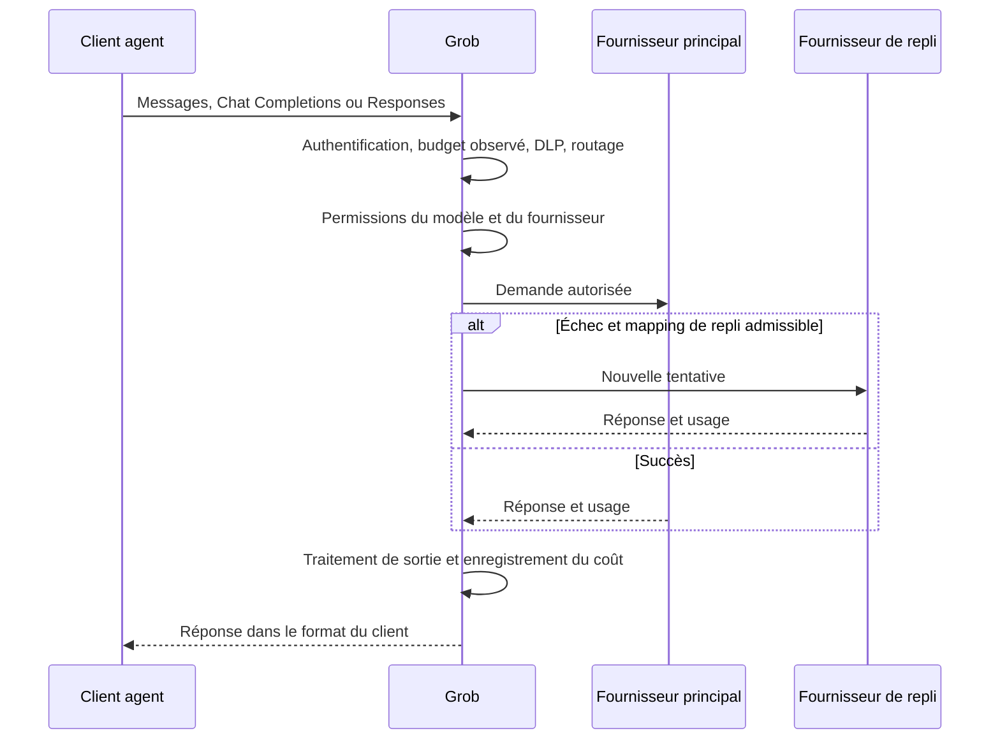

# Grob: прокси LLM Rust, фильтрация данных и бюджетов

Оценка от 9 октября 2026 г. **Оценка соответствия для руководства: 3/5**, поддержание после вызова агента-технического писателя. Решение: сохранить эталонную технику и протокол пилотирования. Соблюдаются пробелы в рекомендации этой версии, связанные с защитой производства для разумных людей.

## Ce que Grob apporte

[Grob](https://github.com/azerozero/grob) перехватывает обращения между клиентами и их моделями. Я открою сообщения, завершения чата и ответы, а также внутренний формат сообщений. Он объединит правила маршрутизации, ответы между специалистами, фильтрацию DLP, добродетели, советы, политику одобрения и журналы аудита. Бинарный файл Rust и запасы файлов являются отдельными серверами базы данных.

Обзор [l'arbre от 5 октября](https://github.com/azerozero/grob/tree/1b9e00c36cc31ff627a07beec5b67545a81b4758), `Cargo.toml` не объявляет 0.36.120. Последняя публикация [](https://github.com/azerozero/grob/releases/tag/v0.36.120) стала номером мема с публикацией от 27 сентября. Тесты касаются клонированного кода, связанного с бинарным кодом этого дистрибутива. L'API GitHub проконсультируйтесь с 9 октября в 21 классе, вилка и три проблемы открыты. Ces compteurs decrivent la publique, pas la fiabilité.

Соберите эти элементы управления в локальном проверяемом демоне. Он проверяет семантику, ограничивает документацию и защищает идентичность, оправданную для учащегося. На поверхности остается обширное взаимопонимание, связанное с прежними встречами.

## Функции в коде

[dispatch](https://github.com/azerozero/grob/blob/1b9e00c36cc31ff627a07beec5b67545a81b4758/src/server/dispatch/mod.rs) выполняет предварительный контроль DLP, вычисляет кэш, классирует запрос, выполняет автоматические сопоставления и может использовать кэш, последовательные реплики или разветвления. [преконтроль](https://github.com/azerozero/grob/blob/1b9e00c36cc31ff627a07beec5b67545a81b4758/src/server/dispatch/preflight.rs#L16-L22) деактивирует грубое копирование. Ответы на действия DLP изменяют запрос, чтобы удалить исходные октеты после фильтрации.



Эта схема описывает последовательность операций. Исключения из числа разветвлений фигурируют в F3.

[routeur](https://github.com/azerozero/grob/blob/1b9e00c36cc31ff627a07beec5b67545a81b4758/src/routing/classify/mod.rs#L298-L452) применяет явный порядок: вне сети, имя фонда, автоматическое сопоставление, баланс су-агента, регулярное выражение подсказки, `thinking.type == "enabled"`, объявленные уровни, эвристика оценки. Le [score](https://github.com/azerozero/grob/blob/1b9e00c36cc31ff627a07beec5b67545a81b4758/src/routing/classify/classify.rs#L458-L480) дополнительные параметры контекста, наличие инструментов, плафон вылета, текстовые сообщения и система подсказок. Он не внесен в таблицу, в которой модель будет восстановлена, как мой учитель.

Claude Code, `ANTHROPIC_BASE_URL` являются документированным интерфейсом [Anthropic](https://code.claude.com/docs/en/model-config). [lanceur Grob](https://github.com/azerozero/grob/blob/1b9e00c36cc31ff627a07beec5b67545a81b4758/src/commands/exec.rs#L73-L85) распознает URL-адреса клиентов без настраиваемых параметров аутентификации. Ветка отражения не исследует `enabled`, а модели Claude, недавно использовавшие адаптационный смысл: не ассимилируют эту ветку при полном использовании режима планирования.

## Констаты, которые меняют решение

### Ф1. Секрет в возврате средств под маску

**Подтвердите выполнение цифрового запроса.** [санитайзер запроса](https://github.com/azerozero/grob/blob/1b9e00c36cc31ff627a07beec5b67545a81b4758/src/features/dlp/mod.rs#L329-L387) в системе подсказок паркинга, текстовых сообщениях и блоках `Text`. Текст не содержит маски в `ToolResult`, а не аргументы JSON из `ToolUse`. Обнаружение инъекции отличается особой проверкой возвратных средств без аппликации и маскировки секретов.

Пробное воспроизведение может быть выполнено с фактом и персонализированным жетоном: жетон не соответствует текстовому сообщению, оставшемуся неповрежденным в `tool_result`, без связи с DLP. В агенте по развитию, документация или командная вылазка прибывают в соответствии с этим форматом. Это испытание на дезинфицирующее средство применяется для предварительного контроля, и это не мешает работе с катушкой для фурнитуры.

### Ф2. Блокировка инъекции в различных режимах ответа

**Подтвердите правильное выполнение.** При наличии `response_action = "block"`, явный контроль инъекции отклонит фактическое сообщение. Pourtant, [le дезинфицирующее средство](https://github.com/azerozero/grob/blob/1b9e00c36cc31ff627a07beec5b67545a81b4758/src/features/dlp/mod.rs#L714-L733), характерное для `IndirectInjectionResult::Blocked`, представляет собой отсутствие действий и отправку текста в неповрежденном виде, без связи. В [traitement без потоковой передачи](https://github.com/azerozero/grob/blob/1b9e00c36cc31ff627a07beec5b67545a81b4758/src/server/helpers.rs#L341-L357) используется дезинфицирующее средство ce. В потоковой передаче используется отдельный контроль над потоком данных.

Исследование установило порядок выполнения соответствующих функций. Книга HTTP блокирует текст и не воспроизводит его в этом сеансе.

### Ф3. Le fan-out ouvre des chemins sans tous les contrôles ordinaires

**Подтвердите лекцию по коду, не воспроизводите ее в HTTP.** Последовательный запуск без потоковой передачи по запросу[авторизуется для возврата](https://github.com/azerozero/grob/blob/1b9e00c36cc31ff627a07beec5b67545a81b4758/src/server/dispatch/retry.rs#L491-L505). [успешно выполнив разветвление](https://github.com/azerozero/grob/blob/1b9e00c36cc31ff627a07beec5b67545a81b4758/src/server/dispatch/mod.rs#L834-L883), отфильтруйте и зарегистрируйте ответ, чтобы вернуться без этого вызова HIT. Политика человеческого одобрения не должна быть активной в этом вопросе.

[оценка качества](https://github.com/azerozero/grob/blob/1b9e00c36cc31ff627a07beec5b67545a81b4758/src/server/fan_out.rs#L159-L176), выбранная врачом и апеллой `send_message`, после обычной отправки. Кандидаты-ответы вступают в бой перед финалом фильтрации. Ограничения по финансам, бюджету и политике по основным запросам не могут быть автоматически поданы под апелляцию. Документация [по разветвлению](https://github.com/azerozero/grob/blob/1b9e00c36cc31ff627a07beec5b67545a81b4758/docs/reference/fan-out.md#L124-L136) исследует более позднюю версию.

### Ф4. Бюджеты и расчеты не являются точными составляющими pafond financier

**Подтвердите лекцию по коду и документации.** [Контроль бюджета](https://github.com/azerozero/grob/blob/1b9e00c36cc31ff627a07beec5b67545a81b4758/src/server/budget.rs#L149-L201) сравните количество зарегистрированных пользователей без резервирования на будущее. Запросы принимаются одновременно или ответ может быть отложен. Запросы, удостоверяющие личность, используемые контролерами арендаторов, представляют собой денежный плафон, соединяющий всех арендаторов.

Разветвленная аппликация, используемая всеми участниками, возвращается и может подать апелляцию судье. Местное аннулирование не является подтверждением того, что фактурирование не произошло. Соединения OAuth имеют нулевую ценность в этом случае: это не размер, ни цена за подключение, ни оставшаяся квота. Экономика и сверка с оставшейся фактурой **не проверены**.

### Ф5. Имя пользователя не задано, ни фильтрация, ни резиденция

**Подтвердите конфигурацию и код.** Le [preset `gdpr`](https://github.com/azerozero/grob/blob/1b9e00c36cc31ff627a07beec5b67545a81b4758/presets/gdpr.toml) настройте региональную маршрутизацию без активации раздела DLP. [по умолчанию DLP](https://github.com/azerozero/grob/blob/1b9e00c36cc31ff627a07beec5b67545a81b4758/src/features/dlp/config.rs#L5-L12) отключен. Региональный фильтр принимает любой `global`, а его регион не является более важным, чем [resolver](https://github.com/azerozero/grob/blob/1b9e00c36cc31ff627a07beec5b67545a81b4758/src/server/helpers.rs#L218-L231).

Региональные этикетки конфигурации. Они не верифицируют место, где находится повар. Матрица функций [](https://github.com/azerozero/grob/blob/1b9e00c36cc31ff627a07beec5b67545a81b4758/docs/reference/features.md) отличает средства контроля сертификации или организации соответствия. Интерпретация «применение предварительно заданных настроек» — это **réfutée**.

## Благоприятные моменты и ограничения совместимости

Кэш выполняется при отправке наиболее точно. Включая арендатора, разрешения, время настройки, требования и расширения. Помощники SimHash не используются в ходе этого процесса: их присутствия недостаточно, чтобы завершить работу кэша между арендаторами. Кэш ответов предотвращает потоковую передачу; aucune économie sur une session Claude Code потокового вещания на самом деле не так важно.

Конкретные меры защиты учетных данных: складские запасы, порты tenant/service, контроль генерации, авторизованные пункты назначения и ограничения на транспортировку. Присутствие не защищает все следы. Le [handler Responses](https://github.com/azerozero/grob/blob/1b9e00c36cc31ff627a07beec5b67545a81b4758/src/server/handlers.rs#L756-L764) peut Journaliser le Corps Entrant Brut En Mode Debug avant Filtrage. Охрана ключей и сохранение остающихся следов ответственности за развертывание.

[проверка соответствия](https://github.com/azerozero/grob/blob/1b9e00c36cc31ff627a07beec5b67545a81b4758/tests/integration/conformance_test.rs) проверяет октеты, полученные в результате имитации четырехмерных файлов: аргументы утилит, порядок сообщений, изображения, система подсказок, кэш Anthropic и структурированные ошибки. Опубликованная матрица [](https://github.com/azerozero/grob/blob/1b9e00c36cc31ff627a07beec5b67545a81b4758/docs/reference/conformance.md) содержит непроверенные случаи и исключает Gemini из этих ворот. Le mot «сертифицирован» и разработан для утверждений проекта, как внешняя квалификация. Декларация проверки по причине мутации каждого утверждения не является независимой проверкой.

Ответы адаптера [rejette `previous_response_id`](https://github.com/azerozero/grob/blob/1b9e00c36cc31ff627a07beec5b67545a81b4758/src/server/responses_compat/transform.rs#L174-L179) и требуют полной истории. Преобразование включает в себя немоделированные элементы и мотивацию участника. Сохраненная грубая копия может быть сохранена для потоковой передачи на бэкэнде OpenAI; Преобразование DLP деактивирует эту копию. Совместимость Codex соответствует требованиям маршрута, режима и активных функций.

Тесты [для проекта](https://github.com/azerozero/grob/blob/1b9e00c36cc31ff627a07beec5b67545a81b4758/docs/reference/benchmarks.md) составляют 90 мкс в среднем с кучей элементов управления на экземпляре ARM с четырьмя виртуальными процессорами, с одновременной локальной серверной частью. Этот размер не подлежит воспроизведению. Сравнения с другими шлюзами объединяют условия и активные функции; они не отступают от превосходства в бою в бою.

Описание GitHub «нулевая глубина» не означает отсутствия зависимостей Rust: `Cargo.toml` в составе. Публикуемые архивы распределения размером от 8,25 до 9,45 МБ в сжатом виде на кабеле. Описание «6 МБ» не указано в этих архивах и хвосте установки двоичного файла, который не был установлен ранее.

## Валидация действует и находится на расстоянии

| Проверка | Результат | Порте |
|---|---|---|
| `cargo test --locked --test lib conformance -- --nocapture` | 1 тест пройден | Семантические ворота депо, Fournisseurs Simulés |
| `cargo test --locked --offline --test lib responses_e2e -- --nocapture` | 1 тест пройден | Обмен ответами, текстами и аргументами; фурниссер-симуле |
| Соединение зонда | 2 теста пройдены | Воспроизведение лакун F1 и F2 с положительным контролем |
| Клиент Claude Code/Codex, OAuth Fournisseur, заряд и фактура | Не проверено | Aucun appel de modele reel effectué |

Премьер-министр ответов в условиях ограничения окружающей среды повторяет утверждения, а одновременное обслуживание автомобиля не позволяет выйти в местный порт. Тест проходит с авторизованным открытием. Первоначально это не было регрессией Гроба.

При анализе фиксации требуется [контроль CI](https://github.com/azerozero/grob/actions/runs/37255214371/job/111594439797). Журнал [«Ворота качества»](https://github.com/azerozero/grob/actions/runs/37255214371/job/111590753649) с идентификацией `no-commit-to-branch`, аппликацией `main`, является причиной проверки. Тестирование Ubuntu, настройка, примеры документации и повторное использование CodeQL; задания по публикации и E2E этого выполнения игнорируются. План аудита[от 9 октября](https://github.com/azerozero/grob/actions/runs/37922890042/job/113794822012) отобразился при отказе в предупреждении: `yoke-derive` 0.8.3 был удален из нормального выбора регистрации («дернут»). Эта работа не обнаруживает никаких уязвимостей в базе. Ночной контроль звучит на австралийце, без причины. Не совершайте никаких действий в отношении полной CI.

## Воспроизведение двух лакун без фурниса

В [probe Rust](fixtures/grob-boundary-probe.rs) используются уникальные значения фактов и публичных функций Grob. Он подтверждает соблюдение правил поведения и включает в себя невыполненные действия: два теста очень важны для того, чтобы невыполненные действия воспроизводились, но не были исправлены.

Подробное руководство по созданию клона Claude Code с установленными Git и Rust:

```bash
git clone https://github.com/azerozero/grob.git /path/to/grob
git -C /path/to/grob checkout 1b9e00c36cc31ff627a07beec5b67545a81b4758
cp docs/resource-evaluations/fixtures/grob-boundary-probe.rs /path/to/grob/tests/grob_boundary_probe.rs
cd /path/to/grob
cargo test --locked --test grob_boundary_probe -- --nocapture
```

Доступ к сети является клоном и, если необходимо, телезарядкой зависимостей. Не обращайтесь к четырем моделям. Он не будет воспроизводиться без обхода HIT du разветвления, как апелляция судьи или прекращение одновременного бюджета.

## Решение для руководства и пилотирования допустимо

Руководство по шлюзам, бюджетам и наблюдаемости в [API Gateway](../../guide/ops/api-gateway.md) и [AI Unit Economics](../../guide/ops/ai-unit-economics.md). Получите пример локального сочетания этих функций Rust с возможностью проверки DLP. Оценка 3/5 перенесена в документальный Интернет; это не класс безопасности производства.

Пилотный маршрут маршрутизации для нечувствительных людей имеет смысл с помощью API, явного сопоставления и последовательного выполнения. Прежде всего, используйте средства контроля безопасности, маскировку секретов во всех блоках утилит агента, отказ от идентификации в потоковой передаче и вне потоковой передачи, а также проверку HIT ответа на запрос утилит. Квалификаторы отделены от апелляций судьи, ограничений профессиональных врачей и совместимости, если предусмотрено разветвление.

Редакционное решение остается ссылкой на эти ограничения. Анализ не проводится для интеграции сети Claude Code/Codex или квалификации производства.
