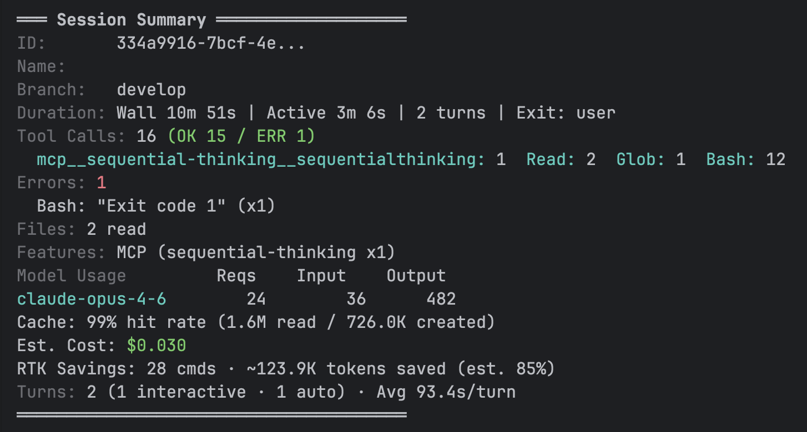

# Claude Code хуки

Хуки — это сценарии, которые автоматически выполняются при событиях Claude Code. Они обеспечивают автоматизацию, блокируют опасные операции и обогащают контекст.

## Доступные хуки

| Хук | Событие | Цель | Платформа |
|------|-------|---------|----------|
| [bm25-routing/bm25-suggest.js](./bm25-routing/bm25-suggest.js) | Пользовательское приглашениеОтправить | Маршрутизация лексических навыков BM25 с самокалибрующимися порогами | Node.js |
| [bash/smart-suggest.sh](./bash/smart-suggest.sh) | Пользовательское приглашениеОтправить | Тренер по поведению на основе регулярных выражений с трехуровневым приоритетом (enforcement/discovery/contextual) | Баш |
| [dangerous-actions-blocker.sh](./bash/dangerous-actions-blocker.sh) | PreToolUse | Блокировать опасный commands/edits | Баш |
| [security-check.sh](./bash/security-check.sh) | PreToolUse | Блокировать секреты в командах | Баш |
| [prompt-injection-detector.sh](./bash/prompt-injection-detector.sh) | PreToolUse | Обнаружение попыток внедрения (+ANSI, нулевые байты, вложенный cmd) | Баш |
| [unicode-injection-scanner.sh](./bash/unicode-injection-scanner.sh) | PreToolUse | Обнаружение нулевой ширины, переопределение RTL, escape ANSI, нулевые байты | Баш |
| [repo-integrity-scanner.sh](./bash/repo-integrity-scanner.sh) | PreToolUse | Сканируйте README/package.json на наличие скрытой инъекции. | Баш |
| [mcp-config-integrity.sh](./bash/mcp-config-integrity.sh) | Начало сеанса | Проверьте хеш конфигурации MCP (CVE-2025-54135/54136) | Баш |
| [claudemd-scanner.sh](./bash/claudemd-scanner.sh) | Начало сеанса | Обнаружение атак путем внедрения CLAUDE.md | Баш |
| [output-secrets-scanner.sh](./bash/output-secrets-scanner.sh) | PostToolUse | Обнаружение секретов + утечка окружения в выходных данных инструмента | Баш |
| [auto-format.sh](./bash/auto-format.sh) | PostToolUse | Автоматическое форматирование после редактирования | Баш |
| [rtk-baseline.sh](./bash/rtk-baseline.sh) | Начало сеанса | Сохраните базовый уровень RTK для отслеживания экономии сеанса. | Баш |
| [session-summary.sh](./bash/session-summary.sh) | Конец сеанса | Полная аналитика сеанса (15 настраиваемых разделов) | Баш |
| [session-summary-config.sh](./bash/session-summary-config.sh) | Инструмент CLI | Настройка разделов сводки сеанса, порядок, предварительный просмотр | Баш |
| [learning-capture.sh](./bash/learning-capture.sh) | Останавливаться | Запрос на запись ежедневного обучения | Баш |
| [sandbox-validation.sh](./bash/sandbox-validation.sh) | PreToolUse | Проверка изоляции песочницы | Баш |
| [file-guard.sh](./bash/file-guard.sh) | PreToolUse | Защитите конфиденциальные файлы от изменений | Баш |
| [permission-request.sh](./bash/permission-request.sh) | PreToolUse | Явный поток разрешений для рискованных операций | Баш |
| [rtk-auto-wrapper.sh](./bash/rtk-auto-wrapper.sh) | PreToolUse | Автоматический перенос команд с помощью RTK для экономии токенов | Баш |
| [setup-init.sh](./bash/setup-init.sh) | Начало сеанса | Инициализировать среду сеанса | Баш |
| [auto-checkpoint.sh](./bash/auto-checkpoint.sh) | PostToolUse | Авто-КПП работает с определенной периодичностью | Баш |
| [typecheck-on-save.sh](./bash/typecheck-on-save.sh) | PostToolUse | Запустите проверку TypeScript при сохранении. | Баш |
| [test-on-change.sh](./bash/test-on-change.sh) | PostToolUse | Запуск тестов изменений файлов | Баш |
| [output-validator.sh](./bash/output-validator.sh) | PostToolUse | Эвристическая проверка вывода | Баш |
| [session-logger.sh](./bash/session-logger.sh) | PostToolUse | Журнал операций для мониторинга | Баш |
| [privacy-warning.sh](./bash/privacy-warning.sh) | PostToolUse | Предупреждайте о возможных утечках конфиденциальной информации | Баш |
| [tts-selective.sh](./bash/tts-selective.sh) | PostToolUse | Преобразование текста в речь для выбранных выходных данных | Баш |
| [subagent-stop.sh](./bash/subagent-stop.sh) | Останавливаться | Очистка ресурсов субагента | Баш |
| [pre-commit-secrets.sh](./bash/pre-commit-secrets.sh) | Git-хук | Блокировать секреты от входа в коммиты | Баш |
| [pre-commit-evaluator.sh](./bash/pre-commit-evaluator.sh) | Git-хук | LLM-as-a-Judge проверка перед фиксацией | Баш |
| [notification.sh](./bash/notification.sh) | Уведомление | Контекстные звуковые оповещения macOS | Баш (macOS) |
| [auto-rename-session.sh](./bash/auto-rename-session.sh) | Конец сеанса | Генерация названия сеанса на основе искусственного интеллекта через Haiku | Баш |
| [security-gate.sh](./bash/security-gate.sh) | PreToolUse | Обнаружение уязвимых шаблонов кода перед записью в исходные файлы | Баш |
| [velocity-governor.sh](./bash/velocity-governor.sh) | PreToolUse | Вызовы инструментов ограничения скорости, чтобы избежать регулирования API | Баш |
| [security-check.ps1](./powershell/security-check.ps1) | PreToolUse | Блокировать секреты в командах | PowerShell |
| [auto-format.ps1](./powershell/auto-format.ps1) | PostToolUse | Автоматическое форматирование после редактирования | PowerShell |

## Перехват событий

33 события в 9 группах. События, отмеченные **[B]**, могут блокироваться посредством выхода 2 или решения JSON. `PermissionRequest` игнорирует выход 2 и блокирует только через свой объект `decision`.

**Жизненный цикл**

| Событие | Когда | Типичные случаи использования |
|-------|------|-------------------|
| `SessionStart` | Сеанс начинается или возобновляется | Инициализация, настройка среды, сканирование конфигурации |
| `Setup` | Одноразовая инициализация через `--init-only` или `--init`/`--maintenance` в режиме `-p`. | Установите deps, проверьте предварительные условия |
| `SessionEnd` | Сеанс завершается | Очистка, сводка сеанса |

**Действия агента**

| Событие | Когда | Типичные случаи использования |
|-------|------|-------------------|
| `Stop` **[B]** | Claude заканчивает отвечать | Ворота качества после ответа, циклы продолжения |
| `StopFailure` | Поворот завершается из-за ошибки API | Оповещение об ограничениях ставок, наблюдаемость |
| `PreToolUse` **[B]** | Прежде чем инструмент заработает | Проверка, блокировка опасных операций |
| `PostToolUse` | После успеха инструмента | Форматирование, журналирование, очистка |
| `PostToolUseFailure` | После того, как инструмент вышел из строя | Регистрация ошибок, действия по восстановлению |
| `PostToolBatch` **[B]** | После полного пакета параллельных вызовов инструментов, перед следующим вызовом модели. | Пакетное внедрение контекста, применение политик |

**Разрешения**

| Событие | Когда | Типичные случаи использования |
|-------|------|-------------------|
| `PermissionRequest` **[B]** | Появится диалоговое окно разрешения (запретить через `decision`, а не выход 2) | Пользовательская логика утверждения, автоматическое одобрение безопасных операций |
| `PermissionDenied` | Вызов инструмента запрещен автоматическим режимом | Аудит отказов классификатора, при необходимости повторная попытка сигнала |

**Уплотнение**

| Событие | Когда | Типичные случаи использования |
|-------|------|-------------------|
| `PreCompact` **[B]** | До сжатия контекста | Блокировать нежелательное автосжатие, сохранять состояние |
| `PostCompact` | После завершения уплотнения | Восстановление контекста, сводка по сжатию журнала |

**Multi-agent**

| Событие | Когда | Типичные случаи использования |
|-------|------|-------------------|
| `SubagentStart` | Появляется субагент | Внедрить контекст в субагент |
| `SubagentStop` **[B]** | Субагент завершает работу | Очистка, контроль качества перед выходом субагента |
| `TeammateIdle` **[B]** | Товарищ по команде агента собирается бездействовать | Координация команды, качественные ворота |
| `TaskCreated` **[B]** | Задача, созданная через TaskCreate | Обеспечение соблюдения соглашений об именах, аудит |
| `TaskCompleted` **[B]** | Задача отмечена выполненной | Принудительное выполнение критериев завершения (тесты, анализ) |

**Конфигурация**

| Событие | Когда | Типичные случаи использования |
|-------|------|-------------------|
| `ConfigChange` **[B]** | Изменения файла конфигурации во время сеанса | Аудит предприятия, блокировка несанкционированных изменений |
| `InstructionsLoaded` | CLAUDE.md или файл правил загружен. | Проверить, какие файлы инструкций активны |

**Файловая система**

| Событие | Когда | Типичные случаи использования |
|-------|------|-------------------|
| `CwdChanged` | Изменения в рабочем каталоге | перезагрузка direnv, переключение инструментальной цепочки |
| `FileChanged` | Просматриваемый файл изменяется на диске | Перезагрузить окружение, вызвать наблюдателей |
| `WorktreeCreate` **[B]** | Создается рабочее дерево | Пользовательская настройка VCS (SVN, Perforce) |
| `DirectoryAdded` | Рабочий каталог добавлен через `/add-dir` или SDK `register_repo_root`. | Загрузка среды для каждого репозитория, аудит добавленных корней |
| `WorktreeRemove` **[B]** | Рабочее дерево удаляется (любой ненулевой выход не может быть удален) | Очистка состояния VCS, учетных данных |

**Взаимодействие с пользователем**

| Событие | Когда | Типичные случаи использования |
|-------|------|-------------------|
| `UserPromptSubmit` **[B]** | Пользователь отправляет сообщение | Обогащение контекста, быстрая проверка |
| `UserPromptExpansion` **[B]** | Команда Slash расширяется до приглашения | Заблокировать команду, добавить контекст навыка |
| `Notification` | Claude отправляет уведомление | Звуковые оповещения, внешние уведомления |
| `MessageDisplay` | Пока отображается текст помощника | Уберите уценку с экрана, отредактируйте секреты |
| `Elicitation` **[B]** | Сервер MCP запрашивает ввод данных пользователем | Предварительный ответ в безголовой автоматизации |
| `ElicitationResult` **[B]** | Пользователь отвечает на запрос | Проверяйте или изменяйте ответы, прежде чем они попадут в MCP. |

**Модель**

| Событие | Когда | Типичные случаи использования |
|-------|------|-------------------|
| `PreModelSwitch` **[B]** | Прежде чем будет применено запрошенное переключение модели | Принудительно применять разрешенные модели, предупреждать о стоимости |
| `PostModelSwitch` | После изменения модели сеанса | Регистрация изменений модели, внедрение контекста, специфичного для модели. |

## Расширенные ограждения (НОВОЕ в версии 3.3.0)

Усовершенствованные шаблоны защиты, вдохновленные производственными системами LLM.

### prompt-injection-detector.sh

**Событие**: `PreToolUse`

Обнаруживает и блокирует попытки быстрого внедрения до того, как они достигнут Claude:

**Обнаруженные закономерности**:
- Переопределение роли: «игнорировать предыдущие инструкции», «вы сейчас», «притворяться»
- Попытки взлома: «режим DAN», «режим разработчика», «без ограничений».
- Вставка разделителя: `</system>`, `[INST]`, `<<SYS>>`.
- Олицетворение авторитета: «антропный сотрудник», «разрешено обходить»
- Полезные данные в кодировке Base64 (декодированные и отсканированные)
- Манипулирование контекстом: ложные утверждения о предыдущих сообщениях

**Configuration**:
```json
{
  "hooks": {
    "PreToolUse": [{
      "hooks": [{
        "type": "command",
        "command": "$CLAUDE_PROJECT_DIR/.claude/hooks/prompt-injection-detector.sh",
        "timeout": 5000
      }]
    }]
  }
}
```

### output-validator.sh

**Событие**: `PostToolUse`

Эвристическая проверка выходных данных Claude (без вызова LLM, чистый bash):

**Проверки проверки**:
- Пути заполнителей: `/path/to/`, `/your/project/`.
- Содержимое заполнителя: `TODO:`, `your-api-key`, `example.com`.
- Потенциальные секреты вывода (шаблоны регулярных выражений)
- Индикаторы неопределенности (множественные «Я не уверен», «Вероятно»)
- Неполные реализации: `NotImplementedError`, `throw new Error`.
- Непроверенные справочные утверждения

**Behavior**: предупреждает через `systemMessage`, не блокирует. Для более глубокой проверки используйте агент `output-evaluator`.

### session-logger.sh

**Событие**: `PostToolUse`

Записывает все операции Claude в файлы JSONL для мониторинга и отслеживания затрат:

**Расположение журнала**: `~/.claude/logs/activity-YYYY-MM-DD.jsonl`

**Зарегистрированные данные**:
- Временная метка, идентификатор сеанса, имя инструмента
- Пути к файлам и команды (усеченные)
- Название проекта
- Оценка токена (input/output)

**Anaанализ**: используйте сценарий `session-stats.sh` для анализа журналов.

**Переменные среды**:
| Переменная | По умолчанию | Описание |
|----------|---------|-------------|
| `CLAUDE_LOG_DIR` | `~/.claude/logs` | Каталог журналов |
| `CLAUDE_LOG_TOKENS` | `true` | Включить оценку токенов |
| `CLAUDE_SESSION_ID` | авто | Пользовательский идентификатор сеанса |

Полную документацию см. в [Observability Guide](../../guide/ops/observability.md).

### pre-commit-evaluator.sh

**Type**: перехватчик предварительной фиксации Git (не перехватчик Claude)

Оценка LLM в качестве судьи перед каждым коммитом. **Только подписка** из-за затрат API.

**Installation**:
```bash
cp pre-commit-evaluator.sh .git/hooks/pre-commit
chmod +x .git/hooks/pre-commit
export CLAUDE_PRECOMMIT_EVAL=1  # Enable evaluation
```

**Cost**: ~$0,01–0,05 за фиксацию (модель Haiku)

**Обход**: `git commit --no-verify` или `CLAUDE_SKIP_EVAL=1 git commit`

---

## Хуки безопасности

### dangerous-actions-blocker.sh

**Event**: `PreToolUse` (Bash, редактирование, запись)

Комплексная защита от опасных операций:

**Bash — Заблокированные команды**:
- Уничтожение системы: `rm -rf /`, `rm -rf ~`, `sudo rm`
- Дисковые операции: `dd if=`, `mkfs`, `> /dev/sda`.
- Вилочные бомбы: `:(){:|:&};:`
- База данных падает: `DROP DATABASE`, `DROP TABLE`.
- Силовые толчки: `git push --force main/master`
- Публикация пакета: `npm publish`, `pnpm publish`.
- Секретные шаблоны: `password=`, `api_key=`, `token=`.

**Edit/Write - Защищенные файлы**:
- Окружающая среда: `.env`, `.env.local`, `.env.production`
- Полномочия: `credentials.json`, `serviceAccountKey.json`
- SSH-ключи: `id_rsa`, `id_ed25519`, `id_ecdsa`.
- Конфигурация: `.npmrc`, `.pypirc`, `secrets.yml`

**Edit/Write — Разрешенные пути**:
- `$CLAUDE_PROJECT_DIR` (текущий проект)
- `~/.claude/` (конфигурация Claude)
- `/tmp/` (временные файлы)
- Дополнительные пути через переменную среды `$ALLOWED_PATHS`

**Коды выхода**:
```bash
exit 0  # Allow operation
exit 2  # Block (stderr message shown to Claude)
```

**Configuration**:
```bash
# Add custom allowed paths (colon-separated)
export ALLOWED_PATHS="/custom/path:/another/path"
```

### security-check.sh

**Event**: `PreToolUse` (Баш)

Сосредоточено на обнаружении секретов в командах:
- Шаблоны паролей
- Ключи API (распространенные форматы, такие как `sk-xxx`, `pk-xxx`)
- Учетные данные AWS
- Закрытые ключи
- Жестко запрограммированные токены

### claudemd-scanner.sh

**Событие**: `SessionStart`

Сканирует файлы CLAUDE.md при запуске сеанса на наличие потенциальных атак с быстрым внедрением:

**Обнаруженные закономерности**:
- варианты «игнорировать предыдущие инструкции»
- Впрыск снаряда: `curl | bash`, `wget | sh`, `eval(`
- Содержимое в кодировке Base64 (потенциальная обфускация)
- Скрытые инструкции в комментариях HTML
- Подозрительные длинные строки (>500 символов)
- Символы, отличные от ASCII, рядом с конфиденциальными ключевыми словами (атаки по гомоглифам)

**Отсканированные файлы**:
- `CLAUDE.md` (корень проекта)
- `.claude/CLAUDE.md` (локальное переопределение)
- Любые файлы `.md` в каталоге `.claude/`.

**Почему это важно**: Когда вы клонируете незнакомый репозиторий, вредоносный CLAUDE.md может внедрить инструкции, которые скомпрометируют вашу систему. Этот хук предупреждает вас перед тем, как Claude обработает потенциально опасные инструкции.

**Configuration**:
```json
{
  "hooks": {
    "SessionStart": [{
      "hooks": [{
        "type": "command",
        "command": ".claude/hooks/claudemd-scanner.sh",
        "timeout": 5000
      }]
    }]
  }
}
```

### output-secrets-scanner.sh

**Событие**: `PostToolUse`

Дополняет `security-check.sh` инструментом сканирования **outputs** (не входные данные) на предмет утечки секретов.

**Обнаруженные закономерности**:
- Ключи API: OpenAI, Anthropic, AWS, GCP, Azure, Stripe, Twilio, SendGrid.
- Токены: GitHub, GitLab, NPM, PyPI, JWT.
- Закрытые ключи: RSA, EC, DSA, OpenSSH, PGP.
- URL-адреса базы данных со встроенными паролями
- Общие шаблоны `api_key=`, `secret=`, `password=`

**Почему это важно**: Claude может прочитать файл `.env` и включить учетные данные в свой ответ или фиксацию. Этот хук ловит секреты до того, как они утекут.

**Configuration**:
```json
{
  "hooks": {
    "PostToolUse": [{
      "hooks": [{
        "type": "command",
        "command": ".claude/hooks/output-secrets-scanner.sh",
        "timeout": 5000
      }]
    }]
  }
}
```

## Хуки производительности

### rtk-baseline.sh

**Событие**: `SessionStart`

Собирает совокупную статистику RTK в начале сеанса для отслеживания изменений. В сочетании с `session-summary.sh`, который вычисляет экономию RTK для каждого сеанса в конце сеанса.

**Configuration**:
```json
{
  "hooks": {
    "SessionStart": [{
      "hooks": [{
        "type": "command",
        "command": "~/.claude/hooks/rtk-baseline.sh",
        "timeout": 5000
      }]
    }]
  }
}
```

### session-summary.sh (v3)

**Событие**: `SessionEnd`

Полная аналитика сеансов с 15 настраиваемыми разделами, инструментом настройки CLI и ведением журнала JSONL.

**Установка плагина (рекомендуется)**:
```bash
claude plugin marketplace add FlorianBruniaux/claude-code-plugins
claude plugin install session-summary@florian-claude-tools
```
Хуки подключаются автоматически, ручная настройка не требуется. Подробности смотрите в репозитории плагинов [](https://github.com/FlorianBruniaux/claude-code-plugins).

**Sections** (все настраивается через переменные окружения или файл конфигурации):

| Раздел | По умолчанию | Описание |
|---------|---------|-------------|
| `meta` | всегда | Идентификатор сеанса, имя, филиал |
| `duration` | всегда | Время у стены, активное время, ходы, причина выхода |
| `tools` | всегда | Разбивка вызовов инструментов (OK/ERR) |
| `errors` | на | Подробности об ошибках, сгруппированные по инструментам |
| `files` | на | Файлы read/edited/created с топом отредактированы |
| `features` | на | MCP серверы, агенты, навыки, команды, режим планирования |
| `git` | на | Сводка различий Git (строки +/-, файлы изменены) |
| `loc` | на | Строки кода, написанные с помощью Edit/Write |
| `models` | всегда | Использование модели (запросы, токены) |
| `cache` | всегда | Скорость попадания в кэш |
| `cost` | всегда | Ориентировочная стоимость (обоснование или таблица цен) |
| `rtk` | на | Экономия токенов RTK (дельта от начала сеанса) |
| `ratio` | на | Коэффициент разговора (повороты interactive/auto) |
| `thinking` | выключенный | Мыслительные блоки имеют значение |
| `context` | выключенный | Оценка контекстного окна (пиковая %) |

**Log File**: `~/.claude/logs/session-summaries.jsonl` (структурированный JSONL со всеми метриками)

**Приоритет конфигурации**: `env vars (SESSION_SUMMARY_*)` > `config file (~/.config/session-summary/config.sh)` > `defaults`

**Переменные среды**:
| Переменная | По умолчанию | Описание |
|----------|---------|-------------|
| `NO_COLOR` | - | Отключить цвета ANSI |
| `SESSION_SUMMARY_SKIP` | `0` | Установите значение `1`, чтобы отключить сводку. |
| `SESSION_SUMMARY_LOG` | `~/.claude/logs` | Переопределить каталог журнала |
| `SESSION_SUMMARY_FILES` | `1` | Переключение раздела файлов |
| `SESSION_SUMMARY_RTK` | `auto` | `auto` / `1` / `0` |
| `SESSION_SUMMARY_GIT` | `1` | Переключение различий в Git |
| `SESSION_SUMMARY_ERRORS` | `1` | Переключение сведений об ошибке |
| `SESSION_SUMMARY_LOC` | `1` | Переключение строк кода |
| `SESSION_SUMMARY_RATIO` | `1` | Переключение коэффициента разговора |
| `SESSION_SUMMARY_FEATURES` | `1` | Используемые функции переключаются |
| `SESSION_SUMMARY_THINKING` | `0` | Блоки мышления переключаются |
| `SESSION_SUMMARY_CONTEXT` | `0` | Переключение контекстной оценки |
| `SESSION_SUMMARY_SECTIONS` | (все) | Порядок разделов через запятую |

**CLI Инструмент настройки** (`session-summary-config.sh`):
```bash
session-summary-config show              # Current config with section status
session-summary-config set git=0         # Disable a section
session-summary-config set thinking=1    # Enable a section
session-summary-config reset             # Reset to defaults
session-summary-config sections          # Show section order
session-summary-config sections "meta,duration,tools,cost"  # Minimal output
session-summary-config preview           # Demo output with current config
session-summary-config install           # Install hooks in settings.json
session-summary-config log 5             # Last 5 session summaries
```

**Requirements**:
- `jq` (требуется для анализа JSON)
- `ccusage` (опционально, для точного расчета стоимости)
- `rtk` (необязательно, для отслеживания экономии токенов)

**Screenshot** (выходные данные реального сеанса):



**Пример вывода** (все разделы включены):
```
═══ Session Summary ═══════════════════
ID:       abc-123-def-456...
Name:     Fix session summary hook
Branch:   main
Duration: Wall 5m 28s | Active 1m 33s | 12 turns | Exit: user

Tool Calls: 29 (OK 27 / ERR 2)
  Edit: 13  Bash: 8  Read: 6  Grep: 1  Glob: 1

Errors: 2
  Bash: "command not found: rtk" (x1)
  Edit: "old_string not unique" (x1)

Files: 3 read · 2 edited · 1 created
  session-summary.sh (8 edits), settings.json (3 edits)

Features: MCP (perplexity x4, chrome x12) · Agents (Explore x3, Plan x1) · Skills (commit)

Git: +142 -37 lines · 4 files changed
Code: +87 -12 net (via Edit/Write)

Model Usage         Reqs    Input    Output
claude-opus-4-6       59      93K      628
Cache: 85% hit rate (3.9M read / 322K created)
Est. Cost: $0.045

RTK Savings: 24 cmds · ~12.4K tokens saved (73%)
Turns: 12 (8 interactive · 4 auto) · Avg 6.7s/turn
═══════════════════════════════════════
```

**Configuration**:
```json
{
  "hooks": {
    "SessionEnd": [{
      "hooks": [{
        "type": "command",
        "command": "~/.claude/hooks/session-summary.sh"
      }]
    }]
  }
}
```

**Быстрая установка**: Система плагинов (см. выше) или руководство: `session-summary-config.sh install` (копии хуков + обновления settings.json)

**По сравнению с патчем `/cost` от tweakcc**:

[твикcc](https://github.com/Piebald-AI/tweakcc) (1 тыс.+ звезд) патчи Claude Code's `cli.js` чтобы снова включить `/cost` для Pro/Max подписчики. Другой подход, другие компромиссы:

| | твикcc `/cost` | session-summary.sh |
|---|---|---|
| Подход | Патчи Claude Code двоичный файл | Официальные хуки API (без модификаций) |
| Выдерживает обновления CC | Нет (повторно применять каждое обновление) | Да |
| Курок | Ручной (команда `/cost`) | Автоматически при выходе из сеанса |
| Метрики | Стоимость, продолжительность, токены, LOC | 15 разделов (стоимость, токены, инструменты, ошибки, файлы, функции, git diff, LOC, кеш, RTK, соотношение...) |
| История | Нет | Журнал JSONL со всеми метриками |
| Зависимости | Node.js | jq (родной для bash) |

tweakcc — это более широкий инструмент (темы, подсказки, наборы инструментов) — патч `/cost` — одна из многих функций. Этот хук специально ориентирован на аналитику сеансов с более глубокими метриками и нулевым изменением внутреннего устройства Claude Code.

### auto-format.sh / auto-format.ps1

**Event**: `PostToolUse` (Редактирование, Запись)

Автоматически форматировать файлы после редактирования:

| Расширение | форматтер |
|-----------|-----------|
| `.ts`, `.tsx`, `.js`, `.jsx` | красивее |
| `.json`, `.css`, `.scss`, `.md` | красивее |
| `.prisma` | `prisma format` |
| `.py` | Черный / autopep8 |
| `.go` | `go fmt` |

**Бесшумная работа**: Нет вывода, сбои игнорируются во избежание блокировки Claude.

**Требования**: Установите форматтеры в свой проект:
```bash
# Node.js projects
npm install -D prettier

# Python projects
pip install black

# Go projects (built-in)
go fmt
```

### notification.sh

**Event**: `Notification` (только macOS)

Контекстные звуковые оповещения на основе содержимого уведомления:

| Контекст | Звук | Инициировано |
|---------|-------|--------------|
| Успех | Hero.aiff | «завершено», «сделано», «успех» |
| Ошибка | Basso.aiff | «ошибка», «не удалось», «проблема» |
| Ожидающий | Submarine.aiff | «ожидание», «разрешение», «ввод» |
| Предупреждение | Sosumi.aiff | «предупреждение», «внимание», «тревога» |
| По умолчанию | Ping.aiff | Другие уведомления |

**Features**:
- Неблокирующий (играет в фоновом режиме)
- Нативные уведомления macOS
- Автоматическое определение контекста по ключевым словам
- Многоязычная поддержка (English/French)

**Требования**: macOS с `afplay` и `osascript` (встроенный)

## Конфигурация

Хуки настраиваются в `.claude/settings.json`:

```json
{
  "hooks": {
    "PreToolUse": [
      {
        "matcher": "Bash|Edit|Write",
        "hooks": [{
          "type": "command",
          "command": "$CLAUDE_PROJECT_DIR/.claude/hooks/dangerous-actions-blocker.sh",
          "timeout": 5000
        }]
      }
    ],
    "PostToolUse": [
      {
        "matcher": "Edit|Write",
        "hooks": [{
          "type": "command",
          "command": "$CLAUDE_PROJECT_DIR/.claude/hooks/auto-format.sh",
          "timeout": 10000
        }]
      }
    ],
    "Notification": [
      {
        "hooks": [{
          "type": "command",
          "command": "$CLAUDE_PROJECT_DIR/.claude/hooks/notification.sh",
          "timeout": 5000
        }]
      }
    ]
  }
}
```

**Шаблоны сопоставления**:
- `".*"` — подобрать все инструменты
- `"Bash"` — соответствует только инструменту Bash.
- `"Edit|Write"` — инструменты редактирования и записи совпадений
- `"Bash|Edit|Write"` — Сопоставьте несколько инструментов

## Создание пользовательских хуков

### Базовый шаблон

```bash
#!/bin/bash
# Hook: [EventType] - Description
# Exit 0 = success/allow, Exit 2 = block (PreToolUse only)

set -e

# Read JSON from stdin
INPUT=$(cat)

# Extract data
TOOL_NAME=$(echo "$INPUT" | jq -r '.tool_name // empty')
TOOL_INPUT=$(echo "$INPUT" | jq -r '.tool_input // empty')

# Your logic here...

# Return optional JSON
cat << EOF
{
  "systemMessage": "Message displayed to Claude",
  "hookSpecificOutput": {
    "additionalContext": "Extra context added"
  }
}
EOF

exit 0
```

### <a name="environment-variables"></a>Переменные среды

Доступно в скриптах-хуках:

| Переменная | Описание |
|----------|-------------|
| `CLAUDE_PROJECT_DIR` | Текущий путь проекта |
| `CLAUDE_FILE_PATHS` | Файлы, переданные с флагом `-f` |
| `CLAUDE_TOOL_INPUT` | Ввод инструмента как JSON |
| `HOME` | Домашний каталог пользователя |

### Лучшие практики

1. **Short Timeout**: максимум 5–10 с, чтобы избежать блокировки Claude.
2. **Fail Graceful**: используйте `|| true` для некритических операций.
3. **Minimal Logging**: Избегайте стандартного вывода, за исключением структурированного JSON.
4. **Require jq**: анализ JSON с помощью `jq` для надежности.
5. **Тщательное тестирование**: тестирование с использованием различных входных данных перед развертыванием
6. **Document Behavior**: четкие комментарии о том, что делает хук.
7. **Handle Errors**: правильные сообщения об ошибках для отладки.

### Пример: обогащение контекста Git

Создайте `git-context.sh` (событие UserPromptSubmit):

```bash
#!/bin/bash
# Hook: UserPromptSubmit - Add Git context to prompts

set -e

INPUT=$(cat)

# Get Git information
BRANCH=$(git rev-parse --abbrev-ref HEAD 2>/dev/null || echo "unknown")
LAST_COMMIT=$(git log -1 --oneline 2>/dev/null || echo "none")
UNCOMMITTED=$(git status --short 2>/dev/null | wc -l | tr -d ' ')
STAGED=$(git diff --cached --name-only 2>/dev/null | wc -l | tr -d ' ')

# Return enriched context
cat << EOF
{
  "systemMessage": "[Git] Branch: $BRANCH | Last: $LAST_COMMIT | Uncommitted: $UNCOMMITTED files | Staged: $STAGED files"
}
EOF

exit 0
```

Зарегистрируйтесь в настройках:
```json
{
  "hooks": {
    "UserPromptSubmit": [
      {
        "hooks": [{
          "type": "command",
          "command": "$CLAUDE_PROJECT_DIR/.claude/hooks/git-context.sh",
          "timeout": 3000
        }]
      }
    ]
  }
}
```

## Установка

### Уровень проекта (совместно с командой)

1. Создайте каталог хуков:
```bash
mkdir -p .claude/hooks
```

2. Скопируйте хук из примеров:
```bash
cp /path/to/examples/hooks/bash/dangerous-actions-blocker.sh .claude/hooks/
chmod +x .claude/hooks/*.sh
```

3. Настройте в `.claude/settings.json` (см. раздел «Конфигурация» выше).

4. Зафиксировать в репозитории:
```bash
git add .claude/hooks/ .claude/settings.json
git commit -m "Add Claude Code hooks"
```

### Personal/global (только ваша машина)

1. Создайте каталог глобальных хуков:
```bash
mkdir -p ~/.claude/hooks
```

2. Копировать хук:
```bash
cp /path/to/examples/hooks/bash/notification.sh ~/.claude/hooks/
chmod +x ~/.claude/hooks/*.sh
```

3. Настроить в `~/.claude/settings.json`

**Priority**: перехватчики проекта переопределяют глобальные перехватчики.

## Примечания для конкретной платформы

### macOS / Linux (баш)

- Используйте расширение `.sh`.
- Для выполнения требуется `chmod +x`.
- Разделитель пути: `/`
- Домашний каталог: `~` или `$HOME`.

### Windows (PowerShell)

- Используйте расширение `.ps1`.
- Может потребоваться политика выполнения: `Set-ExecutionPolicy RemoteSigned`.
- Разделитель пути: `\`
- Домашний каталог: `$env:USERPROFILE`

## <a name="troubleshooting"></a>Поиск неисправностей

### Хук не выполняется

**Cause**: Не зарегистрирован в settings.json или неправильный путь.

**Fix**: проверьте конфигурацию и используйте абсолютные пути или `$CLAUDE_PROJECT_DIR`.

### Доступ запрещен

**Cause**: перехватчик не исполняется

**Fix**:
```bash
chmod +x .claude/hooks/*.sh
```

### Крюк блокирует все

**Cause**: код выхода 2 без условий

**Fix**: проверьте логику, убедитесь, что `exit 0` используется по умолчанию.

### Ошибки тайм-аута

**Cause**: перехват занимает слишком много времени (>значение тайм-аута)

**Fix**: Оптимизируйте производительность перехвата или увеличьте время ожидания в настройках.

### jq не найден

**Причина**: `jq` не установлен

**Fix**: Установите jq:
```bash
# macOS
brew install jq

# Ubuntu/Debian
sudo apt-get install jq

# Windows
choco install jq
```

## Расширенные примеры

### Регистратор активности

Записывайте все операции Claude в файл JSONL:

```bash
#!/bin/bash
# PostToolUse - Log all activities

set -e

INPUT=$(cat)
TOOL=$(echo "$INPUT" | jq -r '.tool_name')
LOG_FILE="$HOME/.claude/logs/activity-$(date +%Y-%m-%d).jsonl"

mkdir -p "$(dirname "$LOG_FILE")"

# Create log entry
cat << EOF >> "$LOG_FILE"
{"timestamp":"$(date -u +%Y-%m-%dT%H:%M:%SZ)","tool":"$TOOL","session":"$CLAUDE_SESSION_ID"}
EOF

exit 0
```

### Детектор миграции базы данных

Оповещение при создании миграции:

```bash
#!/bin/bash
# PostToolUse - Detect database migrations

set -e

INPUT=$(cat)
TOOL=$(echo "$INPUT" | jq -r '.tool_name')

if [[ "$TOOL" == "Write" ]]; then
    FILE=$(echo "$INPUT" | jq -r '.tool_input.file_path')

    if [[ "$FILE" == *"/migrations/"* ]]; then
        cat << EOF
{
  "systemMessage": "⚠️ Database migration created: $FILE\n\nReminder:\n1. Review migration carefully\n2. Test on dev database first\n3. Run 'prisma migrate deploy' after merge"
}
EOF
    fi
fi

exit 0
```

## Соображения безопасности

1. **Никогда не храните секреты в хуках**: используйте переменные среды
2. **Validate Input**: всегда очищать данные из стандартного ввода.
3. **Ограничить область действия перехватчика**: используйте определенные совпадения, а не `".*"`
4. **Просмотр заблокированных операций**: регистрируйте, когда перехватчики блокируют действия.
5. **Test in Isolation**: сначала протестируйте перехватчики вне Claude.
6. **Version Control**: зафиксируйте перехватчики в репозитории для совместного использования командой.

## <a name="resources"></a>Ресурсы

- [Основное руководство – Раздел 7: Крючки](../../guide/ultimate-guide.md#7-hooks)
- [Claude Code Документация](https://code.claude.com/docs)
- [Hook Event Reference](../../guide/ultimate-guide.md#71-the-event-system)

---

*Подробные объяснения и расширенные шаблоны см. в главном руководстве [](../../guide/ultimate-guide.md).*
