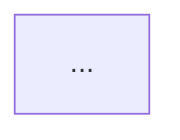
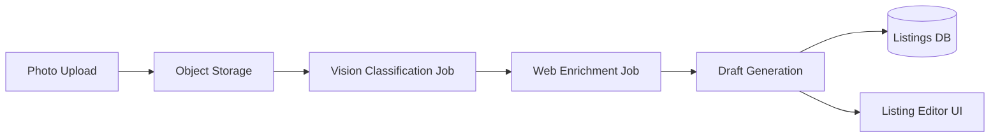
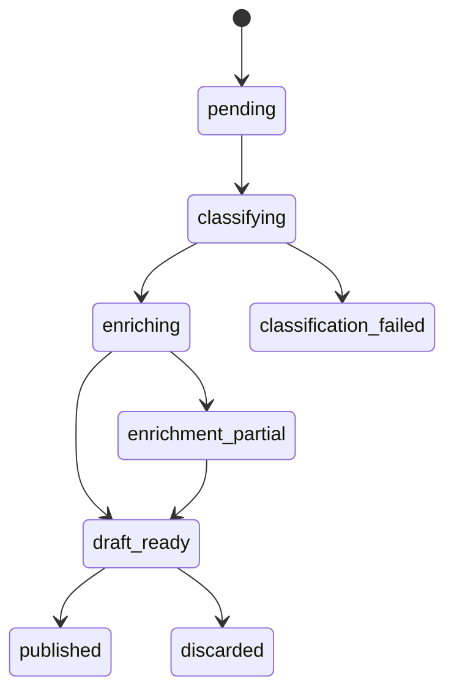

# /plan-pipeline:eng-review: Ворота инженерной архитектуры

Команда после направления, перед реализацией. Принимает проверенное направление продукта и возвращает готовую техническую спецификацию с диаграммами. Заставляет систему продумать архитектуру до того, как будет написана хотя бы одна строка кода реализации.

**Используйте после того, как `/plan-pipeline:ceo-review` зафиксировал направление. Все еще в режиме плана.**

---

## Проблема, которую это решает

Как только направление продукта будет зафиксировано, следующей причиной отказа станет расплывчатая архитектура. «Система справится» — это не план. Эта команда требует четких ответов на сложные технические вопросы до того, как они станут производственными инцидентами.

Ключ разблокировки: **Форсирующая диаграмма**. Диаграммы выявляют скрытые предположения, которые в прозе остаются расплывчатыми. Диаграмма последовательности позволяет указать, кто и что вызывает. Конечный автомат заставляет вас явно перечислять каждый режим отказа.

---

## <a name="when-to-use"></a>Когда использовать

- После подтверждения направления продукта (опубликация `/plan-pipeline:ceo-review` или эквивалентная)
- Прежде чем начнется какая-либо реализация нетривиальной функции
- Если функция имеет асинхронные компоненты, внешние зависимости или многоэтапные потоки.
- Каждый раз, когда «архитектура ясна», необходимо доказать, а не предполагать

---

## Что оно должно производить

| Выход | Почему это важно |
|--------|----------------|
| Схема архитектуры (Mermaid) | Делает границы компонентов явными |
| Схема потока данных | Показывает, где трансформируются данные и кто чем владеет |
| Конечный автомат для основного потока | Принудительный перебор всех состояний, включая сбои |
| Решения о границах синхронизации и асинхронности | Предотвращает «просто сделайте это асинхронным» без рассуждений. |
| Инвентаризация режимов отказов | Каждый путь неудачи, а не только счастливый путь |
| Карта границ доверия | Где вы принимаете внешние данные? Что вы подтверждаете? |
| Тестовая матрица | Что необходимо тестировать и на каком уровне |

---

## Шаблон запроса

```markdown
# /plan-pipeline:eng-review

You are in engineering manager / tech lead mode. Direction is locked.
Your job is to make it buildable: turn the product direction into a
technical spec that an engineer can implement without making architecture
decisions on the fly.

Do NOT question the product direction. Do NOT suggest scope changes.
Do NOT implement anything. Return a technical spec.

## Step 1: Restate the Feature

1-2 sentences: what is being built. Confirm you are working from the
correct brief.

## Step 2: Architecture Diagram

Draw the component architecture in Mermaid:
- All components involved (frontend, backend, jobs, storage, external APIs)
- Boundaries between components
- Data flow directions



## Шаг 3: Основной поток (диаграмма последовательности)

Нарисуйте счастливый путь в виде диаграммы последовательности:
- Какие компоненты какие вызывают и в каком порядке
- Какие данные проходят на каждом этапе
- Где происходит асинхронная передача обслуживания

```mermaid
sequenceDiagram
    ...
```

## Шаг 4: Конечный автомат

Нарисуйте конечный автомат для основного объекта домена:
- Все действительные состояния
- Все переходы и их триггеры
- Терминальные состояния (успех И неудача)


## Шаг 5: Синхронные и асинхронные решения

Для каждой операции в потоке определите:
- **Synchronous** (блокирует запрос): почему и каков бюджет задержки
- **Asynchronous** (фоновое задание): почему, что вызывает повторную попытку, как выполняется
  звонящий знает, что все удалось

## Шаг 6. Инвентаризация режимов отказов

Для каждого шага потока перечислите:
- Что может выйти из строя
- Как это терпит неудачу (молча? громко? частичный успех?)
- Каков путь восстановления
- Что видит пользователь

Отмечайте любые сбои, о которых в данный момент не сообщается.

## Шаг 7: Границы доверия

Для каждого внешнего ввода (загрузки пользователей, ответы API, полезные данные веб-перехватчика):
- Чему вы доверяете? Что вы подтверждаете?
- Где вредоносный ввод может нанести вред?
- Передаются ли какие-либо внешние данные для дальнейшей обработки (риск быстрого внедрения)?

## Шаг 8: Тестовая матрица

| Слой | Что протестировать | Зачем |
|-------|-------------|-----|
| Единица | ... | ... |
| Интеграция | ... | ... |
| E2E | ... | ... |

Определите любой вид отказа из шага 6, для которого нет соответствующего теста.

## Шаг 9: Открытые вопросы

Перечислите любые архитектурные решения, которые действительно неясны и требуют участия человека.
решение до начала реализации. Не полный список, только
blockers.
```

---

## Example

**Feature**: Smart listing creation from photo (post-`/plan-pipeline:ceo-review`)

**Output excerpt**:


Государственная машина:


Режимы отказа:
- Классификация не удалась -> переход к листингу вручную (не молчаливый сбой)
- Обогащение частично не удалось -> использовать то, что удалось, отметить отсутствующие поля
- Загрузка прошла успешно, задание классификации не запускается -> потерянный файл, требуется задание очистки
- Веб-данные при создании черновика -> вектор быстрого внедрения, очистка перед передачей в LLM

---

## Положение трубопровода

```
/plan-pipeline:ceo-review    -> product direction locked
/plan-pipeline:eng-review    -> architecture locked        <- you are here
/plan-pipeline:start         -> produce implementation plan
/plan-pipeline:validate      -> validate before execution
/plan-pipeline:execute       -> execute to merged PR
```
