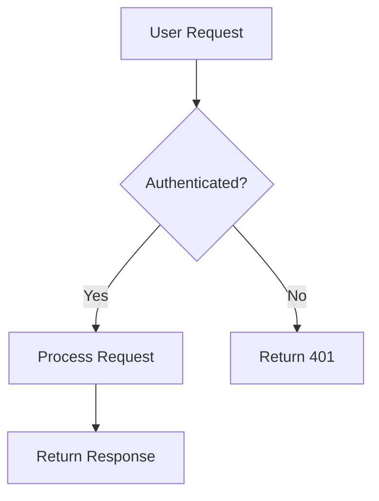
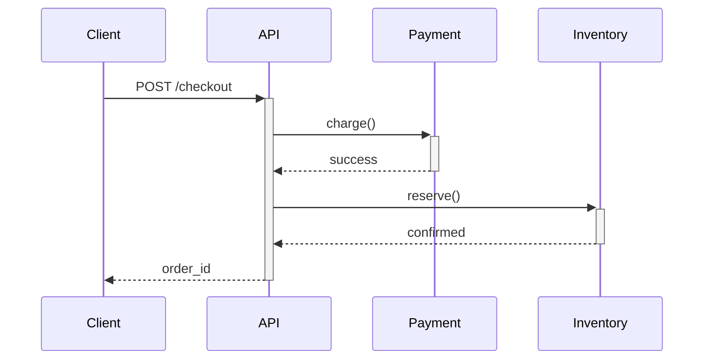
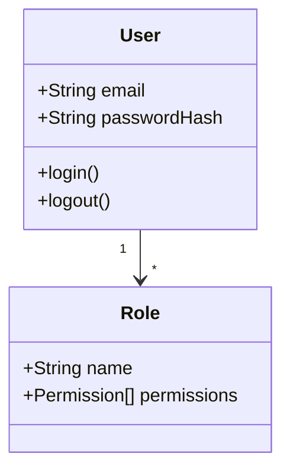

[К оглавлению](README.md) · [Предыдущая глава](08-8-mcp-servers.md) · [Следующая глава](10-9-advanced-patterns-part-2.md)

# <a name="9-advanced-patterns"></a>9. Расширенные шаблоны

_Быстрый переход:_ [The Trinity](#91-the-trinity) · [Композиционные шаблоны](#92-composition-patterns) · [CI/CD Интеграция](#93-cicd-integration) · [IDE Интеграция](#94-ide-integration) · [Краткая обратная связь Циклы](#95-tight-feedback-loops) · [Оптимизация контекста на основе проверки](10-9-advanced-patterns-part-2.md#926-review-driven-context-optimization)

---

> **Предварительное условие**: прочтите [4.1 Что такое агенты](04-4-agents.md#41-what-are-agents) и [3.1 CLAUDE.md](03-3-memory--settings.md#31-memory-files-claudemd), прежде чем углубляться в 9.17-9.20.

> **Новичок в Claude Code?** Сначала начните с глав 1–3. Глава 9 имеет наибольший смысл после 1-2 месяцев ежедневного использования.

## 📌 Раздел 9 TL;DR (3 минуты)

**Что вы узнаете**: Рабочие процессы производственного уровня, сочетающие в себе несколько функций Claude Code.

### Категории шаблонов:

**🎯 The Trinity (9.1)**: Максимальный рабочий процесс, Режим планирования → Расширенное мышление → Последовательный MCP
- Когда: Архитектурные решения, сложный рефакторинг, критические системы.
- Почему: максимальная сила рассуждения + безопасное исследование.

**🔄 Шаблоны интеграции (9.2-9.4)**
- Состав: Агенты + Навыки + Хуки, работающие вместе.
- CI/CD: GitHub Actions, автоматизированные обзоры, качественные ворота
- IDE: интеграция VS Code + Claude Code

**⚡ Модели продуктивности (9.5-9.8)**
- Тесная обратная связь: тестирование с мгновенной проверкой
- Todo как зеркало: сохраняйте контекст в соответствии с реальностью
- Vibe-кодирование: скелет → итерация → производство

**🎨 Качественные шаблоны (9.9-9.11)**
- Пакетные операции: эффективная обработка нескольких файлов
- Постоянное улучшение: доработка в течение нескольких сеансов
- Распространенные ошибки: учитесь на ошибках (Do/Don не перечисляет)

### Когда использовать этот раздел:
- ✅ Вы продуктивно владеете основами и хотите овладеть мастерством
- ✅ Вы настраиваете рабочие процессы команды или CI/CD
- ✅ Вы достигли предела простого подхода «спросить Claude».
- ❌ Вы все еще изучаете основы (сначала завершите разделы 1–8)

---

**Время чтения**: 20 минут
**Уровень навыка**: Месяц 1+
**Цель**: овладеть техниками опытного пользователя.

---

## 🌍 Отраслевой контекст: тенденции агентного кодирования в 2026 году.

> **Источник**: [Anthropic «Отчет о тенденциях агентского кодирования на 2026 год»](https://resources.anthropic.com/hubfs/2026%20Agentic%20Coding%20Trends%20Report.pdf) (февраль 2026 г.)

В этом разделе «Модели» отражена документация «Эволюция промышленности» для Anthropic более чем 5000 организаций.

### 📊 Допуск к усыновлению

| Шаблон | График принятия | Повышение производительности | Влияние на бизнес |
|---------|------------------|-------------------|-----------------|
| **Команды агентов** (9.20) | 3-6 месяцев | 50-67% | Хронология: семинары → дни |
| **Мультиэкземпляр** (9.17) | 1-2 месяца | 2x выход | Стоимость: $500-1K/month |
| **Изоляция песочницы** (guide/security/sandbox-native.md) | Немедленный | Базовый уровень безопасности | Требование соответствия |

### 🎯 Результаты исследований (внутреннее исследование Anthropic)

- **60% работы** использует искусственный интеллект (против 0% в 2023 году)
- **0-20% «полностью делегировано»** → Центральное сотрудничество, замена
- **Объединилось на 67% больше PR** на инженера в день
- **27% новых работ** не было бы сделано без ИИ (исследовательское, полезно иметь)

### ⚠️ Предприятие по борьбе с шаблонами

**Over-Delegation** (агенты):
- Симптом: стоимость переключения контекста > прирост производительности.
- Ограничение: более 5 агентов одновременно = накладные расходы на координацию.
- Исправлено: запуск 1-2 агентов, масштабирование прогресса.

**Преждевременная автоматизация**:
- Признак: Рабочий процесс автоматизатора не выполняется вручную.
- Исправлено: Ручной → Полуавтоматический → Полностью автоматический (прогрессивный).

**Разрастание инструментов** (распространение MCP):
- Симптом: >10 серверов MCP, конфликты, нагрузка на обслуживание.
- Исправлено: запуск основного стека (Serena, Context7, Sequential), выборочное добавление.

### 📚 Тематические исследования отрасли

- **Fountain** (управление персоналом): проверка на 50 % быстрее с помощью иерархического мультиагента.
- **Rakuten** (технология): 7-часовая автономная реализация vLLM (12,5 млн строк, точность 99,9 %).
- **CRED** (финтех): скорость выполнения в 2 раза, качество сохраняется (15 миллионов пользователей)
- **TELUS** (телекоммуникации): сэкономлено 500 тысяч часов, 13 тысяч индивидуальных решений
- **Zapier** (автоматизация): внедрение 89%, более 800 внутренних агентов

### 🔗 Навигация

Узор Chaque Ci-dessous включает в себя:
- ✅ **Отраслевая проверка** (принятие статистики, рентабельность инвестиций)
- ✅ **Практическое руководство** (пошаговые рабочие процессы)
- ✅ **Анти-паттерны** (подводные камни, которых следует избегать)

**Полная оценка**: [`docs/resource-evaluations/anthropic-2026-agentic-coding-trends.md`](../../docs/resource-evaluations/anthropic-2026-agentic-coding-trends.md)

---

## <a name="91-the-trinity"></a>9.1 Троица

Самый мощный паттерн Claude Code сочетает в себе три техники:

```
┌─────────────────────────────────────────────────────────┐
│                      THE TRINITY                        │
├─────────────────────────────────────────────────────────┤
│                                                         │
│   ┌─────────────┐                                       │
│   │ Plan Mode   │  Safe exploration without changes     │
│   └──────┬──────┘                                       │
│          │                                              │
│          ▼                                              │
│   ┌─────────────┐                                       │
│   │ Ext.Thinking│  Deep analysis (Opus 4.6+, adaptive thinking)  │
│   └──────┬──────┘                                       │
│          │                                              │
│          ▼                                              │
│   ┌─────────────────────┐                               │
│   │ Sequential Thinking │  Structured multi-step reason │
│   └─────────────────────┘                               │
│                                                         │
│   Combined: Maximum understanding before action         │
│                                                         │
└─────────────────────────────────────────────────────────┘
```

### Когда использовать Троицу

| Ситуация | Используете Тринити? |
|-----------|--------------|
| Исправление опечатки | ❌ Излишество |
| Добавление функции | Может быть |
| Отладка сложной проблемы | ✅ Да |
| Архитектурное решение | ✅ Да |
| Модернизация устаревшей системы | ✅ Да |

### Расширенное мышление (Opus 4.5+) и адаптивное мышление (Opus 4.6+)

Метки версий в этом заголовке сохраняют существующие ссылки. В текущей линейке Opus 5.5, Sonnet 5.5, Haiku 5.5 и Fable 5.1 используются адаптивные рассуждения с параметром усилий. Устаревшая версия Haiku 4.5 поддерживает расширенное мышление, но не имеет параметра усилий. [Технические характеристики модели](https://platform.claude.com/docs/en/models/overview).

#### Адаптивное мышление (Opus 4.6+, включая Opus 4.8)

Усилия управляют рассуждениями и могут влиять на использование инструментов, длину выходных данных, задержку и стоимость. Используйте таблицу текущих усилий [](02-2-core-concepts.md#effort-levels), а не предполагайте, что каждая модель имеет одно и то же значение по умолчанию. Opus 5.5, Sonnet 5.5 и Haiku 5.5 по умолчанию — `medium` в Claude Code; В Fable 5.1 по умолчанию используется `high`.

```python
response = client.messages.create(
    model="claude-opus-5-5",
    max_tokens=16000,
    thinking={"type": "adaptive"},
    output_config={"effort": "high"},
    messages=[{"role": "user", "content": "Analyze the failure modes."}],
)
```

Opus 4.7 и новее, Sonnet 5 и новее, Haiku 5.5 и Fable используют только адаптивное рассуждение. `CLAUDE_CODE_DISABLE_ADAPTIVE_THINKING` и фиксированный бюджет `MAX_THINKING_TOKENS` на них не распространяются. Переключатель совместимости с фиксированным бюджетом остается специфичным для Opus 4.6 и Sonnet 4.6.

#### <a name="controlling-thinking-mode"></a>Управление режимом мышления

| Контроль | Текущее поведение |
|---------|------------------|
| Ползунок `/effort` или `/model` | Выберите поддерживаемое усилие; `Enter` сохраняет данные для каждой модели, `s` применяется к этому сеансу. |
| `--effort high` | Установить усилие для запущенного сеанса |
| `CLAUDE_CODE_EFFORT_LEVEL` | Явное переопределение среды |
| `modelSettings` / `effortLevel` | Постоянные настройки поддерживают `low` через `xhigh`, а не `max`. |
| `Option+T` / `Alt+T`, `/config`, `MAX_THINKING_TOKENS=0` | Можно отключить мышление о поддерживаемых моделях; не влияет на Opus 5.5, Sonnet 5.5, Haiku 5.5 или Fable |
| `Ctrl+O` | Откройте программу просмотра стенограммы; дисплей не меняет биллинг |

За токены мышления взимается плата, даже если их отображение свернуто или отредактировано. Установите `showThinkingSummaries: true`, если полные сводки должны быть доступны в расширенном представлении. [Мышление контролирует](https://code.claude.com/docs/en/model-config#extended-thinking).

#### Справочник по устаревшим ключевым словам

`ultrathink` в настоящее время добавляет инструкцию для более глубокого обоснования терна. **not** устанавливает усилие API на `max`. `think` и `think hard` — это обычный текст подсказки. Для детерминированного выбора усилий используйте `/effort` или `--effort`.

#### <a name="api-breaking-changes-opus-46"></a>Критические изменения API (Opus 4.6)

Предварительное заполнение помощника не поддерживается в Opus 4.6. Прежде чем повторно использовать примеры на основе предварительного заполнения, ознакомьтесь с руководством по миграции целевой модели; используйте системные инструкции, примеры или поддерживаемые структурированные выходные данные, если предварительное заполнение недоступно.

Для быстрого режима используйте поддерживаемую версию Opus и текущие инструкции быстрого режима [API](https://platform.claude.com/docs/en/build-with-claude/fast-mode). В Claude Code `/fast` по умолчанию использует Opus 5.5 начиная с версии 2.1.280. Стандартный Opus 5.5 стоит 4/20 долларов за MTok, а быстрый режим – 8/40 долларов. Более старый быстрый режим Opus 5 и 4.8 стоит 10/50 долларов. Доступность, поддержка поставщика и выставление счетов за использование не зависят от настройки скорости.

### Пример: использование Троицы

```
You: /plan

Let's analyze this legacy authentication system before we touch anything.
[Opus 5.5 uses adaptive thinking; choose effort explicitly when needed]

[Claude enters Plan Mode and does deep analysis]

Claude: I've analyzed the auth system. Here's what I found:
- 47 files depend on the current auth module
- 3 critical security issues
- Migration path needs 4 phases

Ready to implement?

You: [approve the plan]
Let's start with phase 1
```

## <a name="92-composition-patterns"></a>9.2 Шаблоны композиции

### Мультиагентное делегирование

Запустите несколько агентов для разных аспектов:

```
You: For this feature, I need:
1. Backend architect to design the API
2. Security reviewer to audit the design
3. Test engineer to plan the tests

Run these in parallel.
```

Claude будет координировать:
- Бэкэнд-архитектор проектирует API
- Аудиты рецензентов безопасности (параллельно)
- Инженер-испытатель планирует испытания (параллельно)

### Накопление навыков

Объедините несколько навыков для решения сложных задач:

```yaml
# code-reviewer.md
skills:
  - security-guardian
  - performance-patterns
  - accessibility-checker
```

Теперь у рецензента есть все три области знаний.

### Паттерн «Заведи двигатель»

Для качественной работы используйте несколько раундов критики:

```
You: Write the function, then critique it, then improve it.
Do this 3 times.

Round 1: [Initial implementation]
Critique: [What's wrong]
Improvement: [Better version]

Round 2: [Improved implementation]
Critique: [What's still wrong]
Improvement: [Even better version]

Round 3: [Final implementation]
Final check: [Verification]
```

### Паттерн «Максимум стека»

Для ответственной работы объедините все:

```
1. Plan Mode + Extended Thinking → Deep exploration
2. Multiple Agents → Specialized analysis
3. Sequential Thinking → Structured reasoning
4. Rev the Engine → Iterative improvement
5. Code Review Agent → Final validation
```

## <a name="93-cicd-integration"></a>9.3 Интеграция CI/CD

> **📖 Полное руководство по рабочему процессу**: см. [GitHub Actions Workflows](../workflows/github-actions.md) для получения 5 готовых к производству шаблонов с использованием официального `anthropics/claude-code-action` (проверка PR, сортировка, безопасность, плановое обслуживание).

> **Code Review (Teams/Enterprise)**: Для автоматической проверки PR без ручного запроса см. [Code Review](../workflows/code-review.md), функция многоагентной проверки Anthropic, которая публикует встроенные комментарии GitHub к каждому PR.

> **Billing:** Anthropic объявил, что рабочие процессы в этом разделе (безголовый режим через `claude -p`, GitHub Actions, агент SDK) будут переведены на отдельный ежемесячный программный кредит 15 июня 2026 г., а затем приостановил это изменение. Как было проверено 31 октября 2026 г., они по-прежнему учитывают ограничения на использование вашей подписки при входе в систему с помощью вашего плана; в планах Max, Ultra и Team ежемесячные кредиты API, доступные с 7 октября 2026 г., покрывают их при запуске с ключом API от связанной организации консоли. Проверяйте использование CI/CD с помощью `ccusage`, чтобы быть готовыми к возобновлению действия плана. См. [§9.13: Interactive/Programmatic Billing Split](#the-interactiveprogrammatic-billing-split-announced-then-paused) для ознакомления с объявленным планом и структурой принятия решений.

### <a name="headless-mode"></a>Безголовый режим

Запустите Claude Code без интерактивных подсказок:

```bash
# Basic headless execution
claude -p "Run the tests and report results"

# With timeout
claude -p --timeout 300 "Build the project"

# With specific model
claude -p --model sonnet "Analyze code quality"
```

### <a name="unix-piping-workflows"></a>Рабочие процессы трубопроводов Unix

Claude Code поддерживает операции с конвейерами **Unix**, обеспечивая мощную интеграцию оболочки для автоматического анализа и преобразования кода.

**Как работают трубопроводы**:

```bash
# Pipe content to Claude with a prompt
cat file.txt | claude -p 'analyze this code'

# Pipe command output for analysis
git diff | claude -p 'explain these changes'

# Chain commands with Claude
npm test 2>&1 | claude -p 'summarize test failures and suggest fixes'
```

**Общие шаблоны**:

1. **Автоматизация проверки кода**:
   ```bash
   git diff main...feature-branch | claude -p 'Review this diff for security issues'
   ```

2. **Анализ журнала**:
   ```bash
   tail -n 100 /var/log/app.log | claude -p 'Find the root cause of errors'
   ```

3. **Разбор тестового вывода**:
   ```bash
   npm test 2>&1 | claude -p 'Create a summary of failing tests with priority order'
   ```

4. **Генерация документации**:
   ```bash
   cat src/api/*.ts | claude -p 'Generate API documentation in Markdown'
   ```

5. **Пакетный анализ файлов**:
   ```bash
   find . -name "*.js" -exec cat {} \; | claude -p 'Identify unused dependencies'
   ```

**Использование с `--output-format`**:

```bash
# Get structured JSON output
git status --short | claude -p 'Categorize changes' --output-format json

# Stream JSON for real-time processing
cat large-file.txt | claude -p 'Analyze line by line' --output-format stream-json
```

**Рекомендации**:

- **Будьте конкретны**: четкие подсказки приводят к лучшим результатам.
  ```bash
  # Good: Specific task
  git diff | claude -p 'List all function signature changes'

  # Less effective: Vague request
  git diff | claude -p 'analyze this'
  ```

- **Ограничить размер ввода**: передавать только релевантный контент, чтобы избежать перегрузки контекста.
  ```bash
  # Good: Filtered scope
  git diff --name-only | head -n 10 | xargs cat | claude -p 'review'

  # Risky: Could exceed context
  cat entire-codebase/* | claude -p 'review'
  ```

- **Использовать неинтерактивный режим**: добавить `-p` для автоматизации
  ```bash
  cat file.txt | claude -p -p 'fix linting errors' > output.txt
  ```

- **Объединить с jq для JSON**: анализ выходных данных Claude JSON
  ```bash
  echo "const x = 1" | claude -p 'analyze' --output-format json | jq '.suggestions[]'
  ```

**Управление форматом вывода**:

Флаг `--output-format` управляет форматом ответа Claude:

| Формат | Вариант использования | Пример |
|--------|----------|---------|
| `text` | Удобочитаемый вывод (по умолчанию) | `claude -p 'explain' --output-format text` |
| `json` | Структурированные данные, поддающиеся машинному анализу | `claude -p 'analyze' --output-format json` |
| `stream-json` | Потоковая передача в реальном времени для больших выходных данных | `claude -p 'transform' --output-format stream-json` |

**Пример рабочего процесса JSON**:

```bash
# Get structured analysis
git log --oneline -10 | claude -p 'Categorize commits by type' --output-format json

# Output:
# {
#   "categories": {
#     "features": ["add user auth", "new dashboard"],
#     "fixes": ["fix login bug", "resolve crash"],
#     "chores": ["update deps", "refactor tests"]
#   },
#   "summary": "10 commits: 2 features, 2 fixes, 6 chores"
# }
```

**Интеграция со скриптами сборки** (`package.json`):

```json
{
  "scripts": {
    "claude-review": "git diff main | claude -p 'Review for security issues' --output-format json > review.json",
    "claude-test-summary": "npm test 2>&1 | claude -p -p 'Summarize failures and suggest fixes'",
    "claude-docs": "cat src/**/*.ts | claude -p 'Generate API documentation' > API.md",
    "precommit-check": "git diff --cached | claude -p -p 'Check for secrets or anti-patterns' && git diff --cached | prettier --check"
  }
}
```

Пример интеграции **CI/CD**:

```yaml
# .github/workflows/claude-review.yml
name: AI Code Review
on: [pull_request]

jobs:
  claude-review:
    runs-on: ubuntu-latest
    steps:
      - uses: actions/checkout@v4
        with:
          fetch-depth: 0

      - name: Install Claude Code
        run: npm install -g @anthropic-ai/claude-code

      - name: Run Claude Review
        env:
          ANTHROPIC_API_KEY: ${{ secrets.ANTHROPIC_API_KEY }}
        run: |
          git diff origin/main...HEAD | \
            claude -p -p 'Review this PR diff for security issues, performance problems, and code quality. Format as JSON.' \
            --output-format json > review.json

      - name: Comment on PR
        uses: actions/github-script@v7
        with:
          script: |
            const fs = require('fs');
            const review = JSON.parse(fs.readFileSync('review.json', 'utf8'));
            github.rest.issues.createComment({
              issue_number: context.issue.number,
              owner: context.repo.owner,
              repo: context.repo.repo,
              body: `## 🤖 Claude Code Review\n\n${review.summary}`
            });
```

**Limitations**:

- **Размер контекста**: большие каналы могут превышать ограничения токена (мониторинг с помощью `/status`)
- **Интерактивные подсказки**: используйте `-p` для автоматизации, чтобы избежать блокировки.
- **Обработка ошибок**: сбои трубопровода не всегда распространяются; добавьте `set -e` для строгого режима
- Стоимость **API**: Автоматизированные каналы потребляют кредиты API; контролировать использование с помощью `ccusage`

> **💡 Совет для профессионалов**: Объедините трубопроводы с псевдонимами для часто используемых шаблонов:
> ```bash
> # Add to ~/.bashrc or ~/.zshrc
> alias claude-review='git diff | claude -p "Review for bugs and suggest improvements"'
> alias claude-logs='tail -f /var/log/app.log | claude -p "Monitor for errors and alert on critical issues"'
> ```

> **Source**: [DeepTo Claude Code Руководство - Unix Piping](https://cc.deeptoai.com/docs/en/best-practices/claude-code-comprehensive-guide)

### Интеграция Git-хуков

> **Windows Примечание**: перехватчики Git запускаются в Git Bash на Windows, поэтому приведенный ниже синтаксис bash работает. Альтернативно вы можете создать версии `.cmd` или `.ps1` и ссылаться на них из сценария-оболочки.

**Хук предварительной фиксации**:

```bash
#!/bin/bash
# .git/hooks/pre-commit

# Run Claude Code for commit message validation
COMMIT_MSG=$(cat "$1")
claude -p "Is this commit message good? '$COMMIT_MSG'. Reply YES or NO with reason."
```

**Крюк предварительного нажатия**:

```bash
#!/bin/bash
# .git/hooks/pre-push

# Security check before push
claude -p "Scan staged files for secrets and security issues. Exit 1 if found."
EXIT_CODE=$?

if [ $EXIT_CODE -ne 0 ]; then
    echo "Security issues found. Push blocked."
    exit 1
fi
```

### <a name="github-actions-integration"></a>GitHub Actions Интеграция

```yaml
# .github/workflows/claude-review.yml
name: Claude Code Review

on:
  pull_request:
    types: [opened, synchronize]

jobs:
  review:
    runs-on: ubuntu-latest
    steps:
      - uses: actions/checkout@v4

      - name: Install Claude Code
        run: npm install -g @anthropic-ai/claude-code

      - name: Run Review
        env:
          ANTHROPIC_API_KEY: ${{ secrets.ANTHROPIC_API_KEY }}
        run: |
          claude -p "Review the changes in this PR. \
            Focus on security, performance, and code quality. \
            Output as markdown." --bare
```

> Флаг **`--bare` для сценариев CI (v2.1.81+)**: добавьте `--bare` к любому вызову `claude -p`, чтобы получить детерминированную, герметичную среду выполнения. Он отключает перехватчики, LSP, синхронизацию плагинов и сканирование каталогов навыков, гарантируя, что конфигурация локального разработчика никогда не попадет в CI. Требуется `ANTHROPIC_API_KEY` (нет OAuth/keychain). Также отключает автозапоминание.
>
> ```bash
> # Without --bare: picks up local hooks, plugins, skills — non-deterministic in CI
> claude -p "run tests"
>
> # With --bare: clean slate, API key only
> ANTHROPIC_API_KEY=$SECRET claude -p "run tests" --bare
> ```

#### Отладка неудачных запусков CI

В случае сбоя GitHub Actions используйте `gh` CLI для расследования, не покидая терминал:

**Быстрый процесс расследования**:

```bash
# List recent workflow runs
gh run list --limit 10

# View specific run details
gh run view <run-id>

# View logs for failed run
gh run view <run-id> --log-failed

# Download logs for detailed analysis
gh run download <run-id>
```

**Общие команды отладки**:

| Команда | Цель |
|---------|---------|
| `gh run list --workflow=test.yml` | Фильтровать по файлу рабочего процесса |
| `gh run view --job=<job-id>` | Посмотреть конкретную информацию о вакансии |
| `gh run watch` | Следите за текущим забегом в режиме реального времени |
| `gh run rerun <run-id>` | Повторить неудачный запуск |
| `gh run rerun <run-id> --failed` | Повторять только неудачные задания |

**Пример: Исследование ошибок тестирования**:

```bash
# Get the latest failed run
FAILED_RUN=$(gh run list --status failure --limit 1 --json databaseId --jq '.[0].databaseId')

# View the failure
gh run view $FAILED_RUN --log-failed

# Ask Claude to analyze
gh run view $FAILED_RUN --log-failed | claude -p "Analyze this CI failure and suggest fixes"
```

**Совет для профессионалов**: Объедините с Claude Code для автоматической отладки:

```bash
# Fetch failures and auto-fix
gh run view --log-failed | claude -p "
  Analyze these test failures.
  Identify the root cause.
  Propose fixes for each failing test.
  Output as actionable steps.
"
```

Этот рабочий процесс экономит время по сравнению с навигацией по веб-интерфейсу GitHub и позволяет быстрее устранять сбои CI.

### <a name="verify-gate-pattern"></a>Проверьте шаблон ворот

Прежде чем создавать PR, убедитесь, что все локальные проверки пройдены. Это предотвращает напрасные циклы CI и время проверки.

**Шаблон**:

```
Build ✓ → Lint ✓ → Test ✓ → Type-check ✓ → THEN create PR
```

**Реализация в виде команды** (`.claude/commands/complete-task.md`):

```markdown
# Complete task

Run the full verification gate before creating a PR:

1. **Build**: Run `pnpm build` - must succeed
2. **Lint**: Run `pnpm lint` - must have zero errors
3. **Test**: Run `pnpm test` - all tests must pass
4. **Type-check**: Run `pnpm typecheck` - no type errors

If ANY step fails:
- Stop immediately
- Report what failed and why
- Suggest fixes
- Do NOT proceed to PR creation

If ALL steps pass:
- Create the PR with `gh pr create`
- Wait for CI with `gh pr checks --watch`
- If CI fails, fetch feedback and auto-fix
- Loop until mergeable or blocked
```

**Автономный цикл повтора**:

```
┌─────────────────────────────────────────┐
│         VERIFY GATE + AUTO-FIX          │
├─────────────────────────────────────────┤
│                                         │
│   Local checks (build/lint/test)        │
│        │                                │
│        ▼ FAIL?                          │
│   ┌─────────┐                           │
│   │ Auto-fix│ ──► Re-run checks         │
│   └─────────┘                           │
│        │                                │
│        ▼ PASS                           │
│   Create PR                             │
│        │                                │
│        ▼                                │
│   Wait for CI (gh pr checks --watch)    │
│        │                                │
│        ▼ FAIL?                          │
│   ┌─────────────────────┐               │
│   │ Fetch CI feedback   │               │
│   │ (CodeRabbit, etc.)  │               │
│   └─────────────────────┘               │
│        │                                │
│        ▼                                │
│   Auto-fix + push + loop                │
│        │                                │
│        ▼                                │
│   PR mergeable OR blocked (ask human)   │
│                                         │
└─────────────────────────────────────────┘
```

**Получение обратной связи CI** (GitHub GraphQL):

```bash
# Get PR review status and comments
gh api graphql -f query='
  query($pr: Int!) {
    repository(owner: "OWNER", name: "REPO") {
      pullRequest(number: $pr) {
        reviewDecision
        reviewThreads(first: 100) {
          nodes {
            isResolved
            comments(first: 1) {
              nodes { body }
            }
          }
        }
      }
    }
  }' -F pr=$PR_NUMBER
```

> Вдохновлен рабочими процессами разработки агента кодирования [Nick Tune](https://medium.com/nick-tune-tech-strategy-blog/coding-agent-development-workflows-af52e6f912aa)

### Создание примечаний к выпуску

Автоматизируйте примечания к выпуску и генерацию журнала изменений с помощью Claude Code.

**Зачем автоматизировать примечания к выпуску?**
- Согласованный формат для всех выпусков
- Захватывает технические детали из коммитов
- Переводит технические изменения на язык, понятный пользователю.
- Экономит 30-60 минут на выпуск

**Pattern**: Git коммиты → Анализ Claude → Удобные примечания к выпуску

#### Подход 1: Командный

Создайте `.claude/commands/release-notes.md`:

```markdown
# Generate release notes

Analyze git commits since last release and generate release notes.

## Process

1. **Get commits since last tag**:
   ```bash
   git log $(git describe --tags --abbrev=0)..HEAD --oneline
   ```

2. **Читать полную информацию о коммите**:
   - Включить сообщения о фиксации
   - Включить изменения файла
   - Укажите номера PR, если они есть.

3. **Классифицировать изменения**:
   - **✨ Возможности** - Новый функционал
   - **🐛 Исправления ошибок** - Решение проблем
   - **⚡ Производительность** — улучшения Speed/efficiency
   - **🔒 Security** - Обновления безопасности
   - **📝 Документация** - Обновления документации
   - **🔧 Maintenance** - Рефакторинг, зависимости
   - **⚠️ Критические изменения** — изменения API (выделить на видном месте)

4. **Сгенерировать три версии**:

   **A. Формат CHANGELOG.md** (технический, для разработчиков):
   ```markdown
   ## [Version] - YYYY-MM-DD

   ### Added
   - Feature description with PR reference

   ### Fixed
   - Bug fix description

   ### Changed
   - Breaking change with migration guide
   ```

   **B. Примечания к выпуску GitHub** (сбалансированный, технический + контекст):
   ```markdown
   ## What's New

   Brief summary of the release

   ### ✨ New Features
   - User-facing feature description

   ### 🐛 Bug Fixes
   - Issue resolution description

   ### ⚠️ Breaking Changes
   - Migration instructions

   **Full Changelog**: v1.0.0...v1.1.0
   ```

   **C. Объявление пользователя** (нетехническое, ориентированное на преимущества):
   ```markdown
   We're excited to announce [Version]!

   **Highlights**:
   - What users can now do
   - How it helps them
   - When to use it

   [Link to full release notes]
   ```

5. **Выходные файлы**:
   - Добавить к `CHANGELOG.md`
   - Сохранить в `release-notes-[version].md`
   - Скопируйте «Объявление пользователя» в буфер обмена для Slack/blog.

## Проверка

- Проверьте наличие пропущенных критических изменений
- Убедитесь, что все ссылки на PR действительны.
- Убедитесь, что руководства по миграции понятны
```

#### Approach 2: CI/CD Automation

Add to `.github/workflows/release.yml`:

```yaml
name: Release

on:
  push:
    tags:
      - 'v*'

jobs:
  release:
    runs-on: ubuntu-latest
    steps:
      - uses: actions/checkout@v4
        with:
          fetch-depth: 0  # Full history for changelog

      - name: Generate Release Notes
        env:
          ANTHROPIC_API_KEY: ${{ secrets.ANTHROPIC_API_KEY }}
          GITHUB_TOKEN: ${{ secrets.GITHUB_TOKEN }}
        run: |
          # Get version from tag
          VERSION=${GITHUB_REF#refs/tags/}

          # Generate with Claude
          claude -p "Generate release notes for $VERSION. \
            Analyze commits since last tag. \
            Output in GitHub Release format. \
            Save to release-notes.md"

          # Create GitHub Release
          gh release create $VERSION \
            --title "Release $VERSION" \
            --notes-file release-notes.md

      - name: Update CHANGELOG.md
        run: |
          # Prepend to CHANGELOG
          cat release-notes.md CHANGELOG.md > CHANGELOG.tmp
          mv CHANGELOG.tmp CHANGELOG.md

          # Commit back
          git config user.name "github-actions[bot]"
          git config user.email "github-actions[bot]@users.noreply.github.com"
          git add CHANGELOG.md
          git commit -m "docs: update changelog for $VERSION"
          git push
```

#### Подход 3: Интерактивный рабочий процесс

Для большего контроля используйте интерактивный сеанс:

```bash
# 1. Start Claude Code
claude

# 2. Request release notes
You: "Generate release notes for v2.0.0"

# 3. Claude will:
# - Run git log to get commits
# - Ask clarifying questions:
#   - "Is this a major/minor/patch release?"
#   - "Any breaking changes users should know?"
#   - "Target audience for announcement?"

# 4. Review and refine
You: "Add more detail to the authentication feature"

# 5. Finalize
You: "Save these notes and update CHANGELOG.md"
```

#### Лучшие практики

**До создания:**
- ✅ Убедитесь, что коммиты соответствуют обычному формату коммитов.
- ✅ Все PR объединены
- ✅ Определен номер версии (семвер)

**Во время генерации:**
- ✅ Проверьте точность (Claude может пропустить контекст)
- ✅ Добавьте руководства по миграции для внесения серьезных изменений.
- ✅ При необходимости включите инструкции по обновлению.

**После генерации:**
- ✅ Перекрестная ссылка с закрытым issues/PRs
- ✅ Протестируйте путь обновления на промежуточном проекте.
- ✅ Поделитесь черновиком с командой перед публикацией.

#### Пример вывода

Учитывая эти коммиты:
```
feat: add user avatar upload (PR #123)
fix: resolve login timeout issue (PR #124)
perf: optimize database queries by 40% (PR #125)
BREAKING: change API endpoint from /api/v1 to /v2 (PR #126)
```

Claude генерирует:

**CHANGELOG.md** (технический):
```markdown
## [2.0.0] - 2025-01-10

### Added
- User avatar upload functionality (#123)

### Fixed
- Login timeout issue affecting mobile users (#124)

### Performance
- Optimized database queries, reducing load time by 40% (#125)

### Breaking changes
- **API Endpoints**: Migrated from `/api/v1/*` to `/v2/*`
  - Update client code: replace `/api/v1/` with `/v2/`
  - Old endpoints will return 410 Gone after 2025-02-01
  - Migration guide: docs/migration-v2.md (#126)
```

**GitHub Релиз** (сбалансированный):
```markdown
## What's new in v2.0.0

This release brings performance improvements, bug fixes, and a new avatar feature.

### ✨ New features
- **Avatar Upload**: Users can now upload custom profile pictures

### 🐛 Bug fixes
- Fixed login timeout issue that affected some mobile users

### ⚡ Performance
- Database queries are now 40% faster

### ⚠️ Breaking changes
- **API Endpoint Migration**: All endpoints have moved from `/api/v1` to `/v2`
  - **Action Required**: Update your API client code
  - **Timeline**: Old endpoints will stop working on February 1, 2025
  - **Migration Guide**: docs/migration-v2.md (forthcoming)

**Full Changelog**: v1.9.0...v2.0.0
```

**Объявление пользователя** (нетехническое):
```markdown
📢 Version 2.0 is here!

We've made your experience faster and more personal:

✨ **Customize Your Profile** - Upload your own avatar
⚡ **Lightning Fast** - Pages load 40% faster
🐛 **More Reliable** - Fixed the login timeout issue

**For Developers**: This is a breaking release. See our migration guide for API changes.

[Read full release notes →]
```

#### Общие проблемы

**«Примечания к выпуску слишком технические»**
- Решение: Укажите аудиторию в подсказке: «Создать для нетехнических пользователей».

**"Claude пропустил важное изменение"**
- Решение. Явно перечислите критические изменения в подсказке.
- Лучше: используйте префикс «BREAKING:» в сообщениях о фиксации.

**"Создаваемые примечания являются общими"**
- Решение: предоставьте больше контекста: «В этом выпуске основное внимание уделяется производительности мобильных устройств».

**"Коммиты — messy/unclear"**
- Решение. Очистите историю коммитов перед созданием (интерактивное перебазирование).
- Лучше: обеспечить соблюдение формата сообщения фиксации с помощью git-хуков.

### Фрагменты журнала изменений: шаблон применения мер по каждому PR

Альтернативой созданию примечаний к выпуску из коммитов является захват контекста _во время реализации_, а не во время выпуска. Шаблон «фрагменты журнала изменений» заменяет общий `CHANGELOG.md` одним файлом YAML для каждого PR, накопленным в `changelog/fragments/`, который автоматически собирается при выпуске.

Подходы, основанные на фиксации, теряют контекст к моменту запуска `git log` для создания примечаний к выпуску. Разработчик, исправивший состояние гонки три недели назад, единственный, кто осознал последствия. В сообщении фиксации написано `fix SSE handling`.

Шаблон фрагментов решает эту проблему с помощью трех уровней принудительного исполнения:

**Layer 1 (правило CLAUDE.md)**: Загрузите правило `git-workflow.md`, которое кодирует весь рабочий процесс фрагмента. Когда разработчик просит Claude Code «создать PR», он считывает разницу, выводит type/scope/title, генерирует YAML, проверяет его и фиксирует как часть ветки. Claude справляется с этим автономно.

```yaml
# changelog/fragments/886-fix-visiochat-sse-race-condition.yml
pr: 886
type: fix
scope: "visiochat"
title: "Fix empty chat after starting activity due to SSE race condition"
description: |
  SSE workplan fires before AI stream completes, causing ChatWrapper to mount
  with 0 messages. Added isStartingActivityRef guard and await response.text().
breaking: false
migration: false
```

**Layer 2 (перехват `UserPromptSubmit`)**: обнаруживает намерение создания PR и проверяет, был ли уже упомянут фрагмент.

```bash
# Tier 0 enforcement in smart-suggest.sh
if echo "$PROMPT_LC" | grep -qE '(create.*pr|make.*pr|pull.?request)'; then
    if ! echo "$PROMPT_LC" | grep -qE '(changelog|fragment|skip-changelog)'; then
        suggest "pnpm changelog:add" "REQUIRED before merge: fragment missing"
    else
        suggest "/pr" "PR creation with structured description"
    fi
fi
```

Перехватчик неблокируется и отображает одно предложение до того, как Claude обработает приглашение. Если фрагмент уже упоминается, хук молчит и предлагает обычную команду PR.

**Уровень 3 (вентиль CI)**: два независимых задания GitHub Actions. Первый проверяет существование и структуру фрагмента. Второй проверяет, установлен ли `migration: true`, если PR добавляет файлы миграции SQL. Это задание выполняется независимо от меток обхода, поскольку PR «пропустить журнал изменений» все равно может добавить миграцию, о которой должна знать группа развертывания.

**Сборка в выпуске:**

```bash
pnpm changelog:assemble --version 1.8.0 [--dry-run]
```

Считывает все фрагменты, группирует их по типу, вставляет версионный раздел в `CHANGELOG.md`, заменяя заполнитель `## [Next Release]`, архивирует фрагменты в `changelog/fragments/released/{version}/`.

**Преимущества по сравнению с генерацией на основе фиксации:**
- Нулевые конфликты слияния (каждый фрагмент представляет собой уникальный файл для каждого PR)
- Контекст, записанный во время реализации, не реконструируемый позже
- Миграции БД явно проявлялись в каждом фрагменте.
- Обход доступен для проверки (закрытый список меток виден в истории PR)

Полная документация по рабочему процессу: [Changelog Fragments](../workflows/changelog-fragments.md).
Эталонная реализация перехватчика: [`examples/hooks/bash/smart-suggest.sh`](../../examples/hooks/bash/smart-suggest.sh)

### <a name="deployment-automation"></a>Автоматизация развертывания

Claude Code может автоматизировать развертывание на Vercel, GCP и других платформах, используя сохраненные учетные данные. Ключевым моментом является объединение трех компонентов: управление секретами, навыки развертывания и обязательные ограждения.

#### Требуемые секреты

Храните учетные данные в связке ключей ОС, а не в файлах `.env`:

```bash
# Vercel deployment (3 required variables)
security add-generic-password -a claude -s VERCEL_TOKEN -w "your_token"
security add-generic-password -a claude -s VERCEL_ORG_ID -w "your_org_id"
security add-generic-password -a claude -s VERCEL_PROJECT_ID -w "your_project_id"

# Retrieve in scripts
VERCEL_TOKEN=$(security find-generic-password -s VERCEL_TOKEN -w)
```

Для многоплатформенных секретов (одновременно GitHub, Vercel, AWS) **Infisical** обеспечивает централизованное управление с управлением версиями и восстановлением на определенный момент времени, что является полезной альтернативой HashiCorp Vault с открытым исходным кодом:

```bash
# Install infisical CLI
brew install infisical/get-cli/infisical

# Inject secrets into Claude Code session
infisical run -- claude
# Infisical automatically sets all project secrets as env vars
```

#### Навыки развертывания

Создайте навык, который инкапсулирует полный рабочий процесс развертывания:

```yaml
---
name: deploy-to-vercel
description: Deploy to Vercel staging then production with smoke tests
allowed-tools: Bash
---

## Deploy workflow

1. Run tests: `pnpm test`: stop if any fail
2. Build: `pnpm build`: stop if build fails
3. Deploy to staging: `vercel deploy`
4. Run smoke tests against staging URL
5. **PAUSE**: output staging URL and ask for human confirmation before production
6. On approval: `vercel deploy --prod`
7. Verify production URL responds with HTTP 200
```

#### Необоротные ограждения

Эти ограждения не являются обязательными. Производственные развертывания без них создают инциденты:

| Ограждение | Выполнение | Зачем |
|-----------|---------------|-----|
| **Staging-first** | Всегда развертывайте в промежуточной версии перед выпуском продукта. | Обнаружение сбоев, связанных с конкретной средой |
| **Человеческое подтверждение** | Остановитесь и спросите перед флагом `--prod`. | Никакого автономного производства не развертывается |
| **Дымовой тест** | Проверьте HTTP 200 на ключевых конечных точках после развертывания. | Обнаружение сбоев тихого развертывания |
| **Откат готов** | Сохраните предыдущий идентификатор развертывания перед продвижением | `vercel rollback <deployment-id>` |

**Перехват для подтверждения** (предотвращение случайного развертывания в рабочей среде):

```json
// .claude/settings.json
{
  "hooks": {
    "PreToolUse": [{
      "matcher": "Bash",
      "hooks": [{
        "type": "command",
        "command": "scripts/check-prod-deploy.sh"
      }]
    }]
  }
}
```

```bash
#!/bin/bash
# check-prod-deploy.sh: exit 2 to block, exit 0 to allow
INPUT=$(cat)
if echo "$INPUT" | grep -q "vercel deploy --prod\|gcloud deploy.*production"; then
  echo "BLOCKED: Production deploy requires manual confirmation. Run the command directly from your terminal."
  exit 2
fi
exit 0
```

> **Sources**: шаблон навыков развертывания Vercel, задокументированный сообществом (lobehub.com, haniakrim21); Неофициальное управление секретами на нескольких платформах на [infisical.com](https://infisical.com). По состоянию на март 2026 года в сообществе не существует сквозного автоматизированного рабочего процесса развертывания. Строительные блоки доступны, но шаблон продвижения от стадии подготовки к производству — это то, что каждая команда собирает самостоятельно.

## <a name="94-ide-integration"></a>9.4 Интеграция IDE

### Интеграция кода VS

Claude Code интегрируется с VS Code:

1. **Установить расширение**: Найдите «Claude Code» в расширениях.
2. **Configure**: Установите ключ API в настройках.
3. **Use**:
   - `Ctrl+Shift+P` → «Claude Code: начать сеанс»
   - Выделите текст → Щелкните правой кнопкой мыши → «Спросить Claude».

### Интеграция JetBrains

Работает с IntelliJ, WebStorm, PyCharm:

1. **Установить плагин**: Настройки → Плагины → "Claude Code"
2. **Настроить**: Инструменты → Claude Code → Установить ключ API.
3. **Use**:
   - `Ctrl+Shift+A` → "Claude Code"
   - Окно инструментов для постоянного сеанса

### <a name="xcode-integration-feb-2026"></a>Интеграция Xcode (февраль 2026 г.)

**New**: Xcode 26.3 RC+ включает встроенную поддержку агента Claude SDK, используя ту же систему, что и Claude Code:

1. **Требования**: Xcode 26.3 RC или более поздняя версия (macOS)
2. **Setup**: Настройте ключ API в Xcode → Настройки → Claude.
3. **Use**:
   - Встроенный помощник по кодированию на базе Claude.
   - Те же возможности, что и у Claude Code CLI.
   - Встроенная интеграция с рабочими процессами Xcode

**Claude Агент SDK**: отдельный продукт от Claude Code, но использует ту же структуру выполнения агента. Включает инструменты разработки на базе Claude в IDE, помимо VS Code.

> **Примечание**: Claude Агент SDK — это платформа Anthropic для создания инструментов разработчика на базе агентов, отдельная от самого Claude Code. Claude Code CLI и интеграция Xcode используют этот SDK.

### Терминальная интеграция

Для собственного рабочего процесса терминала:

#### macOS/Linux (Bash/Zsh)

```bash
# Add to .bashrc or .zshrc
alias cc='claude'
alias ccp='claude --plan'
alias cce='claude --execute'

# Quick code question
cq() {
    claude -p "$*"
}
```

Usage:
```bash
cq "What does this regex do: ^[a-z]+$"
```

#### Windows (PowerShell)

```powershell
# Add to $PROFILE (run: notepad $PROFILE to edit)
function cc { claude $args }
function ccp { claude --plan $args }
function cce { claude --execute $args }

function cq {
    param([Parameter(ValueFromRemainingArguments)]$question)
    claude -p ($question -join ' ')
}
```

Чтобы найти местоположение вашего профиля: `echo $PROFILE`

Общие локации:
- `C:\Users\YourName\Documents\PowerShell\Microsoft.PowerShell_profile.ps1`
- `C:\Users\YourName\Documents\WindowsPowerShell\Microsoft.PowerShell_profile.ps1`

Если файл не существует, создайте его:
```powershell
New-Item -Path $PROFILE -Type File -Force
```

## <a name="95-tight-feedback-loops"></a>9.5. Плотные петли обратной связи

**Время чтения**: 5 минут
**Уровень навыка**: неделя 1+

Тесная обратная связь ускоряет обучение и позволяет выявить проблемы на ранней стадии. Разработайте свой рабочий процесс для немедленной проверки изменений.

### Пирамида петли обратной связи

```
                    ┌─────────────┐
                    │   Deploy    │  ← Hours/Days
                    │   Tests     │
                    ├─────────────┤
                    │    CI/CD    │  ← Minutes
                    │   Pipeline  │
                    ├─────────────┤
                    │   Local     │  ← Seconds
                    │   Tests     │
                    ├─────────────┤
                    │  TypeCheck  │  ← Immediate
                    │    Lint     │
                    └─────────────┘
```

### Реализация узких циклов

#### Уровень 1: Немедленный (IDE/Editor)
```bash
# Watch mode for instant feedback
pnpm tsc --watch
pnpm lint --watch
```

#### Уровень 2: При сохранении (Git Hooks)
```bash
# Pre-commit hook
#!/bin/bash
pnpm lint-staged && pnpm tsc --noEmit
```

#### Уровень 3: При фиксации (CI)
```yaml
# GitHub Action for PR checks
- run: pnpm lint && pnpm tsc && pnpm test
```

### Claude Code Интеграция

Используйте хуки для автоматической проверки:

```json
// settings.json
{
  "hooks": {
    "PostToolUse": [{
      "matcher": "Edit|Write",
      "hooks": ["./scripts/validate.sh"]
    }]
  }
}
```

**validate.sh:**
```bash
#!/bin/bash
# Run after every file change
FILE=$(echo "$TOOL_INPUT" | jq -r '.file_path // .file')
if [[ "$FILE" == *.ts || "$FILE" == *.tsx ]]; then
    npx tsc --noEmit "$FILE" 2>&1 | head -5
fi
```

### Контрольный список цикла обратной связи

| Петля | Курок | Время ответа | Что он ловит |
|------|---------|---------------|-----------------|
| Ворс | По типу | <1s | Стиль, импорт |
| ТипПроверка | При сохранении | 1-3s | Введите ошибки |
| Модульные тесты | При сохранении | 5-15s | Логические ошибки |
| Интеграция | При фиксации | 1-5min | API контракты |
| E2E | О пиаре | 5-15min | Пользовательские потоки |

💡 **Tip**: более быстрые циклы обнаруживают больше ошибок. Инвестируйте в ускорение работы вашего набора тестов.

### Фоновые задачи для Fullstack-разработки

**Проблема**: Fullstack-разработка часто требует длительных процессов (серверов разработки, наблюдателей), которые блокируют основной сеанс Claude, предотвращая итеративную работу внешнего интерфейса.

**Решение**: используйте `Ctrl+B` для фоновых задач и поддерживайте тесную обратную связь по всему стеку.

#### Когда выполнять фоновые задачи

| Сценарий | Фоновая команда | Зачем |
|----------|-------------------|-----|
| Сервер **Dev работает** | `pnpm dev` → `Ctrl+B` | Поддерживает работу сервера во время итерации во внешнем интерфейсе |
| **Наблюдатель за тестами** | `pnpm test --watch` → `Ctrl+B` | Отслеживайте результаты тестов во время кодирования |
| **Наблюдатель сборки** | `pnpm build --watch` → `Ctrl+B` | Обнаружение ошибок сборки без блокировки сеанса |
| **Миграция базы данных** | `pnpm migrate` → `Ctrl+B` | Длительная миграция, работа над другими функциями |
| **Docker составить** | `docker compose up` → `Ctrl+B` | Инфраструктура работает, разрабатываем приложение |

#### Шаблон рабочего процесса Fullstack

```bash
# 1. Start backend dev server
pnpm dev:backend
# Press Ctrl+B to background

# 2. Now Claude can iterate on frontend
"Update the login form UI to match Figma designs"
# Claude can read files, make changes, all while backend runs

# 3. Check server logs when needed
/tasks  # View background task status

# 4. Bring server back to foreground if needed
# (Currently: no built-in foreground command, restart if needed)
```

#### Пример из реальной жизни: API + итерация внешнего интерфейса

**Традиционный (заблокированный) поток:**
```bash
$ pnpm dev:backend
# Server starts... Claude waits... session blocked
# Cannot iterate on frontend until server stops
# Kill server → work on frontend → restart server → repeat
```

**Последовательность фоновых задач:**
```bash
$ pnpm dev:backend
# Server starts...
$ Ctrl+B  # Background the server
# Claude is now free to work

"Add loading state to the API calls"
# Claude iterates on frontend
# Backend still running, can test immediately
# Tight feedback loop maintained
```

#### Предотвращение гниения контекста

**Проблема**: Длительное выполнение фоновых задач может привести к порче контекста. Claude теряет понимание того, что происходит.

**Решение**: Периодически проверяйте состояние задачи:

```bash
# Before major changes
/tasks

# Output example:
# Task 1 (background): pnpm dev:backend
#   Status: Running (35 minutes)
#   Last output: Server listening on :3000
```

**Рекомендации:**
- Фоновые задачи в начале сеанса (этап настройки)
- Проверьте `/tasks` перед серьезными изменениями архитектуры.
- Перезапустите фоновые задачи, если контекст потерян.
- Используйте описательные команды (`pnpm dev:backend`, а не только `npm run dev`)

#### Ограничения

- **Нет команды на переднем плане**: невозможно вернуть задачи на передний план (пока)
- **Потеря контекста**: длительно выполняемые задачи могут потерять актуальность для текущей работы.
- **Вывод не передается в потоковом режиме**: вывод фоновой задачи не виден, если не установлен флажок
- **Session-scoped**: фоновые задачи, привязанные к сеансу Claude, завершаются при выходе.

**Обходной путь для переднего плана**: Если вам нужно взаимодействовать с фоновой задачей, перезапустите ее на переднем плане:
```bash
# Can't foreground task directly
# Instead: check status, then restart if needed
/tasks  # See what's running
# Ctrl+C to stop current session interaction
# Restart the command you need in foreground
```

#### Интеграция с телепортацией

При использовании сеансовой телепортации (веб → локальная) фоновые задачи передаются **not**:
- Веб-сеансы не могут выполнять фоновые задачи
- Телепортированные сеансы начинаются с чистого листа
- Перезапустите необходимые серверы разработки после телепортации.

**Рабочий процесс телепортации:**
```bash
# 1. Teleport session from web to local
claude --teleport

# 2. Restart dev environment
pnpm dev:backend
Ctrl+B  # Background

# 3. Continue work locally with full feedback loops
```

#### Мониторинг фоновых задач

```bash
/tasks  # View all background tasks

# Output includes:
# - Task ID
# - Command run
# - Runtime duration
# - Recent output (last few lines)
# - Status (running, completed, failed)
```

**Используйте `/tasks`, когда:**
- Начинаем работу над новой функцией (проверяем работу инфраструктуры)
- Отладка (проверка вывода ошибок в фоновых задачах)
- Перед фиксацией (убедитесь, что тесты прошли в фоновом режиме)
- Сеанс работает медленно (проверьте, не потребляют ли ресурсы фоновые задачи)

#### Отключение фоновых задач

```bash
# Environment variable (v2.1.4+)
export CLAUDE_CODE_DISABLE_BACKGROUND_TASKS=true
claude

# Useful when:
# - Debugging Claude Code itself
# - Running in resource-constrained environments
# - Avoiding accidental backgrounding
```

💡 **Ключевая идея**: фоновые задачи оптимизируют полнофункциональные рабочие процессы за счет отделения инфраструктуры (серверов, наблюдателей) от итеративной разработки. Используйте их стратегически, чтобы поддерживать тесную обратную связь по всему стеку.

### Claude в Chrome: цикл визуальной обратной связи

Все приведенные выше циклы проверяют код. Никто из них не сообщает Claude, действительно ли пользовательский интерфейс выглядит правильно, работает ли форма и отображается ли страница без ошибок. Без подключения к браузеру Claude может только делать выводы: он пишет код и предполагает, что результат соответствует замыслу.

Claude в Chrome закрывает этот пробел. Это расширение браузера Chrome, которое дает Claude Code прямой контроль над вашим браузером: переходите к URL-адресам, щелкайте элементы, читайте консоль, заполняйте формы, делайте снимки экрана и наблюдайте за визуализированным результатом того, что он только что создал.

**Setup:**
1. Установите расширение Claude в Chrome из Интернет-магазина Chrome.
2. Включите его для вашего сеанса:

```bash
claude --chrome          # start with Chrome integration enabled
claude --no-chrome       # disable for this session
/chrome                  # check connection status / manage permissions
```

**Что Claude может делать с доступом к Chrome:**

| Возможность | Практическое использование |
|-----------|--------------|
| Перейдите на локальный хост | Убедитесь, что страница отображается после изменения |
| Чтение ошибок консоли | Никакого копирования-вставки; Claude видит ошибки напрямую |
| Щелкните по потокам | Проверьте, действительно ли отправка формы работает |
| Скриншот + сравнение | Проверьте визуальный результат на соответствие ожиданиям |
| Заполните входные данные | Проверка теста, крайние случаи, пустые состояния |

**Ключевая мысль Бориса Черного (создателя Claude Code)**: «Если Claude не видит результата, он не сможет его улучшить». Циклы обратной связи кода выявляют синтаксические и логические ошибки. Циклы обратной связи браузера улавливают все остальное: макет, взаимодействия, ошибки времени выполнения.

**Когда `/chrome` скрыт**: Claude Code скрывает команду `/chrome`, когда интеграция Chrome недоступна для вашей текущей настройки аутентификации (v2.1.87+). Убедитесь, что расширение установлено и Chrome запущен, если оно не отображается.

> Представлен в версии 2.0.72 как «Claude в бета-версии Chrome». Флаги `--chrome`/`--no-chrome` и команда `/chrome` управляют интеграцией браузера. Он отличается от сервера `claude-in-chrome` MCP, который представляет собой другой механизм автоматизации браузера.

## <a name="96-todo-as-instruction-mirrors"></a>9.6 Todo как зеркала инструкций

**Время чтения**: 5 минут
**Уровень навыка**: неделя 1+

TodoWrite — это механизм инструкций, а не просто отслеживание. Хорошо продуманные задачи помогут выполнить Claude.

### <a name="the-mirror-principle"></a>Принцип зеркала

То, что вы пишете как задачу, становится инструкцией Claude:

```
❌ Vague Todo → Vague Execution
"Fix the bug"

✅ Specific Todo → Precise Execution
"Fix null pointer in getUserById when user not found - return null instead of throwing"
```

### Todo как спецификация

```markdown
## Effective todo pattern

- [ ] **What**: Create user validation function
- [ ] **Where**: src/lib/validation.ts
- [ ] **How**: Use Zod schema with email, password rules
- [ ] **Verify**: Test with edge cases (empty, invalid format)
```

### Руководство по детализации задач

| Сложность задачи | Детализация задач | Пример |
|-----------------|------------------|---------|
| Простое решение | 1-2 задачи | «Исправить опечатку в компоненте заголовка» |
| Особенность | 3-5 задач | Этапы процесса аутентификации |
| Эпический | 10+ задач | Полная функциональность с тестами |

### Встраивание инструкций

Встраивайте ограничения прямо в задачи:

```markdown
## Bad
- [ ] Add error handling

## Good
- [ ] Add error handling: try/catch around API calls,
      log errors with context, return user-friendly messages,
      use existing ErrorBoundary component
```

### Шаблоны задач

**Исправление ошибки:**
```markdown
- [ ] Reproduce: [steps to reproduce]
- [ ] Root cause: [investigation findings]
- [ ] Fix: [specific change needed]
- [ ] Verify: [test command or manual check]
```

**Feature:**
```markdown
- [ ] Design: [what components/functions needed]
- [ ] Implement: [core logic]
- [ ] Tests: [test coverage expectations]
- [ ] Docs: [if public API]
```

## <a name="97-output-styles"></a>9.7 Стили вывода

**Время чтения**: 5 минут
**Уровень навыка**: неделя 1+

Управляйте реакцией Claude в соответствии с вашим рабочим процессом и предпочтениями в обучении. Стили вывода — это встроенная функция продукта (а не трюк с подсказками) и применяются на уровне сеанса.

### Встроенные стили

Claude Code начинается в стиле **Default**. Четыре других встроенных стиля содержат стандартные инструкции по разработке программного обеспечения и добавляют свои собственные (официальная страница стилей вывода[](https://code.claude.com/docs/en/output-styles), проверено 27 октября 2026 г.):

| Стиль | Что делает Claude | Лучшее для |
|-------|-----------------|----------|
| **По умолчанию** | Стиль не выбран: Claude работает из стандартной системной подсказки Claude Code. | Общие работы по разработке программного обеспечения |
| **Проактивный** | Начинает реализовывать, как только вы отправляете задачу, и делает разумные предположения по поводу рутинных решений, вместо того, чтобы спрашивать; нет режима плана, если вы не спросите | Порученную работу вы исправите постфактум |
| **Краткий** | Подводит к результату, оставляя преамбулу, пошаговое повествование и заключительные выводы. | Ответы по умолчанию длиннее, чем вы хотите |
| **Пояснительная** | Добавляет короткие блоки `Insight`, объясняющие выбор кода. | Изучение незнакомого кода, онбординг |
| **Обучение** | Добавляет блоки `Insight` и оставляет для вас сложные детали на маркере `TODO(human)`, а затем ждет. | Практическая практика, пока задача еще выполнена |

Проактивный режим не меняет ваш режим разрешений: запросы на получение разрешений по-прежнему следуют за ним.

**Для активации:**

- `/output-style <style>` (например `/output-style concise`); без аргументов он перечисляет стили и отмечает текущий. Он также работает в неинтерактивном режиме, сеансах агента SDK и удаленном управлении (только встроенные стили). Требуется версия 2.1.269+.
- `/config` → **Стиль вывода** в терминале
- Код VS: меню команд `/` → **Стили вывода** (v2.1.257+)
- Настольное приложение: установите `outputStyle` в файле настроек.

Команда и оба меню сохраняют выбор в `.claude/settings.local.json`. Чтобы установить его вручную:

```json
{
  "outputStyle": "Explanatory"
}
```

Значение чувствительно к регистру: напишите `Proactive`, `Concise`, `Explanatory` или `Learning`. Несовпадающее значение, такое как `explanatory`, автоматически дает вам значение по умолчанию; команда `/output-style` игнорирует регистр. Установите `outputStyle` в `~/.claude/settings.json` для межпроектного значения по умолчанию; настройки проекта имеют приоритет. Переключение в середине сеанса применяется при следующем сообщении (до версии 2.1.251 требовался `/clear` или новый сеанс).

Стили применяются к основному разговору и ответвлению. Другие субагенты запускают собственные системные приглашения, поэтому стиль не влияет на их ответ.

### Влияние токена

Инструкции стиля добавляют токены ввода при каждом запросе; кэширование подсказок уменьшает это значение после первого запроса. Объяснение и обучение задумано дают более длинные ответы, увеличивая выходные токены, а сжатый делает противоположное. При оперативном кэшировании не учитываются сгенерированные выходные токены.

### Пользовательские стили

Пользовательские стили вывода представляют собой файлы Markdown с дополнительным оформлением YAML. Храните их на уровне пользователя в `~/.claude/output-styles/`, на уровне проекта в `.claude/output-styles/` (читается каждый такой каталог между рабочим каталогом и корнем репозитория; при конфликте имен побеждает ближайший) или в каталоге управляемых настроек. Плагины могут поставлять стили в каталог `output-styles/`.

```
.claude/output-styles/
└── strict-reviewer.md    # Custom style definition
```

| Поле фронтмена | Эффект |
|-------------------|--------|
| `name` | Имя отображается в средстве выбора. По умолчанию: имя файла |
| `description` | Описание показано в средстве выбора `/config`. |
| `keep-coding-instructions` | `true` хранит встроенные инструкции по разработке программного обеспечения Claude Code вместе со стилем. По умолчанию `false`. Не влияет на более короткую системную подсказку; `CLAUDE_CODE_SIMPLE_SYSTEM_PROMPT=0` выбирает полное приглашение |
| `force-for-plugin` | Только стили плагина: применяет стиль всякий раз, когда плагин включен, переопределяя пользовательский `outputStyle`. |

Поле с ошибкой игнорируется без ошибки, а неразбираемый блок YAML загружает стиль под своим именем файла без установленных полей (`claude --debug` показывает ошибку синтаксического анализа). В терминале файлы стилей считываются при запуске: перезапустите Claude Code после их создания или редактирования.

Выберите его по имени (имя файла, если не установлено `name`):

```json
{
  "outputStyle": "strict-reviewer"
}
```

См. `examples/styles/` для получения готового к использованию шаблона пользовательского стиля.

### Ручной подход (директивы CLAUDE.md)

Для управления каждой задачей без изменения глобального стиля добавьте директивы вывода в CLAUDE.md:

**Минимальный (экспертный режим):**
```markdown
Output code only. No explanations unless asked.
Assume I understand the codebase.
```

**Balanced:**
```markdown
Explain significant decisions. Comment complex logic.
Skip obvious explanations.
```

**С учетом контекста по типу задачи:**
```markdown
## Output preferences
- **Code reviews**: Detailed, cite specific lines
- **Bug fixes**: Minimal, show diff only
- **New features**: Balanced, explain architecture decisions
- **Refactoring**: Minimal, trust my review
```

### Выходные шаблоны

**Вывод исправления ошибки:**
```markdown
**Root Cause**: [one line]
**Fix**: [code block]
**Test**: [verification command]
```

**Вывод функции:**
```markdown
**Files Changed**: [list]
**Key Decisions**: [bullet points]
**Next Steps**: [if any]
```

### Mermaid Генерация диаграммы

Claude Code может генерировать диаграммы Mermaid для визуальной документации. Это полезно для документирования архитектуры, визуализации потоков и понимания системы.

#### Поддерживаемые типы диаграмм

| Тип | Вариант использования | Синтаксис Начало |
|------|----------|--------------|
| **Блок-схема** | Потоки процессов, деревья решений | `flowchart TD` |
| **Последовательность** | API звонки, взаимодействия | `sequenceDiagram` |
| **Класс** | Структура ООП, взаимоотношения | `classDiagram` |
| **ER** | Схема базы данных | `erDiagram` |
| **State** | Государственные машины | `stateDiagram-v2` |
| **Гантт** | Сроки реализации проекта | `gantt` |

#### Шаблоны запросов

**Архитектурная схема:**
```markdown
Generate a Mermaid flowchart showing the authentication flow:
1. User submits credentials
2. Server validates
3. JWT issued or error returned
```

**Схема базы данных:**
```markdown
Create an ER diagram for our user management system
showing User, Role, and Permission relationships.
```

**Диаграмма последовательности:**
```markdown
Show me a Mermaid sequence diagram of how our
checkout process calls payment API → inventory → notification services.
```

#### Пример вывода

**Flowchart:**


**Sequence:**


**Class:**


#### Где визуализировать

| Платформа | Поддерживать |
|----------|---------|
| **GitHub** | Нативный рендеринг в README, проблемы, PR |
| Код **VS** | Mermaid Расширение предварительного просмотра |
| **GitLab** | Нативный рендеринг |
| **Понятие** | Кодовый блок с языком русалок |
| **mermaid.live** | Онлайн-редактор с экспортом |

#### Советы по интеграции

1. **In CLAUDE.md**: Попросите Claude задокументировать архитектурные решения с помощью диаграмм.
2. **In PRs**: включить диаграммы последовательности для сложных потоков.
3. **В документации/**: Создание architecture.md со встроенными диаграммами
4. **Export**: используйте mermaid.live для экспорта как PNG/SVG для презентаций.

## <a name="98-vibe-coding--skeleton-projects"></a>9.8 Vibe-кодирование и скелетные проекты

**Время чтения**: 5 минут
**Уровень навыка**: Месяц 1

### <a name="vibe-coding"></a>Кодирование вибрации

«Vibe Coding» — это быстрое создание прототипов посредством естественного диалога, исследование идей перед их реализацией.

#### Когда использовать код Vibe

- **Раннее исследование**: проверка эффективности подхода
- **Подтверждение концепции**: Быстрая проверка перед полной реализацией
- **Learning**: понимание новой библиотеки или шаблона.

#### Сессия кодирования Vibe

```markdown
User: Let's explore how we could add real-time updates to the dashboard.
      Don't write code yet, just brainstorm approaches.

Claude: Here are three approaches we could consider:

1. **WebSockets**: Full duplex, lowest latency
   - Pro: Real-time push
   - Con: Connection management complexity

2. **Server-Sent Events (SSE)**: One-way server push
   - Pro: Simple, native browser support
   - Con: One direction only

3. **Polling**: Periodic HTTP requests
   - Pro: Simplest implementation
   - Con: Not truly real-time, more server load

User: Let's vibe on option 2. Show me a minimal SSE setup.

Claude: [Provides minimal example for exploration]
```

#### Правила кодирования Vibe

1. **Нет производственного кода**: Это только разведка.
2. **Выбрасывайте свободно**: Без привязки к вайбер-коду
3. **Сосредоточьтесь на обучении**: Понимание подхода
4. **Подайте четкий сигнал**: «Это вайбер-код, не для производства»

#### <a name="anti-pattern-context-overload"></a>Антишаблон: перегрузка контекста

[Jens Rusitschka](https://kickboost.substack.com/p/are-you-still-vibe-coding-or-are) определяет «перегрузку контекста» как основной вид сбоя при кодировании vibe: сброс целых кодовых баз в контекст в надежде, что Claude разберется с этим.

**Symptoms:**
- Вставка более 5 тысяч строк кода в первое приглашение
- «Прочитайте весь репозиторий и реализуйте X»
- Ожидается, что Claude будет поддерживать контекст при более чем 20 изменениях файлов.
- Снижение производительности после загрязнения контекста (см. §2.2 Шаблон свежего контекста)

**Почему не получается:**
- Рассредоточение внимания по слишком большому количеству файлов и проблем
- Потерянное архитектурное мышление в шуме
- Неудачные попытки накапливаются, что еще больше ухудшает качество.
- Разрыв контекста между несвязанными задачами

**Поэтапная контекстная стратегия:**

Вместо дампа контекста большого взрыва используйте **поэтапный подход** который использует Claude Codeвстроенные функции:

| Фаза | Инструмент | Цель | Размер контекста |
|-------|------|---------|--------------|
| 1. Исследование | Режим `/plan` | Анализ только для чтения, безопасное расследование | Контролируемый (план записывает результаты) |
| 2. Реализация | Обычный режим | Выполнить запланированные изменения | Сосредоточенный (объем руководств плана) |
| 3. Новый старт | Передача сеанса | Сбросить, когда контекст >75 %. | Минимальный (только документ передачи) |

**Практический рабочий процесс:**

```bash
# Phase 1: Exploration (read-only, safe)
/plan
You: "How should I refactor the auth system for OAuth?"
Claude: [explores codebase, writes plan to .claude/plans/oauth-refactor.md]
[approve the plan, or Shift+Tab]  # exit plan mode

# Phase 2: Implementation (focused context)
You: "Execute the plan from .claude/plans/oauth-refactor.md"
Claude: [reads plan, implements in focused scope]

# Phase 3: Fresh start if needed (context >75%)
You: "Create session handoff document"
Claude: [writes handoff to claudedocs/handoffs/oauth-implementation.md]
# New session: cat claudedocs/handoffs/oauth-implementation.md | claude -p
```

**Cross-references:**
- Полный рабочий процесс `/plan`: см. [§2.3 Режим планирования](02-2-core-concepts.md#23-plan-mode) (строка 2100).
- Шаблон свежего контекста: см. [§2.2 Шаблон свежего контекста](02-2-core-concepts.md#fresh-context-pattern-ralph-loop) (строка 1525).
- Передача обслуживания сеанса: см. [Session Handoffs](02-2-core-concepts.md#session-handoff-pattern) (строка 2278).

«Vibe Coding, Level 2» от Rusitschka — это собственный рабочий процесс Claude Code, требующий только явного оформления в качестве противоядия от шаблонов. Режим планирования предотвращает загрязнение контекста во время исследования, свежий контекст предотвращает накопление во время реализации, а передача обслуживания обеспечивает чистые фазовые переходы.

### Борьба с деградацией кода Vibe

Программирование Vibe ускоряет работу. Создаваемые им кодовые базы имеют тенденцию гнить, что трудно заметить: абстракции смещаются, именование становится противоречивым, обработка ошибок осуществляется тремя разными способами. Код по-прежнему работает, но работать с ним становится все хуже.

«Отбросы» (термин [, придуманный Саймоном Уиллисоном](https://simonwillison.net/2024/May/8/slop/) в 2024 году для обозначения нежелательного, непроверенного контента, созданного ИИ) — это проблема качества, которую неизбежно порождает масштабное кодирование вибрации.

**Desloppify** ([github.com/peteromallet/desloppify](https://github.com/peteromallet/desloppify)) — это инструмент сообщества, который напрямую решает эту проблему. Он устанавливает руководство по рабочему процессу в Claude Code в качестве навыка, а затем запускает цикл исправления с приоритетом: сканирование → получение следующей проблемы → исправление → решение → повторять, пока не будет достигнут целевой показатель качества. Система подсчета очков создана для того, чтобы противостоять геймингу: улучшение числа требует фактического улучшения кода.

```bash
pip install --upgrade "desloppify[full]"
desloppify update-skill claude   # installs workflow as a Claude Code skill

# Before scanning: exclude generated files, build output, vendored code
desloppify exclude node_modules
desloppify exclude .next

desloppify scan --path .
desloppify next                  # get first prioritized fix
# fix it, then:
desloppify resolve <issue-id>
desloppify next                  # repeat
```

Цикл решает как механические проблемы (мертвый код, дублирование, сложность), так и структурные (ясность именования, дизайн абстракции, границы модулей). Оценка выше 98 означает то, что старший инженер назвал бы чистой кодовой базой.

> **Status**: Ранняя стадия (выпущена в феврале 2026 г., ~ 2 тыс. звезд GitHub; 2996 по состоянию на 27 июля 2026 г.). Многообещающая встроенная интеграция с Claude Code, но еще не опробованная в масштабе. Оцените стоимость токена перед запуском на больших базах кода: многопроходная проверка LLM по всей базе кода может оказаться существенной.

---

### <a name="skeleton-projects"></a>Скелетные проекты

Скелетные проекты — это минимальные рабочие шаблоны, которые устанавливают шаблоны перед полной реализацией.

#### Скелетная структура

```
project/
├── src/
│   ├── index.ts           # Entry point (working)
│   ├── config.ts          # Config structure (minimal)
│   ├── types.ts           # Core types (defined)
│   └── features/
│       └── example/       # One working example
│           ├── route.ts
│           ├── service.ts
│           └── repo.ts
├── tests/
│   └── example.test.ts    # One working test
└── package.json           # Dependencies defined
```

#### Скелетные принципы

1. **Он должен запустить**: `pnpm dev` работает с 1-го дня
2. **Одна полная вертикальная**: Полный стек для одной функции
3. **Шаблоны, а не функции**: показывает КАК, а не ЧТО
4. **Минимальные зависимости**: Только то, что необходимо

#### Создание скелета

```markdown
User: Create a skeleton for our new microservice. Include:
      - Express setup
      - One complete route (health check)
      - Database connection pattern
      - Test setup
      - Docker configuration

Claude: [Creates minimal, working skeleton with these elements]
```

#### Расширение скелета

```
Skeleton (Day 1)     →    MVP (Week 1)    →    Full (Month 1)
────────────────────────────────────────────────────────────
1 route              →    5 routes        →    20 routes
1 test               →    20 tests        →    100+ tests
Basic config         →    Env-based       →    Full config
Local DB             →    Docker DB       →    Production DB
```

## <a name="99-batch-operations-pattern"></a>9.9 Шаблон пакетных операций

**Время чтения**: 5 минут
**Уровень навыка**: неделя 1+

Пакетные операции повышают эффективность и сокращают использование контекста при внесении аналогичных изменений в файлы. Для экономичной массовой обработки в масштабе с помощью API пакеты сообщений Anthropic API (`client.messages.batches`) обрабатывают до 100 запросов асинхронно за 50 % стоимости синхронной обработки (полное использование см. в разделе «Шаблоны [API»](https://platform.claude.com/docs/en/build-with-claude/batch-processing)).

### Когда выполнять пакетную обработку

| Сценарий | Партия? | Зачем |
|----------|--------|-----|
| То же изменение в 5+ файлах | ✅ Да | Эффективность |
| Связанные изменения в 3 файлах | ✅ Да | Согласованность |
| Несвязанные исправления | ❌ Нет | Риск ошибок |
| Сложный рефакторинг | ⚠️ Возможно | Зависит от шаблона |

### Пакетные шаблоны

#### 1. Импорт обновлений
```markdown
User: Update all files in src/components to use the new Button import:
      - Old: import { Button } from "~/ui/button"
      - New: import { Button } from "~/components/ui/button"
```

#### 2. Миграция API
```markdown
User: Migrate all API calls from v1 to v2:
      - Change: /api/v1/* → /api/v2/*
      - Update response handling for new format
      - Files: src/services/*.ts
```

#### 3. Нанесение узора
```markdown
User: Add error boundaries to all page components:
      - Wrap each page export with ErrorBoundary
      - Use consistent error fallback
      - Files: src/pages/**/*.tsx
```

### Стратегия пакетного выполнения

```
1. Identify scope   → List all affected files
2. Define pattern   → Exact change needed
3. Create template  → One example implementation
4. Batch apply      → Apply to all files
5. Verify all       → Run tests, typecheck
```

### Пакет с Claude

```markdown
## Effective batch request

"Apply this change pattern to all matching files:

**Pattern**: Add 'use client' directive to components using hooks
**Scope**: src/components/**/*.tsx
**Rule**: If file contains useState, useEffect, or useContext
**Change**: Add 'use client' as first line

List affected files first, then make changes."
```

### macOS Пакетная автоматизация: Shell + AppleScript

Пакетные операции выходят за рамки изменений кода. Тот же шаблон применим к конвейерам преобразования файлов с использованием собственных инструментов macOS без каких-либо внешних зависимостей.

**Случай использования**: конвертируйте папку с презентациями PPTX в PDF с помощью Keynote.

```bash
# Requirements: macOS + Keynote installed. No LibreOffice, no Python.
./pptx-to-pdf.sh ~/Downloads/Prose   # recursive, processes all subdirectories
```

Скрипт ([`examples/scripts/pptx-to-pdf.sh`](../../examples/scripts/pptx-to-pdf.sh)):
- Рекурсивно находит все файлы `.pptx` в целевой папке.
- Пропускает файлы, в которых уже существует `.pdf` (идемпотентный, безопасный для повторного запуска)
- Открывает каждый файл через оболочку, экспортирует в PDF через AppleScript, затем закрывает Keynote.
- В конце печатает сводку всех созданных PDF-файлов.

**Критическая ошибка: открывать через оболочку, а не через AppleScript**:

Интуитивный подход терпит неудачу:
```applescript
-- This triggers error -1719 "Index non valable" on ~12% of files
tell application "Keynote" to open pptx_file
-- document 1 is sometimes empty, AppleScript throws on access
```

Исправление: используйте `open -a "Keynote" "$pptx"` из оболочки *before* блока AppleScript с 8-секундным спящим режимом, чтобы позволить Keynote полностью зарегистрировать документ. Когда Keynote открывает файл с помощью собственной команды `open`, он не всегда добавляет его в список `documents`. Когда оболочка передает ей путь к файлу через `open -a`, она это делает.

```bash
# Correct pattern
open -a "Keynote" "$pptx"   # shell open
sleep 8                      # wait for Keynote to register the document

osascript << EOF
tell application "Keynote"
  if (count of documents) > 0 then
    export document 1 to (POSIX file "$pdf") as PDF
    close document 1 saving no
  end if
end tell
EOF
```

Этот же шаблон «оболочка открыта, затем AppleScript» распространяется на любое приложение macOS, которое поддерживает сценарии, но имеет ненадежную регистрацию документов с помощью собственной команды `open`.

## <a name="910-continuous-improvement-mindset"></a>9.10 Мышление о постоянном совершенствовании

Цель выходит за рамки простого использования ИИ для кодирования: **постоянно улучшать рабочий процесс**, чтобы ИИ давал лучшие результаты с меньшим вмешательством.

### <a name="the-key-question"></a>Ключевой вопрос

После каждого ручного вмешательства спрашивайте себя:

> «Как я могу улучшить процесс, чтобы в следующий раз избежать этой ошибки или ручного исправления?»

### Конвейер улучшений

```
Error or manual intervention detected
        │
        ▼
Can a linting rule catch it?
        │
    YES ─┴─ NO
     │      │
     ▼      ▼
Add lint   Can it go in conventions/docs?
rule            │
            YES ─┴─ NO
             │      │
             ▼      ▼
        Add to    Accept as
      CLAUDE.md   edge case
       or ADRs
```

### Практические примеры

| Проблема | Решение | Куда добавить |
|---------|----------|--------------|
| Агент забывает провести тесты | Добавить в рабочий процесс команду | `.claude/commands/complete-task.md` |
| Проверка кода выявила проблему со стилем | Добавить правило ESLint | `.eslintrc.js` |
| Повторяется та же архитектурная ошибка | Решение документа | `docs/conventions/architecture.md` |
| Агент использует неправильный шаблон импорта | Добавить пример | `CLAUDE.md` |

### Сдвиг в мышлении

Традиционно: *«Я пишу код, искусственный интеллект помогает»*

Нативный для ИИ: *«Я улучшаю рабочий процесс и контекст, чтобы ИИ писал лучший код»*

> «Разработка программного обеспечения может представлять собой скорее рабочий процесс + контекстную разработку».
> Ник Тьюн

Это мета-навык: вместо исправления кода **исправьте систему, создающую код**.

> Вдохновлен рабочими процессами разработки агента кодирования [Nick Tune](https://medium.com/nick-tune-tech-strategy-blog/coding-agent-development-workflows-af52e6f912aa)

> **См. также**: [§2.5 От чат-бота к контекстной системе](02-2-core-concepts.md#from-chatbot-to-context-system), четырехуровневая структура (CLAUDE.md, навыки, приемы, память), которая делает этот образ мышления работоспособным.

## <a name="911-common-pitfalls--best-practices"></a>9.11 Распространенные ошибки и лучшие практики

Учитесь на распространенных ошибках, чтобы избежать разочарований и максимизировать производительность.

### <a name="security-pitfalls"></a>Ловушки безопасности

**❌ Не надо:**

- Используйте `--dangerously-skip-permissions` в производственных системах или конфиденциальных кодовых базах.
- Секреты жесткого кода в командах, файлах конфигурации или CLAUDE.md.
- Предоставляйте слишком широкие разрешения, такие как `Bash(*)`, без ограничений.
- Запустите Claude Code с повышенными привилегиями (sudo/Administrator) без необходимости.
- Зафиксировать `.claude/settings.local.json` для контроля версий (содержит ключи API)
- Делитесь идентификаторами сеансов или журналами, которые могут содержать конфиденциальную информацию.
- Отключить перехватчики безопасности во время нормальной разработки.

**✅ Делайте:**

- Храните секреты в переменных среды или безопасных хранилищах.
- Начните с минимальных разрешений и постепенно расширяйте их по мере необходимости.
- Регулярно проводите аудит с помощью `claude config list` для проверки активных разрешений.
- Изолируйте рискованные операции в контейнерах, виртуальных машинах или отдельных средах.
- Используйте `.gitignore`, чтобы исключить конфиденциальные файлы конфигурации.
- Прежде чем принимать изменения, просмотрите все различия, особенно в критически важном для безопасности коде.
- Внедрить перехватчики PreToolUse для обнаружения случайного раскрытия секрета.
- Используйте режим планирования для изучения незнакомых или конфиденциальных кодовых баз.

**Пример защитного хука:**

```bash
#!/bin/bash
# .claude/hooks/PreToolUse.sh - Block secrets in commits

INPUT=$(cat)
TOOL_NAME=$(echo "$INPUT" | jq -r '.tool.name')

if [[ "$TOOL_NAME" == "Bash" ]]; then
    COMMAND=$(echo "$INPUT" | jq -r '.tool.input.command')

    # Block git commits with potential secrets
    if [[ "$COMMAND" == *"git commit"* ]] || [[ "$COMMAND" == *"git add"* ]]; then
        # Check for common secret patterns
        if git diff --cached | grep -E "(password|secret|api_key|token).*=.*['\"]"; then
            echo "❌ Potential secret detected in staged files" >&2
            exit 2  # Block the operation
        fi
    fi
fi

exit 0  # Allow
```

### Ловушки производительности

**❌ Не надо:**

- Загрузите весь монорепозиторий, если вам нужен только один пакет
- Максимально используйте бюджеты thinking/turn для простых задач (трата времени и денег)
- Игнорировать очистку сеанса — старые сеансы накапливаются и замедляют работу Claude Code
- Используйте подсказки для глубокого размышления для тривиальных изменений, таких как исправление опечаток.
- Сохраняйте контекст на уровне 90%+ в течение длительного времени.
- Загружайте большие двоичные файлы или сгенерированный код в контекст.
- Выполняйте дорогостоящие операции MCP в тесных циклах.

**✅ Делайте:**

- Используйте `--add-dir`, чтобы разрешить инструменту доступ к каталогам за пределами текущего рабочего каталога.
- Управляйте режимом мышления для повышения экономической эффективности:
  - Ограниченные задачи: уменьшите усилия или отключите мышление только там, где это поддерживает модель.
  - Сложные задачи: четко выбирайте усилия; Opus 5.5, Sonnet 5.5, Haiku 5.5 и Fable всегда используют мышление.
  - `ultrathink` добавляет инструкцию рассуждения без изменения усилия API.
- Установите `cleanupPeriodDays` в конфигурации для автоматического удаления старых сеансов.
- При необходимости снова включите аналитические сводки: добавьте `"showThinkingSummaries": true` к settings.json (по умолчанию отключено в интерактивных сеансах, начиная с версии 2.1.89).
- Активно используйте `/compact`, когда контекст достигает 70 %.
- Блокируйте конфиденциальные файлы с помощью `permissions.deny` в settings.json
- Отслеживайте затраты с помощью `/status` и соответствующим образом корректируйте уровни model/thinking.
- Кэшируйте дорогостоящие вычисления в памяти с помощью Serena MCP

**Стратегия управления контекстом:**

| Уровень контекста | Действие | Зачем |
|--------------|--------|-----|
| 0-50% | Работайте свободно | Оптимальная производительность |
| 50-70% | Будьте избирательны | Начать мониторинг |
| 70-85% | `/compact` сейчас | Предотвратить деградацию |
| 85-95% | `/compact` или `/clear` | Значительное замедление |
| 95%+ | Требуется `/clear` | Риск ошибок |

### Подводные камни рабочего процесса

**❌ Не надо:**

- Пропустить контекст проекта (`CLAUDE.md`) — приводит к повторным исправлениям.
- Используйте расплывчатые подсказки, например «исправьте это» или «проверьте мой код».
- Игнорировать ошибки в журналах или игнорировать предупреждения.
- Автоматизируйте рабочие процессы без предварительного тестирования в безопасных средах.
- Принимайте изменения вслепую, не просматривая различия.
- Работайте без контроля версий и резервных копий
- Смешивайте несколько несвязанных задач в одном сеансе
- Забудьте совершить коммит после выполнения задач

**✅ Делайте:**

- Регулярно поддерживайте и обновляйте `CLAUDE.md` с помощью:
  - Технический стек и версии
  - Соглашения и шаблоны кодирования
  - Архитектурные решения
  - Распространенные ошибки, характерные для вашего проекта
- Будьте конкретны и целенаправленны в подсказках, используя формат WHAT/WHERE/HOW/VERIFY.
- Мониторинг через журналы или OpenTelemetry, когда это необходимо.
- Сначала автоматизируйте тестирование в средах dev/staging.
- Всегда проверяйте выходные данные агента, прежде чем принимать их, особенно проверенные (см. «Парадокс артефакта» ниже).
- Используйте ветки git для экспериментальных изменений
- Разбейте сложные задачи на целенаправленные занятия
- Регулярно делайте коммиты с описательными сообщениями

> **⚠️ Парадокс артефакта: Anthropic Индекс беглости ИИ (февраль 2026 г.)**
>
> Anthropic исследование 9830 Claude разговоров обнаруживает критический парадоксальный вывод: **когда Claude создает отполированный артефакт (код, файлы, конфигурации), пользователи становятся значительно менее критичными**, не более.
>
> По сравнению с сеансами без создания артефактов:
> - **-5.2pp** вероятность определения отсутствующего контекста
> - **−3.7pp** вероятность проверки фактов вывода
> - **−3.1pp** вероятность подвергнуть сомнению рассуждения
>
> Пользователи *do* становятся более директивными (+14,7 пунктов, уточняющих цели, +14,5 пунктов, уточняющих формат), но их **критическая оценка падает именно тогда, когда результат выглядит законченным**.
>
> **Для Claude Code это номинальный случай.** Каждый сгенерированный файл, каждый написанный тест, каждый созданный конфиг является артефактом. Полноценный результат компиляции и запуска — это именно тот момент, когда вам следует приложить самое пристальное внимание, а не последнее.
>
> **Counter-measures:**
> - Запускайте тесты *before*, принимая сгенерированный код, а не после.
> - Прямо спросите: «Какие крайние случаи или требования вы не учли?»
> - Используйте хук [`output-validator`](../../examples/hooks/bash/output-validator.sh) для автоматических проверок.
> - Примените шаг VERIFY формата WHAT/WHERE/HOW/VERIFY, даже если вывод выглядит завершенным.
> - В режиме плана: бросьте вызов плану *до выполнения*, а не после того, как увидите результат.
>
> *Источник: Суонсон и др., «Индекс беглости искусственного интеллекта», Anthropic (23 февраля 2026 г.), [anthropic.com/research/AI-fluency-index](https://www.anthropic.com/research/AI-fluency-index)*
>
> 📊 Визуализация: [AI Беглость речи: пути высокой и низкой беглости](../../guide/diagrams/06-development-workflows.md#ai-fluency--high-vs-low-fluency-paths)

**Эффективный формат подсказки:**

```markdown
## Task template

**WHAT**: [Concrete deliverable - e.g., "Add email validation to signup form"]
**WHERE**: [File paths - e.g., "src/components/SignupForm.tsx"]
**HOW**: [Constraints/approach - e.g., "Use Zod schema, show inline errors"]
**VERIFY**: [Success criteria - e.g., "Empty email shows error, invalid format shows error, valid email allows submit"]

## Example

WHAT: Add input validation to the login form
WHERE: src/components/LoginForm.tsx, src/schemas/auth.ts
HOW: Use Zod schema validation, display errors inline below inputs
VERIFY:
- Empty email shows "Email required"
- Invalid email format shows "Invalid email"
- Empty password shows "Password required"
- Valid inputs clear errors and allow submission
```

### Проблемы сотрудничества

**❌ Не надо:**

- Перенесите личные ключи API или локальные настройки в общие репозитории.
- Отменить командные соглашения в личном `.claude/` без обсуждения.
- Используйте нестандартный agents/skills без согласования команды.
- Изменяйте общие перехватчики без тестирования всей командой
- Пропустить документацию для кастомного commands/agents
- Используйте разные версии Claude Code в команде без координации.

**✅ Делайте:**

- Используйте `.gitignore` для `.claude/settings.local.json` и личных конфигов.
- Документирование соглашений всей команды в проекте `CLAUDE.md` (зафиксировано)
- Поделитесь полезным agents/skills через командный репозиторий или вики.
- Тестируйте хуки изолированно перед фиксацией
- Поддерживайте README для `.claude/agents/` и `.claude/commands/`.
- Координируйте обновления Claude Code и тестируйте совместимость.
- Используйте согласованные соглашения об именах для пользовательских компонентов.
- Делитесь полезными подсказками и шаблонами в базе знаний команды.

**Рекомендуется .gitignore:**

```gitignore
# Claude Code - personal
.claude/settings.local.json
.claude/CLAUDE.md
.claude/.serena/

# Claude Code - Team (committed)
# .claude/agents/
# .claude/commands/
# .claude/hooks/
# .claude/settings.json

# Environment
.env.local
.env.*.local
```

### Подводные камни структуры кодовой базы

**❌ Не надо:**

- Используйте сокращенные имена variable/function (`usr`, `evt`, `calcDur`) — агенты не смогут их найти.
- Пишите очевидные комментарии, которые тратят токены (`// Import React`)
- Сохраняйте большие монолитные файлы (>500 строк), которые агенты должны читать частями.
- Спрячьте бизнес-логику в племенных знаниях — агентам нужна явная документация.
- Предположим, что агенты знают ваши пользовательские шаблоны без документации (ADR).
- Делегируйте написание тестов агентам — они будут писать тесты, соответствующие их (потенциально ошибочной) реализации.

**✅ Делайте:**

- Используйте полные термины с возможностью поиска (`user`, `event`, `calculateDuration`).
- Добавьте синонимы в комментариях для удобства обнаружения («участник, подписчик, клиент»).
- Разделение больших файлов по задачам (проверка, синхронизация, бизнес-логика)
- Встраивайте знания предметной области в CLAUDE.md, ADR и комментарии к коду.
- Документируйте пользовательские архитектуры с помощью записей об архитектурных решениях (ADR).
- Сначала напишите тесты вручную (TDD), а затем попросите агентов реализовать их для прохождения тестов.
- Используйте стандартные шаблоны проектирования (Singleton, Factory, Repository), которые агенты знают в ходе обучения.
- Добавьте перекрестные ссылки между связанными модулями

**Пример враждебного агента**:

```typescript
// usr-mgr.ts
class UsrMgr {
  async getUsr(id: string) { /* ... */ }
}
```

**Пример для агента**:

```typescript
// user-manager.ts
/**
 * User account management service.
 * Also known as: member manager, subscriber service
 *
 * Related: user-repository.ts, auth-service.ts
 */
class UserManager {
  /**
   * Fetch user by ID. Returns null if not found.
   * Common use: authentication, profile rendering
   */
  async getUser(userId: string): Promise<User | null> { /* ... */ }
}
```

> **Подробное руководство**: Полные стратегии оптимизации кодовой базы, включая эффективность токенов, подходы к тестированию и защитные меры, см. в [Раздел 9.18: Проектирование кодовой базы для повышения производительности агентов](10-9-advanced-patterns-part-2.md#918-codebase-design-for-agent-productivity).

### Подводные камни оптимизации затрат

**❌ Не надо:**

- Используйте Opus для простых задач, с которыми может справиться Sonnet.
- По умолчанию используйте подсказки для глубокого мышления для каждой задачи.
- Игнорируйте показатели затрат в `/status`.
- Используйте серверы MCP, которые чрезмерно выполняют внешние вызовы API.
- Загрузите всю кодовую базу для целенаправленных задач
- Повторный анализ неизмененного кода.

**✅ Делайте:**

- Используйте режим OpusPlan: Opus для планирования, Sonnet для выполнения.
- Сопоставьте модель со сложностью задачи:
  - Haiku: проверка кода, простые исправления
  - Sonnet: Большинство задач разработки.
  - Opus: Архитектура, сложная отладка
- Регулярно отслеживайте расходы с помощью `/status`.
- Установите оповещения о бюджете, если используете API напрямую
- Используйте память Serena, чтобы избежать повторного анализа кода.
- Используйте кэширование контекста с `/compact`
- Группируйте похожие операции вместе

**Выбор экономичной модели:**

> См. [Раздел 2.5 «Руководство по выбору модели и анализу»](02-2-core-concepts.md#25-model-selection--thinking-guide), где приведена каноническая таблица решений с уровнями усилий и оценками затрат.

### Ловушки обучения и внедрения

**❌ Не надо:**

- Попытайтесь выучить все сразу – это сложно и неэффективно.
- Пропустите основы и перейдите к расширенным функциям
- Ожидайте совершенства от ИИ — это инструмент, а не волшебство
- Вините Claude в ошибках, не просматривая подсказки.
- Работайте изолированно, не проверяя ресурсы сообщества.
- Сдавайтесь после первого разочарования
- **Доверять выходу AI без пропорциональной проверки.** — код AI содержит в 1,75 раза больше логических ошибок, чем код, написанный человеком ([source](https://dl.acm.org/doi/10.1145/3716848)). Сопоставьте усилия по проверке с уровнем риска (см. [Раздел 1.7](01-1-quick-start-day-1.md#17-trust-calibration-when-and-how-much-to-verify))

**✅ Делайте:**

- Следуйте прогрессивному пути обучения:
  1. Неделя 1: Базовые команды, управление контекстом
  2. Неделя 2: CLAUDE.md, разрешения
  3. Неделя 3: Агенты и команды
  4. Месяц 2+: серверы MCP, расширенные шаблоны
- Начните с простых задач с низким уровнем риска
- Повторяйте подсказки на основе результатов
- Регулярно просматривайте это руководство и ресурсы сообщества.
- Присоединяйтесь к сообществам Claude Code (Discord, обсуждения GitHub)
- Делитесь знаниями и задавайте вопросы
- Празднуйте маленькие победы и отслеживайте рост производительности

**Контрольный список обучения:**

```
□ Week 1: Installation & Basic Usage
  □ Install Claude Code successfully
  □ Complete first task (simple edit)
  □ Understand context management (use /compact)
  □ Learn permission modes (try Plan Mode)

□ Week 2: Configuration & Memory
  □ Create project CLAUDE.md
  □ Set up .gitignore correctly
  □ Configure permissions in settings.local.json
  □ Use @file references effectively

□ Week 3-4: Customization
  □ Create first custom agent
  □ Create first custom command
  □ Set up at least one hook
  □ Explore one MCP server (suggest: Context7)

□ Month 2+: Advanced Patterns
  □ Implement Trinity pattern (Git + TodoWrite + Agent)
  □ Set up CI/CD integration
  □ Configure OpusPlan mode
  □ Build team workflow patterns
```

### Корпоративные антипаттерны (отраслевые данные за 2026 год)

> **Источник**: [Anthropic Отчет о тенденциях агентского кодирования за 2026 год](https://resources.anthropic.com/hubfs/2026%20Agentic%20Coding%20Trends%20Report.pdf)

Согласно исследованию Anthropic, проведенному в более чем 5000 организациях, эти антишаблоны оказались наиболее дорогостоящими ошибками при внедрении агентного кодирования.

#### ❌ Чрезмерное делегирование (>5 агентов)

**Симптом**: затраты на переключение контекста превышают прирост производительности

**Example**:
```
Team spawns 10 agents simultaneously:
- 6 agents blocked waiting for each other
- 3 agents working on conflicting changes
- 1 agent actually productive
→ Net result: Slower than 2 well-coordinated agents
```

**Почему это не удается**: Накладные расходы на координацию растут квадратично (N агентов = N² потенциальных конфликтов)

**✅ Fix**:
- Начните с максимум 2-3 агентов.
- Измерьте прирост производительности перед масштабированием
- Данные Anthropic: Оптимальная точка = 3-5 агентов для большинства команд.
- Борис Черный (создатель): 5-15 агентов, но с **идеальной архитектурой + ресурсы**

#### ❌ Преждевременная автоматизация

**Симптом**: автоматизацию рабочего процесса сначала не удалось освоить вручную.

**Example**:
```
Team automates PR review before:
- Understanding what good reviews look like
- Having manual review checklist
- Testing on 10+ PRs manually
→ Automated garbage (agent reproduces poor manual practices)
```

**Почему это не удается**: ИИ усиливает существующие шаблоны (мусор на входе = мусор на выходе)

**✅ Fix**:
- Ручной → Полуавтоматический → Полностью автоматический (прогрессивный)
- Сначала документируйте ручной процесс (становится правилами CLAUDE.md)
- Автоматизация тестирования на более чем 20 примерах перед полным внедрением
- Вывод Anthropic: **60% используют ИИ, но только 0–20% полностью делегируют** (сотрудничество ≠ замена)

#### ❌ Разрастание инструментов (> 10 серверов MCP)

**Симптом**: нагрузка на обслуживание, конфликты версий, ад отладки

**Example**:
```
Project has 15 MCP servers:
- 8 unused (installed for one-off task)
- 4 duplicative (3 different doc lookup servers)
- 2 conflicting (competing file search implementations)
- 1 actually needed daily
→ Startup time: 45 seconds, frequent crashes
```

**Почему происходит сбой**: Каждый сервер MCP = дополнительная точка отказа, зависимость, конфигурация

**✅ Fix**:
- Начальный основной стек: Serena (символы), Context7 (документы), Sequential (рассуждения)
- Добавляйте выборочно: по одному серверу MCP за раз, измеряйте ценность
- Ежеквартальный аудит: удаление неиспользуемых серверов (`/mcp list` → статистика использования)
- Шаблон команды Anthropic: **CLI/scripts поверх MCP**, если не требуется двусторонняя связь.

#### ❌ Игнорирование парадокса сотрудничества

**Симптом**: Ожидание 100% делегирования, разочарование из-за необходимости постоянного контроля

**Example**:
```
Engineer assumes "AI writes code, I review":
- Reality: Constant clarification questions
- Reality: Edge cases require human judgment
- Reality: Architecture decisions still need human input
→ Burnout from micromanaging instead of collaborating
```

**Почему это не удается**: Текущее состояние ИИ = **Инструмент для совместной работы**, а не автономная замена

**✅ Fix**:
- Принять использование ИИ **60%, полное делегирование 0–20%** как обычно (данные Anthropic)
- Разрабатывайте рабочие процессы для совместной работы, а не делегирования
- Используйте ИИ для: Легко проверяемых, четко определенных, повторяющихся задач.
- Сохраняйте человечность: дизайн высокого уровня, организационный контекст, «вкусовые» решения.

#### ❌ Нет измерения рентабельности инвестиций

**Симптом**: масштабирование расходов без отслеживания роста производительности

**Example**:
```
Team increases from 3 to 10 Claude instances:
- Monthly cost: $500 → $2,000
- Measured output: ??? (no tracking)
- Actual gain: Unclear if positive ROI
→ CFO asks "Why $2K/month?" → No answer → Budget cut
```

**Почему это не удается**: невозможно оптимизировать то, что не измеряешь

**✅ Fix**:
- Базовая версия трека: PRs/week, функции shipped/month, ошибки fixed/sprint.
- Измерение после масштабирования: те же показатели.
- Рассчитайте рентабельность инвестиций: (прирост производительности × почасовая ставка инженера) — стоимость Claude
- Проверка Anthropic: **На 67% больше PR merged/day** = измеримая производительность
- Поделитесь показателями с руководством (обосновайте бюджет, продемонстрируйте ценность)

#### Краткий справочник: как избежать антишаблонов

| Anti-Pattern | Лимит | Измерение | Исправить триггер |
|-------------|-------|-------------|-------------|
| **Over-delegation** | >5 агентов | Накладные расходы на координацию | Уменьшите до 2-3, отмерьте |
| **Расползание инструментов** | >10 серверов MCP | Время запуска, вылетает | Ежеквартальный аудит, удаление неиспользуемых |
| **Преждевременная автоматизация** | - | Ручной процесс неясен | Документ → Тестирование → Автоматизировать |
| **Без отслеживания рентабельности инвестиций** | - | Не могу ответить «Какая выгода?» | Базовый уровень → Измерить → Оптимизировать |

**Отраслевой тест** (Anthropic, 2026 г.):
- **3–6 месяцев. График внедрения** для команд агентов.
- Стоимость **$500-1K/month** для нескольких экземпляров (положительная рентабельность инвестиций в >3 экземплярах)
- **27% новых работ** (не было бы сделано без ИИ) = сложнее измерить, но ценно

---

## <a name="912-git-best-practices--workflows"></a>9.12 Лучшие практики и рабочие процессы Git

Эффективные рабочие процессы git с Claude Code для профессионального развития.

### Рекомендации по отправке сообщений о фиксации

Claude Code автоматически генерирует сообщения о фиксации. Руководствуйтесь им с помощью четкого контекста.

**Поведение по умолчанию:**
```bash
# After changes, Claude creates commits like:
git commit -m "feat: add user authentication middleware

- Implement JWT validation
- Add session management
- Create auth error handling

Co-Authored-By: Claude Sonnet 5.5 <noreply@anthropic.com>"
```

#### Стандарты атрибуции ИИ

Для комплексной атрибуции кода AI, помимо соавторства, включая:
- Стандарт прицепа LLVM `Assisted-by:`
- отслеживание контрольных точек git-ai
- Шаблоны соответствия требованиям для команд и предприятий

См.: [AI Руководство по отслеживанию](../ops/ai-traceability.md).

**Настройте стиль фиксации в CLAUDE.md:**

```markdown
## Git commit conventions

Follow Conventional Commits format:
- feat: New features
- fix: Bug fixes
- docs: Documentation changes
- refactor: Code restructuring
- test: Test additions/changes
- chore: Maintenance tasks

Keep first line under 72 characters.
Include ticket number: [PROJ-123]
```

**Пример с инструкциями:**

```markdown
You: "Implement login endpoint"

Claude: Creates commit:
git commit -m "feat: implement user login endpoint [AUTH-42]

- Add POST /api/auth/login route
- Validate credentials with bcrypt
- Generate JWT tokens
- Return user profile on success

Co-Authored-By: Claude Sonnet 5.5 <noreply@anthropic.com>"
```

### Рабочий процесс внесения изменений в Git

**Когда вносить изменения:**
- Исправить опечатки в недавнем коммите
- Добавить забытые файлы в последний коммит
- Улучшить сообщение о фиксации
- **Только для неотправленных коммитов**

**Безопасный шаблон изменения:**

```bash
# Check if commit is unpushed
git status
# Output: "Your branch is ahead of 'origin/main' by 1 commit"

# Amend the commit
You: "Add the missing test file to the last commit"

Claude:
git add tests/auth.test.ts
git commit --amend --no-edit
```

**❌ Никогда не вносить изменения в отправленные коммиты** (требуется принудительное нажатие, нарушается история команды)

**. Для push-коммитов создайте новый коммит:**.

```bash
You: "Fix typo in authentication function"

Claude:
# Creates new commit instead of amending
git commit -m "fix: correct typo in authenticateUser function"
```

### Управление филиалом

**Шаблон ветки функции:**

```markdown
## CLAUDE.md git workflow

Always work on feature branches:
1. Create branch from main: git checkout -b feature/name
2. Make changes and commit regularly
3. Push to remote: git push -u origin feature/name
4. Create pull request when ready
5. Never commit directly to main/master
```

**Соглашение об именах ветвей:**

```
feature/user-authentication
fix/login-validation-bug
refactor/api-endpoints
docs/update-readme
chore/dependency-updates
```

**Claude Code с ответвлениями:**

```bash
# Start new feature
You: "Create a new branch for adding search functionality"

Claude:
git checkout -b feature/search-functionality

# Work on feature...
# ...

# When complete
You: "Create pull request for search feature"

Claude:
git push -u origin feature/search-functionality
# Opens PR creation in browser
```

### Перемотка назад против возврата

**`/rewind` (локальная отмена):**
- Отменяет недавние изменения Claude в текущей сессии.
- НЕ создает git-коммиты
- Работает только для незафиксированных изменений
- Используйте, когда: Claude допустил ошибку, вы хотите попробовать другой подход.

**Example:**

```bash
You: "Add email validation to login form"
Claude: [Makes changes]
You: [Reviews diff] "This breaks the existing flow"
/rewind
# Changes are undone, back to previous state
You: "Add email validation but preserve existing flow"
```

**`git revert` (зафиксированные изменения):**
- Создает новый коммит, который отменяет предыдущий коммит.
- Безопасно для push-коммитов (сохраняет историю)
- Используйте, когда: необходимо отменить зафиксированные изменения.

**Example:**

```bash
You: "Revert the authentication changes from the last commit"

Claude:
git revert HEAD
# Creates new commit: "Revert 'feat: add authentication'"
```

**Дерево решений:**

```
Changes not committed yet? → Use /rewind
Changes committed but not pushed? → Use git reset (careful!)
Changes committed and pushed? → Use git revert
```

### <a name="git-worktrees-for-parallel-development"></a>Git Worktrees для параллельной разработки

**Что такое рабочие деревья?**

Рабочие деревья Git (доступны начиная с Git 2.5.0, июль 2015 г.) создают несколько рабочих каталогов из одного и того же репозитория, каждый из которых извлекается в отдельную ветку.

**Традиционная проблема рабочего процесса:**

```bash
# Working on feature A
git checkout feature-a
# 2 hours of work...

# Urgent hotfix needed
git stash              # Save current work
git checkout main
git checkout -b hotfix
# Fix the bug...
git checkout feature-a
git stash pop          # Resume work
```

**Решение рабочего дерева:**

```bash
# One-time setup
git worktree add ../myproject-hotfix hotfix
git worktree add ../myproject-feature-a feature-a

# Now work in parallel
cd ../myproject-hotfix    # Terminal 1
claude                    # Fix the bug

cd ../myproject-feature-a # Terminal 2
claude                    # Continue feature work
```

**Когда использовать рабочие деревья:**

✅ **Используйте рабочие деревья, когда:**
- Работа над несколькими функциями одновременно
- Нужно тестировать разные подходы параллельно
- Проверка кода во время разработки
- Запуск длинных сборок CI/CD во время кодирования
- Поддержка нескольких версий (поддержка v1 + разработка v2)

❌ **Не используйте рабочие деревья, если:**
- Простого переключения ветвей достаточно.
- Место на диске ограничено (каждое рабочее дерево = полный рабочий каталог)
- Команда не знакома с рабочими деревьями (усложняет работу)

> **Worktrees изолирует изменения, а не поведение.** Каждое рабочее дерево имеет свои собственные файлы и ветки, но все они совместно используют метаданные Git репозитория, включая список тайников (`git stash`, созданный в одном рабочем дереве, появляется в `git stash list` в других), а также ваши учетные данные, локальные службы, такие как базы данных и серверы разработки, а также доступ к сети. Агенты, использующие одно рабочее дерево, находятся в худшем положении: в порте Бана Zig-to-Rust параллельные агенты запускали `git stash` и `git reset` поверх работы друг друга до тех пор, пока рабочий процесс не запретил эти команды ([пример](10-9-advanced-patterns-part-2.md#case-study-buns-zig-to-rust-port-with-claude-code)). Для надежной работы этот компромисс обычно приемлем. Автоматическим агентам, потребляющим ненадежный контент, необходима реальная изолированная программная среда и учетные данные с ограниченной областью действия (изоляция изолированной программной среды[](../security/sandbox-isolation.md)).

**Команды жизненного цикла Worktree:**

Полный жизненный цикл рабочего дерева охватывается четырьмя сопутствующими командами:

| Команда | Цель |
|---------|---------|
| `/git-worktree` | Создайте рабочее дерево с проверкой ветвей, символическими ссылками и проверкой данных. |
| `/git-worktree-status` | Проверка задач фоновой проверки (проверка типа, тесты, сборка) |
| `/git-worktree-remove` | Безопасное удаление одного рабочего дерева с помощью проверок слияния и очистки БД. |
| `/git-worktree-clean` | Пакетная очистка устаревших рабочих деревьев с отчетом об использовании диска |

```bash
# Create with auto-prefix and symlinked node_modules
You: "/git-worktree auth"
# → Creates feat/auth branch, symlinks node_modules, runs checks in background

# Check background verification status
You: "/git-worktree-status"
# → Type check: PASS, Tests: PASS (142 tests)

# Remove after merge
You: "/git-worktree-remove feat/auth"
# → Removes worktree + branch (local + remote) + DB cleanup reminder

# Batch cleanup of all merged worktrees
You: "/git-worktree-clean --dry-run"
# → Preview: 3 merged (4.2 MB), 1 unmerged (kept)
```

> **💡 Совет: Символическая ссылка node_modules**: команда `/git-worktree` по умолчанию создает символические ссылки `node_modules` на главное рабочее дерево, экономя ~30 секунд на создание рабочего дерева и значительный объем дискового пространства. Используйте `--isolated`, когда вам нужны новые зависимости (например, для тестирования обновлений).

**Управление рабочим деревом:**

```bash
# List all worktrees
git worktree list

# Remove worktree (after merging feature)
git worktree remove .worktrees/feature/new-api

# Cleanup stale worktree references
git worktree prune
```

> **💡 Совет команды: псевдонимы оболочки для быстрой навигации по рабочему дереву.**: команда Claude Code использует однобуквенные псевдонимы для мгновенного переключения между рабочими деревьями:
>
> ```bash
> # ~/.zshrc or ~/.bashrc
> alias za="cd .worktrees/feature-a"
> alias zb="cd .worktrees/feature-b"
> alias zc="cd .worktrees/feature-c"
> alias zlog="cd .worktrees/analysis"  # Dedicated worktree for logs & queries
> ```
>
> Специальное рабочее дерево «анализа» используется для просмотра журналов и выполнения запросов к базе данных без загрязнения активных ветвей функций.
>
> **Источник**: [10 советов изнутри команды Claude Code](https://paddo.dev/blog/claude-code-team-tips/)

Контекст **Claude Code в рабочих деревьях:**

Каждое рабочее дерево поддерживает независимый от **контекст Claude Code**:

```bash
# Terminal 1 - worktree A
cd .worktrees/feature-a
claude
You: "Implement user authentication"
# Claude indexes feature-a worktree

# Terminal 2 - Worktree B (simultaneous)
cd .worktrees/feature-b
claude
You: "Add payment integration"
# Claude indexes feature-b worktree (separate context)
```

**Файлы памяти с рабочими деревьями:**

- **Глобальная память** (`~/.claude/CLAUDE.md`): используется всеми рабочими деревьями.
- **Память проекта** (корень репозитория `CLAUDE.md`): зафиксированная, общая
- **Worktree-локальная память** (`.claude/CLAUDE.md` в рабочем дереве): специфично для этого рабочего дерева.

**Рекомендуемая структура:**

```
~/projects/
├── myproject/              # Main worktree (main branch)
│   ├── CLAUDE.md          # Project conventions (committed)
│   └── .claude/
├── myproject-develop/      # develop branch worktree
│   └── .claude/           # Develop-specific config
├── myproject-feature-a/    # feature-a branch worktree
│   └── .claude/           # Feature A context
└── myproject-hotfix/       # hotfix branch worktree
    └── .claude/           # Hotfix context
```

**Рекомендации:**

1. **Четко называйте рабочие деревья:**
   ```bash
   # Bad
   git worktree add ../temp feature-x

   # Good
   git worktree add ../myproject-feature-x feature-x
   ```

2. **Добавить в .gitignore:**
   ```gitignore
   # Worktree directories
   .worktrees/
   worktrees/
   ```

3. **Очистка объединенных ветвей:**
   ```bash
   git worktree remove myproject-feature-x
   git branch -d feature-x  # Delete local branch after merge
   git push origin --delete feature-x  # Delete remote branch
   ```

4. **Использовать единое местоположение:**
   - `.worktrees/` (скрыт, в корне проекта)
   - `worktrees/` (виден в корне проекта)
   - `../myproject-*` (родственные каталоги)

5. **Не фиксировать содержимое рабочего дерева:**
   - Всегда проверяйте, что каталоги рабочих деревьев находятся в `.gitignore`.
   - Команда `/git-worktree` проверяет это автоматически.

**Дополнительно: Шаблон параллельного тестирования:**

```bash
# Test feature A while working on feature B
cd .worktrees/feature-a
npm test -- --watch &      # Run tests in background

cd .worktrees/feature-b
claude                      # Continue development
You: "Add new API endpoint"
# Tests for feature A still running in parallel
```

**Устранение неполадок рабочего дерева:**

**Проблема:** Создание рабочего дерева завершается с ошибкой «уже извлечено»

```bash
# Solution: You can't check out the same branch in multiple worktrees
git worktree list  # See which branches are checked out
# Use a different branch or remove the existing worktree first
```

**Проблема:** Проблемы с дисковым пространством

```bash
# Each worktree is a full working directory
# Solution: Clean up unused worktrees regularly
git worktree prune
```

**Проблема:** Невозможно удалить каталог рабочего дерева.

```bash
# Solution: Use git worktree remove, not rm -rf
git worktree remove --force .worktrees/old-feature
```

**Resources:**
- [Документация Git Worktree](https://git-scm.com/docs/git-worktree)
- Команды жизненного цикла рабочего дерева:
  - [`examples/commands/git-worktree.md`](../../examples/commands/git-worktree.md): Создать
  - [`examples/commands/git-worktree-status.md`](../../examples/commands/git-worktree-status.md): Статус
  - [`examples/commands/git-worktree-remove.md`](../../examples/commands/git-worktree-remove.md): Удалить
  - [`examples/commands/git-worktree-clean.md`](../../examples/commands/git-worktree-clean.md): Очистить

### Claude Code Собственные функции рабочего дерева (v2.1.49–v2.1.50)

Claude Code имеет встроенную интеграцию рабочего дерева помимо ручного рабочего процесса `git worktree`, описанного выше.

#### Запустите Claude в изолированном рабочем дереве.

```bash
# --worktree / -w flag: creates a temporary worktree based on HEAD
claude --worktree
claude -w
```

Рабочее дерево создается автоматически, внутри него запускается Claude и очищается при выходе (если не было внесено никаких изменений).

> **Критическое изменение (v2.1.133)**: `worktree.baseRef` теперь по умолчанию имеет значение `fresh`, возвращая поведение версии 2.1.128, когда `EnterWorktree` разветвлялся от локального HEAD. Если у вас есть неотправленные коммиты, которые вам нужны в ветке рабочего дерева, явно установите `worktree.baseRef: "head"`.

**`worktree.baseRef`** (`fresh` | `head`, по умолчанию: `fresh`): управляет базовой фиксацией для рабочих деревьев, созданных с помощью `--worktree`, `EnterWorktree` и рабочих деревьев изоляции агента.

| Ценить | Поведение |
|-------|----------|
| `fresh` | Филиал от `origin/<default-branch>`, всегда чистая удаленная база |
| `head` | Ветка из локального HEAD, включает неотправленные коммиты. |

```json
// .claude/settings.json (or .claude/settings.local.json)
{
  "worktree": {
    "baseRef": "head"
  }
}
```

Используйте `head`, когда вы выполняете итерацию по ветке функций и хотите, чтобы рабочее дерево включало ваши текущие фиксации.

#### <a name="declarative-isolation-in-agent-definitions"></a>Декларативная изоляция в определениях агентов

Установите `isolation: "worktree"` во вступительной части агента, чтобы каждый раз автоматически создавать его в новом рабочем дереве (v2.1.50+):

```yaml
---
name: refactoring-agent
description: Large-scale refactors that must not pollute the main working tree
model: opus
isolation: "worktree"   # Each invocation gets its own isolated checkout
---

Perform the requested refactoring. Commit your changes inside the worktree.
```

Это заменяет прежний шаблон ручной передачи `isolation: "worktree"` при каждом вызове инструмента Task.

#### Пользовательская настройка VCS с событиями перехвата (v2.1.50+)

Два новых события-перехватчика запускаются в течение жизненного цикла рабочего дерева агента:

| Событие | Пожары | Вариант использования |
|-------|-------|----------|
| `WorktreeCreate` | Когда создается рабочее дерево агента | Настройте ветку БД, скопируйте .env, установите deps |
| `WorktreeRemove` | Когда рабочее дерево агента снесено | Очистить ветку БД, удалить временные учетные данные |

```json
// .claude/settings.json
{
  "hooks": {
    "WorktreeCreate": [
      {
        "matcher": "",
        "hooks": [
          {
            "type": "command",
            "command": "scripts/worktree-setup.sh $CLAUDE_WORKTREE_PATH"
          }
        ]
      }
    ],
    "WorktreeRemove": [
      {
        "matcher": "",
        "hooks": [
          {
            "type": "command",
            "command": "scripts/worktree-teardown.sh $CLAUDE_WORKTREE_PATH"
          }
        ]
      }
    ]
  }
}
```

Типичный `worktree-setup.sh`: создайте ветку базы данных Neon/PlanetScale, скопируйте `.env.local`, запустите `npm install`.

#### Аудит конфигурации предприятия с помощью ConfigChange (v2.1.49+)

Перехватчик `ConfigChange` срабатывает всякий раз, когда файл конфигурации изменяется во время сеанса. Используйте его для аудита или блокировки несанкционированных изменений конфигурации в реальном времени, что особенно полезно в корпоративных средах с управляемыми перехватчиками политик.

```json
// .claude/settings.json
{
  "hooks": {
    "ConfigChange": [
      {
        "matcher": "",
        "hooks": [
          {
            "type": "command",
            "command": "scripts/audit-config-change.sh"
          }
        ]
      }
    ]
  }
}
```

Пример `audit-config-change.sh` (журнал + опционально блок):

```bash
#!/bin/bash
# Receives JSON on stdin with changed config path
CONFIG=$(cat | jq -r '.config_path // "unknown"')
echo "[ConfigChange] $(date -u +%Y-%m-%dT%H:%M:%SZ) $CONFIG" >> ~/.claude/logs/config-audit.log
# Exit 2 to block the change, exit 0 to allow it
exit 0
```

> **Примечание для предприятия**: `disableAllHooks` (v2.1.49+) больше не может обходить перехватчики *managed*: перехватчики, установленные с помощью политики организации, всегда выполняются независимо от этого параметра. Затрагиваются только неуправляемые перехватчики.

#### <a name="policy-fragment-deployment-with-managed-settingsd-v2183"></a>Развертывание фрагмента политики с помощью `managed-settings.d/` (v2.1.83+)

В организациях с несколькими командами редактирование одного `managed-settings.json` создает конфликты слияния и накладные расходы на координацию. Вставной каталог `managed-settings.d/` решает эту проблему: каждый файл представляет собой независимый фрагмент политики, который Claude Code объединяет в алфавитном порядке при запуске.

```
/etc/claude-code/managed-settings.d/
├── 00-security-baseline.json     # From security team
├── 10-allowed-tools.json         # From platform team
└── 50-team-hooks.json            # From individual team
```

Каждый фрагмент следует той же схеме, что и `managed-settings.json`. Конфликты разрешаются в порядке слияния (в алфавитном порядке). Это позволяет обеспечению безопасности обеспечить глобальную основу, не блокируя команды от независимого развертывания собственных фрагментов.

#### Безопасная песочница: `sandbox.failIfUnavailable` (v2.1.83+)

По умолчанию, если Claude Code не может запустить песочницу (macOS Seatbelt / Linux seccomp недоступен), он автоматически возвращается к работе без песочницы. В средах, чувствительных к безопасности, этот тихий резервный вариант представляет собой риск нарушения требований.

Вместо этого установите `sandbox.failIfUnavailable: true` в `managed-settings.json` для жесткого сбоя:

```json
{
  "sandbox": {
    "failIfUnavailable": true
  }
}
```

**Рекомендуется для**: регулируемые среды (SOC 2, HIPAA), среды выполнения CI, где гарантирована доступность песочницы, любой контекст, в котором резервный вариант без изолированной программной среды неприемлем.

#### Изоляция учетных данных подпроцесса: `CLAUDE_CODE_SUBPROCESS_ENV_SCRUB` (v2.1.83+)

По умолчанию подпроцессы, порожденные Claude Code (инструмент Bash, перехватчики, MCP stdio), наследуют полную среду оболочки, включая ключи Anthropic API и учетные данные облачного провайдера. Установите `CLAUDE_CODE_SUBPROCESS_ENV_SCRUB=1` для удаления этих учетных данных перед выполнением подпроцесса:

```bash
export CLAUDE_CODE_SUBPROCESS_ENV_SCRUB=1
```

Это скрабы `ANTHROPIC_API_KEY`, `AWS_*`, `GOOGLE_*`, `AZURE_*`и аналогичные переменные облачного провайдера из среды подпроцесса. Claude Codeсобственный API звонки не влияют. Ограничены только дочерние процессы.

**Когда включать**: любой перехватчик или сценарий MCP, который выполняет исходящие сетевые вызовы и не должен иметь доступа к вашим учетным данным API.

### Изоляция ветвей базы данных с помощью рабочих деревьев

**Современный шаблон (2024+):** Объедините рабочие деревья git с ветвями базы данных для полной изоляции функций.

**Проблема:**

```
Traditional workflow:
Git branch → Shared dev database → Schema conflicts → Migration hell
```

**Решение:**

```
Modern workflow:
Git worktree + DB branch → Isolated environments → Safe experimentation
```

**Как это работает:**

```bash
# 1. Create worktree (standard)
/git-worktree feature/auth

# 2. Claude detects your database and suggests:
🔍 Detected Neon database
💡 DB Isolation: neonctl branches create --name feature-auth --parent main
   Then update .env with new DATABASE_URL

# 3. You run the commands (or skip if not needed)
# 4. Work in isolated environment
```

**Обнаружение поставщика:**

Команда `/git-worktree` автоматически определяет:
- **Neon** → Предлагает `neonctl branches create`
- **PlanetScale** → Предлагает `pscale branch create`
- **Supabase** → Отмечает отсутствие поддержки ветвления.
- **Local Postgres** → Предлагает изоляцию на основе схемы.
- **Other** → Напоминает о параметрах изоляции.

**Когда создавать ветку БД:**

| Сценарий | Создать филиал? |
|----------|---------------|
| Добавление миграции базы данных | ✅ Да |
| Рефакторинг модели данных | ✅ Да |
| Исправлена ​​ошибка (без изменения схемы) | ❌ Нет |
| Эксперименты с производительностью | ✅ Да |

**Prerequisites:**

```bash
# For Neon:
npm install -g neonctl
neonctl auth

# For PlanetScale:
brew install pscale
pscale auth login

# For all providers:
# Ensure .worktreeinclude contains .env
echo ".env" >> .worktreeinclude
echo ".env.local" >> .worktreeinclude
```

**Полный рабочий процесс:**

```bash
# 1. Create worktree
/git-worktree feature/payments

# 2. Follow suggestion to create DB branch
cd .worktrees/feature-payments
neonctl branches create --name feature-payments --parent main

# 3. Update .env with new DATABASE_URL
# (Get connection string from neonctl output)

# 4. Work in isolation
npx prisma migrate dev
pnpm test

# 5. After PR merge, cleanup
git worktree remove .worktrees/feature-payments
neonctl branches delete feature-payments
```

**См. также:**
- [Руководство по настройке ветки базы данных](../../examples/workflows/database-branch-setup.md) — полные рабочие процессы для конкретного поставщика
- [Neon Branching](https://neon.com/docs/introduction/branching) - Официальная документация Neon
- [Ветвление PlanetScale](https://planetscale.com/docs/concepts/branching) — Официальное руководство PlanetScale

### Координация параллельных рабочих деревьев: зависимости задач

При запуске нескольких агентов в параллельных рабочих деревьях самой сложной проблемой является координация, а не настройка. Между агентами рабочего дерева нет встроенного автоматического обнаружения зависимостей. Вы управляете этим явно.

**Шаблон: проанализировать затронутые файлы, затем установить `blockedBy` вручную**

Прежде чем создавать параллельные агенты, определите, какие задачи совместно используют файлы:

```bash
# Quick dependency check: list files each task will touch
echo "Task A (auth feature):"
grep -r "UserService\|auth/" src/ --include="*.ts" -l

echo "Task B (payment feature):"
grep -r "PaymentService\|billing/" src/ --include="*.ts" -l

# No overlap? Safe to parallelize.
# Overlap detected? Sequence them.
```

В Задачах API создайте обе задачи и используйте `TaskUpdate`, чтобы добавить идентификатор необходимой задачи к зависимой задаче. Это инструкция координации, а не схема вызова инструмента JSON:

```text
Create task A: implement and merge the auth change.
Create task B: implement the payment service.
Use TaskUpdate to make B depend on A using their returned IDs.
```

**Матрица решений**:

| Сценарий | Стратегия |
|----------|----------|
| Задачи касаются разных файлов, разных модулей | Свободное распараллеливание |
| Задачи касаются одного и того же модуля, но разных файлов | Распараллеливание с явным шагом разрешения конфликтов |
| Задачи касаются одних и тех же файлов | Последовательность их |
| Задаче B нужен контракт API задачи A. | Блокировать задачу B до тех пор, пока не будет определен интерфейс задачи A. |

**Практическое правило**: 5-минутный анализ для обнаружения перекрытий файлов перед созданием агентов экономит часы разрешения конфликтов слияния.

**Tooling**: [coderabbitai/git-worktree-runner](https://github.com/coderabbitai/git-worktree-runner) предоставляет менеджер рабочего дерева на основе bash с базовой интеграцией инструментов искусственного интеллекта. Он обрабатывает жизненный цикл рабочего дерева, но не обнаруживает зависимости: это остается вручную.

> **Note**: Полностью автоматическое обнаружение зависимостей (когда система определяет, какие задачи конфликтуют) не существует в Claude Code или более широкой экосистеме по состоянию на март 2026 года. Описанные выше подходы представляют собой современный практический уровень.

---

## <a name="913-cost-optimization-strategies"></a>9.13 Стратегии оптимизации затрат

Практические методы минимизации затрат API при максимизации производительности.

### <a name="model-selection-matrix"></a>Матрица выбора модели

Выбирайте подходящую модель для каждой задачи, чтобы сбалансировать стоимость и возможности.

> См. [Раздел 2.5 «Руководство по выбору модели и анализу»](02-2-core-concepts.md#25-model-selection--thinking-guide), где приведена каноническая таблица решений с уровнями усилий и оценками затрат.

Режим **OpusPlan (рекомендуется):**
- **Планирование**: Opus для мышления высокого уровня
- **Execution**: Sonnet для реализации
- **Лучшее из обоих миров**: стратегическое мышление + экономически эффективное исполнение

```bash
# Activate OpusPlan mode
/model opusplan

# Enter plan mode (Opus for planning)
Shift+Tab × 2

You: "Design a caching layer for the API"
# Opus creates detailed architectural plan

# Exit plan mode (Sonnet for execution)
Shift+Tab

You: "Implement the caching layer following the plan"
# Sonnet executes the plan at lower cost
```

### <a name="token-saving-techniques"></a>Методы сохранения токенов

> **Важно**: Claude Code использует отложенную загрузку - он не «загружает» всю вашу кодовую базу при запуске. Файлы читаются по требованию, когда вы просите Claude проанализировать их. Основными потребителями контекста при запуске являются файлы CLAUDE.md и автоматически загружаемые правила.

**CLAUDE.md Оценка стоимости токена:**

| Размер файла | Приблизительные токены | Влияние |
|-----------|-------------------|--------|
| 50 строк | 500-1000 токенов | Минимальный (рекомендуется) |
| 100 строк | 1000-2000 токенов | Приемлемый |
| 200 строк | 2000-3500 жетонов | Верхний предел |
| 500+ строк | 5000+ жетонов | Рассмотрите возможность разделения |

Загрузка сеанса и биллинг API — это разные события. Инструкции могут войти в разговор один раз и оставаться в префиксе, отправляемом при последующих вызовах, где за них взимается плата за чтение, запись в кэш или некэшированный ввод. Корневой импорт загружается вместе с соответствующим файлом; условные правила загружаются при сопоставлении операций. Измеряйте фактически загруженный контент и его категории выставления счетов, а не рассматривайте его как единовременные расходы на токены. Большее количество входных данных само по себе не определяет наибольшую стоимость: в стоимость каждой принятой задачи включаются полученные результаты, оплачиваемые рассуждения, исправления и человеческий анализ.

> **Граница исследования**: [Gloaguen и др., раздел 4.2](https://arxiv.org/html/2602.11988v1) сообщают о среднем увеличении стоимости вывода на 20 % и 23 % для файлов, сгенерированных LLM на SWE-bench Lite и AGENTbench, соответственно. Это результаты для протестированных конфигураций, а не доплата за каждый файл инструкций. Стоимость, жетоны рассуждений и вероятность успеха — это разные меры.

> **См. также**: [Сравнение загрузки памяти](03-3-memory--settings.md#memory-loading-comparison), чтобы узнать, когда загружается каждый метод.

**1. Делайте файлы CLAUDE.md краткими:**

```markdown
# ❌ Bloated CLAUDE.md (wastes tokens on every session)
- 500+ lines of instructions
- Multiple @includes importing other files
- Rarely-used guidelines

# ✅ Lean CLAUDE.md
- Essential project context only (<200 lines)
- Move specialized rules to .claude/rules/ (auto-loaded at session start)
- Split by concern: team rules in project CLAUDE.md, personal prefs in ~/.claude/CLAUDE.md
```

> **Примечание к исследованию**: Написанные человеком контекстные файлы имели неоднозначные преимущества для агентов в [Оценка AGENTS.md](https://arxiv.org/html/2602.11988v1). Эксперимент не устанавливает универсальный лимит строк и не показывает, что каждый сгенерированный файл вреден. Оцените более короткого кандидата по сравнению с существующим файлом репрезентативных задач, сохраняя необходимые ограничения проекта. [Оценка источника](../../docs/resource-evaluations/agents-md-empirical-study-2602-11988.md).

**2. Используйте целевые ссылки на файлы:**.

```bash
# ❌ Vague request (Claude reads many files to find context)
"Fix the authentication bug"

# ✅ Specific request (Claude reads only what's needed)
"Fix the JWT validation in @src/auth/middleware.ts line 45"
```

**3. Компактируйте заранее:**

```bash
# ❌ Wait until 90% context
/status  # Context: 92% - Too late, degraded performance

# ✅ Compact at 70%
/status  # Context: 72%
/compact  # Frees up context, maintains performance
```

**4. Специализация агента:**

```markdown
---
name: test-writer
description: Generate unit tests (use for test generation only)
model: haiku
---

Generate comprehensive unit tests with edge cases.
```

**Benefits:**
- Haiku стоит меньше, чем Sonnet
- Сфокусированный контекст (только тесты)
- Более быстрое исполнение

**5. Пакетные аналогичные операции:**

```bash
# ❌ Individual sessions for each fix
claude -p "Fix typo in auth.ts"
claude -p "Fix typo in user.ts"
claude -p "Fix typo in api.ts"

# ✅ Batch in single session
claude
You: "Fix typos in auth.ts, user.ts, and api.ts"
# Single context load, multiple fixes
```

**6. Предструктурная индексация:**

Вместо того, чтобы позволить Claude читать файлы по требованию в течение сеанса, перед началом работы заранее создайте структурный индекс вашей кодовой базы. Claude запрашивает индекс (1 вызов), а не читает файлы последовательно (5-10 операций чтения на задачу).

```bash
# With CodeXRay (npx setup, SQLite-backed, 15 languages):
npx codexray        # Interactive setup + first index build
cxr watch &         # Background sync on file changes

# Claude Code then queries the graph instead of reading files:
# "find the payment module" → 1 graph query vs 5-10 file reads
```

Инструменты, созданные по этому шаблону, заменяют 5–10 операций чтения файлов одним структурированным запросом: примерно на 75 % меньше вызовов инструментов для задач обнаружения.

**Обнаружение мертвого кода и циклических зависимостей:**

Структурный индекс также позволяет проанализировать, что пофайловое чтение не может быть эффективным:

- **Dead code**: функции определены, но никогда не вызываются, их можно безопасно удалить, что снижает контекстный шум в будущем.
- **Циркулярные зависимости**: Модуль A импортирует B импортирует A, архитектурный долг, который молча увеличивает накладные расходы на рассуждения Claude
- **Hotspots**: файлы с наибольшим количеством зависимостей. Сначала расставьте приоритеты для документации или рефакторинга.

```bash
# With grepai (zero callers = dead code candidate):
grepai trace callers "MyFunction"  # Empty result → safe to investigate for deletion

# With a structural MCP tool (if available):
# Tools like CodeXRay expose: codexray_deadcode, codexray_circular, codexray_hotspots
```

> **Инструменты сообщества**: [CodeXRay](https://github.com/NeuralRays/codexray) (Tree-sitter + SQLite, 16 инструментов MCP, 15 языков) и [Claudette](https://github.com/nicmarti/Claudette) (двоичный код Go, 4 языка) являются ранними реализациями этого подхода. По состоянию на март 2026 г. оба находятся на альфа-стадии. Используйте grepai для производственных рабочих процессов.

---

### Пещерный человек (сжатые ответы ИИ)

**GitHub**: [juliusbrussee/caveman](https://github.com/juliusbrussee/caveman) | **Stars**: 93,5 тыс. (27 июля 2026 г., было 53 тыс.) | **Лицензия**: MIT

Пещерный человек — это навык Claude Code (также доступен для курсора, виндсерфинга, Codex, Gemini, CLI и 26 других агентов), который перезаписывает стиль вывода помощника в сжатые телеграфные фрагменты. Статьи, шутки, переходные резюме и многословные пояснения удалены. Блоки кода, пути к файлам, URL-адреса, команды, заголовки и номера версий сохраняются дословно.

**Установить для Claude Code**:

```bash
claude plugin marketplace add JuliusBrussee/caveman
claude plugin install caveman@caveman
```

Универсальный установщик (автоматически определяет ваш агент):

```bash
curl -fsSL https://raw.githubusercontent.com/JuliusBrussee/caveman/main/install.sh | bash
```

**Активация во время выполнения**:

```
/caveman           # activate (full mode: default)
/caveman lite      # grammar intact, only filler removed
/caveman ultra     # maximum telegraphic compression
stop caveman       # return to normal
```

Также автоматически срабатывает на такие фразы, как «говорите кратко» или «поменьше токенов, пожалуйста». Автоматическое отключение критически важных сообщений и разрушительных операций.

**Четыре режима сжатия**:

| Режим | Стиль |
|------|-------|
| Лайт | Полная грамматика, любезности удалены |
| Полный (по умолчанию) | Фрагментированные предложения, статьи исключены |
| Ультра | Максимальное телеграфное сжатие |
| Вэньян (文言文) | Классический китайский литературный режим, экспериментальный |

**Как сохраняются токены**: два механизма:

1. **Сжатие вывода**: Текущий Caveman README (прочитано 30 сентября 2026 г.) больше не лидирует с заголовком 65% или 75%. В нем сообщается о 50%-ном сокращении количества выходных токенов по десяти вопросам разработчиков по сравнению с простым контролем `Answer concisely.` (только длина, а не правильность) и цитируется независимый тест JetBrains на 86 реальных задачах кодирования (только навыки, без прокси): выходных токенов на 8,5% меньше, никаких заметных изменений качества. Более ранние заявления о «~ 75%» и «65%» (в примечаниях к выпуску версии 1.9.1 указано, что 65% — это среднее сокращение выходных токенов по сравнению с подробными ответами по умолчанию в тесте с 10 подсказками, диапазон 22–87%) больше не входят в README. Наиболее эффективен в сложных объяснениях: обсуждения архитектуры, рассказы об отладке, вопросы и ответы.

2. **Входное сжатие через `/caveman-compress`**: перезаписывает CLAUDE.md и файлы памяти проекта в сжатую форму на месте, что обеспечивает снижение стоимости токена запуска сеанса примерно на 46%. Блоки кода, URL-адреса и пути остаются нетронутыми.

**Входящие сопутствующие инструменты**:

- `/caveman-commit`: обычные сообщения о фиксации длиной менее 50 символов, ориентированные на вопрос «почему».
- `/caveman-review`: однострочные PR-комментарии с маркерами серьезности смайликов.
- `/caveman-stats`: использование токена сеанса и экономия в течение всего срока службы (только Claude Code)
- `caveman-shrink`: оболочка MCP, которая сжимает поля описания tool/prompt перед их загрузкой в ​​контекст.

**Честные цифры**: Цифры по каждому ответу относятся к подсказкам в прозаическом стиле, а не к сеансу. В сеансах агентного кодирования большинство токенов представляют собой вызовы кода и инструментов, которые не затрагиваются навыком: JetBrains зафиксировал на 8,5% меньше выходных токенов. Прокси-тест README (54 закрепленных запуска Claude Code) показывает на 33,2% меньше входных токенов (с 885 793 до 591 673) при 18 из 18 правильных ответов, интервал 95% от 14,6% до 48,5%; Сам README называет это закрепленным отчетом, а не общедоступным воспроизведением. Caveman больше всего окупается в сеансах, насыщенных двусторонним диалогом, и меньше всего в сеансах, в которых преобладают чтение файлов, вызовы инструментов или генерация кода.

**Когда НЕ использовать**:

- Генерация документации: выходные данные предназначены для чтения людьми.
- Комментарии по проверке кода, доступные для нетехнических заинтересованных сторон
- Сеансы отладки, где важна прозрачность рассуждений
- Мультиагентные цепочки, в которых нижестоящие агенты анализируют предыдущие ответы для восстановления состояния.

**Stats**: 93,5 тыс. звезд GitHub по состоянию на 27 июля 2026 г. (было 53 тыс.) | Создано 4 апреля 2026 г. | Массачусетский технологический институт | Контрольный пакет (`evals/`) все еще находится в стадии разработки, рассматривайте определенные проценты как направленные.

> **Источник**: [juliusbrussee/caveman](https://github.com/juliusbrussee/caveman)

### <a name="command-output-optimization-with-rtk"></a>Оптимизация вывода команд с помощью RTK

**RTK (Rust Token Killer)** фильтрует вывод команды до того, как он достигнет модели. Сообщаемые сокращения касаются обработанных выходных данных оболочки, а не всего сеанса или счета-фактуры. `rtk gain` использует оценки локальных токенов; подсчитывайте повторы и результаты задач отдельно.

**Репозиторий:** [rtk-ai/rtk](https://github.com/rtk-ai/rtk) | **Веб-сайт:** [rtk-ai.app](https://www.rtk-ai.app/) | **Раскрытие информации:** автор этого руководства внес свой вклад в RTK на раннем этапе и остается его сторонником, не внося активного вклада в его код сегодня (а не его создатель), поэтому это не независимая рекомендация; Измерения всей задачи из нескольких исследований и ответы сопровождающих на них приведены в [context-engineering-tools.md](../ecosystem/context-engineering-tools.md).

Более широкие перехваты, навигацию по коду и перехват MCP см. в разделе сравнения [Tokenade и границе доказательств](https://github.com/FlorianBruniaux/claude-code-ultimate-guide/blob/main/guide/ecosystem/third-party-tools.md#tokenade). Он охватывает запатентованную альтернативу с результатами тестов, поддерживаемыми поставщиком, а не универсальные рекомендации по замене.

**Installation:**

```bash
# Option 1: Homebrew (macOS/Linux)
brew install rtk

# Option 2: Cargo (all platforms, use --git: another "rtk" crate exists on crates.io)
cargo install --git https://github.com/rtk-ai/rtk

# Option 3: Install script (Linux/macOS, installs to ~/.local/bin)
curl -fsSL https://raw.githubusercontent.com/rtk-ai/rtk/refs/heads/master/install.sh | sh

# Verify installation
rtk --version  # latest release checked 2026-09-30: v0.50.0
```

**Оцените влияние на вашу рабочую нагрузку:**

Сравните эквивалентные команды в одном и том же состоянии репозитория и сохраните необработанные выходные данные для диагностики. `rtk gain` сообщает оценки отфильтрованного вывода оболочки, а не измеренную экономию по всему счету. Никакого универсального сокращения сеансов из меньшего `git log` или журнала испытаний не следует. См. [, как RTK измеряет экономию](https://github.com/rtk-ai/rtk#how-savings-work).

**Основные функции (перечислены по состоянию на версию 0.28.0; последняя версия — v0.50.0):**

```bash
# Git operations
rtk git log
rtk git status
rtk git diff HEAD~1

# JS/TS stack
rtk vitest run           # Test results condensed
rtk pnpm list            # Dependency tree optimized
rtk prisma migrate status # Migration status filtered

# Python
rtk pytest               # Python test output condensed
rtk mypy                 # Type errors grouped by file

# Go
rtk go test              # Go test results filtered

# Rust
rtk cargo test           # Cargo test output condensed
rtk cargo nextest        # cargo-nextest failures-only output
rtk cargo build          # Build output filtered
rtk cargo clippy         # Lints grouped by severity

# Cloud & database
rtk aws                  # AWS CLI output filtered
rtk psql                 # psql query results condensed
rtk docker               # Docker output condensed
rtk docker compose       # docker compose support

# Version control (extra)
rtk gt                   # Graphite CLI support

# File & text utilities
rtk tree                 # Project structure condensed
rtk wc                   # Compact word/line/byte counts
rtk read file.ts         # File contents condensed

# Project setup & learning
rtk init                 # Initialize RTK with hook auto-install
rtk init --global        # Install hook globally (settings.json auto-patch)
rtk learn                # Interactive RTK learning

# Analytics
rtk gain                 # Token savings dashboard (SQLite tracking)
rtk gain -p              # Per-project token savings breakdown
rtk discover             # Find missed optimization opportunities

# Hook & config management
rtk rewrite <cmd>        # Single source of truth for hook rewrites
rtk verify               # Validate TOML filter rules
```

**Оцените влияние на вашу рабочую нагрузку:**

Сравните репрезентативные необработанные и отфильтрованные выходные данные, затем проверьте `rtk gain` на предмет предполагаемого сокращения выходных данных. Оценка токена RTK на основе байтов не является количеством токенов провайдера или измеренным сокращением полного счета за сеанс. Сохраняйте необработанные выходные данные, когда фильтрация скрывает информацию, необходимую для диагностики.

**TOML Filter DSL (v0.28.0, добавить фильтры без написания Rust):**

RTK теперь поддерживает механизм декларативной фильтрации через конфигурацию TOML. Вы можете добавить собственные фильтры вывода для любой команды, не затрагивая код Rust.

```toml
# .rtk/filters.toml (project-local) or ~/.config/rtk/filters.toml (user-global)

[[filters]]
match_command = "my-build-tool"
strip_lines_matching = "^(DEBUG|TRACE|INFO):"
max_lines = 50
```

Цепочка поиска: `.rtk/filters.toml` (проект) → `~/.config/rtk/filters.toml` (глобальный) → 33 встроенных фильтра (brew, поэтика, dotnet, Swift, uv, tofu, ansible, helm и т. д.)

Доступные примитивы: `strip_ansi`, `replace`, `match_output`, `strip/keep_lines_matching`, `truncate_lines_at`, `head/tail_lines`, `max_lines`, `on_empty`.

Отладка: `RTK_NO_TOML=1` обходит все фильтры TOML. `RTK_TOML_DEBUG=1` показывает, какой фильтр срабатывает.

**Стратегии интеграции:**

1. **Сначала установить с помощью Hook** (рекомендуется):
   ```bash
   rtk init --global  # Sets up PreToolUse hook + patches settings.json automatically
   ```

2. **CLAUDE.md Инструкция** (ручная обертка):
   ```markdown
   ## Token Optimization

   Use RTK for all supported commands:
   - `rtk git log`
   - `rtk git status`
   - `rtk git diff`
   ```

3. **Skill** (автопредложение):
   - Шаблон: `examples/skills/rtk-optimizer/SKILL.md`
   - Обнаруживает команды с высокой степенью детализации
   - Автоматически предлагает оболочку RTK

4. **Hook** (автоматическая оболочка):
   - Шаблон: `examples/hooks/bash/rtk-auto-wrapper.sh`
   - Хук PreToolUse перехватывает команды bash
   - Применяет оболочку RTK, когда это полезно

**Параметры конфигурации:**

```toml
# ~/.config/rtk/config.toml
exclude_commands = ["my-interactive-tool", "fzf"]  # Never rewrite these
```

**Примечание о миграции (v0.25.0+):**

После обновления с версии 0.24.0 или более ранней версии запустите `rtk init --global`, чтобы установить новый перехватчик тонкого делегирования. Старый хук по-прежнему работает, но не будет автоматически подхватывать новые сопоставления команд.

```bash
cargo install --git https://github.com/rtk-ai/rtk  # Upgrade the correct RTK project
rtk init --global          # Replace hook with thin delegator
```

**Recommendation:**

- ✅ **Используйте RTK**: полнофункциональные проекты (JS/TS, Rust, Python, Go), рабочие процессы тестирования, аналитика.
- ❌ **Пропустить RTK**: небольшие выходные данные (<100 символов), быстрое исследование, интерактивные команды.

**См. также:**

- Оценка: `docs/resource-evaluations/rtk-evaluation.md`
- Шаблоны: `examples/{claude-md,skills,hooks}/rtk-*`
- GitHub: https://github.com/rtk-ai/rtk
- Веб-сайт: https://www.rtk-ai.app/
- Сравнение сторонних инструментов: `guide/ecosystem/third-party-tools.md#rtk-rust-token-killer`

### Прогрессивное исследование кода (Smart Explore)

РТК ручки **командные выходы** (то, чем вы управляете). Умные ручки исследования **чтение кода** (то, что вы читаете). Вместе они охватывают оба основных приемника токенов в Claude Code session.

**Проблема**: Когда Claude исследует кодовую базу, он читает файлы полностью: 400 строк, тогда как ему требовалось 3 сигнатуры функций. Типичное исследование модуля из 10 файлов стоит 35 000 токенов. При прогрессивном исследовании та же задача стоит 3500.

**Паттерн (3 шага, уменьшение 86-92%):**

```
Step 1: Structure (~200 tokens per file)
  Get function signatures, types, fields only
  Claude answers "what exists?" without reading any body

Step 2: Target (~350 tokens per function)
  Read one specific function by line offset
  Not the whole file, just lines 45-90

Step 3: Cross-reference (~150 tokens)
  Find callers of a function
  rg "function_name" --type rust -n
```

Это тот же шаблон, который Aider использует для своей карты репо (47,7 тысяч звезд по состоянию на 27 июля 2026 года, было 40 тысяч+), проверенной в масштабе с 2023 года.

**Подход A: без настройки, дисциплина CLAUDE.md**

Самый быстрый путь. Добавьте в `CLAUDE.md` вашего проекта:

```markdown
## Code exploration protocol

When exploring a codebase or understanding a module:

1. **Structure first**: run the appropriate command for the language:

   Rust: `rg "^\s*(pub\s+)?(async\s+)?fn |^\s*(pub\s+)?(struct|enum|trait|impl)\s" src/ --no-heading -n`
   Python/TS/JS: `rg "^\s*(async\s+)?(def |function |class |export (function|class|const))" src/ --no-heading -n`

   Use `^\s*` not `^`: Rust methods inside impl blocks are indented. The `^` pattern misses ~70% of them.

2. Identify 2-3 relevant functions from the signatures
3. Read only those functions with line offset (not the whole file)
4. Cross-reference callers with Grep if needed

Never read a file end-to-end when exploring. Structure first, drill second.
```

**Подход Б: сидящий на дереве CLI + скрипт (50-150 токенов на файл)**

```bash
# Install tree-sitter
brew install tree-sitter

# Use the extract-signatures script
# → Template: examples/skills/smart-explore.md (Approach B section)
python3 ~/.claude/scripts/extract-signatures.py src/

# Sample output for a 500-line Rust file:
# src/auth.rs:
#   fn  pub async fn login(username: &str, password: &str) -> Result<Session>  (line 28)
#   fn  pub async fn logout(session_id: Uuid) -> Result<()>  (line 67)
#   struct  pub struct AuthConfig  (line 110)
```

50–150 токенов на файл против 2000–5000 при полном чтении.

**Подход C: серверы MCP (большие базы кода, >50 файлов)**

| Вариант использования | Инструмент | Установка |
|---|---|---|
| Общая разведка | mcp-server-tree-sitter | `pip install mcp-server-tree-sitter` |
| Обзоры PR-кода | code-review-graph (MIT, 26,9 тыс. звезд по состоянию на 27 июля 2026 г., было 10 тыс.+) | `pip install code-review-graph` |
| Поиск символов | jCodeMunch (бесплатная некоммерческая версия) | `claude mcp add jcodemunch uvx jcodemunch-mcp` |

**code-review-graph** — самый сильный автономный вариант: MIT, 26,9 тыс. звезд по состоянию на 27 июля 2026 г. (было 10 тыс.+), среднее сокращение токенов в 8,2 раза по реальным базам кода (gin: 16x, flask: 9x, FastAPI: 8x, Next.js: 8x). Создает Tree-sitter AST вашего репозитория, отслеживает радиус взрыва для каждого изменения и предоставляет 28 инструментов MCP, поэтому Claude читает только те файлы, которые имеют значение. Поддерживает 23 языка + блокноты Jupyter, автоматические обновления при каждом коммите git (переиндексация < 2 с) и предоставляет демон с несколькими репозиториями для настроек, не зависящих от редактора.

```bash
pip install code-review-graph
code-review-graph install   # auto-detects Claude Code, Cursor, Windsurf, Zed, Continue, Kiro...
code-review-graph build     # first-time parse (~10s for 500 files)
```

**Честные тесты:**

| Задача | Без смарт-исследования | С умным исследованием | Экономия |
|---|---|---|---|
| Понимание 5-файлового модуля | ~18 000 токенов | ~2500 токенов | **86%** |
| Найдите, куда добавить функцию | ~8000 токенов | ~800 жетонов | **90%** |
| PR-обзор (10 измененных файлов) | ~25 000 токенов | ~3500 токенов | **86%** |
| Поиск одной функции | ~3000 токенов | ~350 жетонов | **88%** |

**RTK против Smart Explore, полная картина:**

| | РТК | Умное исследование |
|---|---|---|
| **Что это экономит** | Токены вывода команды | Токены чтения кода |
| **Когда** | После запуска git, Cargo, npm | Прежде чем читать исходные файлы |
| **Как** | Регулярное выражение + фильтрация текста | Парсинг AST (только подписи) |
| **Типичная экономия** | 60-90% на выходах CLI (RTK README: «до 90%» от выхода bash, а не от счета) | 86–92% в приведенных выше оценках по задачам (контролируемые измерения не указаны); Экономия 10,5% токенов кэша в контролируемом 50-итерации A/B сопоставимого инструмента для работы с деревьями (jCodeMunch) |
| **Настройка** | `rtk init --global` (2 мин) | Правило CLAUDE.md (0 минут) или скрипт (5 минут) |

Используйте оба, но не экстраполируйте значения для каждой команды на сеанс. Ни один из источников в этом руководстве не поддерживает общую сумму за весь сеанс для RTK плюс интеллектуальное исследование. Измерения RTK для всей задачи различаются в зависимости от исследования: JetBrains показал +7,6% медианной стоимости задачи при небольших усилиях по рассуждению и +0,1% при высоких усилиях, Dasein +13% общих затрат, THOL +7,1% с интервалом, пересекающим ноль, а воспроизведение Codepointer -0,5% расходов. Разработчики RTK оспаривают дизайн JetBrains и сообщают о -4,8% по 13 задачам разработки (p = 0,305) в собственном повторном запуске (см. [context-engineering-tools.md](../ecosystem/context-engineering-tools.md)).

**См. также:**

- Шаблон навыка: `examples/skills/smart-explore.md`
- Оценка: `docs/resource-evaluations/tree-sitter-progressive-code-exploration.md`
- Эталонная реализация: https://aider.chat/docs/repomap.html

### <a name="cost-tracking"></a>Отслеживание затрат

**Отслеживание затрат с помощью `/status`:**

```bash
/status

# Output:
Model: Sonnet | Ctx: 45.2k | Cost: $1.23 | Ctx(u): 42.0%
```

**Установить оповещения о бюджете (использование API):**

```python
# If using Anthropic API directly
import anthropic

client = anthropic.Anthropic()

# Track spending
response = client.messages.create(
    model="claude-sonnet-5-5",
    max_tokens=1024,
    messages=[...],
    metadata={
        "user_id": "user_123",
        "project": "api_development"
    }
)

# Log cost per request
cost = calculate_cost(response.usage)
if cost > BUDGET_THRESHOLD:
    alert_team(f"Budget threshold exceeded: ${cost}")
```

**Ограничения стоимости сеанса:**

```markdown
## CLAUDE.md - cost awareness

**Budget-conscious mode:**
- Use Haiku for reviews and simple tasks
- Reserve Sonnet for feature work
- Use Opus only for critical decisions
- Compact context at 70% to avoid waste
- Close sessions after task completion
```

### Экономические рабочие процессы

**Шаблон 1: Haiku для тестов, Sonnet для реализации**

```bash
# Terminal 1: Test generation (Haiku)
claude --model haiku
You: "Generate tests for the authentication module"

# Terminal 2: Implementation (Sonnet)
claude --model sonnet
You: "Implement the authentication module"
```

**Шаблон 2: Прогрессивная эскалация модели**

```bash
# Start with Haiku
claude --model haiku
You: "Review this code for obvious issues"

# If complex issues found, escalate to Sonnet
/model sonnet
You: "Deep analysis of the race condition"

# If architectural issue, escalate to Opus
/model opus
You: "Redesign the concurrency model"
```

**Шаблон 3. Повторное использование контекста**

```bash
# Build context once, reuse for multiple tasks
claude
You: "Analyze the authentication flow"
# Context built: ~20k tokens

# Same session - context already loaded
You: "Now add 2FA to the authentication flow"
# No context rebuild needed

You: "Generate tests for the 2FA feature"
# Still same context

# Commit when done
You: "Create commit for 2FA implementation"
```

### Справочник по расчету токенов

**Ввод токенов:**
- Исходный код загружен в контекст
- История разговоров
- Файлы памяти (CLAUDE.md)
- Agent/skill инструкции

**Выходные токены:**
- Ответы Claude
- Сгенерированный код
- Пояснения

**Приблизительные оценки:**
- 1 токен ≈ 0,75 слова (английский)
- 1 токен ≈ 4 символа
- Средняя функция: 50-200 жетонов
- Средний файл (500 LOC): 2000-5000 токенов

**Пример расчета:**

```
Context loaded:
- 10 files × 500 LOC × 4 tokens/LOC = 20,000 tokens
- Conversation history: 5,000 tokens
- CLAUDE.md: 1,000 tokens
Total input: 26,000 tokens

Claude response:
- Generated code: 500 LOC × 4 = 2,000 tokens
- Explanation: 500 tokens
Total output: 2,500 tokens

Total cost per request: (26,000 + 2,500) tokens × model price
```

Цены на **Sonnet 5.5 (проверено 27 октября 2026 г.):**
- Входные данные: 2 доллара США за миллион токенов.
- Выход: $10 за миллион токенов.

**Стоимость сеанса:**
```
Input: 26,000 × $2 / 1,000,000 = $0.052
Output: 2,500 × $10 / 1,000,000 = $0.025
Total: ~$0.08 per interaction
```

### Контрольный список оптимизации затрат

```markdown
Daily practices:
□ Use /status to monitor context and cost
□ Compact at 70% context usage
□ Close sessions after task completion
□ Use `permissions.deny` to block sensitive files

Model selection:
□ Default to Sonnet for most work
□ Use Haiku for reviews and simple fixes
□ Reserve Opus for architecture and critical debugging
□ Try OpusPlan mode for strategic work

Context management:
□ Use specific file references (@path/to/file.ts)
□ Batch similar tasks in single session
□ Reuse context for multiple related tasks
□ Create specialized agents with focused context

Team practices:
□ Share cost-effective patterns in team wiki
□ Track spending per project
□ Set budget alerts for high-cost operations
□ Review cost metrics in retrospectives
```

### Альтернатива: фиксированная ставка через Copilot Pro

В случае интенсивного использования рассмотрите **cc-copilot-bridge** для маршрутизации запросов через GitHub Copilot Pro ($10/month) вместо выставления счетов по токенам.

```bash
# Switch to Copilot mode (flat rate)
ccc  # Uses Copilot Pro subscription

# Back to direct Anthropic (per-token)
ccd  # Uses ANTHROPIC_API_KEY
```

**Когда это имеет смысл:**
- Вы часто превышаете лимиты ставок
- Ежемесячные затраты превышают $50-100.
- У вас уже есть подписка Copilot Pro.

Подробную информацию см. в разделе [Раздел 11.2: Настройка нескольких поставщиков](13-11-ai-ecosystem-complementary-tools.md#multi-provider-setup-cc-copilot-bridge).

### Расширенный: экономичный CI/CD

```yaml
# .github/workflows/claude-review.yml
name: Claude Code Review

on: [pull_request]

jobs:
  review:
    runs-on: ubuntu-latest
    steps:
      - uses: actions/checkout@v3

      # Use Haiku for cost-effective reviews
      - name: Run Claude review
        run: |
          claude --model haiku \
                 -p "Review changes for security and style issues" \
                 --add-dir src/ \
                 --output-format json > review.json

      # Only escalate to Sonnet if issues found
      - name: Deep analysis (if needed)
        if: ${{ contains(steps.*.outputs.*, 'CRITICAL') }}
        run: |
          claude --model sonnet \
                 -p "Detailed analysis of critical issues found" \
                 --add-dir src/
```

**Сравнение стоимости:**

```
Haiku review (per PR): ~$0.02
Sonnet review (per PR): ~$0.10
Opus review (per PR): ~$0.50

With 100 PRs/month:
- Haiku: $2/month
- Sonnet: $10/month
- Opus: $50/month

Smart escalation (Haiku → Sonnet for 10% of PRs):
- Base cost: $2 (Haiku for all)
- Escalation: $1 (Sonnet for 10%)
- Total: $3/month (vs $10 or $50)
```

### Компромиссы между стоимостью и производительностью

**Не будьте мудрыми и глупыми:**

❌ **Ложная экономия:**
- Потратьте 2 часа на отладку вручную, чтобы сэкономить 1 доллар на затратах на API.
- Использование Haiku для сложных задач, генерация неверного кода
- Чрезмерное сжатие контекста, потеря ценной истории

✅ **Умная оптимизация:**
- Используйте правильную модель для задачи (экономия времени >> стоимость)
- Инвестируйте в хорошие подсказки и файлы памяти (сократите количество итераций)
- Автоматизация с помощью агентов (последовательно, эффективно)

**Перспектива окупаемости инвестиций:**

Экономия времени от эффективного Claude Code использование обычно намного перевешивает API затраты на большинство задач разработки. Вместо того, чтобы рассчитывать точную рентабельность инвестиций (которая во многом зависит от вашего конкретного контекста, почасовой ставки и сложности задачи), сосредоточьтесь на том, действительно ли инструмент помогает вам ускорить выпуск продукта. Информацию об измерении на уровне команды см. [Показатели вклада](10-9-advanced-patterns-part-2.md#contribution-metrics-january-2026), Anthropic's GitHub-интегрированная панель мониторинга для отслеживания PR и атрибуции кода (Team/Enterprise планы, публичная бета).

**Когда следует агрессивно оптимизировать:**
- Большие объемы операций (>1000 requests/day)
- Автоматизированные конвейеры под управлением 24/7
- Большие команды (расходы зависят от пользователей)
- Бюджетно-ограниченные проекты

**Когда производительность важнее:**
- Исправления критических ошибок
- Функции, чувствительные ко времени
- Обучение и экспериментирование
- Сложные архитектурные решения

### <a name="the-interactiveprogrammatic-billing-split-announced-then-paused"></a>Разделение счетов Interactive/Programmatic (объявлено, затем приостановлено)

> Статус **, подтвержден 30 сентября 2026 г.:** Anthropic объявил об этом изменении 13 мая 2026 г. ([сообщил Gigazine от 14 мая](https://www.gigazine.net/gsc_news/en/20260514-anthropic-claude-agent-sdk-credits)) на 15 июня 2026 г., а затем приостановил его. В справочной статье говорится: «Мы приостанавливаем изменения в использовании агента Claude SDK, описанные ниже. На данный момент ничего не изменилось: использование агента Claude SDK, `claude -p` и сторонних приложений по-прежнему ограничивается ограничениями использования вашей подписки». Ежемесячный кредит в настоящее время недоступен, и Anthropic заявляет, что будет делиться обновлениями до того, как какие-либо изменения вступят в силу ([Claude Справочный центр](https://support.claude.com/en/articles/15036540-use-the-claude-agent-sdk-with-your-claude-plan)). В оставшейся части этого раздела план описан в том виде, в котором он был объявлен, поэтому вы можете подготовиться, если он возобновится.
>
> **Обновление, проверено 31 октября 2026 г.:** само разделение все еще приостановлено, но с 7 октября 2026 г. планы Max, Ultra и Team включают **ежемесячные Claude Платформа API кредиты**. Они охватывают управляемые агенты Claude API, Claude, агент SDK и `claude -p` **только при запуске с ключом API из организации консоли Claude, связанной с планом**. Выполнив вход по вашему плану, агенты SDK и `claude -p` по-прежнему используют ограничения вашей подписки. См. [Ежемесячные кредиты API, которые теперь активны](#monthly-api-credits-now-active), ниже.

#### Что было объявлено

Anthropic планировал разделить использование подписки на две отдельные группы. Первый, называемый интерактивным использованием, охватывает терминалы Claude Code и IDE, а также веб-интерфейсы, настольный и мобильный чат. Эти рабочие процессы сохранят существующие ограничения на подписку.

Вторая группа — программное использование — будет новой и ограниченной. Он охватывает `claude -p` (безголовый режим), агента SDK (Python и TypeScript), GitHub Actions с Claude и сторонних средств, включая OpenClaw, Hermes, Conductor и любой собственный конвейер оркестрации, который вызывает Claude вне собственных интерфейсов Anthropic. Подробную информацию об этих ремнях сторонних производителей и их сравнении с Claude Code см. в разделе [Agent Tools: Beyond Claude Code](../ecosystem/agentic-tools.md). Каждый план подписки будет получать ежемесячный кредит. В объявлении описано, что использование сверх этого кредита оплачивается по стандартным ставкам токенов API без пролонгации.

Запланированное разделение не является «взаимодействием человека и автоматизацией». Оперативное различие заключается в интерфейсе **Anthropic и вашем интерфейсе**. Интерактивный запуск Claude Code в терминале использует интерфейс Anthropic и останется неизменным. Запуск собственного жгута или оркестратора использует ваш интерфейс, который будет ограничен. Это отражает то, где Anthropic приобретает ценность по мере превращения моделей LLM в товар: на уровне системы и UX, а не на уровне модели.

#### Планируемые суммы кредита

В справочной статье перечислены кредиты, которые получат соответствующие пользователи, «если и когда изменения возобновятся»:

| План | Планируемый ежемесячный программный кредит |
|------|-------------------------------------|
| Про | $20 |
| Макс 5x | $100 |
| Макс 20x | $200 |
| Команда, Стандартные места | $20 |
| Команда, Премиум места | $100 |
| Корпоративный, на основе использования | $20 |
| Enterprise, места премиум-класса на основе мест | $200 |

Эти запланированные программные кредиты неактивны. Текущие тарифы на API см. в таблице цен [](02-2-core-concepts.md#pricing-model-verified-september-24-2026) и в обзоре рынка [LLM](../ops/llm-market-snapshot.md#2-api-prices).

#### <a name="monthly-api-credits-now-active"></a>Ежемесячные кредиты API теперь активны

Другой механизм был запущен 7 октября 2026 г.: планы Max, Ultra и Team включают ежемесячные кредиты для платформы Claude отдельно от лимитов использования плана ([Claude Справочный центр](https://support.claude.com/en/articles/17154008)).

| План | Ежемесячный кредит API (проверено 31 октября 2026 г.) |
|------|------------------------------------------|
| Макс | $100 |
| Ультра | $200 |
| Команда, Стандартные места | 20 долларов за место |
| Команда, Премиум места | 100 долларов за место |
| Профессионал, Предприятие | Не соответствует критериям |

- **Claim**: свяжите одну консольную организацию Claude с `Settings > Billing` (Max, Ultra) или `Organization settings > Billing` (владельцы команд). Ссылку невозможно изменить без обращения в службу поддержки. Новые подписчики могут подать заявку на участие в плане через семь дней.
- **Covered**: API-интерфейсы сообщений и пакетов сообщений, игровая площадка консоли, управляемые агенты Claude и агент SDK, когда они используют ключ API из связанной организации.
- **Не рассматривается**: интерактивный Claude Code в терминале, IDE, на рабочем столе или в Интернете, дополнительное использование в Claude, Claude Code или Cowork и Claude в Bedrock, Vertex AI или Foundry.
- **Behavior**: кредиты обновляются в каждом платежном цикле, истекают в неиспользованном виде, расходуются до приобретения кредитов и доступны всем, у кого есть ключ в связанной организации. В планах Team все места объединяются в один баланс, ограниченный 500 долларами в месяц. Когда кредиты заканчиваются без купленных кредитов или автоматической перезагрузки, запросы API прекращаются до следующего гранта; с плана Claude ничего не взимается.

#### На что повлияет план

Эта таблица отражает объявление от 13 мая. Ничто в нем не применяется, пока изменение приостановлено.

| Будет затронуто (программный сегмент) | Это не повлияет (интерактивный сегмент) |
|-------------------------------|----------------------------------|
| `claude -p` / `claude --print` | Терминал Claude Code (интерактивные сеансы) |
| Агент SDK (Python и TypeScript) | Интеграция Claude Code IDE (VS Code, JetBrains, Xcode) |
| GitHub Actions с использованием `anthropics/claude-code-action` | Веб-чат Claude.ai |
| Запланированная автоматизация и задания, запускаемые cron | Claude настольное приложение |
| Циклы фонового агента | Claude мобильные приложения |
| OpenClaw, Hermes, Conductor, нестандартные ремни безопасности | Любой рабочий процесс, в котором человек читает ответы в режиме реального времени. |
| Конвейеры CI/CD, вызывающие Claude | Запланированные задачи `/loop` запускаются в интерактивном режиме |
| Рекурсивные многоагентные рабочие процессы | Подпрограммы, запускаемые событиями GitHub (считаются интерактивными) |

> **Примечание:** Подпрограммы (запланированные в облаке задачи через `claude.ai/code/routines`) выполняются в инфраструктуре Anthropic с использованием системы агентов Anthropic. Их платежная классификация не была явно подтверждена в объявлении от 13 мая; проверьте с помощью поддержки Anthropic, является ли использование ваших подпрограмм значительным.

#### <a name="the-anthropic_api_key-billing-trap"></a>Платежная ловушка ANTHROPIC_API_KEY

> **Предупреждение:** Если `ANTHROPIC_API_KEY` установлен в вашей среде оболочки или в файле `.env`, Claude Code полностью обходит подписку и выставляет счет за каждый запрос по токенам API, включая ваши интерактивные сеансы. Это не зависит от программного кредитного плана и применяется сегодня. Из-за этого пользователи получали счета API на сумму 400 долларов США и более сверх активного плана Max на 200 долларов США.
>
> **Diagnose:**
> ```bash
> echo $ANTHROPIC_API_KEY   # Any output means you are on API billing, not subscription
> claude /cost              # Shows real-time spend in the current session
> ```
>
> **Fix:** Удалите переменную в профиле оболочки (`~/.zshrc`, `~/.bashrc`), если вы хотите маршрутизировать использование через свою подписку. Устанавливайте `ANTHROPIC_API_KEY` только в том случае, если вы явно намерены использовать прямой биллинг API.

#### Проведите аудит вашего программного использования

Запустите этот аудит, чтобы узнать, какая часть вашего использования является программной, независимо от того, возобновляется ли кредитный план.

**Шаг 1. Проверьте расходы на сеанс:**
```bash
claude /cost    # or /usage since v2.1.118
```

**Шаг 2. Просмотрите историю между сеансами с помощью ccusage:**
```bash
npx ccusage     # Breakdown by model and session type
```

Ищите сеансы, инициированные сценариями, заданиями CI или автоматизацией: это ваши программные сеансы. Оцените общий ежемесячный расход токенов для этих сеансов и сравните его с запланированным кредитом для вашего плана.

**Шаг 3. Определите программные рабочие процессы в вашей настройке:**
```bash
# Find all places you invoke claude -p or use headless flags
grep -r "claude -p\|claude --print\|claude --headless" ~/.claude/ .github/ scripts/ Makefile
```

**Шаг 4. Проверьте файлы `.env` на наличие ключа API:**
```bash
grep -r "ANTHROPIC_API_KEY" ~/.zshrc ~/.bashrc ~/.env .env* 2>/dev/null
```

#### <a name="decision-framework"></a>Структура принятия решений

Эта основа применяется, если кредитный план возобновляется. До тех пор программное использование конкурирует с интерактивным использованием за те же ограничения подписки, что в любом случае является причиной применения путей A и B.

**Если ваше программное использование не превышает запланированного кредита:** Никаких действий не требуется. Продолжайте как есть и выполняйте мониторинг с помощью `/cost` или `ccusage`.

**Если использование программных продуктов превысит запланированный кредит**, выберите один или несколько из следующих путей:

**Путь A. Уменьшить объем или частоту:**
- Увеличьте интервал выполнения запланированных заданий.
- Вызовы Gate CI/CD Claude будут выполняться только на PR, которые касаются определенных путей.
- Замените многошаговые агентные циклы однонаправленными вызовами.

**Путь B. Переход на прямое выставление счетов API с ограничением бюджета:**
```yaml
# .github/workflows/claude-review.yml: with spend awareness
- name: Run Claude analysis
  env:
    ANTHROPIC_API_KEY: ${{ secrets.ANTHROPIC_API_KEY }}
  run: |
    # Set ANTHROPIC_API_KEY explicitly to use API billing
    # Add a monthly budget alert in the Anthropic Console
    claude -p "Review changes for security issues" ...
```
Прямое выставление счетов API обеспечивает прогнозируемую стоимость звонка и оповещения о бюджете консоли. Для CI/CD небольшого объема (редкие PR-обзоры) стоимость токена API обычно ниже, чем ежемесячное выделение на него кредита.

**Путь C. Разнообразие оркестраторов:**

| Вариант использования | Альтернатива | Обоснование |
|----------|-------------|-----------|
| Автоматическая фоновая работа | OpenAI Codex | Разработан для асинхронного автоматического выполнения. |
| Поиск и поиск больших документов | Gemini 2.0/2.5 | Контекст 2M при более низкой стоимости за токен |
| Синтез и обобщение по объему | Локальные модели (Ollama + Llama/Qwen) | Нулевые предельные затраты, если оборудование доступно. |
| Написание, планирование, интерактивный обзор | Claude (держать) | По-прежнему самая сильная модель для этих задач |

Они не являются взаимоисключающими. Распространенный шаблон: оставьте Claude для интерактивной работы и задач качества записи, направьте большие объемы автоматизированных конвейеров к тому поставщику, который предлагает лучшее соотношение цены и качества для этой конкретной рабочей нагрузки. См. [Раздел 11: AI Ecosystem](13-11-ai-ecosystem-complementary-tools.md#11-ai-ecosystem-complementary-tools) для получения полной матрицы инструментов и снимок рынка [LLM](../ops/llm-market-snapshot.md) для датированных цен поставщиков.

#### Стратегический контекст

Экономическая причина объявленных изменений очевидна. На момент объявления опытный пользователь, использующий непрерывную автоматизацию агентов, мог получать примерно 2000 долларов США в месяц на вычислениях, эквивалентных API, за подписку стоимостью 200 долларов США. В крайних случаях доход достигал примерно 5000 долларов в месяц. При таком соотношении Anthropic терял около 300 долларов в месяц на каждом экстремальном профиле. Массовое внедрение автоматизации агентов в конце 2025 года сделало эту ситуацию неустойчивой.

Сроки имеют значение: 6 мая Anthropic удвоил лимит интерактивных ставок (об этом было объявлено одновременно с партнерством SpaceX). 13 мая было объявлено о программном разделении счетов. Он должен был состояться 15 июня и был приостановлен, прежде чем вступил в силу. 13 июля закончился временный интерактивный бонус +50%. Это части одной и той же ребалансировки мощностей, а не отдельные изменения.

Для большинства пользователей Claude Code, которые используют его в интерактивном режиме в терминале, этот план не окажет никакого влияния. Для команд, которые создали значительную автоматизацию на базе `claude -p` или агента SDK, это остается существенным изменением, которое следует планировать, поскольку Anthropic заявляет, что работает над пересмотренной версией.

### <a name="cost-optimization-levers-native-vs-api-level"></a>Рычаги оптимизации затрат: нативный или уровень API

Шесть рычагов контролируют затраты LLM. Некоторые из них доступны напрямую из Claude Code; другие требуют сборки на базе Anthropic API или SDK. В таблице каждый рычаг сопоставлен с тем, что уже доступно и где его найти.

| Рычаг | Родной в Claude Code? | При сборке с Anthropic API/SDK | Где задокументировано |
|-------|------------------------|----------------------------------------|------------------|
| Мониторинг затрат | Команда `/cost`, `ccusage` CLI, панель кредитов подписки | Anthropic Панель управления консоли, отслеживание затрат на вызов | §9.13 выше |
| Сжатие вывода | Навык пещерного человека (на 8,5 % меньше токенов вывода при выполнении реальных задач по кодированию на JetBrains, больше при ответах только в прозе), RTK для вывода CLI | Быстрое проектирование, потоковая обработка ответов | §9.13 Пещерный человек + RTK |
| Маршрутизация модели | `/model opusplan`, `model:` агентное оформление, `haiku` для механических задач | RouteLLM (на 85% меньше обращений к модели высшего уровня на MT-Bench, arXiv 2406.18665) | [§2.5 Выбор модели](02-2-core-concepts.md#25-model-selection--thinking-guide) |
| Оперативное кэширование | Автоматически для стабильных префиксов контекста (Anthropic прозрачно кэширует повторяющиеся префиксы) | Точки останова `cache_control` в запросах API; экономия до 90% на повторяющемся контексте | [§2.2 Управление токенами](02-2-core-concepts.md#22-context-management) |
| Пакетная обработка | Недоступно в интерактивных сеансах Claude Code. | Пакеты сообщений API: на 50 % дешевле, асинхронный, 24-часовой интервал, до 100 запросов на пакет. | [core/architecture.md, Пакеты сообщений API](../core/architecture.md#message-batches-api) |
| Семантическая предварительная индексация | grepai MCP, лин-ctx, stacklit | Semble (только ЦП, Ollama не требуется, собственный сервер MCP) | mcp-servers-ecosystem.md, context-engineering-tools.md |

**При маршрутизации модели через API**: RouteLLM (lm-sys, ICLR 2025, arXiv 2406.18665) обучает облегченный маршрутизатор, который для каждого вызова решает, следует ли использовать надежную модель или более дешевую. На MT-Bench достигается снижение затрат на 85 % по сравнению с всегда надежной маршрутизацией, при этом производительность сильной модели соответствует 95 %. Этот метод применим к автоматизированным конвейерам, построенным на основе Anthropic API, а не к интерактивным сеансам Claude Code.

**О пакетной обработке**: [Пакеты сообщений API](../core/architecture.md#message-batches-api) — это мощный рычаг для автоматизированных конвейеров (ночная классификация, массовый анализ документов, крупномасштабное извлечение данных). Неприменимо для интерактивного использования. Для асинхронной работы большого объема сравните пакеты сообщений API с вашей текущей подпиской или способом выставления счетов API. Объявленное 15 июня программное разделение счетов было приостановлено; не составляйте бюджет так, как будто этот отдельный кредит активен.

---

## <a name="914-development-methodologies"></a>9.14 Методологии разработки

> **Полная ссылка**: [methodologies.md](../core/methodologies.md) | **Практические рабочие процессы**: [рабочие процессы/](../workflows/)

Для разработки с помощью ИИ появилось 15 структурированных методологий разработки (2025–2026 гг.).

### Дерево быстрых решений

```
┌─ "I want quality code" ────────────→ workflows/tdd-with-claude.md
├─ "I want to spec before code" ─────→ workflows/spec-first.md
├─ "I need to plan architecture" ────→ workflows/plan-driven.md
├─ "I'm iterating on something" ─────→ workflows/iterative-refinement.md
├─ "Feasibility is unknown" ─────────→ workflows/rpi.md
└─ "I need methodology theory" ──────→ methodologies.md
```

### 4 основных рабочих процесса для Claude Code

| Рабочий процесс | Когда использовать | Ключевой шаблон подсказки |
|----------|-------------|-------------------|
| **TDD** | Критически важный для качества код | «Сначала напишите FAILING-тесты, а затем реализуйте» |
| **Spec-First** | Новые функции, API | Прежде чем спрашивать, определите в CLAUDE.md |
| **Plan-Driven** | Многофайловые изменения | Используйте режим `/plan` |
| **Итеративный** | Уточнение | Конкретный отзыв: «Измените X, потому что Y». |

### 15 методологий (ссылка)

| Уровень | Методологии | Claude Подходит |
|------|--------------|------------|
| оркестровка | БМАД | ⭐⭐ Управление высокой сложности |
| Спецификация | SDD, на основе документов, на основе требований, DDD | ⭐⭐⭐ Основные шаблоны |
| Поведение | BDD, АТДД, CDD | ⭐⭐⭐ Фокус тестирования |
| Доставка | FDD, Контекстная инженерия | ⭐⭐ Процесс |
| Выполнение | TDD, управляемый оценкой, многоагентный | ⭐⭐⭐ Основные рабочие процессы |
| Оптимизация | Итеративные циклы, быстрое проектирование | ⭐⭐⭐ Фонд |

→ Полное описание с примерами: [methodologies.md](../core/methodologies.md)

### Инструменты SDD (внешние)

| Инструмент | Вариант использования | Интеграция |
|------|----------|-------------|
| **Спецкомплект** | Новые проекты | `/speckit.*` слэш-команды |
| **OpenSpec** | Brownfield/existing | `/openspec:*` слэш-команды |
| **Specmatic** | Тестирование контракта API | Доступен агент MCP |

→ См. официальную документацию по установке и подробному использованию.

### <a name="combination-patterns"></a>Комбинированные узоры

| Ситуация | Рекомендуемый стек |
|-----------|-------------------|
| Лучший соло | SDD + TDD |
| Команда 5-10, с нуля | Комплект спецификаций + TDD + BDD |
| Микросервисы | CDD + Спекматик |
| Существующий SaaS | ОпенСпец + BDD |
| Высокая сложность/соответствие | БМАД + комплект спецификаций |
| LLM-родной продукт | Управление оценкой + мультиагентность |

---

## <a name="915-named-prompting-patterns"></a>9.15 Именованные шаблоны подсказок

**Время чтения**: 5 минут
**Уровень навыка**: неделя 2+

Запоминающиеся именованные шаблоны для эффективного взаимодействия Claude Code. Эти шаблоны возникли на основе передового опыта сообщества и помогают вам более эффективно общаться.

### Модель «Как будто»

Установите ожидания в отношении качества, установив контекст и стандарты.

**Pattern**: «Реализуйте так, как если бы вы были [роль] в [высоком стандарте company/context]»

**Examples:**
```markdown
# High quality code
Implement this authentication system as if you were a senior security engineer at a major bank.

# Production readiness
Review this code as if preparing for a SOC2 audit.

# Performance focus
Optimize this function as if it will handle 10,000 requests per second.
```

**Почему это работает**: Активирует соответствующие шаблоны знаний и повышает качество вывода в соответствии с указанным контекстом.

### Шаблон ограничений

Принуждайте к творческим решениям, добавляя явные ограничения.

**Pattern**: «Решите это [с ограничением X] [без использования Y]»

**Examples:**
```markdown
# Dependency constraint
Implement this feature without adding any new dependencies.

# Size constraint
Solve this in under 50 lines of code.

# Time constraint (execution)
This must complete in under 100ms.

# Simplicity constraint
Use only standard library functions.
```

**Почему это работает**: Ограничения предотвращают чрезмерное проектирование и заставляют сосредоточиться на важном решении.

### Шаблон «Сначала объясни»

Принудительное планирование перед реализацией.

**Pattern**: «Перед реализацией объясните свой подход в [N] предложениях»

**Examples:**
```markdown
# Simple planning
Before writing code, explain in 2-3 sentences how you'll approach this.

# Detailed planning
Before implementing, outline:
1. What components you'll modify
2. What edge cases you've considered
3. What could go wrong

# Trade-off analysis
Before choosing an approach, explain 2-3 alternatives and why you'd pick one.
```

**Почему это работает**: Предотвращает преждевременное кодирование и заранее выявляет недоразумения. Особенно полезно для сложных задач.

### Узор «Резиновая уточка».

Выполняйте совместную отладку, попросив Claude задавать вопросы.

**Pattern**: «Я застрял на [X]. Задавайте мне вопросы, которые помогут мне разобраться».

**Examples:**
```markdown
# Debugging
I'm stuck on why this test is failing. Ask me questions to help diagnose the issue.

# Design
I can't decide on the right architecture. Ask me questions about my requirements.

# Problem understanding
I don't fully understand what I need to build. Ask clarifying questions.
```

**Почему это работает**: Часто проблема заключается в неясных требованиях или предположениях. Вопросы выявляют скрытые ограничения.

### «Поэтапный» шаблон

Создавайте сложные функции шаг за шагом с проверкой.

**Pattern**: «Давайте создавать это постепенно. Начнём с [минимальной версии], затем добавим [функции]».

**Examples:**
```markdown
# Feature development
Build the user registration incrementally:
1. First: Basic form that saves to database
2. Then: Email validation
3. Then: Password strength requirements
4. Finally: Email verification flow

Show me step 1 first.

# Refactoring
Refactor this incrementally. First extract the validation logic,
run tests, then we'll continue.
```

**Почему это работает**: снижает риск, обеспечивает проверку на каждом этапе, поддерживает рабочий код на протяжении всего процесса.

### Паттерн «Граница»

Определите явную область действия, чтобы предотвратить чрезмерное проектирование.

**Pattern**: «Изменяйте только [X]. Не трогайте [Y]».

**Examples:**
```markdown
# File scope
Only modify auth.ts. Don't change any other files.

# Function scope
Fix just the calculateTotal function. Don't refactor surrounding code.

# Feature scope
Add the logout button only. Don't add session management or remember-me features.
```

**Почему это работает**: Предотвращает расползание объема и обеспечивает целенаправленность и возможность проверки изменений.

### Комбинации узоров

| Ситуация | Комбинация узоров |
|-----------|---------------------|
| Критическая особенность | Как будто + сначала объяснить + постепенно |
| Быстрое решение | Ограничение + Граница |
| Сеанс отладки | Резиновая утка + Инкрементальный |
| Архитектурное решение | Объясните сначала + как если бы |
| Рефакторинг | Граница + Приращение + Ограничение |

### Антишаблоны, которых следует избегать

| Anti-Pattern | Проблема | Лучший подход |
|--------------|---------|-----------------|
| «Сделай это идеально» | Неопределенный стандарт | Используйте «Как если бы» в конкретном контексте |
| «Исправить все» | Взрыв сферы | Используйте шаблон «Граница» |
| "Просто сделай это" | Нет проверки | Используйте «Сначала объясните» |
| «Сделай это быстро» | Неясное ограничение | Укажите: «менее 100 мс» |
| Потрясающая детализация | Загрязнение контекста | Сосредоточьтесь только на соответствующих ограничениях |

---

## <a name="916-session-teleportation"></a>9.16 Телепортация сеанса

**Время чтения**: 5 минут
**Уровень навыка**: неделя 2+
**Status**: предварительный обзор исследования (по состоянию на январь 2026 г.)

Телепортация сеансов позволяет переносить сеансы кодирования между облачной (claude.ai/code) и локальной (CLI) средами. Это позволяет использовать рабочие процессы, в которых вы начинаете работу над mobile/web и продолжаете локально с полным доступом к файловой системе.

### Хронология эволюции

| Версия | Особенность |
|---------|---------|
| **2.0.24** | Начальная сеть → Возможность телепортации CLI |
| **2.0.41** | Телепортация автоматически устанавливает восходящую ветку |
| **2.0.45** | Префикс `&` для фоновых задач в Интернете |
| **2.1.0** | Команды `/teleport` и `/remote-env` |

### Справочник команд

| Команда | Использование |
|---------|-------|
| Префикс `%` или `&` | Отправить задачу в облако (например, `% Fix the auth bug`) |
| `claude --teleport` | Интерактивный выбор доступных сеансов |
| `claude --teleport <id>` | Телепортировать конкретную сессию по ID |
| `/teleport` | Команда In-REPL для телепортации текущего сеанса |
| `/tasks` | Мониторинг состояния фоновых задач |
| `/remote-env` | Настройка параметров облачной среды |
| `Ctrl+B` | Фон всех запущенных задач (унифицирован в версии 2.1.0) |

### <a name="prerequisites"></a>Предварительные условия

**Необходимо для телепортации:**
- Аккаунт GitHub подключен + установлено приложение Claude GitHub
- Очистить состояние git (0 незафиксированных изменений)
- Тот же репозиторий (не форк)
- Филиал существует на удаленном компьютере
- Одна и та же учетная запись Claude.ai в обеих средах.
- CLI версия 2.1.0+

### Пример рабочего процесса

```bash
# 1. Start task on web (claude.ai/code)
#    "Refactor the authentication middleware"

# 2. Session works in cloud sandbox

# 3. Later, on local machine:
claude --teleport
# → Interactive picker shows available sessions

# 4. Select session, Claude syncs:
#    - Conversation context
#    - File changes (via git)
#    - Task state

# 5. Continue work locally with full filesystem access
```

### Поддержка окружающей среды

| Среда | Поддержка телепорта |
|-------------|------------------|
| CLI/Terminal | Полная двунаправленная связь |
| VS-код | Через терминал (не в режиме чата) |
| Курсор | Через терминал |
| Интернет (claude.ai/code) | Только исходящие (веб → локальные) |
| iOS-приложение | Только мониторинг |

### Текущие ограничения (Предварительный обзор исследования)

> **⚠️ Важно.**: телепортация сеанса находится в предварительной версии исследования. Ожидайте острых углов.

- **Однонаправленный**: Интернет → только локально (нельзя телепортироваться локально → Интернет)
- Только **GitHub**: пока нет поддержки GitLab или Bitbucket.
- **Требуется подписка**: Pro, Max, Team Premium или Enterprise Premium
- **Ограничения скорости**: параллельные сеансы используют пропорциональные ограничения скорости.
- **Git зависимость**: для синхронизации требуется чистое состояние git.

### Поиск неисправностей

| Проблема | Решение |
|-------|----------|
| «Незафиксированные изменения» | Зафиксируйте или сохраните изменения перед телепортацией |
| «Ветка не найдена» | Сначала переместите локальную ветку на удаленную |
| «Сессия не найдена» | Подтвердите одну и ту же учетную запись Claude.ai на обоих |
| «Телепорт не удался» | Проверьте подключение к Интернету, повторите попытку. |
| Тайм-аут соединения | Используйте `claude --teleport <id>` с явным идентификатором. |

### Лучшие практики

1. **Часто выполняйте коммиты**: требуется чистое состояние git
2. **Используйте осмысленные имена ветвей.**: помогает идентифицировать сеансы.
3. **Проверьте `/tasks`**: проверьте состояние фоновой задачи перед телепортацией.
4. **Одна и та же учетная запись**: убедитесь, что CLI и Интернет используют один и тот же логин Claude.ai.
5. **Push ветки**: Удаленный должен иметь ветку для синхронизации.

### <a name="environment-variables"></a>Переменные среды

| Переменная | Цель |
|----------|---------|
| `CLAUDE_CODE_DISABLE_BACKGROUND_TASKS` | Отключить функциональность фоновых задач (v2.1.4+) |

---
