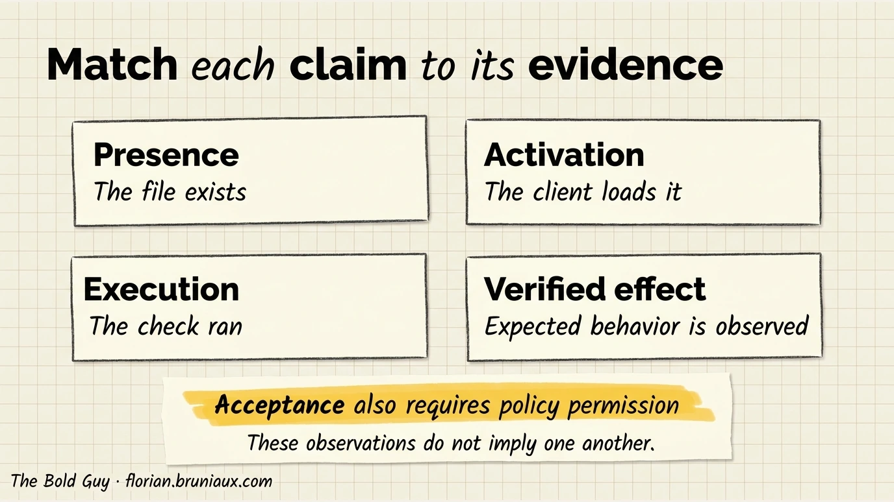

# Разработка агентской системы

> **Confidence**: уровень 1 для построения архитектуры; Уровень 2 для заявлений о производительности нескольких продуктов. Контролируемые исследования показывают измеримые эффекты ремня безопасности, но не доказывают, что ремень безопасности всегда важнее модели.
>
> **Время чтения**: ~35 минут

---

## <a name="the-core-claim"></a>Основная претензия

Необработанный LLM не является агентом. Он становится единым при подключении к ремню безопасности. Поэтому полезной единицей оценки является пара **модель-привязь**, а не какой-либо компонент по отдельности.

Исследование [Agent System and Harness Design 2026](https://arxiv.org/abs/2606.20683) разлагает исполнительную систему на наблюдение, контекст, управление, действие, состояние и проверку. [Code как агентский ремень](https://arxiv.org/abs/2605.18747) добавляет представление, ориентированное на код: код — это не только результат, но и исполняемая основа для инструментов, памяти, управления, координации и проверки. Это полезные таксономии, а не доказательства производительности.

Контролируемые доказательства подтверждают более узкое утверждение. В [Эффект каркаса в Coding Agents](https://arxiv.org/abs/2607.22585)две фиксированные модели были протестированы в трех связях на 50 задачах Terminal-Bench Pro. Выбор жгута изменял количество жетонов за решенную задачу до 40 раз, в то время как парные различия в проходимости оставались в пределах от 0 до 8 процентных пунктов и в большинстве случаев были статистически незначимыми. Система может влиять на стоимость и поведение при сбоях, не влияя при этом на точность выполнения задачи. И наоборот, качество модели или совместимость модели и оборудования могут оставаться сдерживающим фактором. Сообщите пару, поставленную задачу и бюджет.

Токены за решенную задачу не являются множителем биллинга: цены input/output, кеширование и проверка человеком требуют отдельного учета. Незначительная разница в показателях успеха также не обеспечивает эквивалентного качества. При выборе локального исходного уровня сохраняйте четкость показателей ресурсов и результатов исследования.

На этой странице **agent используется** в смысле времени выполнения: система, которая владеет циклом агента, инструментами, контекстом, состоянием и разрешениями. Репозиторий также может предоставлять **-систему репозитория** для этой среды выполнения: его инструкции, настройку, состояние задачи и шлюзы проверки. Это различие имеет значение, поскольку проект может улучшить использование своего репозитория, не заменяя Claude Code, а команда может переключать средства выполнения во время выполнения, не отказываясь от каждой практики проекта.

На этой странице рассказывается о том, что находится внутри среды выполнения. Информацию об уровне репозитория см. в разделе [Repository Harness Engineering](../ultimate-guide.md#925-repository-harness-engineering). Для циклов обратной связи, исполняемых графиков рабочих процессов, правил остановки и границ оценки используйте [Loop & Graph Engineering](./loop-graph-engineering.md). Датированное сравнение конкретных продуктов в CLI, IDE и облаке см. в [Agent Harness Landscape](../ecosystem/agent-harness-landscape.md).

Цель пользователя 

*LLM — это один из этапов цикла обеспечения надежности. Контекст, политика, защищенное выполнение, проверка, наблюдаемость, ограничения и обратная связь определяют, станет ли предложение модели принятым результатом.*

### <a name="choose-the-right-entry-point"></a>Выберите правильную точку входа

| Вопрос | Каноническая страница |
|---|---|
| Что содержит среда выполнения и как работают ее элементы управления? | Эта страница [Agent Harness Engineering](./agent-harness.md) |
| Как следует проектировать циклы, графы рабочих процессов, переходы между состояниями, правила остановки и оценки? | [Проектирование циклов и графов](./loop-graph-engineering.md) |
| Как независимые сессии Claude Code должны обмениваться доказательствами, не распространяя дрейф? | [Межсессионный обмен сообщениями: безопасность координации](../workflows/cross-session-messaging.md#coordination-safety-correlated-drift-and-false-consensus) |
| Какую среду выполнения, оркестратор, фреймворк или смежный проект мне следует сравнить? | [Пейзаж агента](../ecosystem/agent-harness-landscape.md) |
| Что поддерживает конкретный продукт-агент кодирования? | [Инструменты агента: за пределами Claude Code](../ecosystem/agentic-tools.md) |
| Что отличает среду выполнения, репозиторий, средства оценки и оркестратор? | [Глоссарий](./glossary.md) |
| В каком выпуске Claude Code появилось такое поведение? | [Claude Code Релизы](./claude-code-releases.md) и его машиночитаемая история [](../../machine-readable/claude-code-releases.yaml) |

Страницы намеренно остаются отдельными. Инженерные концепции меняются медленнее, чем перечень продуктов, лицензии, характеристики и сигналы популярности. Объединение того и другого приведет к тому, что архитектурная ссылка унаследует датированный снимок каталога и цикл обслуживания.

---

## Оглавление

0. [Четыре уровня, четыре обязанности](#0-four-layers-four-responsibilities)
1. [Три основополагающих свойства](#1-three-foundational-properties)
2. [Девять компонентов](#2-the-nine-components)
3. [Смертельная троица: модель безопасности](#3-the-lethal-trifecta-security-model)
4. [CI/CD Агентские шаблоны](#4-cicd-agentic-patterns)
5. [Тестирование цифрового двойника](#5-digital-twin-testing)
6. [Стек наблюдаемости](#6-observability-stack)
7. [Антишаблоны распределения тестов и наложения компонентов](#7-test-distribution-and-component-stacking-anti-patterns)
8. [Шаблон Creator-Verifier](#8-creator-verifier-pattern)
9. [Эталонная архитектура](#9-reference-architecture)
10. [Видеосвидетельства практиков](#10-practitioner-video-evidence)
11. [Оптимизаторы и мета-обвязки](#11-harness-optimizers-and-meta-harnesses)

---

## <a name="0-four-layers-four-responsibilities"></a>0. Четыре уровня, четыре ответственности

Слово *harness* перегружено. В этом руководстве используются четыре уровня, поэтому модель, среда выполнения, настройка репозитория и менеджер парка не рассматриваются как взаимозаменяемые продукты.

| Слой | Ответственность | Примеры | Что он не заменяет |
|-------|----------------|----------|--------------------------|
| **Модель** | Генерирует и рассуждает о токенах | Claude, GPT, Gemini, DeepSeek, Квен | Инструменты, политика, устойчивое состояние или исполнение |
| **Жгут времени** | Запускает цикл агента и обеспечивает использование инструментов, контекст, разрешения и восстановление. | Claude Code, Codex, Gemini CLI, ремень безопасности DeepSeek, OpenCode | Инструкции по конкретному проекту и ворота поставки |
| **Репозиторий** | Делает одну кодовую базу разборчивой и проверяемой во время выполнения. | `CLAUDE.md`/`AGENTS.md`, `init.sh`, файлы блокировки, состояние задачи, тесты; Лиза установила контракты и ограждения | Маршрутизация модели среды выполнения, цикл инструментов или песочница. |
| **Оркестратор** | Координирует несколько трасс, рабочих пространств или жгутов | Symphony, Vibe Kanban, AgentBox, Proliferate, Liza | Базовый цикл агента среды выполнения |

Граница практична. Если продукт может планировать или проверять только сеансы Claude Code и Codex, он является оркестратором. Если он сам предоставляет итеративный цикл модели и инструментов, это среда выполнения. Если он зафиксирован в репозитории и сообщает любой совместимой среде выполнения, как безопасно работать, это система репозитория.

Продукт может охватывать два слоя, не владея всеми четырьмя. [Liza](https://github.com/liza-mas/liza) устанавливает поведенческие контракты, навыки, настройки и защитные меры в репозиторий, а затем координирует внешний интерфейс командной строки агента кодирования с помощью рабочих деревьев, устойчивого состояния задач, аренды, ролей doer/reviewer, восстановления и шлюзов слияния. Claude Code, Codex или другой выбранный CLI по-прежнему владеет внутренним циклом инструмента. Профиль [Landscape](../ecosystem/agent-harness-landscape.md#liza-a-repository-harness-and-control-plane-combined) записывает доказательства закрепленного кода и ограничения безопасности.

Термин **мета-жгут** перегружен. В исследовании оптимизатора, описанном на этой странице, оптимизатор системы или мета-система предлагает изменения в целевой системе, оценивает кандидатов и продвигает или отклоняет версии. В некоторых продуктах и ​​практических статьях *meta-harness* используется для другой роли: общего клиента, который отправляет задачи в Claude Code, Codex, Cursor, Pi или другую среду выполнения. Согласно таксономии этого руководства, система, которая выбирает или координирует существующие жгуты без их модификации и оценки, является **orchestrator или плоскостью управления**, а не оптимизатором жгутов.

### Цикл, график, жгут и оркестратор — это разные представления.

Эти термины отвечают на разные вопросы. Отношение к ним как к конкурирующим категориям продуктов скрывает важные границы.

| Вид | Основной вопрос | Основной артефакт |
|-------|------------------|---------------|
| **Проектирование контуров** | Какая обратная связь повторяется, а что останавливает повторение? | Цель, действие, наблюдение, проверка, правило остановки |
| **Графическое проектирование** | Какие узлы, ребра, переходы состояний, соединения и контрольные точки являются исполняемыми? | Версионный граф рабочего процесса и схема общего состояния |
| **Проектирование проводки** | Какой контекст, инструменты, политика, состояние, проверка и выполнение связаны с восстановлением? | Элементы управления средой выполнения и репозиторием |
| **Оркестрация** | Как координируются пробеги, рабочие места, очереди, бюджеты и люди? | Планировщик или плоскость управления |

[Loop Engineering](https://addyo.substack.com/p/loop-engineering) — это полезный ярлык для практики, позволяющий заменить повторяющиеся ручные подсказки системой, которая находит работу, отправляет ее, проверяет и решает, что будет дальше. Это не формальный стандарт. [Графическая инженерия в эпоху агентов LLM](https://arxiv.org/abs/2608.21156) и [Что делает подсказки графом](https://arxiv.org/abs/2607.27578) предлагает более широкий словарь графической инженерии, но оба являются недавними препринтами. Механизмы старше названия: официальный [LangGraph Graph API](https://docs.langchain.com/oss/python/langgraph/graph-api) уже моделирует общее состояние, узлы, фиксированные или условные ребра и параллельные супершаги, а его [persistence Layer](https://docs.langchain.com/oss/python/langgraph/persistence) обеспечивает контрольные точки, прерывания, повторы и восстановление после сбоев.

Цикл может быть закодирован в виде графа. Граф может координировать несколько циклов. Жгут может выполняться либо при добавлении разрешений, контекста, инструментов, проверки и восстановления. Оркестратор может запланировать несколько жгутов, не владея их внутренними циклами. Прежде чем сравнивать количество функций, сравните продукты внутри одного слоя.

---

## <a name="1-three-foundational-properties"></a>1. Три основополагающих свойства

arXiv 2605.18747 («Код как обвязка агента», май 2026 г.) формализует три свойства, которые отличают обвязку от простой оболочки LLM:

**Executability**: программа может проверить, что на самом деле сделал агент, а не только то, что он обещал сделать. Программа, которая регистрирует только подсказки и завершения, не является исполняемой, поскольку не может отличить успешный вызов инструмента от галлюцинаторного.

**Inspectability**: когда что-то выходит из строя, жгут выдает действенные диагностические данные. Трассировки стека, указывающие на этап быстрой сборки. События трения с пометкой, какие правила и навыки были активны. Потребление токенов по компонентам. Без возможности проверки отладка сбоя агента требует восстановления сеанса на основе журналов, что является дорогостоящим и часто неполным.

**Statefulness**: протокол поддерживает непрерывность между сеансами. Состояние сеанса выводится наружу, а не хранится в контекстном окне модели. Когда агент возобновляет работу после сброса контекста, он может восстановить, где он находился, без предоставления полного инструктажа человеком. Собственные телеметрические данные Anthropic показывают, что продолжительность сеанса 99,9-го процентиля составила 45 минут в январе 2026 года по сравнению с 25 минутами в октябре 2025 года. При такой продолжительности сохранение состояния не является обязательным.

---

## <a name="2-the-nine-components"></a>2. Девять компонентов

Эти девять компонентов присутствуют в Claude Code, Anthropic SDK, OpenAI Agents SDK, LangGraph, AWS Bedrock AgentCore и Factory.ai Missions. Ни один инструмент не реализует все девять одинаково, но структура достаточно последовательна, чтобы ее можно было использовать в качестве контрольного списка при оценке использования нового инструмента или платформы.

### <a name="21-while-loop-engine"></a>2.1 Двигатель цикла while

Основной цикл: восприятие (чтение контекста, выходные данные инструмента, последняя инструкция пользователя), планирование (вызов LLM с собранной подсказкой), действие (выполнение инструментов). Это сердцебиение. Anthropic SDK, OpenAI Агенты SDK и LangGraph реализуют его по-разному (Anthropic ориентирован на потоковую передачу, LangGraph основан на графах), но все три имеют этот цикл в качестве базовой абстракции.

Где возникают проблемы: циклы, которые не ограничивают итерации, циклы, которые не обрабатывают отказы LLM или неоднозначные вызовы инструментов, циклы, которые позволяют контексту расти без суммирования, пока не достигнут предела окна и не прервутся.

#### <a name="three-loop-horizons"></a>Три петли горизонта

Полезная модель практикующего специалиста разделяет три горизонта обратной связи. Условия не являются формальным стандартом, но они показывают, где коррекция должна стать устойчивой.

| Горизонт | Граница | Типичные элементы управления | Где он обычно обитает |
|---|---|---|---|
| **Внутренний контур** | Один агент работает | Результаты инструмента, целевые тесты, навыки, локальные проверки | Среда выполнения плюс использование репозитория |
| **Внешний контур** | Задача или запрос на включение | Агентский контроль качества, полные наборы тестов, более глубокий анализ, независимые проверяющие | Репозиторий плюс CI |
| **Мета-петля** | Во многих пробегах | Анализ ошибок, периодический анализ проверок, поиск средств, обновления правил и верификаторов. | Командный процесс, оптимизатор или мета-обвязка |

В интервью [AI Native DevCon, посвящённом проектированию жгутов](https://www.youtube.com/watch?v=D_cw-k0F1DM&t=243s), внутренний цикл описывается как быстрая обратная связь во время работы агента, [outer цикл](https://www.youtube.com/watch?v=D_cw-k0F1DM&t=340s) как более медленные проверки на границе запроса на извлечение, а метацикл [](https://www.youtube.com/watch?v=D_cw-k0F1DM&t=427s) как непрерывное улучшение после сбоев. Эта модель превращает повторяющиеся исправления, выполняемые человеком, в сигнал технического обслуживания. Повторяющийся комментарий к обзору должен стать проверкой, правилом, навыком, ловушкой или проверкой на самом раннем цикле, который сможет его перехватить.

Прежде чем добавлять автономные слои, создайте один ограниченный цикл. В интервью по контекстной инженерии [2026](https://www.youtube.com/watch?v=Usufn8IQJgw&t=3112s)Декс Хорти описывает выключенную фабрику программного обеспечения, которая отказалась от тестирования и проверки людьми, накапливала сбои и была закрыта. Это ретроспектива практикующего специалиста, а не контролируемое исследование, но оно определяет конкретную причину отказа: автономия расширяется быстрее, чем проверка и восстановление. Адди Османи дает тому же правилу название «распараллеливать в последнюю очередь»: копировать заводской параллелизм только после того, как у одного устройства появится надежный судья, путь восстановления и формат проверки, который люди смогут усвоить, поскольку «параллелизм умножает уже имеющееся узкое место», которым обычно являются возможности проверки человеком ([Brownfield Agentic Engineering](https://addyo.substack.com/p/brownfield-agentic-engineering), сентябрь 2026 г.). Он также сужает то, что должен производить метацикл: переместить повторяющееся исправление в правило проверки, ловушку, тип, тест или навык и «сохранить прозу для ограничений, которые не могут быть реализованы механически».

Метацикл теперь можно автоматизировать. [Meta-Harness](https://arxiv.org/abs/2603.28052) ищет код жгута, используя предыдущий источник, оценки и трассировки выполнения. [Agentic Harness Engineering](https://arxiv.org/abs/2604.25850) представляет редактируемые компоненты в виде файлов и связывает каждое изменение с прогнозом, который следующая оценка может опровергнуть. Автоматизация не устраняет необходимости в отложенных тестах или бюджетах. Это делает эти границы более важными.

### <a name="22-context-management"></a>2.2 Управление контекстом

Что отображается в подсказке на каждой итерации цикла: история разговоров, выходные данные инструмента, полученная память, текущее состояние задачи, правила из CLAUDE.md. Проблема в том, что контекст конечен и дорог. Стратегии:

- **Сжатие/суммирование**: заменить предыдущие ходы сжатым резюме. Claude Code автоматически сжимается вблизи порога контекста, а также предоставляет `/compact` для явного сжатия. Хуки `PreCompact` и `PostCompact` позволяют командам проверять эту границу или реагировать на нее.
- **Скользящее окно**: сохранить последние N ходов дословно, подвести итог всему предшествующему.
- **Дополненный поиском контекст**: извлекайте соответствующие фрагменты из долговременного хранилища, а не переносите все в окно.

Конвейер ACE (см. [context-engineering.md §6](./context-engineering.md#6-the-ace-pipeline)) — это уровень Config-Persistence над управлением контекстом: он определяет, какие правила и навыки загружаются между сеансами.

[Агентный контекстный инжиниринг](https://arxiv.org/abs/2510.04618) рассматривает контекст как развивающуюся книгу, а не как многократно переписываемое резюме. В документе сообщается о приросте на 10,6% по показателям агентов и на 8,6% по финансовым задачам за счет поэтапной генерации, анализа и курирования. Ссылайтесь на них как на результаты метода, а не как на доказательство того, что добавление большего контекста лучше. Принцип работы меньше: сохраняйте полезные детали, прикрепляйте обратную связь к проверяемому артефакту и тестируйте развивающийся контекст на фоне отложенных задач.

#### <a name="context-beyond-the-repository"></a>Контекст за пределами репозитория

Файлы репозитория — это только один источник истины. Решения по продукту могут храниться в Linear, ограничения интерфейса — в Figma, поведение компонентов — в Storybook, а история эксплуатации — в системах инцидентов. В докладе Марка Слоана [2026 об ограничениях продукта и дизайна](https://www.youtube.com/watch?v=tf6VNGH3tRk&t=523s) утверждается, что этот внешний контекст должен стать доступным для агента, не удаляясь молча от его источника.

| Шаблон доступа | Сила | Режим отказа |
|---|---|---|
| Живой инструмент или доступ MCP | Свежие данные и прямая атрибуция | Доступность, разрешение и риск быстрого внедрения |
| Снимок версионного репозитория | Воспроизводимость и возможность просмотра с помощью кода | Снимок может устареть |
| Мост синхронизации | Сочетает свежесть и местный артефакт. | Сбои синхронизации могут создать две противоречивые истины |

Запишите источник, время получения и ожидаемую свежесть внешнего контекста. Если агент не может определить, является ли проектное решение актуальным, построитель контекста переместил неопределенность в подсказку вместо того, чтобы разрешить ее.

### <a name="23-tool-registry"></a>2.3 Реестр инструментов

Каталог доступных инструментов: название, схема, описание, разрешения, смета. Статический реестр инструментов загружает все схемы инструментов при каждом вызове. Динамический реестр («поиск инструментов по требованию») загружает только то, что действительно необходимо текущей задаче.

Внутренние данные Anthropic (цитируемые в статье Фаулера, источник: сообщение практикующего специалиста) указывают на 37%-ное сокращение использования токенов при динамической отправке инструментов по сравнению со статической загрузкой. Это число не воспроизводится независимо, но направленное утверждение заслуживает доверия: предоставление модели 40 схем инструментов, когда ей нужно 4, увеличивает шум и стоимость.

Для конфиденциальных инструментов MCP (Model Context Protocol) поместите аутентификацию и авторизацию на границе выполнения. Шлюз с идентификацией — это один из рабочих шаблонов, но он не является свойством по умолчанию для MCP или Claude Code. Требуемый контроль зависит от данных инструмента, побочных эффектов и модели развертывания. См. раздел Экосистема серверов [MCP](../ecosystem/mcp-servers-ecosystem.md) и [Усиление безопасности](../security/security-hardening.md).

### <a name="24-sub-agent-management"></a>2.4 Управление субагентами

Делегирование специализированным субагентам со своими контекстными окнами и объемом задач. Оркестратор порождает работника, предоставляет ограниченное описание задачи и получает структурированный результат. Рабочий не разделяет полный контекст оркестратора; он получает только то, что ему нужно.

Factory.ai Missions формализует это: агент оркестратора разлагает требования, делегирует реализацию работникам и направляет выполненную работу состязательным агентам-валидаторам. В задокументированном проекте клонирования Slack независимые валидаторы выявили 81 проблему до того, как какой-либо код был объединен, в результате чего 34% работ по реализации были «исправлениями функций».

Субагенты Claude Code по умолчанию наследуют режим разрешений родительского сеанса. Это поведение во время выполнения, а не доказательство наименьших привилегий. Ограничьте каждого агента `tools`, `disallowedTools` и `permissionMode` и используйте `isolation: worktree`, когда параллельные записывающие устройства не должны совместно использовать извлечение. См. Справочник по инструментам [](./tools-reference.md), [Agent Teams](../workflows/agent-teams.md)и определение изоляции рабочего дерева [](./glossary.md#worktree-isolation).

### 2.5 Собственные инструменты и загружаемые навыки

Claude Code предоставляет встроенные инструменты для доступа к файлам, поиска, выполнения оболочки, веб-доступа, делегирования и других операций во время выполнения. Навыки разные: это загружаемые модули инструкций и ресурсов, вызываемые с помощью инструмента `Skill`. Навык может включать сценарии и детерминированные проверки, но сам навык не является детерминированным по своей сути, поскольку модель по-прежнему интерпретирует его инструкции и выбирает действия.

Тестируйте детерминированные скрипты и валидаторы с помощью обычных утверждений. Проверьте часть навыка, опосредованную моделью, с помощью поведенческих задач, ожидаемых границ и проверки человеком или калиброванным оценщиком. Справочник по инструментам [Tools Reference](./tools-reference.md) документирует поверхность инструмента времени выполнения; примеры [skills](../../examples/skills/) показывают отдельную модель упаковки.

### 2.6 Сохранение сеанса

Состояние, которое сохраняется при сбросе контекста и прерываниях сеанса. Это не то же самое, что долговременная память (которая является концепцией более высокого уровня). Постоянство на уровне обвязки означает: агент может восстановить свое текущее состояние задачи на основе внешних артефактов, а не на основе истории разговоров в контексте.

Factory.ai Missions использует общий слой артефактов (контракты проверки, списки функций, определения навыков), чтобы выжить в контекстных ограничениях многодневных миссий. E2B и Northflank обеспечивают это на уровне инфраструктуры через постоянное состояние песочницы. Anthropic Claude Управляемые агенты предоставляют эту возможность как функцию продукта с контрольными точками.

### 2.7 Динамическая сборка подсказок

Шаг, который превращает текущее состояние (описание задачи + соответствующий контекст + определения инструментов + память + правила) в фактическое приглашение, отправленное на LLM. Это не стандартизировано для разных платформ. LangChain, LangGraph и Anthropic SDK имеют разные абстракции.

Места, где сборка идет не так: внедрение правил, которые конфликтуют с инструкциями пользователя, схемы инструментов, которые перекрываются таким образом, что запутывают выбор модели, извлечение из памяти, которое выявляет устаревший контекст. Обвязки, которые делают сборку видимой (регистрируя окончательно собранное приглашение, а не только ответ), значительно легче отлаживать.

В докладе Райана Лопополо [2026, посвященном проектированию жгутов](https://www.youtube.com/watch?v=c8bE0cj7vHY&t=674s), репозиторий рассматривается как среда, которая должна сделать стандарты хорошей работы команды понятными и вовремя выявить правильный контекст. Эксплуатационная проверка проста: если одна и та же обратная связь появляется дважды, решите, принадлежит ли она форматтеру, линтеру, тесту, записи архитектурного решения, навыку или верификатору. Текст подсказки — это только один из возможных элементов управления.

### 2.8 Перехватчики жизненного цикла

Точки внедрения, которые срабатывают при определенных событиях времени выполнения. Claude Code не предоставляет общие перехватчики `pre-LLM` и `post-LLM`. Его модель событий включает загрузку инструкций, запросы разрешений, использование инструментов, сжатие, жизненный цикл субагента и товарища по команде, изменения рабочего дерева, жизненный цикл сеанса и события сбоя. Точный список и семантика блокировки находятся в справочнике событий [Hooks](./hooks-events-reference.md).

Хуки — это место, где вы вставляете инструменты наблюдения, проверку разрешений, ограничение скорости, очистку вывода и ведение журнала аудита. Только события с документированной семантикой блокировки могут остановить действие. Асинхронные перехватчики подходят для телеметрии, для которой не требуется прерывать цикл.

### 2.9 Обеспечение соблюдения разрешений

Перед выполнением каждого последующего действия необходимо установить границы применения. В зависимости от риска эта граница может сочетать в себе явное одобрение, правила разрешений, изолированную программную среду, сетевую политику, учетные данные с ограниченной областью действия и проверку после выполнения. Человеческий анализ по-прежнему полезен для принятия важных решений, но повторяющиеся запросы на одобрение не являются стратегией полной изоляции.

Два полезных структурных механизма:

1. **Изоляция песочницы**: агент работает в среде, где деструктивные действия физически невозможны, не только запрещены политикой, но буквально невозможны с учетом ограничений сети, файловой системы и процессов. Агент-песочница Kubernetes, микровиртуальные машины E2B и исполнители Northflank BYOC реализуют это на аппаратном уровне.

2. **Identityшлюз**: вызовы конфиденциальных инструментов аутентифицируются во время вызова с использованием учетных данных сеанса с ограниченной областью действия, а не широкого статического ключа API. Strata Maverics и Microsoft Entra Agent ID реализуют этот шаблон с помощью потоков OAuth OBO (от имени), которые ограничивают разрешения текущим контекстом задачи.

Claude Code теперь предоставляет дополнительные примитивы для этого уровня: `sandbox.network.strictAllowlist` запрещает трафик песочницы, не внесенный в белый список, без запроса, изоляция рабочего дерева разделяет одновременные изменения, а `--restricted` удаляет выполнение команд и кода, а также `WebFetch`, если не восстановлено явным образом. Эти меры контроля уменьшают риск заражения, но они не определяют, что каждая интеграция MCP использует идентификацию для каждого сеанса или что каждое действие находится в изолированной программной среде.

Интервью [2026 с создателем Claude Code Борисом Черным](https://www.youtube.com/watch?v=julbw1JuAz0&t=3176s) описывает систему разрешений как многоуровневую комбинацию классификаторов, статического анализа, списков разрешенных шаблонов, консервативных значений по умолчанию и человеческого решения, когда система не уверена. Это полезное обоснование дизайна от создателя продукта. Текущее поведение по-прежнему необходимо сверять с официальной документацией и историей выпусков [Claude Code](./claude-code-releases.md).

### <a name="claude-code-implementation-checkpoint"></a>Контрольная точка реализации Claude Code

Девятикомпонентная модель не зависит от продукта. В таблице ниже это сопоставлено с поведением Claude Code до версии 2.1.250 без превращения этой страницы во второй журнал выпуска.

| Используйте беспокойство | Текущие механизмы Claude Code | Опубликовать доказательства |
|---|---|---|
| Контекст и состояние | Автоматическое и явное уплотнение; хуки `PreCompact` и `PostCompact`; автоматическая память | v2.1.247, v2.1.105, v2.1.76, v2.1.59 |
| Инструмент и оперативная сборка | Отложенная загрузка инструмента, опция `alwaysLoad` MCP, крюк `InstructionsLoaded` | v2.1.121, v2.1.69 |
| Делегация | Фоновые подагенты, унаследованный режим разрешений, ограничения параллелизма и вложенности, разветвление диалога, наследование кэша подсказок | v2.1.198, v2.1.212, v2.1.217, v2.1.219, v2.1.232 |
| Изоляция и политика | Изоляция рабочего дерева и последующее усиление защиты, строгий список разрешенных сетей, режим запуска `--restricted` | v2.1.49, v2.1.50, v2.1.222, v2.1.219, v2.1.248 |
| Восстановление и координация | Межсессионный обмен сообщениями, TTL кэша каждого агента, резервная модель субагента | v2.1.224, v2.1.248, v2.1.247 |
| Инспекция и контроль | События разрешения, инструмента, уплотнения, инструкции, сбоя, агента, товарища по команде и перехвата рабочего дерева. | с версии 2.1.69 по версию 2.1.219 |

Используйте удобочитаемую историю выпусков [](./claude-code-releases.md) для интерпретации и [`claude-code-releases.yaml`](../../machine-readable/claude-code-releases.yaml) для поиска на уровне версии. `reference.yaml` обеспечивает стабильные тематические маршруты на этой странице и в сопутствующем руководстве.

---

## <a name="3-the-lethal-trifecta-security-model"></a>3. Смертельная тройка: модель безопасности

Саймон Уиллисон придумал этот термин в 2025 году (см. [martinfowler.com/articles/202508-ai-thoughts.html](https://martinfowler.com/articles/202508-ai-thoughts.html)):

**Личные данные + ненадежный контент + внешняя связь = документированный вектор эксфильтрации.**

Любые два из трех являются управляемыми. Все три вместе, без структурной изоляции, создают путь, по которому злоумышленник внедряет инструкции в данные, которые будет читать агент (документ, комментарий к коду, билет Jira), агент обрабатывает эти инструкции, используя свой доступ к личным данным, а затем использует свои коммуникационные возможности для проникновения.

Это не теоретически. GitHub Security задокументировала атаки с быстрым внедрением в Copilot через вредоносное содержимое репозитория. Оборона не лучше, чем оперативная инженерия; это структурная изоляция.

[AgentDojo](https://arxiv.org/abs/2406.13352) позволяет измерить угрозу с помощью 97 реалистичных задач и 629 тестовых сценариев безопасности для агентов, использующих данные ненадежных инструментов. [CaMeL](https://arxiv.org/abs/2503.18813) демонстрирует структурный ответ: доверенный поток управления отделяется от ненадежного потока данных, а возможности обеспечивают соблюдение политики при вызове инструментов. CaMeL сообщает о 77% успеха задач при доказуемой безопасности по сравнению с 84% для незащищенной системы. За безопасность приходится платить, но граница может быть реализована за пределами модели.

### Слои защиты

| Слой | Механизм | Выполнение |
|-------|-----------|---------------|
| Сетевая изоляция | Агент не может связаться с внешними конечными точками, кроме явного списка разрешений. | GitHub Агентские рабочие процессы: прокси-сервер Squid в белом списке; Северный фланг: выходной брандмауэр |
| Изоляция файловой системы | Агент записывает во временное рабочее пространство, а не в файловую систему хоста. | Kubernetes агент-песочница, E2B microVM |
| Область действия удостоверения | Каждый вызов инструмента содержит учетные данные для каждого сеанса с минимально необходимыми разрешениями. | Strata Maverics, идентификатор агента Microsoft Entra |
| Проверка вывода | Созданный агентом контент проходит этап обнаружения угроз, прежде чем попасть на любую производственную поверхность. | GitHub Агентские рабочие процессы: шаблон безопасных выходов (Semgrep + TruffleHog + LlamaGuard) |
| Контекст выполнения, доступный только для чтения | Агент читает базу кода, но не может писать напрямую; запись проходит через вентиль PR/review | GitHub Положение по умолчанию для агентских рабочих процессов |

### <a name="why-human-review-alone-fails"></a>Почему человеческая оценка неэффективна

Внутренние данные Anthropic (документация модели совместной ответственности, апрель 2026 г.): 93 % запросов на разрешения агентов в производстве одобряются без надлежащего рассмотрения. Это не критика вовлеченных людей; это структурное следствие объема и когнитивной нагрузки. Когда человек утверждает 50 диалогов с разрешениями в час, индивидуальное одобрение становится формальностью.

Масштабируемая защита: структурная изоляция (делает невозможными определенные действия) и проверка второго агента (шаблон создатель-проверяющий, раздел 8). Человеческий анализ по-прежнему подходит для принятия важных и нечастых решений, а не для рутинных действий агента.

---

## <a name="4-cicd-agentic-patterns"></a>4. Агентские шаблоны CI/CD

Три платформы создали агентов в виде примитива CI/CD. Выбор между ними — это архитектурное решение, а не сравнение функций.

### <a name="test-selection-as-an-agent-primitive"></a>Выбор теста как примитив агента

Перед любой из трех платформ, представленных ниже, один уровень решает, что на самом деле запускают эти агенты: детерминированный выбор тестов, служба, которая выбирает, какие тесты запускать для данного изменения, на основе прошлых результатов и релевантности пакета, вместо запуска полного набора для каждого PR. Это не относится ни к одной платформе; это инфраструктура, поверх которой расположены три шаблона агента CI/CD, представленные ниже.

Это важно именно для агентов, а не только для стоимости CI. Рецензент-человек может посмотреть на неудавшийся тест и на основе опыта решить, применимо ли это к их изменению. Агенту необходимо такое суждение: конкретный текущий набор соответствующих тестов — это то, что позволяет ему самопроверяться и выполнять итерации, а не тонуть в нерелевантных сбоях ([Агентное кодирование утомляет CI](https://claude.com/blog/agentic-coding-is-straining-ci-heres-how-we-scaled-test-impact-analysis-at-anthropic), проектирование Anthropic, сентябрь 2026 г.; см. [полную оценку](../../docs/resource-evaluations/2026-09-14-anthropic-ci-test-impact-analysis.md)).

Собственный сервис Anthropic иллюстрирует режим отказа, который следует учитывать при проектировании. Его версия v0 разделяет прослушиватель, который записывает результаты тестирования каждого запуска CI, от селектора, который считывает эту историю, чтобы решить, что запускать на новых PR. Оба выполнялись как один процесс, потому что для запуска истории каждого теста требуется один записывающий элемент, и это ограничение одного записывающего устройства блокирует горизонтальное сегментирование. При одновременной нагрузке CI прослушиватель отставал от очереди PR: плохое объединенное изменение провалило тест для всех, отслаивающаяся зависимость превратилась в нечеткие красные цвета, которые блокировали слияния, а недавно исправленный тест просто не запускался, пока прослушиватель не догнал его. Три последовательных патча, более крупная машина, затем сегментирование, затем ежедневные перезапуски, каждый из которых купил меньше времени, чем предыдущий, прежде чем команда переписала сервис на основе журнала в памяти без сохранения состояния, к которому может добавлять данные любой работник, что сделало его горизонтально масштабируемым за счет запуска более дорогой инфраструктуры, чем исходный синглтон.

Ограничения: в исходном коде не указан ни один продукт, не публикуется SLO с задержкой, а запуск распределенного проекта явно дороже в обмен на то, что его легче масштабировать и профилировать. Относитесь к этому как к образцу для планирования, а не как к конкретному инструменту, который нужно принять.

### <a name="keep-test-feedback-compact-and-recoverable"></a>Сохраняйте отзывы о тестировании компактными и восстанавливаемыми

Предоставьте агенту компактный результат для каждого запуска теста: команда, версия, среда, статус завершения, фактически выполненные или пропущенные тесты, а также сбои, требующие принятия мер. Сохраняйте полный доступ к выходным данным с помощью артефакта с контролируемым доступом или ссылки на журнал для диагностики. Модель [Молчаливый успех](../ultimate-guide.md#silent-success-pattern) применяется к хукам. В сводке теста по-прежнему следует отличать успешное выполнение от отсутствия тестов, тайм-аута, отсутствующих выходных данных или повторного использования результата.

Сократите количество повторяющихся строк прохождения теста и сообщений о ходе выполнения, прежде чем удалять детали диагностики. В случае сбоя укажите ошибочное утверждение, соответствующие кадры стека и способ получения полной трассировки. Прежде чем полагаться на него, убедитесь, что компактное представление сохраняет статус выхода и выявляет известный сбой. Меньшее количество отображаемых строк само по себе не приводит к снижению общей стоимости или повышению производительности агента.

### <a name="own-harness-maintenance-and-the-ci-feedback-path"></a>Собственное обслуживание проводки и канал обратной связи CI

Назначьте специалиста по обслуживанию и резервному копированию общей конфигурации жгутов с зарезервированными возможностями для воспроизведения повторяющихся сбоев, тестирования изменений конфигурации и вывода из эксплуатации устаревших элементов управления. Продуктовые группы сохраняют ответственность за свои требования и доказательства приемки. Сопровождающий предоставляет многократно используемые пути настройки, проверки и восстановления, а не становится проверяющим каждое изменение.

Там, где CI является узким местом, укажите также владельца пути обратной связи. Записывайте время в очереди отдельно от времени выполнения, случайных сбоев, попаданий в кэш, усилий по диагностике и нагрузки на проверку. Установите базовый уровень, прежде чем решить, нужна ли для этого специальная команда по повышению производительности или она может оставаться явной обязанностью существующей команды.

[Bazel удаленного кэширования](https://bazel.build/remote/caching) может совместно использовать результаты действий между разработчиками и CI. Повторное использование зависит от воспроизводимых входных и выходных данных, а серверная часть кэша нуждается в управлении работой и доступом. Его руководство по герметичности [](https://bazel.build/basics/hermeticity) рекомендует перед миграцией определить зависимости от окружающей среды. Сравните репрезентативные листовые изменения, изменения общих зависимостей и холодные сборки с существующей системой сборки, включая работы по настройке и обслуживанию. Это оценочный кандидат, а не рекомендация по миграции или измеренное локальное ускорение.

### <a name="github-agentic-workflows"></a>GitHub агентские рабочие процессы

Основная концепция: `gh aw compile` берет определение рабочего процесса агента в Markdown и создает `.lock.yml`, защищенный файл GitHub Actions, который выполняет рабочий процесс с принудительной изоляцией. На этапе компиляции свойства безопасности встроены, а не добавлены позже.

**Модель выполнения**: агент запускается в контексте только для чтения. Он может анализировать и генерировать. Любая запись (фиксация, комментарий, развертывание) проходит через «Безопасные выходные данные» — отдельное задание, которое проверяет сгенерированный артефакт, прежде чем он коснется рабочих поверхностей. Safe Outputs запускает Semgrep (SAST), TruffleHog (обнаружение секретов) и LlamaGuard (вредоносный контент) для различий, сгенерированных агентом, перед их применением.

**Интеграция проверки кода**: GitHub Copilot Code Review обработал более 60 миллионов проверок кода по состоянию на 2026 год. На стенде Code Review Bench (Марсиан, март 2026 года, более 200 000 PR с открытым исходным кодом, оценено 17 инструментов) Augment Code лидирует с отзывом 62,8%, Copilot - 53,3%. Графит лидирует по точности на уровне 75 %, но по полноте — на 8,8 % (высокая точность означает мало ложных срабатываний, низкая полнота означает, что пропущено много реальных ошибок). Ни один инструмент не доминирует по обоим показателям.

Тест **[c-CRAB](https://arxiv.org/html/2603.23448v3)**: Claude Code достигает 32,1% в тестах, основанных на отдельных комментариях людей. Отдельный агент кодирования применяет комментарии перед оценкой. Из 234 тестов 192 структурные и 42 поведенческие. Эти результаты не являются ни производственным потолком, ни общим отзывом дефектов. Агент по ремонту, тестовая конструкция и выбранные проблемы ограничивают интерпретацию.

**Наилучший вариант для**: организации, которым нужны собственные журналы аудита GitHub и простая интеграция с существующими конвейерами действий.

### AWS Bedrock AgentCore

Управляемая среда выполнения для производственных агентов: управление версиями определений агентов, память для сохранения состояния между сеансами, встроенная наблюдаемость (совместимость с OTel) и непрерывная оценка 1–2 % реального трафика. Функция оценки трафика фиксирует тихую деградацию: обновление модели, которое снижает качество, не вызывая каких-либо явных сигналов тревоги.

**Наилучший вариант для**: организации, уже инвестировавшие в экосистему AWS, которым требуется управляемое сохранение состояния и непрерывный мониторинг качества без создания собственной инфраструктуры оценки.

### <a name="gitlab-duo"></a>GitLab Дуэт

Исправление CI/CD Pipeline стало общедоступным в GitLab 18.8. При сбое конвейера Duo считывает до 150 КиБ журналов, диагностирует основную причину и предлагает исправление в виде запроса на слияние. С 18 ноября CI Expert Agent находится в стадии бета-тестирования для более широкой поддержки конвейера.

**Ограничение ключа**: ограничение журнала 150 КиБ. Конвейеры с подробным выводом за пределами этого порога получают усеченный контекст, что снижает качество диагностики перед маршрутизацией ошибок по этому пути.

**Наилучший вариант для**: организации, ориентированные на GitLab, которым нужна диагностика CI с помощью агентов без перехода на отдельную платформу.

---

## <a name="5-digital-twin-testing"></a>5. Тестирование цифровых двойников

Агенты не могут быть безопасно протестированы в рабочей среде с первого прохода. Стандартной практикой тестирования программного обеспечения, не связанного с искусственным интеллектом, являются промежуточные среды. Для агентов, вызывающих внешние сервисы (Slack, Jira, Okta, Google Drive), промежуточный этап означает либо сжигание реальной квоты API, либо использование поведенческих макетов, которые достаточно точно имитируют сервис, чтобы выявить ошибки интеграции.

**Различие поведенческого макета**: статический макет возвращает фиксированный ответ. Поведенческий макет поддерживает внутреннее состояние, которое логически развивается посредством последовательностей взаимодействий, воспроизводит ограничение скорости, задержку распространения состояния и условные зависимости. Агент, который повторяет попытку после ответа 429, будет вести себя по-разному по сравнению с макетом, который точно воспроизводит окно ограничения скорости Slack, и агентом, который просто возвращает 200 для всего.

### Текущее покрытие услуг

| Услуга | Лучший доступный макет | Покрытие |
|---------|---------------------|---------|
| Слабый | Слэк-Мок (github.com/Skellington-Closet/slack-mock) | 7 каналов взаимодействия: Web API, RTM, События API, Slash-команды, Веб-хуки, Интерактивные кнопки, доставка сообщений. Государственное управление включено. Самый полный. |
| Гугл Диск | Предварительно настроенный образец Mockoon | Поверхность REST API. Ограниченное поведенческое состояние. |
| Окта | Шаблоны сообщества, DevForum | Потоки аутентификации и жизненный цикл удостоверений. Никакого официального издевательства. Требуется индивидуальная сборка. |
| Джира | Рекомендованные Atlassian промежуточные среды | Отдельные ключи приложения для изоляции. Это не поведенческий издевательство. |
| Общий HTTP | WireMock (с сохранением состояния), Beeceptor (на базе искусственного интеллекта, многопротокольный) | Нет поведенческого состояния для конкретных служб, но его можно настроить для произвольного HTTP. |

Materialize («всегда актуальные цифровые двойники») использует другой подход: синхронизацию в реальном времени с операционными системами с логической изоляцией. Ближе к управляемой промежуточной среде, чем к макету. Полезно, когда агентам требуется достоверное распределение данных, а не правдоподобные, но фальшивые тестовые данные.

Сценарий LangWatch SDK ([langwatch.ai/scenario](https://langwatch.ai/scenario)) — единственная попытка систематического поведенческого тестирования агента без необходимости реального работающего сервиса: он имитирует многоходовые диалоги с агентом-пользователем, который генерирует реалистичные входные данные, в то время как агент-судья оценивает, соответствует ли системный агент критериям успеха.

---

## <a name="6-observability-stack"></a>6. Стек наблюдаемости

Базовая версия с открытым исходным кодом, работающая в производстве, задокументированная независимыми организациями:

```
OpenLLMetry (Traceloop)       ← instrumentation layer (Python + TypeScript)
      +
OpenInference (Arize)         ← semantic schema for LLM/agent attributes
      ↓
Langfuse or Arize Phoenix      ← tracing backend + eval storage
      +
DeepEval or LangWatch Scenario ← quality evaluation
```

Для предприятий с требованиями к управлению добавьте Strata Maverics или Entra Agent ID на уровень идентификации.

### Соглашения OpenTelemetry GenAI (статус августа 2026 г.)

Канонический реестр [OpenTelemetry GenAI](https://opentelemetry.io/docs/specs/semconv/registry/attributes/gen-ai/) определяет общие поля для диалогов, системных инструкций, определений инструментов, идентификаторов вызовов инструментов, аргументов, результатов, имен рабочих процессов, использования токенов и таких операций, как `execute_tool`, `invoke_agent` и `invoke_workflow`. Соглашения GenAI все еще развиваются, и некоторые определения были перемещены в специальный репозиторий семантических соглашений, поэтому закрепите версию, используемую производственными инструментами.

По умолчанию не записывайте полный контент. Системные инструкции, поисковые запросы, аргументы инструментов и результаты инструментов могут содержать секреты или личные данные. Предпочитайте идентификаторы, размеры, хэши, поля из белого списка и явное редактирование. Включайте захват полезной нагрузки только для ограниченных диагностических целей с контролем хранения и доступа.

### Что инструментировать в первую очередь

1. **Каждый вызов LLM**: задержка, входные токены, выходные токены, название модели, причина завершения.
2. **Каждый вызов инструмента**: имя инструмента, аргументы (отредактированы, если они чувствительны), результат success/failure, задержка.
3. **Session-level**: общее количество токенов за сеанс, продолжительность сеанса, завершение задачи (двоичный файл).
4. **Оценки**: показатель выполнения задачи, показатель правильности инструмента (использованные правильные инструменты / общее количество использованных инструментов).

### <a name="operational-measures-beyond-telemetry"></a>Оперативные меры помимо телеметрии

Трассировки токенов и задержек объясняют использование ресурсов. Они не устанавливают, что агент выполнил приемлемую работу. Добавьте показатели результата и потока управления, которые связывают выполнение с проверенным результатом.

| Мера | Почему это важно | Источник подсказки |
|---|---|---|
| Повороты к принятому завершению | Выявляет разногласия, скрытые окончательным результатом pass/fail. | Патрик Дебуа обсуждает количество ходов [как сигнал активации агента](https://www.youtube.com/watch?v=I9RWrW32QEw&t=700s) |
| Ручные поглощения и комментарии к человеческим проверкам | Меры, в которых привязь все еще зависит от спасателей | В интервью AI Native DevCon предлагается отслеживать поглощения [и комментарии к пул-реквестам](https://www.youtube.com/watch?v=D_cw-k0F1DM&t=2898s) |
| Покрытие требований | Не позволяет широкому показателю успеха скрыть один пропущенный контракт. | Верификаторы спецификации исполняемого файла могут выдать один вердикт для каждого требования. |
| Полнота доказательств | Требуются команды, выходные данные, тесты, снимки экрана или трассировки для заявлений о завершении. | Саймон Уиллисон демонстрирует артефакт [Markdown, созданный на основе команд и выходных данных](https://www.youtube.com/watch?v=owmJyKVu5f8&t=461s) |
| Распределение задержки | Фиксирует медленные хвосты, которые скрывает среднее или медианное значение | Амит Кушваха выступает за [тесты агентов, ориентированных на распространение](https://www.youtube.com/watch?v=guhTp2Q8VX0&t=810s) |
| Контролируемое восстановление | Проверяет, выдерживает ли состояние прерывание без дублирования или потери работы. | Прервите бег в определенной точке, затем проверьте его возобновленную траекторию. |
| Надежность при повторных запусках | Отделяет задачу, решенную один раз, от поведения, которое последовательно увенчается успехом. | [К науке о надежности агентов искусственного интеллекта](https://arxiv.org/abs/2602.16666) определяет согласованность, надежность, предсказуемость и безопасность как отдельные измерения. |
| Пара шлейки-модель | Предотвращает, чтобы название модели включало в себя стоимость и поведение при отказах, специфичных для жгута проводов. | [The Scaffold Effect](https://arxiv.org/abs/2607.22585) сообщает о стоимости и отказах конкретных жгутов в фиксированных моделях. |

Знаменатели отчетов и распределения. «Восемь принятых задач из десяти» можно проверить. «Агент обычно добивается успеха» — это не так. Что касается задержки и стоимости, включите как минимум медиану и хвостовой процентиль, если выборка поддерживает это. Для небольших пилотных проектов публикуйте каждый результат, а не предполагайте статистическую точность.

Datadog, Honeycomb, New Relic и MLflow поддерживают соглашения OTel GenAI. Arize Phoenix обрабатывает 1 триллион промежутков в месяц через DoorDash, Instacart, Reddit, Uber и Booking.com, что делает его наиболее документированным производственным масштабом для варианта с открытым исходным кодом в этой сфере.

### Ограничения LLM в качестве судьи

JudgeBiasBench (arXiv 2604.23178, Хунли Чжоу и др., апрель 2026 г.) измерил более 50% коэффициента ошибок для передовых моделей в расширенных тестах обнаружения систематической ошибки. Предвзятость стиля является доминирующей моделью: баллы 0,76–0,92 по сравнению с предвзятостью позиции ниже 0,04. Практический результат: судья LLM одобряет стилистически безупречные, но неправильные результаты значительно чаще, чем следовало бы. Истинно отрицательные показатели выявления недействительных результатов обычно составляют менее 25%.

Ни одна коммерческая платформа (Arize, LangWatch, Openlayer, Langfuse по состоянию на май 2026 г.) публично не документирует, как она нейтрализует предвзятость стиля среди своих оценщиков.

Рабочее решение: использовать LLM в качестве судьи для качественных параметров, которые невозможно оценить детерминированно (тон, качество объяснения, чувствительность к контексту). Используйте проверки на основе кода для всего, что можно оценить механически (правильность выбора инструмента, соответствие схемы структурированного вывода, регрессионные тесты на известных примерах). Не используйте только LLM-as-judge в качестве шлюза качества для производственного трафика.

---

## <a name="7-test-distribution-and-component-stacking-anti-patterns"></a>7. Распределение тестов и антишаблоны наложения компонентов

Эмпирическое исследование 39 агентских платформ с открытым исходным кодом и 439 агентных приложений (arXiv 2509.19185) показало, что более 70% усилий по тестированию агентных систем нацелены на детерминированные компоненты (инструменты, API, логику рабочего процесса), в то время как менее 5% нацелены на тело плана, ядро ​​рассуждения LLM. Внедрение специальных инструментов оценки LLM (DeepEval) было ниже 1%, несмотря на высокую маркетинговую известность этих инструментов.

Это структурно назад. Детерминированные компоненты лучше всего тестируются с помощью стандартных модульных тестов, и при их поломке они будут сильно терпеть неудачу. Ядро рассуждений LLM — это то место, где живут неочевидные, недетерминированные неудачи: те, которые приводят к правдоподобным, но неверным выводам, промахам в выборе инструментов или галлюцинирующим заявлениям о возможностях.

**Рекомендуемая ребалансировка**: дайте Основе плана собственные поведенческие и повторяющиеся тесты вместо назначения произвольного целевого процентного показателя. Шаблон pass^k устраняет недетерминизм: несколько раз запустите критический тест и сообщите, сколько выполнений выполнено. Это реализуется флагом Promptfoo `--repeat`. LangWatch Scenario SDK делает это на уровне многооборотного моделирования.

Для детерминированных компонентов: стандартные модульные тесты, проверка схемы, явные проверки вызовов инструментов. Для рассуждений LLM: поведенческое моделирование (сценарий LangWatch), LLM-как судья с осознанием предвзятости, наборы регрессии на заведомо хороших примерах из производства.

Тесты необходимы, но зеленый комплект не является полным набором доказательств. В докладе Саймона Уиллисона [2026, посвященном инженерным практикам,](https://www.youtube.com/watch?v=owmJyKVu5f8&t=415s) тесты сочетаются с захваченными командами и выходными данными, а затем определяется песочница [как основная граница выполнения](https://www.youtube.com/watch?v=owmJyKVu5f8&t=980s). Для задачи агентного кодирования сохраните карту требований, соответствующие команды, выходные данные, результаты тестирования, вердикт проверки, а также любые визуальные доказательства или доказательства во время выполнения, необходимые для воспроизведения принятия.

Не думайте, что планирование, инструменты, память, размышления и извлечение информации являются монотонными. [Межкомпонентное взаимодействие](https://arxiv.org/abs/2605.05716) протестировал все 32 подмножества пяти компонентов на HotpotQA и GSM8K. Конфигурация с одним инструментом превысила комплексную систему на 32% на HotpotQA; трехкомпонентное подмножество превысило его на 79% на GSM8K. Это препринт, посвященный двум тестам, но его конструкция соответствует строгому инженерному правилу: начните с наименьшего достаточного жгута и требуйте, чтобы каждый добавленный компонент прошел парный тест на абляцию и регрессию.

### <a name="price-generated-artifacts-against-cached-context"></a>Артефакты, генерируемые ценой, в сравнении с кэшированным контекстом

В статье Бруно Букара [о бережливом использовании](https://blog.octo.com/harnais-agentiques-%2812%29--pourquoi-les-bonnes-pratiques-d%27hier-coutent-cher-aujourd%27hui) (23 октября 2026 г.) содержится полезное сравнение предельных затрат. При стандартных тарифах Opus 5.5 API проверено 24 октября 2026 г.:

| Иллюстративная операция | Расчет | Стоимость |
|---|---|---|
| Чтение существующего кэшированного префикса на 50 000 токенов. | 50 000 × 0,20 долл. США/миллион | $0.01 |
| Создайте промежуточную записку в 5000 токенов | 5000 × 20 долларов США/миллион | $0.10 |

Официальные цены [](https://platform.claude.com/docs/en/about-claude/pricing) поддерживают арифметику, а не измеренную экономию. Это сравнение исключает первоначальную запись в кэш, промахи, срок действия, последующие чтения заметки и любые изменения в результатах задачи. Больший объем ввода все равно может доминировать в счете. Сравните полную стоимость [за принятую задачу](../ops/subscription-strategy.md#5-optimize-cost-per-accepted-task-not-cost-per-token), включая неудачные попытки, координацию, проверку и доработку.

В заметке можно сохранить деловое решение, обеспечить возможность проверки человеком или позволить другому работнику возобновить работу. Удалите его только тогда, когда эта функция остается закрытой. Более функциональная модель сама по себе не заменяет принудительное применение разрешений, проверку или восстановление. Повторно аттестуйте старые обходные пути после изменения модели, используя [evaluation epochs](../roles/agent-evaluation.md#evaluation-epochs-and-four-clocks). В статье представлены общие положения практикующих специалистов и иллюстративные тома без контролируемого сравнения поколений моделей или доказательств того, что планирование и анализ в целом устарели. См. оценку исходного кода [](../../docs/resource-evaluations/boucard-frugal-agent-harnesses.md).

### <a name="test-review-constraints-separately"></a>Ограничения проверки проверки отдельно

[SWE-Gate](https://arxiv.org/html/2609.04167v1) отделяет функциональные тесты от ограничений, полученных в результате проверок кода. С учетом этих ограничений 221 из 644 функционально пройденных ремонтов экземпляров модели по-прежнему нарушали тесты ограничений. Знаменатель охватывает четыре бэкэнда и 303 синтезированных экземпляра восстановления Python; это не 644 ПР независимого производства. Репозиторий репликации [](https://github.com/DeepSoftwareAnalytics/SWE-Gate) доступен, но не запускался для данного руководства.

Для локального восстановления отдельно протестируйте обнаруженную ошибку и соответствующую совместимость, обработку ошибок или ограничения ресурсов. Например, исправление синтаксического анализатора может передавать новый случай ввода при изменении вызывающего исключения.

### <a name="test-the-control-and-its-permitted-path"></a>Проверьте элемент управления и его разрешенный путь.

Опрос [Marmelab, проведенный в сентябре 2026 года](https://marmelab.com/blog/2026/09/24/the-state-of-ai-harness-engineering-2026.html), рекомендует протестировать подвеску, наблюдать за ее фактическим использованием и снять с эксплуатации устаревшие компоненты. Инвентаризация репозитория является доказательством открытия, а не контролируемой оценкой эффективности.

Для каждого превентивного контроля сохраните инцидент, на который он направлен, вход, который должен быть заблокирован, допустимый ближайший вход, который должен пройти, и ожидаемый результат, когда его адаптер не может интерпретировать действие. Тестируйте ядро ​​политики, хост-адаптер и наблюдаемое поведение клиента отдельно. Реализация, запрещающая все, может передавать пакет только для отрицательных значений; журнал вызовов перехватчиков может сосуществовать с игнорируемым ответом.

Назначьте элементу управления владельца и условие повторного рассмотрения. Низкое использование может указывать на сбой обнаружения или редкое защищенное действие. Перед удалением воспроизведите мотивирующий инцидент и разрешенные альтернативы, а затем оцените результаты задания в отложенных случаях. Статическая инвентаризация или успешная установка не подтверждают, что элемент управления работает во время работающего сеанса.

### <a name="lean-countermeasure-loop-for-a-repository-harness"></a>Экономичный цикл контрмер для использования репозитория

Относитесь к повторяющемуся дефекту как к поводу для проверки рабочей станции, а не как к автоматическому запросу другого специалиста или рецензента. [Дзидока и кайдзен Toyota](https://global.toyota/en/company/vision-and-philosophy/production-system/) предлагают аналогию: обнаружить аномалию вблизи ее источника, остановить затронутую работу, устранить ее причину и проверить наличие повторения. Команда разработчиков программного обеспечения должна определить свою собственную политику остановки и принятия. Ниже приведен план тестирования, а не измеренное улучшение.

| Наблюдаемый отказ | Контроль кандидатов на месте работы | Доказательство перед принятием |
|---|---|---|
| Цитируемая исходная строка существует, но агент неправильно интерпретирует ее поведение. | Проведите механическую проверку цитирования, а затем добавьте независимый семантический обзор или тест на характеристику такого поведения. | Известное ложное утверждение отклоняется, близлежащее истинное утверждение проходит, и тест выполняется с соответствующей ревизией. |
| Редактор изменяет кодировку устаревшего файла или окончания строк. | Направляйте изменения по пути, сохраняющему формат, и проверяйте полученные байты перед фиксацией. | Небезопасное редактирование обнаруживается даже при использовании альтернативного пути записи; допустимое редактирование сохраняет исходный формат |
| Агенты вносят изменения быстрее, чем люди успевают их проверить. | Принимайте новое изменение только тогда, когда указанный верификатор и необходимые проверки имеют емкость. | Возраст очереди и принятый результат улучшаются или остаются в пределах ограничений владельца, без каких-либо дополнительных дефектов или скрытых работ. |

Для каждого кандидата сохраните пример сбоя, разрешенный соседний случай, точную версию хоста и репозитория, наблюдаемое выполнение, ложные блокировки, попытку восстановления и владельца. Сравните принятые изменения одного и того же класса в сопоставимых окнах. Тест на уровне исходного кода, установленный хук, зеленый запуск CI и выпущенный пользовательский результат — это разные наблюдения. Используйте таблицу противодействия [](../../examples/workflows/lean-harness-experiment.md) для одного сбоя; рабочий лист [admission](../../examples/workflows/review-admission.md) обрабатывает общую очередь; [контекстная инженерия](https://cc.bruniaux.com/context-engineering/#pull-the-context-that-the-current-decision-needs) обрабатывает информацию, загруженную в одну задачу. Если средство контроля требует больше времени ожидания или обслуживания, чем сбой, который он предотвращает, измените или отмените его после того, как владелец проверит доказательства.

---

### Структурные оценки и проходные баллы нуждаются в поведенческих доказательствах.

В оценке [Walkinglabs](../../docs/resource-evaluations/learn-harness-engineering-2026.md) записан синтетический репозиторий, структурно получивший оценку 100/100, хотя проверка не удалась, а также смоделированная проверка, принимающая `not approved`. Курс представляет собой полезный учебный материал; эти случаи не оправдывают использование его строительных лесов в качестве средства производственного контроля.

Оценка [AutoHarness](../../docs/resource-evaluations/autoharness-2026.md) фиксирует 410 пройденных тестов, а также целевые противоположные примеры, связанные с владением навыками, сфабрикованными доказательствами, потерей обновлений и созданием смешанных файлов. Люкс может пройти, пока указанный объект не имеет покрытия. Используйте эти случаи для разработки тестов на отказ для своих собственных границ, а не для приписывания этих дефектов другому проекту.

Продолжайте просматривать, вызывать, успешно выполнять и использовать в качестве отдельных наблюдений. Сохраните производителя, соответствующую версию, объем, конечное состояние и политику приемки для каждого результата. Выполняемое контрольное упражнение [](../../examples/workflows/review-control-demo.py) иллюстрирует проверку поступления, долгосрочные бюджеты и восстановление эффекта на моделируемой службе; он не измеряет активацию или полезность навыков.

[](../images/harness-review/harness-evidence-en-gemini.webp)

*Каждое наблюдение нуждается в собственных доказательствах; ни одно не подразумевает следующее. Откройте изображение в полном размере. Принятие также требует политического авторитета. [Французская версия и исходники](../images/harness-review/README.md).*

## <a name="8-creator-verifier-pattern"></a>8. Шаблон «Создатель-верификатор»

Шаблон «создатель-верификатор» назначает производство и оценку отдельным шагам или агентам. Это полезный кандидат на проектирование, а не гарантированный множитель точности.

[Natural-Language Agent Harnesses](https://arxiv.org/html/2603.25723v1), RQ2, сообщает о более низких совокупных баллах после добавления своего верификатора для выборочного кодирования и задач использования компьютера, а также некоторых дополнительных спасенных случаев. В зарегистрированном случае SymPy принятие локального проверяющего не соответствовало эталону. Этот ограниченный контрпример мотивирует оценивать окончательное принятие после проверки, а не подсчитывать успешные промежуточные вердикты.

Доказательства неоднозначны. [Self-Refine](https://arxiv.org/abs/2303.17651) сообщает о преимуществах итеративной обратной связи по одной и той же модели по семи задачам. [Multiagent Debate](https://arxiv.org/abs/2305.14325) сообщает об улучшениях в некоторых задачах по рассуждению и фактам. И наоборот, [Large Language Models пока не может самокорректировать рассуждения.](https://arxiv.org/abs/2310.01798) обнаруживает, что внутренняя самокоррекция без внешней обратной связи может привести к сбою или ухудшению ответов. [Масштабируемые эксперименты по надзору](https://arxiv.org/abs/2407.04622) обнаруживают скорее зависящие от задачи, чем универсальные выгоды, а [LLM исследование предвзятости судьи](https://arxiv.org/abs/2410.02736) документирует систематические предвзятости оценщиков. Поэтому руководство Anthropic [ZEvaluator-Optimizer](https://www.anthropic.com/engineering/building-effective-agents) рекомендует шаблон, когда критерии оценки ясны, а итеративное уточнение дает измеримую ценность.

Новый контекст — это только одно измерение независимости. Верификатор по-прежнему может разделять «слепые зоны» создателя, если оба они зависят от одного и того же семейства моделей, спецификации, инструментов, набора данных, сигнала вознаграждения или отсутствующих доказательств во время выполнения. Оцените как минимум пять аспектов:

| Измерение независимости | Неудача при совместном использовании | Более прочная конструкция |
|------------------------|---------------------|-----------------|
| **Контекст** | Рецензент наследует формулировку и предположения создателя. | Предоставьте рецензенту требования, артефакты и доказательства без цепочки рассуждений автора. |
| **Модель или поставщик** | Коррелирующие слепые зоны и самопредпочтения | Стратифицируйте результаты по моделям и разнообразию поставщиков тестов, где риск оправдывает затраты. |
| **Доказательства и инструменты** | Оба агента проверяют одни и те же неполные сигналы. | Добавьте детерминированные тесты, трассировки времени выполнения, внешние источники или другой инструмент проверки. |
| **Роль и стимулы** | Рецензент оптимизирует текст по согласованию или стилю. | Требуйте вердиктов и доказательств pass/fail для каждого требования, а не общего показателя качества. |
| **Полномочия по эскалации** | Вероятностный вердикт молча становится окончательным | Определите правила апелляции, тайм-аута, контрольно-пропускного пункта и правил закрытия при сбоях для принятия важных решений. |

Измеряйте устраненные сбои, ложные принятия, ложные отклонения, регрессии, задержки и затраты. Подсчет звонков рецензента или использование другого имени роли не обеспечивает независимости.

Разрешения только на чтение ограничивают полномочия; они не демонстрируют независимого суждения. Сохраняйте эти средства контроля при сравнении методов обзора и записывайте, какие доказательства каждый рецензент получает независимо.

[Межсессионный обмен сообщениями](../workflows/cross-session-messaging.md#coordination-safety-correlated-drift-and-false-consensus) может осуществлять передачу обслуживания между независимо запущенными сеансами Claude Code, но транспорт не делает верификатор независимым. Привяжите передачу к SHA фиксации, отправьте исходные требования, артефакты, доказательства и неопределенности вместо обоснования создателя, а затем позвольте верификатору проверить свое собственное текущее состояние. Примените модель межсеансовых угроз [](../security/security-hardening.md#cross-session-messaging-threat-model) отдельно для доверия отправителя, входящей политики, разрешений и воздействия на несколько компьютеров.

Лиза реализует этот шаблон в виде пар doer/reviewer, поддерживаемых детерминированным супервизором. Его конечный автомат [и полномочия по слиянию](https://github.com/liza-mas/liza/blob/a22c12381c5d884d2586a48aaaa517bca184f9cf/specs/architecture/supervision-model.md) могут отклонять недопустимые переходы, даже если их предлагает агент. Это сильнее, чем имя роли в подсказке, но все равно требует оценки результатов: структурно отдельный рецензент может использовать ту же модель, неполную спецификацию или отсутствующие доказательства, что и исполнитель.

Закрепленная конфигурация Liza делает границу видимой. На некоторых этапах планирования с высокой эффективностью требуется кворум из двух человек и помечается разнообразие поставщиков как `preferred`, в то время как пара кодирования использует кворум из одного. В журнале архитектурных проблем [Лизы](https://github.com/liza-mas/liza/blob/a22c12381c5d884d2586a48aaaa517bca184f9cf/specs/architecture/architectural-issues.md) фиксируется необязательное разнообразие поставщиков при вынесении вердикта и неизмеримая точность рецензентов. Ручные межфазные контрольные точки применяются, когда `auto_resume` отключен; закрепленный профиль также документирует автономное развитие, если оно включено. Человеческое управление не предполагает участие человека в каждом цикле исполнения. Кодекс обеспечивает законность рабочего процесса; это не доказывает правильность вердикта юридического эксперта.

### Распределение суждений: где на самом деле лежит ответственность

Условие остановки отвечает, когда цикл заканчивается. Это само по себе не означает, что результат достаточно хорош. В каждом производственном проекте должно быть записано, кто устанавливает планку качества, какие доказательства допустимы, кто решает, что доказательств достаточно, и кто обрабатывает исключения.

| Решение | Владелец по умолчанию | Доказательство | Эскалация, когда |
|----------|---------------|----------|---------------|
| Назначение продукта и приемлемый риск | Подотчетный орган по управлению персоналом или продуктом | Требования, политика, классификация рисков | Намерение неоднозначно или влияние велико |
| Декомпозиция и маршрутизация задач | Организатор или агент планирования | Типизированный график задач, зависимости, бюджеты | Разветвление большое, необратимое или пересекает домены |
| Исполнение | Среда выполнения и репозиторий | Результаты инструмента, события песочницы, измененные артефакты | Достигнуто разрешение, политика или экологическая граница. |
| Механическая приемка | Детерминированные ворота | Тесты, схемы, линтеры, проверки политик, воспроизводимые команды | Страхование неполное или чек ненадежный |
| Семантическая достаточность | Агент-рецензент для ограниченной работы, ответственный человек за высокоэффективную работу | Вердикты на уровне требований плюс проверенные доказательства | Верификатор не уверен, противоречив или находится за пределами своих доказательств. |
| Выпуск или исключение из политики | Человеческий или внешний политический авторитет | Подписанное одобрение и проверяемое обоснование | Никогда не одобряйте исключение автоматически автоматически |

Это полезный вывод из дебатов о циклической инженерии: человеческое суждение не обязательно исчезает, когда подсказки автоматизированы. Далее мы переходим к проектированию циклов, критериям качества, политике исключений и окончательной отчетности. [Владение внешним контуром](https://addyo.substack.com/p/own-the-outer-loop) представляет это как практический принцип проектирования. Относитесь к точному размещению как к решению о риске, а не как к универсальному правилу.

Практическая реализация: создать второго агента с выходным артефактом и исходными требованиями. Спросите, удовлетворяет ли результат каждому требованию. Не спрашивайте: «Это хорошо?» Спросите: «Удовлетворяет ли это требованию X?» с явным pass/fail для каждого.

Вариант спецификации исполняемого файла делает этот контракт более детальным:

1. Планировщик извлекает из задачи явные требования и свидетельства приемки.
2. Один верификатор оценивает каждое требование независимо, параллельно, если это позволяет изоляция.
3. Каждый верификатор проверяет соответствующее состояние кодовой базы, а не только созданный diff.
4. Поведение во время выполнения проверяется в эфемерном браузере или песочнице, если статическая проверка не может этого доказать.
5. Программа объединяет вердикты по каждому требованию и сохраняет доказательства, лежащие в основе каждого из них.

Шачар Азриэль представляет эту архитектуру в документе [Executable Specs: Создание уровня проверки для агентного кодирования](https://www.youtube.com/watch?v=aWrGSM5vVyc&t=861s). В докладе документируется подход к реализации. Он не является независимым доказательством точности полученного продукта, поэтому рассматривайте шаблон как кандидата на проектирование и проверяйте его на реальных задачах хранилища.

Это не устраняет галлюцинации; он улавливает подмножество галлюцинаций, не соответствующих заявленным требованиям. Чтобы выявить галлюцинации, которые внутренне непротиворечивы, но фактически ошибочны, вам нужны тестовые примеры, специфичные для предметной области.

---

Человеческому надзору необходимо достаточно информации и возможностей, чтобы бросить вызов или возобновить работу. Компактное досье решения должно содержать источники, неизвестные сведения и разногласия; Сама по себе скорость одобрения не может определить его качество. [Learning with AI](../roles/learning-with-ai.md#supervision-needs-capacity-and-a-usable-interface) владеет предлагаемым упражнением на людях и его пределами доказательности.

## <a name="9-reference-architecture"></a>9. Эталонная архитектура

```
User instruction
      ↓
┌─────────────────────────────────────────────────────────────────┐
│                       HARNESS                                    │
│                                                                  │
│  ┌─────────────┐      ┌──────────────┐      ┌───────────────┐   │
│  │   Context   │      │  While-Loop  │      │  Permission   │   │
│  │  Management │◄────►│    Engine    │◄────►│  Enforcement  │   │
│  └─────────────┘      └──────┬───────┘      └───────────────┘   │
│                              │                                    │
│  ┌─────────────┐      ┌──────▼───────┐      ┌───────────────┐   │
│  │   Session   │      │   Dynamic    │      │   Lifecycle   │   │
│  │ Persistence │◄────►│   Prompt     │◄────►│    Hooks      │   │
│  └─────────────┘      │  Assembly   │      └───────────────┘   │
│                        └──────┬───────┘                          │
│  ┌─────────────┐             │              ┌───────────────┐   │
│  │    Tool     │      ┌──────▼───────┐      │  Sub-Agent    │   │
│  │  Registry   │◄────►│  LLM Call    │◄────►│  Management   │   │
│  └─────────────┘      └──────────────┘      └───────────────┘   │
│                                                                  │
│  ┌─────────────┐                                                  │
│  │  Built-in   │                                                  │
│  │   Skills    │                                                  │
│  └─────────────┘                                                  │
└─────────────────────────────────────────────────────────────────┘
      ↓
┌──────────────┐      ┌──────────────┐      ┌──────────────────┐
│   Sandbox    │      │   Identity   │      │  Observability   │
│  (E2B/k8s/  │      │  Gateway     │      │  (OTel + eval)   │
│  Northflank) │      │(Strata/Entra)│      │                  │
└──────────────┘      └──────────────┘      └──────────────────┘
```

---

## <a name="10-practitioner-video-evidence"></a>10. Видеодоказательства практикующего врача

Этот реестр связывает архитектуру с датированными показаниями практиков и создателей продуктов. Каждое цитируемое ниже предложение было проверено на соответствие местной стенограмме WebVTT и ссылкам на соответствующую временную метку YouTube. Заглавные буквы и пунктуация нормализованы; формулировка сохранена. Стенограмма подтверждает то, что было сказано в этот момент на видео. Это не доказывает, что продукт по-прежнему ведет себя таким образом, что сообщаемый результат обобщает или что утверждение на собеседовании было независимо оценено.

На этой странице используйте три уровня доказательств:

- **Официальные текущие доказательства** поведения продукта, ограничений, лицензий и доступности.
- **Создатель берет интервью у**, чтобы узнать обоснование устаревшего дизайна и исторические решения по продукту.
- **Практик рассказывает** о методах, отчетах об ошибках и гипотезах, которые все еще требуют локальной проверки.

| Источник | Дословно с отметкой времени | Что он поддерживает | Граница доказательств |
|---|---|---|---|
| [Harness Engineering: Новая дисциплина агентной разработки](https://www.youtube.com/watch?v=D_cw-k0F1DM), интервью AI Native DevCon, 8 июля 2026 г. | [«Никогда не сообщайте агенту более одного раза, как что-то сделать, прежде чем это будет кодифицировано где-то во внутреннем или внешнем цикле».](https://www.youtube.com/watch?v=D_cw-k0F1DM&t=459s) | Внутренние, внешние и мета-петли обратной связи | Практикующая модель, а не формальный стандарт; имя говорящего не установлено локальными метаданными |
| [Патрик Дебуа, Рост возможностей агентов](https://www.youtube.com/watch?v=I9RWrW32QEw), 8 июля 2026 г. | [«Мы не строим вещь, мы строим вещь, которая строит вещь».](https://www.youtube.com/watch?v=I9RWrW32QEw&t=98s) | Включение агента как проект системы | Организационная структура, а не эталонный результат |
| [Райан Лопополо, Harness Engineering: Как создавать программное обеспечение, когда люди управляют, а агенты выполняют](https://www.youtube.com/watch?v=c8bE0cj7vHY), 19 июня 2026 г. | [«Я никогда не хочу оставлять один и тот же отзыв дважды».](https://www.youtube.com/watch?v=c8bE0cj7vHY&t=668s) | Кодификация повторяющейся обратной связи в системе управления | Рабочий процесс и определение практикующего специалиста |
| [Марк Слоан, Harness Engineering Beyond Code](https://www.youtube.com/watch?v=tf6VNGH3tRk), 20 июня 2026 г. | [«Контекст продукта и дизайна важен для агентов, но он находится за пределами базы кода».](https://www.youtube.com/watch?v=tf6VNGH3tRk&t=523s) | Внешний продукт и контекст дизайна | Разговор практикующего специалиста; компромиссы в интеграции требуют локального тестирования |
| [Борис Черный, Корпус Claude Code](https://www.youtube.com/watch?v=julbw1JuAz0), 04.03.2026 | [«Если вы не уверены, просто спросите человека, и тогда он сможет решить».](https://www.youtube.com/watch?v=julbw1JuAz0&t=3301s) | Консервативный запасной вариант разрешений | Интервью с создателем; текущее поведение описано в официальной документации и примечаниях к выпуску. |
| [Dax Raad, Создание OpenCode](https://www.youtube.com/watch?v=1VqKUrxR2C8), 27 мая 2026 г. | [«Вам нужна какая-то плоскость управления, чтобы настроить всех провайдеров, разрешения, контроль бюджета, ограничения ставок».](https://www.youtube.com/watch?v=1VqKUrxR2C8&t=2048s) | Разделение среды выполнения и плоскости управления организацией | Интервью с создателем и датированная заявка на продукт, но не подтверждение текущей доступности |
| [Саймон Уиллисон, Инженерные практики, обеспечивающие работу агентов кодирования](https://www.youtube.com/watch?v=owmJyKVu5f8), 19 марта 2026 г. | ["Я думаю, что тесты больше не являются обязательными."](https://www.youtube.com/watch?v=owmJyKVu5f8&t=415s) | Тесты, артефакты проверки и песочница | Рекомендация практикующего врача |
| [Шачар Азриэль, Спецификации исполняемого файла: создание уровня проверки для агентского кодирования](https://www.youtube.com/watch?v=aWrGSM5vVyc), 15 июня 2026 г. | [«Код — это то, как мы привязываем этого агента к реальности».](https://www.youtube.com/watch?v=aWrGSM5vVyc&t=868s) | Проверка уровня требований по реальному коду | Архитектура, описываемая спикером; результаты здесь не проверяются независимо |
| [Амит Кушваха, Сравнительный анализ агента Era](https://www.youtube.com/watch?v=guhTp2Q8VX0), 10 июля 2026 г. | [«Вы не можете говорить о среднем и медианах. Теперь вам придется говорить о распределениях».](https://www.youtube.com/watch?v=guhTp2Q8VX0&t=810s) | Многооборотное, многофункциональное измерение с учетом хвоста | Беседа о бенчмарк-методологии; конкретные заявления о производительности требуют основного исследования |
| [Декс Хорти, контекстная инженерия](https://www.youtube.com/watch?v=Usufn8IQJgw), 15 июля 2026 г. | [«Если вы хотите заниматься разработкой циклов, вам следует создавать по одному циклу за раз, сохраняя их небольшими и ограниченными».](https://www.youtube.com/watch?v=Usufn8IQJgw&t=3509s) | Ограниченные циклы перед автоматизацией отключения света | Интервью с практикующим врачом и ретроспектива, а не контролируемое исследование |
| [Паван Белагатти, Что такое фабрика программного обеспечения?](https://www.youtube.com/watch?v=0nM1ygBm8tA), 2026 г. | ["Агенты выполняют работу, люди обеспечивают ворота."](https://www.youtube.com/watch?v=0nM1ygBm8tA&t=97s) | Разделение цикла исполнения и цикла управления | Практикующий короткий и порт-ориентированный кадр; нет сравнительной надежности или измерения производительности |

Три дополнительных выступления содержат практические примеры, перефразированные здесь на основе проверенных отрывков:

- **Уилл Бонд и Амея Кеткар, Uber**, [Building uReview, 07:03](https://www.youtube.com/watch?v=EL123UNokkI&t=423s), 28 августа 2026 г.: критерии для конкретной команды и рецензенты single-file/multi-file в ограниченном окне проверки. См. [разделение ролей](../workflows/multi-provider-code-review.md#role-separation).
- **Ишаан Сегал, Омнара**, [Журнал — это агент, 04:57](https://www.youtube.com/watch?v=UPwGaM2MKHY&t=297s), 25 июня 2026 г.: необработанная запись и ее сжатое представление служат разным целям. Видеть [история и уплотнение](./memory-systems.md#keep-history-distinct-from-compaction).
- **Майкл Хаблих, Google**, [Building Agent Interfaces, 21:56](https://www.youtube.com/watch?v=_B4Pv9ttFgY&t=1316s), 05.06.2026: сценарии восстановления и токены за успешный результат. См. [Неисправности инструментов, требующих принятия мер](./loop-graph-engineering.md#make-tool-failures-actionable).

Эти дополнения и три исследовательские статьи оцениваются в корпусном приложении [](../../docs/resource-evaluations/harness-corpus-supplement-2026.md).

Список источников является выборочным. Он включает в себя видеоролики, которые добавляют на эту страницу отдельный механизм, метрику или границу сбоя. Инклюзивность не означает одобрение каждого утверждения в выступлении.

---

## <a name="11-harness-optimizers-and-meta-harnesses"></a>11. Оптимизаторы и мета-обвязки

Использование среды выполнения улучшает работу одного агента. Оптимизатор проводки улучшает код и конфигурацию, которые управляют будущими запусками. Оптимизатор может редактировать подсказки, контекстные политики, инструменты, промежуточное программное обеспечение, память, поток управления, проверку или маршрутизацию, а затем использовать внешний оценщик, чтобы решить, какой кандидат выживет.

В этом разделе используются *meta-harness* в этом исследовательском смысле. Databricks и Omnigent используют один и тот же термин для обозначения единой поверхности разработчика, которая отправляет задачу в один из нескольких существующих средств кодирования. Этот диспетчер может уменьшить трение при переключении и сохранить согласованность политики инструментов, но он принадлежит оркестратору или уровню плоскости управления, если только он также не ищет, не изменяет и не оценивает целевую программу. Обзор источников и терминологии: [Оценка ресурсов управления затратами Databricks](../../docs/resource-evaluations/databricks-managing-ai-coding-costs-scale.md).

| Работа | Поверхность оптимизации | Сообщенные доказательства | Граница |
|---|---|---|---|
| [Автоматическое проектирование агентских систем](https://proceedings.iclr.cc/paper_files/paper/2025/hash/36b7acf6f6010652b3f2a433774a66fe-Abstract-Conference.html), ICLR 2025 | Кодово-определяемые агентские системы | Поиск метаагентов обнаруживает подсказки, инструменты и рабочие процессы, которые передаются между доменами и моделями. | Поиск на уровне системы; не каждый результат изолирует эффект использования фиксированной модели |
| [AFlow](https://arxiv.org/abs/2410.10762), ICLR 2025 | Рабочие процессы, представленные в коде | Среднее улучшение на 5,7% по шести критериям | Гетерогенные базовые показатели «модель плюс рабочий процесс» |
| [ACE](https://arxiv.org/abs/2510.04618), ICLR 2026 | Учебники по контексту и памяти | +10,6% по показателям агентов и +8,6% по финансовым задачам | Контекстная оптимизация, а не полный поиск |
| [GEPA](https://arxiv.org/abs/2507.19457), ICLR 2026 Оральный | Подсказки от отраженных траекторий | Средний прирост по сравнению с GRPO по шести задачам составляет 6 %, при этом количество развертываний сокращается до 35 раз. | Подскажите оптимизатор; управление моделью зависит от эксперимента |
| [Meta-Harness](https://arxiv.org/abs/2603.28052), препринт 2026 г. | Сквозной код жгута | +7,7 балла при четырехкратном уменьшении количества токенов контекста; +4,7 балла по пяти устоявшимся моделям по 200 математическим задачам. | Поиск и окончательная оценка TerminalBench повторно используют одни и те же 89 задач; общий объем поисковых вычислений не сводится к одной сопоставимой цифре затрат |
| [Agentic Harness Engineering](https://arxiv.org/abs/2604.25850), препринт 2026 г. | Подсказка, инструменты, промежуточное программное обеспечение, навыки, субагенты и память. | Прохождение Terminal-Bench 2 при первом проходе увеличивается с 69,7% до 77,0% за десять итераций. | Препринт, ориентированный на кодирование; внешняя репликация остается ограниченной |
| [HarnessOpt-Bench](https://arxiv.org/abs/2608.06301), препринт 2026 г. | Сам оптимизатор | Пять моделей оптимизатора, четыре последующих задачи, 111 оцененных прогонов. | Протокол тестирования, а не оптимизатор производства |
| [WikiSkill](https://arxiv.org/abs/2608.27454v1), препринт за август 2026 г. | Процедурные навыки, постоянная вики с шаблонами и результатами предложений. | Gemini-3.5-Flash в среднем набирает 49,5% без навыков и 68,1% с WikiSkill по пяти тестам. | Полное внедрение навыков обходит извлечение и активацию; ни эффективность производства кодирующего агента, ни экономия затрат не установлены. |

WikiSkill добавляет полезное отличие к метациклу [](#three-loop-horizons): восстановление отклоненного навыка не должно стирать доказательства, объясняющие его отказ. Его использование записывает различия предложений и результаты проверки, пока вики существует. Страницы шаблонов можно редактировать, а продвижение требует строгого улучшения оценок, поэтому равные баллы также отклоняются. См. оценку исходного кода [](../../docs/resource-evaluations/wikiskill-persistent-skill-evolution.md).

Обнаружение и применение навыков также требуют отдельной оценки. Эксперименты по переносу [WikiSkill](https://arxiv.org/html/2608.27454v1#S4.SS2.SSS2) включают в себя как преимущества, так и недостатки: навыки Qwen-3.5-4B снижают оценку Gemini-3.5-Flash SpreadsheetBench с 50,5% до 18,1%. Оценить продвигаемый навык по предполагаемому исполнителю и инструментам; более сильный предлагающий или переносимый формат файла не обеспечивают полезной передачи.

Доказательства многообещающие, но молодые. Не продвигайте кандидата, потому что его рейтинг развития улучшился. Для надежной оптимизации необходимы:

1. **Замороженные инварианты: целевая модель**, разрешения на инструмент, контракт задачи, оценщик и ограничения ресурсов остаются фиксированными, если в эксперименте не указано иное.
2. **Отдельные данные:** подробные трассировки разработки, ограниченная обратная связь при проверке и скрытый тестовый раздел, который оптимизатор не может проверить.
3. **Явные бюджеты:** оценочные вызовы, попытки выполнения задач, жетоны, время ожидания и вмешательство человека учитываются.
4. **Версионные кандидаты:** каждое изменение имеет разницу, обоснование, прогнозируемую выгоду, риск регресса, оценку и путь отката.
5. **Мультиметрическое продвижение: успех**, стоимость принятой задачи, распределение задержек, надежность повторных запусков и серьезность сбоев — все это участвует в принятии решения.
6. **Внешняя оценка:** оптимизатор не может изменять оценщика, выявлять скрытые случаи или присуждать свою собственную окончательную оценку.

[HarnessOpt-Bench](https://arxiv.org/abs/2608.06301) — самый понятный из существующих протоколов: доверенная среда выполнения скрывает тестовый раздел, обеспечивает соблюдение бюджетов оценки, измерение ресурсов и сохранение версий-кандидатов. [Разработка лучших практик для создания строгих тестов агентов](https://arxiv.org/abs/2507.02825) объясняет, почему эти элементы управления имеют значение: дефекты задач и вознаграждений могут искажать отчетную производительность агентов до 100 % в относительном выражении, а контрольный список снижает завышение оценок CVE-Bench на 33 %.

Практический вывод заключается не в том, что «агенты, занимающиеся самосовершенствованием, решают вопросы проектирования ремня безопасности». Дело в том, что проектирование жгутов может стать проверяемым экспериментом, когда пространство поиска, доказательства, бюджет и границы продвижения четко определены.

Если вашей команде необходимо применить эти элементы управления на практике, [получите помощь в настройке вашего репозитория](https://www.florian.bruniaux.com/services/agent-tooling/?utm_source=cc-guide&utm_medium=cta&utm_campaign=consulting&utm_content=agent-harness).

---

## <a name="see-also"></a>См. также

- [Пейзаж системы агентов](../ecosystem/agent-harness-landscape.md): датированная карта продукта, состояния доказательств и протокол выбора
- [AI Шаблоны проектирования](./ai-design-patterns.md): классические шаблоны проектирования, сопоставленные с этими компонентами жгута, с режимами отказа и проверками.
- [Architecture](./architecture.md): главный цикл Claude Code, инструменты, контекст, агенты, разрешения и интеграция MCP.
- [Справочник по инструментам](./tools-reference.md) и [Hooks Справочник по событиям](./hooks-events-reference.md): точные поверхности времени выполнения
- [Контекстное проектирование](./context-engineering.md) и [Системы памяти](./memory-systems.md): быстрая сборка, сохранение, извлечение и дрейф
- [Оценка агента](../roles/agent-evaluation.md) и [Наблюдаемость](../ops/observability.md): свидетельства приемки, трассировки, метрики и анализ отказов
- [Усиление безопасности](../security/security-hardening.md) и [Нативная песочница](../security/sandbox-native.md): защита от быстрого внедрения и границы выполнения
- [Межсессионный обмен сообщениями](../workflows/cross-session-messaging.md#coordination-safety-correlated-drift-and-false-consensus): передача управления с привязкой к фиксации, контроль коррелированного смещения и риски общего рабочего дерева
- [Команды агентов](../workflows/agent-teams.md) и [Agentic Software Factory](../workflows/agentic-software-factories.md): координация нескольких агентов в одном контуре
- [Repository Harness Engineering](../ultimate-guide.md#925-repository-harness-engineering): инструкции на уровне проекта, настройка, состояние и шлюзы проверки.
- [Машиночитаемые ссылки](../../machine-readable/README.md): история выпусков, привязки тем и нормализованные данные об связках.

---

*Последнее обновление: 26 сентября 2026 г. Данные контрольного тестирования и обзора и оценки были выборочно обновлены; запасы продукции не подвергались повторной проверке. Сопоставление реализации Claude Code проверено в версии 2.1.250. Котировки практиков сверены со снимком корпуса yt-insights WebVTT, созданным 25 августа 2026 г. Академические доказательства проверены на соответствие первоисточникам до 28 августа 2026 г. arXiv 2605.18747 (Код как агентский ремень) — это основное исследование, ориентированное на код; arXiv 2606.20683 предоставляет таксономию времени выполнения с шестью обязанностями.*
