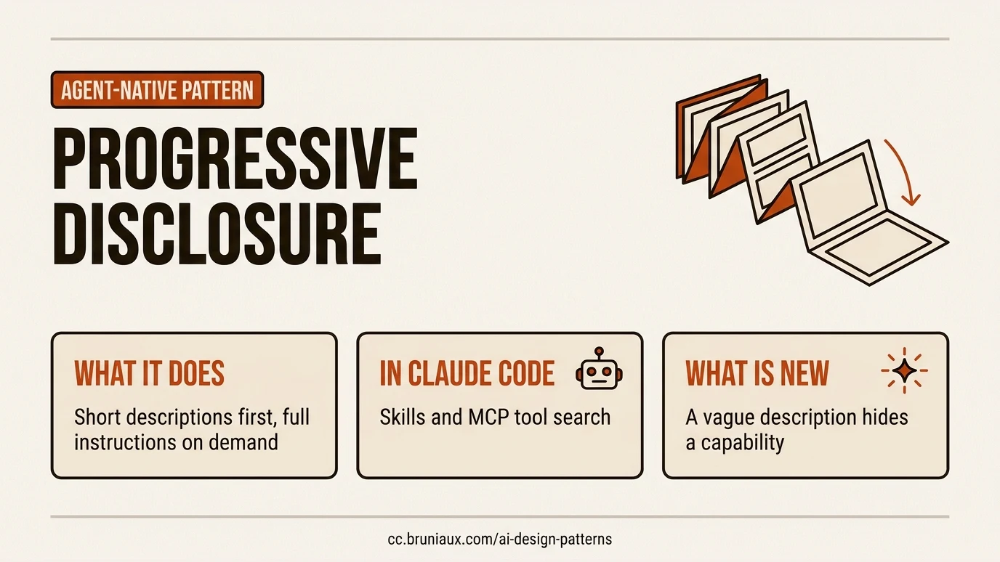
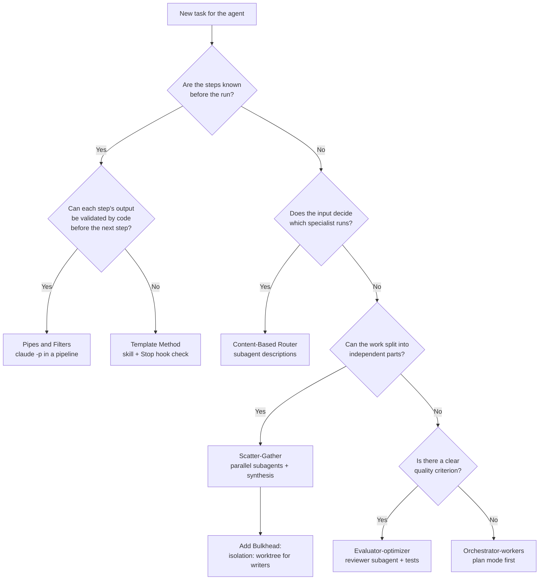

# Шаблоны проектирования ИИ для Claude Code: справочник по реализации

Используйте карточки при реализации или проверке шаблона в системе агента. На каждой карточке указан механизм Claude Code, и здесь аналогия нарушается, и вы можете выполнить проверку. Чтобы сравнить кандидатов, прежде чем выбрать одного, начните с визуального искателя образов .

> **В процессе:** сопоставление между двумя словарями является предварительным. Сопоставления следует обсуждать и исправлять, и они будут меняться по мере изменения Claude Code и источников. Если сопоставление вам не подходит, [откройте проблему](https://github.com/FlorianBruniaux/claude-code-ultimate-guide/issues) с указанием случая, когда оно нарушается. Исследование, лежащее в основе этого проекта, также опирается на два местных исследовательских инструмента автора, которые помогают находить и цитировать исходные материалы: [youtube-video-insights](https://github.com/FlorianBruniaux/youtube-video-insights) для доступных для поиска стенограмм выступлений на конференциях с метками времени и [paper-insights](https://github.com/FlorianBruniaux/paper-insights) для местного корпуса статей с проверенными цитатами.
>
> **Статус:** Стандартного пешеходного перехода не существует. Опубликованные сопоставления совпадают по некоторым парам и не совпадают по другим, и ни один из источников, прочитанных для этой страницы, не сопоставляет классические шаблоны с механизмами Claude Code, за исключением хуков и CLAUDE.md. Каждая вторая запись в столбце Claude Code представляет собой сопоставление этого руководства, отмеченное `Our mapping`. Механизмы сверены с официальной документацией  (последняя проверка 27 октября 2026 г.). Последнее обновление страницы: 28 октября 2026 г.
>
> **Используйте эту страницу для:** объяснения конструкции агента разработчикам в терминах, которые они знают, и проверки конструкции на соответствие режимам отказа, которые несет в себе каждый шаблон. Информацию о компонентах ремня см. в разделе [Agent Harness Engineering](./agent-harness.md). Информацию о контрактах циклов и графов см. в разделе [Loop & Graph Engineering](./loop-graph-engineering.md). Шаблоны внутри одного навыка см. в разделе [Шаблоны проектирования навыков](./skill-design-patterns.md).

Таблицы на этой странице созданы на основе [`machine-readable/ai-design-patterns.json`](../../machine-readable/ai-design-patterns.json) с помощью `scripts/build-ai-design-patterns.py`. Редактируйте набор данных, а не таблицы.

## Содержание

1. [TL;DR](#tldr)
2. [Происхождение](#lineage)
3. [Как читать](#how-to-read)
4. [Пешеходный переход](#crosswalk)
5. [Карточки с шаблонами](#pattern-cards)
6. [Там, где аналогия нарушается](#where-the-analogy-breaks)
7. [Нативные шаблоны агентов](#native-agent-patterns)
8. [Выберите узор](#choose-a-pattern)
9. [Anti-patterns](#anti-patterns)
10. [Классическая сторона](#classic-side)
11. [Дополнительная литература](#further-reading)
12. [Источники](#sources)

---

## ТЛ;ДР

- Классические шаблоны в этой таблице по-прежнему описывают агентные системы, но компонент посередине теперь является моделью, которая принимает решения во время выполнения. Паттерн, основанный на фиксированном ордере или гарантированном колле, нуждается в детерминированной проверке рядом с ним.
- В Claude Code наиболее четко задокументированным механизмом сопоставлений являются Observer для перехватчиков, Memento для контрольных точек, Mediator для субагентов, координирующих основной диалог, Bulkhead для контекста субагента и изоляция рабочего дерева. Ограничения по оборотам и бюджету обеспечивают ограниченное исполнение, статическую половину автоматического выключателя: они останавливают работу, не обнаруживают сбоев. Только Observer и Facade названы источником; остальные представляют собой карты этого руководства.
- Два распространенных предположения ошибочны в деталях. Перехватчики одного и того же события выполняются параллельно, поэтому они не образуют цепочку. Контрольные точки отслеживают только изменения файлов Claude, поэтому перемотка не отменяет команды оболочки или удаленные эффекты.
- Каждая карта классического образца заканчивается проверкой, которую вы можете выполнить.

## Родословная

Три поколения шаблонов решают одну и ту же проблему в разных масштабах:

- **Объектные шаблоны** (Gamma, Helm, Johnson, Vlissides, 1994) описывают, как объекты взаимодействуют внутри одной программы. Разработчик пишет структуру, даже если она меняет поведение во время выполнения, как это делает Strategy.
- **Интеграция и распределенные шаблоны** ([Enterprise Integration Patterns](https://www.enterpriseintegrationpatterns.com/)Хохпе и Вульфа, 2003 г., а также последующие шаблоны устойчивости) описывают, как службы обмениваются сообщениями и выдерживают частичный сбой.
- **Шаблоны агентов** (Anthropic's [Создание эффективных агентов](https://www.anthropic.com/engineering/building-effective-agents), 2024 и последующие каталоги) описывают, как подвеска управляет моделью, которая сама выбирает следующее действие.

Цзя Хуан [Pattern Evolution](https://kage-ai.com/research/pattern-evolution/) описывает третий шаг как изменение в том, кто выбирает структуру: разработчик, который ее пишет, или модель, которая выбирает следующий шаг во время работы с неполной информацией. Именно из-за этого изменения каждая карта ниже содержит режим отказа: классическое название описывает структуру, а карта указывает, какое поведение система больше не гарантирует.

Практикующие делают то же самое на сцене. Фрэнк Койл (Калифорнийский университет в Беркли) вспоминает движение 1990-х годов: «Теперь у нас есть шаблоны для агентов, но есть и антишаблоны» ([talk, 2:13](https://www.youtube.com/watch?v=Z-c11pV_uvU&t=133s)). Нишант Гупта (Meta Superintelligence Labs) напрямую отображает старый уровень: «Распределенные системы решали нечто подобное на протяжении десятилетий» ([talk, 6:03](https://www.youtube.com/watch?v=APh1Vx0oLmQ&t=363s)). В «Прагматическом инженере» дело в том, что агентам нужны ограждения корпоративных шаблонов: «старые шаблоны, похоже, возвращаются» ([episode, 44:04](https://www.youtube.com/watch?v=5wks1W-auKY&t=2644s)). Обсуждения отдельных шаблонов связаны с каждой карточкой в ​​разделе **Watch**.

![Обзор 29 шаблонов на этой странице в шести столбцах: создание GoF (фабричный метод, синглтон), структурное GoF (адаптер, составной, декоратор, фасад), поведенческое GoF (цепочка ответственности, команда, посредник, сувенир, наблюдатель, стратегия, метод шаблона), корпоративная интеграция (каналы и фильтры, контент-ориентированный маршрутизатор, рассеяние-сбор), распределенный и устойчивость (переборка, автоматический выключатель, сага, коляска, источник событий) и родная для агента (работники-оркестраторы, оценщик-оптимизатор, планирование, затем выполнение, изоляция контекста, сжатие контекста, прогрессивное раскрытие, детерминированные ворота, цикл целей).](../images/ai-design-patterns/overview-en.webp)

## Как читать

На каждом ряду пешеходного перехода имеется две таблички.

| Этикетка | Значение |
|---|---|
| `Consensus` | Два или более различных источника сопоставляют классический паттерн с одним и тем же аналогом основного агента. Карта может иметь второе прочтение, которое ее уточняет. |
| `Single source` | Один источник предлагает картографирование. Воспринимайте это как предложение. |
| `Divergent` | Источники связывают одну и ту же классическую картину с разными аналогами агентов. На карточке указано каждое показание с указанием его источника. |
| `Named by a source` | Источник называет сам механизм Claude Code. |
| `Our mapping` | В источниках указан аналог дженерика; в этом руководстве он сопоставлен с Claude Code. |

Строка попадает в таблицу только при соблюдении трех условий: общедоступный источник сопоставляет классический шаблон с аналогом агента, существует документированный механизм Claude Code и может быть указан режим отказа. Saga — единственное намеренное исключение: Claude Code не имеет встроенного механизма компенсации, и эта строка документирует этот пробел.

## Пешеходный переход

<!-- BEGIN GENERATED: crosswalk-table -->

| Классический узор | Семья | Аналог агента | В Claude Code | Доказательство | Картирование |
|---|---|---|---|---|---|
| [Фабричный метод](#factory-method) | GoF творческий | Создание субагента из именованного определения | Определения субагентов и инструмент «Агент» | Консенсус | Наше картографирование |
| [Синглтон](#singleton) | GoF творческий | Общий реестр инструментов/управление многоуровневой памятью: решите, какое состояние является общим, изолированным, постоянным или эфемерным. | Иерархия CLAUDE.md и автоматическая память (общее состояние, а не синглтон) | Дивергент | Наше картографирование |
| [Адаптер](#adapter) | структурный | Адаптер инструмента, который отображает внешнюю систему в модели | Серверы MCP | Консенсус | Наше картографирование |
| [Композитный](#composite) | структурный | Агент, который делегирует полномочия агентам, которые могут делегировать снова | Вложенные субагенты (глубина появления) | Консенсус | Наше картографирование |
| [Декоратор](#decorator) | структурный | Guardrail, обернутый вокруг вызова модели/промежуточного программного обеспечения внедрения контекста, которое обогащает каждый запрос | Хуки UserPromptSubmit и PostToolUse | Дивергент | Наше картографирование |
| [Фасад](#facade) | структурный | Файл инструкций проекта как единая точка входа для соглашений | CLAUDE.md | Единый источник | Названо источником |
| [Цепочка ответственности](#chain-of-responsibility) | поведенческий | Перехватчик или конвейер разрешений перед вызовами инструментов. Агенты объединены в цепочку, поэтому каждый обрабатывает то, что может, а остальное передает. | Правила разрешения: запретить, затем спросить, затем разрешить | Дивергент | Наше картографирование |
| [Команда](#command) | поведенческий | Вызов инструмента: именованное действие со структурированными аргументами. | Вызовы инструментов и хуки PreToolUse | Консенсус | Наше картографирование |
| [Медиатор](#mediator) | поведенческий | Оркестратор, координирующий работников, которые никогда не разговаривают друг с другом | Субагенты, координирующие основной разговор; Команды агентов (экспериментальная функция, отключена по умолчанию; обмен сообщениями между узлами, непосредственная альтернатива) | Консенсус | Наше картографирование |
| [Мементо](#memento) | поведенческий | Контрольная точка и перемотка состояния агента | Чекпойнт и /rewind | Консенсус | Наше картографирование |
| [Наблюдатель](#observer) | поведенческий | Перехватчики жизненного цикла, реагирующие на события агента | Хуки (PreToolUse, PostToolUse, Stop, SubagentStop) | Консенсус | Названо источником |
| [Стратегия](#strategy) | поведенческий | Модель или подход выбираются для каждой задачи / переключение стратегии во время выполнения с записью причин, какой стоимости и способа отката | поле модели для каждого субагента и /model | Консенсус | Наше картографирование |
| [Шаблонный метод](#template-method) | поведенческий | Системное приглашение, определяющее шаги. Исправлен скелет цикла агента с подключаемыми шагами. | Навыки, определяющие процедуру; Остановите хук в качестве последнего шага проверки. | Дивергент | Наше картографирование |
| [Трубы и фильтры](#pipes-and-filters) | Корпоративная интеграция | Конвейер, в котором каждый вызов агента или модели является фильтром. | Режим печати в конвейере оболочки (claude -p) | Консенсус | Наше картографирование |
| [Маршрутизатор на основе контента](#content-based-router) | Корпоративная интеграция | Классификатор, отправляющий запрос специализированному обработчику | Автоматическое делегирование по описанию субагента; Выбор навыков по описанию | Консенсус | Наше картографирование |
| [Scatter-Gather](#scatter-gather) | Корпоративная интеграция | Параллельные агенты, за которыми следует этап синтеза | Параллельные субагенты; Динамические рабочие процессы | Консенсус | Наше картографирование |
| [Переборка](#bulkhead) | Распределенность и устойчивость | Поагентная изоляция контекста, инструментов и бюджета | Изоляция контекста субагента; изоляция: рабочее дерево | Консенсус | Наше картографирование |
| [Автоматический выключатель](#circuit-breaker) | Распределенность и устойчивость | Стоп-лимиты на обороты, расчетную стоимость и глубину цикла. Прерыватели инструментов, моделей и собственного цикла агента. | Ограниченное выполнение: --max-turns и --max-budget-usd (режим печати); maxTurns во фронтальной части субагента | Консенсус | Наше картографирование |
| [Сага](#saga) | Распределенность и устойчивость | Компенсирующие действия по агентскому плану | Никакой нативной саги: чекпоинты плюс скриптовая компенсация | Консенсус | Наше картографирование |
| [Коляска](#sidecar) | Распределенность и устойчивость | Использование агента в цикле модели | Перехватчики, разрешения и песочница в цикле | Единый источник | Наше картографирование |
| [Источник событий](#event-sourcing) | Распределенность и устойчивость | Журнал трассировки как поток событий запуска агента | Стенограммы сеансов и резюме (сохранение разговора) | Единый источник | Наше картографирование |

<!-- END GENERATED: crosswalk-table -->

## Карточки с узорами

<!-- BEGIN GENERATED: pattern-cards -->

### Фабричный метод

`GoF creational` `Consensus` `Our mapping`

- **Классическое намерение:** Позвольте создателю решить, какой конкретный продукт создать, используя общий интерфейс.
- **Агентная сторона:** Субагент, порожденный из именованного определения ([AgentPatterns.ai](https://agentpatterns.ai/patterns/agent-design/classical-se-patterns-agent-analogues/), [Esther Aznar, Ivan Garcia Villar](https://aicodingpatterns.com/patterns/patrones-gof-patrones-agenticos-mapeo-completo/))
- **В Claude Code:** [Определения субагентов и инструмент «Агент»](https://code.claude.com/docs/en/sub-agents)
- **Режим отказа:** Фабрика передает каждому продукту полный набор инструментов: определение субагента без поля инструментов наследует все инструменты, доступные субагентам.
- **Как проверить:** Перечислите поле инструментов каждого определения в .claude/agents/ и не выполните проверку, если у агента с возможностью записи нет явного списка разрешений.

### Синглтон

`GoF creational` `Divergent` `Our mapping`

- **Классическое намерение:** Гарантировать один общий экземпляр компонента с глобальной точкой доступа.
- **Агентская сторона, источники не согласны:**
  - Общий реестр инструментов ([Эстер Азнар, Иван Гарсия Вильяр](https://aicodingpatterns.com/patterns/patrones-gof-patrones-agenticos-mapeo-completo/))
  - Управление многоуровневой памятью: решите, какое состояние является общим, изолированным, постоянным или эфемерным ([Jia Huang](https://kage-ai.com/research/pattern-evolution/))
- **In Claude Code:** [CLAUDE.md Иерархия и автоматическая память (совместное состояние, а не Singleton)](https://code.claude.com/docs/en/memory)
- **Режим отказа:** Claude Code не обеспечивает здесь Singleton: несколько CLAUDE.md и файлов памяти загружаются и объединяются, и ничто не обеспечивает использование одного экземпляра или одной точки доступа. Что сохраняется, так это риск неуправляемого общего состояния: параллельные сеансы или агенты, которые одновременно записывают один и тот же файл памяти, могут перезаписывать записи друг друга.
- **Как проверить:** Запустите два сеанса, оба из которых добавляются в один и тот же файл памяти, и проверьте, не потеряна ли какая-либо запись.
- **Идем дальше:** [Системы памяти: родной стек памяти Claude Code](memory-systems.md#2-native-claude-code-memory-stack) (руководство); [Постоянная память: шесть сбоев, которые никогда не вызывают ошибки](https://www.florian.bruniaux.com/guides/persistent-memory-silent-failures/) (статья автора)

### Адаптер

`GoF structural` `Consensus` `Our mapping`

- **Классическое намерение:** Преобразовать интерфейс существующего компонента в интерфейс, ожидаемый клиентом.
- **Агентская сторона:** Адаптер инструмента, который открывает доступ к внешней системе модели ([Эстер Азнар, Иван Гарсия Вильяр](https://aicodingpatterns.com/patterns/patrones-gof-patrones-agenticos-mapeo-completo/), [Марко Ниссен](https://github.com/agentpatternscatalog/patterns))
- **На серверах Claude Code:** [MCP](https://code.claude.com/docs/en/mcp)
- **Режим отказа:** Адаптер зеркально отражает каждую входящую конечную точку, поэтому определения инструментов заполняют контекст, и модель выбирает среди почти повторяющихся инструментов.
- **Как проверить:** Запустите /mcp и /context, затем удалите или отложите инструменты, которые не использовались ни одной задачей в последнем спринте.
- **Идем дальше:** [MCP экосистема серверов](../ecosystem/mcp-servers-ecosystem.md) (руководство); Серверы [MCP: сколько они на самом деле стоят и когда их использовать](https://www.florian.bruniaux.com/guides/mcp-servers-token-cost/) (авторская статья)
- **Смотреть:** Кристиан Цолов и Дариуш Енджейчик (Devoxx), [Объединение интеграции искусственного интеллекта с Model Context Protocol](https://www.youtube.com/watch?v=PJOthBhLbao&t=1262s) в 21:02: Спикеры объясняют, что каждый поставщик предоставляет свои собственные API через уровень сервера MCP, унифицированную оболочку, которую может использовать LLM.

### Композитный

`GoF structural` `Consensus` `Our mapping`

- **Классическое намерение:** Обрабатывать отдельный объект и дерево объектов через один и тот же интерфейс.
- **Агентская сторона:** Агент, который делегирует полномочия агентам, которые могут делегировать снова ([AgentPatterns.ai](https://agentpatterns.ai/patterns/agent-design/classical-se-patterns-agent-analogues/), [Esther Aznar, Ivan Garcia Villar](https://aicodingpatterns.com/patterns/patrones-gof-patrones-agenticos-mapeo-completo/))
- **In Claude Code:** [Вложенные субагенты (глубина появления)](https://code.claude.com/docs/en/sub-agents)
- **Режим отказа:** Рекурсия без бюджета: каждый уровень увеличивает использование токенов. Колпачки Claude Code совмещены с CLAUDE_CODE_MAX_SUBAGENT_SPAWN_DEPTH, которые можно регулировать, но нельзя снимать.
- **Как проверить:** Установите CLAUDE_CODE_MAX_SUBAGENT_SPAWN_DEPTH явно для автоматического запуска и регистрации созданных субагентов с помощью перехватчика SubagentStop.
- **Смотреть:** Клеман Эскофье и Марио Фуско (Devoxx), [От оркестрации LLM к автономным агентам: Шаблоны агентного ИИ с LangChain4j](https://www.youtube.com/watch?v=SrFXsjeGc6Q&t=6741s) в 112:21: Спикеры показывают агента в последовательности, которая сама по себе представляет собой цикл из двух агентов, поэтому рабочий процесс используется как один субагент.

### Декоратор

`GoF structural` `Divergent` `Our mapping`

- **Классическое намерение:** Добавьте поведение к объекту, обернув его, не меняя его класс.
- **Агентская сторона, источники не согласны:**
  - Ограждение вокруг вызова модели ([Эстер Азнар, Иван Гарсия Вильяр](https://aicodingpatterns.com/patterns/patrones-gof-patrones-agenticos-mapeo-completo/))
  - Промежуточное программное обеспечение внедрения контекста, которое дополняет каждый запрос ([AgentPatterns.ai](https://agentpatterns.ai/patterns/agent-design/classical-se-patterns-agent-analogues/))
- **In Claude Code:** [UserPromptSubmit and PostToolИспользовать перехватчики](https://code.claude.com/docs/en/hooks)
- **Режим отказа:** Классический стек декораторов имеет фиксированный порядок. Соответствующие перехватчики выполняются параллельно, поэтому оболочка, предполагающая, что другая оболочка уже запущена, является гонкой.
- **Как проверить:** Напишите каждый перехватчик, чтобы он проходил при запуске в одиночку, и протестируйте его с отключенными другими перехватчиками.
- **Идем дальше:** [Справочник событий перехватчиков](hooks-events-reference.md) (руководство); [Маршрутизация Smart-Suggest: перехватчик UserPromptSubmit, который добавляет кандидатов с навыками в приглашение](../workflows/smart-suggest-routing.md#claude-code-architecture) (руководство)
- **Смотреть:** Марк Поллак, Кристиан Цолов, Джош Лонг, Джеймс Уорд (Devoxx), [Bootiful Spring AI](https://www.youtube.com/watch?v=Sw3PlFXfWj4&t=703s) в 11:43: Докладчик объясняет, что советники Spring AI представляют собой фильтр или препроцессор, который оборачивает вызовы к модели и от нее и может изменять или регистрировать каждый запрос.
- **Смотреть:** Тарик Шихипар, [Claude Агент SDK [Полный семинар]](https://www.youtube.com/watch?v=TqC1qOfiVcQ&t=6430s) в 107:10: Спикер Anthropic говорит, что перехваты срабатывают как события в агенте SDK и используются для детерминированной проверки или для вставки контекста.

### Фасад

`GoF structural` `Single source` `Named by a source`

- **Классическое намерение:** Предложить одну простую точку входа перед сложной подсистемой.
- **Агентская сторона:** Файл инструкций проекта как единая точка входа для соглашений ([AgentPatterns.ai](https://agentpatterns.ai/patterns/agent-design/classical-se-patterns-agent-analogues/))
- **In Claude Code:** [CLAUDE.md](https://code.claude.com/docs/en/memory)
- **Режим отказа:** Фасад читается как контракт. В документах указано, что Claude рассматривает CLAUDE.md как контекст, а не как обязательную конфигурацию: написанное там правило является запросом, а не гарантией.
- **Как проверить:** Для каждого правила «никогда нельзя» в CLAUDE.md добавьте перехватчик PreToolUse или правило запрета и тест, который его запускает.
- **Идем дальше:** [Ваш CLAUDE.md слишком длинный](https://www.florian.bruniaux.com/blog/articles/your-claudemd-is-too-long/) (авторская статья); [ctxharness: проверяет, что утверждения в CLAUDE.md и правила по-прежнему соответствуют проекту](https://github.com/FlorianBruniaux/ctxharness) (авторский проект); [Инструкции Team AI](../workflows/team-ai-instructions.md) (руководство)

### Цепочка ответственности

`GoF behavioral` `Divergent` `Our mapping`

- **Классическое намерение:** Передавать запрос по цепочке обработчиков, пока один из них не обработает его.
- **Агентская сторона, источники не согласны:**
  - Перехватчик или конвейер разрешений перед вызовами инструментов ([AgentPatterns.ai](https://agentpatterns.ai/patterns/agent-design/classical-se-patterns-agent-analogues/), [Ashish Patel](https://github.com/ashishpatel26/agent-harness-engineering-pattern))
  - Агенты скованы цепочкой, поэтому каждый справляется с тем, что может, и передает остальное ([Эстер Аснар, Иван Гарсия Вильяр](https://aicodingpatterns.com/patterns/patrones-gof-patrones-agenticos-mapeo-completo/))
- **In Claude Code:** [Правила разрешений: запретить, затем спросить, затем разрешить](https://code.claude.com/docs/en/permissions)
- **Режим отказа:** Команды ожидают принятия решения о порядке объявления или специфике правила. В документах говорится, что правила оцениваются как «отказ», затем «спрос» и «разрешение», и специфичность не меняет этот порядок: широкий запрет превосходит узкий «разрешение».
- **Как проверить:** Добавьте запрет и более конкретное разрешение для одной и той же команды в тестовом проекте и убедитесь, что команда остается заблокированной.

### Команда

`GoF behavioral` `Consensus` `Our mapping`

- **Классическое намерение:** Превратить запрос в объект, который можно поставить в очередь, записать в журнал, проверить или отменить.
- **Агентская сторона:** Вызов инструмента: именованное действие со структурированными аргументами ([Эстер Азнар, Иван Гарсия Вильяр](https://aicodingpatterns.com/patterns/patrones-gof-patrones-agenticos-mapeo-completo/), [Ашиш Патель](https://github.com/ashishpatel26/agent-harness-engineering-pattern))
- **In Claude Code:** [Вызовы инструментов и перехватчики PreToolUse](https://code.claude.com/docs/en/tools-reference)
- **Режим отказа:** Объект команды записывается моделью. Без проверки перед отправкой неправильно сформированный аргумент или аргумент, выходящий за рамки области видимости, выполняется так, как написано.
- **Как проверить:** Передайте PreToolUse, перехватите записанный ввод инструмента путем за пределами области видимости и подтвердите, что он блокируется.
- **Идите дальше:** [Справочник событий перехватчиков](hooks-events-reference.md) (руководство)

### Посредник

`GoF behavioral` `Consensus` `Our mapping`

- **Классическое намерение:** Централизовать взаимодействие набора компонентов, чтобы они не ссылались друг на друга напрямую.
- **Агентская сторона:** Оркестратор, который координирует работников, которые никогда не разговаривают друг с другом ([Эстер Аснар, Иван Гарсия Вильяр](https://aicodingpatterns.com/patterns/patrones-gof-patrones-agenticos-mapeo-completo/), [Саркар и Саркар](https://arxiv.org/abs/2506.05364))
- **In Claude Code:** [Субагенты, координирующие основной диалог](https://code.claude.com/docs/en/sub-agents); [Команды агентов (экспериментальная функция, отключена по умолчанию; обмен сообщениями между узлами, непосредственная альтернатива)](https://code.claude.com/docs/en/agent-teams)
- **Режим отказа:** Топология не применяется, и посредник может стать узким местом. Субагент, инструменты которого включают SendMessage, может отправлять сообщения другим именованным агентам напрямую, без участия команд агентов. А если работники возвращают стенограммы вместо резюме, контекст координации заполняется материалом, который он больше никогда не читает.
- **Как проверить:** Исключите SendMessage из инструментов работника, когда весь трафик должен проходить через координатора, запросите у каждого субагента ограниченный окончательный отчет и сравните /context до и после делегирования.
- **Идем дальше:** [Команды агентов](../workflows/agent-teams.md) (руководство); [Межсессионный обмен сообщениями: одноранговые сообщения без посредника](../workflows/cross-session-messaging.md) (руководство)
- **Смотреть:** Сандипан Бхаумик, [От хаоса к хореографии: шаблоны многоагентной оркестрации, которые действительно работают](https://www.youtube.com/watch?v=2czYyrTzILg&t=529s) в 8:49: При оркестрации каждый вызов проходит через оркестратор, и агенты никогда не звонят друг другу.

### сувенир

`GoF behavioral` `Consensus` `Our mapping`

- **Классическое намерение:** Зафиксировать состояние объекта, чтобы его можно было восстановить позже, не раскрывая его внутренние компоненты.
- **Агентская сторона:** Контрольная точка и перемотка состояния агента ([AgentPatterns.ai](https://agentpatterns.ai/patterns/agent-design/classical-se-patterns-agent-analogues/), [Ashish Patel](https://github.com/ashishpatel26/agent-harness-engineering-pattern))
- **In Claude Code:** [Checkpointing и /rewind](https://code.claude.com/docs/en/checkpointing)
- **Режим отказа:** Снимок является частичным. В документах указано, что контрольные точки отслеживают только изменения, внесенные с помощью инструментов редактирования файлов Claude; Команды Bash и внешние процессы не фиксируются, как и изменения, внесенные фоновым субагентом.
- **Как проверить:** Используйте команду Bash, чтобы изменить файл, который Claude не редактировал в этом сеансе, перемотайте назад и подтвердите, что изменение сохранилось. Выполняйте коммит с помощью git перед рискованной работой с оболочкой или делегированным редактированием.
- **Смотреть:** Хамза Тахир, [Вашим агентам нужна кнопка сохранения](https://www.youtube.com/watch?v=bZISsg7H7DA&t=14s) в 0:14: Спикер утверждает, что агентам нужна кнопка сохранения: контрольные точки во время выполнения, которые позволяют воспроизводить, сравнивать и принимать решения, а не трассировки, доступные только для чтения.

### наблюдатель

`GoF behavioral` `Consensus` `Named by a source`

Карта 

- **Классическое намерение:** Автоматически уведомлять подписчиков, когда субъект меняет состояние.
- **Агентская сторона:** Обработчики жизненного цикла, которые реагируют на события агента ([AgentPatterns.ai](https://agentpatterns.ai/patterns/agent-design/classical-se-patterns-agent-analogues/), [Esther Aznar, Ivan Garcia Villar](https://aicodingpatterns.com/patterns/patrones-gof-patrones-agenticos-mapeo-completo/))
- **In Claude Code:** [Hooks (PreToolUse, PostToolUse, Stop, SubagentStop)](https://code.claude.com/docs/en/hooks)
- **Режим отказа:** Подписчики принимают заказ. В документах указано, что соответствующие перехватчики выполняются параллельно, что Claude Code объединяет их выходные данные после того, как все они завершатся, и что для решений о разрешении применяется наиболее ограничительный результат: запрет одного перехватчика не останавливает побочные эффекты родственного перехватчика.
- **Как проверить:** Запустите каждый перехватчик отдельно для записанных полезных данных события; хук, который проходит только после другого, не является наблюдателем.
- **Идем дальше:** [Справочник событий перехватчиков](hooks-events-reference.md) (руководство); [Claude Code под капотом](https://www.florian.bruniaux.com/blog/articles/claude-code-under-the-hood/) (авторская статья)
- **Смотреть:** Коул Медин, [Посмотрите это, если ваш агент кодирования игнорирует ваши правила (вам нужны хуки)](https://www.youtube.com/watch?v=msfMqW92Y8Q&t=44s) в 0:44: Докладчик определяет хуки как действия, которые гарантированно срабатывают при событиях агента, например, непосредственно перед чтением файла или при остановке разговора.

### Стратегия

`GoF behavioral` `Consensus` `Our mapping`

- **Классическое намерение:** Заменить один алгоритм на другой за тем же интерфейсом во время выполнения.
- **Агентская сторона, сначала основное чтение:**
  - Модель или подход, выбранные для каждой задачи ([AgentPatterns.ai](https://agentpatterns.ai/patterns/agent-design/classical-se-patterns-agent-analogues/), [Esther Aznar, Ivan Garcia Villar](https://aicodingpatterns.com/patterns/patrones-gof-patrones-agenticos-mapeo-completo/))
  - Переключение стратегии во время выполнения с записью причин, какой стоимости и способа отката ([Jia Huang](https://kage-ai.com/research/pattern-evolution/))
- **In Claude Code:** [поле модели для каждого субагента и /model](https://code.claude.com/docs/en/model-config)
- **Режим отказа:** Стратегия меняется незаметно. Никто впоследствии не сможет сказать, какая модель дала какой результат и сколько стоило переключение.
- **Как проверить:** Закрепите модель в каждом определении субагента и проверьте /usage или стенограмму сеанса после запуска.
- **Идем дальше:** [agent-router-core: экспериментальная детерминированная маршрутизация CLI для рабочих процессов агентов](https://github.com/FlorianBruniaux/agent-router-core) (авторский проект); [cc-copilot-bridge: мультипровайдерская маршрутизация для Claude Code](https://ccbridge.bruniaux.com/) (авторский проект); [Измерение собственного использования ИИ: три метра, три разных ответа](https://www.florian.bruniaux.com/blog/articles/real-cost-of-ai-measuring-your-own-usage/) (авторская статья)
- **Смотреть:** Арчана Камат и Тайлер Гиллам, [Предпочтения перед контрольными показателями: маршрутизация моделей](https://www.youtube.com/watch?v=FvxY8oPoI8o&t=106s) в 1:46: Спикер утверждает, что одна модель для каждой задачи — это излишество и что маршрутизация каждой задачи к подходящей модели снижает затраты и риски.

### Шаблонный метод

`GoF behavioral` `Divergent` `Our mapping`

- **Классическое намерение:** Исправьте скелет алгоритма и позвольте подклассам выполнять некоторые шаги.
- **Агентская сторона, источники не согласны:**
  - Системная подсказка, определяющая шаги ([Эстер Азнар, Иван Гарсия Вильяр](https://aicodingpatterns.com/patterns/patrones-gof-patrones-agenticos-mapeo-completo/))
  - Исправлен скелет цикла агента с подключаемыми шагами ([Ashish Patel](https://github.com/ashishpatel26/agent-harness-engineering-pattern))
- **In Claude Code:** [Навыки, определяющие процедуру](https://code.claude.com/docs/en/skills); [Остановить крюк на последнем этапе проверки](https://code.claude.com/docs/en/hooks)
- **Режим отказа:** Прозаический скелет не применяется: модель может пропустить или изменить порядок шагов, в отличие от базового класса, который сам вызывает шаги.
- **Как проверить:** Дайте последнему шагу артефакт (файл, тестовый запуск) и заблокируйте завершение с помощью перехватчика Stop, если артефакт отсутствует.
- **Идем дальше:** [Шаблоны проектирования навыков](skill-design-patterns.md) (руководство); [TDD с Claude](../workflows/tdd-with-claude.md) (руководство); [TDD с Claude Code](https://www.florian.bruniaux.com/guides/tdd-with-claude-code/) (авторская статья)
- **Смотреть:** Коул Медин, [Агенты кодирования Stripe отправляют 1300 PR КАЖДУЮ неделю — вот как они это делают](https://www.youtube.com/watch?v=NMWgXvm--to&t=421s) в 7:01: Докладчик описывает чертежи Stripe: навыки агента переплетаются с детерминированным кодом в фиксированном рабочем процессе.

### Трубы и фильтры

`Enterprise integration` `Consensus` `Our mapping`

Карта 

- **Классическое намерение:** Обработать сообщение посредством последовательности независимых шагов, связанных каналами.
- **Агентская сторона:** Конвейер, в котором каждый вызов агента или модели является фильтром ([Roan Brasil](https://github.com/roanbrasil/agents-integration-patterns), [Marco Nissen](https://github.com/agentpatternscatalog/patterns))
- **In Claude Code:** [Режим печати в конвейере оболочки (claude -p)](https://code.claude.com/docs/en/headless)
- **Режим отказа:** Фильтр выдает произвольный текст, который неправильно считывается следующим фильтром, и ошибка передается по каналу.
- **Как проверить:** Используйте --output-format json между шагами и проверяйте форму перед запуском следующего фильтра.
- **Дальше:** [GitHub Actions рабочие процессы](../workflows/github-actions.md) (руководство)
- **Смотреть:** Марк Поллак, Кристиан Цолов, Джош Лонг, Джеймс Уорд (Devoxx), [Bootiful Spring AI](https://www.youtube.com/watch?v=Sw3PlFXfWj4&t=2291s) в 38:11: Оратор передает git log в claude -p, чтобы сгенерировать примечания к выпуску, и снова вызывает его и фильтрует.
- **Смотреть:** Кевин Дюбуа и Марио Фуско (Devoxx), [Схемы агентского искусственного интеллекта](https://www.youtube.com/watch?v=X9baI7RBhqk&t=491s) в 8:11: Спикеры представляют шаблон последовательности, вызывая одного агента за другим, что также известно как цепочка подсказок.

### Контентно-ориентированный маршрутизатор

`Enterprise integration` `Consensus` `Our mapping`

- **Классическое намерение:** Направляет каждое сообщение в пункт назначения на основе его содержимого.
- **Агентская сторона:** Классификатор, отправляющий запрос специализированному обработчику ([Roan Brasil](https://github.com/roanbrasil/agents-integration-patterns), [Anthropic](https://www.anthropic.com/engineering/building-effective-agents))
- **In Claude Code:** [Автоматическое делегирование по описанию субагента](https://code.claude.com/docs/en/sub-agents); [Выбор навыков по описанию](https://code.claude.com/docs/en/skills)
- **Режим отказа:** Перекрывающиеся описания направляют один и тот же запрос к разным обработчикам от одного запуска к другому.
- **Как проверить:** Сохраните набор подсказок маршрутизации с ожидаемым субагентом или навыком и повторно запускайте его после каждого изменения описания.
- **Идем дальше:** [BM25 маршрутизатор, пошагово](../workflows/smart-suggest-routing.md#bm25-router-step-by-step) (руководство); [Запускаемый маршрутный крюк BM25](../../examples/hooks/bm25-routing/README.md) (шаблон); [cc-skill-usage: считает реальные вызовы Навыков в транскриптах](https://github.com/FlorianBruniaux/cc-skill-usage) (авторский проект)
- **Смотреть:** Гулвен Ле Дю (Doctolib), [Alfred le système Agentic AI от Doctolib в службе профессиональных врачей](https://www.youtube.com/watch?v=uTM3fRgbUN0&t=252s) в 4:12: У Alfred из Doctolib есть агент маршрутизации, который использует модель классификации намерений для отправки каждого запроса специализированному агенту.
- **Смотреть:** Ренато Герра Кавальканти (Devoxx), [Akka: корпоративная среда выполнения для отказоустойчивых агентов AI](https://www.youtube.com/watch?v=PrIh_9HomfI&t=821s) в 13:41: Докладчик описывает маршрутизатор, который получает сообщение и решает, какой агент его получит: через LLM или просто if и else.

### Scatter-Gather

`Enterprise integration` `Consensus` `Our mapping`

- **Классическое намерение:** Отправьте запрос нескольким получателям и агрегируйте их ответы.
- **Агентская сторона:** Параллельные агенты с последующим этапом синтеза ([Эстер Аснар, Иван Гарсиа Вильяр](https://aicodingpatterns.com/patterns/patrones-gof-patrones-agenticos-mapeo-completo/), [Роан Бразил](https://github.com/roanbrasil/agents-integration-patterns))
- **In Claude Code:** [Параллельные субагенты](https://code.claude.com/docs/en/sub-agents); [Динамические рабочие процессы](https://code.claude.com/docs/en/workflows)
- **Режим отказа:** Шаг сбора усредняет противоречивые ответы, а не согласовывает их, а стоимость токена растет с каждым ответвлением.
- **Как проверить:** Составьте в шаге синтеза явный список разногласий и сравните стоимость прогона с базовым уровнем для одного агента.
- **Иди дальше:** [Динамические рабочие процессы](../workflows/dynamic-workflows.md) (руководство); [Лучший из N](../workflows/best-of-n.md) (руководство); [Просмотр кода нескольких поставщиков](../workflows/multi-provider-code-review.md) (руководство)
- **Смотреть:** Ренато Герра Кавальканти (Devoxx), [Akka: корпоративная среда выполнения для отказоустойчивых агентов AI](https://www.youtube.com/watch?v=PrIh_9HomfI&t=786s) в 13:06: Докладчик описывает параллельный вызов нескольких агентов, ожидание всех результатов и передачу их сумматору.
- **Смотреть:** Колин (LangChain), [Динамические субагенты: как надежно запускать параллельные агенты в Deep Agents](https://www.youtube.com/watch?v=5AkdMangfNk&t=46s) в 0:46: В демонстрационной версии агент параллельно распределяет 15 субагентов, а затем выбирает лучший результат.

### Переборка

`Distributed and resilience` `Consensus` `Our mapping`

- **Классическое намерение:** Изолируйте ресурсы для каждого потребителя, чтобы один сбой не мог привести к разрушению всей системы.
- **Агентская сторона:** Изоляция контекста, инструментов и бюджета для каждого агента ([Эстер Аснар, Иван Гарсия Вильяр](https://aicodingpatterns.com/patterns/patrones-gof-patrones-agenticos-mapeo-completo/), [Джя Хуан](https://kage-ai.com/research/pattern-evolution/))
- **In Claude Code:** [Изоляция контекста подагента](https://code.claude.com/docs/en/sub-agents); [изоляция: рабочее дерево](https://code.claude.com/docs/en/worktrees)
- **Режим отказа:** Изолируется только контекст. Параллельные агенты по-прежнему используют одну кассу и перезаписывают файлы друг друга.
- **Как проверить:** Обеспечьте изоляцию параллельных подагентов с возможностью записи: рабочее дерево и убедитесь, что статус git в основной проверке остается чистым во время выполнения.
- **Идем дальше:** [Изоляция песочницы](../security/sandbox-isolation.md) (руководство); [Plan-execute: запуск 20+ агентов на миграции (изоляция рабочего дерева)](https://www.florian.bruniaux.com/guides/plan-execute-migrations/) (авторская статья); [wt-sweep: обнаруживает рабочие деревья Git и проверяет доказательства интеграции](https://wt-sweep.bruniaux.com/) (авторский проект)

### Автоматический выключатель

`Distributed and resilience` `Consensus` `Our mapping`

- **Классическое намерение:** Прекратить вызов сбойной зависимости после повторяющихся сбоев и быстро выполнить сбой.
- **Агентская сторона, сначала основное чтение:**
  - Ограничения стопов на поворотах, расчетная стоимость и глубина цикла ([AgentPatterns.ai](https://agentpatterns.ai/patterns/agent-design/classical-se-patterns-agent-analogues/), [Esther Aznar, Ivan Garcia Villar](https://aicodingpatterns.com/patterns/patrones-gof-patrones-agenticos-mapeo-completo/), [James Davies](https://github.com/jlldavies/go4-llm-design-patterns))
  - Прерыватели инструментов, моделей и собственного контура агента ([Jia Huang](https://kage-ai.com/research/pattern-evolution/))
- **In Claude Code:** [Ограниченное выполнение: --max-turns и --max-budget-usd (режим печати)](https://code.claude.com/docs/en/cli-reference); [maxTurns во фронтальной части субагента](https://code.claude.com/docs/en/sub-agents)
- **Режим отказа:** Эти ограничения представляют собой ограниченное выполнение, а не прерыватель. Автоматический выключатель отслеживает неисправности и размыкается; эти ограничения фиксируются перед запуском и не отслеживают сбои. --max-turns по умолчанию не имеет ограничений и считает обороты, а не стоимость. --max-budget-usd останавливается на оценке затрат на стороне клиента, и документы предупреждают, что расходы могут превысить ограничение, поэтому оставьте запас.
- **Как проверить:** Запустите автоматическое задание с параметрами --max-turns и --max-budget-usd для задачи, предназначенной для циклического выполнения, и проверьте, завершается ли оно с ошибкой и насколько заявленные расходы превысили ограничение.
- **Идем дальше:** [Loop & Graph Engineering: написание контракта цикла](loop-graph-engineering.md#2-write-a-loop-contract) (руководство); [Проектирование ограниченного цикла обзора](https://www.florian.bruniaux.com/guides/bounded-code-review-loop/) (авторская статья)
- **Смотреть:** Сандипан Бхаумик, [От хаоса к хореографии: шаблоны многоагентной оркестровки, которые действительно работают](https://www.youtube.com/watch?v=2czYyrTzILg&t=1011s) в 16:51: Докладчик применяет автоматический выключатель при вызовах между агентами: после повторяющихся сбоев цепь размыкается, быстро выходит из строя, затем полуразмыкается для проверки восстановления.
- **Смотреть:** Тиша Чавла и Сушим Коул, [FinOps для ИИ-агентов: кто потратил все токены?](https://www.youtube.com/watch?v=GJX19pNhmSw&t=1056s) в 17:36: В демонстрации агент, превышающий свой бюджет на запуск, немедленно уничтожается, что оратор называет простым автоматическим выключателем.

### Сага

`Distributed and resilience` `Consensus` `Our mapping`

Карта 

- **Классическое намерение:** Запустите длинную транзакцию как локальные шаги, каждый из которых имеет компенсирующее действие в случае сбоя последующего шага.
- **Агентская сторона:** Компенсирующие действия по агентскому плану ([AgentPatterns.ai](https://agentpatterns.ai/patterns/agent-design/classical-se-patterns-agent-analogues/), [Esther Aznar, Ivan Garcia Villar](https://aicodingpatterns.com/patterns/patrones-gof-patrones-agenticos-mapeo-completo/), [Jia Huang](https://kage-ai.com/research/pattern-evolution/), [Vasundra Srinivasan](https://arxiv.org/abs/2605.20173))
- **In Claude Code:** [Нет родной саги: чекпоинты плюс скриптовая компенсация](https://code.claude.com/docs/en/checkpointing)
- **Режим отказа:** Перемотка ошибочно принимается за компенсацию. Он восстанавливает только локальные изменения файлов; нажатие, вызов API или запись в базу данных остаются выполненными.
- **Как проверить:** Для каждого побочного шага в плане агента запишите его компенсирующее действие перед запуском и протестируйте это действие один раз.
- **Идем дальше:** [Loop & Graph Engineering: согласовываем прерванные эффекты перед повторной попыткой](loop-graph-engineering.md#reconcile-interrupted-effects-before-retrying) (руководство); [Производственная безопасность](../security/production-safety.md) (руководство)
- **Смотреть:** Сандипан Бхаумик, [От хаоса к хореографии: шаблоны многоагентной оркестровки, которые действительно работают](https://www.youtube.com/watch?v=2czYyrTzILg&t=1142s) в 19:02: Докладчик представляет схему компенсации или саги: каждый агент выполняет и компенсирует, а в случае неудачи оркестратор идет назад, вызывая компенсацию.
- **Смотреть:** Салман Мунаф, [AI Сейчас агенты — это просто распределенные системы](https://www.youtube.com/watch?v=hD9-V56FNRI&t=730s) в 12:10: Докладчик говорит, что многоэтапный агент, терпящий неудачу на полпути, должен отменить всю транзакцию между системами и нуждается в определенной операции компенсации.

### Коляска

`Distributed and resilience` `Single source` `Our mapping`

Карта 

- **Классическое намерение:** Прикрепите сквозные возможности (ведение журнала, политика, сеть) рядом со службой, а не внутри нее.
- **Агентская сторона:** Привязь агента вокруг цикла модели ([Jia Huang](https://kage-ai.com/research/pattern-evolution/))
- **In Claude Code:** [Перехватчики, разрешения и песочница вокруг цикла](https://code.claude.com/docs/en/sandboxing)
- **Режим отказа:** Политика находится в командной строке, а не в боковой панели, поэтому модель может отказаться от нее. Перехват политики также может не открыться: в большинстве случаев перехватчик, который выходит из строя или истекает время ожидания, пропускает действие, если он не устанавливает onFailure: «блокировать».
- **Как проверить:** Перечислите каждое правило безопасности и назовите уровень, который его обеспечивает: перехватчик, правило разрешений, песочница или только запрос. Для каждого перехватчика политики укажите на отсутствующий скрипт и проверьте, заблокировано ли действие.
- **Идем дальше:** [Родная песочница](../security/sandbox-native.md) (гайд); [Claude Code безопасность: поверхность атаки аудита нескольких команд](https://www.florian.bruniaux.com/guides/claude-code-attack-surface/) (авторская статья)

### Поиск событий

`Distributed and resilience` `Single source` `Our mapping`

- **Классическое намерение:** Сохранять каждое изменение состояния как событие и восстанавливать состояние, воспроизводя журнал.
- **Агентская сторона:** Журнал трассировки как поток событий запуска агента ([Jia Huang](https://kage-ai.com/research/pattern-evolution/))
- **In Claude Code:** [Расшифровка и возобновление сеанса (сохранение разговора)](https://code.claude.com/docs/en/sessions)
- **Режим сбоя:** Транскрипт берется для всего журнала событий. Он записывает диалог, включая выходные данные модели и результаты инструмента, поэтому --resume перестраивает диалог без повторного вызова модели. Он не записывает состояние файлов, ветвей или служб, которые изменил сеанс, поэтому не может восстановить это состояние, а ходы после возобновления представляют собой вызовы новой модели.
- **Как проверить:** Прежде чем полагаться на возобновленный сеанс, убедитесь, что файлы, ветка и службы, которые он предполагает, по-прежнему совпадают, и сохраните состояние, которое необходимо перестроить, в git или явном журнале.
- **Идем дальше:** [Наблюдаемость: поиск и возобновление сеанса](../ops/observability.md) (руководство); [AI прослеживаемость](../ops/ai-traceability.md) (руководство); [cc-сессии: поиск и анализ истории сессий Claude Code](https://github.com/FlorianBruniaux/cc-sessions) (авторский проект)
- **Смотреть:** Йонас Темплштейн, [Создайте собственную систему управления агентом, основанную на событиях, с помощью потоковых процессоров.](https://www.youtube.com/watch?v=vi-2nasppAg&t=105s) в 1:45: Докладчик хочет создать систему управления агентом кодирования, основанную исключительно на событиях, поскольку агент уже ведет журнал событий.
- **Смотреть:** Ишаан Сегал, [Журнал — это агент](https://www.youtube.com/watch?v=UPwGaM2MKHY&t=259s) в 4:19: Докладчик утверждает, что журнал — это устойчивая история, из которой каждое представление агента (отладка, аудит, сжатие) является проекцией.

<!-- END GENERATED: pattern-cards -->

## Где аналогия нарушается

Каждый разрыв ниже имеет один и тот же корень: классический шаблон предполагает, что компонент в середине выполняет то, что ему дано, а модель — нет.

**Порядок не гарантируется.** Стек декораторов и цепочка обработчиков выполняются в известном порядке. Claude Code параллельно запускает соответствующие перехватчики для одного события, а для принятия решений о разрешениях применяется наиболее ограничительный результат (ссылка на[hooks](https://code.claude.com/docs/en/hooks)). Claude Code объединяет выходные данные после завершения всех соответствующих перехватчиков, поэтому запрет одного перехватчика не останавливает побочные эффекты другого; отменяется только перехватчик, достигший тайм-аута (руководство по[hooks](https://code.claude.com/docs/en/hooks-guide)). Напишите каждый хук так, чтобы он был правильным. Правила разрешений, напротив, оцениваются в документированном порядке: запретить, затем спросить, затем разрешить, причем этот порядок не меняется ([permissions](https://code.claude.com/docs/en/permissions)).

**Restore является частичным.** Сувенир фиксирует все необходимое состояние. Контрольные точки отслеживают только изменения, внесенные с помощью инструментов редактирования файлов Claude; изменения, внесенные с помощью команд Bash или внешних процессов, не фиксируются ([checkpointing](https://code.claude.com/docs/en/checkpointing)). Изменения, внесенные фоновым субагентом, обычно также находятся за пределами контрольных точек: перемотка восстанавливает только те файлы, которые Claude уже редактировал в разговоре. Ко всему, что выходит за рамки этой области, применим вопрос Саги: что такое компенсирующее действие и кто его осуществляет?

**Журнал — это не все состояние.** Система, основанная на событиях, восстанавливает свое состояние из журнала, поскольку каждое изменение состояния является в нем событием. Транскрипт Claude Code записывает разговор, включая результаты инструмента, поэтому возобновленный сеанс возвращает разговор без новых вызовов модели. Он не записывает файлы, ветки или службы, измененные сеансом, поэтому не может их перестроить, а после возобновления модель выполняет новый запуск. Сохраняйте стенограмму в качестве контрольного журнала и сохраняйте состояние, необходимое для восстановления, в git или явном журнале.

**Prose не применяет.** Метод шаблона вызывает свои шаги; фасад — это код, поэтому каждый вызов проходит через него. Навык, в котором перечислены шаги, или файл CLAUDE.md, в котором указаны правила, — это контекст, который считывает модель. В документации об этом говорится прямо: Claude рассматривает CLAUDE.md как контекст, а не как обязательную конфигурацию, и указывает на хук PreToolUse для блокировки действия независимо от того, что решит Claude ([memory](https://code.claude.com/docs/en/memory)).

**Наблюдатели могут наложить вето.** Классический наблюдатель получает уведомление и не может изменить действия своего субъекта. Перехватчик PreToolUse может блокировать вызов инструмента, который он наблюдает, поэтому перехватчик ближе к защите, чем к прослушивателю. Вето действует только в одном направлении: перехватчик, возвращающий разрешение, не обходит правила разрешений, и соответствующее правило запрета или запроса по-прежнему применяется ([permissions](https://code.claude.com/docs/en/permissions)).

**Guards не открывается.** Классическая защита, которая выбрасывает, останавливает запрос. В большинстве событий перехватчик Claude Code, который дает сбой, не может запуститься или истекает время ожидания, пропускает действие, поэтому перехватчик политики с неправильным путем ничего не применяет. Установите `"onFailure": "block"` для команды или перехват HTTP, чтобы отменить это, доступно в Claude Code v2.1.295 (ссылка на[hooks](https://code.claude.com/docs/en/hooks)).

**Пределы статичны.** Классический автоматический выключатель размыкается после повторяющихся сбоев и снова замыкается после остывания. `--max-turns`, `--max-budget-usd` и `maxTurns` — это фиксированные ограничения, устанавливаемые перед запуском (ссылка[CLI](https://code.claude.com/docs/en/cli-reference)): они ограничивают цикл и не обнаруживают сбойную зависимость. Ограничение бюджета сверяется с оценкой затрат на стороне клиента, и документы предупреждают, что расходы могут его превысить.

**Обертка также является вероятностной.** Некоторые источники сопоставляют Decorator с ограждениями или с внедрением контекста. Ограждение, которое само по себе является вызовом модели, наследует неопределенность, которую оно должно содержать. Сохраняйте хотя бы одну детерминированную проверку на любом пути, которая не должна потерпеть неудачу.

## Собственные шаблоны агентов

Эти шаблоны близки к классическим, но они зависят от двух вещей, которыми классическим шаблонам никогда не приходилось управлять: контекстное окно как дефицитный ресурс и модель как средство принятия решений. Если ряд пешеходного перехода охватывает аналогичный механизм, на карте указывается ближайший классический образец и то, что меняется.

<!-- BEGIN GENERATED: native-cards -->

### Orchestrator-workers

Центральная модель разбивает задачу во время выполнения, делегирует части и синтезирует результаты.

- **Что нового:** Ближайший классический паттерн: Медиатор. Разница в том, что модель определяет декомпозицию во время выполнения, а не рисует ее дизайнер. Делегирование платит за параллельную работу: в контролируемом исследовании Google Research каждый многоагентный вариант ухудшал задачу последовательного планирования на 39–70%.
- **В Claude Code:** [Субагенты](https://code.claude.com/docs/en/sub-agents); [Динамические рабочие процессы](https://code.claude.com/docs/en/workflows)
- **Источники:** [Anthropic](https://www.anthropic.com/engineering/building-effective-agents), [Claude Code Документы: Subagents](https://code.claude.com/docs/en/sub-agents), [Claude Code Документы: Динамические рабочие процессы](https://code.claude.com/docs/en/workflows), [Юбин Ким, Синь Лю (Google) Исследования)](https://research.google/blog/towards-a-science-of-scaling-agent-systems-when-and-why-agent-systems-work/)
- **Иди дальше:** [Динамические рабочие процессы](../workflows/dynamic-workflows.md) (руководство); [Команды агентов](../workflows/agent-teams.md) (гид); [Plan-execute: запуск 20+ агентов на миграции](https://www.florian.bruniaux.com/guides/plan-execute-migrations/) (авторская статья)
- **Смотреть:** Люк Альвоейро, [Мультиагентная архитектура, которая на самом деле поставляется](https://www.youtube.com/watch?v=ow1we5PzK-o&t=276s) в 4:36: Докладчик описывает систему миссий Factory как оркестратор, который планирует, работники, которые выполняют, и валидаторы, которые проверяют.

### Evaluator-optimizer

Один вызов выдает ответ, другой оценивает его и отправляет обратную связь в цикле.

- **Что нового:** Тестовый оракул сам по себе является моделью, поэтому цикл может сходиться на неправильном ответе, который принимают обе стороны.
- **In Claude Code:** [Субагент Reviewer со своим контекстом](https://code.claude.com/docs/en/sub-agents); [Stop-хук, который запускает настоящие тесты](https://code.claude.com/docs/en/hooks)
- **Источники:** [Anthropic](https://www.anthropic.com/engineering/building-effective-agents), [Claude Code Документы: Субагенты](https://code.claude.com/docs/en/sub-agents), [Claude Code Документы: Справочник по хукам](https://code.claude.com/docs/en/hooks)
- **Идите дальше:** [Best-of-N](../workflows/best-of-n.md) (руководство); [Когда место заслужит независимый рецензент](https://www.florian.bruniaux.com/blog/articles/reviewer-you-ignore/) (авторская статья); [Проектирование ограниченного цикла обзора](https://www.florian.bruniaux.com/guides/bounded-code-review-loop/) (авторская статья)
- **Смотреть:** Эш Прабакер и Эндрю Уилсон, [Anthropic Семинар: Создание агентов, которые работают часами](https://www.youtube.com/watch?v=mR-WAvEPRwE&t=1141s) в 19:01: Докладчики описывают генератор и оценщик, разделенные на отдельные контексты, где оценщик проверяет результат с помощью Драматурга и возвращает критику.
- **Смотреть:** Люк Альвоейро, [Мультиагентная архитектура, которая действительно поставляется](https://www.youtube.com/watch?v=ow1we5PzK-o&t=334s) в 5:34: Отдельная роль валидатора проверяет работу, включая сквозное поведение, а не только чтение кода.

### Plan-then-execute

Отделите этап планирования только для чтения от этапа изменения файлов.

- **Что нового:** План представляет собой проверяемый артефакт, написанный до внесения каких-либо изменений в файл, поэтому неправильный подход можно обнаружить до того, как он потребует внесения изменений. Просмотр его добавляет контрольную точку; он не заменяет просмотр последующего кода, а исполняемая модель может отличаться от планирующей (opusplan планирует с помощью Opus и выполняется с помощью Sonnet).
- **В Claude Code:** [Режим планирования](https://code.claude.com/docs/en/permission-modes)
- **Источники:** [Никола Балич и участники](https://github.com/nibzard/awesome-agentic-patterns), [Claude Code Документы: Режимы разрешений](https://code.claude.com/docs/en/permission-modes), [Claude Code Документы: Конфигурация модели](https://code.claude.com/docs/en/model-config)
- **Идите дальше:** [Плановый рабочий процесс](../workflows/plan-driven.md) (руководство); [Планирование двух экземпляров](../workflows/dual-instance-planning.md) (руководство); [Plan-execute: запуск 20+ агентов на миграции](https://www.florian.bruniaux.com/guides/plan-execute-migrations/) (авторская статья)
- **Watch:** Мэтт Покок, [I был скептиком в области искусственного интеллекта. Затем я попробовал режим планирования](https://www.youtube.com/watch?v=WNx-s-RxVxk&t=22s) в 0:22: Докладчик планирует каждое изменение в режиме планирования, заставляет ИИ выполнять план, затем тестирует и фиксирует.

### Изоляция контекста

.

Запустите зашумленную побочную задачу в отдельном контексте и верните сводку результата.

- **Что нового:** Самый близкий классический образец: Переборка. Здесь защищаемым ресурсом является контекстное окно, а не потоки или соединения.
- **In Claude Code:** [Субагенты работают в своем собственном контексте и сообщают сводку](https://code.claude.com/docs/en/sub-agents)
- **Источники:** [Лэнс Мартин](https://rlancemartin.github.io/2026/01/09/agent_design/), [Claude Code Документы: Субагенты](https://code.claude.com/docs/en/sub-agents)
- **Идите дальше:** [Аппаратная инженерия: управление субагентами](agent-harness.md#24-sub-agent-management) (руководство)
- **Watch:** Колин (LangChain), [Динамические субагенты: как надежно запускать параллельные агенты в Deep Agents](https://www.youtube.com/watch?v=5AkdMangfNk&t=110s) в 1:50: Субагенты обеспечивают изоляцию контекста: каждый запускается в своем собственном окне контекста и возвращает только свои результаты, поэтому контекст основного агента остается чистым.
- **Смотреть:** Фрэнк Койл, экзамен CCA [Anthropic как практическое руководство по агентской инженерии](https://www.youtube.com/watch?v=Z-c11pV_uvU&t=917s) в 15:17: Докладчик называет антишаблон, позволяющий каждой подзадаче выгружать весь свой вывод в основной поток, и предлагает вместо этого изолировать вывод подзадачи.

### Сжатие контекста

Подведите итоги разговора, когда оно приблизится к пределу окна, и продолжайте с подведения итогов.

- **Что нового:** Состояние с потерями по своей природе: то, что выбрасывает сводка, покидает активный контекст до тех пор, пока что-то не перезагрузит его. Claude Code повторно внедряет проект CLAUDE.md, автоматическую память, план и вызванные навыки (с ограничениями), а также перечитывает до пяти последних файлов; остальная часть разговора сохранилась только в виде резюме.
- **In Claude Code:** [Автоматическое уплотнение и /compact](https://code.claude.com/docs/en/context-window)
- **Источники:** [Лэнс Мартин](https://rlancemartin.github.io/2026/01/09/agent_design/), [Никола Балич и участники](https://github.com/nibzard/awesome-agentic-patterns), [Claude Code Документы: Контекстное окно](https://code.claude.com/docs/en/context-window)
- **Идем дальше:** [Архитектура: автоуплотнение](architecture.md#auto-compaction) (гайд); [Системы памяти: сохраняйте историю отдельно от сжатия](memory-systems.md#keep-history-distinct-from-compaction) (руководство)
- **Смотреть:** Луи-Франсуа Бушар, Омар Солано и Самриди Вайд (Towards AI), [Контекстная инженерия в 2026 г.](https://www.youtube.com/watch?v=WP3hjUXd918&t=535s) в 8:55: Спикеры определяют уплотнение как сохранение наименьшего контекста, который все еще может ответить на вопрос, и удаление или сохранение остального.
- **Смотреть:** Ишаан Сегал, [Журнал — это агент](https://www.youtube.com/watch?v=UPwGaM2MKHY&t=272s) в 4:32: Спикер объясняет, что журнал может расти вечно, а представление модели — нет, поэтому журнал необходимо сжать в меньшее представление с потерями.

### Прогрессивное раскрытие информации

Сначала загружайте краткие описания, а полные инструкции — только тогда, когда они необходимы.

- **Что нового:** Выбор происходит путем чтения описаний модели, поэтому расплывчатое описание скрывает возможности. Навыки, предварительно загруженные через поле навыков субагента, являются исключением: их полное содержимое загружается при запуске.
- **In Claude Code:** [Skills: описания в начале, полный контент при использовании](https://code.claude.com/docs/en/skills); [MCP Поиск инструмента](https://code.claude.com/docs/en/mcp)
- **Источники:** [Lance Martin](https://rlancemartin.github.io/2026/01/09/agent_design/), [Claude Code Документы: Skills](https://code.claude.com/docs/en/skills), [Claude Code Документы: MCP](https://code.claude.com/docs/en/mcp)
- **Идем дальше:** [Шаблоны проектирования навыков](skill-design-patterns.md) (руководство); [Smart-Предложить маршрутизацию](../workflows/smart-suggest-routing.md) (руководство); [Ваш CLAUDE.md слишком длинный](https://www.florian.bruniaux.com/blog/articles/your-claudemd-is-too-long/) (авторская статья)
- **Смотреть:** Педро Родригес, [Skill Issue: Как мы использовали искусственный интеллект, чтобы сделать агентов действительно хорошими в Supabase](https://www.youtube.com/watch?v=GmAQKINjv1E&t=265s) в 4:25: Докладчик говорит, что навыки позволили постепенно раскрывать информацию, которой не хватало инструментам MCP, и позже связывает поиск инструмента Claude Code с той же идеей для инструментов MCP.

### Детерминированные ворота

Поместите все, что всегда должно происходить, в код, который выходит за рамки оценки модели.

- **Что нового:** Ближайшие классические шаблоны: Коляска и Цепочка ответственности. Разница в том, что остальная часть системы является вероятностной, поэтому грань между внушением и принуждением приходится проводить намеренно.
- **In Claude Code:** [PreToolИспользовать перехватчики](https://code.claude.com/docs/en/hooks); [Правила отказа в разрешении](https://code.claude.com/docs/en/permissions)
- **Источники:** [Anthropic](https://claude.com/resources/articles/steering-claude-code-skills-hooks-rules-subagents-and-more), [Claude Code документы: Память (CLAUDE.md)](https://code.claude.com/docs/en/memory), [Claude Code документы: Справочник по хукам](https://code.claude.com/docs/en/hooks)
- **Идем дальше:** [Справочник событий перехватчиков](hooks-events-reference.md) (руководство); Зелёный обзор [A не является мержгейтом](https://www.florian.bruniaux.com/blog/articles/your-gate-is-decorative/) (авторская статья); [Превратите повторяющиеся комментарии обзора в тестируемые элементы управления](https://www.florian.bruniaux.com/blog/articles/recurring-review-comments-controls/) (авторская статья)
- **Смотреть:** Сачин Малхотра, [Дайте агенту бюджет, а не жетон](https://www.youtube.com/watch?v=rbjWzZK2LU0&t=967s) в 16:07: Спикер Anthropic описывает прокси-уровень, который считает и сравнивает, возвращает 403 при превышении бюджета или попытке удаления, и его нельзя отговорить от правила путем подсказки.
- **Смотреть:** Мэтт Покок, [Как на самом деле заставить Claude Code использовать правильный CLI (не использовать CLAUDE.md)](https://www.youtube.com/watch?v=3CSi8QAoN-s&t=146s) в 2:26: Докладчик использует перехват PreToolUse, который блокирует вызов инструмента перед его выполнением, превращая инструкции CLAUDE.md в детерминированные перехватчики.

### Целевой цикл

Поддерживайте работу агента до тех пор, пока не будет выполнено заявленное условие завершения.

- **Что нового:** Достигнута ли цель определяется моделью, поэтому условие должно быть проверяемым.
- **In Claude Code:** [/goal](https://code.claude.com/docs/en/goal); [Продолжение стопорного крюка](https://code.claude.com/docs/en/hooks)
- **Источники:** [Никола Балич и участники](https://github.com/nibzard/awesome-agentic-patterns), [Claude Code Документы: Продолжайте Claude работать над достижением цели](https://code.claude.com/docs/en/goal), [Claude Code Документы: Справочник по крючкам](https://code.claude.com/docs/en/hooks)
- **Идите дальше:** [Loop & Graph Engineering](loop-graph-engineering.md) (руководство); [Проектирование ограниченного цикла обзора](https://www.florian.bruniaux.com/guides/bounded-code-review-loop/) (авторская статья)
- **Смотреть:** Эш Прабакер и Эндрю Уилсон, [Anthropic Семинар: Создание агентов, которые работают часами](https://www.youtube.com/watch?v=mR-WAvEPRwE&t=506s) в 8:26: Докладчики объясняют цикл Ральфа: подайте одно приглашение в CLI и запускайте его в цикле до тех пор, пока не будут выполнены все задачи, с перехватчиком остановки и максимальным количеством итераций. Плагин Anthropic.

<!-- END GENERATED: native-cards -->

## Выберите узор

Выберите форму проблемы, а затем используйте самую простую структуру, которая пройдет проверку, как рекомендует руководство Anthropic.

К каждой ветви, независимо от модели, применимы три вопроса:

- **Какие побочные эффекты покидают машину?** Для каждого из них требуется письменное компенсационное действие (Сага), поскольку перемотка не отменит его.
- **Какие правила ни в коем случае нельзя нарушать?** Каждому из них нужен детерминированный шлюз (перехватчик PreToolUse или правило запрета), поскольку подсказка ни к чему не приводит.
- **Что останавливает запуск?** Каждому автоматизированному ответвлению требуется ограниченное выполнение, статичная половина Выключателя: лимит хода и лимит бюджета с запасом, устанавливаемый перед запуском.

## Anti-patterns

Первые три категории взяты из таксономии многоагентных сбоев MAST ([Cemri et al.](https://arxiv.org/abs/2503.13657)), которая группирует 14 режимов сбоев в три категории: проблемы спецификации, межагентное несогласование и проверка задач (метки сокращены в таблице). Четвертая категория охватывает механику Claude Code, которую MAST не рассматривает. Отнесение каждого антипаттерна к категории и есть суть данного руководства.

<!-- BEGIN GENERATED: anti-patterns-table -->

| Anti-pattern | Симптом | Исправить | Категория | Связанные шаблоны |
|---|---|---|---|---|
| **Подсказка о принудительном исполнении** | Правило «никогда нельзя» существует только в CLAUDE.md или системной подсказке. | Детерминированный шлюз: перехватчик PreToolUse с onFailure: «блокировать» или правило запрета с проверкой. | Проблемы со спецификациями | [Детерминированные ворота](#deterministic-gate), [Фасад](#facade) |
| **Затопление контекста** | Работники возвращают полные стенограммы или журналы в координирующий поток. | Контекстная изоляция: попросите каждого работника предоставить ограниченный окончательный отчет. | Межагентское рассогласование | [Изоляция контекста](#context-isolation), [Mediator](#mediator) |
| **Неограниченный цикл** | Автоматизированный забег не имеет ограничения по ходу, стоимости или глубине. | Ограниченное выполнение на каждом уровне: --max-turns, --max-budget-usd с запасом, maxTurns, глубина появления. | Проблемы со спецификациями | [Автоматический выключатель](#circuit-breaker), [Композитный](#composite) |
| **Непроверено сделано** | Агент объявляет об успехе, не выполняя проверку, или останавливается раньше времени. | Оценщик-оптимизатор с реальным тестом, поддерживаемым стоп-хуком. | Проверка задачи | [Оценщик-оптимизатор](#evaluator-optimizer), [Шаблонный метод](#template-method) |
| **Повторение шагов** | Агент повторяет выполненные действия после прерывания или сброса разговора. | Устойчивый прогресс вне контекста (списка задач или файла) и идемпотентные побочные эффекты. | Проблемы со спецификациями | [Источник событий](#event-sourcing), [Saga](#saga) |
| **Перемотка назад** | Команда рассчитывает на то, что /rewind сможет отменить команды оболочки или удаленные эффекты. | Сага о мышлении: git фиксирует перед рискованной работой письменную компенсацию за каждый внешний эффект. | Механика ремня безопасности (помимо MAST) | [Memento](#memento), [Сага](#saga) |
| **Предположение о заказанных крючках** | Перехватчик полагается на другой перехватчик для того же события, которое запускается первым. | Независимые наблюдатели: каждый хук проходит или блокируется самостоятельно. | Механика ремня безопасности (помимо MAST) | [Observer](#observer), [Декоратор](#decorator) |
| **Специфическое разрешение переопределения запрета** | Правило узкого разрешения добавлено, чтобы проделать дыру в широком запрете. | Правила разрешений оцениваются: запрещают, затем спрашивают, затем разрешают: вместо этого сузьте запрет. | Механика ремня безопасности (помимо MAST) | [Цепочка ответственности](#chain-of-responsibility) |
| **Неохраняемая общая касса** | Агенты с возможностью параллельной записи редактируют одно и то же рабочее дерево. | Переборка: изоляция: рабочее дерево для каждого записывающего агента. | Межагентское рассогласование | [Переборка](#bulkhead), [Scatter-Gather](#scatter-gather) |
| **Ненадежный контент в соответствии с инструкциями** | Полученные страницы, текст проблемы или выходные данные инструмента могут определять следующее действие агента. | Граница доверия: относитесь к внешнему контенту как к данным и держите инструменты записи и сети в рамках правил разрешений. | Механика ремня безопасности (помимо MAST) | [Коляска](#sidecar), [Команда](#command) |

<!-- END GENERATED: anti-patterns-table -->

## Классическая сторона

В руководстве уже есть навык, который обнаруживает 23 шаблона GoF в базе кода: [`examples/skills/design-patterns/`](../../examples/skills/design-patterns/), описанный в [Пример 3: Навык анализа шаблонов проектирования](../ultimate-guide.md#example-3-design-patterns-analyzer-skill). Используйте его в коде, который создает агент; используйте эту страницу для жгута, который его производит.

## Дальнейшее чтение

Практикующее письмо и репозитории, которые освещают ту же тему с других точек зрения. Никто из них не использует пешеходный переход этой страницы; соответствующие ссылки указывают на ближайшую карту здесь.

<!-- BEGIN GENERATED: further-reading -->

- Адди Османи, [Agent Harness Engineering](https://addyosmani.com/blog/agent-harness-engineering/): 19 апреля 2026 г. Каталог практик использования: Git как устойчивое состояние, уплотнение, навыки с постепенным раскрытием, перехваты как уровень обеспечения соблюдения, планировщик, генератор и оценщик разделяются, а также превращение каждой ошибки агента в постоянное правило. Связано: [Сжатие контекста](#context-compaction), [Прогрессивное раскрытие](#progressive-disclosure), [Детерминированный вентиль](#deterministic-gate), [Оценщик-оптимизатор](#evaluator-optimizer), [Целевой цикл](#goal-loop).
- Биргитта Бёкелер (martinfowler.com), [Инжиниринг для пользователей агентов кодирования](https://martinfowler.com/articles/harness-engineering.html): 2 апреля 2026 г. Ментальная модель направляющих прямой связи и датчиков обратной связи, каждый из которых является вычислительным или логическим, с человеком, управляющим циклом. Связанный: [Детерминированный вентиль](#deterministic-gate), [Evaluator-Optimizer](#evaluator-optimizer).
- Саймон Уиллисон, [Шаблоны генной инженерии](https://simonwillison.net/guides/agentic-engineering-patterns/): Руководство по практическим шаблонам для агентов кодирования: субагенты, red/green TDD, предварительное выполнение тестов, ручное тестирование и антишаблоны. Связано: [Изоляция контекста](#context-isolation), [Evaluator-optimizer](#evaluator-optimizer).
- Эндрю Нг, [Шаблоны агентного проектирования, часть 1 (Пакет)](https://www.deeplearning.ai/the-batch/how-agents-can-improve-llm-performance/): март 2024 г. Четыре шаблона агентного проектирования, которые популяризировали этот термин: размышление, использование инструментов, планирование и многоагентное сотрудничество. Связано: [Evaluator-optimizer](#evaluator-optimizer), [Plan-then-execute](#plan-then-execute), [Orchestrator-workers](#orchestrator-workers).
- Чип Хуен, [Agents](https://huyenchip.com/2025/01/07/agents.html): январь 2025 г. Использование инструментов, планирование и проверка плана, анализ, режимы сбоя и оценка агентов. Связано: [Plan-then-execute](#plan-then-execute), [Evaluator-optimizer](#evaluator-optimizer).
- Лилиан Венг, [LLM Powered Autonomous Agents](https://lilianweng.github.io/posts/2023-06-23-agent/): июнь 2023 г. Декомпозиция планирования, памяти и использования инструментов, с которой начинается большинство более поздних каталогов. Связано: [Plan-then-execute](#plan-then-execute), [Сжатие контекста](#context-compaction).
- Денис Сергеевич, [agents-best-practices](https://github.com/DenisSergeevitch/agents-best-practices): Навык агента, лицензированный MIT, для проектирования и аудита программных средств, построенный на одном правиле: модель предлагает действия, система проверяет, авторизует, выполняет и записывает их. Связано: [Детерминированные ворота](#deterministic-gate), [Sidecar](#sidecar).
- gtzheng, [Потрясающий дизайн агентской системы](https://github.com/gtzheng/Awesome-Agentic-System-Design): лицензированный MIT центр чтения по оркестровке, контексту и памяти, инструментам и протоколам, оценке и безопасности производства. Связано: [Изоляция контекста](#context-isolation), [Сжатие контекста](#context-compaction).
- josephsenior, [Agentic-Design-Patterns](https://github.com/josephsenior/Agentic-Design-Patterns): лицензированные MIT небольшие работоспособные реализации Python шаблонов рабочих процессов, таких как связывание, маршрутизация, распараллеливание, отражение и планирование. Связанные темы: [Трубы и фильтры](#pipes-and-filters), [Маршрутизатор на основе содержимого](#content-based-router), [Scatter-Gather](#scatter-gather), [Evaluator-optimizer](#evaluator-optimizer).

<!-- END GENERATED: further-reading -->

## Источники

Лицензии различаются. Текст и диаграммы из источников без указанной лицензии цитируются и связаны, но не копируются. Несколько широко распространенных репозиториев, описывающих шаблоны проектирования Claude Code, созданы на основе утекшего исходного кода; они исключены, и каждый механизм Claude Code на этой странице взят только из официальной документации.

<!-- BEGIN GENERATED: sources -->

**Пешеходные переходы и каталоги**

- AgentPatterns.ai, [Классические шаблоны SE как аналоги дизайна агентов](https://agentpatterns.ai/patterns/agent-design/classical-se-patterns-agent-analogues/)
- Эстер Аснар, Иван Гарсия Вильяр, [Патроны GoF и агенты IA: el Mapeo Complete](https://aicodingpatterns.com/patterns/patrones-gof-patrones-agenticos-mapeo-completo/)
- Цзя Хуан, [Эволюция модели: GoF, распределенный, агент](https://kage-ai.com/research/pattern-evolution/)
- Роан Бразил, [Шаблоны интеграции агентов](https://github.com/roanbrasil/agents-integration-patterns)
- Джеймс Дэвис, [GO4: язык шаблонов для LLM Engineering](https://github.com/jlldavies/go4-llm-design-patterns)
- Ашиш Патель, [Инженерные шаблоны использования агентов](https://github.com/ashishpatel26/agent-harness-engineering-pattern)
- Марко Ниссен, [Каталог шаблонов агентов](https://github.com/agentpatternscatalog/patterns)
- Никола Балич и участники, [Awesome Agentic Patterns](https://github.com/nibzard/awesome-agentic-patterns)
- Денис Сергеевич, [agents-best-practices](https://github.com/DenisSergeevitch/agents-best-practices)
- gtzheng, [Потрясающий дизайн агентской системы](https://github.com/gtzheng/Awesome-Agentic-System-Design)
- Джозефсениор, [Agentic-Design-Patterns](https://github.com/josephsenior/Agentic-Design-Patterns)

**Бумаги**

- Цзя Хуан, Джои Тяньи Чжоу, [A Двумерная структура для шаблонов проектирования агентов ИИ: когнитивная функция и топология выполнения (arXiv 2605.13850)](https://arxiv.org/abs/2605.13850)
- Цзя Хуан, Биншэн Жу, Бо Лян, Юк Сюн, Хайян Фань, Джои Тяньи Чжоу, [Выбор и составление шаблонов проектирования агентов: промышленные примеры и эксперименты с контролируемыми эталонными системами (arXiv 2610.25629)](https://arxiv.org/abs/2610.25629)
- Васундра Сринивасан, [A Методология выбора и составления шаблонов архитектуры времени выполнения для производственных агентов LLM (arXiv 2605.20173)](https://arxiv.org/abs/2605.20173)
- Саркар и Саркар, [Обзор взаимодействия агента LLM с MCP: обзор, ориентированный на шаблоны проектирования программного обеспечения (arXiv 2506.05364)](https://arxiv.org/abs/2506.05364)
- Цемри и др., [Почему многоагентные системы LLM выходят из строя? (arXiv 2503.13657)](https://arxiv.org/abs/2503.13657)
- Юбин Ким, Синь Лю (Google Research), [На пути к науке о системах масштабируемых агентов (arXiv 2512.08296)](https://research.google/blog/towards-a-science-of-scaling-agent-systems-when-and-why-agent-systems-work/)

**Руководства и статьи поставщиков**

- Anthropic, [Создание эффективных агентов](https://www.anthropic.com/engineering/building-effective-agents)
- Anthropic, [Управление Claude Code: навыки, приемы, правила, субагенты и многое другое](https://claude.com/resources/articles/steering-claude-code-skills-hooks-rules-subagents-and-more)
- Лэнс Мартин, [Шаблоны проектирования агентов](https://rlancemartin.github.io/2026/01/09/agent_design/)
- Адди Османи, [Agent Harness Engineering](https://addyosmani.com/blog/agent-harness-engineering/)
- Биргитта Бёкелер (martinfowler.com), [Разработка оборудования для пользователей агентов кодирования](https://martinfowler.com/articles/harness-engineering.html)
- Саймон Уиллисон, [Узоры генной инженерии](https://simonwillison.net/guides/agentic-engineering-patterns/)
- Эндрю Нг, [Agentic Design Patterns Part 1 (The Batch)](https://www.deeplearning.ai/the-batch/how-agents-can-improve-llm-performance/)
- Чип Хуен, [Агенты](https://huyenchip.com/2025/01/07/agents.html)
- Лилиан Венг, [LLM Автономные агенты с питанием](https://lilianweng.github.io/posts/2023-06-23-agent/)

**Переговоры**

- Сандипан Бхаумик, [От хаоса к хореографии: шаблоны многоагентной оркестровки, которые действительно работают](https://www.youtube.com/watch?v=2czYyrTzILg)
- Мэтт Покок, [Как на самом деле заставить Claude Code использовать правильный CLI (не используйте CLAUDE.md)](https://www.youtube.com/watch?v=3CSi8QAoN-s)
- Колин (LangChain), [Динамические субагенты: как надежно запускать параллельные агенты в глубоких агентах](https://www.youtube.com/watch?v=5AkdMangfNk)
- Инженер-прагматик, [Медленнее, чтобы ускориться: искусственный интеллект и разработка программного обеспечения](https://www.youtube.com/watch?v=5wks1W-auKY)
- Нишант Гупта, [Детерминированная инфраструктура для недетерминированных агентов ИИ](https://www.youtube.com/watch?v=APh1Vx0oLmQ)
- Арчана Камат и Тайлер Гиллам, [Предпочтения перед контрольными показателями: маршрутизация модели](https://www.youtube.com/watch?v=FvxY8oPoI8o)
- Тиша Чавла и Сушим Коул, [FinOps для агентов ИИ: кто потратил все токены?](https://www.youtube.com/watch?v=GJX19pNhmSw)
- Педро Родригес, [Skill Issue: Как мы использовали ИИ, чтобы сделать агентов действительно хорошими в Supabase](https://www.youtube.com/watch?v=GmAQKINjv1E)
- Коул Медин, агенты по кодированию [Stripe отправляют 1300 PR КАЖДУЮ неделю — вот как они это делают](https://www.youtube.com/watch?v=NMWgXvm--to)
- Кристиан Цолов и Дариуш Енджейчик (Devoxx), [Объединение интеграции искусственного интеллекта с Model Context Protocol](https://www.youtube.com/watch?v=PJOthBhLbao)
- Ренато Герра Кавальканти (Devoxx), [Akka: корпоративная среда выполнения для отказоустойчивого агента AI](https://www.youtube.com/watch?v=PrIh_9HomfI)
- Клеман Эскофье и Марио Фуско (Devoxx), [От оркестрации LLM к автономным агентам: шаблоны агентного ИИ с LangChain4j](https://www.youtube.com/watch?v=SrFXsjeGc6Q)
- Марк Поллак, Кристиан Цолов, Джош Лонг, Джеймс Уорд (Devoxx), [Bootiful Spring AI](https://www.youtube.com/watch?v=Sw3PlFXfWj4)
- Тарик Шихипар, [Claude Агент SDK [Полный мастер-класс]](https://www.youtube.com/watch?v=TqC1qOfiVcQ)
- Ишаан Сегал, [Агент — журнал](https://www.youtube.com/watch?v=UPwGaM2MKHY)
- Мэтт Покок, [I, был скептиком в области искусственного интеллекта. Затем я попробовал режим планирования](https://www.youtube.com/watch?v=WNx-s-RxVxk)
- Луи-Франсуа Бушар, Омар Солано и Самриди Вайд (На пути к искусственному интеллекту), [Контекстная инженерия в 2026 году](https://www.youtube.com/watch?v=WP3hjUXd918)
- Кевин Дюбуа и Марио Фуско (Devoxx), [Agentic AI Patterns](https://www.youtube.com/watch?v=X9baI7RBhqk)
- Фрэнк Койл, Экзамен CCA [Anthropic как практическое руководство по агентной инженерии](https://www.youtube.com/watch?v=Z-c11pV_uvU)
- Хамза Тахир, [Вашим агентам нужна кнопка сохранения](https://www.youtube.com/watch?v=bZISsg7H7DA)
- Салман Мунаф, [AI Агенты теперь просто распределенные системы](https://www.youtube.com/watch?v=hD9-V56FNRI)
- Эш Прабакер и Эндрю Уилсон, Семинар [Anthropic: Создание агентов, которые работают часами](https://www.youtube.com/watch?v=mR-WAvEPRwE)
- Коул Медин, [Посмотрите это, если ваш агент кодирования игнорирует ваши правила (вам нужны хуки)](https://www.youtube.com/watch?v=msfMqW92Y8Q)
- Люк Альвоейро, [Мультиагентная архитектура, которая действительно работает](https://www.youtube.com/watch?v=ow1we5PzK-o)
- Сачин Малхотра, [Дайте агенту бюджет, а не жетон](https://www.youtube.com/watch?v=rbjWzZK2LU0)
- Гулвен Ле Ду (Doctolib), [Альфред, системный агент Doctolib для службы профессиональных медиков](https://www.youtube.com/watch?v=uTM3fRgbUN0)
- Йонас Темплштейн, [Создайте собственную систему агентов на основе событий с использованием потоковых процессоров](https://www.youtube.com/watch?v=vi-2nasppAg)

**Классические ссылки**

- Грегор Хохпе, Бобби Вульф, [Шаблоны корпоративной интеграции](https://www.enterpriseintegrationpatterns.com/)
- Мартин Фаулер, [Circuit Breaker](https://martinfowler.com/bliki/CircuitBreaker.html)

**Claude Code документация**

- Документация Claude Code, Справочник по [Hooks](https://code.claude.com/docs/en/hooks)
- Claude Code документы, [Автоматизация рабочих процессов с помощью перехватчиков](https://code.claude.com/docs/en/hooks-guide)
- Документы Claude Code, [Permissions](https://code.claude.com/docs/en/permissions)
- Документы Claude Code, [Режимы разрешений](https://code.claude.com/docs/en/permission-modes)
- Документы Claude Code, [Checkpointing](https://code.claude.com/docs/en/checkpointing)
- Документы Claude Code, [Субагенты](https://code.claude.com/docs/en/sub-agents)
- Claude Code документы, [Команды агентов](https://code.claude.com/docs/en/agent-teams)
- Документы Claude Code, [Динамические рабочие процессы](https://code.claude.com/docs/en/workflows)
- Документы Claude Code, [Память (CLAUDE.md)](https://code.claude.com/docs/en/memory)
- Документы Claude Code, [Skills](https://code.claude.com/docs/en/skills)
- Claude Code документы, [MCP](https://code.claude.com/docs/en/mcp)
- Документы Claude Code, ссылка [CLI](https://code.claude.com/docs/en/cli-reference)
- Документы Claude Code, [Запустите Claude Code программно](https://code.claude.com/docs/en/headless)
- Документы Claude Code, [Переменные среды](https://code.claude.com/docs/en/env-vars)
- Документы Claude Code, [Конфигурация модели](https://code.claude.com/docs/en/model-config)
- Документация Claude Code, [Справочник по инструментам](https://code.claude.com/docs/en/tools-reference)
- Документы Claude Code, [Worktrees](https://code.claude.com/docs/en/worktrees)
- Claude Code документы, [Песочница](https://code.claude.com/docs/en/sandboxing)
- Документы Claude Code, [Sessions](https://code.claude.com/docs/en/sessions)
- Документы Claude Code, [Контекстное окно](https://code.claude.com/docs/en/context-window)
- Claude Code документы, [Продолжайте Claude работать над достижением цели](https://code.claude.com/docs/en/goal)
- Документы Claude Code, [Security](https://code.claude.com/docs/en/security)

<!-- END GENERATED: sources -->
