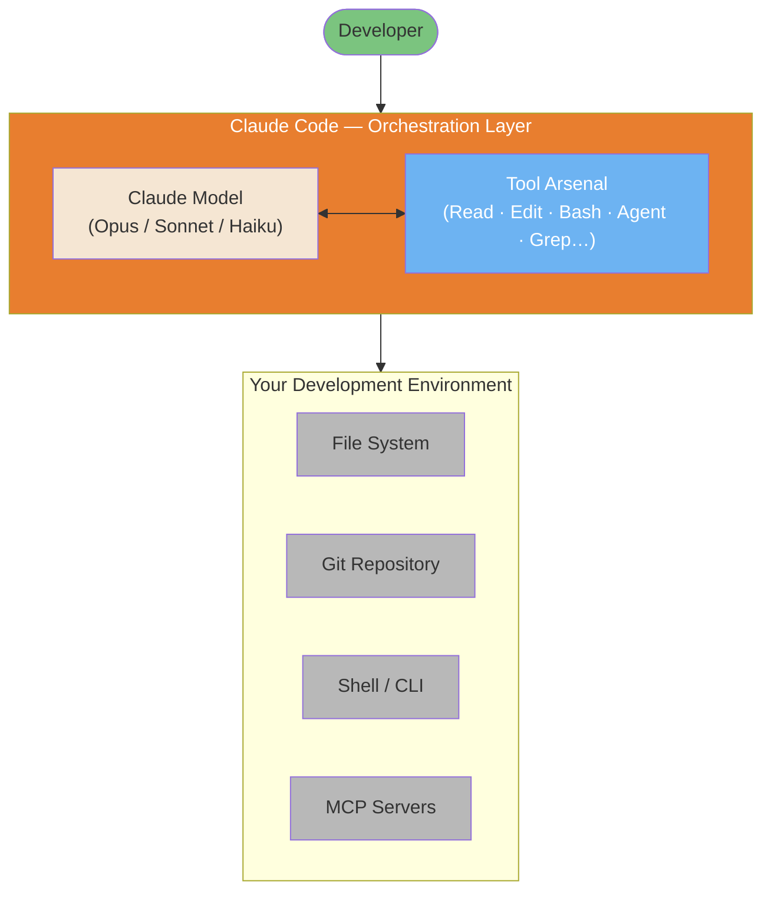
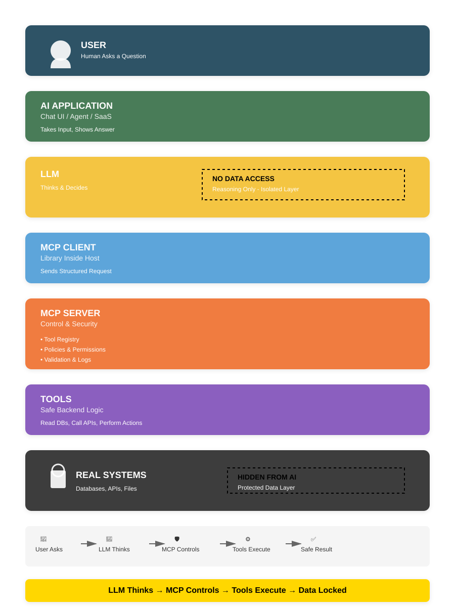

# Как работает Claude Code: Архитектура и внутреннее устройство

> Техническое руководство по документированному поведению Claude Code с отдельными наблюдениями сообщества. Цитируемый исторический анализ не устанавливает нынешнюю внутреннюю структуру.

**Автор**: Florian BRUNIAUX | Вклад от Claude (Anthropic)

**Время чтения**: ~25 минут (полное) | ~5 минут (только TL;DR)

**Последняя проверка**: октябрь 2026 г. Для инвентаризации инструментов, контекстного окна и заявок субагента исправлены ниже. В других разделах сохраняются цитированные исходные даты.

---

## Прозрачность источника

Этот документ объединяет три уровня источников:

| Уровень | Описание | Предел доказательств | Пример |
|------|-------------|------------|---------|
| **Уровень 1** | Официальная документация Anthropic | Контракт или поведение для указанного version/date и области действия. | документация code.claude.com |
| **Уровень 2** | Цитированная инспекция или реверс-инжиниринг | Наблюдение ограничивается проверенной версией и методом. | PromptLayer анализ |
| **Уровень 3** | Вывод сообщества | Непроверенное объяснение, а не контракт на продукт | Наблюдается, но официально не подтверждено |

Ярлыки источника описывают происхождение, а не измеренную достоверность. Предпочитаете текущую официальную документацию; исторические наблюдения остаются ограниченными датами и методами их источника.

---

## Где находится Claude Code в стопке ремней безопасности

Claude Code это **среда выполнения**: он владеет итеративным циклом моделей и инструментов для задачи кодирования. Модель генерирует токены; репозиторий предоставляет инструкции, настройку, состояние и проверку; оркестратор координирует несколько сеансов среды выполнения. Эти слои отвечают на разные вопросы и не должны рассматриваться как взаимозаменяемые продукты.

Прочтите [Agent Harness Engineering](./agent-harness.md), чтобы узнать о четырехслойной модели и механике во время выполнения. Используйте [Agent Harness Map](../ecosystem/agent-harness-landscape.md) при сравнении продуктов, имеющих цикл кодирования. Используйте [Agent Tools: Beyond Claude Code](../ecosystem/agentic-tools.md) для получения более широкого набора платформ, плоскостей управления и инструментов, связанных со средой выполнения. Глоссарий [](./glossary.md) определяет термины, используемые на этих страницах.

### <a name="claude-code-and-the-agent-sdk"></a>Claude Code и агент SDK

Claude Code это продукт, который вы запускаете в терминале, IDE или настольное приложение. Claude Агент SDK это библиотека, которая встраивает Claude Codeагент на вашем собственном Python или TypeScript приложение. Согласно [официальный агент SDK обзор](https://code.claude.com/docs/en/agent-sdk/overview), он запускает Claude Code двоичный и предоставляет те же инструменты, цикл агента и управление контекстом, включая разрешения, сеансы, перехватчики, субагенты и MCP. Таким образом, механика цикла и контекста на этой странице также описывает агенты, созданные с помощью SDK. SDK-включен только лимит цикла [Управление глубиной цикла с помощью max_turns](#controlling-loop-depth-with-max_turns). Для того, как SDK сравнивается с другими платформами агентов, см. [Инструменты агента §3.4](../ecosystem/agentic-tools.md#34-anthropic-agent-sdk).

---

## <a name="tldr---5-bullet-summary"></a>TL;DR – резюме из 5 пунктов

1. **Агентный цикл**: Модель предлагает инструменты или реакцию; программа применяет проверки разрешений перед запуском инструментов. В автоматическом режиме можно использовать классификатор. Этот цикл представляет собой обучающую модель, а не полное описание каждого компонента среды выполнения. [Система разрешений](https://code.claude.com/docs/en/permissions#permission-system).

2. **Встроенные и расширяемые инструменты**: Claude Code обеспечивает редактирование файлов, доступ к оболочке, поиск, субагенты и другие встроенные возможности. Доступный набор зависит от версии, модели и конфигурации; ссылка [tools](https://code.claude.com/docs/en/tools-reference) — это текущий инвентарь.

   **Эволюция стратегии поиска**: Ранние версии Claude Code экспериментировали с RAG, используя встраивания Voyage для семантического поиска кода. Anthropic перешел на агентный поиск на основе grep (ripgrep) после того, как внутренние тесты показали превосходную производительность при меньшей эксплуатационной сложности: не требуется синхронизация индексов, нет обязательств по безопасности со стороны внешних поставщиков внедрения. Эта философия «Ищите, не индексируйте» заменяет latency/tokens на simplicity/security. плагины сообщества (ast-grep для шаблонов AST) и серверы MCP (Serena для символов, grepai для RAG), доступные для специализированных нужд.

   *Источник*: подкаст [Latent Space](https://www.latent.space/p/claude-code) (май 2025 г.), документация ast-grep

3. **Контекстный бюджет, зависящий от модели**: Контекстное окно используется совместно с инструкциями, историей, результатами инструмента и ответами. Поддерживаемые модели и конфигурации учетных записей могут предоставить 200 000 или 1 миллион токенов; [Конфигурация модели](https://code.claude.com/docs/en/model-config#extended-context) контролирует доступность документов и автоматическое сжатие.

4. **Контекст субагента**: Обычные субагенты начинают заново; вилки наследуют разговор родителя при появлении. Разделение контекста не изолирует файловую систему или внешние эффекты. Обычное делегирование имеет настраиваемый предел глубины: по умолчанию он находится на три уровня ниже основного разговора; вилки не могут порождать дальнейшие вилки. [Режимы и ограничения субагента](https://code.claude.com/docs/en/sub-agents).

5. **Философия**: «Меньше строительных лесов, больше модели». Доверьтесь рассуждениям Claude, а не стройте вокруг них сложные системы оркестрации.

---

## <a name="visual-overview"></a>Визуальный обзор

Claude Code — не новая модель ИИ. Это уровень оркестрации, который объединяет Claude (Opus/Sonnet/Haiku) с возможностью чтения файлов, запуска команд оболочки, навигации по репозиториям и создания субагентов — и все это в непрерывном цикле, пока задача не будет выполнена.



*Вдохновлен архитектурной схемой [Мохамеда Али Бен Салема](https://www.linkedin.com/posts/mohamed-ali-ben-salem-2b777b9a_en-ce-moment-je-vois-passer-des-posts-du-activity-7420592149110362112-eY5a). См. диаграммы внутренней архитектуры [](../diagrams/04-architecture-internals.md) для более подробной информации.*

---

## Оглавление

- [Визуальный обзор](#visual-overview)

1. [Главный цикл](#1-the-master-loop)
2. [Инструментальный арсенал](#2-the-tool-arsenal)
3. [Внутренние элементы управления контекстом](#3-context-management-internals)
4. [Архитектура субагента](#4-sub-agent-architecture)
5. [Модель разрешений и безопасности](#5-permission--security-model)
6. [MCP Интеграция](#6-mcp-integration)
7. [Расширенные шаблоны использования инструментов (API)](#7-advanced-tool-use-patterns-api)
8. [Инструмент редактирования: как он на самом деле работает](#8-the-edit-tool-how-it-actually-works)
9. [Сохранение сеанса](#9-session-persistence)
10. [Философия: Меньше строительных лесов, больше моделей](#10-philosophy-less-scaffolding-more-model)
11. [Claude Code против Альтернатив](#11-claude-code-vs-alternatives)
12. [Источники и ссылки](#12-sources--references)
13. [Приложение: Чего мы не знаем](#13-appendix-what-we-dont-know)


---

## <a name="1-the-master-loop"></a>1. Главный цикл

**Категория источника**: Уровень 1, Официальный; ограничен указанным version/date и областью действия.
**Источник**: [Anthropic Инженерный блог](https://www.anthropic.com/engineering/claude-code-best-practices)

На диаграмме показан центральный цикл, в котором оценка разрешений сведена к шагу инструмента. В нем отсутствуют сведения о жизненном цикле перехватчика, уплотнении, повторных попытках и делегировании.

```
┌─────────────────────────────────────────────────────────────┐
│                    CLAUDE CODE MASTER LOOP                  │
├─────────────────────────────────────────────────────────────┤
│                                                             │
│   ┌──────────────┐                                          │
│   │  Your Prompt │                                          │
│   └──────┬───────┘                                          │
│          │                                                  │
│          ▼                                                  │
│   ┌──────────────────────────────────────────────────────┐  │
│   │                                                      │  │
│   │                  CLAUDE REASONS                      │  │
│   │             (Select the next action)                │  │
│   │                                                      │  │
│   └────────────────────────┬─────────────────────────────┘  │
│                            │                                │
│                            ▼                                │
│                   ┌────────────────┐                        │
│                   │  Tool Call?    │                        │
│                   └───────┬────────┘                        │
│                           │                                 │
│              YES          │           NO                    │
│         ┌─────────────────┴─────────────────┐               │
│         │                                   │               │
│         ▼                                   ▼               │
│  ┌────────────┐                      ┌────────────┐         │
│  │  Evaluate  │                      │   Text     │         │
│  │ permission │                      │  Response  │         │
│  │ run/refuse │                      │   (DONE)   │         │
│  └─────┬──────┘                      └────────────┘         │
│        │                                                    │
│        ▼                                                    │
│  ┌─────────────┐                                            │
│  │ Feed Result │                                            │
│  │  to Claude  │──────────────────┐                         │
│  └─────────────┘                  │                         │
│                                   │                         │
│                                   ▼                         │
│                          ┌────────────────┐                 │
│                          │   LOOP BACK    │                 │
│                          │  (Next turn)   │                 │
│                          └────────────────┘                 │
│                                                             │
└─────────────────────────────────────────────────────────────┘
```

### Что это значит

Упрощенный псевдокод обучения, а не реализация системы разрешений или перехватчиков:

```
while (claude_response.has_tool_call):
    result = evaluate_permissions_and_run_or_refuse(tool_call)
    claude_response = send_to_claude(result)
return claude_response.text
```

Модель выбирает следующее действие в зависимости от элементов управления ремнями безопасности. [Правила разрешений](https://code.claude.com/docs/en/permissions#permission-system) применяются Claude Code, а автоматический режим может использовать классификатор. Дополнительные рабочие процессы и расширения добавляют другие пути управления; этот эскиз не доказывает их отсутствия. См. [, как работает Claude Code](https://code.claude.com/docs/en/how-claude-code-works), и текущий перечень инструментов [](https://code.claude.com/docs/en/tools-reference).

### Почему этот дизайн?

1. **Простота**: Меньше компонентов = меньше режимов отказа.
2. **Model-driven**: рассуждения Claude лучше, чем эвристика, написанная вручную.
3. **Гибкость**: нет жесткого конвейера, ограничивающего возможности Claude.
4. **Отладка**: Легко понять, что произошло и почему.

### Словарь агентного цикла API

На приведенной выше диаграмме главного цикла показан поток концептуально, но сообщения API раскрывают его через конкретные значения `stop_reason`. Эти три общих значения иллюстрируют цикл; Полный список см. в официальном справочнике причин остановки [](https://platform.claude.com/docs/en/build-with-claude/handling-stop-reasons).

| `stop_reason` | Значение | Циклическое действие |
|---------------|---------|-------------|
| `tool_use` | Claude хочет вызвать один или несколько инструментов | Выполнить инструменты, вернуть результаты, продолжить цикл |
| `end_turn` | Claude решил, что все кончено | Выйти из цикла, вернуть текстовый ответ |
| `max_tokens` | Достигнут запрошенный лимит выходных токенов | Поднимите предел вывода или продолжите ответ |

Псевдокод становится точным с этими именами:

```python
messages = [{"role": "user", "content": user_prompt}]

while True:
    response = client.messages.create(model=model, messages=messages, tools=tools)

    if response.stop_reason == "end_turn":
        return response.content[0].text  # done

    if response.stop_reason == "tool_use":
        # Process every tool_use block in the response
        tool_results = []
        for block in response.content:
            if block.type == "tool_use":
                result = execute_tool(block.name, block.input)
                tool_results.append({
                    "type": "tool_result",
                    "tool_use_id": block.id,
                    "content": result
                })
        messages.append({"role": "assistant", "content": response.content})
        messages.append({"role": "user", "content": tool_results})
        # loop continues
```

Блок `tool_use` внутри `response.content` имеет три поля, с которыми вы работаете: `id` (для обратного сопоставления результатов), `name` (какую функцию вызывать) и `input` (список аргументов). Результат, который вы отправляете обратно, должен ссылаться на `tool_use_id`, чтобы модель могла сопоставить вызов и ответ.

**`fork_session`** — это концепция более высокого уровня, построенная на этом цикле: она создает независимую ветвь текущего диалога, разделяя одну и ту же историю сообщений до точки разветвления. Обе ветки могут одновременно исследовать разные подходы или конфигурации, например `git branch`, но для сеансов агентов. Каждый форк независимо запускает собственный агентский цикл, что полезно для сравнения ответов при различных конфигурациях инструментов или вариантов подсказок без повторного запуска всего диалога с нуля.

#### <a name="controlling-loop-depth-with-max_turns"></a>Управление глубиной цикла с помощью max_turns

`max_turns` ограничивает количество итераций assistant/tool перед завершением работы оркестратора. Без явного ограничения неконтролируемый цикл может истощить бюджет или контекстное окно способами, которые трудно диагностировать постфактум.

Практические диапазоны по типам задач:

| Тип задачи | Рекомендуется `max_turns` |
|---|---|
| Простой поиск (одиночный поиск) | 5 |
| Исследование или многоэтапное кодирование | 20-30 |
| Расширенные автономные рабочие процессы | 50 |

`max_turns` является агентом SDK ограничение цикла, а не сообщения API `stop_reason`. Если этот предел достигнут, задача может быть неполной. Осмотрите SDKокончательное сообщение о результате для `subtype == "error_max_turns"`, как описано в [Агент Python SDK ссылка](https://code.claude.com/docs/en/agent-sdk/python):

```python
from claude_agent_sdk import ClaudeAgentOptions, ResultMessage, query

# Inside an async function; handle_incomplete is your application callback.
async for message in query(prompt=task, options=ClaudeAgentOptions(max_turns=20)):
    if isinstance(message, ResultMessage) and message.subtype == "error_max_turns":
        handle_incomplete(message)
```

Установка `max_turns` для каждого типа задачи, а не глобально, не позволяет одной медленной задаче истощать другие задачи в многоагентном конвейере. Ночное пакетное задание, для которого законно требуется 50 ходов, не должно наследовать тот же предел, что и быстрый поиск, который должен выполняться за 5.

### Аудит собственных возможностей

Используйте этот контрольный список, чтобы убедиться, что вы понимаете всю площадь поверхности Claude Code. Каждая возможность подробно описана в другом месте этого руководства.

**11 встроенных возможностей**:

- [ ] **Event Hooks**: сценарии Bash/PowerShell запускаются при выполнении инструмента.
  - PreToolUse, PostToolUse, UserPromptSubmit, уведомление
  - См.: [Раздел 5. Крючки](#5-permission--security-model).

- [ ] **HooksSkill-Sscoped**: перехватчики событий, специфичные для контекста выполнения навыков.
  - Управление жизненным циклом по навыкам
  - См.: [Полное руководство, раздел 5.11](#51-understanding-skills).

- [ ] **Background Agents**: асинхронное выполнение задач (наборы тестов, длительные операции)
  - Неблокирующий спавн агента
  - См.: [Раздел 4.2 Архитектура субагента](#4-sub-agent-architecture)

- [ ] **Изучите субагент**: `/explore` для анализа кодовой базы
  - Исследование кодовой базы только для чтения
  - См.: [Раздел 4.2 Субагенты](#4-sub-agent-architecture)

- [ ] **Plan Subagent**: `/plan` для режима планирования только для чтения.
  - Безопасное архитектурное исследование
  - См.: [Полное руководство, раздел 2.3](#23-plan-mode).

- [ ] **Agent Tool**: Иерархическое делегирование задач специализированным агентам.
  - Параллельное выполнение задач; вложенность настраивается (по умолчанию три слоя)
  - См.: [Раздел 4.2 Архитектура субагента](#4-sub-agent-architecture)

- [ ] **Команды агентов**: параллельная координация нескольких агентов (экспериментальная версия 2.1.32+)
  - Координация на основе Git, автономное утверждение задач
  - См.: [Полное руководство, раздел 9.20](#920-agent-teams-multi-agent-coordination).

- [ ] **Выбор модели для каждой задачи**: динамическое переключение модели в середине сеанса
  - `/model opus|sonnet|haiku` на границах задач
  - См.: [Раздел 10 «Оптимизация затрат»](#10-claude-code-vs-alternatives).

- [ ] **MCP Интеграция протоколов**: Model Context Protocol для расширений инструментов
  - Контекст7, Последовательный, Серена, Playwright и т. д.
  - См.: [Раздел 6 MCP Интеграция](#6-mcp-integration)

- [ ] **Режимы разрешений**: детальный контроль над выполнением инструмента.
  - По умолчанию, автоматическое принятие, режим планирования, пользовательские правила
  - См.: [Раздел 5, Модель разрешений и безопасности](#5-permission--security-model).

- [ ] **Session Memory**: постоянный контекст между сеансами.
  - CLAUDE.md, файлы памяти, состояние проекта
  - См.: [Раздел 8. Сохранение сеанса](#8-session-persistence).

**Совет по адаптации**: Если вы не изучили все 11 возможностей, вы, скорее всего, упускаете возможности повышения производительности. Сосредоточьтесь на неотмеченных пунктах выше.

**Источник**: Синтезировано на основе анализа [Гура Санникова](https://www.linkedin.com/posts/gursannikov_claudecode-embeddedengineering-aiagents-activity-7423851983331328001-DrFb)

---

## <a name="2-the-tool-arsenal"></a>2. Инструментальный арсенал

**Категория источника**: Уровень 1, Официальный; ограничен указанным version/date и областью действия.
**Источник**: [code.claude.com/docs](https://code.claude.com/docs/en/setup)

Приведенные ниже инструменты являются примерами, а не исчерпывающим перечнем. Информацию о доступности в зависимости от модели и конфигурации см. в справочнике по текущим инструментам [](https://code.claude.com/docs/en/tools-reference).

| Инструмент | Цель | Ключевое поведение | Стоимость токена |
|------|---------|--------------|------------|
| `Bash` | Выполнение команд оболочки | Универсальный адаптер, самый мощный | Низкий (команда) + Переменная (выход) |
| `Read` | Чтение содержимого файла | Макс. 2000 строк, обрабатывается усечение | Высокий для больших файлов |
| `Edit` | Изменить существующие файлы | На основе различий, требуется точное совпадение | Середина |
| `Write` | Create/overwrite файлы | Необходимо сначала прочитать, если файл существует | Середина |
| `Grep` | Поиск содержимого файла | На основе Ripgrep (регулярное выражение), замененный подход RAG/embedding. Для поиска по структурному коду (на основе AST) см. плагин ast-grep. Компромисс: Grep (быстрый, простой) против ast-grep (точный, требуется настройка) против Serena MCP (семантический, с учетом символов) | Низкий |
| `Glob` | Найти файлы по шаблону | Сопоставление путей, отсортировано по времени | Низкий |
| `Agent` | Создавать субагентов (ранее `Task`) | Свежий или раздвоенный контекст; настраивается обычное вложение (три слоя по умолчанию); эффекты файловой системы могут быть общими | Зависит от режима делегирования |
| `TodoWrite` / Инструменты задач | Отслеживайте прогресс | Доступные инструменты и настройки по умолчанию зависят от модели и конфигурации; обратитесь к текущему справочнику инструментов [](https://code.claude.com/docs/en/tools-reference) | Зависит от списка задач |

### <a name="the-bash-universal-adapter"></a>Универсальный адаптер bash

**Ключевая мысль**: Bash — это швейцарский армейский нож Claude. Он может:

- Запустите любой инструмент CLI (git, npm, docker, curl...)
- Выполнение скриптов
- Цепные команды с трубами
- Доступ к состоянию системы

Модель была обучена на огромных объемах данных оболочки, что делает ее очень эффективной при использовании Bash в качестве универсального адаптера, когда специализированных инструментов недостаточно.

### Логика выбора инструмента

Claude решает, какой инструмент использовать, исходя из задачи. Там нет жестко запрограммированной маршрутизации:

```
┌─────────────────────────────────────────────────────┐
│              TOOL SELECTION (Model-Driven)          │
├─────────────────────────────────────────────────────┤
│                                                     │
│  "Read auth.ts"           → Read tool               │
│  "Find all test files"    → Glob tool               │
│  "Search for TODO"        → Grep tool               │
│  "Run npm test"           → Bash tool               │
│  "Explore the codebase"   → Agent (sub-agent)       │
│  "Track my progress"      → Available task tools    │
│                                                     │
│  The model learns these patterns during training,   │
│  not from explicit rules.                           │
│                                                     │
└─────────────────────────────────────────────────────┘
```

### Расширенная экосистема инструментов

Помимо встроенных инструментов, перечисленных в справочнике [tools](https://code.claude.com/docs/en/tools-reference), Claude Code может использовать:

Серверы **MCP** (Model Context Protocol):
- **Serena**: навигация по коду с учетом символов + память сеанса
- **grepai**: семантический поиск + анализ графа вызовов (на основе Ollama)
- **Context7**: Поиск официальной документации библиотеки.
- **Sequential**: Структурированное многоэтапное рассуждение.
- **Playwright**: автоматизация браузера и E2E-тестирование
- **claude-code-ultimate-guide**: 12 инструментов: поиск по руководствам, отслеживание выпусков, `compare_versions`, поиск угроз безопасности (`get_threat`, `list_threats` с 28 CVE + 655 вредоносных навыков), поиск по шаблонам (`search_examples`); установить через `npx -y claude-code-ultimate-guide-mcp`

**Плагины сообщества**:
- **ast-grep**: поиск структурного кода на основе AST (явный вызов)

### Матрица выбора инструмента поиска

Claude Code предлагает несколько способов поиска кода, каждый из которых имеет свои преимущества:

| Поиск Необходимость | Родной инструмент | MCP/Plugin Альтернатива | Когда следует эскалировать |
|-------------|-------------|----------------------|------------------|
| Точный текст | `Grep` (рипгреп) | - | Никогда (самый быстрый) |
| Имя функции | `Grep` | Серена `find_symbol` | Многофайловый рефакторинг |
| По смыслу | - | грепай `search` | Не знаю точного текста |
| График звонков | - | грепай `trace_callers` | Анализ зависимостей |
| Структурный образец | - | ast-grep | Большие миграции (>50 тыс. строк) |
| Структура файла | - | Серена `get_symbols_overview` | Нужен контекст символа |

**Сравнение производительности**:

| Инструмент | Скорость | Настройка | Вариант использования |
|------|-------|-------|----------|
| Греп (рипгреп) | ⚡ ~20 мс | ✅ Нет | 90% поисков |
| Серена | ⚡ ~100 мс | ⚠️ MCP | Рефакторинг, символы |
| грепай | 🐢 ~500 мс | ⚠️ Оллама + MCP | Семантика, граф вызовов |
| ast-grep | 🕐 ~200 мс | ⚠️ Плагин | Шаблоны AST, миграции |

**Принцип принятия решения**: начните с Grep (самый быстрый), переходите к специализированным инструментам только при необходимости.

> **📖 Подробное описание**: см. [Search Tools Mastery](../workflows/search-tools-mastery.md), где описаны подробные рабочие процессы, объединяющие все инструменты поиска.

---

## <a name="3-context-management-internals"></a>3. Внутренние механизмы управления контекстом

**Категория источника**: уровень 2, частично официальный; ограничивается приведенными наблюдением и методом.
**Sources**:
- [platform.claude.com/docs](https://platform.claude.com/docs/en/build-with-claude/context-windows) (Уровень 1)
- Наблюдаемое поведение (уровень 2)

Размер контекстного окна Claude Code зависит от модели, плана и поставщика. Поддерживаемые конфигурации предоставляют 200 тыс. или 1 млн токенов; см. [расширенный контекст](https://code.claude.com/docs/en/model-config#extended-context).

### <a name="context-budget-breakdown"></a>Контекстная разбивка бюджета

```
┌─────────────────────────────────────────────────────────────┐
│             CONTEXT BUDGET (model-dependent)                │
├─────────────────────────────────────────────────────────────┤
│                                                             │
│  ┌──────────────────────────────────────────────────────┐   │
│  │ System Prompt                            (variable)  │   │
│  │ • Tool definitions                                   │   │
│  │ • Safety instructions                                │   │
│  │ • Behavioral guidelines                              │   │
│  │ • See detailed breakdown below ↓                     │   │
│  ├──────────────────────────────────────────────────────┤   │
│  │ CLAUDE.md Files and Rules                 (variable)  │   │
│  │ • Global ~/.claude/CLAUDE.md                         │   │
│  │ • Project CLAUDE.md or .claude/CLAUDE.md               │   │
│  │ • Native .claude/rules/ files                         │   │
│  ├──────────────────────────────────────────────────────┤   │
│  │ Conversation History                     (variable)  │   │
│  │ • Your prompts                                       │   │
│  │ • Claude's responses                                 │   │
│  │ • Tool call records                                  │   │
│  ├──────────────────────────────────────────────────────┤   │
│  │ Tool Results                             (variable)  │   │
│  │ • File contents from Read                            │   │
│  │ • Command outputs from Bash                          │   │
│  │ • Search results from Grep                           │   │
│  ├──────────────────────────────────────────────────────┤   │
│  │ Response / compaction allowance          (variable)  │   │
│  │ • Claude's thinking                                  │   │
│  │ • Generated code/text                                │   │
│  └──────────────────────────────────────────────────────┘   │
│                                                             │
│  Measure the session with /context; no fixed free budget    │
│                                                             │
└─────────────────────────────────────────────────────────────┘
```

### <a name="system-prompt-contents"></a>Содержимое системной подсказки

**Категория источника**: уровень 1, официальная документация Anthropic; ограничен указанным version/date и областью действия.
**Sources**:
- [Claude Code настройки: публикация системной подсказки](https://code.claude.com/docs/en/settings#change-a-setting)
- [Как работает Claude Code: context](https://code.claude.com/docs/en/how-claude-code-works)
- [Anthropic Системные подсказки Примечания к выпуску](https://platform.claude.com/docs/en/release-notes/system-prompts/overview)
- [Anthropic Инженерное дело: Claude Code Лучшие практики](https://www.anthropic.com/engineering/claude-code-best-practices)

Claude Codeсистемное приглашение **не опубликовано**, согласно его документации по настройкам. Anthropicвыпущен Claude.ai/mobile подсказки не устанавливают текущий CLI текст приглашения или размер токена.

**Документированные контекстные компоненты** включают инструкции, доступные определения инструментов, историю и результаты работы инструментов. Доступность инструмента зависит от модели и конфигурации. Инструкции пользователя, такие как поведение формы `CLAUDE.md`; настройки разрешений контролируют разрешенные действия. Точная структура запроса, размер приглашения и распределение внутреннего кэша здесь остаются непроверенными.

**Важные отличия**:
- **Claude.ai/Mobile**: опубликованные подсказки доступны публично.
- **Anthropic API**: различные инструкции по умолчанию, настраиваемые разработчиками.
- **Claude Code CLI**: Агент-помощник по кодированию с функцией сбора контекста.

**Исторический анализ сообщества подсказок семейства Claude**, а не свидетельство текущей подсказки Claude Code:
- **Claude Саймона Уиллисона 4 Анализ** (май 2025 г.): [Глубокое погружение в блоки мышления, правила поиска, ограждения безопасности](https://simonwillison.net/2025/May/25/claude-4-system-prompt/)
- **Технический анализ PromptHub** (июнь 2025 г.): [Подробный анализ шаблонов быстрого проектирования](https://www.prompthub.us/blog/an-analysis-of-the-claude-4-system-prompt)

→ **Перекрестная ссылка**: Информацию о последствиях для безопасности см. в [Раздел 5: Модель разрешений и безопасности](#5-permission--security-model)

Область **Cache**: контракт на кэширование подсказок [API](https://platform.claude.com/docs/en/build-with-claude/prompt-caching#cache-storage-and-sharing) разделяет организации с изоляцией рабочего пространства на платформах Claude API, Claude на AWS и Microsoft Foundry; Bedrock и Google Cloud используют организационную изоляцию. Этот контракт не устанавливает структуру внутреннего кэша Claude Code. Повторное использование вилки описано отдельно в справочнике субагента [](https://code.claude.com/docs/en/sub-agents#how-forks-differ-from-other-subagents).

---

### Auto-compaction

**Категория источника**: уровень 2, проверено сообществом при поддержке исследований; ограничивается приведенными наблюдением и методом.

Когда использование контекста превышает пороговое значение, Claude Code автоматически суммирует предыдущие повороты разговора:

| Источник | Сообщенный порог | Примечания |
|--------|-------------------|-------|
| Расширение кода VS | Использование ~75% (осталось 25%) | [GitHub #11819](https://github.com/anthropics/claude-code/issues/11819) (ноябрь 2025 г.) |
| Версия CLI | осталось 1-5% | Более консервативен, чем VS Code. |
| PromptLayer анализ | 92% | Историческое наблюдение |
| Стив Кинни | 95% | [Руководство по управлению сеансами](https://stevekinney.com/courses/ai-development/claude-code-session-management) (июль 2025 г.) |
| Запускается пользователем `/compact` | В любое время | Ручное управление |

**Что происходит во время уплотнения:**

1. Обобщены старые разговоры
2. Результаты инструмента сжаты
3. Недавний контекст сохраняется полностью
4. Модель получает сигнал «контекст был сжат».

**Влияние на производительность** (подтверждено исследованиями):

Недавние исследования и наблюдения практиков подтверждают ухудшение качества **при автоматическом уплотнении**:

- Производительность **LLM падает на 50–70 % при выполнении сложных задач** по мере роста контекста с 1 000 до 32 000 токенов ([Context Rot Research](https://research.trychroma.com/context-rot), июль 2025 г.)
- **11 из 12 моделей падают ниже 50 % от своей производительности в коротком контексте** при 32 000 токенов (тест NoLiMa)
- **Auto-compact теряет нюансы и нарушает ссылки** в результате повторяющихся циклов сжатия ([Claude сохраняет токены, забывает все](https://golev.com/post/claude-saves-tokens-forgets-everything/), январь 2026 г.)
- **Механизм внимания борется** с нагрузкой поиска в высококонтекстных сценариях

**Консенсус сообщества**: Ручной `/compact` на логических точках останова > ожидание срабатывания автоматического сжатия.

**Рекомендуемая стратегия** (Лоренц, 2026 г. (исходное сообщение LinkedIn недоступно)):

| Контекст % | Действие | Обоснование |
|-----------|--------|-----------|
| **70%** | Внимание – запланируйте очистку. | Раннее осознание |
| **85%** | Рекомендуется ручная передача | Предотвращение деградации автоматического сжатия |
| **95%** | Принудительная передача | Серьезное ухудшение качества |

**Пользовательский элемент управления**: используйте `/compact` вручную, чтобы инициировать суммирование в логических точках останова, или используйте **передачу сеанса** (см. [Передача сеанса](#session-handoffs)), чтобы сохранить намерение в сжатой истории.

Карточка [Context Compaction](./ai-design-patterns.md#context-compaction) в шаблонах проектирования AI перечисляет то, что Claude Code повторно вводит после сжатия, а что сохраняется только в виде сводки.

### Стратегии сохранения контекста

| Стратегия | Когда использовать | Как |
|----------|-------------|-----|
| Sub-agents | Исследовательские задачи | Инструмент `Agent` для отдельного контекста; общие эффекты требуют координации |
| Ручной компактный | Проактивная очистка | Команда `/compact` |
| Очистить сеанс | Нужен новый старт | Команда `/clear` |
| Конкретные чтения | Знайте, что вам нужно | Читать точные файлы, а не каталоги |
| CLAUDE.md | Постоянный контекст | Соглашения о хранении в файлах памяти |

### <a name="session-degradation-limits"></a>Пределы деградации сеанса

**Категория источника**: Уровень 2, исследования практиков, исследования arXiv; ограничивается приведенными наблюдением и методом.

Эффективность Claude Code предсказуемо снижается при определенных условиях:

| Состояние | Наблюдаемый порог | Симптом |
|-----------|-------------------|---------|
| Разговор поворачивается | **15-25 витков** | Теряет след прежних ограничений |
| Накопление токенов | **80-100 тыс. токенов** | Игнорирует требования, заявленные в начале сессии. |
| Объем проблемы | **>5 файлов одновременно** | Непоследовательные изменения, пропущенные файлы |

**Уровни успеха в зависимости от области применения** (на основе исследований практиков):

| Область применения | Уровень успеха | Пример |
|-------|--------------|---------|
| 1-3 файла | ~85% | Исправить ошибку в одном модуле |
| 4-7 файлов | ~60% | Функция рефакторинга компонентов |
| 8+ файлов | ~40% | Изменения всей кодовой базы |

**Стратегии смягчения последствий**:

1. **Checkpoint подсказывает**: «Прежде чем продолжить, повторите текущие требования и ограничения».
2. **Сброс сеанса**: начать заново для новых задач (`/clear`)
3. **Жестко масштабируйте**: разбивайте большие задачи на целенаправленные подзадачи.
4. **Использовать субагенты**: делегируйте исследование инструменту `Agent`, чтобы сохранить основной контекст

### Смещение контекста, вызванное сбоем

Отдельный режим деградации, не зависящий от размера контекста: повторяющиеся сбои инструмента. Когда вызов инструмента завершается неудачей и Claude повторяет попытку, вывод ошибки накапливается в контекстном окне. Трассировки стека, шум повторных попыток и сообщения об ошибках ослабляют первоначальный замысел. Последующие попытки следуют описанию ошибки, а не цели задачи. Контекстное окно не заполнено, но соотношение сигнал/шум ухудшилось.

Это отличается от сноса уплотнения. Контекст адресов сжатия *size*; повторное внедрение ошибки адресов контекста *quality* в пределах ограниченного окна.

**Pattern**: повторно вводить инструкцию основной задачи при каждом сбое команды, а не только после `/compact`. Хук `PostToolUse` может префикс повторных запросов с сокращенной версией исходной задачи и ограничений:

```bash
# PostToolUse hook: re-inject intent after failures
if [[ "$CLAUDE_TOOL_EXIT_CODE" != "0" ]]; then
  echo "REMINDER: The current task is: $ORIGINAL_TASK_SUMMARY. Ignore the above error if non-blocking and continue toward that goal."
fi
```

Источник: [Nick Tune, Workflow DSL: управляемые доменом рабочие процессы Claude Code](https://nick-tune.me/blog/2026-03-01-workflow-dsl-domain-driven-claude-code-workflows/) (01.03.2026)

---

## <a name="4-sub-agent-architecture"></a>4. Архитектура субагента

**Категория источника**: Уровень 1, Документированное поведение; ограничен указанным version/date и областью действия.
**Источник**: [Claude Code документация субагента](https://code.claude.com/docs/en/sub-agents)

Делегаты инструмента Claude Code `Agent` работают в отдельном контексте. Эта граница не изолирует общие файлы, службы или внешние действия.

### <a name="isolation-model"></a>Модель изоляции

На этом рисунке описан обычный субагент без форка. Форки наследуют разговор родителя при появлении; `isolation: "worktree"` предоставляет отдельные файлы Git, а не отдельные внешние сервисы. [Поведение вилки](https://code.claude.com/docs/en/sub-agents#how-forks-differ-from-other-subagents).

```
┌─────────────────────────────────────────────────────────────┐
│                        MAIN AGENT                           │
│                                                             │
│  ┌───────────────────────────────────────────────────────┐  │
│  │ Context: Full conversation + all file reads           │  │
│  │                                                       │  │
│  │       Agent("Explore authentication patterns")        │  │
│  │                        │                              │  │
│  │                        ▼                              │  │
│  │  ┌─────────────────────────────────────────────────┐  │  │
│  │  │             SUB-AGENT (Spawned)                 │  │  │
│  │  │                                                 │  │  │
│  │  │  • Own fresh context window                     │  │  │
│  │  │  • Task, definition and applicable context     │  │  │
│  │  │  • Tools vary by agent and permission settings  │  │  │
│  │  │  • May delegate (default depth: 3 layers)       │  │  │
│  │  │  • Returns: summary text only                   │  │  │
│  │  │                                                 │  │  │
│  │  └─────────────────────────────────────────────────┘  │  │
│  │                        │                              │  │
│  │                        ▼                              │  │
│  │         Result: "Found 3 auth patterns: JWT in..."    │  │
│  │         (Only this text enters main context)          │  │
│  │                                                       │  │
│  └───────────────────────────────────────────────────────┘  │
│                                                             │
└─────────────────────────────────────────────────────────────┘
```

### Вложенность и ограничения

По умолчанию субагенты могут делегировать до трех уровней ниже основного разговора. Ограничение глубины [](https://code.claude.com/docs/en/sub-agents#let-subagents-spawn-their-own-subagents) можно настроить; субагент без инструмента агента не может делегировать полномочия. Каждый агент использует свой собственный контекст и вносит свой вклад в ограничения использования, поэтому вложенное делегирование требует четких границ задач.

Вилки не могут порождать дальнейшие вилки. Новые субагенты также могут загружать соответствующие инструкции и предварительно загруженные навыки; они получают больше, чем строка задачи. [Контекст запуска](https://code.claude.com/docs/en/sub-agents#what-loads-at-startup).

### <a name="sub-agent-types"></a>Типы субагентов

Встроенные типы и ограничения инструментов зависят от версии и конфигурации. В текущей ссылке [](https://code.claude.com/docs/en/sub-agents#built-in-subagents) перечислены:

| Тип | Цель | Доступные инструменты |
|------|---------|-----------------|
| `Explore` | Исследование кодовой базы | Все инструменты только для чтения |
| `Plan` | Исследования в режиме планирования | Инструменты только для чтения; Запись и редактирование запрещены |
| `general-purpose` | Сложный многоэтапный | Инструменты, доступные субагентам при наличии разрешений |
| Другие помощники | Помощь по конкретному сеансу | Зависит от помощника и конфигурации |

### Когда использовать субагентов

| Вариант использования | Почему субагент помогает |
|----------|---------------------|
| Поиск в больших кодовых базах | Сохраняет основной контекст чистым |
| Параллельная разведка | Несколько поисков одновременно |
| Масштабные геологоразведочные работы | Промежуточный вывод остается в отдельном контексте; общие эффекты все еще требуют контроля |
| Специализированный анализ | Разное «мышление» для разных задач |

### Оркестровка «ступица и спица»

Предлагаемый шаблон **hub-and-spoke** назначает интеграцию одному координатору. Следующая диаграмма отражает эту политику координации, а не ограничение на обмен сообщениями между узлами или наследование контекста.

```
                    ┌─────────────────────┐
                    │    COORDINATOR      │
                    │  (Hub / Orchestrator)│
                    │                     │
                    │  • Decomposes goal  │
                    │  • Passes context   │
                    │  • Aggregates results│
                    │  • Resolves conflicts│
                    └──┬──────┬──────┬───┘
                       │      │      │
            ┌──────────┘      │      └──────────┐
            │                 │                 │
     ┌──────▼──────┐  ┌───────▼─────┐  ┌───────▼─────┐
     │  WORKER A   │  │  WORKER B   │  │  WORKER C   │
     │             │  │             │  │             │
     │  Specific   │  │  Specific   │  │  Specific   │
     │  task only  │  │  task only  │  │  task only  │
     └─────────────┘  └─────────────┘  └─────────────┘
           │                 │                 │
           └────────────────►│◄────────────────┘
                     (results flow back to coordinator only)
```

**Проверьте режим делегирования.** Свежим субагентам требуется явный контекст задачи; вилки наследуют снимок. Ни один из них автоматически не получает результаты более поздних исследований брата или сестры. Передавайте эти результаты или координируйте свои действия с помощью поддерживаемых сообщений и общих файлов. [Контекст запуска и форки](https://code.claude.com/docs/en/sub-agents#what-loads-at-startup).

**Явный шаблон передачи контекста:**

```python
# Teaching pseudocode, not a Claude Code API
# Independent fresh workers do not automatically share findings
task_a = delegate_fresh("Analyze auth.py and find the session token logic")
task_b = delegate_fresh("Find all callers of the session token logic")

# Wait for the result, then supply it to the next fresh worker
result_a = await_result(task_a)
task_b = delegate_fresh(f"Find all callers of {result_a} across the codebase")
```

**Обязанности координатора:**

1. **Decompose**: разбейте цель на независимые подзадачи с четкими границами.
2. **Передавать контекст явно**: описание каждой рабочей задачи должно быть самодостаточным.
3. **Aggregate**: собирать текстовые результаты от всех рабочих процессов, объединять их в последовательный вывод.
4. **Решить сквозные вопросы**: поручить решения по интеграции координатору в этом шаблоне

В этом предложенном шаблоне зависимости маршрутизируются через координатора. Одноранговая связь также поддерживается, когда выбранный сеанс предоставляет инструменты обмена сообщениями; выбрать политику координации, соответствующую поставленной задаче.

---

## <a name="5-permission--security-model"></a>5. Модель разрешений и безопасности

**Категория источника**: Уровень 1, Официальный; ограничен указанным version/date и областью действия.
**Sources**:
- [code.claude.com/docs/en/hooks](https://code.claude.com/docs/en/hooks)
- [code.claude.com/docs/en/sandboxing](https://code.claude.com/docs/en/sandboxing)

Claude Code имеет многоуровневую модель безопасности:

```
┌─────────────────────────────────────────────────────────────┐
│                    PERMISSION LAYERS                        │
├─────────────────────────────────────────────────────────────┤
│                                                             │
│  Layer 1: INTERACTIVE PROMPTS                               │
│  ┌────────────────────────────────────────────────────────┐ │
│  │ Claude wants to run: rm -rf node_modules               │ │
│  │ [Allow once] [Allow always] [Deny] [Edit command]      │ │
│  └────────────────────────────────────────────────────────┘ │
│                          │                                  │
│                          ▼                                  │
│  Layer 2: ALLOW/DENY RULES (settings.json)                  │
│  ┌────────────────────────────────────────────────────────┐ │
│  │ {                                                      │ │
│  │   "permissions": {                                     │ │
│  │     "allow": ["Bash(npm *)", "Read"],              │ │
│  │     "deny": ["Bash(rm -rf *)"]                         │ │
│  │   }                                                    │ │
│  │ }                                                      │ │
│  └────────────────────────────────────────────────────────┘ │
│                          │                                  │
│                          ▼                                  │
│  Layer 3: HOOKS (Pre/Post execution)                        │
│  ┌────────────────────────────────────────────────────────┐ │
│  │ PreToolUse: Validate before execution                  │ │
│  │ PostToolUse: Audit after execution                     │ │
│  │ PermissionRequest: Override permission prompts         │ │
│  └────────────────────────────────────────────────────────┘ │
│                          │                                  │
│                          ▼                                  │
│  Layer 4: SANDBOX MODE (Optional isolation)                 │
│  ┌────────────────────────────────────────────────────────┐ │
│  │ Filesystem isolation + Network restrictions            │ │
│  └────────────────────────────────────────────────────────┘ │
│                                                             │
└─────────────────────────────────────────────────────────────┘
```

### Обнаружение опасных закономерностей

**Категория источника**: Уровень 2, Соблюдается, но не является исчерпывающим; ограничивается приведенными наблюдением и методом.

Claude Code, похоже, отмечает определенные закономерности для дополнительного изучения:

| Шаблон | Риск | Поведение |
|---------|------|----------|
| `rm -rf` | Деструктивное удаление | Всегда подсказывает |
| `sudo` | Повышение привилегий | Всегда подсказывает |
| `curl \| sh` | Удаленное выполнение кода | Всегда подсказывает |
| `chmod 777` | Небезопасные разрешения | Всегда подсказывает |
| `git push --force` | Разрушение истории | Всегда подсказывает |
| `DROP TABLE` | Уничтожение данных | Всегда подсказывает |

Это не полный черный список. Паттерны, скорее всего, обнаруживаются посредством обучения модели, а не явных правил.

### <a name="native-sandbox-v210"></a>Собственная песочница (v2.1.0+)

**Категория источника**: Уровень 1, Официальный; ограничен указанным version/date и областью действия.
**Источник**: [code.claude.com/docs/en/sandboxing](https://code.claude.com/docs/en/sandboxing)

Claude Code включает в себя встроенный **встроенная песочница** использование примитивов уровня ОС для изоляции на уровне процесса:

```
┌──────────────────────────────────────────────────────┐
│               Native Sandbox Architecture            │
├──────────────────────────────────────────────────────┤
│                                                      │
│  Bash Command Request                                │
│       │                                              │
│       ▼                                              │
│  Sandbox Wrapper (Seatbelt/bubblewrap)               │
│       │                                              │
│       ├─ Filesystem: read all, write CWD only        │
│       ├─ Network: SOCKS5 proxy + domain filtering    │
│       ├─ Process: isolated environment               │
│       │                                              │
│       ▼                                              │
│  OS Kernel Enforcement                               │
│       │                                              │
│       ├─ Allowed: operations within boundaries       │
│       ├─ Blocked: violations at system call level    │
│       └─ Notify: user receives alert on violation    │
│                                                      │
└──────────────────────────────────────────────────────┘
```

**OS Примитивы**:

| Платформа | Механизм | Примечания |
|----------|-----------|-------|
| **macOS** | Ремень безопасности (TrustedBSD MAC) | Встроенная фильтрация системных вызовов на уровне ядра. |
| **Linux/WSL2** | пузырьковая оболочка (пространства имен + seccomp) | Требуется: `sudo apt-get install bubblewrap socat` |
| **WSL1** | ❌ Не поддерживается | Bubblewrap нуждается в функциях ядра, недоступных |
| **Windows** | ❌ Не поддерживается | Команды выполняются без изолированной программной среды; используйте WSL2 |

**Модель изоляции**:

1. **Filesystem**:
   - **Read**: весь компьютер (кроме запрещенных путей)
   - **Write**: только текущий рабочий каталог (настраиваемый)
   - **Blocked**: изменения вне CWD, каталоги учетных данных (`~/.ssh`, `~/.aws`)

2. **Network**:
   - **Proxy**: все соединения маршрутизируются через прокси-сервер SOCKS5.
   - **Фильтрация доменов**: режим Allowlist/denylist
   - **По умолчанию заблокировано**: частные CIDR, диапазоны локальных хостов

3. **Process**:
   - **Общее ядро**: уязвимо для эксплойтов ядра (в отличие от Docker microVM)
   - **Дочерние процессы**: наследовать те же ограничения песочницы.
   - **Аварийный люк**: параметр `dangerouslyDisableSandbox` для несовместимых инструментов.

**Режимы песочницы**:

- **Режим автоматического разрешения**: команды Bash автоматически одобряются, если они находятся в песочнице (рекомендуется для ежедневной разработки)
- **Обычный режим разрешений**: все команды требуют явного одобрения (высокий уровень безопасности).

**Компромиссы безопасности**:

| Аспект | Родная песочница | Docker Песочницы (microVM) |
|--------|---------------|---------------------------|
| **Изоляция ядра** | ❌ Общее ядро | ✅ Отдельное ядро ​​для каждой виртуальной машины |
| **Настройка** | 0 штук (macOS), 2 упаковки (Linux) | Docker Рабочий стол 4.58+ |
| **Накладные расходы** | Минимальный (~1-3% ЦП) | Умеренный (~5-10% ЦП) |
| **Случай использования** | Ежедневная разработка, надежный код | Ненадежный код, максимальная безопасность |

**Ограничения безопасности**:

⚠️ **Фронт домена**: CDN (Cloudflare, Akamai) могут обходить фильтрацию доменов.
⚠️ **Unix-сокеты**: неправильно настроенный `allowUnixSockets` предоставляет повышение привилегий.
⚠️ **Filesystem**: слишком широкие права на запись позволяют атаковать каталоги `$PATH`.

**Когда использовать**:

- ✅ **Native Sandbox**: ежедневная разработка, надежная команда, легкая настройка.
- ✅ **Docker Песочницы**: ненадежный код, защита от эксплойтов ядра, необходим Docker-in-Docker

**Глубокое погружение**: см. [Native Sandbox Guide](../security/sandbox-native.md) для получения полной технической информации, примеров конфигурации и устранения неполадок.

### Система хуков

Хуки позволяют программно контролировать действия Claude:

```json
{
  "hooks": {
    "PreToolUse": [
      {
        "matcher": "Bash",
        "hooks": [{
          "type": "command",
          "command": "/path/to/validate-command.sh"
        }]
      }
    ],
    "PostToolUse": [
      {
        "matcher": "*",
        "hooks": [{
          "type": "command",
          "command": "/path/to/audit-log.sh"
        }]
      }
    ]
  }
}
```

Возможности **Hook:**

| Возможность | Поддерживается | Как |
|------------|-----------|-----|
| Блокировать выполнение | Да | Код выхода 2 |
| Изменить параметры | Да | Вернуть измененный JSON |
| Записывать действия | Да | Запись в файл в крючке |
| Асинхронная обработка | Да | Установите `async: true` в конфигурации хука (v2.1.0+) |

**Hook JSON Полезная нагрузка** (передается через стандартный ввод):

```json
{
  "session_id": "abc123",
  "transcript_path": "/home/user/.claude/projects/.../transcript.jsonl",
  "cwd": "/path/to/project",
  "permission_mode": "default",
  "hook_event_name": "PreToolUse",
  "tool_name": "Bash",
  "tool_input": {
    "command": "npm install lodash"
  }
}
```

Общие поля, отправляемые на все события: `session_id`, `transcript_path`, `cwd`, `permission_mode`, `hook_event_name`. Поля, специфичные для события (например, `tool_name`/`tool_input` для PreToolUse), добавляются сверху.

→ **Перекрестная ссылка**: полные примеры см. в разделе [Раздел 7 — Хуки](#7-hooks) основного руководства.

---

## <a name="6-mcp-integration"></a>6. Интеграция MCP

**Категория источника**: Уровень 1, Официальный; ограничен указанным version/date и областью действия.
**Источник**: [code.claude.com/docs/en/mcp](https://code.claude.com/docs/en/mcp)

Серверы MCP (Model Context Protocol) расширяют Claude Code дополнительными инструментами.

### <a name="mcp-architecture-overview"></a>Обзор архитектуры MCP

> **💡 Визуальное руководство**: На следующей диаграмме показано, как MCP создает безопасный уровень управления между LLM и реальными системами. LLM слой имеет **нет прямого доступа к данным** - MCP Сервер применяет политики безопасности до того, как инструменты смогут взаимодействовать с базами данных, API или файлами.

Архитектура 

*Рис. 1. Архитектура MCP, показывающая разделение между мышлением (LLM), контролем (Сервер MCP) и исполнением (Инструменты). Дизайн вдохновлен визуализацией LinkedIn [Динеша Кумара](https://www.linkedin.com/posts/dinesh-kumar-6b0528b4_model-context-protocol-mcp-why-it-came-activity-7419969525795782656-VoFh), воссозданной под лицензией Apache-2.0.*

**Ключевые границы безопасности**:
- **Желтый слой (LLM)**: Только рассуждения – **Нет доступа к данным**
- **Оранжевый уровень (сервер MCP)**: точка управления безопасностью (политики, проверка, журналы)
- **Серый слой (реальные системы)**: Защищенные данные — **Скрыто от AI**

### Как работает MCP (технические подробности)

```
┌─────────────────────────────────────────────────────────────┐
│                    MCP INTEGRATION                          │
├─────────────────────────────────────────────────────────────┤
│                                                             │
│  ┌─────────────────────────────────────────────────────┐    │
│  │                  CLAUDE CODE                        │    │
│  │                                                     │    │
│  │   Native Tools        MCP Tools                     │    │
│  │   ┌─────────┐        ┌─────────────────────────┐    │    │
│  │   │ Bash    │        │ mcp__serena__*          │    │    │
│  │   │ Read    │        │ mcp__context7__*        │    │    │
│  │   │ Edit    │        │ mcp__playwright__*      │    │    │
│  │   │ ...     │        │ mcp__custom__*          │    │    │
│  │   └─────────┘        └───────────┬─────────────┘    │    │
│  │                                  │                  │    │
│  └──────────────────────────────────┼──────────────────┘    │
│                                     │                       │
│                           JSON-RPC 2.0                      │
│                                     │                       │
│                                     ▼                       │
│  ┌─────────────────────────────────────────────────────┐    │
│  │                  MCP SERVER                         │    │
│  │                                                     │    │
│  │   stdio/HTTP transport                              │    │
│  │   Tool definitions (JSON Schema)                    │    │
│  │   Tool implementations                              │    │
│  │                                                     │    │
│  └─────────────────────────────────────────────────────┘    │
│                                                             │
└─────────────────────────────────────────────────────────────┘
```

### Ключевые факты о MCP

| Аспект | Поведение |
|--------|----------|
| Протокол | JSON-RPC 2.0 через stdio или HTTP |
| Именование инструмента | Соглашение `mcp__<server>__<tool>` |
| Совместное использование контекста | Только через параметры инструмента и возвращаемые значения |
| Жизненный цикл | Сервер запускается при первом использовании, остается активным во время сеанса |
| Разрешения | Та же система, что и собственные инструменты |

### Чего MCP не может сделать

| Ограничение | Объяснение |
|------------|-------------|
| Доступ к истории разговоров | Видит только параметры инструмента, а не полный контекст |
| Сохранение состояния во время вызовов | Каждый вызов независим (если сервер не реализует кеширование) |
| Измените системную подсказку Claude. | Только инструменты, без быстрого введения |
| Обход разрешений | Тот же уровень безопасности, что и встроенные инструменты |

→ **Перекрестная ссылка**: См. [Раздел 8.6 - MCP Безопасность](#86-mcp-security) для ознакомления с соображениями безопасности.

### <a name="mcp-extensions-apps-sep-1865"></a>Расширения MCP: Приложения (сентябрь 1865 г.)

**Status**: Стабильный (26 января 2026 г.)
**Spec**: [SEP-1865 на GitHub](https://github.com/modelcontextprotocol/ext-apps)
**В соавторстве с**: создатели OpenAI, Anthropic, MCP-UI

#### <a name="what-are-mcp-apps"></a>Что такое приложения MCP?

MCP Приложения — это **первое официальное продление** к Model Context Protocol, позволяя MCP серверы для доставки **интерактивные пользовательские интерфейсы** наряду с традиционными инструментальными ответами.

**Проблема решена**: Традиционные текстовые ответы создают трудности для рабочих процессов, требующих изучения. Каждое взаимодействие (сортировка, фильтрация, детализация) требует нового цикла подсказок. Приложения MCP устраняют этот «контекстный разрыв», отображая интерактивные пользовательские интерфейсы непосредственно в разговоре.

#### Техническая архитектура

**Два основных примитива**:

1. **Инструменты с метаданными пользовательского интерфейса**:
   ```json
   {
     "name": "query_database",
     "description": "Query customer database",
     "_meta": {
       "ui": {
         "resourceUri": "ui://dashboard/customers"
       }
     }
   }
   ```

2. Ресурсы **UI** (схема `ui://`):
   - Серверные пакеты HTML/JavaScript
   - Отображается хостом в изолированных iframe-ах.
   - Двунаправленная связь JSON-RPC через `postMessage`

**Поток связи**:

```
┌─────────────────────────────────────────────────────────┐
│                  MCP APPS ARCHITECTURE                  │
├─────────────────────────────────────────────────────────┤
│                                                         │
│  ┌──────────────┐         ┌──────────────┐             │
│  │  MCP Client  │◄───────►│  MCP Server  │             │
│  │ (Claude/IDE) │ JSON-RPC│  (Your App)  │             │
│  └──────┬───────┘         └──────────────┘             │
│         │                                               │
│         │ Fetches ui:// resource                       │
│         ▼                                               │
│  ┌─────────────────────────────────────────┐            │
│  │     Sandboxed Iframe (UI Render)        │            │
│  │  ┌───────────────────────────────────┐  │            │
│  │  │  HTML/JS Bundle from Server       │  │            │
│  │  │  - Interactive dashboard           │  │            │
│  │  │  - Forms with validation           │  │            │
│  │  │  - Real-time data visualization    │  │            │
│  │  └───────────────────────────────────┘  │            │
│  │                                          │            │
│  │  postMessage ◄─────► JSON-RPC           │            │
│  └─────────────────────────────────────────┘            │
│                                                         │
└─────────────────────────────────────────────────────────┘
```

#### Модель безопасности

**Многоуровневая защита**:

| Слой | Защита |
|-------|------------|
| **Iframe песочница** | Ограниченные разрешения (нет прямого доступа к системе) |
| **Предварительно объявленные шаблоны** | Организаторы проверяют HTML/JS перед рендерингом. |
| **Аудитируемые сообщения** | Вся связь между пользовательским интерфейсом и хостом через журналы JSON-RPC. |
| **Согласие пользователя** | Необязательное требование для вызовов инструментов, инициируемых пользовательским интерфейсом. |
| **Блокировка контента** | Хосты могут отклонить предварительный рендеринг подозрительных ресурсов. |

→ **Перекрестная ссылка**: см. [Раздел 8.6 — MCP Security](#86-mcp-security) для более широких вопросов безопасности MCP.

#### SDK: @modelcontextprotocol/ext-apps

**Installation**:
```bash
npm install @modelcontextprotocol/ext-apps
```

**Core API** (независимо от платформы):

```typescript
import { App } from '@modelcontextprotocol/ext-apps';

const app = new App();

// 1. Establish communication with host
await app.connect();

// 2. Receive tool results from host
app.ontoolresult = (result) => {
  // Update UI with tool execution results
  updateDashboard(result.data);
};

// 3. Call server tools from UI
await app.callServerTool('fetch_analytics', {
  timeRange: '7d',
  metrics: ['users', 'revenue']
});

// 4. Update model context asynchronously
await app.updateModelContext({
  selectedFilters: ['region:EU', 'status:active']
});

// Additional capabilities:
app.logDebug('User action', { filter: 'applied' });
app.openBrowserLink('https://docs.example.com');
app.sendFollowUpMessage('Applied filters: EU, Active');
```

**Стандартная связь**: Все функции работают через `postMessage` (без привязки к платформе).

#### Поддержка платформы

| Платформа | Поддержка приложений MCP | Примечания |
|----------|------------------|-------|
| **Claude Рабочий стол** | ✅ Доступно сейчас | claude.ai/directory (Pro/Max/Team/Enterprise) |
| **Claude Cowork** | 🔄 Скоро | Планируется интеграция агентских рабочих процессов |
| Код **VS** | ✅ Инсайдерская сборка | [Официальная запись в блоге](https://code.visualstudio.com/blogs/2026/01/26/mcp-apps-support) |
| **ЧатGPT** | 🔄Выкатка | Неделя от 26 января 2026 г. |
| **Гусь** | ✅ Доступно сейчас | CLI с открытым исходным кодом и поддержкой пользовательского интерфейса. |
| **Claude Code CLI** | ❌ N/A | Только текст терминала (без рендеринга iframe) |

#### Актуальность для пользователей Claude Code

**Прямое использование**: Нет (CLI предназначен только для текста, не может отображать iframe)

**Косвенные выгоды**:

1. **Понимание экосистемы**: MCP Приложения представляют собой будущее агентных рабочих процессов
2. Разработка сервера **MCP**: при создании собственных серверов MCP опция «Приложения» теперь является вариантом дизайна.
3. **Гибридные рабочие процессы**:
   - Используйте Claude Desktop для изучения данных с помощью приложений (панели мониторинга, визуализации)
   - Переключиться на Claude Code CLI для реализации (скрипты, автоматизация)
4. **Контекст для конфигурации**: серверы MCP могут рекламировать возможности пользовательского интерфейса в метаданных.

#### Пример реализации

**Официальные примеры серверов** (в репозитории [`ext-apps`](https://github.com/modelcontextprotocol/ext-apps)):

- **threejs-server**: 3D-визуализация и манипуляции
- **map-server**: Интерактивное исследование географических данных
- **pdf-server**: просмотр документов со встроенными выделениями
- **system-monitor-server**: информационные панели показателей в реальном времени.
- **sheet-music-server**: рендеринг нотной записи

**Принятие в производство** (январь 2026 г.):

| Инструмент | Поставщик | Возможности |
|------|----------|--------------|
| Асана | Асана | Сроки реализации проекта, доски задач |
| Слабый | Salesforce | Составление сообщения с предварительным просмотром форматирования |
| Фигма | Фигма | Блок-схемы, диаграммы Ганта в FigJam |
| Амплитуда | Амплитуда | Диаграммы аналитики с интерактивной фильтрацией |
| Коробка | Коробка | Поиск файлов, предварительный просмотр документов |
| Канва | Канва | Дизайн презентации с возможностью настройки в реальном времени |
| Глина | Глина | Исследование компании, обнаружение контактов |
| Шестигранник | Шестигранник | Анализ данных с помощью интерактивных запросов |
| monday.com | monday.com | Советы управления работой |

**Скоро в продаже**: Salesforce (Agentforce 360)

#### Связь с предыдущей работой

MCP Apps стандартизирует шаблоны, впервые разработанные:
- **MCP-UI**: раннее расширение пользовательского интерфейса для MCP (проект сообщества)
- **OpenAI Приложения SDK**: Параллельная работа над интерактивными инструментами

Обе платформы продолжают поддерживаться. MCP Приложения предоставляют **единая спецификация** (SEP-1865), в соавторстве с сопровождающими обеих экосистем, а также Anthropic и OpenAI.

**Путь миграции**: простой для существующих реализаций MCP-UI и приложений SDK.

#### Когда использовать приложения MCP

**Дерево решений для разработчиков сервера MCP**:

```
Building a custom MCP server?
├─ Users need to SELECT from 50+ options? → MCP Apps (dropdown, multi-select UI)
├─ Users need to VISUALIZE data patterns? → MCP Apps (charts, maps, graphs)
├─ Users need MULTI-STEP workflows with conditional logic? → MCP Apps (wizard forms)
├─ Users need REAL-TIME updates? → MCP Apps (live dashboards)
└─ Simple data retrieval or actions only? → Traditional MCP tools (sufficient)
```

**Компромисс**: сложность пользовательского интерфейса и усилия по его реализации в сравнении с улучшением пользовательского опыта.

#### <a name="resources"></a>Ресурсы

- **Спецификация**: [SEP-1865 на GitHub](https://github.com/modelcontextprotocol/ext-apps)
- **SDK**: [`@modelcontextprotocol/ext-apps` (npm)](https://www.npmjs.com/package/@modelcontextprotocol/ext-apps)
- **Примеры серверов**: Репозиторий [modelcontextprotocol/ext-apps](https://github.com/modelcontextprotocol/ext-apps)
- **Запись в блоге (MCP)**: [MCP Анонс приложений](https://blog.modelcontextprotocol.io/posts/2026-01-26-mcp-apps/)
- **Запись в блоге (Claude)**: [Интерактивные инструменты в Claude](https://claude.com/blog/interactive-tools-in-claude)
- Код **VS**: [MCP Объявление о поддержке приложений](https://code.visualstudio.com/blogs/2026/01/26/mcp-apps-support)

---

### <a name="mcp-tool-search-lazy-loading"></a>Поиск инструментов MCP (отложенная загрузка)

**Категория источника**: Уровень 1, Официальный; ограничен указанным version/date и областью действия.
**Источник**: [anthropic.com/engineering/advanced-tool-use](https://www.anthropic.com/engineering/advanced-tool-use)

Начиная с версии 2.1.7 (январь 2026 г.), Claude Code использует **ленивая загрузка** для MCP определения инструментов вместо предварительной загрузки всех инструментов в контекст. Это обеспечивается Anthropic's [Расширенное использование инструментов](https://www.anthropic.com/engineering/advanced-tool-use) API feature.

**Проблема решена:**
- Определения инструментов MCP требуют значительного контекста (например, только GitHub MCP: ~46 000 токенов для 93 инструментов).
- Разработчик Скотт Спенс зафиксировал, что перед вводом одного запроса было использовано более 66 000 токенов.
- Это «загрязнение контекста» ограничило практическое внедрение MCP.

**Как работает поиск инструментов:**

```
┌─────────────────────────────────────────────────────────────┐
│                   MCP TOOL SEARCH FLOW                       │
├─────────────────────────────────────────────────────────────┤
│                                                             │
│  WITHOUT Tool Search (eager loading):                       │
│  ┌──────────────────────────────────────────────────────┐   │
│  │All 100+ tool definitions loaded upfront (~55K tokens)│   │
│  └──────────────────────────────────────────────────────┘   │
│                                                             │
│  WITH Tool Search (lazy loading):                           │
│  ┌──────────────────────────────────────────────────────┐   │
│  │ Step 1: Only search tool loaded (~500 tokens)        │   │
│  │ Step 2: Claude determines needed capability          │   │
│  │ Step 3: Tool Search finds matching tools (regex/BM25)│   │
│  │ Step 4: Only matched tools loaded (~600 tokens each) │   │
│  │ Step 5: Tool invoked normally                        │   │
│  └──────────────────────────────────────────────────────┘   │
│                                                             │
│  Result: 55K tokens → ~8.7K tokens (85% reduction)          │
│                                                             │
└─────────────────────────────────────────────────────────────┘
```

**Измеренные улучшения** (тесты Anthropic):

| Метрика | До | После | Улучшение |
|--------|--------|-------|-------------|
| Издержки токена (настройка с 5 серверами) | ~55K | ~8.7K | **Снижение на 85%** |
| Opus 4 точность выбора инструмента | 49% | 74% | +25 баллов |
| Opus 4,5 точность выбора инструмента | 79.5% | 88.1% | +8,6 баллов |
| Opus 4.6 адаптивное мышление | N/A | Auto-calibrated | Динамическая глубина |

**Конфигурация** (v2.1.9+):

```bash
# Environment variable
ENABLE_TOOL_SEARCH=auto      # Default (10% context threshold)
ENABLE_TOOL_SEARCH=auto:5    # Aggressive (5% threshold)
ENABLE_TOOL_SEARCH=auto:20   # Conservative (20% threshold)
ENABLE_TOOL_SEARCH=true      # Always enabled
ENABLE_TOOL_SEARCH=false     # Disabled (eager loading)
```

| Порог | Рекомендуется для |
|-----------|-----------------|
| `auto:20` | Легкие настройки (5–10 инструментов) |
| `auto:10` | Сбалансированный по умолчанию (20–50 инструментов) |
| `auto:5` | Опытные пользователи (более 100 инструментов) |

→ Как заметил Саймон Уиллисон: «Из-за загрязнения контекста я редко использовал MCP. Теперь, когда проблема решена, нет причин не подключать десятки или даже сотни MCP к Claude Code». (через [X/Twitter, 14 января 2026 г.](https://twitter.com/simonw))

---

## <a name="7-advanced-tool-use-patterns-api"></a>7. Расширенные шаблоны использования инструментов (API)

**Категория источника**: уровень 1, официальное проектирование Anthropic; ограничен указанным version/date и областью действия.
**Источник**: [Anthropic Инженерное дело: расширенное использование инструментов](https://www.anthropic.com/engineering/advanced-tool-use) | [Документация по программным вызовам инструментов](https://platform.claude.com/docs/en/agents-and-tools/tool-use/programmatic-tool-calling)

Четыре функции уровня API выпущены как общедоступные 18 февраля 2026 г. (с Opus/Sonnet 4.6). Они актуальны для разработчиков, создающих агенты на Anthropic API или Agent SDK. Они недоступны непосредственно в Claude Code CLI.

| Особенность | Проблема решена | Доступность |
|---------|---------------|--------------|
| Программный вызов инструментов (PTC) | Циклы агентов сжигают токены во время поездок туда и обратно | API + Литейный цех |
| Динамическая фильтрация | Поиск в Интернете раздувает контекст шумом | API + Литейный цех |
| Инструмент поиска инструментов | Слишком много определений инструментов раздувают контекст. | API + Литейный цех |
| Примеры использования инструментов | Сама по себе схема не может выразить шаблоны использования. | API + Литейный цех |

**Стратегическое многоуровневое распределение**: в первую очередь устраните самое большое узкое место:
- Контекст, раздутый определениями инструментов → Инструмент поиска инструментов
- Большие промежуточные результаты → Программный вызов инструментов
- Веб-исследования возвращают шум → Динамическая фильтрация
- Ошибки параметров, несмотря на правильную схему → Примеры использования инструмента

### Программный вызов инструментов (PTC)

**Смена парадигмы**: вместо вызова инструментов по одному с полным обходом модели каждый, Claude пишет код Python, который внутренне организует все вызовы инструментов. В контекстное окно попадает только последний `stdout`.

```
Traditional: prompt → Claude → tool 1 → response 1 → Claude → tool 2 → response 2 → Claude → answer
             (3 tools = 3 inference passes, 3× intermediate results in context)

PTC:         prompt → Claude → writes Python → code calls tool 1, 2, 3 → stdout → Claude → answer
             (3 tools = 1 inference pass, only final output in context)
```

**Configuration**: пометьте инструменты, которые можно вызывать из песочницы выполнения кода с помощью `allowed_callers`:

```json
{
  "tools": [
    { "type": "code_execution_20250825", "name": "code_execution" },
    {
      "name": "query_database",
      "description": "Execute SQL. Returns rows as JSON: id (str), name (str), revenue (float).",
      "input_schema": {
        "type": "object",
        "properties": { "sql": { "type": "string" } },
        "required": ["sql"]
      },
      "allowed_callers": ["code_execution_20250825"]
    }
  ]
}
```

| Значение `allowed_callers` | Поведение |
|-------------------------|----------|
| опущен / `["direct"]` | Только традиционные звонки |
| `["code_execution_20250825"]` | Можно вызывать только из песочницы Python |
| `["direct", "code_execution_20250825"]` | Оба режима, не рекомендуется (сбивает с толку Claude) |

**Patterns** (все выполняются за 1 проход вывода):
- Пакетная обработка: цикл по N элементам, агрегирование, печать сводки
- Досрочное прекращение: прекращение, как только будут выполнены критерии успеха.
- Условный выбор инструмента: выберите легкий или тяжелый инструмент на основе промежуточного результата.
- Фильтрация данных: уменьшите то, что видит Claude (`errors = [l for l in logs if "ERROR" in l]`)

**Эффективность токена**: результаты программного инструмента никогда не попадают в контекст Claude; только финальный `stdout` делает это. 10 программных вызовов инструментов — 1/10th контекстные токены 10 прямых вызовов. Заявление о сокращении общего количества токенов на ~37% сообщается сообществом (анализ Шаяна Табе) и официально не подтверждено Anthropic.

**Constraints**: только API и Foundry (не Bedrock/Vertex). Ни инструментов MCP, ни веб-search/fetch, ни инструментов `strict: true`. Время жизни контейнера ~4,5 минуты. Не подпадает под действие нулевого хранения данных.

### Динамическая фильтрация для Интернета search/fetch

Инструменты веб-поиска и выборки выгружают полный HTML-код в контекст: навигация, реклама и шаблоны включены. Динамическая фильтрация позволяет Claude писать Python для предварительной обработки и фильтрации результатов перед тем, как они попадут в контекстное окно.

**Configuration**: используйте обновленные версии типов инструментов с бета-заголовком:

```json
{
  "tools": [
    { "type": "web_search_20260209", "name": "web_search" },
    { "type": "web_fetch_20260209", "name": "web_fetch" }
  ]
}
```

Требуется заголовок: `anthropic-beta: code-execution-web-tools-2026-02-09`. Фильтрация включена по умолчанию при использовании этих версий типа инструмента с Sonnet 4.6 или Opus 4.6.

**Официальные результаты тестов** (Anthropic, набор данных BrowseComp):

| Модель | Без фильтрации | С фильтрацией | Улучшение |
|-------|-------------------|----------------|-------------|
| Sonnet 4.6 | 33.3% | 46.6% | +13,3 п.п. |
| Opus 4.6 | 45.3% | 61.6% | +16,3 п.п. |

Среднее уменьшение входных токенов: ~24%. Лучше всего подходит для многоэтапных исследований, проверки цитирования и извлечения конкретных данных из больших страниц.

### Примеры использования инструмента

Схемы JSON определяют структуру, но не могут указать, когда включать дополнительные параметры, какие комбинации имеют смысл или соглашения о формате. Добавьте `input_examples` в определения инструментов, чтобы показать конкретные модели использования:

```json
{
  "name": "create_ticket",
  "input_schema": { ... },
  "input_examples": [
    { "title": "Login page 500 error", "priority": "critical", "assignee": "oncall-team", "labels": ["bug", "auth"] },
    { "title": "Add dark mode", "priority": "low", "labels": ["feature-request"] },
    { "title": "Update API docs for v2" }
  ]
}
```

Точность обработки сложных параметров: 72% → 90% в тестах Anthropic. Используйте 1–5 реалистичных примеров для каждого инструмента, охватывающих минимальные, частичные и полные характеристики.

### Claude Code актуальность

| Особенность | Claude Code CLI | Действие для пользователей CLI |
|---------|----------------|---------------------|
| Поиск инструментов (отложенная загрузка MCP) | Встроен с версии 2.1.7 как автоматический режим MCPSearch. | Настройте `ENABLE_TOOL_SEARCH=auto:N` (описано в §6 выше) |
| Примеры использования инструментов | Не настраивается из CLI | Актуально для авторов пользовательских серверов MCP; добавить `input_examples` в схемы инструментов |
| Программный вызов инструментов | Недоступно в CLI. | Актуально для разработчиков агентов SDK, создающих собственные агенты. |
| Динамическая фильтрация | Недоступно в CLI. | Актуально для пользователей агента SDK, выполняющих конвейеры веб-исследований. |

---

## <a name="8-the-edit-tool-how-it-actually-works"></a>8. Инструмент редактирования: как он на самом деле работает

**Категория источника**: уровень 2, проверено по поведению; ограничивается приведенными наблюдением и методом.
**Sources**:
- Наблюдаемое поведение
- [github.com/cline/cline/issues/2909](https://github.com/cline/cline/issues/2909) (аналогичная реализация)

Инструмент «Редактирование» более сложен, чем кажется.

### Редактировать алгоритм

```
┌─────────────────────────────────────────────────────────────┐
│                     EDIT TOOL FLOW                          │
├─────────────────────────────────────────────────────────────┤
│                                                             │
│  Input: old_string, new_string, file_path                   │
│                                                             │
│         ┌──────────────────────────────────────┐            │
│         │ Step 1: EXACT MATCH                  │            │
│         │ Search for literal old_string        │            │
│         └────────────────┬─────────────────────┘            │
│                          │                                  │
│              Found?  ────┴────  Not found?                  │
│                │                     │                      │
│                ▼                     ▼                      │
│         ┌──────────┐         ┌──────────────────┐           │
│         │ REPLACE  │         │ Step 2: FUZZY    │           │
│         │  (done)  │         │ MATCH            │           │
│         └──────────┘         └────────┬─────────┘           │
│                                       │                     │
│                           Found?  ────┴────  Not found?     │
│                             │                     │         │
│                             ▼                     ▼         │
│                      ┌──────────┐         ┌──────────────┐  │
│                      │ REPLACE  │         │    ERROR     │  │
│                      │ + WARN   │         │  (mismatch)  │  │
│                      └──────────┘         └──────────────┘  │
│                                                             │
└─────────────────────────────────────────────────────────────┘
```

### <a name="fuzzy-matching-details"></a>Нечеткие детали совпадения

Если точное совпадение не удалось, инструмент редактирования пытается:

1. **Нормализация пробелов**: игнорировать конечные пробелы, нормализовать отступы
2. **Нормализация окончания строки**: обработка различий между CRLF и LF
3. **Расширение контекста**: используйте окружающие линии, чтобы найти нужное место.

Если нечеткое сопоставление также не удается, инструмент возвращает ошибку, запрашивая Claude проверить old_string.

### Изменить проверку

Прежде чем применить изменения, инструмент Редактировать:

| Проверять | Цель |
|-------|---------|
| Файл существует | Запретить создание файлов через Edit |
| найдена старая_строка | Убедитесь, что мы редактируем правильное место |
| Одиночный матч | old_string должна быть уникальной (или используйте `replace_all`) |
| Новый контент отличается | Запретить неактивное редактирование |

### Когда редактирование не удалось

| Ошибка | Причина | Ответ Claude |
|-------|-------|-------------------|
| «старая_строка не найдена» | Содержимое изменено с момента последнего прочтения | Перечитывает файл, пытается еще раз |
| «Несколько матчей» | old_string не уникален | Использует больше контекстных строк |
| "Файл не найден" | Неправильный путь | Ищет правильный путь |

---

## <a name="9-session-persistence"></a>9. Сохранение сеанса

**Категория источника**: Уровень 1, Официальный; ограничен указанным version/date и областью действия.
**Источник**: [code.claude.com/docs](https://code.claude.com/docs/en/setup)

Сеансы можно возобновлять через сеансы терминала.

### Механизмы возобновления

| Команда | Поведение |
|---------|----------|
| `claude --continue` / `claude -c` | Возобновить последний сеанс |
| `claude --resume <id>` / `claude -r <id>` | Возобновить конкретный сеанс по идентификатору |

### Что сохраняется

| Сохранился | Не сохраняется |
|-----------|---------------|
| История разговоров | Состояние живого инструмента |
| Результаты вызова инструмента | Ожидающие операции |
| Идентификатор сеанса | Блокировки файлов |
| Контекст рабочего каталога | Переменные среды |

### Формат хранения

**Категория источника**: Уровень 3, Предполагаемый; непроверенное объяснение.

Сессии сохраняются как файлы JSON/JSONL в `~/.claude/`, но:

- Формат не задокументирован публично.
- Не предназначен для использования в качестве стабильной версии API.
- Может меняться между версиями

**Не полагайтесь на формат файла сеанса** для внешнего инструментария.

---

## <a name="10-philosophy-less-scaffolding-more-model"></a>10. Философия: меньше строительных лесов, больше моделей.

**Категория источника**: Уровень 1, Официальный; ограничен указанным version/date и областью действия.
**Источник**: Даниэла Амодей (сооснователь и президент Anthropic) – Публичные заявления

Основная философия Claude Code:

> «Делайте больше с меньшими затратами. Разумный выбор архитектуры, повышение эффективности обучения и целенаправленное решение проблем могут конкурировать с необработанным масштабом».

### Что это означает на практике

| Традиционный подход | Claude Code Подход |
|---------------------|---------------------|
| Классификатор намерений → Маршрутизатор → Специалист | Действия на основе модели, на которые распространяется контроль разрешений |
| RAG с вложениями | Grep + Glob (поиск по регулярному выражению) |
| оркестровка задач DAG | Центральная агентная петля; дополнительные рабочие процессы и делегирование |
| Планировщики для конкретных инструментов | Выбор инструмента на основе модели |
| Сложные государственные машины | Разговор как состояние |
| Оперативные инженерные основы | Доверяйте модели |

### Почему это работает

1. **Возможности модели**: Claude 4+ достаточно способен обрабатывать решения по маршрутизации
2. **Уменьшенная задержка**: Меньше компонентов = более быстрый отклик
3. **Упрощенная отладка**: если что-то выходит из строя, есть одно место, куда можно обратиться.
4. **Лучшее обобщение**: нет написанных вручную правил, которые можно было бы нарушить в крайних случаях.

### Компромиссы

| Преимущество | Недостаток |
|-----------|--------------|
| Простота | Менее детальный контроль |
| Гибкость | Сложнее обеспечить соблюдение строгого поведения |
| Меньше ошибок | Ошибки модели влияют на все |
| Быстрая итерация | Требуется хорошее качество модели. |

### Проверка сообщества

Подход «в первую очередь собственные возможности» все чаще подтверждается внешними практиками. Команды встроенных инженеров (включая бывших опытных пользователей Cursor) сходятся на стандарте Agent Skills, а не на внешних платформах оркестрации, демонстрируя жизнеспособность доверия к собственным рассуждениям Claude по сравнению с добавлением слоев каркаса.

**Пример**: [Гур Санников](https://www.linkedin.com/posts/gursannikov_claudecode-embeddedengineering-aiagents-activity-7423851983331328001-DrFb) (встроенное проектирование) внедрил рабочие процессы на основе ADR, используя только собственные возможности Claude Code (перехватчики, навыки, Task Tool) без внешних платформ, подтверждая архитектурную философию, описанную в этом руководстве.

Эта конвергенция предполагает, что подход «меньше строительных лесов, больше моделей» превосходит первоначальные ожидания даже для таких сложных инженерных областей, как разработка встроенных систем.

---

## <a name="11-claude-code-vs-alternatives"></a>11. Claude Code против альтернатив

**Категория источника**: уровень 2, на основе проверенных фактов данных за март 2026 года; ограничивается приведенными наблюдением и методом.
**Sources**: официальная документация, исследование Perplexity, март 2026 г., журналы изменений поставщиков.

| Измерение | Claude Code | GitHub Copilot | Курсор | Разработчик Amazon Q |
|-----------|-------------|----------------|--------|-------------------|
| **Архитектура** | цикл while(инструмент) | Агент IDE + облачный агент кодирования | Управляемый событиями + облако | Агенты, интегрированные в AWS |
| **Выполнение** | Местный терминал | Локальные (режим агента) + облачные виртуальные машины | Локальный + облако | Cloud/local гибрид |
| **Модель** | Claude (один поставщик) | GPT, Claude, Codex (по выбору) | Множественный (адаптивный) | Амазон Титан и другие |
| **Контекст** | В зависимости от модели и конфигурации (200 000 или 1 М токенов) | Полная кодовая база (режим агента) | Поддержка кодовой базы (Composer) | Варьируется (в пределах AWS) |
| **Прозрачность** | Высокий (видимые рассуждения) | Середина | Середина | Низкий |
| **Кастомизация** | CLAUDE.md + хуки + MCP | AGENTS.md, MCP (GA), специальные агенты | Приложения MCP, .cursorrules | MCP (родной), интеграция с AWS |
| **MCP Поддержка** | Родной | Да (GA, автоматическое одобрение) | Да (приложения MCP v2.6) | Да (родной) |
| **Цены** | Про $20 / Макс $100–200 | Бесплатно / Про 10 долларов США / Про+ 39 долларов США / Бизнес $19/seat | Бесплатно / Про $ 20 / Бизнес $ 40/seat | Бесплатная / Профессиональная версия $19/seat / Корпоративная |

### Когда выбирать Claude Code

| Сценарий | Claude Code | Альтернатива |
|----------|-------------|-------------|
| Глубокое исследование кодовой базы | Отличный | Хороший |
| Собственный рабочий процесс терминала | Отличный | Ограниченный |
| Пользовательская автоматизация (хуки) | Отличный | Ограниченный |
| Стандартизация команды | Хорошо (CLAUDE.md) | Варьируется |
| Интеграция IDE | Ограниченная версия (дополнительный код VS) | Cursor/Copilot лучше |
| Корпоративное соответствие | Через предприятие Anthropic | Варьируется |

---

## <a name="12-sources--references"></a>12. Источники и ссылки

### Уровень 1 — официальный Anthropic

| Источник | URL-адрес | Темы |
|--------|-----|--------|
| Инженерный блог | anthropic.com/engineering/claude-code-best-practices | Мастер-петля, философия |
| Документы по настройке | code.claude.com/docs/en/setup | Установка, аутентификация и выпуск каналов |
| Справочник команд | code.claude.com/docs/en/commands | **Источник истины для каждой встроенной косой черты**, псевдонимов, объединенных навыков и рабочих процессов |
| CLI Ссылка | code.claude.com/docs/en/cli-reference | Флаги и подкоманды времени запуска |
| Контекст Windows | platform.claude.com/docs/en/build-with-claude/context-windows | Лимиты токенов |
| Справочник по крючкам | code.claude.com/docs/en/hooks | Крюковая система |
| Руководство по крючкам | code.claude.com/docs/en/hooks-guide | Примеры хуков |
| MCP Документы | code.claude.com/docs/en/mcp | Интеграция MCP |
| Песочница | code.claude.com/docs/en/sandboxing | Модель безопасности |
| llms.txt (индекс) | code.claude.com/docs/llms.txt | Оптимизированный для LLM указатель документов, ~65 страниц. |
| llms-full.txt | code.claude.com/docs/llms-full.txt | Полная документация (текст ~98 КБ) |

### Уровень 2 – проверенный анализ

| Источник | URL-адрес | Темы |
|--------|-----|--------|
| Быстрый анализ слоев | blog.promptlayer.com/claude-code-behind-the-scenes-of-the-master-agent-loop/ | Внутренняя архитектура |
| Курс Стива Кинни | stevekinney.com/courses/ai-development/claude-code-* | Разрешения, сеансы |

### Уровень 3 – ресурсы сообщества.

| Источник | Темы |
|--------|--------|
| Проблемы с GitHub (anthropics/claude-code) | Крайние случаи, ошибки, обсуждения функций |
| Реддит r/ClaudeAI | Пользовательский опыт, обходные пути |
| Учебники на YouTube | Визуальные прохождения |

---

## <a name="13-appendix-what-we-dont-know"></a>13. Приложение: Чего мы не знаем

Прозрачность в отношении пробелов в нашем понимании:

### Неизвестно или неподтверждено

| Тема | Чего мы не знаем | Уверенность в текущем понимании |
|-------|-------------------|-------------------------------------|
| **Точный порог уплотнения** | Это 75%? 85%? 92%? Зависит от модели? | 40% |
| **Содержимое системной подсказки** | Полный текст не является общедоступным, зависит от версии модели. | 30% |
| **Метод подсчета токенов** | Точный токенизатор, накладные расходы на схемы инструментов | 50% |
| **Резервная модель** | Будет ли Claude Code резервным вариантом в случае сбоя модели? | 20% |
| **Внутреннее кэширование** | Есть ли кэширование результатов между сеансами? | 20% |
| **Логика ограничения скорости** | Как ограничения скорости применяются для каждого инструмента | 40% |

### Явно недокументировано

Они намеренно не документированы Anthropic:

- Формат файла сеанса (детали внутренней реализации)
- Различия в системных подсказках между моделями
- Внутренний компонент names/architecture
- Разбивка использования токенов по компонентам
- Точный порядок оценки разрешений

### Как оставаться в курсе

1. **Официальный список изменений**: Смотреть anthropic.com/changelog
2. Выпуски **GitHub**: github.com/anthropics/claude-code/releases
3. **Community Discord**: Различные серверы, ориентированные на Claude.
4. **Это руководство**: периодически обновляется на основе проверенной информации.

---

## Содействие

Нашли ошибку? Проверили новую информацию? Вклады приветствуются:

1. **Официальные факты**: Цитировать источник Anthropic
2. **Для наблюдений**: Опишите, как вы проверили поведение
3. **Для исправлений**: Объясните, что не так и почему

---

**Последнее обновление**: февраль 2026 г.
Версия **Claude Code**: v2.1.34
**Версия документа**: 1.1.0

---

## <a name="anthropic-api-patterns-for-architects"></a>Anthropic API шаблоны для архитекторов

Три функции уровня API, которые архитекторы должны понимать для производственных систем: пакеты сообщений API для экономичной массовой обработки, `tool_choice` для гарантированного структурированного вывода и строгое соблюдение схемы JSON.

---

### <a name="message-batches-api"></a>Пакеты сообщений API

Пакеты API отправляют до 100 сообщений в одном запросе HTTP и обрабатывают их асинхронно в течение 24 часов. Стоимость составляет 50 % от скорости синхронизации: то же качество, вдвое дешевле, но за счет задержки.

**Когда использовать:**

| Вариант использования | Синхронизировать API | Потоковое вещание | Пакет API |
|---|---|---|---|
| Интерактивный чат | да | да | нет |
| Анализ в реальном времени | да | да | нет |
| Массовая обработка документов | нет | нет | да (на 50% дешевле) |
| Многооборотные петли для инструментов | да | да | нет (не поддерживается) |
| Ночной конвейер классификации | нет | нет | да |
| Масштабное извлечение данных | нет | нет | да |

Пакеты API не поддерживают многоходовые разговоры или продолжение `tool_use` между ходами. Каждый запрос в пакете представляет собой один вызов без сохранения состояния.

**Отправить, опрос, получить:**

```python
import anthropic
import time

client = anthropic.Anthropic()

batch = client.messages.batches.create(
    requests=[
        {
            "custom_id": f"doc-{i}",
            "params": {
                "model": "claude-opus-5-5",
                "max_tokens": 1024,
                "messages": [
                    {"role": "user", "content": f"Classify this document: {doc}"}
                ]
            }
        }
        for i, doc in enumerate(documents)
    ]
)

# Poll until done (processing_status: "in_progress" | "ended")
while batch.processing_status == "in_progress":
    time.sleep(60)
    batch = client.messages.batches.retrieve(batch.id)

# Stream results — each entry has a custom_id and a result
for result in client.messages.batches.results(batch.id):
    match result.type:
        case "succeeded":
            output = result.message.content[0].text
            process(result.custom_id, output)
        case "errored":
            log_error(result.custom_id, result.error.error.message)
        case "expired":
            requeue(result.custom_id)
```

Результаты остаются доступными в течение 29 дней после окончания пакета, а затем автоматически удаляются.

**Обработка ошибок в масштабе:**

Ошибки каждого запроса не приводят к сбою всего пакета. Пакет из 100 запросов, из которых 3 не удалось выполнить, по-прежнему возвращает 97 успешных результатов. Шаблон для устойчивых трубопроводов:

1. Немедленно обработайте все результаты `succeeded`.
2. Соберите `errored` custom_ids для повторной попытки с экспоненциальной задержкой.
3. Считайте `expired` программным сбоем: запрос так и не был выполнен, поэтому повторно задайте его.

**Повторить экономику:**

Синхронная повторная попытка отдельных неудачных элементов стоит в 2 раза дороже, чем пакетная обработка. Если уровень ошибок ниже 5 %, синхронная повторная попытка все равно обходится дешевле, чем дальнейшее разделение пакетов. При частоте ошибок более 10 % изучите подсказку, прежде чем вообще повторять попытку.

---

### <a name="tool_choice-controlling-when-tools-fire"></a>tool_choice: Контроль срабатывания инструментов

`tool_choice` определяет, может ли модель вызывать инструменты и какие именно инструменты. Четыре режима:

| Ценить | Поведение |
|---|---|
| `{"type": "auto"}` | Модель решает; может или не может вызывать инструменты (по умолчанию) |
| `{"type": "any"}` | Модель должна вызвать хотя бы один инструмент из предоставленного списка. |
| `{"type": "tool", "name": "X"}` | Модель должна вызывать инструмент `X` специально. |
| `{"type": "none"}` | Вызовы инструментов не разрешены; модель отвечает прозой |

Режимы `any` и режимы специального инструмента запрашивают вызов инструмента, если это поддерживается. Осмотрите `stop_reason` и возвращенные блоки; отказ или ограничение вывода не являются доказательством того, что модель проигнорировала инструкцию.

**Принудительное использование инструмента зависит от модели.** Проверьте совместимость мышления перед использованием `any` или именованного инструмента. Не делайте вывод об успехе только на основании запрошенного выбора: обрабатывайте отказы, пределы вывода и фактические блоки ответов. Для JSON с ограничениями по схеме используйте специальный формат, указанный ниже.

### <a name="structured-outputs-strict-mode"></a>Структурированные выходы: строгий режим

Структурированные результаты обычно доступны. Используйте `output_config.format` для ответов JSON или `strict: true` на уровне определения инструмента для проверенных аргументов инструмента. Старый заголовок бета-версии и примеры `output_format` устарели. [Официальная документация по структурированным выводам](https://platform.claude.com/docs/en/build-with-claude/structured-outputs).

```python
import json

response = client.messages.create(
    model="claude-opus-5-5",
    max_tokens=4096,
    output_config={"format": {
        "type": "json_schema",
        "schema": {
            "type": "object",
            "properties": {
                "vendor_name": {"type": ["string", "null"]},
                "total_amount": {"type": ["number", "null"]},
            },
            "required": ["vendor_name", "total_amount"],
            "additionalProperties": False,
        },
    }},
    messages=[{"role": "user", "content": invoice_text}],
)
if response.stop_reason != "end_turn":
    raise RuntimeError(f"Incomplete or refused extraction: {response.stop_reason}")
text = next(block.text for block in response.content if block.type == "text")
fields = json.loads(text)
```

Для инструментов `strict` находится рядом с `name`, `description` и `input_schema`, а не внутри схемы. Соответствие схемы не обеспечивает семантическую точность. Проверяйте извлеченные значения на соответствие документу и обрабатывайте отказы или усеченные выходные данные перед использованием результата.

**Поля, допускающие значение NULL, предотвращают галлюцинацию значений по умолчанию:**

Без значения NULL модель должна заполнить все обязательные поля и придумает значение, а не оставит его пустым. Поля, допускающие значение NULL, дают модели явный результат:

```json
"vendor_name": {"type": ["string", "null"]}
```

Модель возвращает `null`, когда поле не может быть найдено, вместо того, чтобы гадать.

**Расширяемые перечисления с сопутствующими полями:**

Закрытые перечисления прерываются, когда входные данные не соответствуют ни одной категории. Решение: добавьте `"other"` в качестве последнего значения перечисления и сопутствующего поля сведений:

```json
{
    "document_type": {
        "type": "string",
        "enum": ["invoice", "purchase_order", "receipt", "credit_note", "other"]
    },
    "document_type_detail": {
        "type": ["string", "null"],
        "description": "Populate when document_type is 'other'; describe the actual document type"
    }
}
```

Это сохраняет типобезопасность перечисления для случая 95%, одновременно корректно захватывая 5%.

**`detected_pattern` для ложноположительного анализа:**

В конвейерах классификации поле `detected_pattern` отображает доказательства, используемые моделью. Это превращает непрозрачные классификации в отлаживаемые решения:

```json
{
    "is_complaint": {"type": "boolean"},
    "detected_pattern": {
        "type": ["string", "null"],
        "description": "Quote the specific phrase or pattern that triggered the classification"
    },
    "confidence": {"type": "number"}
}
```

При сочетании `is_complaint: true` с `detected_pattern: "your service is terrible"` человек-проверяющий может проверить классификацию за считанные секунды. Когда `detected_pattern: null` и `confidence: 0.6`, это сигнал к эскалации для ручной проверки, а не для автоматической обработки.

## Иди дальше

- [Примеры](../../examples/README.md) — готовые к использованию шаблоны Claude Code
- [Workflows](../workflows/README.md) — комплексные руководства по рабочему процессу
