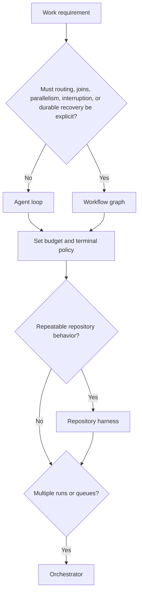

# Циклическая и графическая инженерия

**loop** определяет обратную связь и остановку агента. **graph** определяет топологию исполняемого файла. Граф может содержать цикл, но ни один из терминов не устанавливает правильность решения о приемке.

> **Status:** Проектирование контуров — это практический словарь, а не формальный стандарт. Графовая инженерия — это новый исследовательский бренд, а не устоявшаяся дисциплина. Базовые механизмы, такие как конечные автоматы, графы рабочих процессов, контрольные точки и шлюзы проверки, представляют собой зрелые инженерные методы.
>
> **Используйте эту страницу для:** проектирования обратной связи и топологии агентской системы. Информацию о компонентах среды выполнения, средствах управления безопасностью и исследованиях оптимизаторов см. в разделе [Agent Harness Engineering](./agent-harness.md). Классификацию продуктов см. в [Agent Harness Landscape](../ecosystem/agent-harness-landscape.md). Классические шаблоны проектирования, лежащие в основе этих структур, см. в разделе [AI Design Patterns](./ai-design-patterns.md).

Явные контракты делают возможным тестирование обратной связи, остановки, маршрутизации и приемки; Более длинная подсказка сама по себе не определяет эти элементы управления.

[Agent Harness Engineering](./agent-harness.md) владеет различиями между моделью, средой выполнения, средой репозитория и оркестратором. Используйте его, чтобы определить, какой уровень владеет контекстом, инструментами, разрешениями, проверкой, восстановлением или координацией. На этой странице основное внимание уделяется контрактам циклов и графов, которые позволяют проверять обратную связь и маршрутизацию.

## Содержание

1. [Выберите наименьшую структуру управления](#1-choose-the-smallest-control-structure)
2. [Написать контракт цикла](#2-write-a-loop-contract)
3. [Написать графический контракт](#3-write-a-graph-contract)
4. [Статические и динамические графики](#4-static-and-dynamic-graphs)
5. [Явно вынести решение](#5-allocate-judgment-explicitly)
6. [Сделать исполнение долговечным](#6-make-execution-durable)
7. [Наблюдайте и оценивайте систему](#7-observe-and-evaluate-the-system)
8. [Три варианта реализации](#8-three-implementation-cases)
9. [Anti-patterns](#9-anti-patterns)
10. [Контрольный список выбора](#10-selection-checklist)

---

## <a name="1-choose-the-smallest-control-structure"></a>1. Выбирайте наименьшую структуру управления

Начните с самой простой структуры, которая сможет безопасно принять необходимое решение.

| Нуждаться | Наименьшая подходящая структура цикла или графа | Что еще нужно указать |
|---|---|---|
| Одна ограниченная задача с обратной связью от локального инструмента. | Цикл агента | правило остановки, политика инструмента, локальный верификатор |
| Известные ветки, повторные попытки, параллельная работа или вмешательство человека | Явный график рабочего процесса | схема состояния, маршруты, объединения, контрольная точка и политика восстановления |



Диаграмма выбирает структуру управления; [Agent Harness Engineering](./agent-harness.md) определяет границу владения между средой выполнения, обвязкой репозитория и оркестратором.

Не превращайте одну ограниченную задачу в мультиагентный граф только потому, что инфраструктура упрощает это. Каждый добавленный компонент представляет состояние, служебные данные и режимы сбоя. Каждый верификатор, рецензент или релиз-гейт вводит границу приемлемости для тестирования.

Этикетки намеренно узкие. [Отчет практикующего специалиста Адди Османи](https://addyosmani.com/blog/loop-engineering/) — это полезная основа, основанная на опыте, позволяющая заменить повторяющиеся подсказки системой, которая находит, отправляет, проверяет и записывает работу. Это не стандарт или исследование производительности. Два недавних препринта, [Graph Engineering in the Era of LLM Agents](https://arxiv.org/abs/2608.21156) и [What Makes Prompts a Graph](https://arxiv.org/abs/2607.27578), предлагают словари графовой инженерии. Относитесь к их определениям как к исследовательским предложениям, а не как к доказательству того, что графы улучшают каждую агентную систему.

## <a name="2-write-a-loop-contract"></a>2. Напишите контракт цикла

Контракт цикла позволяет тестировать «продолжать, пока не заработает». В нем указывается единица работы, ее разрешенные действия, доказательства, которые считаются прогрессом, и каждый разрешенный выход.

| Поле | Вопросы, на которые должен ответить контракт |
|---|---|
| Цель и вклад | Какое требование, версия репозитория и ожидаемый артефакт определяют этот запуск? |
| Состояние | Какие факты сохраняются за пределами контекстного окна? Кто может их обновлять? |
| Действия | Какие инструменты, учетные данные, файлы и внешние эффекты разрешены? |
| Наблюдение | Результаты каких инструментов, тесты, трассировки и отзывы людей войдут в следующую итерацию? |
| Проверка | Какие детерминированные проверки, независимые проверки или человеческие решения могут принять работу? |
| Остановка и эскалация | Что заканчивается успехом, заканчивается неудачей, расходует бюджет, истекает время или требует от человека? |
| Доказательство | Какие команды, выходные данные, идентификаторы трассировки и версии подтверждают окончательное утверждение? |

### <a name="apply-the-feedback-horizons"></a>Примените горизонты обратной связи

[Agent Harness Engineering](./agent-harness.md#21-while-loop-engine) определяет внутренние, внешние и метагоризонты, а также соответствующие им слои. Примените контракт цикла на каждой границе: контракт внутреннего цикла записывает показания инструмента и локальную остановку; во внешнем контракте указываются орган, проверяющий доставку, и орган приемки; контракт мета-цикла моделирует график или изменение жгута и сравнивает его с имеющимися доказательствами. Заявление о том, что модель завершена, является наблюдением, а не свидетельством принятия.

## <a name="3-write-a-graph-contract"></a>3. Напишите графовый контракт

Используйте явный граф, когда важна сама маршрутизация. Граф [LangGraph API](https://docs.langchain.com/oss/python/langgraph/graph-api) является конкретным примером первичного источника: он представляет общее состояние, узлы, фиксированные и условные ребра, а также параллельное выполнение. Узлы могут содержать вызовы LLM или обычный код. Вот почему граф не является синонимом многоагентной системы.

Контракт графа должен быть доступным для просмотра без запуска графа.

| Элемент | Минимальный контракт |
|---|---|
| Идентичность графа | версии графа и политики, владелец, совместимая схема состояния |
| Состояние | типизированные поля, конфиденциальность, запись, правило сокращения или конфликта, сохранение |
| Узел | назначение, ввод и вывод, граница идемпотентности, тайм-аут, побочные эффекты |
| Край | источник, пункт назначения, состояние, свидетельство маршрутизации, запрещенные переходы |
| Присоединиться | ожидаемые входные данные, тайм-аут, поведение при отсутствии ввода, правило слияния |
| Повторить попытку | повторные неудачи, ограничение, отсрочка, компенсация или эскалация |
| Контрольно-пропускной пункт | граница персистентности, семантика возобновления, совместимость миграции |
| Завершение | законные конечные состояния и орган, который может отмечать каждое из них |

Контракт графа должен отличать действительный маршрут от правильного результата. Государственный аппарат может отклонить незаконный переход, продолжая при этом выносить неверное требование или ошибочный вердикт проверки.

### Практический пример: ограниченный граф проверки изменений

Этот контракт добавляет политики состояния, маршрутизации, бюджета и терминалов, которые отсутствуют в диаграмме только топологии:

```yaml
graph: change-review
version: 1
state:
  requirement: { writer: human, immutable_after: triage }
  patch_ref: { writer: implement, validator: commit_exists }
  test_evidence: { writer: verify, validator: command_and_exit_status }
  remaining_rework_budget:
    type: integer
    writer: retry_router
    initial: 2
    minimum: 0
    maximum: 2
    decrement: { when: verification_failed_and_value_gt_0, by: 1 }
nodes:
  triage: { timeout: 10m, output: approved_plan }
  implement: { side_effect: git_worktree }
  verify: { input: patch_ref, output: test_evidence }
  retry_router:
    input: [test_evidence, remaining_rework_budget]
    behavior: decrement_if_budget_remains_then_route
  review: { input: [patch_ref, test_evidence], authority: accept_or_escalate }
terminals:
  done: { condition: accepted_with_evidence }
  failed: { conditions: [rework_budget_exhausted, policy_violation] }
  escalated: { condition: human_escalation }
edges:
  - triage -> implement: approved_plan
  - triage -> failed: policy_violation
  - implement -> verify: patch_ref_exists
  - implement -> failed: policy_violation
  - verify -> retry_router: verification_failed
  - verify -> failed: policy_violation
  - retry_router -> implement: rework_budget_decremented
  - retry_router -> failed: rework_budget_exhausted
  - verify -> review: verification_passed
  - review -> done: accepted_with_evidence
  - review -> failed: policy_violation
  - review -> escalated: ambiguous_or_high_impact
```

`retry_router` — единственный модуль записи, которому разрешено уменьшать счетчик. Он уменьшается только до тех пор, пока остается бюджет, а затем направляется на `implement`; как только бюджет достигнет нуля, следующая неудачная проверка достигнет терминала `failed`. Этот пример не дает рецензенту права принимать непроверенный патч. В производственный проект добавьте точную команду тестирования, бюджетную единицу, поля трассировки и правила для побочных эффектов.

## <a name="4-static-and-dynamic-graphs"></a>4. Статические и динамические графики

A **статический график** исправляет свою топологию в проверенной конфигурации или коде. А **динамический график** создает или изменяет задачи, зависимости, маршруты или рабочие процессы во время выполнения.

| Аспект | Статический график | Динамический график |
|---|---|---|
| Лучшее для | стабильные роли, утвержденные переходы, возможности проверки, известный рабочий процесс | обнаруженные задачи, рабочие очереди, расширение зависимостей, адаптивная маршрутизация |
| Основное преимущество | проверяемый перед исполнением | может реагировать на новые доказательства |
| Основной риск | хрупкость, когда задача не подходит | непроверенные маршруты, неограниченная работа, дрейф топологии |
| Требуемый контроль | обзор версий и маршрутные тесты | политика создания, бюджет, происхождение, проверка, журнал аудита, отзыв |

Динамический не означает, что LLM может писать произвольный код рабочего процесса и выполнять его. Сохраняйте плоскость управления статичной там, где последствия серьезны: разрешенные типы узлов, разрешения, переходы, параллелизм, бюджеты и полномочия выпуска. Пусть динамическое выполнение создает в этой политике только ограниченные данные.

Это различие видно в закрепленном исходном свидетельстве [Liza](https://github.com/liza-mas/liza/tree/a22c12381c5d884d2586a48aaaa517bca184f9cf). Его `pipeline.yaml` определяет стабильный организационный граф ролей, переходов и кворумов. Зависимости задач развиваются во время выполнения в виде рабочего графика. Таким образом, Liza представляет собой специфичный для предметной области исполняемый граф и плоскость управления, а не свидетельство среды выполнения графа общего назначения. Точную границу смотрите в записи доказательств [Liza](../../docs/resource-evaluations/liza-mas-framework.md).

## <a name="5-allocate-judgment-explicitly"></a>5. Четко выносите суждения

Автоматизация меняет суждения. Это не стирает его. Запишите, кому принадлежит планка качества, декомпозиция, разрешение на инструмент, исключение, вердикт о приемке и решение о выпуске. Это **распределение решений**.

### <a name="separate-execution-from-governance"></a>Отдельное исполнение от управления

Отстранение человека от повторяющихся казней не снимает с человека ответственности. Рассматривайте три цикла как отдельные контракты:

| Петля | Основная ответственность | Роль человека |
|---|---|---|
| Цикл выполнения | планировать, действовать, наблюдать, проверять, повторять попытки в рамках бюджета | обрабатывать исключения и эскалации, выходящие за рамки политики |
| Цикл управления | определить цели, разрешения, бюджеты, политику принятия и полномочия выпуска | нести ответственность за риск и необратимые последствия |
| Цикл улучшения | проверять трассировки и сбои, предлагать измененное приглашение, график, политику или программу | утвердить версию изменения на основе имеющихся доказательств |

Это устраняет двусмысленность в дискуссиях практиков по проектированию контуров. Паван Белагатти описывает удаление оператора, который постоянно запрашивает агента, а затем описывает рабочие процессы фабрики программного обеспечения, в которых сохраняются человеческие ворота для чувствительных переходов. Последовательная интерпретация заключается в том, что человек выходит из повторяющегося цикла исполнения, оставаясь при этом в цикле управления. См. «Описание [Loop Engineering](https://www.youtube.com/watch?v=RvG7R0Ue1k4)» и «Человеческие ворота обзора [» в разделе «Создайте свою собственную фабрику программного обеспечения»](https://www.youtube.com/watch?v=pE1S1egMrAI&t=908s). Эти видеоролики представляют собой демонстрации, ориентированные на практиков и поставщиков, а не сравнительные исследования надежности.

В учетной записи OpenAI [Harness Engineering](https://openai.com/index/harness-engineering/) используется связанная формулировка «Люди управляют. Агенты выполняют». Заявленная производительность и экономия времени описывают один внутренний эксперимент с нуля. Они не устанавливают универсальный уровень автономии или базовый уровень производительности.

| Решение | Предпочитать | Зачем |
|---|---|---|
| схема, требуемая команда, запрещенный переход | детерминированный валидатор или механизм политики | точный, повторяемый, проверяемый |
| неоднозначное требование, компромисс между риском, бизнес-приоритет | ответственный человек | требует авторитета и контекста вне пробега |
| исследовательский анализ или качественное ранжирование | агент или судья LLM с выборочным решением | полезный сигнал, а не единственные производственные ворота |
| высвобождение или необратимый внешний эффект | именованная человеческая или предварительно авторизованная политика | устанавливает подотчетность и обработку исключений |

Разделение создателя и проверяющего — это метод тестирования, а не доказательство независимости. Рецензент может иметь свежий контекст, но при этом использовать ту же ошибочную спецификацию, модель, поставщика, инструменты или стимулы. Сравните самопроверку, проверку свежего контекста, проверку другой модели, детерминированные проверки и человеческие решения по одним и тем же выборочным дефектам. Запишите ложные принятия, ложные отклонения, спасения, промахи, разногласия и доказательства, использованные в каждом вердикте.

В частности, детерминированный супервизор Liza может отклонять незаконные состояния рабочего процесса, устаревшие договоры аренды и неудовлетворенные кворумы. Прикрепленный источник и собственный реестр проблем не устанавливают семантическую корректность юридического вердикта. Сторонний практик [REX от Ippon](https://blog.ippon.fr/2026/04/29/premier-rex-multi-agent-liza/) явно привязан к одному небольшому проекту и сообщает о продолжающихся контрольно-пропускных пунктах людей. Это полезный оперативный отчет, а не сравнительный ориентир.

## <a name="6-make-execution-durable"></a>6. Сделайте исполнение долговечным

### Отличие процесса восстановления от восстановления продукта

Возобновление прерванной задачи обеспечивает непрерывность выполнения. Это не показывает, что достигнутый результат был достаточным или что его последствия можно обратить вспять. После ложной приемки продукт нуждается в обнаружении, локализации, владельце и осуществлении восстановления или компенсации. Откат приложения может оставить изменения данных и внешние эффекты нетронутыми.

Запишите базовую, проверенную версию главы и кандидатскую интеграционную версию для объединенных изменений. Два индивидуально ограниченных PR могут взаимодействовать вне своих отдельных тестов. При изменении базы или группы аннулируйте результат интеграции и повторно оцените затронутые доказательства проверки. См. [обзор нескольких поставщиков](../workflows/multi-provider-code-review.md#blocking-merge-the-ci-gate) для получения информации о границах приемлемости.

Долговечное выполнение означает, что прерывание не приводит к незаметной потере, дублированию или созданию работы. Это не просто сохранение истории чата.

| Требование | Вопрос по дизайну |
|---|---|
| Постоянное состояние | Может ли другой процесс восстановить прогон на основе долговременной записи? |
| Идемпотентность | Что произойдет, если вызов узла или инструмента снова запустится после возобновления? |
| Контрольно-пропускной пункт | На каких безопасных границах можно возобновить работу системы? |
| Внешние эффекты | Какой ключ идемпотентности, правило получения, компенсации или правила чтения перед записью защищает каждый эффект? |
| Восстановление | Кто повторяет попытки, кто разрешает конфликты и когда начинается восстановление? |
| Управление версиями | Можно ли возобновить работу старой контрольной точки в соответствии с измененным графиком или политикой? |

Документация по персистентности [LangGraph](https://docs.langchain.com/oss/python/langgraph/persistence) классифицирует `InMemorySaver` как экспериментальную реализацию и перечисляет постоянные контрольные точки для производства; используйте надежный бэкэнд, когда состояние должно пережить перезапуск процесса. При динамическом [`interrupt()`](https://docs.langchain.com/oss/python/langgraph/interrupts#rules-of-interrupts)возобновление перезапускает содержащий узел с его начала, поэтому код перед прерыванием может быть запущен снова. Повтор и неполные попытки имеют собственную семантику повторного выполнения. Сделайте побочные эффекты идемпотентными на каждой применимой границе вместо того, чтобы предполагать, что каждый возобновляемый узел ведет себя одинаково. [Документация по рабочему процессу Temporal](https://docs.temporal.io/workflow-execution) — это второй основной справочник по надежному выполнению рабочих процессов, воспроизведению и истории событий.

Не требуйте восстановления после сбоя, если оно не было выполнено. Прервите выполнение в определенной точке, возобновите его в чистом процессе и проверьте переход состояний, внешний эффект, запись свидетельства и поведение дублирующейся работы.

### <a name="make-tool-failures-actionable"></a>Сделайте неисправности инструмента действенными

В докладе Майкла Хаблиха [Chrome DevTools, 13:14](https://www.youtube.com/watch?v=_B4Pv9ttFgY&t=794s), описывается улучшение ошибок инструмента; его рекомендации по закрытию [](https://www.youtube.com/watch?v=_B4Pv9ttFgY&t=1316s) включают в себя схемы восстановления и жетоны за успешный результат. Это практическое руководство, а не контролируемое сравнение затрат.

Предлагаемый контракт адаптера должен сообщать о том, что не удалось, мог ли произойти эффект и какое ограниченное восстановление разрешено. Например, тайм-аут после публикации отзыва должен инициировать сверку квитанций перед следующей попыткой публикации. Проверьте, предпринимаются ли попытки перехода и восстановления расходов в рамках сохраненного бюджета; одно только сообщение об ошибке не может обеспечить соблюдение ни одного правила.

### <a name="reconcile-interrupted-effects-before-retrying"></a>Согласуйте прерванные эффекты перед повторной попыткой.

Удаленная операция может быть успешной, даже если ее ответ потерян. Сохраните стабильный идентификатор логического эффекта и израсходованный бюджет при перезапуске. Согласуйте с пунктом назначения, прежде чем повторять действие; без надежной квитанции оставляйте результат неопределенным и направляйте его на принятие решения. Переименование контрольной точки или атомарного файла не обеспечивает однократное выполнение в разных системах.

В управляющем упражнении [](../../examples/workflows/review-control-demo.py) используется устойчивое состояние SQLite и моделируемый идемпотентный пункт назначения. Его проверки охватывают результаты allowed/refused/unknown, измененную версию, устаревшего или ложного производителя, исчерпание бюджета, одновременные попытки и потерю ответа. Запустите его из корня клонированного руководства:

```bash
python3 examples/workflows/review-control-demo.py
```

В примере используется собственный путь управления. Для квалификации реального поставщика также необходимы его фактические разрешения, источник получения и семантика побочных эффектов. [AutoHarness](../../docs/resource-evaluations/autoharness-2026.md) предоставляет проверенные контрпримеры по потерянным обновлениям, счетчикам повторного воспроизведения и частичной многофайловой записи, которые требуют отдельных тестов адаптера.

[](../images/harness-review/review-acceptance-en-gemini.webp)

*Предлагаемый дизайн, а не свидетельство развернутого рабочего процесса. [Французская версия и исходники](../images/harness-review/README.md).*

## <a name="7-observe-and-evaluate-the-system"></a>7. Наблюдайте и оценивайте систему

Для трассировки агента требуется достаточно доказательств, чтобы ответить на четыре вопроса: что было запущено, почему оно было перенаправлено, какое состояние изменилось и кто принял результат. Собирайте данные на уровне, который принял решение.

| Слой | Минимум доказательств |
|---|---|
| Цикл выполнения | версия модели и проводки, вызовы инструментов, разрешения, контекстная политика, повтор, причина остановки |
| График | версия графа и политики, узел, ребро, причина маршрута, состояние до и после, ожидание присоединения, контрольная точка, возобновление |
| Репозиторий | команда настройки, измененный артефакт, команда верификатора, вывод, статус выхода |
| Оркестратор | отправка, владение, ожидание в очереди, передача обслуживания, аренда, эскалация, контрольно-пропускной пункт с участием человека |
| Решение | личность и происхождение оценщика, ссылки на доказательства, вердикт, отмена, орган по исключению |

Используйте стабильные имена событий и редактируйте конфиденциальный текст приглашений, аргументы инструментов, результаты инструментов, пути и идентификаторы перед экспортом телеметрии. Репозиторий семантических соглашений [OpenTelemetry GenAI](https://github.com/open-telemetry/semantic-conventions-genai/blob/main/docs/gen-ai/README.md) определяет телеметрию агента, модели, запроса, ответа, токена и инструмента, но его статус — **Development**. Сохраняйте адаптер между этими соглашениями и серверной частью телеметрии, а также устанавливайте версии локального графика и полей оценки, таких как `graph.version` и `verdict.overturned`, поскольку восходящий словарь может измениться.

Оцените точную пару модель-оборудование, версию репозитория, набор разрешений, версию графа, набор инструментов, бюджет и распределение задач. Тест на зеленом графике показывает, что поток управления следовал своему контракту. Это не доказывает, что поставленный патч соответствует требованиям. Сочетайте тесты рабочих процессов с проверкой уровня требований, тренировками по восстановлению и повторяющимися репрезентативными задачами. [Agent Evaluation](../roles/agent-evaluation.md#evaluate-judgment-allocation-and-reviewer-independence) определяет полезные меры на уровне графа и независимости рецензента.

### <a name="limit-admission-to-verification-capacity"></a>Ограничить доступ к возможностям проверки

Привязка общей очереди, а также каждого запускаемого агента. Задача с ограниченным бюджетом повторных попыток все равно может добавить работу быстрее, чем рецензенты смогут ее принять. В [IFTTD, серия 362](https://www.ifttd.io/episodes/le-lean-a-l-ere-de-l-ia)Ясин Хмито описывает это как проблему потока: более быстрое внедрение увеличивает нагрузку на контроль качества, а повторяющиеся дефекты должны изменить производственный процесс. Бруно Сулез [завершение сезона](https://bilan.ifttd.io/conclusion/) идет дальше, предлагая проверку перед расширением генерации; этот порядок — это его интерпретация, а не продемонстрированная универсальная последовательность.

Сравнение с [Toyota Production System](https://global.toyota/en/company/vision-and-philosophy/production-system/) — это аналогия, а не свидетельство того, что команда разработчиков программного обеспечения воспроизвела результаты Toyota. Здесь одобренное владельцем условие паузы останавливает *новую авторскую работу*, в то время как существующие проверки и исправления продолжаются; подтвержденный повторяющийся дефект становится кандидатом на проверку вышестоящего средства контроля.

#### <a name="name-the-lean-mechanisms-precisely"></a>Точно назовите механизмы бережливого производства.

В книге [Lean Software Development](https://res.infoq.com/articles/poppendieck-implementing-lean/en/resources/poppendieck_ch02.pdf)Мэри и Том Поппендик переводят производственные идеи в принципы программного обеспечения, такие как повышение качества и оптимизация всего потока создания ценности. Это означает, что нужно проверять работу во время создания, а не полагаться на финальную проверку, чтобы найти каждый дефект. Отдельно измеряйте время доставки и последующие результаты для пользователя.

- **Just-in-Time и канбан:** [Toyota](https://global.toyota/en/company/plant-tours/production-system/) использует нисходящий сигнал извлечения, чтобы запросить, что нужно следующему процессу. [Kanban Method](https://kanban.university/kanban-guide/) делает политику незавершенного производства явной. Сама по себе доска билетов не обеспечивает притяжения; резервирование возможностей проверки перед проектом другого агента является предлагаемой адаптацией программного обеспечения.
- **Jidoka и andon:** [Toyota](https://global.toyota/en/company/vision-and-philosophy/production-system/) отличает остановку при неисправности от видимого сигнала андон. В рабочем процессе агента ранние тесты и проверки доказательств могут обнаружить ошибку, в то время как политика должна фактически приостановить затронутую работу и направить ее на исправление. Красный свет приборной панели без стопа – это всего лишь сигнал тревоги.
- **Muda, mura, muri:** Институт бережливого предпринимательства [](https://www.lean.org/lexicon-terms/muda-mura-muri/) определяет их как отходы, неровности и вскрышные породы. Неиспользованные черновики или переделки, которых можно избежать, могут быть муда, пакетными предложениями агентов мури и перегруженным путем проверки мури. Это гипотезы, которые нужно сверить с реальными очередями, а не диагнозы, представленные в инфографике.
- **Kaizen:** [Toyota](https://global.toyota/en/company/vision-and-philosophy/production-system/) описывает постоянное совершенствование людей. Когда тот же дефект возвращается, измените восходящий тест, инструкцию агента или правило допуска, а затем проверьте, не снижается ли повторение. Предупреждение или повторная попытка агента сами по себе не демонстрируют улучшения.
- **Poka-yoke:** [Toyota](https://global.toyota/en/company/plant-tours/production-system/) и [Lean Enterprise Institute](https://www.lean.org/lexicon-terms/error-proofing/) используют этот термин для защиты от ошибок на рабочем месте. В программном обеспечении воспроизводимая сборка, целевой тест или правило проверки могут отклонить известную ошибку перед проверкой. Проверка, которая просто существует, но не обнаруживает соответствующую ошибку, не является свидетельством защиты от ошибок.

Два рассказа практикующих показывают разные части этого механизма. В [Qonto](https://medium.com/qonto-way/ai-driven-refactoring-in-large-scale-migrations-strategies-and-techniques-fcdb9b5116c6)инженеры работали над инструментом миграции с Ember на React в ходе кайдзен-инициативы, сочетая этап ИИ, детерминированный кодмод, еще один этап ИИ и проверку человеком. Один инженер с ограниченной помощью перенес 8632 строки за две недели оценки. Базовый уровень, составляющий примерно 50 строк в день инженера, был оценочным, а перенесенные строки не измеряют стоимость проверки, устраненные дефекты или результаты пользователя. В отчете [Theodo о работе AP-HP](https://www.theodo.com/blog/how-i-shipped-2-months-of-features-in-3-weeks-with-llm-agents)технический директор описывает остановку агента после дефекта, изменение его инструкций или проверок, сброс и повторную попытку; заявленная трехнедельная доставка сравнивается с внутренней двухмесячной оценкой. Ни в одном случае не устанавливается передаваемый множитель скорости или тестируемый предел для очереди проверки.

Готовность репозитория является восходящим ограничением этого потока. В докладе [Марека Калника на FlowCon](https://www.flowcon.io/fr/archives/2026/marek-kalnik-les-standards-lean-pour-guider-les-ia/)непоследовательный файл перевода заставляет агента воспроизводить противоречивые соглашения; он выступает за общие стандарты и четкие критерии для проекта, готового к использованию ИИ. [Документация по готовности агента Factory](https://docs.factory.com/agent-readiness/overview) описывает условия хранилища, такие как воспроизводимые сборки, локальные тесты, поддерживаемые инструкции, наблюдаемость и безопасность. В докладе [No Reyes](https://ai.engineer/talks/ShuJ_CN6zr4-making-codebases-agent-ready)операционный аргумент состоит в том, чтобы надежно проверить одну задачу, прежде чем умножать работу параллельного агента. Это практические концепции, а не контролируемые оценки улучшения результатов. Инженер, знающий репозиторий, все равно должен выбрать сбой, который стоит предотвратить, и решить, отражает ли предлагаемая проверка предполагаемое поведение. Фабрика использует собственную пятиуровневую рубрику; счет с другого радара с ним не взаимозаменяем.

Начните с сбоя, наблюдаемого в реальной задаче: отсутствующей команды сборки, нестабильной проверки, неявного соглашения о коде или дефекта, который выдержал проверку. Измените один элемент управления репозиторием, повторно запустите сопоставимую задачу с той же моделью, средой и условиями приемки, а также запишите повторные попытки, использование токенов, исправления рецензента и затраченное время. Затем проследите за принятыми изменениями в выпуске и результатами для пользователей. Более высокий показатель готовности полезен только в том случае, если основной сбой становится менее частым без создания более поздней очереди или сокрытия дефектов.

Перегруженная нисходящая очередь — это гипотеза, которую необходимо проверить, а не стандартный результат более быстрой генерации. В полевом исследовании [Globo](../ops/team-metrics.md#measure-the-shared-verification-queue) сообщается о более коротком цикле задач Jira в его настройках, с историческим компаратором и без измерения результатов пользователя. Приведенный ниже контроль доступа подходит, когда этого требуют доказательства или риск местной очереди; это не утверждение, что каждая команда должна ограничивать параллелизм агентов.

Перед отправкой зарезервируйте емкость для необходимой проверки изменения. Приостанавливайте новую разработку, если достигнута одобренная владельцем очередь или возрастной предел, требуемый рецензент недоступен или данные телеметрии очереди устарели. Разрешите завершить проверку во время полета и согласованные исправления. Возобновить работу ниже определенного порога со свежими телеметрическими данными и доступной емкостью; в противном случае планировщик может колебаться между паузой и возобновлением.

В рабочей таблице допуска к проверке [](../../examples/workflows/review-admission.md) определяются права собственности, атомарные резервирования, исключения и настольные упражнения. Его показательные пороговые значения не являются производственными дефолтами. Используйте измерения [queue](../ops/team-metrics.md#measure-the-shared-verification-queue) для их калибровки. Это дополняет ограничение незавершенного производства для каждой функции в [Spec-First Development](../workflows/spec-first.md); он не предоставляет полномочия на слияние или развертывание.

## <a name="8-three-implementation-cases"></a>8. Три варианта реализации

### Claude Code: внутренний цикл плюс обвязка репозитория

Claude Code владеет интерактивным циклом моделей и инструментов. Репозиторий предоставляет контракт проекта через `CLAUDE.md`, при необходимости импортируя или символизируя существующий `AGENTS.md`, а также настройку, состояние задачи, тесты, перехватчики и шлюзы доставки. В практичном проекте Claude Code правило остановки должно быть явным: например, целевой тест пройден, изменение проверено на соответствие требованию, и ни одна политика или выход из бюджета не сработали. Не делайте вывод об общей явной среде выполнения графа, исходя только из подагентов, команд или перехватчиков. См. [Agent Harness Engineering](./agent-harness.md) для границ времени выполнения, [официальное объяснение агентского цикла Claude Code](https://code.claude.com/docs/en/how-claude-code-works) для поведения продукта и [раздел совместимости `AGENTS.md`](https://code.claude.com/docs/en/memory#agentsmd) для поддерживаемого шаблона файла инструкций.

#### <a name="compose-recurring-triage-with-bounded-work"></a>Составьте повторяющуюся сортировку с ограниченной работой

Плановая проверка обнаруживает работу; прием решает, может ли кандидат стартовать. Затем ограниченная задача выполняет условие завершения, а политика проверки решает, приемлемо ли результирующее изменение. [Practical Loop Engineering](https://addyo.substack.com/p/practical-loop-engineering) описывает эту комбинацию из практики Адди Османи. Относитесь к этому как к предложению рабочего процесса, а не как к свидетельству успешного выполнения вложенной команды.

| Этап | Требуемые доказательства или решение |
|---|---|
| Обнаружить | Определите подходящую проблему и проверяемую версию репозитория. |
| Признавать | Проверьте, обрабатывается ли уже та же проблема, редакция репозитория и версия критериев или принадлежит ли она активному запуску; резервная проверочная мощность |
| Работа | Заморозить задачу, разрешенные изменения, критерии приемки и общий бюджет попыток. |
| Проверить | Воспроизведите дефект перед исправлением и сохраните соответствующие проверки потенциальной версии. |
| Принять или прекратить | Запишите решение о проверке или причину сбоя, исчерпания бюджета или эскалации |

Для наглядного запуска сортировки проблем допустите одну воспроизводимую ошибку, сохраните ее идентификатор при плановых проверках и создайте потенциальное исправление с доказательствами тестирования. Более поздняя проверка не должна создавать второго работника для той же активной задачи или сбрасывать ее израсходованный бюджет. Зарезервируйте емкость очереди перед отправкой; Контракт ограниченного цикла [](../../examples/workflows/bounded-loop-contract.md) отвечает за выполнение каждой задачи. Этот сценарий не был выполнен в качестве интеграционного теста Claude Code.

Используйте [ссылку цели](../ultimate-guide.md#goal-autonomous-completion-mode-v21139) для поведения завершения и [ссылку планирования](../ultimate-guide.md#the-loop-command) для триггеров. Запланированные запросы не выполняют встроенные команды только потому, что их имена появляются в тексте. Поэтому пример, говорящий «использовать /goal» внутри `/loop`, по-прежнему требует явной, проверенной границы вызова. Не представляйте это как оркестровку, готовую к копированию.

#### <a name="distinguish-requested-limits-from-enforced-budgets"></a>Отличать запрошенные лимиты от принудительных бюджетов

Предел, записанный в условие `/goal`, оценивается оценщиком на основе диалога. Бюджет, налагаемый контроллером, проверяет счетчик перед отправкой другого действия. Пример [runnable с ограниченным циклом](../../examples/workflows/bounded-loop-example.py) демонстрирует последнее с помощью синтетических действий и верификатора; он не устанавливает поведение Claude Code. Для работы, охватывающей сеансы, держите общее потребление вне счетчиков сеансов, которые сбрасываются при возобновлении активной цели в соответствии с документацией по целям [](https://code.claude.com/docs/en/goal).

Оценка завершения также имеет более узкую роль, чем обзор. Оценщик целей Claude Code читает доказательства, уже всплывшие в разговоре; он не проверяет самостоятельно исправление или команды повторного запуска. Отдельному рецензенту по-прежнему нужны исходное требование, возможная версия и доступ к проверкам. Прохождение этих проверок не решает, стоит ли изменение своей стоимости продукта; это решение принадлежит названному органу по приемке.

### LangGraph: явная среда выполнения рабочего процесса

LangGraph подходит, когда состояние, маршрутизация, условные переходы, параллельная работа, прерывания или постоянство должны быть первоклассными артефактами. Его официальный граф API явно представляет состояние, узлы и ребра, а его персистентность API предоставляет контрольные точки и хранилища. Инженерная работа остается в контрактах: редукторы состояний, условия маршрута, идемпотентность побочных эффектов, выбор контрольных точек и наблюдаемость.

### Лиза: обвязка репозитория плюс плоскость управления

Liza координирует внешний интерфейс командной строки агента кодирования посредством постоянного состояния задач, рабочих деревьев, аренды, ролей doer/reviewer, восстановления и шлюзов слияния. Выбранный CLI сохраняет свой внутренний цикл инструмента. Его стабильная конфигурация конвейера и изменяющиеся зависимости задач делают его полезным для разделения организационных и рабочих графиков. Его изоляция рабочего дерева не заменяет файловую систему, учетные данные или сетевую изолированную программную среду. Оценка [Liza](../../docs/resource-evaluations/liza-mas-framework.md) записывает закрепленную фиксацию и границу безопасности.

## <a name="9-anti-patterns"></a>9. Антипаттерны

| Anti-pattern | Почему это терпит неудачу | Корректирующие действия |
|---|---|---|
| «Продолжайте пытаться, пока не закончите» | нет прекращения, стоимости или границ эскалации | напишите явный успех, неудачу, бюджет, тайм-аут и человеческие выходы |
| Диаграмма без исполняемой семантики | рецензенты не могут тестировать маршрутизацию, соединения или восстановление. | определять состояние, контракты узлов, граничные условия и поведение контрольных точек |
| Динамическая топология без политики | LLM может создавать скрытые петли или несанкционированные эффекты. | ограничивайте разрешенные мутации, бюджетируйте их, регистрируйте происхождение и проверяйте каждый маршрут. |
| Один агент и создает, и принимает | самопроверка может принять уверенность за доказательства | отдельные детерминированные проверки и выборочная независимая или человеческая проверка |
| Контрольные точки без идемпотентности | резюме может дублировать записи или искажать состояние | используйте квитанции об эффектах, ключи идемпотентности, повышения или компенсацию |
| Возможность наблюдения только за токенами | стоимость не может объяснить плохой маршрут, устаревшее состояние или неправильный вердикт. | трассировка топологии, переходы между состояниями, доказательства и суждения |
| Вызов планировщика в качестве средства выполнения | скрывает, кто владеет политикой и восстановлением инструментов | определить владельца фактического цикла модель-инструмент-наблюдение |
| Рассматривая REX как эталон | один проект не может обеспечить общую производительность | маркируйте область действия REX, сохраняйте артефакты и избегайте сравнительных утверждений |

## <a name="10-selection-checklist"></a>10. Контрольный список выбора

Прежде чем добавлять цикл, график или оркестратор, ответьте «да» на каждый соответствующий вопрос.

- [ ] Выбранная структура является наименьшей и отвечает требованиям маршрутизации, надежности и полномочий.
- [ ] Цикл имеет явные выходы: успех, сбой, тайм-аут, бюджет и эскалация.
- [ ] Состояние, побочные эффекты, доказательства и сохранение определяются вне контекста модели.
- [ ] Каждый узел графа, ребро, соединение, повтор и контрольная точка имеют проверенный контракт.
- [ ] Статическая политика ограничивает создание динамических задач и маршрутов.
- [ ] Детерминированные проверки владеют тем, что они могут решить детерминированно.
- [ ] Человеческий авторитет назван в честь двусмысленности, исключений, высвобождения и необратимых последствий.
- [ ] Независимость рецензента измеряется, а не предполагается исходя из названий ролей.
- [ ] Поведение возобновления и идемпотентность побочных эффектов были протестированы при прерывании.
- [ ] Трассировки восстанавливают маршрутизацию, изменения состояния, доказательства и вердикты без экспорта конфиденциальных полезных данных.
- [ ] При оценке фиксируется точная пара модель-оборудование, версия графика, бюджет, набор задач и режимы сбоя.

Решите все применимые непроверенные контракты, прежде чем увеличивать область маршрутизации системы, побочные эффекты или полномочия выпуска.
