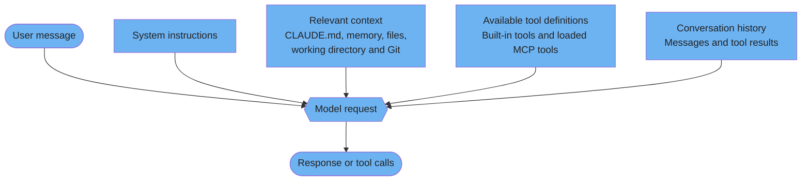
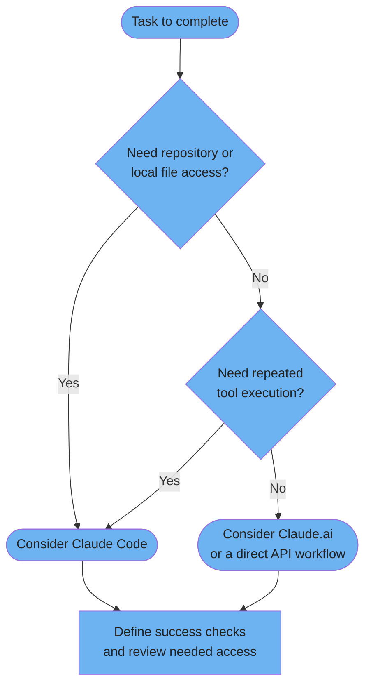

# Фонды

Концептуальные модели и документированное поведение разрешений для Claude Code.

---

### <a name="chatbot-to-context-system-4-layer-model"></a>«Чат-бот в контекстную систему»: 4-уровневая модель

Эта модель обучения, состоящая из четырех частей, группирует входные данные, используемые Claude Code. Ветви представляют собой категории контекста, а не фиксированный порядок сборки. Инструкции и определения инструментов могут загружаться в разное время; Инструменты MCP можно отложить до тех пор, пока они не понадобятся.



<details>
<summary>ASCII версия</summary>

```
User message ------------------------+
System instructions -----------------+
Relevant context --------------------+--> Model request --> Response / tool calls
Available or loaded tool definitions +
Conversation and tool results -------+

Conceptual grouping, not a fixed loading order.
```

</details>

> **Источник**: [Управление контекстом](../ultimate-guide.md#22-context-management)
>
> **Официальная ссылка**: [Контекст Claude Code добавляет](https://code.claude.com/docs/en/how-claude-code-works#context-claude-code-adds-on-its-own) и [отложенные определения MCP](https://code.claude.com/docs/en/how-claude-code-works#when-context-fills-up).

---

### <a name="9-step-workflow-pipeline"></a>9-этапный конвейер рабочего процесса

Этот девятиэтапный рабочий процесс обучения суммирует поворот с помощью инструментов. Claude может ответить напрямую, повторить исследование или остановиться после ошибки или прерывания. На этих этапах не указаны девять обязательных внутренних функций.

```mermaid
flowchart LR
    A([User message]) --> B(Understand request)
    B --> C(Gather relevant context)
    C --> D(Choose next action)
    D --> F{Tool needed?}
    F -->|Yes| P(Check permissions)
    P -->|Allowed| E(Execute tool)
    P -->|Denied| D
    E --> G(Collect result)
    G --> H(Update conversation context)
    H --> D
    F -->|No| I(Generate response)
    I --> J([Display response])
    style A fill:#6DB3F2,color:#222
    click A href "https://github.com/FlorianBruniaux/claude-code-ultimate-guide/blob/main/guide/core/architecture.md#1-the-master-loop" "The master loop"
    style B fill:#6DB3F2,color:#222
    click B href "https://github.com/FlorianBruniaux/claude-code-ultimate-guide/blob/main/guide/core/architecture.md#1-the-master-loop" "The master loop"
    style C fill:#6DB3F2,color:#222
    click C href "https://github.com/FlorianBruniaux/claude-code-ultimate-guide/blob/main/guide/core/architecture.md#1-the-master-loop" "The master loop"
    style D fill:#6DB3F2,color:#222
    click D href "https://github.com/FlorianBruniaux/claude-code-ultimate-guide/blob/main/guide/core/architecture.md#1-the-master-loop" "The master loop"
    style F fill:#6DB3F2,color:#222
    click F href "https://github.com/FlorianBruniaux/claude-code-ultimate-guide/blob/main/guide/core/architecture.md#1-the-master-loop" "The master loop"
    style P fill:#6DB3F2,color:#222
    click P href "https://github.com/FlorianBruniaux/claude-code-ultimate-guide/blob/main/guide/core/architecture.md#1-the-master-loop" "The master loop"
    style E fill:#6DB3F2,color:#222
    click E href "https://github.com/FlorianBruniaux/claude-code-ultimate-guide/blob/main/guide/core/architecture.md#1-the-master-loop" "The master loop"
    style G fill:#6DB3F2,color:#222
    click G href "https://github.com/FlorianBruniaux/claude-code-ultimate-guide/blob/main/guide/core/architecture.md#1-the-master-loop" "The master loop"
    style H fill:#6DB3F2,color:#222
    click H href "https://github.com/FlorianBruniaux/claude-code-ultimate-guide/blob/main/guide/core/architecture.md#1-the-master-loop" "The master loop"
    style I fill:#6DB3F2,color:#222
    click I href "https://github.com/FlorianBruniaux/claude-code-ultimate-guide/blob/main/guide/core/architecture.md#1-the-master-loop" "The master loop"
    style J fill:#6DB3F2,color:#222
    click J href "https://github.com/FlorianBruniaux/claude-code-ultimate-guide/blob/main/guide/core/architecture.md#1-the-master-loop" "The master loop"
```



<details>
<summary>ASCII версия</summary>

```
User message
  -> 1. Understand request -> 2. Gather context -> 3. Choose action
     Tool needed?
       Yes -> 4. Check permissions -> 5. Execute -> 6. Collect result
              denied -> choose action         -> 7. Update context -> choose action
       No  -> 8. Generate response -> 9. Display response
Errors and interruption may end the turn earlier.
```

</details>

> **Источник**: [Главный контур](../core/architecture.md#1-the-master-loop)
>
> **Официальная ссылка**: [Агентный цикл](https://code.claude.com/docs/en/how-claude-code-works#the-agentic-loop).

---

### <a name="quick-decision-tree-should-i-use-claude-code"></a>Дерево быстрого принятия решений: «Следует ли мне использовать Claude Code?»

Авторская эвристика выбора интерфейса. Доступ к файлу и повторное выполнение инструмента могут сделать Claude Code полезным; чистый разговор может подойти Claude.ai. Это не ограничение продукта или измеренный временной порог.



<details>
<summary>ASCII версия</summary>

```
Need repository or local file access?
  Yes -> Consider Claude Code
  No  -> Need repeated tool execution?
           Yes -> Consider Claude Code
           No  -> Consider Claude.ai or a direct API workflow
Either route: define success checks and review needed access.
```

</details>

> **Источник**: [Первый рабочий процесс](../ultimate-guide.md#12-first-workflow)
>
> **Официальная ссылка**: [Проверьте работу и выберите рабочий процесс](https://code.claude.com/docs/en/best-practices#give-claude-a-way-to-verify-its-work).

---

### <a name="permission-modes-comparison"></a>Сравнение режимов разрешений

Шесть документированных режимов меняют способ утверждения вызовов инструментов. Вкратце: правила allow/ask/deny, границы рабочего каталога и защищенные действия по-прежнему имеют значение. Доступность автоматического режима зависит от сеанса.

```mermaid
flowchart TD
    ROOT[Permission modes] --> D[default / Manual<br/>Prompts for actions needing approval<br/>Permitted reads can run]
    ROOT --> A[acceptEdits<br/>Accepts file edits and common<br/>filesystem commands in allowed directories]
    ROOT --> P[plan<br/>Reads and read-only shell<br/>Classifier-approved commands when auto is available<br/>No source-file edits]
    ROOT --> AUTO[auto, when available<br/>Classifier reviews actions<br/>without routine permission prompts]
    ROOT --> N[dontAsk<br/>Denies calls that would prompt<br/>Permitted reads and allowed calls can run]
    ROOT --> B[bypassPermissions<br/>Skips permission prompts<br/>Documented exceptions still apply]
    style ROOT fill:#6DB3F2,color:#222
    click ROOT href "https://github.com/FlorianBruniaux/claude-code-ultimate-guide/blob/main/guide/ultimate-guide.md#14-permission-modes" "Permission modes"
    style D fill:#6DB3F2,color:#222
    click D href "https://github.com/FlorianBruniaux/claude-code-ultimate-guide/blob/main/guide/ultimate-guide.md#14-permission-modes" "Permission modes"
    style A fill:#6DB3F2,color:#222
    click A href "https://github.com/FlorianBruniaux/claude-code-ultimate-guide/blob/main/guide/ultimate-guide.md#14-permission-modes" "Permission modes"
    style P fill:#6DB3F2,color:#222
    click P href "https://github.com/FlorianBruniaux/claude-code-ultimate-guide/blob/main/guide/ultimate-guide.md#14-permission-modes" "Permission modes"
    style AUTO fill:#6DB3F2,color:#222
    click AUTO href "https://github.com/FlorianBruniaux/claude-code-ultimate-guide/blob/main/guide/ultimate-guide.md#14-permission-modes" "Permission modes"
    style N fill:#6DB3F2,color:#222
    click N href "https://github.com/FlorianBruniaux/claude-code-ultimate-guide/blob/main/guide/ultimate-guide.md#14-permission-modes" "Permission modes"
    style B fill:#6DB3F2,color:#222
    click B href "https://github.com/FlorianBruniaux/claude-code-ultimate-guide/blob/main/guide/ultimate-guide.md#14-permission-modes" "Permission modes"
```



<details>
<summary>ASCII версия</summary>

```
default / Manual : prompts for actions requiring approval; permitted reads can run
acceptEdits      : file edits and common filesystem commands in allowed directories
plan             : read-only exploration; no source-file edits
                    classifier-approved commands may run when auto mode is available
auto             : classifier reviews actions; availability depends on session
dontAsk          : calls that would prompt are denied; permitted calls still run
bypassPermissions: skips prompts with documented exceptions; isolated environments only

Rules, directory boundaries and protected actions must still be checked.
```

</details>

> **Источник**: [Режимы разрешений](../ultimate-guide.md#14-permission-modes)
>
> **Официальная ссылка**: [Семантика режима и исключения](https://code.claude.com/docs/en/permissions#permission-modes).
>
> Plan также может запускать команды, одобренные классификатором, когда доступен автоматический режим. Используйте bypassPermissions только в изолированной среде, такой как контейнер или виртуальная машина, доступ к которой не может причинить вреда. dontAsk также запрещает документированные инструменты взаимодействия с пользователем, даже если они разрешены.
