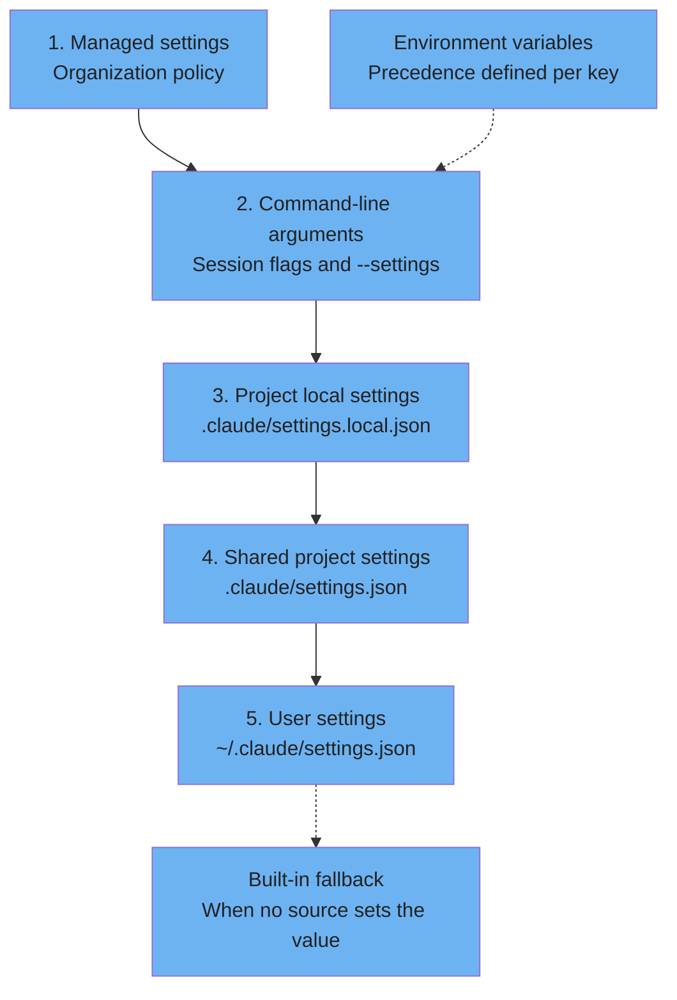
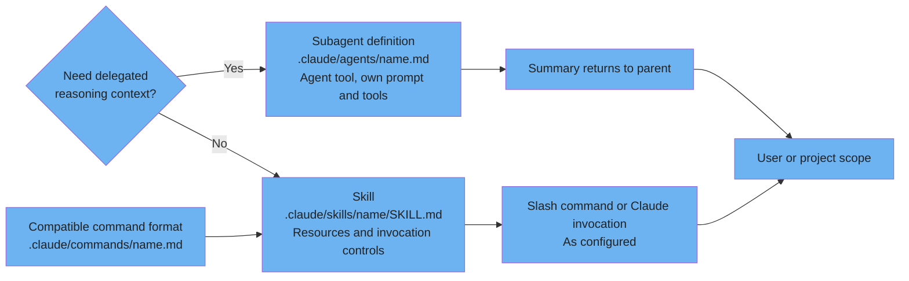
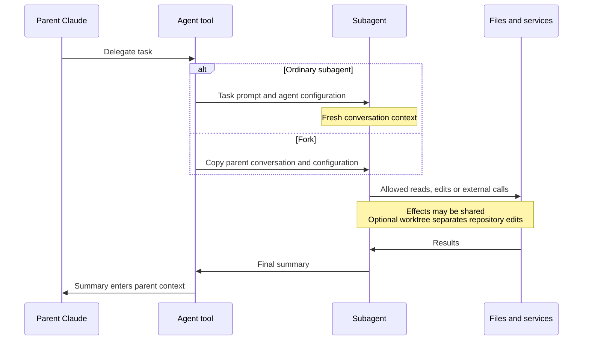
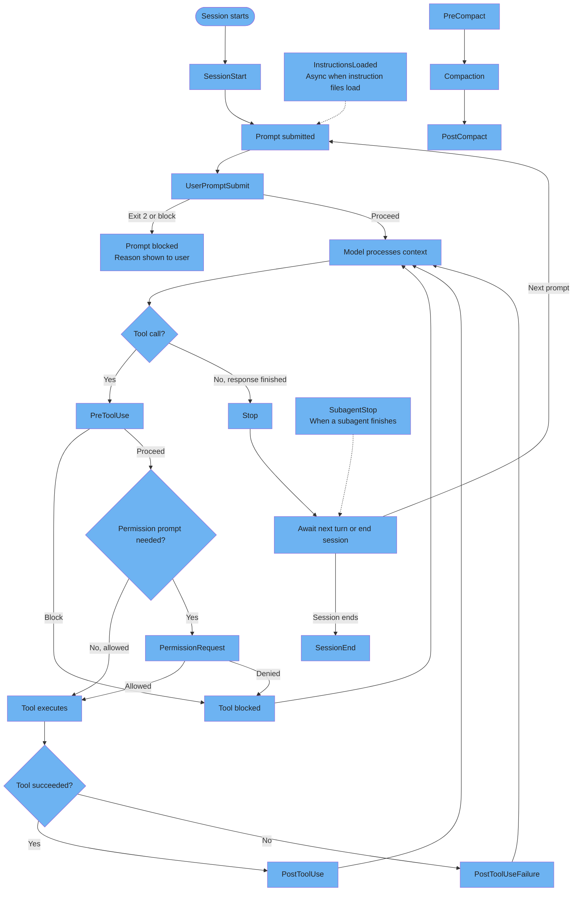

# Система конфигурации

Документированный приоритет настроек и упрощенное представление расширяемости и перехватчиков.

---

### Приоритет конфигурации (5 уровней)

Для одного и того же ключа настроек документированный стек имеет пять уровней, начиная с самого высокого. Списки могут объединяться, и могут применяться исключения, связанные с безопасностью. Приоритет переменных среды определяется для каждой настройки; CLAUDE.md принадлежит контексту инструкций, а не этому стеку настроек.



<details>
<summary>ASCII версия</summary>

```
Highest precedence
1. Managed settings
2. Command-line arguments
3. .claude/settings.local.json
4. .claude/settings.json
5. ~/.claude/settings.json
Fallback: built-in value when not configured

Environment variables: resolve per key, not as a universal sixth level.
CLAUDE.md: instructions, outside this settings stack.
Lists can merge; consult documented security-sensitive exceptions.
```

</details>

> **Источник**: [Правила приоритета](../ultimate-guide.md#34-precedence-rules)
>
> **Официальная ссылка**: [Приоритет настроек](https://code.claude.com/docs/en/settings#settings-precedence) и [Приоритет переменной среды](https://code.claude.com/docs/en/env-vars#precedence).
>
> Для выбора модели используется переменная ANTHROPIC_MODEL. CLAUDE_CONFIG_DIR меняет каталог конфигурации. Выбор модели CLI остается ограниченным управляемыми доступными моделями; это не отменяет политику организации.

---

### Навыки, команды и агенты: когда использовать каждый

Пользовательские команды были объединены в навыки. Оба формата файлов создают косую черту; навыки также поддерживают связанные ресурсы и вызов Claude. Субагенты используют отдельное контекстное окно для делегированной работы. Для этих механизмов существуют области действия пользователя и проекта.



<details>
<summary>ASCII версия</summary>

```
Reusable instructions / workflow:
  .claude/skills/name/SKILL.md -> /name, or Claude invocation as configured
  .claude/commands/name.md    -> compatible /name format
  Both can use user or project scope.

Delegated work:
  .claude/agents/name.md -> Agent tool -> own context, prompt and permitted tools
  Summary returns to parent; file/service effects can be shared.
```

</details>

> **Источник**: [Навыки понимания](../ultimate-guide.md#51-understanding-skills)
>
> **Официальная ссылка**: [Навыки и совместимость команд](https://code.claude.com/docs/en/skills) и [Определения субагентов](https://code.claude.com/docs/en/sub-agents).

---

### Жизненный цикл агента и изоляция области действия

Отдельное контекстное окно позволяет исключить промежуточную активность инструмента из родительского диалога. Он не изолирует эффекты файлов или служб. Обычные субагенты начинают заново; вилки наследуют диалог. Рабочее дерево может разделять изменения репозитория.



<details>
<summary>ASCII версия</summary>

```
Parent -> Agent tool -> Subagent
  Ordinary: task prompt + definition; fresh conversation context
  Fork:     inherits parent conversation and configuration
  Tools:    permitted file/service operations; effects may be shared
  Optional worktree: separate repository checkout, not isolated external services
Subagent -> final summary -> parent context
```

</details>

> **Источник**: [Архитектура субагента](../core/architecture.md#4-sub-agent-architecture)
>
> **Официальная ссылка**: [Форки и обычные субагенты](https://code.claude.com/docs/en/sub-agents#how-forks-differ-from-other-subagents).

---

### <a name="hooks-event-pipeline"></a>Конвейер событий перехватчиков

В этом упрощенном жизненном цикле различаются события сеанса, события поворота и события инструмента. PermissionRequest является условным. Типы перехватчиков и элементы управления принятием решений различаются в зависимости от события; это не исчерпывающий список событий.



<details>
<summary>ASCII версия</summary>

```
SessionStart -> prompt -> UserPromptSubmit
  blocked (exit 2 / decision): reason shown to user; prompt not processed
  proceed -> model processes context -> tool call?
    no, response finished -> Stop -> next turn or SessionEnd
    yes -> PreToolUse -> permissions check
              blocked -> tool blocked -> model
              prompt needed -> PermissionRequest -> allow / deny
              already allowed -> execute
  tool success -> PostToolUse -> model
  tool failure -> PostToolUseFailure -> model

Separate events: InstructionsLoaded (async), SubagentStop
Compaction: PreCompact -> compaction -> PostCompact
Hook types: command, http, mcp_tool, prompt, agent; support depends on event.
```

</details>

> **Источник**: [Система событий](../ultimate-guide.md#71-the-event-system)
>
> **Официальная ссылка**: [Жизненный цикл и решения хука](https://code.claude.com/docs/en/hooks#hook-lifecycle).
>
> InstructionsLoaded также срабатывает при отложенной загрузке инструкций. Stop — для каждого ответа, SessionEnd — для каждого сеанса; Ошибки API имеют StopFailure. Некоторые специальные инструменты пропускают обычные хуки для инструментов. В официальном справочнике перечислены эти исключения и поддерживаемые типы перехватчиков каждого события.
