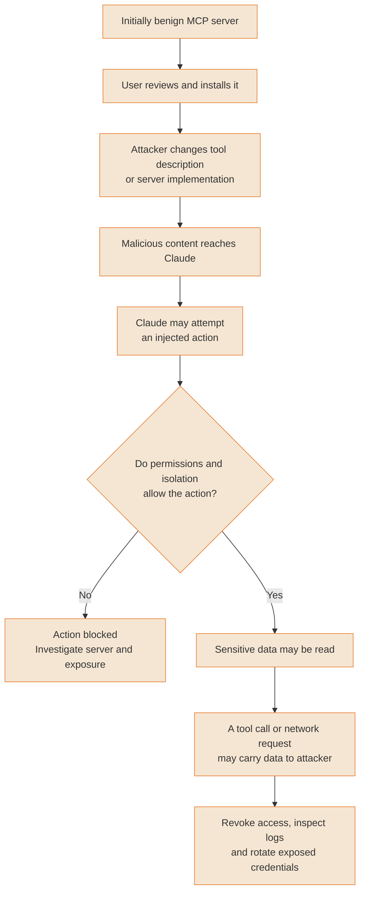
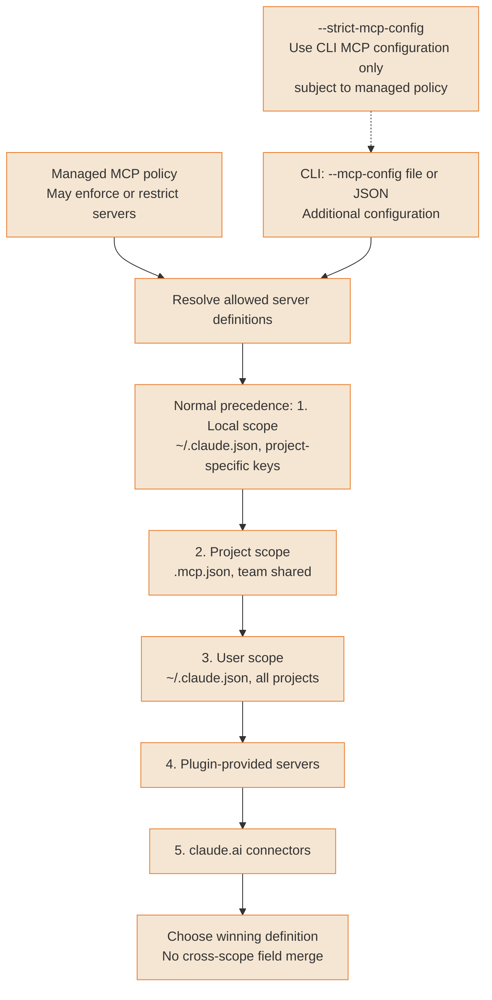

# MCP экосистема

Model Context Protocol расширяет Claude Code внешними инструментальными серверами. Эти диаграммы отличают текущее поведение протокола от рекомендуемых мер безопасности.

---

### <a name="mcp-server-ecosystem-map"></a>Карта экосистемы сервера MCP

Группируйте серверы по их сопровождающему и назначению. Серверы, обслуживаемые поставщиком, и эталонные примеры MCP имеют разные ожидания в отношении поддержки. Ни одна из категорий не гарантирует аудит безопасности со стороны Anthropic. Старый автономный репозиторий Semgrep MCP устарел; его сервер поддерживается через официальный двоичный файл Semgrep.

```mermaid
flowchart TD
    CC["Claude Code<br/>MCP client"] --> REF["MCP reference examples<br/>Educational, evaluate before production"]
    CC --> PROVIDER["Provider-maintained servers"]
    CC --> COMMUNITY["Community servers<br/>Verify exact repository and maintainer"]
    CC --> CUSTOM["Local or internal servers<br/>Project tools and API wrappers"]
    REF --> GIT["mcp-server-git<br/>Local Git operations"]
    REF --> THINK["sequential-thinking<br/>Reasoning example"]
    PROVIDER --> CTX["Context7 / Upstash<br/>Library documentation"]
    PROVIDER --> PLAY["Playwright / Microsoft<br/>Browser automation"]
    PROVIDER --> GH["GitHub MCP / GitHub<br/>Platform tools"]
    PROVIDER --> SEM["Semgrep official binary<br/>Security scanning"]
    PROVIDER --> AWS["AWS Labs MCP servers<br/>AWS tools"]
    COMMUNITY --> VET["Check maintenance, permissions<br/>and pinned version before install"]
    classDef default fill:#F5E6D3,color:#333,stroke:#E87E2F
    click CC href "https://github.com/FlorianBruniaux/claude-code-ultimate-guide/blob/main/guide/ecosystem/mcp-servers-ecosystem.md" "View this pattern in the guide"
    click REF href "https://github.com/FlorianBruniaux/claude-code-ultimate-guide/blob/main/guide/ecosystem/mcp-servers-ecosystem.md" "View this pattern in the guide"
    click PROVIDER href "https://github.com/FlorianBruniaux/claude-code-ultimate-guide/blob/main/guide/ecosystem/mcp-servers-ecosystem.md" "View this pattern in the guide"
    click COMMUNITY href "https://github.com/FlorianBruniaux/claude-code-ultimate-guide/blob/main/guide/ecosystem/mcp-servers-ecosystem.md" "View this pattern in the guide"
    click CUSTOM href "https://github.com/FlorianBruniaux/claude-code-ultimate-guide/blob/main/guide/ecosystem/mcp-servers-ecosystem.md" "View this pattern in the guide"
    click GIT href "https://github.com/FlorianBruniaux/claude-code-ultimate-guide/blob/main/guide/ecosystem/mcp-servers-ecosystem.md" "View this pattern in the guide"
    click THINK href "https://github.com/FlorianBruniaux/claude-code-ultimate-guide/blob/main/guide/ecosystem/mcp-servers-ecosystem.md" "View this pattern in the guide"
    click CTX href "https://github.com/FlorianBruniaux/claude-code-ultimate-guide/blob/main/guide/ecosystem/mcp-servers-ecosystem.md" "View this pattern in the guide"
    click PLAY href "https://github.com/FlorianBruniaux/claude-code-ultimate-guide/blob/main/guide/ecosystem/mcp-servers-ecosystem.md" "View this pattern in the guide"
    click GH href "https://github.com/FlorianBruniaux/claude-code-ultimate-guide/blob/main/guide/ecosystem/mcp-servers-ecosystem.md" "View this pattern in the guide"
    click SEM href "https://github.com/FlorianBruniaux/claude-code-ultimate-guide/blob/main/guide/ecosystem/mcp-servers-ecosystem.md" "View this pattern in the guide"
    click AWS href "https://github.com/FlorianBruniaux/claude-code-ultimate-guide/blob/main/guide/ecosystem/mcp-servers-ecosystem.md" "View this pattern in the guide"
    click VET href "https://github.com/FlorianBruniaux/claude-code-ultimate-guide/blob/main/guide/ecosystem/mcp-servers-ecosystem.md" "View this pattern in the guide"
```



<details>
<summary>ASCII версия</summary>

```
Claude Code
├─ MCP reference examples: mcp-server-git, sequential-thinking
│  Educational examples; evaluate safeguards for your use case
├─ Provider maintained: Context7 (Upstash), Playwright (Microsoft),
│  GitHub MCP (GitHub), Semgrep binary, AWS Labs servers
├─ Community: identify repository, maintainer and maintained version
└─ Local/custom: project tools and internal API wrappers

Provider maintained does not imply Anthropic security audit.
Semgrep's old standalone MCP repository is deprecated.
```

</details>

> **Источник**: [Guide: карта экосистемы серверов MCP](../ecosystem/mcp-servers-ecosystem.md); Справочные серверы [MCP](https://github.com/modelcontextprotocol/servers), [Context7](https://github.com/upstash/context7), [Playwright MCP](https://github.com/microsoft/playwright-mcp), [GitHub MCP](https://github.com/github/github-mcp-server), [Semgrep-миграция уведомление](https://github.com/semgrep/mcp), [AWS Labs MCP](https://github.com/awslabs/mcp)

---

### <a name="mcp-architecture-client-server-protocol"></a>Архитектура MCP: протокол клиент-сервер

MCP использует JSON-RPC. Стандартные транспорты — stdio и Streamable HTTP; исторический транспорт SSE по-прежнему поддерживается Claude Code, но устарел. Streamable HTTP сам может передавать ответы с помощью SSE. На диаграмме показан обмен вызовами инструментов, а не все возможности MCP.

```mermaid
flowchart LR
    CALL["Claude requests a tool"] --> MATCH["Claude Code matches<br/>the tool to its server"]
    MATCH --> REQ["JSON-RPC tools/call<br/>params.name + params.arguments"]
    REQ --> TRANS["stdio or Streamable HTTP<br/>Legacy SSE deprecated"]
    TRANS --> EXEC["MCP server executes action<br/>API, file or CLI"]
    EXEC --> EXT["External service<br/>if required"]
    EXT --> RESULT["JSON-RPC response<br/>result or protocol error"]
    EXEC --> RESULT
    RESULT --> USE["Claude Code provides tool result<br/>to the next model turn"]
    classDef default fill:#F5E6D3,color:#333,stroke:#E87E2F
    click CALL href "https://github.com/FlorianBruniaux/claude-code-ultimate-guide/blob/main/guide/core/architecture.md#mcp-architecture-overview" "View this pattern in the guide"
    click MATCH href "https://github.com/FlorianBruniaux/claude-code-ultimate-guide/blob/main/guide/core/architecture.md#mcp-architecture-overview" "View this pattern in the guide"
    click REQ href "https://github.com/FlorianBruniaux/claude-code-ultimate-guide/blob/main/guide/core/architecture.md#mcp-architecture-overview" "View this pattern in the guide"
    click TRANS href "https://github.com/FlorianBruniaux/claude-code-ultimate-guide/blob/main/guide/core/architecture.md#mcp-architecture-overview" "View this pattern in the guide"
    click EXEC href "https://github.com/FlorianBruniaux/claude-code-ultimate-guide/blob/main/guide/core/architecture.md#mcp-architecture-overview" "View this pattern in the guide"
    click EXT href "https://github.com/FlorianBruniaux/claude-code-ultimate-guide/blob/main/guide/core/architecture.md#mcp-architecture-overview" "View this pattern in the guide"
    click RESULT href "https://github.com/FlorianBruniaux/claude-code-ultimate-guide/blob/main/guide/core/architecture.md#mcp-architecture-overview" "View this pattern in the guide"
    click USE href "https://github.com/FlorianBruniaux/claude-code-ultimate-guide/blob/main/guide/core/architecture.md#mcp-architecture-overview" "View this pattern in the guide"
```



<details>
<summary>ASCII версия</summary>

```
Claude requests tool → match server → JSON-RPC tools/call
                                      params.name + params.arguments
                                                │
                              stdio / Streamable HTTP
                              (legacy SSE deprecated)
                                                │
                                     Server executes action
                                     ↔ optional external service
                                                │
                               JSON-RPC result or protocol error
                                                │
                                Tool result → next model turn
```

</details>

> **Источник**: [Guide: MCP архитектура: протокол клиент-сервер](../core/architecture.md#mcp-architecture-overview); [MCP транспортные привязки](https://modelcontextprotocol.io/specification/2026-07-28/basic/transports), [tools/call формат провода](https://modelcontextprotocol.io/specification/2026-07-28/server/tools#calling-tools), [Claude Code транспорты](https://code.claude.com/docs/en/mcp)

---

### <a name="mcp-rug-pull-attack-chain"></a>MCP цепочка для атаки на коврик

Удаление коврика меняет ранее доверенный инструмент или сервер после установки. Вредоносное описание может попытаться повлиять на Claude, но его чтение не гарантирует выполнение или эксфильтрацию: разрешения и изоляция процесса могут заблокировать попытку действия. Просмотрите исходный код и обновления, прикрепите версии, где это возможно, и ограничьте разрешения и доступ к сети.



<details>
<summary>ASCII версия</summary>

```
Initially benign server → reviewed and installed
            │
Attacker changes description or implementation
            │
Malicious content → possible injected action
            │
Permissions and isolation allow it?
├─ No  → blocked; investigate
└─ Yes → possible sensitive read
          → tool arguments / network request to attacker
          → revoke access, inspect logs, rotate exposed credentials

Source review, version pinning and least privilege reduce risk.
```

</details>

> **Источник**: [Guide: MCP цепочка атак с вытягиванием коврика](../security/security-hardening.md#attack-mcp-rug-pull); [Claude Code MCP безопасность](https://code.claude.com/docs/en/security#mcp-security)

---

### <a name="mcp-config-hierarchy"></a>Иерархия конфигурации MCP

Для повторяющихся имен серверов локальная область предшествует области проекта, а затем области пользователя. Серверы плагинов с более низким приоритетом и коннекторы claude.ai также проверяются на наличие дубликатов. Конфигурация CLI является дополнительным входом; используйте --strict-mcp-config, если вы намерены игнорировать другие источники MCP в соответствии с управляемой политикой. Записи сервера выбираются, а не объединяются по областям.



<details>
<summary>ASCII версия</summary>

```
Managed MCP policy applies before relying on a configuration.
CLI input: --mcp-config file-or-JSON
  --strict-mcp-config ignores other MCP configurations,
  subject to managed MCP rules.

Normal duplicate resolution (highest → lowest):
1. Local scope   ~/.claude.json, current-project keys
2. Project scope .mcp.json
3. User scope    ~/.claude.json, all-project keys
4. Plugin servers
5. claude.ai connectors

Choose the winning entry; do not merge its fields across scopes.
```

</details>

> **Источник**: [Руководство: Иерархия конфигурации MCP](../ultimate-guide.md#83-configuration); [MCP приоритет](https://code.claude.com/docs/en/mcp#scope-hierarchy-and-precedence), [CLI флаги конфигурации](https://code.claude.com/docs/en/cli-reference)
