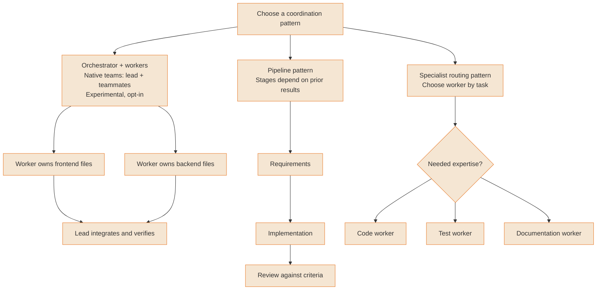
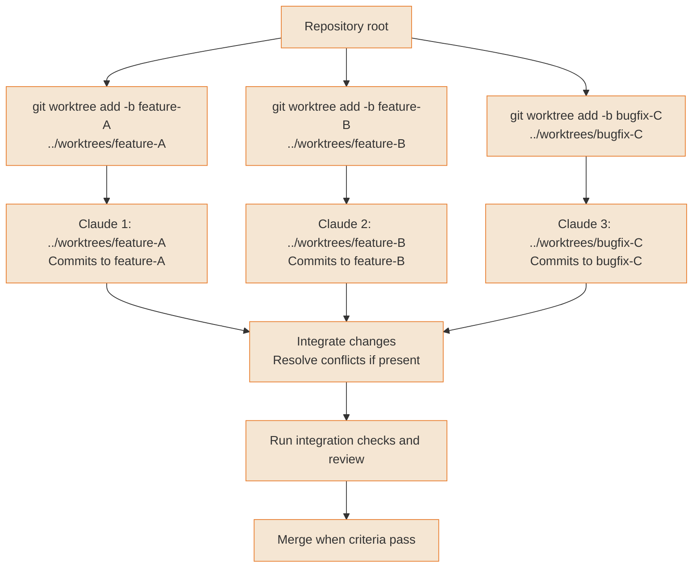
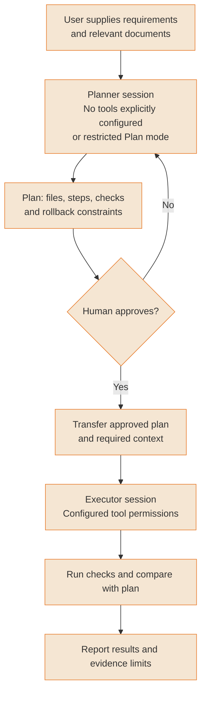
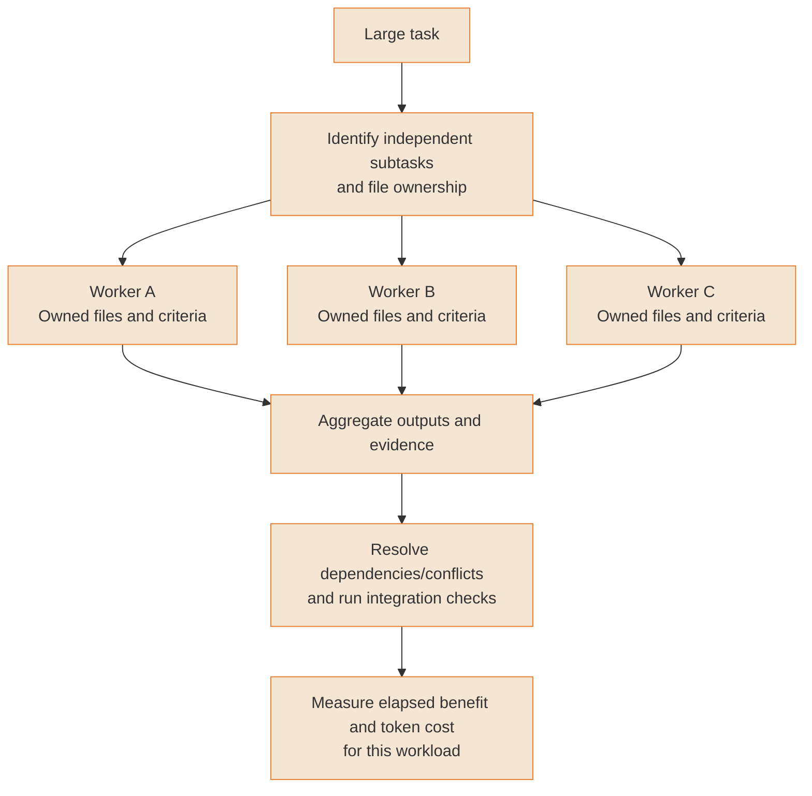
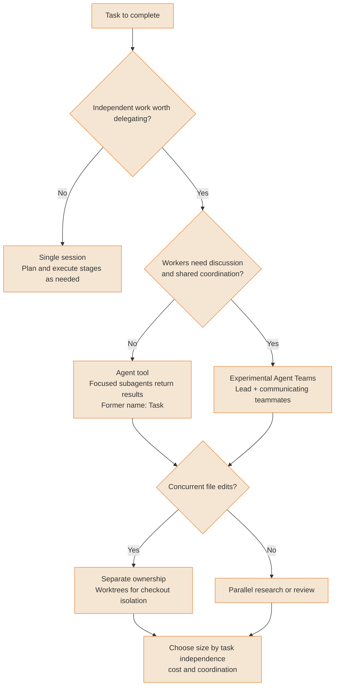
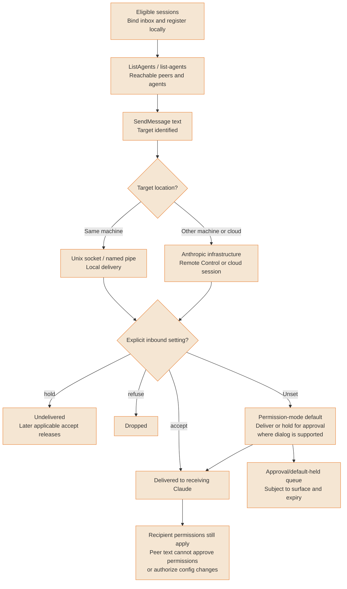

# Мультиагентные шаблоны

Координируйте независимую работу с четкими проверками владения и интеграции. Собственные особенности, концептуальные модели и измеряемые результаты различны.

---

### <a name="agent-teams-conceptual-orchestration-topologies"></a>Команды агентов: топологии концептуальной оркестровки

Оркестратор, конвейер и специализированная маршрутизация — это концептуальные шаблоны, а не три встроенных режима команд агентов. Native Agent Teams использует ведущего и общающихся товарищей по команде; он является экспериментальным и отключен по умолчанию. Это добавляет координацию и стоимость токенов. Последовательные задачи и редактирование одних и тех же файлов часто лучше подходят для одного сеанса или для целевых субагентов.



<details>
<summary>ASCII версия</summary>

```
Conceptual coordination patterns
├─ Orchestrator → workers with explicit ownership → integration checks
│  Native Agent Teams: lead + communicating teammates, experimental opt-in
├─ Pipeline → requirements → implementation → review
│  Workflow pattern; often a single session or subagents suffices
└─ Router → needed specialist (code / tests / docs)
   Workflow pattern, not a dedicated native team mode

Teams cost more tokens and require coordination.
```

</details>

> **Источник**: [Руководство: Команды агентов: топологии концептуальной оркестровки](../workflows/agent-teams.md); [Доступность команд агентов и компромиссы](https://code.claude.com/docs/en/agent-teams)

---

### <a name="git-worktree-multi-instance-pattern"></a>Многоэкземплярный шаблон рабочего дерева Git

Рабочие деревья предоставляют параллельным экземплярам отдельные извлеченные файлы и ветки. Некоторые метаданные репозитория остаются общими, и интеграция их изменений может по-прежнему вызывать конфликты слияния. Приведенные ниже команды предполагают наличие корня клонированного репозитория; каждая команда создает отображаемый путь.



<details>
<summary>ASCII версия</summary>

```
From the cloned repository root:
git worktree add -b feature-A ../worktrees/feature-A
git worktree add -b feature-B ../worktrees/feature-B
git worktree add -b bugfix-C ../worktrees/bugfix-C

Each path → its Claude instance → commits on its own branch
         → integrate → resolve conflicts if present
         → integration checks + review → merge

Separate working files; shared repository metadata.
Concurrent editing is isolated, merge conflicts remain possible.
```

</details>

> **Source**: [Guide: Многоэкземплярный шаблон рабочего дерева Git](../ultimate-guide.md#912-git-best-practices--workflows); [Семантика рабочего дерева Git](https://git-scm.com/docs/git-worktree)

---

### Шаблон планирования с двумя экземплярами

Используйте два сеанса, когда полезна отдельная граница планирования. Планировщику, у которого нет инструментов, необходимы соответствующие документы, представленные в его подсказке. Альтернативно, режим «План» позволяет проводить исследование с ограниченными действиями. Настройте ограничение явно; запуск второго сеанса не отключает инструменты. Исполнителю нужен утвержденный план и необходимый контекст, а не автоматическое наследование разговора с планировщиком.



<details>
<summary>ASCII версия</summary>

```
Supplied documents → planner
                     (explicit no-tools configuration,
                      or restricted Plan mode for exploration)
                   → plan → human review
                            ├─ Revise → planner
                            └─ Approve → transfer plan + required context
                                       → executor with configured tools
                                       → checks + result report

Two sessions alone do not enforce tool restrictions or transfer context.
```

</details>

> **Source**: [Guide: шаблон планирования с двумя экземплярами](../workflows/dual-instance-planning.md); [Режим разрешений плана](https://code.claude.com/docs/en/permissions), [Ограничения на дополнительные инструменты](https://code.claude.com/docs/en/sub-agents)

---

### Шаблон горизонтального масштабирования

Распараллельте независимую работу с явным владением файлом, а затем измерьте результат после координации и интеграции. Большее количество экземпляров не гарантирует пропорционального ускорения; затраты и зависимости могут перевесить выгоду. Прежде чем делать заявления о производительности, измерьте ускорение и стоимость рабочей нагрузки.



<details>
<summary>ASCII версия</summary>

```
Large task → independent subtasks with explicit ownership
            → parallel workers A / B / C
            → aggregate evidence
            → resolve dependencies and conflicts
            → integration checks
            → measure elapsed benefit and token cost

No guaranteed multiplier; coordination reduces gains.
```

</details>

> **Source**: [Guide: Шаблон горизонтального масштабирования](../ultimate-guide.md#917-scaling-patterns-multi-instance-workflows); [Размер команды, стоимость и убывающая прибыль](https://code.claude.com/docs/en/agent-teams)

---

### <a name="multi-instance-decision-matrix"></a>Матрица решений для нескольких экземпляров

Прежде чем выбирать количество рабочих, выберите зависимости, потребности в общении и изоляции. Собственный инструмент делегирования — Агент; Задача была ее прежним названием и остается псевдонимом совместимости в настройках и определениях. Для использования субагентов не требуется наличие четырех экземпляров.



<details>
<summary>ASCII версия</summary>

```
Worth delegating independent work?
├─ No → single session, stages as needed
└─ Yes → need peer discussion / shared coordination?
         ├─ No → Agent tool subagents return results
         │       (Task is the historical compatibility alias)
         └─ Yes → experimental Agent Teams
                    │
         Concurrent file edits?
         ├─ Yes → file ownership + separate worktrees
         └─ No → parallel research/review
                    │
         Size by independence, cost and coordination, not a 4+ rule.
```

</details>

> **Source**: [Guide: Матрица решений для нескольких экземпляров](../ultimate-guide.md#917-scaling-patterns-multi-instance-workflows); [Переименование и делегирование инструментов агентов](https://code.claude.com/docs/en/sub-agents), [Команды и субагенты](https://code.claude.com/docs/en/agent-teams)

---

### <a name="cross-session-messaging-discovery--delivery"></a>Межсеансовый обмен сообщениями: обнаружение и доставка

Подходящие независимые сеансы могут обнаруживать одноранговые узлы с помощью ListAgents и отправлять текст с помощью SendMessage. Доставка на одну машину использует локальные сокеты или именованные каналы; Доставка на другие машины и в облако использует инфраструктуру Anthropic. Явное удержание CrossSessionInbound сохраняет сообщения до тех пор, пока соответствующий прием не освободит их. Диалоговые окна утверждения относятся к некоторым настройкам режима разрешений по умолчанию в поддерживаемых терминалах, а не к явной настройке удержания. Доступность зависит от версии, поставщика и требований удаленного управления.



<details>
<summary>ASCII версия</summary>

```
Eligible sessions → registry/inbox → ListAgents → SendMessage
Target location?
├─ Same machine → Unix socket / named pipe, local delivery
└─ Other machine/cloud → Anthropic infrastructure
                               │
Explicit crossSessionInbound?
├─ accept → delivered
├─ hold   → undelivered; later applicable accept releases
├─ refuse → dropped
└─ unset  → mode-dependent default
            ├─ deliver
            └─ approval hold, depending on terminal/surface and expiry

Peer text does not approve permissions or authorize configuration changes.
Version/provider/Remote Control requirements govern availability.
```

</details>

> **Источник**: [Руководство: Межсеансовый обмен сообщениями: обнаружение и доставка](../workflows/cross-session-messaging.md); [Управление обменом сообщениями и доступность](https://code.claude.com/docs/en/cross-session-messaging)
