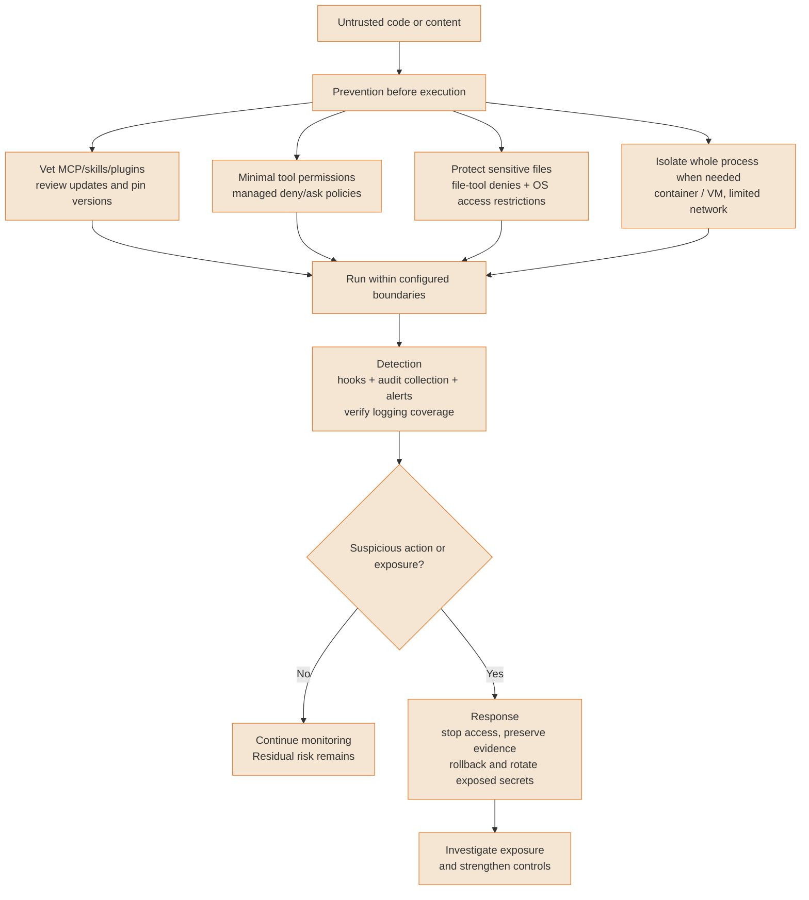
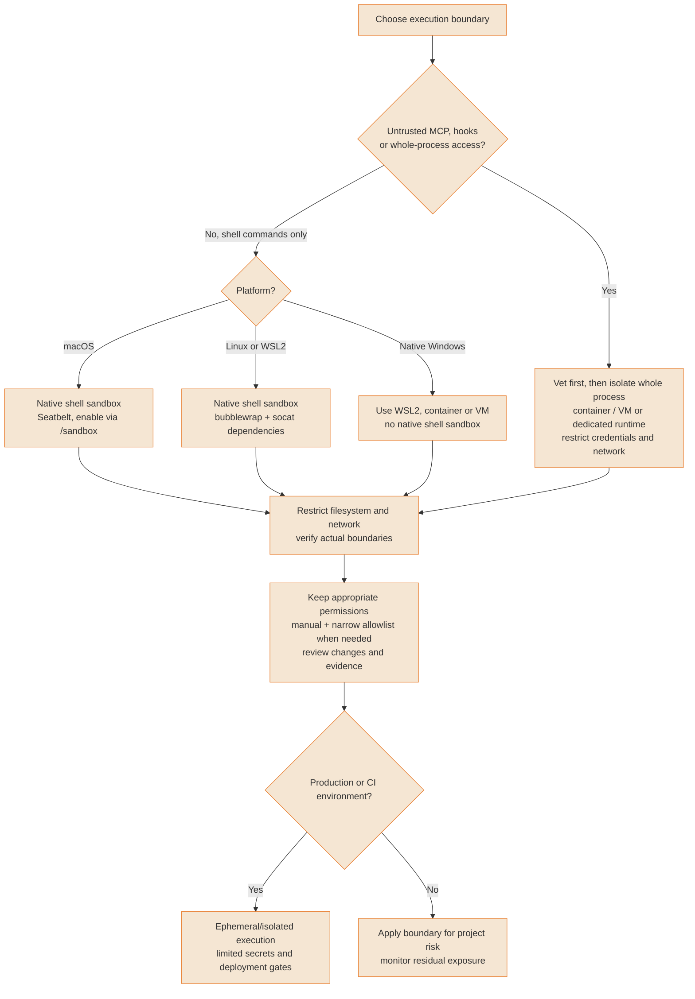
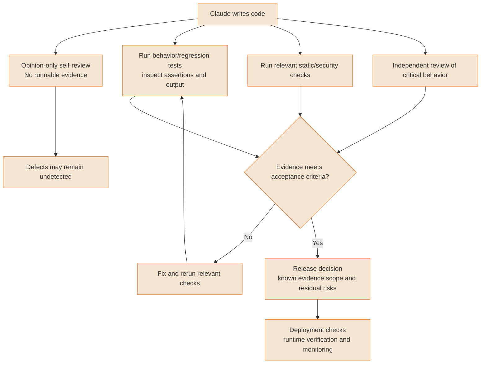
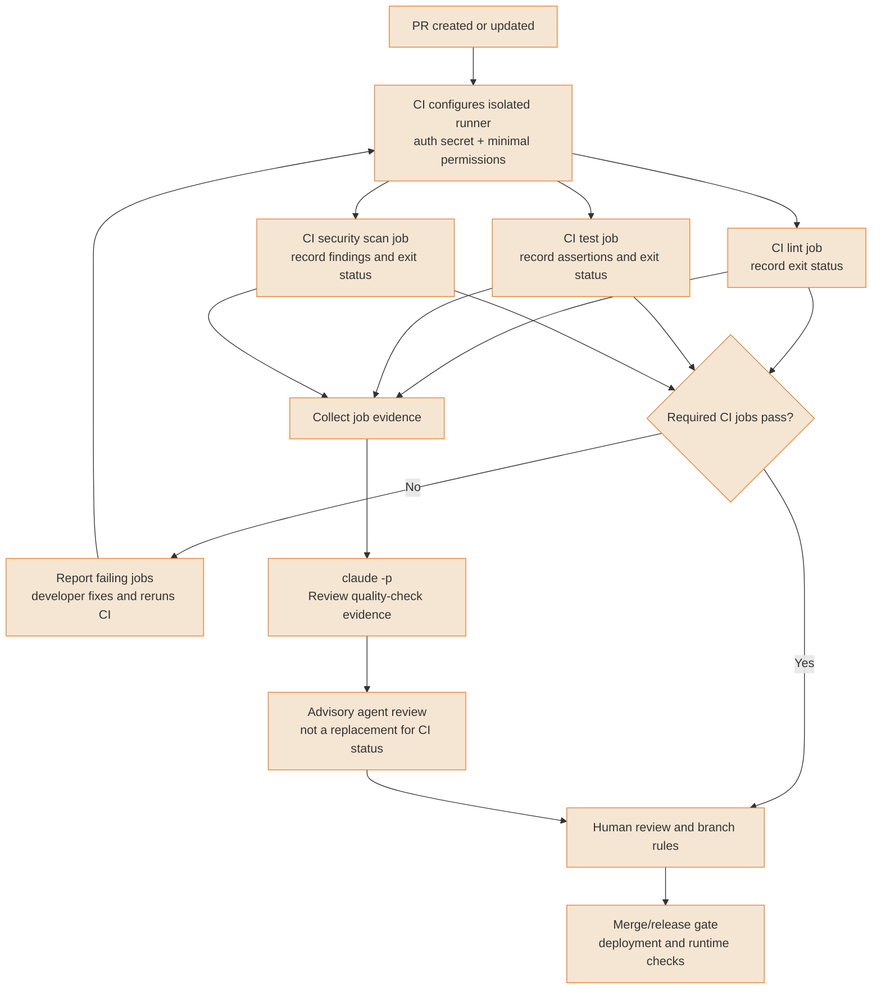

# Безопасность и производство

Используйте принудительные границы выполнения и наблюдаемые доказательства при запуске Claude Code в чувствительных средах. Ни одна диаграмма не обеспечивает универсальную безопасность сдерживания или развертывания.

---

### <a name="security-3-layer-defense-model"></a>Трехуровневая модель защиты безопасности

Предотвращение, обнаружение и реагирование снижают различные риски. Установите принудительные разрешения и изоляцию процессов, прежде чем запускать ненадежную работу. CLAUDE.md управляет моделью, но не обеспечивает соблюдение границ безопасности. Для защиты конфиденциальных файлов необходимы правила разрешений файловых инструментов и ограничения операционной системы, а не предполагаемая функция игнорирования файлов. Необходимо настроить журналы и проверить их покрытие. Обход разрешений уместен только в изолированной среде, а не только потому, что задание помечено как CI.



<details>
<summary>ASCII версия</summary>

```
PREVENTION (before execution)
  Vet servers and updates; minimal permissions; managed policies
  File-tool denies + OS sensitive-file restrictions
  Whole-process isolation and limited network where needed
                        │
DETECTION
  Configured hooks/log collection/alerts; verify coverage
                        │
Suspicious action or exposure?
├─ No → monitor residual risk
└─ Yes → RESPONSE: stop access, preserve evidence,
                  rollback, rotate exposed secrets, investigate

CLAUDE.md guides behavior; it does not enforce a security boundary.
Bypass only in an isolated environment, not simply any CI job.
```

</details>

> **Источник**: [Руководство: Модель трехуровневой защиты](../security/security-hardening.md); Ограничения соответствия [CLAUDE.md](https://code.claude.com/docs/en/memory), [Разрешения](https://code.claude.com/docs/en/permissions), [MCP безопасность](https://code.claude.com/docs/en/security)

---

### <a name="sandbox-decision-tree"></a>Дерево решений песочницы

Выберите границу, охватывающую процесс, подверженный риску. Собственная песочница оболочки поддерживает macOS (ремни безопасности) и Linux/WSL2 (пузырчатая пленка и socat); родному Windows требуется WSL2 или другая изолирующая среда. Файловые инструменты, локальные серверы MCP и перехватчики работают за пределами изолированной программной среды оболочки. Неизвестные MCP или хуки требуют проверки и, при необходимости, изоляции всего процесса Claude Code. AcceptEdits автоматически одобряет изменения, поэтому он не является более строгой альтернативой разрешениям, предоставляемым вручную. Чтения по умолчанию в собственной песочнице могут включать учетные данные, если это явно не ограничено.



<details>
<summary>ASCII версия</summary>

```
What needs isolation?
├─ Untrusted MCP/hooks/full process → vet first + whole-process isolation
│                                    restrict secrets and network
└─ Shell commands → native sandbox by platform
   ├─ macOS → Seatbelt, /sandbox
   ├─ Linux/WSL2 → bubblewrap + socat, /sandbox
   └─ Native Windows → WSL2/container/VM
               │
Restrict filesystem/network; verify enforced boundary
Keep appropriate permissions and review changes
├─ Production/CI → isolated execution + limited secrets + release gates
└─ Local project → boundary suited to project risk

Shell sandbox does not contain file tools, MCP servers or hooks.
acceptEdits automatically accepts edits, not stronger pre-edit review.
Credential reads need explicit restrictions.
```

</details>

> **Источник**: [Guide: дерево решений песочницы](../security/sandbox-native.md); [Встроенная область песочницы и платформы](https://code.claude.com/docs/en/sandboxing), [Режимы разрешений](https://code.claude.com/docs/en/permissions)

---

### <a name="the-verification-paradox"></a>Парадокс проверки

Запрос у генератора неподтвержденного мнения не проверяет его работу. Claude может запускать детерминированные тесты и показывать результаты; эти проверки доказывают только то, что они осуществляют. Независимо проверяйте критическое поведение и отличайте проверки кода от готовности к развертыванию и наблюдаемого поведения во время выполнения. Прохождение проверок само по себе не гарантирует безопасного освобождения.



<details>
<summary>ASCII версия</summary>

```
Opinion only: generated code → "looks good" → defects may remain

Evidence: generated code → behavior tests + relevant static checks
                         → independent review of critical sections
                         → acceptance criteria met?
                           ├─ No → fix and rerun checks
                           └─ Yes → release decision for known scope
                                    → deployment checks
                                    → runtime verification/monitoring

A runnable check executed by Claude is evidence within its coverage.
Passing checks does not guarantee a safe release.
```

</details>

> **Источник**: [Guide: Парадокс проверки](../security/production-safety.md); [Проверка работоспособности и состязательный обзор](https://code.claude.com/docs/en/best-practices)

---

### Конвейер интеграции CI/CD

CI должен запускать анализы, тесты и проверки безопасности как явные задания и использовать их статусы в качестве шлюзов. Claude Code может прочитать эти доказательства и составить рекомендательный обзор в неинтерактивном режиме печати, используя claude -p или --print. Приглашение само по себе не гарантирует параллельное выполнение или надежную агрегацию pass/fail. Явно настройте аутентификацию, разрешения инструментов и выходные данные заданий; обеспечивать соблюдение решений о выпуске посредством CI и проверки человеком, а не на основании мнения агента.



<details>
<summary>ASCII версия</summary>

```
PR → isolated CI runner + auth secret + minimal permissions
   → configured jobs (parallel only if CI declares it)
     ├─ Lint → exit status
     ├─ Tests → assertion results + exit status
     └─ Security scan → findings + exit status
           │
           ├─ Required CI jobs pass?
           │  ├─ No → report failure → fix → rerun CI
           │  └─ Yes → human review + branch rules → release gate
           │                                      → runtime checks
           └─ Job evidence → claude -p "Review quality-check evidence"
                           → advisory review for human

CI job status is the gate; an agent's opinion is not that status.
```

</details>

> **Источник**: [Guide: конвейер интеграции CI/CD](../ultimate-guide.md#93-cicd-integration); [Режим печати CLI](https://code.claude.com/docs/en/cli-reference), [Выполняемая проверка](https://code.claude.com/docs/en/best-practices)
