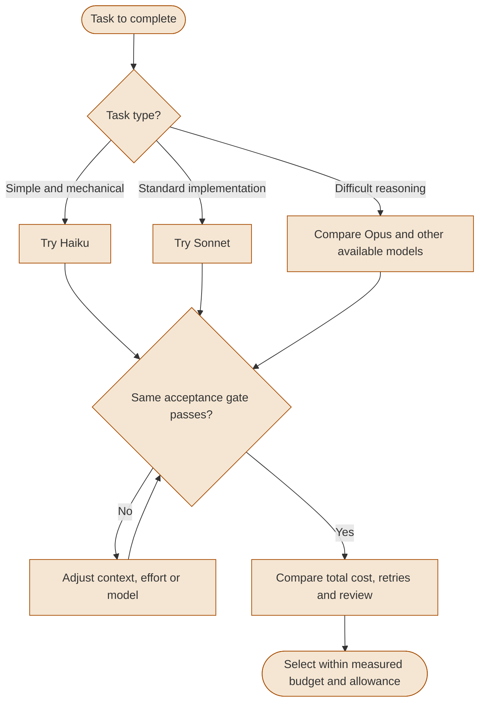
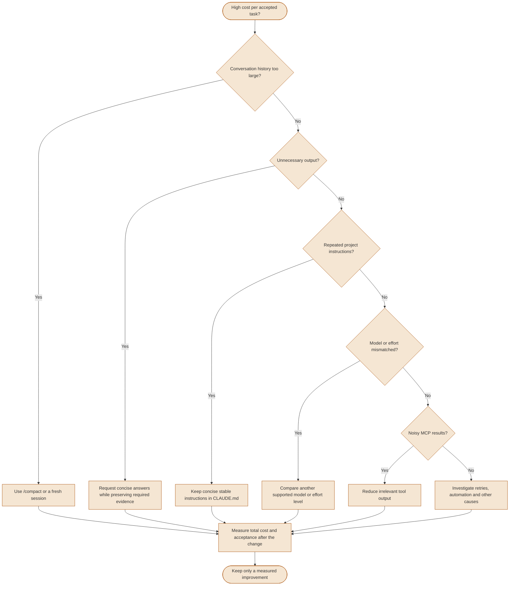
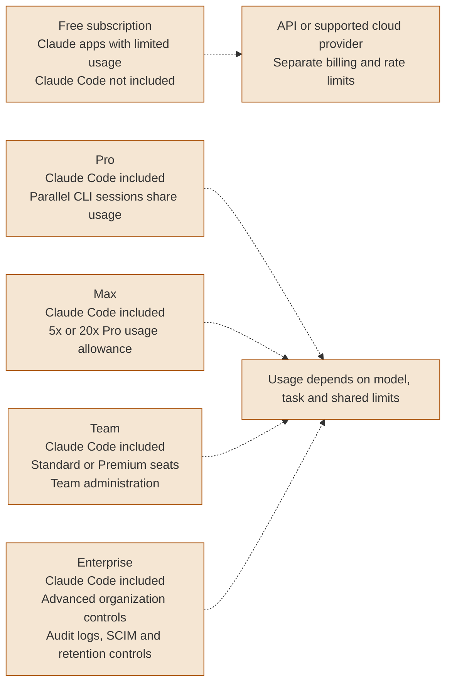

# Стоимость и оптимизация

Контролируйте затраты, измеряя стоимость принятой задачи, включая повторные попытки, проверку и доработку. Доступность модели, тарифы и надбавки к плану зависят от вашей учетной записи и поставщика услуг.

---

### <a name="model-selection-decision-flow"></a>Последовательность принятия решения о выборе модели

Используйте модельные семейства в качестве кандидатов, а затем сравните их с теми же критериями приемки. Более низкая ставка токенов позволяет сэкономить деньги только в том случае, если качество и общая стоимость задачи остаются приемлемыми.



<details>
<summary>ASCII версия</summary>

```text
Task type?
  Simple/mechanical -> try Haiku
  Standard implementation -> try Sonnet
  Difficult reasoning -> compare Opus and other available models
      |
Same acceptance gate passes?
  No -> adjust context, effort or model -> test again
  Yes -> compare total cost, retries and review
      -> select within measured budget and allowance
```

</details>

> **Источник**: [Выбор модели](../ultimate-guide.md#25-model-selection--thinking-guide)

> **Подтверждено 27 октября 2026 г.**: Стандартные прямые ставки API за миллион токенов input/output: Haiku 5,5 0,10 доллара США/0,50 доллара США (предлагается до 100 тысяч токенов); Sonnet 5,5 2 доллара США/10 долларов США; Opus 5,5 4 доллара США/20 долларов США. Коэффициенты 2x применяются к этим классам токенов, а не к общей стоимости задач или ценам на подписку. Кэширование, быстрый режим и другие модификаторы меняют биллинг. [Официальные цены на API](https://platform.claude.com/docs/en/about-claude/pricing).

> Псевдонимы `sonnet` и `opus` разрешаются по-разному в зависимости от поставщика и могут меняться. На Anthropic API `sonnet` преобразуется в Sonnet 5.5, а `haiku` — в Haiku 5.5; Sonnet 5 и Haiku 4.5 остаются в документации как устаревшие модели, для которых не указана дата выхода из эксплуатации. Прежде чем выбирать кандидата, проверьте свою фактическую модель и размер допуска. У Макса есть ограничения на использование; Для API выставление счетов и ограничения тарифов также требуют определенного бюджета. [Псевдонимы моделей](https://code.claude.com/docs/en/model-config#model-aliases), [Текущие планы и устаревшие модели](https://claude.com/pricing).


---

### <a name="cost-optimization-decision-tree"></a>Дерево решений по оптимизации затрат

Выявите один повторяющийся источник потерь, измените его и повторите аналогичные задачи. Если приведенные ниже проверки не объясняют ни одной из затрат, проведите дальнейшее расследование, прежде чем называть базовый уровень приемлемым.



<details>
<summary>ASCII версия</summary>

```text
High cost per accepted task?
  Large history -> /compact or fresh session
  Unnecessary output -> concise answers with required evidence
  Repeated project instructions -> concise stable CLAUDE.md
  Model/effort mismatch -> compare supported alternatives
  Noisy MCP results -> reduce irrelevant output
  None identified -> investigate retries, automation and other causes
      |
Measure total cost and acceptance -> keep a measured improvement
```

</details>

> **Источник**: [Стратегии оптимизации затрат](../ultimate-guide.md#913-cost-optimization-strategies)

> **Effort**: `/effort low|medium|high|xhigh|max` предлагает уровни, зависящие от модели. Меньшие усилия могут сократить затраты на рассуждения, но проверьте влияние на качество завершения. `xlow` и `default` не являются именами текущих уровней. [Уровни усилий](https://code.claude.com/docs/en/model-config#adjust-effort-level).

> Сжатие и управление контекстом уменьшают ввод будущей истории; больший CLAUDE.md также потребляет контекст. Прежде чем выбирать исправление, установите базовый уровень. [Официальное управление затратами](https://code.claude.com/docs/en/costs#reduce-token-usage).


---

### Уровни подписки: что открывает каждый из них

Отделите доступ к продукту от разрешений на использование и контроля организации. Параллельные сеансы CLI совместно используют емкость учетной записи; они не доступны только Максу.



<details>
<summary>ASCII версия</summary>

```text
Free subscription: Claude apps; Claude Code not included
Pro: Claude Code; parallel CLI sessions share plan usage
Max: Claude Code; 5x or 20x Pro usage allowance
Team: Standard/Premium seats; team administration
Enterprise: advanced controls, audit logs, SCIM, retention controls

API/cloud-provider access: separate billing and rate limits
Every paid plan remains usage-limited; parallel work uses shared capacity
```

</details>

> **Источник**: [Планы и ограничения подписки](../ultimate-guide.md#subscription-plans--limits)

> **Проверен 31 октября 2026 г., USD**: Pro $20/month при ежемесячной оплате; Годовые цены различаются. Макс $100/month и Ultra $200/month (Ultra — это прежний Max 20x, без 5-часового ограничения после подтверждения учетной записи). Team Standard — $25/seat/month при ежемесячной оплате или 20 долларов США при ежегодной оплате; Премиум имеет другую цену. Для организации необходимо проверить корпоративные условия и выставление счетов за использование. Налоги и региональные цены могут различаться. [Текущие официальные планы](https://claude.com/pricing).

> Несколько сеансов CLI могут работать одновременно в отдельных рабочих деревьях или терминалах. Их модели и активные задачи по-прежнему потребляют лимит использования учетной записи. [Параллельные сеансы](https://code.claude.com/docs/en/best-practices#run-multiple-claude-sessions). Бесплатная подписка на Claude не препятствует отдельному платному доступу к API. [Поддерживаемые учетные записи](https://code.claude.com/docs/en/quickstart#before-you-begin).


---

### <a name="token-reduction-strategies-pipeline"></a>Конвейер стратегий сокращения токенов

Несколько стратегий влияют на одни и те же классы токенов. Выберите один рычаг, воспроизведите те же ворота приемки и сравните общую стоимость, повторные попытки и проверку. Сохраните или отклоните это изменение, прежде чем тестировать следующий рычаг; не умножайте объявленные проценты сокращения.

```mermaid
flowchart LR
    A([Measure task baseline]) --> B[Select and apply ONE lever<br/>CLI-output filtering OR history compaction<br/>OR concise instructions OR a lower-rate model]
    B --> C[Replay the same acceptance gate]
    C --> D[Compare total cost, retries and review]
    D --> E{Acceptance and cost<br/>criteria satisfied?}
    E -->|Yes| F[Keep this change]
    E -->|No| G[Reject this change]
    F --> H{Another lever to test?}
    G --> H
    H -->|Yes| B
    H -->|No| I([Record the measured result])

    classDef diagramNode fill:#F5E6D3,color:#333,stroke:#A64B00
    class A,B,C,D,E,F,G,H,I diagramNode
    click A href "https://github.com/FlorianBruniaux/claude-code-ultimate-guide/blob/main/guide/ultimate-guide.md#913-cost-optimization-strategies" "View in guide"
    click B href "https://github.com/FlorianBruniaux/claude-code-ultimate-guide/blob/main/guide/ultimate-guide.md#913-cost-optimization-strategies" "View in guide"
    click C href "https://github.com/FlorianBruniaux/claude-code-ultimate-guide/blob/main/guide/ultimate-guide.md#913-cost-optimization-strategies" "View in guide"
    click D href "https://github.com/FlorianBruniaux/claude-code-ultimate-guide/blob/main/guide/ultimate-guide.md#913-cost-optimization-strategies" "View in guide"
    click E href "https://github.com/FlorianBruniaux/claude-code-ultimate-guide/blob/main/guide/ultimate-guide.md#913-cost-optimization-strategies" "View in guide"
    click F href "https://github.com/FlorianBruniaux/claude-code-ultimate-guide/blob/main/guide/ultimate-guide.md#913-cost-optimization-strategies" "View in guide"
    click G href "https://github.com/FlorianBruniaux/claude-code-ultimate-guide/blob/main/guide/ultimate-guide.md#913-cost-optimization-strategies" "View in guide"
    click H href "https://github.com/FlorianBruniaux/claude-code-ultimate-guide/blob/main/guide/ultimate-guide.md#913-cost-optimization-strategies" "View in guide"
    click I href "https://github.com/FlorianBruniaux/claude-code-ultimate-guide/blob/main/guide/ultimate-guide.md#913-cost-optimization-strategies" "View in guide"
```



<details>
<summary>ASCII версия</summary>

```text
Measure baseline
  -> select and apply ONE lever:
       CLI-output filtering OR history compaction
       OR concise instructions OR a lower-rate model
  -> replay the same acceptance gate
  -> compare total cost, retries and review
  -> acceptance and cost criteria satisfied?
       Yes: keep this change / No: reject this change
  -> another lever? Yes: select the next one / No: record result
```

</details>

> **Источник**: [Стратегии оптимизации затрат](../ultimate-guide.md#913-cost-optimization-strategies)

> RTK — это сторонний пример фильтрации вывода CLI, а не возможность Anthropic или гарантированное сокращение количества токенов. Проверьте сохраненный вывод на предмет отсутствия диагностической информации. Никакого усиления RTK здесь не утверждается.

> `/usage` показывает оценку стоимости сеанса и использование плана; `/cost` — допустимый псевдоним. Ориентировочная стоимость сеанса в долларах не является счетом и не представляет собой дополнительную плату за включенное использование подписки. [Команда использования](https://code.claude.com/docs/en/commands), [Оценка стоимости](https://code.claude.com/docs/en/costs#using-the-/usage-command).
