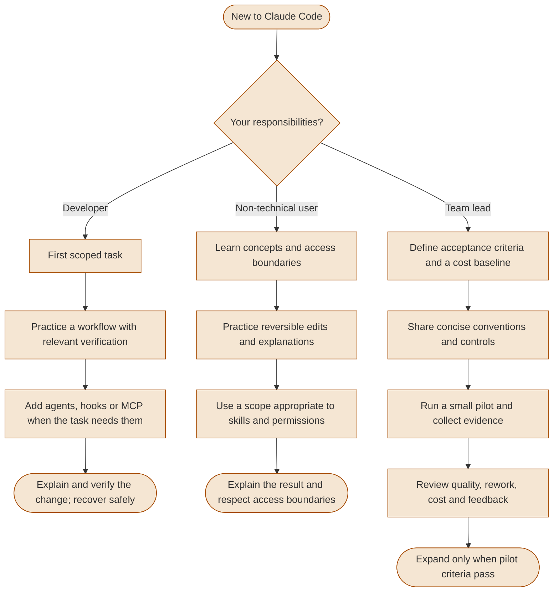
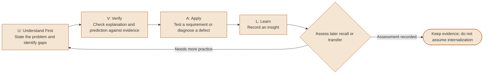
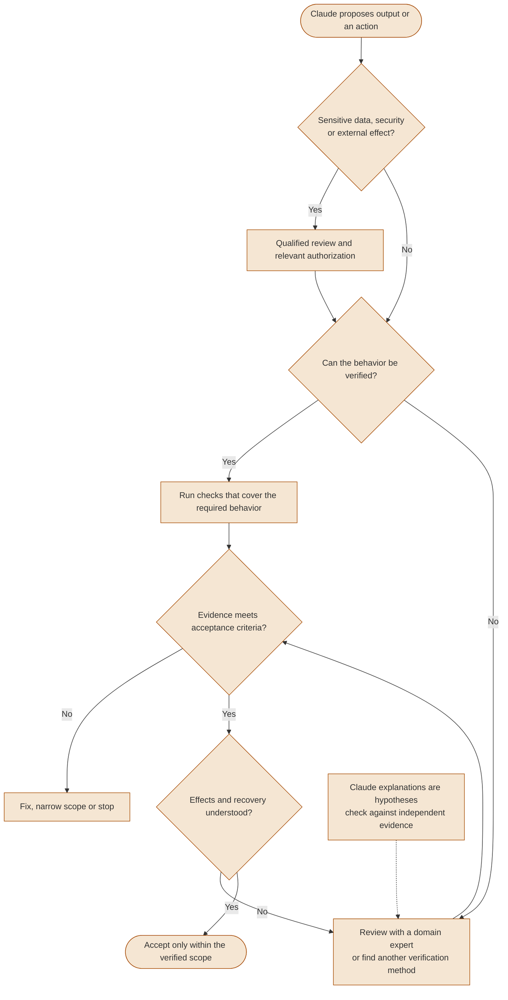
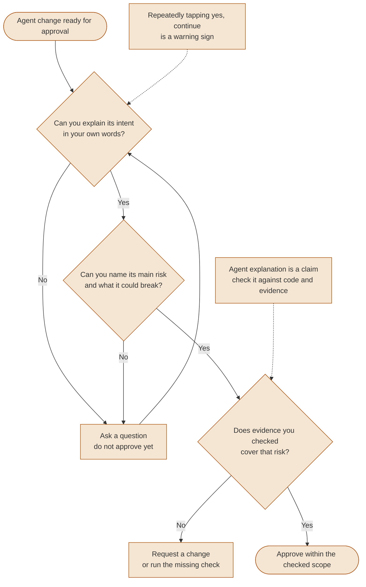

# Принятие и обучение

Примите Claude Code посредством поставленных задач, соответствующей проверки и явных проверок человеческого понимания. Повышение уровня обучения и производительности требует свидетельств со стороны людей и участвующих задач.

---

### <a name="onboarding-adaptive-learning-paths"></a>Адаптивные траектории обучения

Выберите стартовый путь, исходя из обязанностей и имеющихся навыков. Прогресс, когда наблюдаемые критерии удовлетворяются; фиксированная продолжительность обучения или внедрения в команду не подразумевается.



<details>
<summary>ASCII версия</summary>

```text
Developer:
  Scoped task -> verified workflow -> add needed capabilities
  Gate: explain/verify the change and recover safely

Non-technical user:
  Concepts/access boundaries -> reversible practice -> suitable scope
  Gate: explain the result and respect access boundaries

Team lead:
  Acceptance/cost baseline -> shared conventions -> small pilot
  Gate: review quality, rework, cost and feedback before expansion
```

</details>

> **Источник**: [Подходы к внедрению](../roles/adoption-approaches.md#start--build--scale-a-practical-navigation-layer)

> Это предлагаемые пути, а не измеренные сроки завершения. В официальном кратком руководстве рассказывается об установке, поддерживаемых учетных записях и первых задачах; организация должна оценить результаты своего пилотного проекта. [Официальный краткий старт](https://code.claude.com/docs/en/quickstart).


---

### Протокол обучения UVAL

UVAL — это предлагаемая практика проверки понимания во время работы с помощью ИИ. Он не устанавливает преимущества удержания и не заменяет политику принятия изменений.



<details>
<summary>ASCII версия</summary>

```text
UNDERSTAND -> VERIFY -> APPLY -> LEARN
U: State the problem and identify knowledge gaps
V: Check explanation and prediction against evidence
A: Test a requirement or diagnose a defect; adapt when needed
L: Record an insight

Assess later recall/transfer -> practice further or record the result
Retention benefit remains to be evaluated
```

</details>

> **Источник**: [Протокол UVAL](../roles/learning-with-ai.md#the-uval-protocol)


---

### Доверительная калибровочная матрица

Прежде чем принять результат, оцените конфиденциальность данных, безопасность и внешние эффекты. Тесты и откат устанавливают только проверенную область действия; Возврат Git не может отменить раскрытие данных или любое внешнее действие.



<details>
<summary>ASCII версия</summary>

```text
Sensitive data/security/external effect?
  Yes -> qualified review and relevant authorization
  No -> continue to verification
      |
Can behavior be verified?
  Yes -> run relevant checks
  No -> domain review or another verification method
      |
Evidence meets acceptance criteria?
  No -> fix, narrow scope or stop
  Yes -> understand effects and recovery
      -> accept only within the verified scope

An explanation is a hypothesis; Git rollback does not undo disclosure
```

</details>

> **Источник**: [Доверительная калибровка](../ultimate-guide.md#17-trust-calibration-when-and-how-much-to-verify)

> Рецензент продолжает нести ответственность за безопасность предлагаемого кода и команд. Требования к проверке зависят от действия и его последствий. [Anthropic Руководство по безопасности](https://code.claude.com/docs/en/security#user-responsibility).

---

### <a name="approve-only-what-you-can-explain"></a>Одобряйте только то, что можете объяснить

Персональная проверка перед утверждением смены агента. Это практика оценки в вашей команде, а не взвешенное вмешательство. Объяснение агента — это требование сверки с кодом и доказательствами, а не доказательство само по себе.



<details>
<summary>ASCII версия</summary>

```text
Agent change ready for approval
  Can you explain its intent in your own words?
    No  -> ask a question, do not approve yet
    Yes -> can you name its main risk and what it could break?
             No  -> ask a question
             Yes -> does evidence you checked cover that risk?
                      No  -> request a change or run the missing check
                      Yes -> approve within the checked scope

Warning sign: repeatedly tapping "yes, continue"
The agent's explanation is a claim, not evidence
```

</details>

> **Источник**: [Просмотр результатов работы машины — это третий режим](../roles/learning-with-ai.md#reviewing-machine-output-is-a-third-mode). Эти три вопроса представляют собой синтез этого руководства, основанный на информации [Resisting Cognitive Surrender](https://knlb.dev/essays/surrender) и [Kaufman и др.](https://arxiv.org/abs/2607.08885), чей результат касается объяснений сгенерированных утверждений; применение его к обоснованию агента является экстраполяцией.
