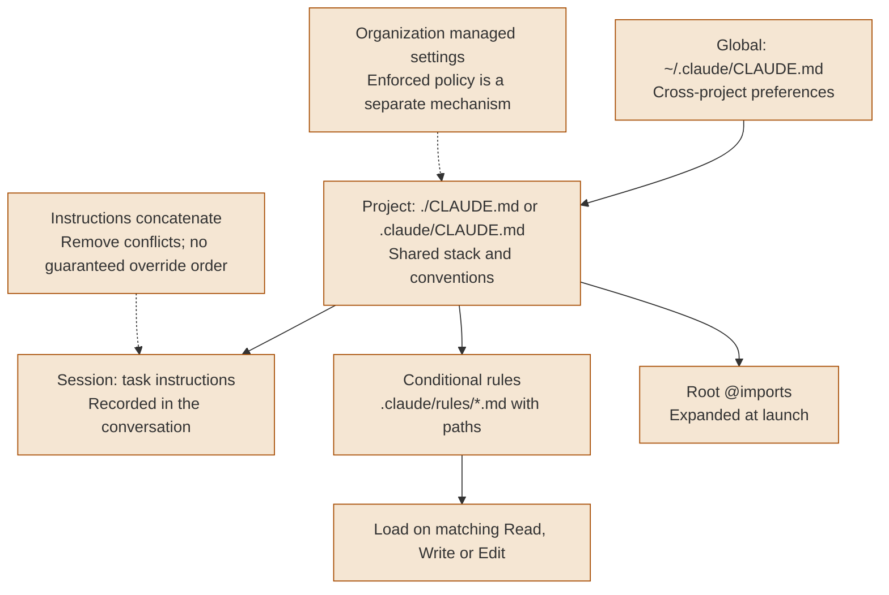
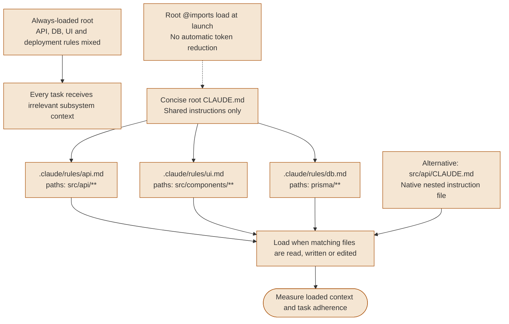
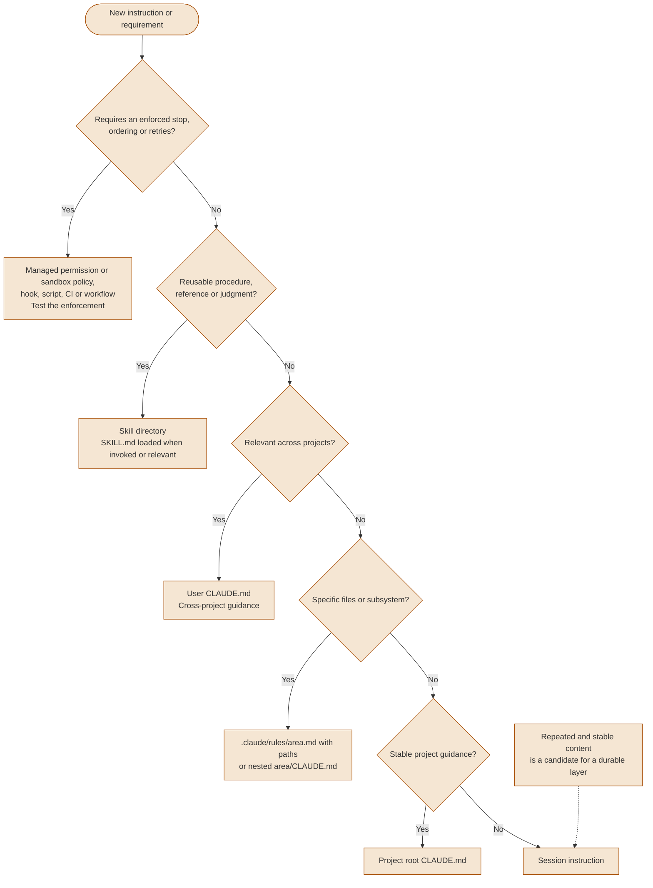

# <a name="context-engineering"></a>Контекстная инженерия

Загрузите соответствующие инструкции и доказательства, а затем определите, соответствует ли Claude необходимым ограничениям для реальных задач. Более короткий контекст сам по себе не дает лучших результатов.

---

### <a name="the-3-layer-context-system"></a>Трехуровневая контекстная система

В этом режиме обучения разделяются глобальные инструкции, инструкции проекта и инструкции сеанса. Это не полный перечень политики организации, автоматической памяти или контекста инструментов среды выполнения. Файлы инструкций становятся контекстом модели, а не обязательными настройками безопасности.



<details>
<summary>ASCII версия</summary>

```text
GLOBAL: ~/.claude/CLAUDE.md -> cross-project preferences
PROJECT: ./CLAUDE.md or .claude/CLAUDE.md -> shared stack and conventions
SESSION: task instructions -> recorded in the conversation

Root @imports -> expanded at launch
.claude/rules/*.md + paths -> conditional Read/Write/Edit loading
Instructions concatenate; keep them consistent
Organization managed settings -> separate enforced policy mechanism
Session instructions do not become durable project/global policy
```

</details>

> **Источник**: [Иерархия конфигурации](../core/context-engineering.md#3-configuration-hierarchy)

> Собственная загрузка отличает импорт от условных правил. Противоречивый текст инструкций не имеет гарантированного порядка переопределения. [Загрузка инструкций](https://code.claude.com/docs/en/memory#how-claude-md-files-load), [Импорты](https://code.claude.com/docs/en/memory#import-additional-files), [Условные правила](https://code.claude.com/docs/en/memory#path-specific-rules).

> `/add-dir` расширяет доступ к рабочему каталогу для сеанса; это не команда импорта инструкций. [Справочник команд](https://code.claude.com/docs/en/commands).


---

### <a name="context-budget--adherence-checks"></a>Контекстный бюджет и проверка его соблюдения

Не существует универсального процента соблюдения для определенного количества строк. Просмотрите актуальность и конфликты, измерьте фактически загруженный контекст, а затем сравните нарушения и результаты задач до и после изменения.

```mermaid
flowchart LR
    A[Inventory loaded instructions] --> B[Find irrelevant or conflicting rules]
    B --> C[Keep shared instructions concise]
    C --> D[Scope subsystem rules to matching files]
    D --> E[Replay representative acceptance checks]
    E --> F[Compare loaded context, violations and rework]
    F --> G([Keep the change only when the evidence supports it])

    classDef diagramNode fill:#F5E6D3,color:#333,stroke:#A64B00
    class A,B,C,D,E,F,G diagramNode
    click A href "https://github.com/FlorianBruniaux/claude-code-ultimate-guide/blob/main/guide/core/context-engineering.md#2-the-context-budget" "View in guide"
    click B href "https://github.com/FlorianBruniaux/claude-code-ultimate-guide/blob/main/guide/core/context-engineering.md#2-the-context-budget" "View in guide"
    click C href "https://github.com/FlorianBruniaux/claude-code-ultimate-guide/blob/main/guide/core/context-engineering.md#2-the-context-budget" "View in guide"
    click D href "https://github.com/FlorianBruniaux/claude-code-ultimate-guide/blob/main/guide/core/context-engineering.md#2-the-context-budget" "View in guide"
    click E href "https://github.com/FlorianBruniaux/claude-code-ultimate-guide/blob/main/guide/core/context-engineering.md#2-the-context-budget" "View in guide"
    click F href "https://github.com/FlorianBruniaux/claude-code-ultimate-guide/blob/main/guide/core/context-engineering.md#2-the-context-budget" "View in guide"
    click G href "https://github.com/FlorianBruniaux/claude-code-ultimate-guide/blob/main/guide/core/context-engineering.md#2-the-context-budget" "View in guide"
```



<details>
<summary>ASCII версия</summary>

```text
Inventory loaded instructions
  -> review irrelevant/conflicting rules
  -> concise shared instructions
  -> scope subsystem rules
  -> replay representative acceptance checks
  -> compare context size, violations and rework
  -> keep changes supported by evidence

No fixed adherence curve or universal context-reduction gain is asserted
```

</details>

> **Источник**: [Контекстный бюджет](../core/context-engineering.md#2-the-context-budget)

> Anthropic рекомендует короткие, организованные и последовательные файлы CLAUDE.md с целевой длиной менее 200 строк на файл. Это рекомендации, а не гарантированный уровень соблюдения. Импорт помогает организовать, но при этом загружает контекст. [Написание эффективных инструкций](https://code.claude.com/docs/en/memory#write-effective-instructions).


---

### <a name="monolithic-vs-modular-architecture"></a>Монолитная и модульная архитектура

Переместите инструкции, специфичные для подсистемы, из всегда загружаемого корня в собственные условные правила или вложенные файлы CLAUDE.md. Разделение корневого импорта на большее количество файлов меняет организацию, но само по себе не уменьшает контекст запуска.



<details>
<summary>ASCII версия</summary>

```text
Always-loaded monolith -> irrelevant subsystem rules on every task

Concise root CLAUDE.md: shared instructions
  .claude/rules/api.md [paths: src/api/**]
  .claude/rules/ui.md  [paths: src/components/**]
  .claude/rules/db.md  [paths: prisma/**]
    -> load on matching Read/Write/Edit
Alternative: src/api/CLAUDE.md -> loads when that subtree is accessed

Root @imports expand at launch
Measure context and adherence; no fixed percentage gain is promised
```

</details>

> **Источник**: [Модульная архитектура](../core/context-engineering.md#4-modular-architecture)

> Произвольные имена, такие как `CLAUDE-api.md`, не обнаруживаются автоматически как вложенные файлы инструкций. Используйте собственные имена или файл условных правил. [Встроенная загрузка памяти проекта и правила](https://code.claude.com/docs/en/memory).


---

### <a name="rule-placement-decision-tree"></a>Дерево решений о размещении правил

Решите, нуждается ли требование в принудительном исполнении, прежде чем выбирать объем его инструктивного текста. Навык обеспечивает многократное использование руководства; правило разрешения, перехватчик, сценарий или шлюз CI должны реализовывать и проверять любую необходимую жесткую остановку.



<details>
<summary>ASCII версия</summary>

```text
Needs an enforced stop/order/retries?
  Yes -> managed permissions/sandbox, hook/script/CI/workflow; test it
  No -> reusable procedure/reference/judgment?
    Yes -> skill
    No -> cross-project? -> user CLAUDE.md
      Otherwise -> subsystem? -> rules file with paths or nested CLAUDE.md
        Otherwise -> stable project guidance? -> root CLAUDE.md
          Otherwise -> session instruction

Repeated AND stable content is a candidate for a durable layer
```

</details>

> **Источник**: [Иерархия конфигурации](../core/context-engineering.md#3-configuration-hierarchy)

> Текст инструкций формирует поведение модели; оно не заменяет принудительное исполнение. Решения и разрешения перехватчиков имеют собственное поведение и область действия. [Hooks](https://code.claude.com/docs/en/hooks), [Разрешения и песочница](https://code.claude.com/docs/en/permissions#how-permissions-interact-with-sandboxing).
