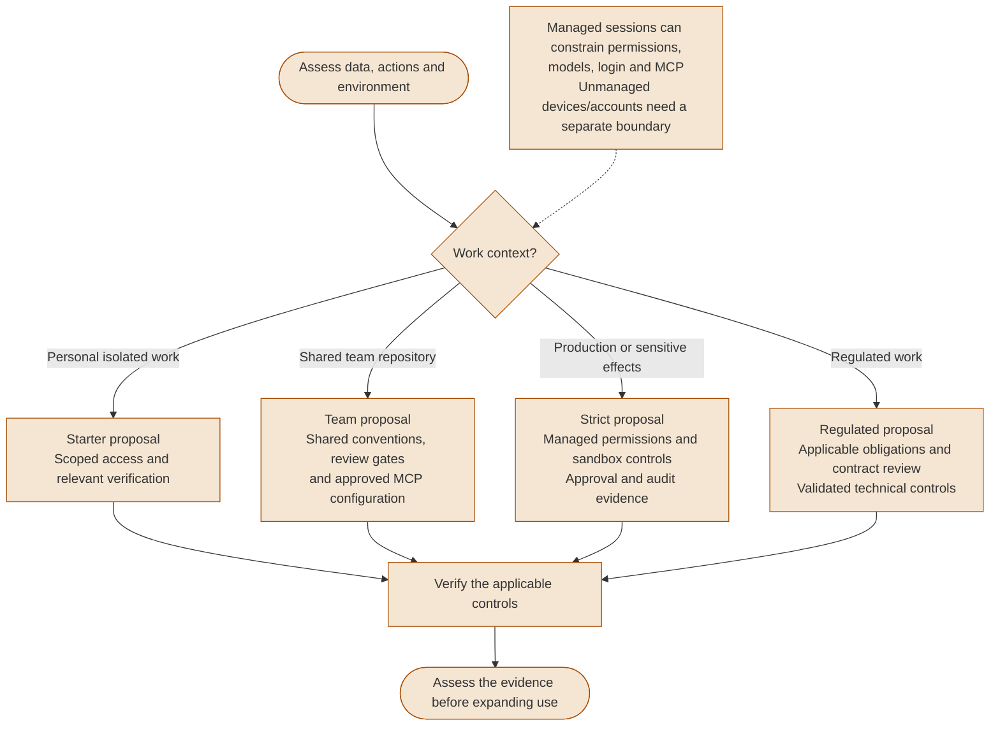
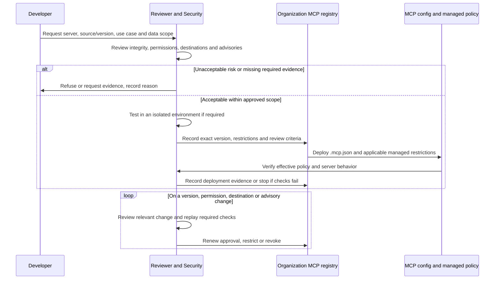
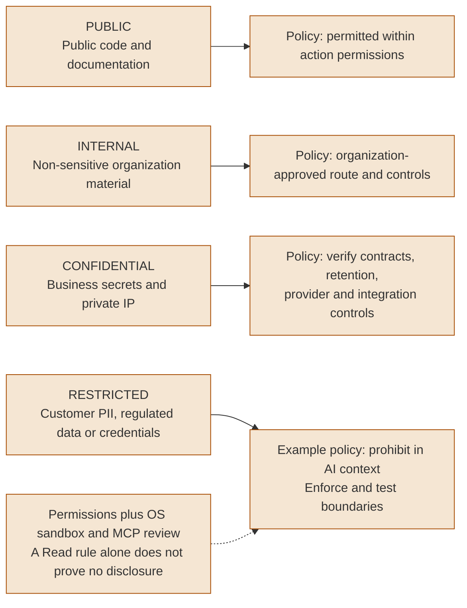
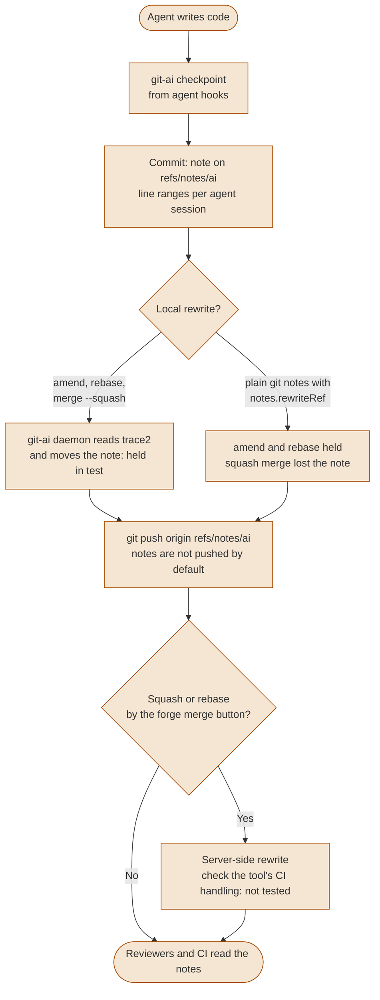

# Управление предприятием

На этих диаграммах предлагаются организационные политики для Claude Code. Адаптируйте их к фактическим данным, действиям, развернутым средствам управления и договорным обязательствам. Они не устанавливают соответствие или сертификацию.

---

### <a name="governance-risk-tiers-what-to-control-and-when"></a>Уровни управленческого риска: что контролировать и когда

Выберите элементы управления по эффектам и чувствительности работы, а затем убедитесь, что политика достигает соответствующего сеанса. Четыре уровня представляют собой предлагаемые организационные модели, а не уровни продуктов Anthropic или нормативные сертификаты.



<details>
<summary>ASCII версия</summary>

```text
Personal isolated work -> scoped access + relevant verification
Shared team repository -> shared conventions + review/MCP controls
Production/sensitive effects -> managed permissions + sandbox + approvals
Regulated work -> obligations/contracts + validated controls
    -> verify actual deployment and effects before expanding use

Managed sessions can constrain permissions, models, login and MCP
Unmanaged devices/accounts are outside that deployment's boundary
These are proposed policies; no setup duration or compliance is guaranteed
```

</details>

> **Источник**: [Разделение управления](../security/enterprise-governance.md#1-local-vs-shared-the-governance-split)

> Политики организации могут ограничивать сеансы с помощью управляемых параметров, списков разрешенных моделей и ограничений входа в систему. Применимость зависит от развертывания и поверхности; соглашение о репозитории само по себе не является доказательством принудительного исполнения. [Управляемые настройки](https://code.claude.com/docs/en/managed-settings), [Приоритет настроек](https://code.claude.com/docs/en/settings#settings-precedence).


---

### <a name="mcp-governance-workflow"></a>Рабочий процесс управления MCP

Рассматривайте реестр как бухгалтерский учет организации, а развернутую конфигурацию MCP — как отдельный элемент управления. Проверьте целостность источника, разрешения, места назначения данных и рекомендации; популярность или версия исправления не доказывают безопасность сервера.



<details>
<summary>ASCII версия</summary>

```text
Request: source/version, use case, data scope
  -> review integrity, permissions, destinations, advisories
  -> unacceptable risk or missing evidence? Refuse/request evidence
  -> acceptable scope? Test in isolation when required
  -> registry: version, restrictions, review criteria
  -> deploy .mcp.json + applicable managed restrictions
  -> verify effective policy and server behavior; stop on failed checks

Change/advisory -> review relevant delta -> verify -> renew/restrict/revoke
No automatic approval merely because the version increment is a patch
```

</details>

> **Источник**: [MCP Рабочий процесс управления](../security/enterprise-governance.md#3-mcp-governance-workflow)

> Серверы проекта определены в `.mcp.json`. Ограничения, налагаемые организацией, требуют управляемой конфигурации MCP или управляемых настроек; фиксация общей конфигурации сама по себе не запрещает локальные переопределения. Реестр организации не является собственным форматом конфигурации Claude Code. [Объем проекта MCP](https://code.claude.com/docs/en/mcp#project-scope), [Управляемая конфигурация MCP](https://code.claude.com/docs/en/mcp#managed-mcp-configuration).

> Частота пересмотра, истечение срока действия и требования к пробному периоду определяются решениями организации. Установите их на основе фактического риска и измените триггеры; не подразумевается фиксированная продолжительность рассмотрения или универсальный интервал утверждения.


---

### <a name="data-classification--claude-code-access-rules"></a>Классификация данных и правила доступа Claude Code

Это пример политики классификации организации. Утвердите маршрут обработки и протестируйте средства контроля доступа к фактическим данным и интеграции. Общедоступный контент по-прежнему требует разрешения на действие и может содержать вредоносные инструкции.



<details>
<summary>ASCII версия</summary>

```text
Example organization policy:
  PUBLIC -> permitted within action permissions
  INTERNAL -> approved processing route and controls
  CONFIDENTIAL -> verify contracts, retention, provider and integrations
  RESTRICTED -> prohibited in AI context under this example policy
      -> enforce and test file, shell, network and MCP boundaries

Separate deny examples: Read(./.env), Read(./secrets/**)
Read rules alone do not prove that restricted data cannot enter context
```

</details>

> **Источник**: Устав использования [AI](../security/enterprise-governance.md#2-ai-usage-charter)

> ZDR для Claude Code на предприятии требует определенных прав и возможностей; он не распространяется на сторонние инструменты или службы MCP. По умолчанию коммерческое обучение, удержание и утверждение организационной обработки — это отдельные вопросы. Область действия [ZDR](https://code.claude.com/docs/en/zero-data-retention#what-zdr-does-not-cover), [Политики данных](https://code.claude.com/docs/en/data-usage#data-policies).

> Разрешения и песочница являются взаимодополняющими элементами управления. Используйте отдельные правила для отдельных шаблонов файлов, проверяйте доступ к оболочке и интеграции, а также тестируйте как разрешенные, так и заблокированные сценарии. Ни инструкция, ни одно правило `Read` не доказывают полного ограничения данных. [Синтаксис разрешений](https://code.claude.com/docs/en/permissions#permission-rule-syntax), [Разрешения и песочница](https://code.claude.com/docs/en/permissions#how-permissions-interact-with-sandboxing).

---

### <a name="ai-attribution-through-history-rewrites"></a>Атрибуция ИИ через переписывание истории

Там, где атрибуция ИИ, хранящаяся в заметках git, сохраняется, по данным локального теста git-ai 1.7.7 и простых заметок git 2.56.0 для этого руководства. Кнопка слияния Forge перезаписывает историю на сервере вне обоих механизмов; этот путь не был проверен.



<details>
<summary>ASCII версия</summary>

```text
Agent writes code -> git-ai checkpoint -> commit with a note on refs/notes/ai
Local rewrite:
  git-ai daemon (trace2)       amend, rebase, merge --squash: note held in test
  plain git + notes.rewriteRef amend, rebase held; squash merge lost the note
Push notes explicitly: git push origin refs/notes/ai
Forge merge button squash or rebase: server-side, check the tool's CI handling (not tested)
```

</details>

> **Источник**: [Происхождение в примечаниях git](../ops/ai-traceability.md#35-provenance-in-git-notes) и оценка [git-ai](../../docs/resource-evaluations/git-ai-provenance-notes.md)
