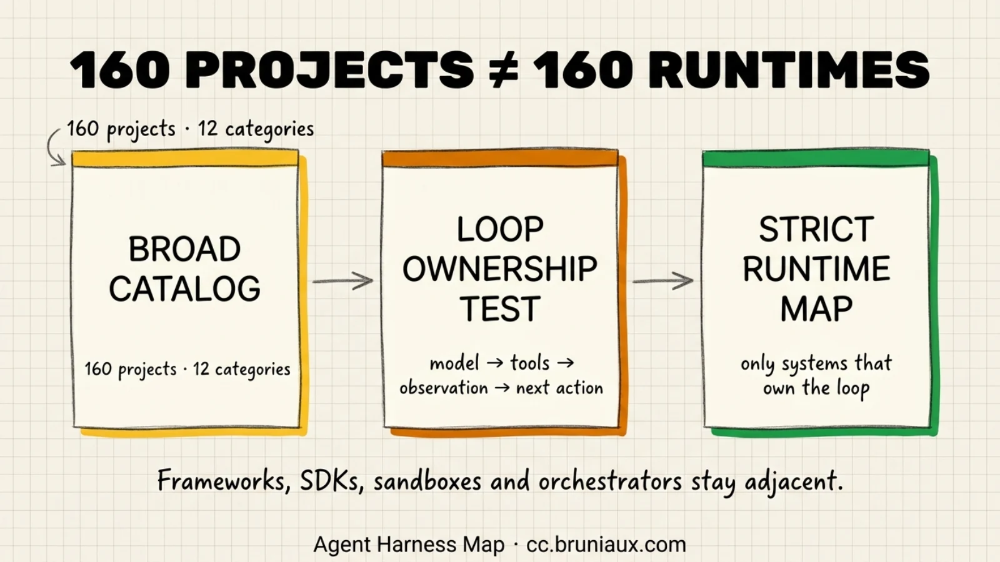
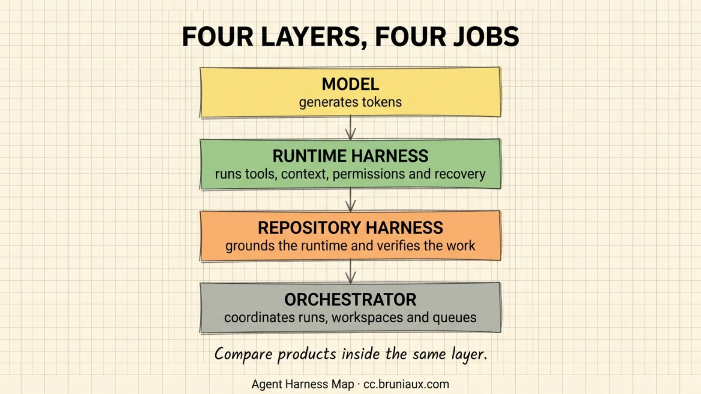
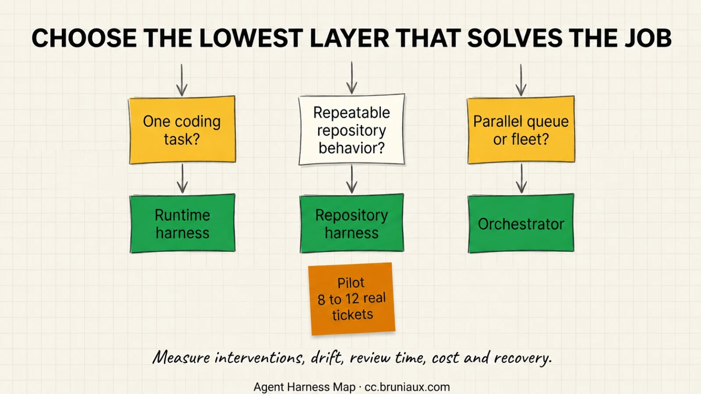

# Агентский ландшафт

Используйте эту карту, чтобы разделить четыре вопроса, которые часто сливаются в списках продуктов: какая модель генерирует, какая среда выполнения владеет циклом инструмента, какая конфигурация репозитория управляет локальным поведением и какой оркестратор координирует несколько запусков. Проект может быть ценным и без использования среды выполнения.

В приведенном ниже широком каталоге нормализованы 160 проектов и 12 категорий из [Best of Agent Harnesses](https://ryanalberts.github.io/best-of-Agent-Harnesses/), а затем добавлены 33 дополнения к руководству, обнаруженные в результате прямого исследования проекта. Он использует моментальный снимок восходящего потока при фиксации [`ece3146`](https://github.com/RyanAlberts/best-of-Agent-Harnesses/tree/ece314654d2c23fe7bd69fc6ef7088f093207e49)от 23 августа 2026 г. Строгая карта применяет дополнительный тест: владеет ли продукт циклом, который планирует, действует с помощью инструментов, наблюдает за результатами и решает, что будет дальше?

**agent** — это среда выполнения модели, которая собирает контекст, предоставляет инструменты, применяет разрешения, выполняет цикл действий, записывает состояние и обрабатывает сбои. Краткое определение Саймона Уиллисона «[» моделирует с использованием инструментов в цикле «](https://simonwillison.net/2025/May/22/tools-in-a-loop/)» определяет границы поведения. Исследование [Agent System and Harness Design 2026 года](https://arxiv.org/abs/2606.20683) расширяет эту среду выполнения на шесть обязанностей: наблюдение, контекст, контроль, действие, состояние и проверка. В документе [SWE-агент](https://papers.neurips.cc/paper_files/paper/2024/file/5a7c947568c1b1328ccc5230172e1e7c-Paper-Conference.pdf) интерфейс кодирования между моделью и компьютером называется **агент-компьютерный интерфейс**.

Для сравнения требуется вторая граница: каждый результат принадлежит паре **модель-оборудование** при раскрытом наборе задач и бюджете. В контролируемом исследовании с участием 300 запусков двух моделей и трех ремней [The Scaffold Effect](https://arxiv.org/abs/2607.22585) обнаружилась до 40-кратной разницы в количестве жетонов на решенную задачу, в то время как различия в скорости прохождения оставались в пределах от 0 до 8 процентных пунктов и в основном не были статистически значимыми. Привязь может сильно повлиять на стоимость и поведение при отказах, не являясь при этом основным узким местом в точности.

Эта страница отвечает *, какой слой и какой проект*. [Agent Harness Engineering](../core/agent-harness.md) документирует компоненты внутри среды выполнения. [Loop & Graph Engineering](../core/loop-graph-engineering.md) охватывает обратную связь, топологию, переходы между состояниями, правила остановки и границы оценки. [Agent Tools: Beyond Claude Code](./agentic-tools.md) предоставляет более глубокие профили продуктов. Глоссарий  отделяет средства выполнения от средств репозитория и средств оценки.

### Выберите правильную точку входа

| Вопрос | Каноническая страница |
|---|---|
| Как работают цикл, контекст, инструмент, ловушка, разрешение и механизм восстановления? | [Проектирование жгутов агентов](../core/agent-harness.md) |
| Как следует спроектировать и ограничить цикл или исполняемый граф рабочего процесса? | [Проектирование циклов и графов](../core/loop-graph-engineering.md) |
| Какой исполняемый или смежный проект подходит для конкретной работы? | Эта страница [Agent Harness Landscape](./agent-harness-landscape.md) |
| Что на практике поддерживает именованный продукт-агент кодирования? | [Инструменты агента: за пределами Claude Code](./agentic-tools.md) |
| Как репозиторий должен готовить инструкции, настройку, состояние и проверку для любой среды выполнения? | [Репозиторий Harness Engineering](../ultimate-guide.md#925-harness-engineering) |
| Как следует оценивать и инструментировать короткий список? | [Оценка агента](../roles/agent-evaluation.md) и [Наблюдаемость](../ops/observability.md) |
| Какие системы оптимизируют работу системы, а не выполняют задачи напрямую? | [Оптимизаторы и мета-обвязки](#harness-optimizers-and-meta-harnesses) |
| Какое рабочее пространство рабочего стола должно координировать существующие интерфейсы командной строки агента? | [Сравнение рабочего пространства агента на рабочем столе](./third-party-tools.md#desktop-agent-workspace-comparison): Conductor, Emdash, Superset, Escouade, Nimbalyst и Vibe Kanban |

Эти страницы связаны, но намеренно не объединены. В инженерном справочнике объясняются стабильные механизмы. Эта карта представляет собой устаревший снимок доказательств, проекты, лицензии, функции и сигналы GitHub которого требуют отдельного цикла обновления.

## Интерфейс, выполнение и владение циклом разделены.

`IDE`, `ADE`, `CLI` и `web agent` описывают, как человек достигает продукта. Они не определяют, где выполняется код или какой компонент владеет циклом агента. `ADE`, сокращение от агентской среды разработки, является полезным языком поставщиков, но не является стабильной категорией сравнения: один продукт может одновременно предоставлять редактор, терминальный агент, настольное приложение и облачную поверхность управления.

Поэтому в этом каталоге используется словарь контролируемого интерфейса:

| Интерфейс | Значение в этой карте |
|---|---|
| `cli` | Точка входа в командную строку, подходящая для использования терминала или сценариев. |
| `tui` | Интерактивный интерфейс терминала, включая полноэкранные терминальные приложения. |
| `ide` | Редактор или интеграция IDE, где агент работает рядом с исходным кодом. |
| `desktop` | Специальное нативное настольное приложение |
| `web` | Интерфейс браузера или поверхность удаленного мониторинга выполнения |
| `chat` | Чат или точка входа, ориентированная на решение проблем, например Slack, Discord или трекер. |

Относитесь к ним как к многозначным ярлыкам, а не как к взаимоисключающим классам продуктов. Затем оцените две независимые оси: место выполнения (`local`, `remote` или `hybrid`) и владение циклом (`runtime`, `orchestrator` или `no loop`). Например, [Warp Agent](./agentic-tools.md#19-warp-agent-cli) доступен как автономный CLI с интерактивным пользовательским интерфейсом терминала и дополнительной передачей обслуживания в облако. Его интерфейс сам по себе не доказывает локальность, автономность, изолированность или независимость от поставщика.

## 160 проектов не означают 160 средств выполнения

Восходящий каталог сочетает в себе готовые к использованию агенты кодирования с SDK, платформами, системами памяти, песочницами, инструментами оценки, продуктами наблюдения, библиотеками подсказок и многоагентными плоскостями управления. Если рассматривать все 160 как взаимозаменяемые среды выполнения, результаты будут некорректными. Строгая карта сохраняет проекты с доказательствами того, что они владеют циклом агента; Соседние товары остаются в каталоге под своим фактическим назначением.

Трехэтапная воронка 

*Цифры по 160 проектам и 12 категориям взяты из Best of Agent Harnesses, снимок от 23 августа 2026 г. Размер каталога не учитывается во время выполнения.*

## Карта двенадцати категорий

Названия категорий берутся из закрепленного восходящего снимка. `Usually`, `Sometimes` и `No` описывают типичное отношение категории к циклу. Они не присваивают один ответ каждому проекту внутри него.

<!-- BEGIN GENERATED: category-summary -->
| Категория | Проекты | Чему это способствует | Владеет агентской сетью? | Направляющий слой |
|---|---:|---|---|---|
| [Продукты агентов кодирования (IDE, CLI, полные пакеты)](#coding-agent-products) | 22 | Кодировщики под ключ | Обычно | Время выполнения |
| [Программирование конфигураций жгутов и SDK](#coding-harness-configs) | 17 | Пакеты конфигурации и SDK агентов | Иногда | Хранилище/строительство |
| [Компьютеры для оценки и сравнительного анализа](#evaluation) | 18 | Тесты и средства оценки | Нет | Оценка |
| [Фреймворки](#frameworks) | 25 | Библиотеки для построения агентского цикла | Иногда | Строительство |
| [Библиотеки и SDK](#libraries-sdks) | 15 | Многоразовые строительные блоки агентов | Нет | Строительство |
| [Память и состояние](#memory) | 5 | Постоянное состояние и извлечение | Нет | Память |
| [Мультиагенты и оркестрация](#multi-agent) | 12 | Координация между агентами или средами выполнения | Иногда | Оркестратор |
| [Наблюдаемость и оценочные операции](#observability) | 4 | Отслеживание, качество и операции | Нет | Наблюдаемость |
| [Среда выполнения личного агента](#personal-agent-runtimes) | 10 | Готовые персональные агенты | Обычно | Время выполнения |
| [Плагины, MCP, инструменты CLI](#plugins-mcp-cli) | 19 | Инструменты, подключенные к существующей среде выполнения | Нет | Расширение |
| [Ремни с прогрессивным раскрытием](#progressive-disclosure) | 8 | Стратегии контекста и быстрой загрузки | Иногда | Репозиторий/контекст |
| [Привязи для исследований и решения конкретных задач](#research-task) | 5 | Специализированные агенты и исследовательские системы | Иногда | Время выполнения/зависит от задачи |
<!-- END GENERATED: category-summary -->

## Основные жгуты кодирования

Строгая карта содержит 42 среды выполнения. Каждое имя ссылается на официальную страницу продукта или канонический репозиторий. Строки с открытым исходным кодом включают звездочки GitHub, если был доступен канонический репозиторий. Звезды — это устаревший сигнал популярности, а не показатель качества. Записи, подробно описанные в этом руководстве, сохраняют этот внутренний профиль в ролевой ячейке.

<!-- BEGIN GENERATED: strict-runtime-map -->
**Снимок:** от 9 сентября 2026 г. Звезды GitHub фиксируются в дату, указанную в каждой ячейке проекта.

**Legend:** <abbr title="Not established from the pinned sources">?</abbr> = не установлено из закрепленных источников; N/A = не применяется.

| Обвязка агента | Интерфейс | Циклическое доказательство | Лицензия | Роль |
|---|---|---|---|---|
| [AgentForge](https://github.com/MohitGoyal09/AgentForge) <small>★ 60 · 28.08.2026</small> | CLI, ТУИ | Подтвержденный | <abbr title="Not established from the pinned sources">?</abbr> | README документирует цикл в стиле ReAct, который повторяет запросы модели, типизированные вызовы инструментов и наблюдения до завершения. |
| [agentic-harness](https://github.com/codejunkie99/agentic-harness) <small>★ 84 · 28.08.2026</small> | CLI | Подтвержденный | <abbr title="Not established from the pinned sources">?</abbr> | README документирует цикл агента кодирования, который выполняет итерацию вызовов инструмента модели в рабочей области. |
| [aider](https://github.com/Aider-AI/aider) <small>★ 48,420 · 23.08.2026</small> | CLI | Заявлено | Открытый исходный код | Программист пары CLI с поддержкой Git; редактирует в репозитории, поддерживает несколько моделей и MCP, чтобы агенты могли видеть контроль версий и инструменты. [Направляющий профиль](./agentic-tools.md#13-aider) |
| [Amp](https://ampcode.com/docs) | CLI, Рабочий стол, Интернет | Заявлено | Собственный | Amp представляет свой продукт как агентный инструмент кодирования. |
| [Код дополнения](https://www.augmentcode.com/) | CLI, IDE | Заявлено | Собственный | Augment представляет свой продукт как платформу для кодирования искусственного интеллекта с возможностями агента. |
| [Жгут автономного кодирования](https://github.com/GantisStorm/autonomous-coding-harness) <small>★ 7 · 28.08.2026</small> | CLI, ТУИ | Заявлено | <abbr title="Not established from the pinned sources">?</abbr> | README заявляет об автономном цикле кодирования, основанном на этапах, с реализацией, проверкой и контрольными точками, выполняемыми людьми. |
| [Claude Code](https://code.claude.com/docs/en/overview) | CLI, Рабочий стол, IDE, Интернет | Заявлено | Собственный | Anthropic документирует Claude Code как агентный инструмент кодирования, который читает базы кода, редактирует файлы и запускает команды. |
| [claw-code-agent](https://github.com/HarnessLab/claw-code-agent) <small>★ 543 · 23.08.2026</small> | CLI, Интернет | Заявлено | <abbr title="Not established from the pinned sources">?</abbr> | Переопределение архитектуры агента Claude Code на Python с нулевыми внешними зависимостями; интерактивный чат, потоковая передача, время выполнения плагина, делегирование вложенного агента, стоимость... |
| [Cline](https://github.com/cline/cline) <small>★ 66,707 · 23.08.2026</small> | IDE | Заявлено | Открытый исходный код | Расширение VS Code, реализация которого представляет собой цикл «планируй-затем действуй» с пошаговым утверждением человеком и прозрачностью затрат; интеграция VS Code — это оболочка пользовательского интерфейса. |
| [Codex](https://github.com/openai/codex) <small>★ 114,837 · 2026-08-23</small> | CLI | Заявлено | Открытый исходный код | Агент терминального кодирования OpenAI. [Направляющий профиль](./agentic-tools.md#11-codex-cli-openai) |
| [crush](https://github.com/charmbracelet/crush) <small>★ 27,601 · 23.08.2026</small> | CLI, ТУИ | Заявлено | Ограничено (fsl-1.1-mit) | Агент кодирования терминала Charm (вилка Charm оригинального OpenCode). [Направляющий профиль](./agentic-tools.md#17-crush-charm) |
| [Агент курсора](https://cursor.com/agents) | Чат, CLI, Рабочий стол, IDE, Интернет | Заявлено | Собственный | Cursor представляет Agent как свой продукт-агент кодирования в редакторе и на удаленных поверхностях. |
| [DeepSeek Harness](https://github.com/deepseek-ai/deepseek-harness) <small>★ 201,064 · 28.08.2026</small> | CLI, Интернет | Заявлено | Мит | Официальный репозиторий описывает пакет агентов предварительной версии для разработчиков, построенный на платформе плагинов Cordis. [Направляющий профиль](./agentic-tools.md#18-deepseek-harness-dsh) |
| [DeepSeek-Reasonix](https://github.com/esengine/DeepSeek-Reasonix) <small>★ 35,065 · 23.08.2026</small> | CLI, ТУИ | Заявлено | <abbr title="Not established from the pinned sources">?</abbr> | Собственный агент кодирования терминала DeepSeek. |
| [Девин](https://devin.ai/) | Чат, Интернет | Заявлено | Собственный | Cognition представляет Девина как инженера-программиста в области искусственного интеллекта. |
| [Devin Desktop](https://devin.ai/desktop) | Рабочий стол, IDE | Заявлено | Собственный | Devin Desktop, ранее известный как Windsurf, сочетает в себе IDE с локальными и облачными агентами кодирования. |
| [Заводской дроид](https://docs.factory.ai/) | CLI, Рабочий стол, IDE, Интернет | Заявлено | Собственный | Factory представляет дроидов как агентов по разработке программного обеспечения. |
| [Gemini CLI](https://github.com/google-gemini/gemini-cli) <small>★ 106,626 · 2026-08-23</small> | CLI | Заявлено | Открытый исходный код | Собственный терминальный агент Google для Gemini. [Направляющий профиль](./agentic-tools.md#16-gemini-cli-google) |
| [GitHub Copilot CLI](https://github.com/features/copilot/cli) | CLI | Заявлено | Собственный | GitHub представляет Copilot CLI в качестве агента кодирования для терминала. |
| [гусь](https://github.com/aaif-goose/goose) <small>★ 53 295 · 23.08.2026</small> | CLI, Рабочий стол | Заявлено | Открытый исходный код | Созданный блоком агент Rust, теперь управляемый Linux Фонд Агентского ИИ Фонда (aaif-goose/goose). [Профиль гида](./agentic-tools.md#14-goose-aaifblock) |
| [Гермес](https://github.com/NousResearch/hermes-agent) <small>★ 234 688 · 23.08.2026</small> | Чат, CLI, TUI | Подтвержденный | Открытый исходный код | Агент самосовершенствования Nous Research: цикл обучения превращает опыт в навыки многократного использования, создает постоянную модель пользователя на протяжении сеансов и записывает состояние контрольных точек на диск с помощью... |
| [jcode](https://github.com/1jehuang/jcode) <small>★ 18,308 · 23.08.2026</small> | CLI | Подтвержденный | <abbr title="Not established from the pinned sources">?</abbr> | Агент терминального кодирования Rust позиционируется как наиболее эффективное использование оперативной памяти в своем классе; Поддержка MCP, мультипровайдер (Claude/OpenAI). |
| [Жюль](https://jules.google/) | Интернет | Заявлено | Собственный | Google представляет Джулса как агента асинхронного кодирования. |
| [Джуни](https://junie.jetbrains.com/docs/) | CLI, IDE, ТУИ | Заявлено | Собственный | JetBrains представляет Джуни своим агентом по кодированию. |
| [Код килограмма](https://github.com/Kilo-Org/kilocode) <small>★ 26,978 · 23.08.2026</small> | CLI, IDE | Заявлено | <abbr title="Not established from the pinned sources">?</abbr> | Расширение VS Code и CLI в линии Cline/Roo-Code: естественный выбор теперь, когда Roo-Code заархивирован в исходной версии. |
| [Код Кими CLI](https://github.com/MoonshotAI/kimi-code) <small>★ 7,126 · 28.08.2026</small> | CLI, IDE, ТУИ | Заявлено | Мит | Официальный репозиторий описывает Kimi Code CLI как агентный инструмент кодирования для терминалов и IDE. |
| [Киро](https://kiro.dev/) | CLI, Рабочий стол, IDE, Интернет | Заявлено | Собственный | Kiro представляет свой продукт как агентную среду разработки. |
| [oh-my-pi](https://github.com/can1357/oh-my-pi) <small> ★ 26,658 · 23.08.2026</small> | CLI, IDE, Веб | Заявлено | Открытый исходный код | Терминальный агент кодирования (вилка Pi), который подключает IDE к жгуту: редактирование с привязкой к хешу, цикл из 32 инструментов, настраиваемый для каждой модели, LSP rename/references/diagnostics при каждой записи,... |
| [OpenHarness (HKUDS)](https://github.com/HKUDS/OpenHarness) <small>★ 15,492 · 23.08.2026</small> | Чат, CLI, TUI | Подтвержденный | Открытый исходный код | Открытый агент со встроенным персональным агентом («Ohmo»), который работает в Feishu, Slack, Telegram и Discord; использование основных инструментов, навыки, память, многоагентная координация с... |
| [Открытый переводчик](https://github.com/openinterpreter/openinterpreter) <small>★ 68,121 · 23.08.2026</small> | CLI | Заявлено | Открытый исходный код | Легкий агент терминального кодирования, ориентированный на открытые модели (DeepSeek, Kimi, Qwen). |
| [Открыть SWE](https://github.com/langchain-ai/open-swe) <small>★ 10,624 · 28.08.2026</small> | Чат, Интернет | Заявлено | Мит | Официальный репозиторий описывает Open SWE как агент асинхронного кодирования для задач репозитория. |
| [opencode](https://github.com/anomalyco/opencode) <small> ★ 200 557 · 23.08.2026</small> | CLI, ТУИ | Заявлено | Открытый исходный код | Агент кодирования терминала с открытым исходным кодом (ранее sst/opencode; передан в anomalyco). [Направляющий профиль](./agentic-tools.md#15-opencode-anomaly-formerly-sst) |
| [OpenCode Harness](https://github.com/samarailly51-pixel/opencode-harness) <small>★ 148 · 2026-08-28</small> | CLI, TUI, Интернет | Подтвержденный | <abbr title="Not established from the pinned sources">?</abbr> | README документирует цикл кодирования-агента с инструментами, разрешениями, трассировками, оценкой и отзывами о восстановлении. |
| [OpenHands](https://github.com/OpenHands/OpenHands) <small> ★ 84,844 · 23.08.2026</small> | Интернет | Заявлено | Ограниченный ((мультилицензия)) | Докеризованный агент разработки программного обеспечения. [Направляющий профиль](./agentic-tools.md#24-openhands-all-hands-ai) |
| [OpenHarness](https://github.com/AgentBoardTT/openharness) <small>★ 12 · 28.08.2026</small> | CLI, ТУИ | Подтвержденный | <abbr title="Not established from the pinned sources">?</abbr> | README документирует цикл агента «поставщик-инструменты» и точки внедрения во время выполнения. |
| [pi](https://github.com/earendil-works/pi) <small> ★ 95 747 · 23.08.2026</small> | ТУИ | Заявлено | <abbr title="Not established from the pinned sources">?</abbr> | Восходящий набор инструментов агента ИИ, стоящий за ответвлением oh-my-pi в этом списке: унифицированный мультипровайдер LLM API, цикл агента и оболочка TUI, обеспечивающие возможности, которые переписывает Rust oh-my-pi... |
| [qwen-код](https://github.com/QwenLM/qwen-code) <small>★ 27,310 · 23.08.2026</small> | CLI | Заявлено | <abbr title="Not established from the pinned sources">?</abbr> | Официальный агент кодирования терминалов Alibaba, созданный на основе агентского цикла Gemini CLI и перенастроенный для моделей Qwen. |
| [Replit Agent](https://replit.com/products/agent) | Интернет | Заявлено | Собственный | Replit представляет агента как продукт, который создает приложения на основе целей пользователя. |
| [Roo Code](https://github.com/RooCodeInc/Roo-Code) <small>★ 24,326 · 23.08.2026</small> | IDE | Заявлено | Открытый исходный код | Расширение VS Code/Cursor в линии Cline. |
| [Spettro](https://github.com/Aploide/spettro) <small>★ 33 · 28.08.2026</small> | CLI, ТУИ | Подтвержденный | <abbr title="Not established from the pinned sources">?</abbr> | README документирует автономные прогоны целей, вызовы собственных инструментов, рабочие процессы субагентов и циклы проверки. |
| [SWE-агент](https://github.com/SWE-agent/SWE-agent) <small>★ 20,112 · 23.08.2026</small> | CLI | Заявлено | Открытый исходный код | Управляемая LM система, созданная для SWE-bench: редактирование состояния, выполнение команд и цикл, ориентированный на проблемы: стек эталонного агента рядом с самим тестом. [Направляющий профиль](./agentic-tools.md#22-swe-agent-princeton) |
| [Агент варпа](https://www.warp.dev/blog/introducing-the-warp-agent-cli-coding-agent) | CLI, TUI, Интернет | Заявлено | Собственный | Warp Agent — это автономный терминальный агент кодирования с интерактивной поддержкой PTY и дополнительной передачей обслуживания в облако. [Направляющий профиль](./agentic-tools.md#19-warp-agent-cli) |
<!-- END GENERATED: strict-runtime-map -->

DeepSeek Harness нуждается в оговорке о зрелости. Официальный репозиторий описывает `dsh` как предварительную версию для разработчиков и предупреждает, что совместимость может измениться. Его архитектура плагинов, разрешения, выбор песочницы и локальная обработка по умолчанию не делают ненадежные репозитории безопасными. См. профиль [DeepSeek Harness](./agentic-tools.md#18-deepseek-harness-dsh) для получения информации о настройке, архитектуре и границах безопасности.

### Интервью с создателями как дополнительное доказательство

Официальная документация и канонические репозитории остаются источником достоверной информации о текущем поведении продукта. Интервью с создателями добавляют устаревшее обоснование дизайна, которое невозможно отразить в таблице функций:

- В интервью Бориса Черного [Building Claude Code](https://www.youtube.com/watch?v=julbw1JuAz0&t=1520s) прослеживается переход продукта от чат-бота к агенту, использующему инструменты, а в обсуждении разрешений  объясняются многоуровневые элементы управления, лежащие в основе выполнения команд.
- Интервью Дакса Раада [Building OpenCode](https://www.youtube.com/watch?v=1VqKUrxR2C8&t=1104s) документирует позиционирование среды выполнения с открытым исходным кодом, независимой от поставщиков. Дальнейшее обсуждение плоскости управления  отделяет элементы управления поставщиком, разрешениями, бюджетом и ограничением скорости в масштабе всей организации от самой среды выполнения.

Эти интервью сами по себе не улучшают состояние полученных доказательств. Они датированы показаниями, поэтому текущая доступность, лицензия и поведение функций по-прежнему требуют прямого официального источника. В журнале видеодоказательств [практика](../core/agent-harness.md#10-practitioner-video-evidence) записаны краткие дословные данные, временная метка и границы для каждого источника.

## Оркестраторы: продукты выше среды выполнения

Соседняя карта содержит 15 плоскостей управления. Оркестратор координирует очереди, изолированные рабочие области или несколько сеансов агентов. Использование одного после одного выполнения больше не является узким местом. Параллельные запуски одновременно увеличивают пропускную способность, смещение контекста и нагрузку на проверку.

Различие runtime/control-plane также появляется в интервью OpenCode [Дакса Раада в мае 2026 г.](https://www.youtube.com/watch?v=1VqKUrxR2C8&t=2045s). Он описывает настройку поставщика услуг в масштабе всей организации, разрешения, бюджеты и ограничения скорости как отдельную плоскость управления. Это подтверждает использованную здесь архитектурную границу, но не является доказательством того, что корпоративный продукт, описанный в интервью, сегодня общедоступен.

<!-- BEGIN GENERATED: adjacent-control-planes -->
| Плоскость управления | Роль | Владение циклом | Лицензия |
|---|---|---|---|
| [AgentBox](https://github.com/madarco/agentbox) <small>★ 374 · 23.08.2026</small> | Запускает несколько агентов кодирования параллельно, каждый на своей изолированной виртуальной машине, локально или в облаке, с помощью одной команды. | Нет; доказательства заявлены | Открытый исходный код |
| [АгентыMesh](https://github.com/AgentsMesh/AgentsMesh) <small>★ 2,330 · 28.08.2026</small> | README документирует систему уровня управления и уровня данных для управления внешними агентами кодирования. | Нет; доказательства подтверждены | <abbr title="Not established from the pinned sources">?</abbr> |
| [Автономный рабочий поток](https://github.com/AmoghReddy45/autonomous-workstream) <small>★ 32 · 28.08.2026</small> | README документирует плагин и CLI, которые упорядочивают ограниченные задачи через внешний бэкэнд агента кодирования. | Нет; доказательства подтверждены | <abbr title="Not established from the pinned sources">?</abbr> |
| [Ремень](https://github.com/boldblackai/harness) <small>★ 10 · 28.08.2026</small> | README документирует защищенные контейнерные среды для агентов, а не цикл принятия решений агентами. | Нет; доказательства подтверждены | <abbr title="Not established from the pinned sources">?</abbr> |
| [cc-ха-ха](https://github.com/NanmiCoder/cc-haha) <small>★ 14,189 · 23.08.2026</small> | Использование локального рабочего пространства рабочего стола для Claude Code и других агентов: многоагентные сеансы, рабочие деревья Git, различия кода, рынок навыков и доступ к приложениям чата (WeChat... | Нет; доказательства заявлены | <abbr title="Not established from the pinned sources">?</abbr> |
| [eigent](https://github.com/eigent-ai/eigent) <small>★ 15,083 · 23.08.2026</small> | Инструментарий рабочего стола с открытым исходным кодом позиционируется как локальная бесплатная альтернатива Claude Cowork и Codex: многоагентная оркестровка рабочего пространства в локальном приложении, а не в размещенном... | Нет; доказательства заявлены | <abbr title="Not established from the pinned sources">?</abbr> |
| [Агентский ремень](https://github.com/0xenzyme/agent-harness) <small>★ 7 · 28.08.2026</small> | README явно описывает управляемую адаптером плоскость управления, которая делегирует планирование среде выполнения Codex. | Нет; доказательства подтверждены | <abbr title="Not established from the pinned sources">?</abbr> |
| [Ремень CLI](https://github.com/hyspacex/harness-cli) <small>★ 15 · 28.08.2026</small> | README описывает уровень оркестрации и восстановления в среде выполнения Claude Agent SDK или Codex App Server. | Нет; доказательства подтверждены | <abbr title="Not established from the pinned sources">?</abbr> |
| [Лиза](https://github.com/liza-mas/liza) <small>★ 363 · 28.08.2026</small> | Исходный код реализует плоскость управления через внешние CLI агента кодирования с постоянной доской YAML, изолированными рабочими деревьями git, ролями doer/reviewer, арендой, восстановлением... | Нет; доказательства подтверждены | Apache-2.0 |
| [Multica](https://github.com/multica-ai/multica) <small>★ 49,348 · 09.09.2026</small> | Плоскость управления работой человека-агента, которая ставит в очередь вопросы, чаты, упоминания и запланированные запуски для внешних интерфейсов командной строки агента кодирования через демон на подключенном компьютере. | Нет; доказательства подтверждены | Ограниченная (многопользовательская лицензия) |
| [OpenAgents](https://github.com/openagents-org/openagents) <small>★ 4,005 · 28.08.2026</small> | Официальный репозиторий описывает OpenAgents как сеть постоянных агентов и общих рабочих пространств. | Нет; доказательства заявлены | Apache-2.0 |
| [Распространение](https://github.com/proliferate-ai/proliferate) <small>★ 310 · 23.08.2026</small> | ИИ IDE с открытым исходным кодом для Claude Code, Codex, OpenCode и других. | Нет; доказательства заявлены | Открытый исходный код |
| [Symphony](https://github.com/openai/symphony) <small>★ 26,812 · 23.08.2026</small> | OpenAI позволяет разбить задачу на множество изолированных, автономных запусков агента кодирования и выявить те из них, которые прошли успешно, поэтому команда управляет результатами, а не... | Нет; доказательства заявлены | <abbr title="Not established from the pinned sources">?</abbr> |
| [harness](https://github.com/twaldin/harness) <small>★ 20 · 28.08.2026</small> | README явно описывает унифицированную оболочку подпроцесса для существующих CLI агента кодирования. | Нет; доказательства подтверждены | <abbr title="Not established from the pinned sources">?</abbr> |
| [vibe-kanban](https://github.com/BloopAI/vibe-kanban) <small> ★ 27 893 · 23.08.2026</small> | Менеджер парка машин в стиле канбан для запуска Claude Code, Codex или любого другого агента кодирования для одновременного выполнения множества задач. | Нет; доказательства заявлены | <abbr title="Not established from the pinned sources">?</abbr> |
| [Виджиланте](https://github.com/aliengiraffe/vigilante) <small>★ 37 · 28.08.2026</small> | README явно называет Vigilante плоскостью управления над поддерживаемыми интерфейсами командной строки агента автономного кодирования. | Нет; доказательства подтверждены | <abbr title="Not established from the pinned sources">?</abbr> |
<!-- END GENERATED: adjacent-control-planes -->

### Статус обслуживания Vibe Kanban

Статус **проверен 17 октября 2026 г.**: Bloop [объявил о своем закрытии 10 апреля 2026 г.](https://www.vibekanban.com/blog/shutdown), при этом Vibe Kanban намеревается продолжать работу как проект с открытым исходным кодом, поддерживаемый сообществом. В объявлении было запланировано удаление удаленных сервисов через 30 дней, включая размещенные проблемы Канбана, комментарии, проекты и организации, и говорилось, что локальные рабочие пространства будут продолжать функционировать. Также описана функция экспорта данных.

Это объявление устанавливает план поставщика, а не живое тестирование каждой услуги или свидетельство постоянного обслуживания сообщества. Перед принятием проверьте версию, путь экспорта и службы, необходимые вашему рабочему процессу. Сгенерированные строки Vibe Kanban на этой странице сохраняют снимок каталога от 23 августа; их краткое описание функций и звезды являются историческими и не определяют текущую доступность хостинга.

В качестве альтернативы используйте сравнение рабочего пространства рабочего стола . Emdash, Superset и Escouade документированы там как выборочные дополнения, без увеличения строгого количества времени выполнения или дублирования их профилей в этом сгенерированном каталоге.

### Лиза: объединение репозитория и плоскости управления.

[Liza](https://github.com/liza-mas/liza) координирует внешние CLI агента кодирования, а не заменяет их внутренний цикл модели и инструмента. В закрепленном каталоге поставщиков  определены девять адаптеров подпроцессов: Claude Code, Codex, Cursor, OpenCode, Gemini, Mistral, Kimi, Qwen и Devin. Gemini и Mistral на этом снимке отключены. Вот почему Лиза появляется на соседней карте и не увеличивает счетчик времени выполнения 42.

Репозиторий содержит не только описание роли на уровне подсказки. Модель [supervision при фиксации `a22c123`](https://github.com/liza-mas/liza/blob/a22c12381c5d884d2586a48aaaa517bca184f9cf/specs/architecture/supervision-model.md) определяет постоянную доску YAML, изменения состояния с блокировкой файлов, изолированные рабочие деревья git, ограничение аренды и генерации, переходы задач doer/reviewer, операции восстановления и контролируемые полномочия слияния. Клонированный снимок содержал 296 тестовых файлов Go. Его точная фиксация прошла вышестоящие задания [Ubuntu](https://github.com/liza-mas/liza/actions/runs/33061917377/job/98482510741) и [macOS](https://github.com/liza-mas/liza/actions/runs/33061917377/job/98482510513) 27 августа 2026 г. Локальные тесты для этого обзора не выполнялись, поскольку на хосте обзора не был установлен Go.

Закрепленный [`INVARIANTS.md`](https://github.com/liza-mas/liza/blob/a22c12381c5d884d2586a48aaaa517bca184f9cf/INVARIANTS.md) называет системные свойства и их объявленные места применения. [`CONTRACT_FAILURE_MODE_MAP.md`](https://github.com/liza-mas/liza/blob/a22c12381c5d884d2586a48aaaa517bca184f9cf/contracts/CONTRACT_FAILURE_MODE_MAP.md) сопоставляет задокументированные виды отказов с положениями контракта, а снимок отслеживает [28 модульных навыков](https://github.com/liza-mas/liza/tree/a22c12381c5d884d2586a48aaaa517bca184f9cf/skills). Эти артефакты позволяют проверить замысел Лизы. Они не измеряют, улучшают ли контрмеры поведение агентов. [«Свидетельство качества кода»](https://github.com/liza-mas/liza/blob/a22c12381c5d884d2586a48aaaa517bca184f9cf/specs/architecture/competition-survey/mas-survey.md#code-quality-evidence) конкурентного опроса — это оценка Claude Code, публикуемая проектом, поэтому ее оценка представляет собой внутреннюю самооценку, а не независимую проверку.

Спутниковые утилиты также являются необязательными и не являются обязательными для выполнения. Профили цепочки инструментов [от Liza](https://github.com/liza-mas/liza/blob/a22c12381c5d884d2586a48aaaa517bca184f9cf/support-docs/TOOLCHAIN.md) могут устанавливать Stacklit, `scip-search` и инструменты функционального кластера, а контракт инструмента [agent](https://github.com/liza-mas/liza/blob/a22c12381c5d884d2586a48aaaa517bca184f9cf/contracts/AGENT_TOOLS.md) возвращается к `rg`, `ast-grep` и выполняет прямое чтение, когда эти индексы или инструменты недоступны. Это поддерживает плавную деградацию; он не устанавливает качество задачи.

Источник подтверждает оркестровку, обеспечиваемую кодом, а не безопасность производства. Рабочее дерево git не позволяет одновременным агентам редактировать одну и ту же проверку; он не изолирует процессы, учетные данные или доступ к сети. Пять из девяти адаптеров поставщика определяют дополнительный путь ACP, который проходит через `--approve-all`. OpenCode и Devin также используют широкие режимы разрешений в своих путях CLI по умолчанию. Для Codex, Cursor и Qwen широкий флаг появляется только на пути ACP; Путь по умолчанию Claude использует `--permission-mode auto`. Просмотрите выбранный путь поставщика, запустите Liza в изолированной программной среде на уровне ОС с заданными учетными данными и выполните пилотное восстановление, а также шлюзы слияния на реальных билетах репозитория.

Собственный реестр архитектурных проблем Лизы  фиксирует оставшиеся риски одноточечного, перекрестного анализа, обратной связи по спецификациям и контекстного давления. Отдельный протокол [Spec Evolution Protocol](https://github.com/liza-mas/liza/blob/a22c12381c5d884d2586a48aaaa517bca184f9cf/specs/protocols/sprint-governance.md#spec-evolution-protocol) обеспечивает процедурную долгосрочную синхронизацию посредством блокировки задач, редактирования человеком, журнала изменений спецификации, записи активности `spec_updated` и оценки воздействия. Этот протокол управляется человеком, а не кодом, и в журнале проблем по-прежнему фиксируются отсутствующие автоматизированные средства контроля жизненного цикла и устаревания.

**Петля и графическая линза.** Liza сочетает в себе замороженный организационный график с графиком работы во время выполнения. Закрепленный [`pipeline.yaml`](https://github.com/liza-mas/liza/blob/a22c12381c5d884d2586a48aaaa517bca184f9cf/internal/embedded/pipeline.yaml) объявляет роли, пары doer/reviewer, словари состояний, кворумы и переходы между парами. Супервизор создает и совершенствует зависимости задач во время выполнения. Это исполняемый граф, специфичный для домена, а не общая структура графа: закрепленный [`TransitionDef`](https://github.com/liza-mas/liza/blob/a22c12381c5d884d2586a48aaaa517bca184f9cf/internal/pipeline/config.go) предоставляет источник, место назначения, триггер и мощность, но не общую схему границ, политику соединения или программу произвольного узла.

**Граница решения.** Механические проверки могут отклонять незаконные переходы состояний, устаревшую аренду, отсутствующие зависимости или неудовлетворенный кворум проверки. Они не могут установить, что декомпозиция, реализация или вердикт рецензента семантически верны. В том же реестре проблем говорится, что решение о кросс-парной декомпозиции является последовательным единым шлюзом, разнообразие поставщиков является предпочтительным, а не гарантированным во время вынесения вердикта, а точность рецензента не измеряется. Ручные контрольные точки делают доступность людей несущей нагрузкой только тогда, когда [`auto_resume`](https://github.com/liza-mas/liza/blob/a22c12381c5d884d2586a48aaaa517bca184f9cf/support-docs/CONFIGURATION.md#auto-resume-auto_resume) отключен. С помощью `auto_resume` агенты автоматически продвигают состояния `CHECKPOINT` и `COMPLETED`. Сопряжение [`yolo`](https://github.com/liza-mas/liza/blob/a22c12381c5d884d2586a48aaaa517bca184f9cf/support-docs/ADVERSARIAL_PAIRING.md) предварительно утверждает запросы человека на стороне исполнителя, но сохраняет утверждения рецензента, проверку, условия остановки, обработку конфликтов слияния и инструкции остановки пользователя. Человеческий авторитет остается бременем для управления и необратимых последствий, даже когда наличие живого человека не является обязательным условием исполнения. Сравните Лизу по двум осям: правильность рабочего процесса и правильность выполнения задач. Прохождение первого не означает второго.

Доказательства больше не ограничиваются сопровождающим. В отчете практикующего специалиста [Ippon](https://blog.ippon.fr/2026/04/29/premier-rex-multi-agent-liza/) описывается намеренно небольшой проект-каталог, включающий примерно 30 задач, 5 автоматических спринтов, 35 вердиктов проверки, 3 исправленных отклонения и 3–4 часа человеческого времени. Он также сообщает о массовом потреблении токенов и необходимых контрольно-пропускных пунктах человеческого планирования. Это полезный ограниченный REX, а не производственный или сравнительный тест.

**Selection border.** Liza — кандидат, когда репозиторию требуется постоянное многоролевое состояние, переходы с применением кода, восстановление и контролируемая интеграция для многих задач. Ограниченный цикл проверки реализации имеет меньшую поверхность координации и должен оставаться значением по умолчанию, когда эти свойства плоскости управления не нужны.

Это определение границы ответственности было вызвано личными сравнительными заметками, которыми поделился сопровождающий Liza [Tangi Vass](https://github.com/liza-mas). Опубликованные выше претензии независимо привязаны к закрепленному репозиторию, а не к этим заметкам.

## Оптимизаторы и мета-обвязки

Оптимизаторы жгута соседствуют со строгой картой времени выполнения. Они в первую очередь не выполняют задачи пользователей и не координируют работу автопарка. Они меняют целевую программу, оценивают кандидатов и решают, какая версия будет использоваться в последующих запусках. Большинство записей ниже представляют собой исследовательские системы, а не производственные продукты.

| Система | Оптимизирует | Доказательство | Срок погашения и основной лимит |
|---|---|---|---|
| [ADAS](https://proceedings.iclr.cc/paper_files/paper/2025/hash/36b7acf6f6010652b3f2a433774a66fe-Abstract-Conference.html) | Определенные в коде подсказки, инструменты и рабочие процессы | ICLR 2025: эксперименты в сфере кодирования, науки и математики | Рецензируется, но сравнения в заголовках относятся к системному уровню, а не к чистой абляции с фиксированной моделью. |
| [AFlow](https://arxiv.org/abs/2410.10762) | Топология рабочего процесса, представленная в виде кода | Среднее улучшение на 5,7% по шести критериям | ICLR 2025; неоднородные исходные данные |
| [ACE](https://arxiv.org/abs/2510.04618) | Учебники по контексту и памяти | +10,6% по агентам и +8,6% по финансовым задачам. | ICLR 2026; уже, чем оптимизация всей жгута |
| [GEPA](https://arxiv.org/abs/2507.19457) | Подсказки с использованием отраженных траекторий | Средний прирост 6% над GRPO по шести задачам; до 35 раз меньше развертываний | ICLR 2026 Устный; оптимизатор уровня подсказок |
| [Meta-Harness](https://arxiv.org/abs/2603.28052) | Сквозной код жгута | Улучшения классификации, математики и TerminalBench-2 | Препринт 2026 г.; поиск кода и окончательная оценка повторно используют одни и те же 89 задач |
| [Проектирование агентских жгутов](https://arxiv.org/abs/2604.25850) | Подсказка, инструменты, промежуточное программное обеспечение, навыки, субагенты и память. | Прохождение Terminal-Bench 2 при первом проходе с 69,7% до 77,0% за десять итераций. | Препринт 2026 года посвящен тестам кодирования. |
| [HarnessOpt-Bench](https://arxiv.org/abs/2608.06301) | Оценивает оптимизатор, а не одну целевую обвязку | Пять моделей оптимизатора, четыре последующих задачи, 111 оцененных прогонов. | Препринт эталонного уровня 2026 года; ранний протокол, ожидающий более широкого распространения |

Не сворачивайте эти системы в счет 42-временного выполнения. Среда выполнения владеет циклом задач. Оптимизатор владеет циклом поиска потенциальных жгутов. [Agent Harness Engineering §11](../core/agent-harness.md#11-harness-optimizers-and-meta-harnesses) документирует доказательства и минимальный протокол оценки.

## Четыре уровня, четыре ответственности

Четырехуровневый стек 

| Слой | Владеет | Типичные артефакты | Вопрос выбора |
|---|---|---|---|
| Модель | Генерация и рассуждения | Веса, API, контекстное окно | Какая модель соответствует поставленной задаче, задержке, конфиденциальности и ограничениям по стоимости? |
| Репозиторий | Инструкции и средства контроля для конкретного проекта | `AGENTS.md`, `CLAUDE.md`, навыки, хуки, политики | Какое поведение должно оставаться переносимым с репозиторием? |
| Обвязка времени выполнения | Цикл инструмента, разрешения, состояние, восстановление | CLI, агент IDE, настольная или облачная среда выполнения | Кому принадлежит планировать, действовать, наблюдать, повторять? |
| Оркестратор | Очереди, рабочие пространства, бюджеты, несколько запусков | Планировщик, менеджер автопарка, доска задач | Что должно координировать работу более чем одной среды выполнения или агента? |

Фреймворки, SDK, песочницы, системы памяти, инструменты оценки, платформы наблюдения и протоколы располагаются рядом или под этими уровнями. LangGraph может помочь в создании среды выполнения; E2B может изолировать свое выполнение; Mem0 может сохранять память; Лангфузе может это наблюдать; MCP может подключать инструменты. Ни одна из этих ролей сама по себе не доказывает владения циклом кодирования.

Термин *мета-упряжь* имеет два несовместимых значения. В исследованиях оптимизаторов его используют для системы, которая меняет один или несколько оцениваемых слоев проводки. Такие продукты, как Omnigent, используют его в качестве общего интерфейса, который распределяет задачи по существующим связям. Разделяйте роли: в этом руководстве диспетчер классифицируется как оркестратор или плоскость управления, а оптимизатор проводки изменяет систему, которая будет выполнять будущие запуски. В сгенерированном ниже каталоге сохраняется формулировка каждого закрепленного источника, поэтому строка Omnigent сохраняет свою восходящую метку *meta-harness*, даже если направляющий уровень является оркестровкой. Границу терминологии см. в статье «Оценка ресурсов управления затратами [Databricks»](../../docs/resource-evaluations/databricks-managing-ai-coding-costs-scale.md).

## Полный каталог проекта

В каталоге хранятся все первоначальные проекты и отдельно перечислены 33 дополнения к руководствам. <abbr title="Not established from the pinned sources">?</abbr> означает, что закрепленный источник не поддерживает вывод. `N/A` означает, что поле не относится к этой категории. Архивированные проекты остаются видимыми и отмеченными, поскольку удаление скроет историю текущих сравнений.

<!-- BEGIN GENERATED: project-catalog -->
<!-- BEGIN UPSTREAM PROJECT DIRECTORY -->

<strong>Продукты агентов кодирования (IDE, CLI, полные пакеты) (22)</strong>

| Проект | Роль | Основные возможности | Принятие | Автономность/Восстановление | Лицензия |
|---|---|---|---|---|---|
| [AgentBox](https://github.com/madarco/agentbox) <small>★ 374 · 23.08.2026</small> | Запускает несколько агентов кодирования параллельно, каждый на своей изолированной виртуальной машине, локально или в облаке, с помощью одной команды. | Сборка или покупка, перехватчики жизненного цикла, память, быстрая оптимизация | Немного сложный | N/A / N/A | Открытый исходный код |
| [cc-ха-ха](https://github.com/NanmiCoder/cc-haha) <small>★ 14,189 · 23.08.2026</small> | Использование локального рабочего пространства рабочего стола для Claude Code и других агентов: многоагентные сеансы, рабочие деревья Git, различия кода, рынок навыков и доступ к приложениям чата (WeChat... | Память, Мультиагент, Машинопись | Сложный | N/A / N/A | <abbr title="Not established from the pinned sources">?</abbr> |
| [claw-code-agent](https://github.com/HarnessLab/claw-code-agent) <small>★ 543 · 23.08.2026</small> | Переопределение архитектуры агента Claude Code на Python с нулевыми внешними зависимостями; интерактивный чат, потоковая передача, время выполнения плагина, делегирование вложенного агента, стоимость... | Сборка или покупка, перехватчики жизненного цикла, память, быстрая оптимизация | Немного сложный | КПП закрытый / нет | <abbr title="Not established from the pinned sources">?</abbr> |
| [Cline](https://github.com/cline/cline) <small>★ 66,707 · 23.08.2026</small> | Расширение VS Code, реализация которого представляет собой цикл «планируй-затем действуй» с пошаговым утверждением человеком и прозрачностью затрат; интеграция VS Code — это оболочка пользовательского интерфейса. | Сборка или покупка, перехватчики жизненного цикла, память, быстрая оптимизация | Немного сложный | Шаг закрытый/возобновляемый | Открытый исходный код |
| [Codex](https://github.com/openai/codex) <small>★ 114,837 · 2026-08-23</small> | Агент терминального кодирования OpenAI. | Сборка или покупка, перехватчики жизненного цикла, память, быстрая оптимизация | Немного сложный | Ограниченный/возобновляемый | Открытый исходный код |
| [crush](https://github.com/charmbracelet/crush) <small>★ 27,601 · 23.08.2026</small> | Агент кодирования терминала Charm (вилка Charm оригинального OpenCode). | Сборка или покупка, перехватчики жизненного цикла, память, быстрая оптимизация | Немного сложный | Ограниченный/возобновляемый | Ограничено (fsl-1.1-mit) |
| [DeepSeek-Reasonix](https://github.com/esengine/DeepSeek-Reasonix) <small>★ 35,065 · 23.08.2026</small> | Собственный агент кодирования терминала DeepSeek. | CLI, Память, TUI, Машинопись | Немного сложный | N/A / N/A | <abbr title="Not established from the pinned sources">?</abbr> |
| [eigent](https://github.com/eigent-ai/eigent) <small>★ 15,083 · 23.08.2026</small> | Инструментарий рабочего стола с открытым исходным кодом позиционируется как локальная бесплатная альтернатива Claude Cowork и Codex: многоагентная оркестровка рабочего пространства в локальном приложении, а не в размещенном... | Локальный, Мультиагентный | Сложный | N/A / N/A | <abbr title="Not established from the pinned sources">?</abbr> |
| [Gemini CLI](https://github.com/google-gemini/gemini-cli) <small>★ 106,626 · 2026-08-23</small> | Собственный терминальный агент Google для Gemini. | Сборка или покупка, перехватчики жизненного цикла, память, быстрая оптимизация | Немного сложный | Ограниченный/возобновляемый | Открытый исходный код |
| [гусь](https://github.com/aaif-goose/goose) <small>★ 53 295 · 23.08.2026</small> | Созданный блоком агент Rust, теперь управляемый Linux Фонд Агентского ИИ Фонда (aaif-goose/goose). | Сборка или покупка, перехватчики жизненного цикла, память, быстрая оптимизация | Немного сложный | Безголовый/возобновляемый | Открытый исходный код |
| [jcode](https://github.com/1jehuang/jcode) <small>★ 18,308 · 23.08.2026</small> | Агент терминального кодирования Rust позиционируется как наиболее эффективное использование оперативной памяти в своем классе; Поддержка MCP, мультипровайдер (Claude/OpenAI). | CLI, Mcp, память, независимость от поставщика | Немного сложный | N/A / N/A | <abbr title="Not established from the pinned sources">?</abbr> |
| [Код килограмма](https://github.com/Kilo-Org/kilocode) <small>★ 26,978 · 23.08.2026</small> | Расширение VS Code и CLI в линии Cline/Roo-Code: естественный выбор теперь, когда Roo-Code заархивирован в исходной версии. | Сборка или покупка, перехватчики жизненного цикла, память, быстрая оптимизация | Немного сложный | Шаг закрытый/возобновляемый | <abbr title="Not established from the pinned sources">?</abbr> |
| [oh-my-pi](https://github.com/can1357/oh-my-pi) <small> ★ 26,658 · 23.08.2026</small> | Терминальный агент кодирования (вилка Pi), который подключает IDE к жгуту: редактирование с привязкой к хешу, цикл из 32 инструментов, настраиваемый для каждой модели, LSP rename/references/diagnostics при каждой записи,... | Сборка или покупка, перехватчики жизненного цикла, память, быстрая оптимизация | Немного сложный | Ограниченный/возобновляемый | Открытый исходный код |
| [Открытый переводчик](https://github.com/openinterpreter/openinterpreter) <small>★ 68,121 · 23.08.2026</small> | Легкий агент терминального кодирования, ориентированный на открытые модели (DeepSeek, Kimi, Qwen). | Сборка или покупка, перехватчики жизненного цикла, память, быстрая оптимизация | В основном простой | Ограниченный/возобновляемый | Открытый исходный код |
| [opencode](https://github.com/anomalyco/opencode) <small> ★ 200 557 · 23.08.2026</small> | Агент кодирования терминала с открытым исходным кодом (ранее sst/opencode; передан в anomalyco). | Сборка или покупка, перехватчики жизненного цикла, память, быстрая оптимизация | Немного сложный | Безголовый/возобновляемый | Открытый исходный код |
| [OpenHands](https://github.com/OpenHands/OpenHands) <small> ★ 84,844 · 23.08.2026</small> | Докеризованный агент разработки программного обеспечения. | Сборка или покупка, перехватчики жизненного цикла, память, быстрая оптимизация | Сложный | Безголовый/возобновляемый | Ограниченный ((мультилицензия)) |
| [pi](https://github.com/earendil-works/pi) <small> ★ 95 747 · 23.08.2026</small> | Восходящий набор инструментов агента ИИ, стоящий за ответвлением oh-my-pi в этом списке: унифицированный мультипровайдер LLM API, цикл агента и оболочка TUI, обеспечивающие возможности, которые переписывает Rust oh-my-pi... | Сборка или покупка, перехватчики жизненного цикла, память, быстрая оптимизация | Немного сложный | Ограниченный/возобновляемый | <abbr title="Not established from the pinned sources">?</abbr> |
| [Распространение](https://github.com/proliferate-ai/proliferate) <small>★ 310 · 23.08.2026</small> | ИИ IDE с открытым исходным кодом для Claude Code, Codex, OpenCode и других. | Сборка или покупка, перехватчики жизненного цикла, память, быстрая оптимизация | Сложный | Ограниченный/возобновляемый | Открытый исходный код |
| [qwen-код](https://github.com/QwenLM/qwen-code) <small>★ 27,310 · 23.08.2026</small> | Официальный агент кодирования терминалов Alibaba, созданный на основе агентского цикла Gemini CLI и перенастроенный для моделей Qwen. | Сборка или покупка, перехватчики жизненного цикла, память, быстрая оптимизация | Немного сложный | Ограниченный/возобновляемый | <abbr title="Not established from the pinned sources">?</abbr> |
| [Roo Code](https://github.com/RooCodeInc/Roo-Code) <small>★ 24,326 · 23.08.2026</small> | Расширение VS Code/Cursor в линии Cline. | Сборка или покупка, перехватчики жизненного цикла, память, быстрая оптимизация | Немного сложный | Шаг закрытый/возобновляемый | Открытый исходный код |
| [Symphony](https://github.com/openai/symphony) <small>★ 26,812 · 23.08.2026</small> | OpenAI позволяет разбить задачу на множество изолированных, автономных запусков агента кодирования и выявить те из них, которые прошли успешно, поэтому команда управляет результатами, а не... | Сборка или покупка, перехватчики жизненного цикла, память, быстрая оптимизация | Сложный | Безголовый/возобновляемый | <abbr title="Not established from the pinned sources">?</abbr> |
| [vibe-kanban](https://github.com/BloopAI/vibe-kanban) <small> ★ 27 893 · 23.08.2026</small> | Менеджер парка машин в стиле канбан для запуска Claude Code, Codex или любого другого агента кодирования для одновременного выполнения множества задач. | Сборка или покупка, перехватчики жизненного цикла, память, быстрая оптимизация | Немного сложный | N/A / N/A | <abbr title="Not established from the pinned sources">?</abbr> |

<strong>Конфигурации жгутов кодирования и SDK (17)</strong>

| Проект | Роль | Основные возможности | Принятие | Автономность/Восстановление | Лицензия |
|---|---|---|---|---|---|
| [addyosmani/agent-skills](https://github.com/addyosmani/agent-skills) <small>★ 89,221 · 2026-08-23</small> | Пакет навыков производственного уровня Адди Османи: 24 инженерных навыка и 4 специалиста-агента, которые кодируют рабочие процессы старших разработчиков (от спецификации до развертывания) с помощью более чем 70 агентов кодирования... | IDE, Рабочий процесс | В основном простой | N/A / N/A | Открытый исходный код |
| [agents-cli](https://github.com/google/agents-cli) <small>★ 5,708 · 23.08.2026</small> | Официальный CLI и пакет навыков Google, который объединяет навыки создания, оценки и развертывания агентов поверх любого помощника по программированию, который вы уже используете, вместо того, чтобы отправлять его... | Сборка или покупка, перехватчики жизненного цикла, память, быстрая оптимизация | В основном простой | N/A / N/A | <abbr title="Not established from the pinned sources">?</abbr> |
| [Anthropic Навыки](https://github.com/anthropics/skills) <small>★ 171 127 · 23.08.2026</small> | Официальный репозиторий навыков агента Anthropic: папки на основе SKILL.md (инструкции, сценарии, ресурсы). Claude динамически загружается на Claude Code, Claude.ai и API. | Сборка или покупка, перехватчики жизненного цикла, память, быстрая оптимизация | В основном простой | N/A / N/A | Ограниченный (антропные термины) |
| [AutoHarness](https://github.com/aiming-lab/AutoHarness) <small>★ 368 · 23.08.2026</small> | Легкая система управления: объединяет любой клиент LLM примерно в 2 строки для автоматизированного проектирования: конвейер из 6–14 шагов, структура YAML, сопоставление шаблонов риска, сеанс... | Сборка или покупка, перехватчики жизненного цикла, память, быстрая оптимизация | Супер просто | Ограничено/Нет | Открытый исходный код |
| [awesome-claude-code](https://github.com/hesreallyhim/awesome-claude-code) <small>★ 52,857 · 23.08.2026</small> | Большой, курируемый сообществом, список навыков Claude Code, косых команд, строк состояния и плагинов: ресурсы для расширения ремня, не самого ремня, а наиболее популярных... | Сборка или покупка, перехватчики жизненного цикла, память, быстрая оптимизация | Супер просто | N/A / N/A | <abbr title="Not established from the pinned sources">?</abbr> |
| [Claude Агент SDK](https://github.com/anthropics/claude-agent-sdk-python) <small> ★ 7,957 · 23.08.2026</small> | Официальный Anthropic SDK (Python + TypeScript, демоверсии, краткие руководства): встроенные инструменты, MCP, долгоработающие агенты кодирования с мостом сеансов. | Сборка или покупка, перехватчики жизненного цикла, память, быстрая оптимизация | Сложный | Безголовый/возобновляемый | Открытый исходный код |
| [готовь-дерьмо](https://github.com/open-gsd/gsd-core) <small>★ 8,617 · 23.08.2026</small> | Планирование назад к цели и поэтапное выполнение в новых контекстных окнах; намеренно избегает гниения контекста. | Сборка или покупка, перехватчики жизненного цикла, память, быстрая оптимизация | В основном простой | Ограниченный/возобновляемый | Открытый исходный код |
| [GStack](https://github.com/garrytan/gstack) <small>★ 129 281 · 23.08.2026</small> | Набор навыков Гарри Тана Claude Code: 23 режима слэш-команд (обзор CEO/eng/design, контроль качества, доставка, просмотр, ретро и т. д.), которые структурируют одного помощника как виртуальную команду инженеров. | Сборка или покупка, перехватчики жизненного цикла, память, быстрая оптимизация | Немного сложный | N/A / N/A | Открытый исходный код |
| [LoopTroop](https://github.com/looptroop-ai/LoopTroop) <small>★ 123 · 23.08.2026</small> | Уровень конфигурации, который объединяет советы LLM для планирования, циклы Ralph для итеративного уточнения и рабочие деревья OpenCode для доставки. | Сборка или покупка, перехватчики жизненного цикла, память, быстрая оптимизация | В основном простой | Ограничено/Повторить попытку | Открытый исходный код |
| [Мета-сбруя](https://github.com/stanford-iris-lab/meta-harness) <small>★ 1,448 · 23.08.2026</small> | Эталонная реализация из статьи Meta-Harness: академический испытательный стенд для исследований в области разработки ремня безопасности, а не продукт: полезен в качестве базовой линии для цитирования, а не... | <abbr title="Not established from the pinned sources">?</abbr> | Немного сложный | N/A / N/A | <abbr title="Not established from the pinned sources">?</abbr> |
| [планирование с файлами](https://github.com/OthmanAdi/planning-with-files) <small>★ 26 305 · 23.08.2026</small> | Навыки постоянного планирования на основе файлов для длительных сеансов агента кодирования: устойчивые к сбоям планы уценки, восстановление сеанса после /clear/сжатия и детерминированный... | Память | В основном простой | N/A / N/A | <abbr title="Not established from the pinned sources">?</abbr> |
| [pmstack](https://github.com/RyanAlberts/pmstack) <small>★ 8 · 23.08.2026</small> | Конфигурация Claude Code для менеджеров по продуктам искусственного интеллекта: CLAUDE.md плюс навыки конкурентного анализа, PRD на основе сигнала, системы показателей, краткие обзоры заинтересованных сторон и дизайн оценки агентов. | Сборка или покупка, перехватчики жизненного цикла, память, быстрая оптимизация | Супер просто | N/A / N/A | Открытый исходный код |
| [RepoMaster](https://github.com/QuantaAlpha/RepoMaster) <small>★ 543 · 23.08.2026</small> | Инструмент исследования на уровне репозитория: строит графики вызовов функций и зависимостей модулей, чтобы исследовать только то, что необходимо; большие относительные приросты на MLE-bench и GitTaskBench при более низких... | Сборка или покупка, перехватчики жизненного цикла, память, быстрая оптимизация | Немного сложный | Безголовый / Нет | <abbr title="Not established from the pinned sources">?</abbr> |
| [skillhub](https://github.com/iflytek/skillhub) <small> ★ 4,891 · 23.08.2026</small> | Самостоятельный реестр iFlytek для публикации, управления версиями и управления пакетами навыков агентов: уровень конфигурации проводки рассматривается как хранилище корпоративных артефактов, а не как... | Сборка или покупка, перехватчики жизненного цикла, память, быстрая оптимизация | В основном простой | N/A / N/A | <abbr title="Not established from the pinned sources">?</abbr> |
| [суперсилы](https://github.com/obra/superpowers) <small>★ 276 518 · 23.08.2026</small> | Пакет ремней безопасности, ориентированный на производительность, для Claude Code и 13 других ремней безопасности (Codex, Cursor, OpenCode, Gemini CLI и др.): навыки, инстинкты, память, безопасность, рабочие процессы, ориентированные на исследования. | Сборка или покупка, перехватчики жизненного цикла, память, быстрая оптимизация | Сложный | N/A / N/A | Открытый исходный код |
| [SWE-агент](https://github.com/SWE-agent/SWE-agent) <small>★ 20,112 · 23.08.2026</small> | Управляемая LM система, созданная для SWE-bench: редактирование состояния, выполнение команд и цикл, ориентированный на проблемы: стек эталонного агента рядом с самим тестом. | Сборка или покупка, перехватчики жизненного цикла, память, быстрая оптимизация | Немного сложный | Безголовый/возобновляемый | Открытый исходный код |
| [wshobson/agents](https://github.com/wshobson/agents) <small>★ 39,042 · 2026-08-23</small> | Универсальный рынок дополнительных субагентов и навыков для Claude Code, Codex, CLI, Cursor, OpenCode и Copilot; специализированные, готовые к использованию определения агентов, которые вы устанавливаете... | Сборка или покупка, перехватчики жизненного цикла, память, быстрая оптимизация | Супер просто | N/A / N/A | Открытый исходный код |

<strong>Жгуты для оценки и сравнительного анализа (18)</strong>

| Проект | Роль | Основные возможности | Принятие | Автономность/Восстановление | Лицензия |
|---|---|---|---|---|---|
| [AgencyBench](https://github.com/GAIR-NLP/AgencyBench) <small>★ 94 · 23.08.2026</small> | Долгосрочный тест агента: 32 сценария, 138 задач, ~1 млн токенов и ~90 вызовов инструментов; Docker песочница и судьи по рубрикам + LLM. | Оценки, Python, Песочница | Сложный | Безголовый / Нет | Открытый исходный код |
| [Агент Молния](https://github.com/microsoft/agent-lightning) <small>★ 17,609 · 23.08.2026</small> | Инструмент Microsoft для обучения: циклы оптимизации поведения агентов: когда вам нужно улучшить политики при развертывании, не ограничивайтесь только фиксированным запросом. | Оценки, Python, Обучение | Сложный | Безголовый/возобновляемый | Открытый исходный код |
| [agent-qa](https://github.com/vostride/agent-qa) <small>★ 936 · 23.08.2026</small> | Инструменты самосовершенствования контроля качества для веб- и мобильных приложений: тесты на естественном языке, самовосстановление с поддержкой памяти, dashboard/CLI, MCP и поддержка навыков, а также изолированные перехватчики для... | CLI, Mcp, Память, Песочница | Немного сложный | Без головы/Повторить попытку | Ограничено (fsl-1.1-alv2) |
| [AgentBench](https://github.com/THUDM/AgentBench) <small> ★ 3,682 · 23.08.2026</small> | Тест ICLR'24: агенты в AlfWorld, БД, графы знаний, ОС, интернет-магазин; Docker Compose, интерфейс вызова функций. | Evals, Python, Rag, Песочница | Сложный | Безголовый / Нет | Открытый исходный код |
| [ARC-AGI-2](https://github.com/arcprize/ARC-AGI-2) <small> ★ 734 · 23.08.2026</small> | Набор задач ARC Prize: abstraction/reasoning на основе сетки; общественное и частное разделение для обобщения. | <abbr title="Not established from the pinned sources">?</abbr> | Супер просто | N/A / N/A | Открытый исходный код |
| [arc-agi-benchmarking](https://github.com/arcprize/arc-agi-benchmarking) <small>★ 363 · 23.08.2026</small> | Runner для ARC-AGI: несколько провайдеров (OpenAI, Anthropic, Gemini и т. д.), ограничения скорости, повторные попытки и подсчет очков. | Evals, независимость от поставщика, Python | В основном простой | Без головы/Повторить попытку | Открытый исходный код |
| [inspect_ai](https://github.com/UKGovernmentBEIS/inspect_ai) <small>★ 2,606 · 23.08.2026</small> | Проверка ядра ИИ: составные задачи оценки, песочницы, системы оценки и прогоны нескольких моделей; фреймворк, лежащий в основе Inspect_evals, а не только пакет задач. | Оценки, Python, Песочница | Сложный | Безголовый/возобновляемый | Открытый исходный код |
| [inspect_evals](https://github.com/UKGovernmentBEIS/inspect_evals) <small>★ 639 · 23.08.2026</small> | Великобритания AISI/Arcadia/Vector: GAIA и другие версии Inspect AI; уровни 1-3, изолированные, решатели с вызовом инструментов. | Оценки, Песочница | Немного сложный | Безголовый/возобновляемый | Открытый исходный код |
| [letta-evals](https://github.com/letta-ai/letta-evals) <small>★ 83 · 23.08.2026</small> | Eval-система для агентов Letta с сохранением состояния; настраиваемые пакеты и классификация (LLM или на основе правил), чтобы вы могли оценивать то, что вы отправляете. | Память, Питон | В основном простой | Безголовый / Нет | Открытый исходный код |
| [SUPER](https://github.com/allenai/super-benchmark) <small>★ 58 · 23.08.2026</small> | Агенты, которые настраивают и запускают ML/NLP из репозиториев GitHub; 45 экспертных задач, 152 маскированных задачи, 602 задачи AutoGen; На базе Docker. | Питон, Песочница | Немного сложный | Безголовый / Нет | Открытый исходный код |
| [SWE-скамейка](https://github.com/SWE-bench/SWE-bench) <small>★ 5,691 · 23.08.2026</small> | LM решают реальные проблемы GitHub; Жгут Docker, идентификаторы экземпляров; стандарт для оценки агента кода. | Оценки, Python, Песочница | Немного сложный | Безголовый/возобновляемый | Открытый исходный код |
| [SWE-Gym](https://github.com/SWE-Gym/SWE-Gym) <small>★ 723 · 23.08.2026</small> | Обучение и оценка агентов и проверяющих SWE (ICML 2025). | Оценки, Python, Обучение | Немного сложный | Безголовый / Нет | Открытый исходный код |
| [swe-smith](https://github.com/SWE-bench/SWE-smith) <small>★ 748 · 23.08.2026</small> | Генерация данных для агентов SWE; Более 50 тысяч экземпляров в 128 репозиториях; используется для обучения SWE-агента-LM. | Питон, Обучение | Немного сложный | Безголовый / Нет | Открытый исходный код |
| [Terminal-Bench](https://github.com/harbor-framework/terminal-bench) <small>★ 533 · 23.08.2026</small> | Агенты по тестированию тестов терминальных задач теперь ссылаются на SWE-bench: сложные, контейнерные терминальные задачи, оцениваемые от начала до конца. | CLI, Evals, Python | Немного сложный | Безголовый / Нет | Открытый исходный код |
| [TRAIL](https://github.com/patronus-ai/trail-benchmark) <small>★ 22 · 23.08.2026</small> | Отслеживание рассуждений и локализация агентских проблем; 148 длинных контекстных трассировок, 841 ошибка, более 20 типов ошибок; Набор данных «Обнимающее лицо». | <abbr title="Not established from the pinned sources">?</abbr> | В основном простой | N/A / N/A | Открытый исходный код |
| [VitaBench](https://github.com/meituan-longcat/vitabench) <small>★ 164 · 23.08.2026</small> | ICLR'26: 66 инструментов, реальные приложения (доставка, путешествия, розничная торговля); 100 кросс-сценарных + 300 односценарных задач; принят Qwen/Seed. | <abbr title="Not established from the pinned sources">?</abbr> | Сложный | Безголовый / Нет | Открытый исходный код |
| [WebArena](https://github.com/web-arena-x/webarena) <small>★ 1,584 · 23.08.2026</small> | Реалистичная веб-среда (например. | Питон | Сложный | Безголовый / Нет | Открытый исходный код |
| [WebVoyager](https://github.com/MinorJerry/WebVoyager) <small>★ 1,122 · 23.08.2026</small> | Сквозной веб-агент с LMM: скриншоты + действия на реальных сайтах; тест на 15 сайтах, GPT-4V для автоматической оценки. | Оценки, Видение | Немного сложный | Безголовый / Нет | Открытый исходный код |

<strong>Рамки (25)</strong>

| Проект | Роль | Основные возможности | Принятие | Автономность/Восстановление | Лицензия |
|---|---|---|---|---|---|
| [agent-squad](https://github.com/2FastLabs/agent-squad) <small> ★ 7,742 · 23.08.2026</small> | Оркестратор, созданный на базе AWS (сейчас находится под управлением 2FastLabs): классификация намерений, потоковая передача, SupervisorAgent; «агент как инструмент», поэтому один агент делегирует полномочия отряду. | Сборка или покупка, перехватчики жизненного цикла, память, быстрая оптимизация | Немного сложный | Ограниченный/возобновляемый | Открытый исходный код |
| [AgentSilex](https://github.com/howl-anderson/agentsilex) <small>★ 454 · 23.08.2026</small> | ~300 строк читаемого кода агента поверх LiteLLM; опция «Я хочу увидеть весь цикл» для обучения или минимального производства. | Сборка или покупка, перехватчики жизненного цикла, память, быстрая оптимизация | Супер просто | Ограничено/Нет | Открытый исходный код |
| [AgentStack](https://github.com/agentstack-ai/AgentStack) <small>★ 2,185 · 23.08.2026</small> | Полноценные агентские проекты; подключает CrewAI, LangGraph, OpenAI Swarm, LlamaStack и обеспечивает наблюдаемость AgentOps с первого дня. | Сборка или покупка, перехватчики жизненного цикла, память, быстрая оптимизация | Немного сложный | N/A / N/A | Открытый исходный код |
| [AgentVerse](https://github.com/OpenBMB/AgentVerse) <small>★ 5,113 · 23.08.2026</small> | Среды решения задач и моделирования для агентов с несколькими LLM; развертывайте множество агентов в пользовательских средах без создания инфраструктуры с нуля. | Сборка или покупка, перехватчики жизненного цикла, память, быстрая оптимизация | Сложный | Безголовый / Нет | Открытый исходный код |
| [agno](https://github.com/agno-agi/agno) <small>★ 41 848 · 23.08.2026</small> | Агенты Python с памятью, базами знаний, инструментами и структурированными результатами; продолжает линейку продуктов эпохи PhiData под названием Agno: производственные приложения, оценочные программы и конвейеры. | Сборка или покупка, перехватчики жизненного цикла, память, быстрая оптимизация | Сложный | Ограниченный/возобновляемый | Открытый исходный код |
| [AutoGPT](https://github.com/Significant-Gravitas/AutoGPT) <small>★ 186 806 · 23.08.2026</small> | Исходный автономный цикл: цель достигнута, агент выполняет итерацию с помощью инструментов и памяти; Forge — это среда разработки, Benchmark — система оценки. | Сборка или покупка, перехватчики жизненного цикла, память, быстрая оптимизация | Сложный | Безголовый/возобновляемый | Ограниченный (polyform-su) |
| [Bee Agent Framework](https://github.com/i-am-bee/beeai-framework) <small>★ 3,383 · 23.08.2026</small> | Python + TypeScript, LF с поддержкой AI; MCP/ACP, рабочие процессы, агент требований; тот, который продвигает «производственный мультиагент» без LangChain. | Сборка или покупка, перехватчики жизненного цикла, память, быстрая оптимизация | Сложный | Ограниченный/возобновляемый | Открытый исходный код |
| [botpress](https://github.com/botpress/botpress) <small>★ 14 876 · 23.08.2026</small> | Визуальный конструктор ботов и среда выполнения; многоканальная альтернатива коммерческим бот-платформам с открытым исходным кодом. | Сборка или покупка, перехватчики жизненного цикла, память, быстрая оптимизация | Сложный | Безголовый/возобновляемый | Открытый исходный код |
| [использование браузера](https://github.com/browser-use/browser-use) <small>★ 110,219 · 2026-08-23</small> | Использование веб-агента Python: цели на естественном языке становятся действиями браузера, управляемыми непосредственно через протокол Chrome DevTools (он отказался от Playwright в августе 2025 года). | Сборка или покупка, перехватчики жизненного цикла, память, быстрая оптимизация | Немного сложный | Ограничено/Повторить попытку | Открытый исходный код |
| [Dify](https://github.com/langgenius/dify) <small>★ 153 269 · 23.08.2026</small> | Универсальная платформа приложений LLM: визуальные рабочие процессы, конвейер RAG, более 50 инструментов, управление моделями; «Отправить прототип к продукту» в едином пользовательском интерфейсе. | Сборка или покупка, перехватчики жизненного цикла, память, быстрая оптимизация | Сложный | Без головы/Повторить попытку | Ограниченный (справедливый код) |
| [Google ADK](https://github.com/google/adk-python) <small>★ 21 234 · 23.08.2026</small> | Официальный комплект разработки агентов Google: набор инструментов Python для создания, оценки и развертывания агентов. | Сборка или покупка, перехватчики жизненного цикла, память, быстрая оптимизация | Сложный | Безголовый/возобновляемый | Открытый исходный код |
| [Haystack](https://github.com/deepset-ai/haystack) <small>★ 26 293 · 23.08.2026</small> | Платформа оркестровки с открытым исходным кодом для контекстно-инженерных приложений LLM: модульные конвейеры и рабочие процессы агентов с явным контролем над извлечением, маршрутизацией, памятью и... | Память, Питон, Тряпка | Сложный | N/A / N/A | Открытый исходный код |
| [langchain](https://github.com/langchain-ai/langchain) <small>★ 144 822 · 23.08.2026</small> | Цепи, инструменты, ретриверы и агенты; обычная точка входа для «добавить инструменты в LLM» в Python/JS. | Сборка или покупка, перехватчики жизненного цикла, память, быстрая оптимизация | Сложный | Ограничено/Повторить попытку | Открытый исходный код |
| [langflow](https://github.com/langflow-ai/langflow) <small> ★ 153 582 · 23.08.2026</small> | Простой пользовательский интерфейс для создания и развертывания потоков LangChain/LangGraph; визуальный редактор DAG и запуск в один клик. | Сборка или покупка, перехватчики жизненного цикла, память, быстрая оптимизация | Сложный | Без головы/Повторить попытку | Открытый исходный код |
| [langgraph](https://github.com/langchain-ai/langgraph) <small>★ 40,276 · 23.08.2026</small> | Графы конечных автоматов по шагам LLM; контрольные точки, участие человека в цикле и надежное выполнение, позволяющее рабочим процессам выдерживать перезапуск. | Сборка или покупка, перехватчики жизненного цикла, память, быстрая оптимизация | Немного сложный | Безголовый / Прочный | Открытый исходный код |
| [letta](https://github.com/letta-ai/letta) <small>★ 24,360 · 23.08.2026</small> | Среда выполнения агента Python с использованием инструментов и потоком управления; постный API; агенты с состоянием и долговременной памятью. | Сборка или покупка, перехватчики жизненного цикла, память, быстрая оптимизация | В основном простой | Безголовый / Прочный | Открытый исходный код |
| [llama-index](https://github.com/run-llama/llama_index) <small>★ 51 815 · 23.08.2026</small> | Ориентированность на данные: индексирование, RAG и механизмы запросов; абстракции агентов располагаются поверх ваших конвейеров данных. | Сборка или покупка, перехватчики жизненного цикла, память, быстрая оптимизация | Сложный | Ограничено/Повторить попытку | Открытый исходный код |
| [mastra](https://github.com/mastra-ai/mastra) <small>★ 27,375 · 23.08.2026</small> | TypeScript-первый; агенты, инструменты и рабочие процессы с единой средой выполнения и минимальным шаблоном. | Сборка или покупка, перехватчики жизненного цикла, память, быстрая оптимизация | Немного сложный | Ограниченный / Прочный | Ограниченный (эластичный-2.0) |
| [n8n](https://github.com/n8n-io/n8n) <small>★ 202,069 · 2026-08-23</small> | Механизм рабочего процесса Fair-code с более чем 400 узлами и собственными узлами искусственного интеллекта; автономный Zapier, который на самом деле занимается агентами и LangChain. | Сборка или покупка, перехватчики жизненного цикла, память, быстрая оптимизация | Сложный | Безголовый / Прочный | Ограниченный (справедливый код) |
| [R2R](https://github.com/SciPhi-AI/R2R) <small>★ 7,973 · 2026-08-23</small> | RAG-first: гибридный поиск, графы знаний, мультимодальность; фреймворк для «производственной RAG», когда вас больше заботит поиск, чем пользовательский интерфейс чата. | Сборка или покупка, перехватчики жизненного цикла, память, быстрая оптимизация | Сложный | Без головы/Повторить попытку | Открытый исходный код |
| [rasa](https://github.com/RasaHQ/rasa) <small>★ 21,302 · 23.08.2026</small> | Разговорный стек AI (NLU, диалог, действия); давний выбор OSS для чатов и голосовых ботов. | Сборка или покупка, перехватчики жизненного цикла, память, быстрая оптимизация | Сложный | Безголовый/возобновляемый | Открытый исходный код |
| [семантическое ядро](https://github.com/microsoft/semantic-kernel) <small>★ 28,481 · 2026-08-23</small> | Плагин Microsoft и уровень планировщика для LLM; С#, Питон, Ява; силен в корпоративной аутентификации и оркестрации. | Сборка или покупка, перехватчики жизненного цикла, память, быстрая оптимизация | Сложный | Ограничено/Повторить попытку | Открытый исходный код |
| [Руководитель сцены](https://github.com/browserbase/stagehand) <small>★ 24,023 · 23.08.2026</small> | SDK от Browserbase для браузерных агентов: действия на естественном языке (действие, извлечение, наблюдение) и детерминированный код драматурга сочетаются в одном скрипте, что обеспечивает гибкость и повторяемость агента... | Браузер, Машинопись | Немного сложный | Ограничено/Нет | Открытый исходный код |
| [СуперАгентX](https://github.com/superagentxai/superagentx) <small>★ 203 · 23.08.2026</small> | Легкий мультиагентный оркестратор с AGI-углом; минимальная поверхность, документация прежде всего, для команд, которым нужна оркестровка без кухонной мойки. | Сборка или покупка, перехватчики жизненного цикла, память, быстрая оптимизация | В основном простой | Ограничено/Нет | Открытый исходный код |
| [youtu-agent](https://github.com/TencentCloudADP/youtu-agent) <small> ★ 4,601 · 23.08.2026</small> | Агентская среда Tencent Cloud: минимальный инструментарий для вызова инструментов, предназначенный для эффективной работы с моделями с открытым исходным кодом и позиционируемый как более легкая альтернатива более сложной оркестрации... | Сборка или покупка, перехватчики жизненного цикла, память, быстрая оптимизация | В основном простой | Ограничено/Повторить попытку | <abbr title="Not established from the pinned sources">?</abbr> |

<strong>Библиотеки и SDK (15)</strong>

| Проект | Роль | Основные возможности | Принятие | Автономность/Восстановление | Лицензия |
|---|---|---|---|---|---|
| [Agent Sandbox](https://github.com/kubernetes-sigs/agent-sandbox) <small>★ 3,591 · 23.08.2026</small> | Kubernetes-родной примитив песочницы для среды выполнения агентов: ресурс песочницы, а также теплые пулы и утверждения для быстрого запуска, изолированных рабочих нагрузок с отслеживанием состояния. | Локальный, Память, Песочница | Немного сложный | N/A / N/A | Открытый исходный код |
| [Cloudflare Agents](https://github.com/cloudflare/agents) <small>★ 5,478 · 23.08.2026</small> | Постоянные агенты с отслеживанием состояния на объектах длительного пользования: встроенное состояние, веб-сокеты, планирование и чат с искусственным интеллектом. | Память, Машинопись | Немного сложный | Безголовый / Прочный | Открытый исходный код |
| [Списки агентов, созданные сообществом](https://github.com/brandonhimpfen/awesome-ai-agents) <small>★ 15 · 23.08.2026</small> | Более широкие каталоги: например. | <abbr title="Not established from the pinned sources">?</abbr> | Супер просто | N/A / N/A | <abbr title="Not established from the pinned sources">?</abbr> |
| [Composio](https://github.com/ComposioHQ/composio) <small>★ 29,840 · 23.08.2026</small> | Более 1000 наборов инструментов с аутентификацией, поиском инструментов и изолированной рабочей средой: вставной слой инструментов, чтобы агенты перестали изобретать заново интеграцию OAuth +. | Python, Песочница, Инструмент-обнаружение, Машинопись | Сложный | N/A / N/A | Открытый исходный код |
| [Daytona](https://github.com/daytonaio/daytona) <small>★ 71,914 · 23.08.2026</small> | Эластичные среды разработки для кода, сгенерированного ИИ: рабочие пространства, Git, предварительный просмотр: инфраструктурная связь между «модель написала патч» и «она запускалась на реальной машине». ⚠️ Публичный репозиторий... | Песочница | Немного сложный | N/A / N/A | Открытый исходный код |
| [deepagents](https://github.com/langchain-ai/deepagents) <small>★ 28,172 · 23.08.2026</small> | Обвязка агента Python+TypeScript от LangChain поверх LangGraph: инструмент планирования, виртуальная файловая система, песочница оболочки, создание субагентов: обвязка в стиле Claude Code как... | Мультиагент, Python, Песочница, Typescript | Немного сложный | Ограниченный / Прочный | Открытый исходный код |
| [E2B](https://github.com/e2b-dev/E2B) <small>★ 13,523 · 2026-08-23</small> | Песочницы Firecracker для выполнения кода, сгенерированного агентом; размещенный уровень изоляции, который используют многие демонстрации вызова инструментов вместо запуска произвольного вывода LLM на вашем ноутбуке. | Питон, Песочница | Немного сложный | N/A / N/A | Открытый исходный код |
| [LiteLLM](https://github.com/BerriAI/litellm) <small>★ 57,066 · 23.08.2026</small> | Один интерфейс для более чем 100 LLM; маршрутизация, кэширование, бюджеты. | Независимость от поставщика, Python | В основном простой | N/A / Повторить попытку | Открытый исходный код |
| [открытая упряжь](https://github.com/MaxGfeller/open-harness) <small>★ 599 · 23.08.2026</small> | TypeScript Класс агента на Vercel AI SDK; потоковая передача событий, инструменты filesystem/bash, MCP и делегирование субагента. | Mcp, Мультиагент, Машинопись | Немного сложный | Ограничено/Нет | Открытый исходный код |
| [openai-agents-js](https://github.com/openai/openai-agents-js) <small> ★ 3,685 · 23.08.2026</small> | Официальные агенты OpenAI SDK для передачи управления Node/TS:, ограждений и голоса; JS-аналог openai-agents-python. | Мультиагентный, Машинописный, Голосовой | Немного сложный | Ограниченный/возобновляемый | Открытый исходный код |
| [pydantic-ai](https://github.com/pydantic/pydantic-ai) <small> ★ 19,453 · 23.08.2026</small> | Типобезопасные агенты Python с Pydantic I/O; мультипровайдер, MCP, наблюдаемость Logfire и участие человека в цикле. | Mcp, независимость от поставщика, Python, типизированный | Немного сложный | Ограниченный / Прочный | Открытый исходный код |
| [смолагенты](https://github.com/huggingface/smolagents) <small>★ 28,938 · 23.08.2026</small> | Агенты «код как действие»: выходные данные модели Python, выполняемые в «песочнице» (E2B, модальный и т. д.); ~1 тыс. LOC-ядра. | Питон, Песочница | В основном простой | Ограничено/Нет | Открытый исходный код |
| [Сталь](https://github.com/steel-dev/steel-browser) <small>★ 7,529 · 23.08.2026</small> | Браузер с открытым исходным кодом API для агентов: облачные или локальные сеансы Chrome со скрытыми, резидентными прокси, решением CAPTCHA и постоянными профилями. | Браузер, Локальный, Память | Немного сложный | N/A / N/A | Открытый исходный код |
| [транды-агенты](https://github.com/strands-agents/harness-sdk) <small>★ 6,984 · 2026-08-23</small> | Python SDK, управляемый моделью; декораторы для инструментов, родной MCP, мультиагентный; «минимальный код» без ущерба для выбора провайдера. | Mcp, Мультиагент, Python, Типизированный | В основном простой | Ограниченный/возобновляемый | Открытый исходный код |
| [vercel/ai](https://github.com/vercel/ai) <small>★ 26,368 · 2026-08-23</small> | React и Node SDK для потоковой передачи, вызовов инструментов и пользовательских интерфейсов в стиле агента; провайдер-агностик. | Независимость от поставщика, Typescript | Немного сложный | Ограничено/Повторить попытку | Открытый исходный код |

<strong>Память и состояние (5)</strong>

| Проект | Роль | Основные возможности | Принятие | Автономность/Восстановление | Лицензия |
|---|---|---|---|---|---|
| [бусины](https://github.com/gastownhall/beads) <small>★ 26,534 · 23.08.2026</small> | Портативный уровень постоянной памяти для агентов кодирования: отслеживает решения и состояние задач вне собственного контекстного окна жгута, поэтому он выдерживает сброс сеанса и смену моделей. | Сборка или покупка, перехватчики жизненного цикла, память, быстрая оптимизация | В основном простой | N/A / N/A | <abbr title="Not established from the pinned sources">?</abbr> |
| [claude-mem](https://github.com/thedotmack/claude-mem) <small> ★ 91 578 · 23.08.2026</small> | Плагин памяти сеанса для Claude Code, Codex, OpenClaw, Gemini, Copilot и других: фиксирует все, что агент делает во время сеанса, сжимает его с помощью искусственного интеллекта и внедряет... | Сборка или покупка, перехватчики жизненного цикла, память, быстрая оптимизация | Немного сложный | N/A / N/A | Открытый исходный код |
| [когни](https://github.com/topoteretes/cognee) <small>★ 30,194 · 23.08.2026</small> | Уровень памяти с открытым исходным кодом для агентов: конвейер извлечения-распознавания-загрузки, который превращает ваши данные в запрашиваемый граф знаний и векторное хранилище, чтобы агенты могли запоминать факты и... | Сборка или покупка, перехватчики жизненного цикла, память, быстрая оптимизация | Немного сложный | N/A / N/A | Открытый исходный код |
| [Графити (Zep)](https://github.com/getzep/graphiti) <small>★ 30,212 · 23.08.2026</small> | Механизм памяти Zep с открытым исходным кодом: временные графики знаний в реальном времени, которые отслеживают, как факты о пользователях и объектах меняются с течением времени, поэтому агенты могут ответить «что было правдой, когда»... | Память, Python, Тряпка, Рабочий Процесс | Немного сложный | N/A / N/A | Открытый исходный код |
| [Mem0](https://github.com/mem0ai/mem0) <small>★ 63 868 · 23.08.2026</small> | Универсальный уровень памяти для агентов ИИ: хранит память user/org/session, извлекает ее по требованию. | Сборка или покупка, перехватчики жизненного цикла, память, быстрая оптимизация | Немного сложный | N/A / N/A | Открытый исходный код |

<strong>Многоагентность и оркестрация (12)</strong>

| Проект | Роль | Основные возможности | Принятие | Автономность/Восстановление | Лицензия |
|---|---|---|---|---|---|
| [AG2](https://github.com/ag2ai/ag2) <small>★ 4,883 · 23.08.2026</small> | AG2 (ранее AutoGen): управляемое сообществом продолжение исходного проекта AutoGen после разветвления Microsoft: диалоговые многоагентные группы, выполнение кода и... | Мультиагент, Python | Сложный | N/A / N/A | <abbr title="Not established from the pinned sources">?</abbr> |
| [АгентRL](https://github.com/THUDM/AgentRL) <small>★ 347 · 23.08.2026</small> | Многозадачный, многооборотный RL для агентов LLM; Масштабирование на основе лучей, рабочие rollout/actor: для команд, которые хотят обучать агентов, а не просто управлять ими. | Сборка или покупка, перехватчики жизненного цикла, память, быстрая оптимизация | Сложный | Безголовый/возобновляемый | Открытый исходный код |
| [autogen](https://github.com/microsoft/autogen) <small>★ 60,585 · 23.08.2026</small> | Разговорные агенты и групповые чаты; выполнение кода и участие человека в цикле; Происхождение Microsoft, экосистема AG2. | Сборка или покупка, перехватчики жизненного цикла, память, быстрая оптимизация | Сложный | Ограниченный/возобновляемый | Открытый исходный код |
| [ChatDev](https://github.com/OpenBMB/ChatDev) <small>★ 34,103 · 23.08.2026</small> | Мультиагентное моделирование компании-разработчика программного обеспечения (генеральный директор, технический директор, программист, тестировщик), построенное на цепочках чатов с коммуникативной дегаллюцинацией; ChatDev 2.0 продолжает эту линию. | Сборка или покупка, перехватчики жизненного цикла, память, быстрая оптимизация | Немного сложный | Безголовый / Нет | Открытый исходный код |
| [crewAI](https://github.com/crewAIInc/crewAI) <small>★ 57 501 · 23.08.2026</small> | Ролевые агенты (роли, цели, предыстория) в Crews; Потоки добавляют управляемый событиями иерархический контроль над производством. | Сборка или покупка, перехватчики жизненного цикла, память, быстрая оптимизация | Сложный | Ограниченный/возобновляемый | Открытый исходный код |
| [hive](https://github.com/aden-hive/hive) <small>★ 10,949 · 23.08.2026</small> | Автономная многоагентная система, предназначенная для производственных рабочих нагрузок: контрольные точки «человек в цикле» и самоулучшающийся цикл агента, в отличие от оболочек агента кодирования с одним сеансом. | Сборка или покупка, перехватчики жизненного цикла, память, быстрая оптимизация | Сложный | Ограниченный/возобновляемый | <abbr title="Not established from the pinned sources">?</abbr> |
| [MetaGPT](https://github.com/FoundationAgents/MetaGPT) <small> ★ 69 962 · 23.08.2026</small> | Многоагентная структура «компании по производству программного обеспечения для искусственного интеллекта»: ролевые агенты-проектировщики, архитекторы и инженеры превращают однострочные требования в спецификации, проекты и код в рамках сборки SOP... | Сборка или покупка, перехватчики жизненного цикла, память, быстрая оптимизация | Сложный | Безголовый/возобновляемый | Открытый исходный код |
| [Microsoft Agent Framework](https://github.com/microsoft/agent-framework) <small>★ 13 060 · 23.08.2026</small> | Конвергенция Microsoft AutoGen и семантического ядра: создание, оркестрация и развертывание агентов и многоагентных рабочих процессов на Python и .NET с рабочими процессами на основе графов и... | Сборка или покупка, перехватчики жизненного цикла, память, быстрая оптимизация | Немного сложный | Ограниченный/возобновляемый | Открытый исходный код |
| [omnigent](https://github.com/omnigent-ai/omnigent) <small>★ 9,189 · 23.08.2026</small> | Мета-обвязка с открытым исходным кодом: управляет Claude Code, Codex, Cursor, Pi и пользовательскими агентами на одном уровне policy/sandboxing, поэтому команды могут менять обвязки без переписывания рабочих процессов. | IDE, Python, Песочница | Сложный | N/A / N/A | <abbr title="Not established from the pinned sources">?</abbr> |
| [openai-агенты-python](https://github.com/openai/openai-agents-python) <small> ★ 28,887 · 2026-08-23</small> | Передачи управления, ограждения и маршрутизация с несколькими LLM; минимальная поверхность, чтобы петля принадлежала вам. | Сборка или покупка, перехватчики жизненного цикла, память, быстрая оптимизация | В основном простой | Ограниченный/возобновляемый | Открытый исходный код |
| [OpenManus](https://github.com/FoundationAgents/OpenManus) <small>★ 58,048 · 23.08.2026</small> | Открытый, не приглашаемый генеральный агент от команды MetaGPT: планирование плюс использование инструментов в мультиагентном цикле, направленное на воспроизведение автономного выполнения задач в стиле Manus на ваших собственных ключах. | Сборка или покупка, перехватчики жизненного цикла, память, быстрая оптимизация | Сложный | Ограничено/Нет | Открытый исходный код |
| [PraisonAI](https://github.com/MervinPraison/PraisonAI) <small>★ 8,947 · 23.08.2026</small> | Автономные мультиагентные команды с единой точкой входа; упор на минимальную конфигурацию. | Сборка или покупка, перехватчики жизненного цикла, память, быстрая оптимизация | В основном простой | Ограничено/Нет | Открытый исходный код |

<strong>Наблюдаемость и операции оценки (4)</strong>

| Проект | Роль | Основные возможности | Принятие | Автономность/Восстановление | Лицензия |
|---|---|---|---|---|---|
| [Аризе Феникс](https://github.com/Arize-ai/phoenix) <small>★ 11,148 · 23.08.2026</small> | Локальный уровень трассировки и оценки Arize, доступный в исходном коде: запустите его на своем ноутбуке или собственной инфраструктуре и переходите на управляемую платформу Arize AX только тогда, когда вам это нужно. | Эвалс, Питон | Немного сложный | N/A / N/A | Ограниченный (эластичный-2.0) |
| [Langfuse](https://github.com/langfuse/langfuse) <small> ★ 33,575 · 23.08.2026</small> | Инженерная платформа LLM с открытым исходным кодом: полная отслеживаемость, онлайн- и офлайн-оценки, оперативное управление и метрики затрат на запуск агентов в производстве: уровень мониторинга... | Оценки, Машинопись | Немного сложный | N/A / N/A | Открытый исходный код |
| [MLflow](https://github.com/mlflow/mlflow) <small>★ 27 630 · 23.08.2026</small> | Зрелая платформа машинного обучения теперь охватывает GenAI: MLflow Tracing фиксирует каждый шаг агента, вызов инструмента и токен с помощью встроенных оценок LLM и оперативного управления версиями: возможность наблюдения для команд... | Эвалс, Питон | Сложный | N/A / N/A | Открытый исходный код |
| [Opik](https://github.com/comet-ml/opik) <small>★ 21,549 · 23.08.2026</small> | Платформа наблюдения и оценки агентов Comet с открытым исходным кодом: отслеживание, оценка и сравнение экспериментов со всем набором основных функций, которые можно бесплатно размещать под Apache-2.0. | Эвалс, Питон | Немного сложный | N/A / N/A | Открытый исходный код |

<strong>Среды выполнения личного агента (10)</strong>

| Проект | Роль | Основные возможности | Принятие | Автономность/Восстановление | Лицензия |
|---|---|---|---|---|---|
| [Агент Зеро](https://github.com/agent0ai/agent-zero) <small>★ 18,943 · 23.08.2026</small> | Органичная, быстро определяемая структура личного агента: иерархические субагенты, постоянная память, инструменты браузера и кода, а также самоизменяющееся поведение; работает в Docker с веб-интерфейсом. | Сборка или покупка, перехватчики жизненного цикла, память, быстрая оптимизация | Немного сложный | Ограниченный/возобновляемый | <abbr title="Not established from the pinned sources">?</abbr> |
| [AIlice](https://github.com/myshell-ai/AIlice) <small>★ 1,411 · 23.08.2026</small> | Полностью автономный агент общего назначения; один двоичный файл, готовый к Docker, на случай, если вы хотите «поставить цель и уйти» без фреймворка. | Сборка или покупка, перехватчики жизненного цикла, память, быстрая оптимизация | Немного сложный | Ограничено/Нет | Открытый исходный код |
| [CowAgent](https://github.com/zhayujie/CowAgent) <small> ★ 46,642 · 23.08.2026</small> | Автономная программа (ранее —chatgpt-on-wechat), которая планирует задачи, запускает tools/skills и самостоятельно развивается через память; многомодельный, многоканальный (WeChat, Telegram и т. д.), однолинейный... | Память, Питон | Немного сложный | N/A / N/A | <abbr title="Not established from the pinned sources">?</abbr> |
| [Элиза](https://github.com/elizaOS/eliza) <small>★ 19,137 · 23.08.2026</small> | Открытая «агентная операционная система» (elizaOS): постоянная многоагентная среда выполнения с символьными файлами, экосистемой плагинов и интеграцией social/platform: основа... | Сборка или покупка, перехватчики жизненного цикла, память, быстрая оптимизация | Сложный | Безголовый/возобновляемый | Открытый исходный код |
| [Гермес](https://github.com/NousResearch/hermes-agent) <small>★ 234 688 · 23.08.2026</small> | Агент самосовершенствования Nous Research: цикл обучения превращает опыт в навыки многократного использования, создает постоянную модель пользователя на протяжении сеансов и записывает состояние контрольных точек на диск с помощью... | Сборка или покупка, перехватчики жизненного цикла, память, быстрая оптимизация | Немного сложный | Безголовый/возобновляемый | Открытый исходный код |
| [Khoj](https://github.com/khoj-ai/khoj) <small>★ 36,674 · 23.08.2026</small> | Самостоятельно размещаемый «второй мозг искусственного интеллекта»: ответы в ваших документах и ​​Интернете, специальные агенты, запланированная автоматизация и охват нескольких клиентов (Интернет, Obsidian, Emacs, WhatsApp). | Сборка или покупка, перехватчики жизненного цикла, память, быстрая оптимизация | Сложный | Безголовый/возобновляемый | Открытый исходный код |
| [нанобот](https://github.com/HKUDS/nanobot) <small>★ 47 301 · 23.08.2026</small> | Сверхлегкая, автономная платформа персонального агента: в состав системы входят инструменты Python-демона, память и MCP во внешние интерфейсы chat/webhook (Telegram, Discord, Интернет)... | Локальный, Mcp, Память, Python | В основном простой | N/A / N/A | <abbr title="Not established from the pinned sources">?</abbr> |
| [OpenClaw](https://github.com/openclaw/openclaw) <small> ★ 387 220 · 23.08.2026</small> | Автономный, всегда активный персональный агент (ранее Clawdbot/Moltbot): шлюз + среда выполнения цикла событий, которая обрабатывает сообщения, контрольные сигналы, cron и веб-перехватчики как одну входную очередь... | Сборка или покупка, перехватчики жизненного цикла, память, быстрая оптимизация | Сложный | Безголовый/возобновляемый | Открытый исходный код |
| [OpenHarness (HKUDS)](https://github.com/HKUDS/OpenHarness) <small>★ 15,492 · 23.08.2026</small> | Открытый агент со встроенным персональным агентом («Ohmo»), который работает в Feishu, Slack, Telegram и Discord; использование основных инструментов, навыки, память, многоагентная координация с... | Сборка или покупка, перехватчики жизненного цикла, память, быстрая оптимизация | Сложный | Ограниченный/возобновляемый | Открытый исходный код |
| [Talon](https://github.com/dylanneve1/talon) <small>★ 71 · 23.08.2026</small> | Мультиплатформенный персональный агент, живущий в Telegram, Discord, Teams и терминале. | Сборка или покупка, перехватчики жизненного цикла, память, быстрая оптимизация | Немного сложный | Безголовый/возобновляемый | Открытый исходный код |

<strong>Плагины, MCP, инструменты CLI (19)</strong>

| Проект | Роль | Основные возможности | Принятие | Автономность/Восстановление | Лицензия |
|---|---|---|---|---|---|
| [Agent Governance Toolkit](https://github.com/microsoft/agent-governance-toolkit) <small>★ 6,091 · 23.08.2026</small> | Уровень соблюдения политики Microsoft для автономных агентов: удостоверение с нулевым доверием, изолированная программная среда выполнения и покрытие OWASP Agentic Top-10 находятся перед циклом агента в качестве... | Питон, Песочница | Немного сложный | N/A / N/A | Открытый исходный код |
| [agent-vault](https://github.com/Infisical/agent-vault) <small>★ 2,124 · 23.08.2026</small> | Прокси-сервер учетных данных HTTP от Infisical, который раскрывает секреты для Claude Code, OpenClaw и других средств агента, поэтому вызовы инструментов агента никогда не видят необработанные учетные данные: средство... | <abbr title="Not established from the pinned sources">?</abbr> | В основном простой | N/A / N/A | <abbr title="Not established from the pinned sources">?</abbr> |
| [agentlog](https://github.com/RyanAlberts/agentlog) <small>★ 1 · 23.08.2026</small> | Постоянная память о решениях для любого проекта: вспоминайте, вспоминайте, размышляйте. | CLI, Память, Питон | Супер просто | N/A / N/A | Открытый исходный код |
| [aider](https://github.com/Aider-AI/aider) <small>★ 48,420 · 23.08.2026</small> | Программист пары CLI с поддержкой Git; редактирует в репозитории, поддерживает несколько моделей и MCP, чтобы агенты могли видеть контроль версий и инструменты. | CLI, Mcp, Питон | Немного сложный | Контрольно-пропускной пункт закрытый/возобновляемый | Открытый исходный код |
| [Better-OpenCodeMCP](https://github.com/ajhcs/Better-OpenCodeMCP) <small>★ 9 · 23.08.2026</small> | Сервер MCP для асинхронного выполнения задач OpenCode/Crush:, мостового соединения моделей (например, | Макп, Машинопись | В основном простой | N/A / N/A | Открытый исходный код |
| [chrome-devtools-mcp](https://github.com/ChromeDevTools/chrome-devtools-mcp) <small>★ 49 601 · 23.08.2026</small> | Официальный сервер Chrome DevTools MCP от Google: обеспечивает проверку консоли, сети и отслеживания производительности, поскольку агенты вызовов инструментов могут управлять напрямую, а не вручную... | Браузер, McP, Машинопись | В основном простой | N/A / N/A | Открытый исходный код |
| [cocoindex-code](https://github.com/cocoindex-io/cocoindex-code) <small> ★ 2,670 · 23.08.2026</small> | Встроенный сервер tree-sitter/AST-based для поиска кода CLI и MCP, который дает агентам кодирования быстрый семантический поиск по репозиторию вместо поиска или повторного чтения целых файлов в... | CLI, МКП | В основном простой | N/A / N/A | <abbr title="Not established from the pinned sources">?</abbr> |
| [Context7](https://github.com/upstash/context7) <small>★ 61 104 · 23.08.2026</small> | Сервер MCP, который по запросу вводит актуальные библиотечные документы для конкретной версии в контекст агента; убивает галлюцинации устаревших обучающих данных, которые мешают кодегену. | Mcp, Обучение, Машинопись | Супер просто | N/A / N/A | Открытый исходный код |
| [продолжить](https://github.com/continuedev/continue) <small>★ 35 601 · 23.08.2026</small> | Расширение IDE с открытым исходным кодом (VS Code, JetBrains); завершение в редакторе и общение с местными моделями или моделями API. | IDE, Машинопись | Сложный | Контрольно-пропускной пункт закрытый/возобновляемый | Открытый исходный код |
| [Docker MCP Шлюз](https://github.com/docker/mcp-gateway) <small>★ 1,537 · 23.08.2026</small> | Официальный плагин / шлюз Docker MCP CLI; Инструментарий MCP с поддержкой контейнеров из Docker (заменяет устаревший путь docker/mcp-servers). | CLI, Mcp, Песочница | Немного сложный | N/A / N/A | Открытый исходный код |
| [github-mcp-server](https://github.com/github/github-mcp-server) <small>★ 32 440 · 23.08.2026</small> | GitHubофициальный MCP сервер (Go): репозитории, проблемы, PR, поиск кода, Действия. | Мкп | Немного сложный | N/A / N/A | Открытый исходный код |
| [MCP Инспектор](https://github.com/modelcontextprotocol/inspector) <small>★ 10,730 · 23.08.2026</small> | Графический интерфейс для тестирования и отладки серверов MCP; проверять инструменты, ресурсы и подсказки. | Макп, Машинопись | Супер просто | N/A / N/A | Открытый исходный код |
| [MCP Python SDK](https://github.com/modelcontextprotocol/python-sdk) <small> ★ 24 090 · 23.08.2026</small> | Официальный SDK для сборки и использования MCP servers/clients на Python; stdio и транспорты SSE. | Макп, Питон | В основном простой | N/A / N/A | Открытый исходный код |
| [MCP Реестр](https://github.com/modelcontextprotocol/registry) <small> ★ 7,185 · 23.08.2026</small> | Официальный реестр серверов MCP, управляемый сообществом: «магазин приложений», который клиенты MCP используют для обнаружения серверов. | Мкп | Немного сложный | N/A / N/A | Открытый исходный код |
| Серверы [MCP](https://github.com/modelcontextprotocol/servers) <small>★ 89 798 · 23.08.2026</small> | Официальная справочная коллекция серверов Model Context Protocol (файловая система, git, выборка, память, время и т. д.): канонические, проверенные агенты набора инструментов, к которым подключаются, и... | Mcp, Память, Машинопись | В основном простой | N/A / N/A | Открытый исходный код |
| [MCP TypeScript SDK](https://github.com/modelcontextprotocol/typescript-sdk) <small>★ 13,230 · 2026-08-23</small> | Официальная реализация MCP для Node/TS; ссылка на протокол. | Макп, Машинопись | В основном простой | N/A / N/A | Открытый исходный код |
| [mcp-context-forge](https://github.com/IBM/mcp-context-forge) <small>★ 4,350 · 23.08.2026</small> | Официальный искусственный интеллект IBM gateway/registry/proxy, который устанавливается поверх любого MCP, A2A или REST/gRPC API: унифицированная конечная точка, централизованное обнаружение, защитные ограждения и поддержка плагинов:... | Макп, Питон | Сложный | N/A / N/A | <abbr title="Not established from the pinned sources">?</abbr> |
| [Драматург MCP](https://github.com/microsoft/playwright-mcp) <small>★ 36 382 · 23.08.2026</small> | Официальный сервер MCP Playwright: структурированное управление браузером (навигация, щелчок, заполнение, извлечение) с помощью дерева доступности, а не снимков экрана, поэтому веб-задачи выполняются быстро и... | Браузер, McP, Машинопись, Vision | В основном простой | N/A / N/A | Открытый исходный код |
| [puppeteer-real-browser-mcp](https://github.com/withLinda/puppeteer-real-browser-mcp-server) <small>★ 26 · 23.08.2026</small> | Puppeteer MCP с реал-браузером и антидетектом; для агентов, которым необходимо управлять сайтами, блокирующими headless. | Браузер, McP, Машинопись | В основном простой | N/A / N/A | <abbr title="Not established from the pinned sources">?</abbr> |

<strong>Ремни прогрессивного раскрытия (8)</strong>

| Проект | Роль | Основные возможности | Принятие | Автономность/Восстановление | Лицензия |
|---|---|---|---|---|---|
| [agents.md](https://github.com/agentsmd/agents.md) <small>★ 23,804 · 2026-08-23</small> | Открытый формат брифингов для агентов репо; инструкции по объему вложенных файлов AGENTS.md для каждого каталога, поэтому агенты получают карту того, что существует, и загружают только то, что актуально. | Сборка или покупка, перехватчики жизненного цикла, память, быстрая оптимизация | Супер просто | N/A / N/A | Открытый исходный код |
| [awesome-cursorrules](https://github.com/PatrickJS/awesome-cursorrules) <small>★ 40,646 · 23.08.2026</small> | Кураторские правила и навыки .cursor, использующие модель Cursor «индексировать, а затем загружать»; канонический сборник правил как прогрессивного раскрытия информации в IDE. | Сборка или покупка, перехватчики жизненного цикла, память, быстрая оптимизация | Супер просто | N/A / N/A | Открытый исходный код |
| [context-mode](https://github.com/mksglu/context-mode) <small>★ 20,102 · 23.08.2026</small> | Уровень оптимизации контекстного окна, который помещает выходные данные инструмента в песочницу до того, как они достигнут модели (заявлено сокращение на 98%), и сохраняет память сеанса на 17 платформах агентов через MCP... | Сборка или покупка, перехватчики жизненного цикла, память, быстрая оптимизация | В основном простой | N/A / N/A | Ограниченный (эластичный-2.0) |
| [Зал](https://github.com/headroomlabs-ai/headroom) <small>★ 67,250 · 23.08.2026</small> | Сжимает выходные данные инструмента, журналы, файлы и фрагменты RAG с помощью компрессоров с учетом содержимого до того, как они достигнут модели: заявлено на 20 % меньше токенов для агентов кодирования и на 60–95 % меньше для... | Макп, Рэг | В основном простой | N/A / N/A | Открытый исходный код |
| [langgraph-bigtool](https://github.com/langchain-ai/langgraph-bigtool) <small>★ 556 · 23.08.2026</small> | Создавайте агенты LangGraph с помощью больших наборов инструментов; извлечение и загрузка инструментов по требованию, что позволяет агентам масштабироваться за пределами контекста, не заполняя каждую схему заранее. | Сборка или покупка, перехватчики жизненного цикла, память, быстрая оптимизация | Немного сложный | Ограниченный / Прочный | Открытый исходный код |
| [MCP-Zero](https://github.com/xfey/MCP-Zero) <small>★ 511 · 23.08.2026</small> | Активное обнаружение инструментов для автономных агентов: моделируйте запросы инструментов по требованию; иерархическая семантическая маршрутизация по 308 серверам/2797 инструментам с сокращением количества токенов ~98% (APIBank). | Сборка или покупка, перехватчики жизненного цикла, память, быстрая оптимизация | Сложный | Ограничено/Нет | Открытый исходный код |
| [ToolGen](https://github.com/Reason-Wang/ToolGen) <small>★ 184 · 23.08.2026</small> | ICLR 2025: унифицированный поиск и вызов инструментов посредством генерации; Более 47 тысяч инструментов без наполнения контекстом: поиск и вызов за один генеративный шаг. | Сборка или покупка, перехватчики жизненного цикла, память, быстрая оптимизация | Сложный | N/A / N/A | <abbr title="Not established from the pinned sources">?</abbr> |
| [ToolRAG](https://github.com/antl3x/ToolRAG) <small>★ 33 · 23.08.2026</small> | Семантический поиск инструментов для LLM; обслуживает только те инструменты, которые требуются пользователю (совместимы с MCP), неограниченное количество наборов инструментов без штрафов за контекст. | Сборка или покупка, перехватчики жизненного цикла, память, быстрая оптимизация | В основном простой | N/A / N/A | Открытый исходный код |

<strong>Жгуты для исследований и решения конкретных задач (5)</strong>

| Проект | Роль | Основные возможности | Принятие | Автономность/Восстановление | Лицензия |
|---|---|---|---|---|---|
| [AutoResearchClaw](https://github.com/aiming-lab/AutoResearchClaw) <small>★ 14,071 · 23.08.2026</small> | Полностью автономный, саморазвивающийся исследовательский инструмент: многоагентные дебаты и проверка цитирования позволяют проекту пройти путь от идеи до письменной статьи без участия человека. | Multi-agent | Сложный | N/A / N/A | <abbr title="Not established from the pinned sources">?</abbr> |
| [DeerFlow](https://github.com/bytedance/deer-flow) <small> ★ 80,648 · 23.08.2026</small> | Инструмент долгосрочных исследований ByteDance: цикл агентов на основе LangGraph, который исследует, кодирует и создает, используя песочницы, память, инструменты и субагенты, стоящие за сообщением... | Память, Мультиагент, Python, Песочница | Сложный | Безголовый/возобновляемый | Открытый исходный код |
| [gpt-исследователь](https://github.com/assafelovic/gpt-researcher) <small> ★ 29,099 · 23.08.2026</small> | Автономный агент глубоких исследований: Интернет + локальные источники, отчеты на основе цитирования, режимы мультиагента и глубокого исследования. | Сборка или покупка, перехватчики жизненного цикла, память, быстрая оптимизация | Сложный | Ограничено/Повторить попытку | Открытый исходный код |
| [MiroThinker](https://github.com/MiroMindAI/MiroThinker) <small> ★ 8,359 · 23.08.2026</small> | Инструмент для глубоких исследований, рассчитанный на длинные цепочки просмотра и рассуждений; протестировано на BrowseComp, GAIA и HLE путем объединения выделенного цикла агента с собственными моделями MiroThinker... | Оценки | Немного сложный | Без головы/Повторить попытку | <abbr title="Not established from the pinned sources">?</abbr> |
| [openagents](https://github.com/OpenAgentsInc/openagents) <small>★ 447 · 23.08.2026</small> | Платформа для автономных агентов и рабочих процессов в стиле автопилота; decentralized/Nostr-oriented (время выполнения Pylon, активно поставляется в 2026 г.). | Сборка или покупка, перехватчики жизненного цикла, память, быстрая оптимизация | Сложный | Безголовый/возобновляемый | Открытый исходный код |

<!-- END UPSTREAM PROJECT DIRECTORY -->

### Путеводители (33)

Эти официальные продукты и исследованные кандидаты отсутствуют на закрепленном исходном снимке. Их включение не меняет количество первоначальных 160 проектов.

| Проект | Роль | Основные возможности | Принятие | Автономность/Восстановление | Лицензия |
|---|---|---|---|---|---|
| [Агентский ремень](https://github.com/0xenzyme/agent-harness) <small>★ 7 · 28.08.2026</small> | README явно описывает управляемую адаптером плоскость управления, которая делегирует планирование среде выполнения Codex. | <abbr title="Not established from the pinned sources">?</abbr> | <abbr title="Not established from the pinned sources">?</abbr> | <abbr title="Not established from the pinned sources">?</abbr> / <abbr title="Not established from the pinned sources">?</abbr> | <abbr title="Not established from the pinned sources">?</abbr> |
| [AgentForge](https://github.com/MohitGoyal09/AgentForge) <small>★ 60 · 28.08.2026</small> | README документирует цикл в стиле ReAct, который повторяет запросы модели, типизированные вызовы инструментов и наблюдения до завершения. | <abbr title="Not established from the pinned sources">?</abbr> | <abbr title="Not established from the pinned sources">?</abbr> | <abbr title="Not established from the pinned sources">?</abbr> / <abbr title="Not established from the pinned sources">?</abbr> | <abbr title="Not established from the pinned sources">?</abbr> |
| [agentic-harness](https://github.com/codejunkie99/agentic-harness) <small>★ 84 · 28.08.2026</small> | README документирует цикл агента кодирования, который выполняет итерацию вызовов инструмента модели в рабочей области. | <abbr title="Not established from the pinned sources">?</abbr> | <abbr title="Not established from the pinned sources">?</abbr> | <abbr title="Not established from the pinned sources">?</abbr> / <abbr title="Not established from the pinned sources">?</abbr> | <abbr title="Not established from the pinned sources">?</abbr> |
| [АгентыMesh](https://github.com/AgentsMesh/AgentsMesh) <small>★ 2,330 · 28.08.2026</small> | README документирует систему уровня управления и уровня данных для управления внешними агентами кодирования. | <abbr title="Not established from the pinned sources">?</abbr> | <abbr title="Not established from the pinned sources">?</abbr> | <abbr title="Not established from the pinned sources">?</abbr> / <abbr title="Not established from the pinned sources">?</abbr> | <abbr title="Not established from the pinned sources">?</abbr> |
| [Amp](https://ampcode.com/docs) | Amp представляет свой продукт как агентный инструмент кодирования. | <abbr title="Not established from the pinned sources">?</abbr> | <abbr title="Not established from the pinned sources">?</abbr> | <abbr title="Not established from the pinned sources">?</abbr> / <abbr title="Not established from the pinned sources">?</abbr> | Собственный |
| [Код дополнения](https://www.augmentcode.com/) | Augment представляет свой продукт как платформу для кодирования искусственного интеллекта с возможностями агента. | <abbr title="Not established from the pinned sources">?</abbr> | <abbr title="Not established from the pinned sources">?</abbr> | <abbr title="Not established from the pinned sources">?</abbr> / <abbr title="Not established from the pinned sources">?</abbr> | Собственный |
| [Жгут автономного кодирования](https://github.com/GantisStorm/autonomous-coding-harness) <small>★ 7 · 28.08.2026</small> | README заявляет об автономном цикле кодирования, основанном на этапах, с реализацией, проверкой и контрольными точками, выполняемыми людьми. | <abbr title="Not established from the pinned sources">?</abbr> | <abbr title="Not established from the pinned sources">?</abbr> | <abbr title="Not established from the pinned sources">?</abbr> / <abbr title="Not established from the pinned sources">?</abbr> | <abbr title="Not established from the pinned sources">?</abbr> |
| [Автономный рабочий поток](https://github.com/AmoghReddy45/autonomous-workstream) <small>★ 32 · 28.08.2026</small> | README документирует плагин и CLI, которые упорядочивают ограниченные задачи через внешний бэкэнд агента кодирования. | <abbr title="Not established from the pinned sources">?</abbr> | <abbr title="Not established from the pinned sources">?</abbr> | <abbr title="Not established from the pinned sources">?</abbr> / <abbr title="Not established from the pinned sources">?</abbr> | <abbr title="Not established from the pinned sources">?</abbr> |
| [Claude Code](https://code.claude.com/docs/en/overview) | Anthropic документирует Claude Code как агентный инструмент кодирования, который читает базы кода, редактирует файлы и запускает команды. | <abbr title="Not established from the pinned sources">?</abbr> | <abbr title="Not established from the pinned sources">?</abbr> | <abbr title="Not established from the pinned sources">?</abbr> / <abbr title="Not established from the pinned sources">?</abbr> | Собственный |
| [Агент курсора](https://cursor.com/agents) | Cursor представляет Agent как свой продукт-агент кодирования в редакторе и на удаленных поверхностях. | <abbr title="Not established from the pinned sources">?</abbr> | <abbr title="Not established from the pinned sources">?</abbr> | <abbr title="Not established from the pinned sources">?</abbr> / <abbr title="Not established from the pinned sources">?</abbr> | Собственный |
| [DeepSeek Harness](https://github.com/deepseek-ai/deepseek-harness) <small>★ 201,064 · 28.08.2026</small> | Официальный репозиторий описывает пакет агентов предварительной версии для разработчиков, построенный на платформе плагинов Cordis. | <abbr title="Not established from the pinned sources">?</abbr> | <abbr title="Not established from the pinned sources">?</abbr> | <abbr title="Not established from the pinned sources">?</abbr> / <abbr title="Not established from the pinned sources">?</abbr> | Мит |
| [Девин](https://devin.ai/) | Cognition представляет Девина как инженера-программиста в области искусственного интеллекта. | <abbr title="Not established from the pinned sources">?</abbr> | <abbr title="Not established from the pinned sources">?</abbr> | <abbr title="Not established from the pinned sources">?</abbr> / <abbr title="Not established from the pinned sources">?</abbr> | Собственный |
| [Devin Desktop](https://devin.ai/desktop) | Devin Desktop, ранее известный как Windsurf, сочетает в себе IDE с локальными и облачными агентами кодирования. | <abbr title="Not established from the pinned sources">?</abbr> | <abbr title="Not established from the pinned sources">?</abbr> | <abbr title="Not established from the pinned sources">?</abbr> / <abbr title="Not established from the pinned sources">?</abbr> | Собственный |
| [Заводской дроид](https://docs.factory.ai/) | Factory представляет дроидов как агентов по разработке программного обеспечения. | <abbr title="Not established from the pinned sources">?</abbr> | <abbr title="Not established from the pinned sources">?</abbr> | <abbr title="Not established from the pinned sources">?</abbr> / <abbr title="Not established from the pinned sources">?</abbr> | Собственный |
| [GitHub Copilot CLI](https://github.com/features/copilot/cli) | GitHub представляет Copilot CLI в качестве агента кодирования для терминала. | <abbr title="Not established from the pinned sources">?</abbr> | <abbr title="Not established from the pinned sources">?</abbr> | <abbr title="Not established from the pinned sources">?</abbr> / <abbr title="Not established from the pinned sources">?</abbr> | Собственный |
| [Ремень](https://github.com/boldblackai/harness) <small>★ 10 · 28.08.2026</small> | README документирует защищенные контейнерные среды для агентов, а не цикл принятия решений агентами. | <abbr title="Not established from the pinned sources">?</abbr> | <abbr title="Not established from the pinned sources">?</abbr> | <abbr title="Not established from the pinned sources">?</abbr> / <abbr title="Not established from the pinned sources">?</abbr> | <abbr title="Not established from the pinned sources">?</abbr> |
| [harness](https://github.com/twaldin/harness) <small>★ 20 · 28.08.2026</small> | README явно описывает унифицированную оболочку подпроцесса для существующих CLI агента кодирования. | <abbr title="Not established from the pinned sources">?</abbr> | <abbr title="Not established from the pinned sources">?</abbr> | <abbr title="Not established from the pinned sources">?</abbr> / <abbr title="Not established from the pinned sources">?</abbr> | <abbr title="Not established from the pinned sources">?</abbr> |
| [Ремень CLI](https://github.com/hyspacex/harness-cli) <small>★ 15 · 28.08.2026</small> | README описывает уровень оркестрации и восстановления в среде выполнения Claude Agent SDK или Codex App Server. | <abbr title="Not established from the pinned sources">?</abbr> | <abbr title="Not established from the pinned sources">?</abbr> | <abbr title="Not established from the pinned sources">?</abbr> / <abbr title="Not established from the pinned sources">?</abbr> | <abbr title="Not established from the pinned sources">?</abbr> |
| [Hermes Autoresearch](https://github.com/AtlasOmnia/hermes-autoresearch) (в архиве) <small>★ 8 · 28.08.2026</small> | В архиве README говорится, что контур управления экспериментом переехал в монорепозиторий hermes-loops. | Исторический | <abbr title="Not established from the pinned sources">?</abbr> | <abbr title="Not established from the pinned sources">?</abbr> / <abbr title="Not established from the pinned sources">?</abbr> | <abbr title="Not established from the pinned sources">?</abbr> |
| [Жюль](https://jules.google/) | Google представляет Джулса как агента асинхронного кодирования. | <abbr title="Not established from the pinned sources">?</abbr> | <abbr title="Not established from the pinned sources">?</abbr> | <abbr title="Not established from the pinned sources">?</abbr> / <abbr title="Not established from the pinned sources">?</abbr> | Собственный |
| [Джуни](https://junie.jetbrains.com/docs/) | JetBrains представляет Джуни своим агентом по кодированию. | <abbr title="Not established from the pinned sources">?</abbr> | <abbr title="Not established from the pinned sources">?</abbr> | <abbr title="Not established from the pinned sources">?</abbr> / <abbr title="Not established from the pinned sources">?</abbr> | Собственный |
| [Код Кими CLI](https://github.com/MoonshotAI/kimi-code) <small>★ 7,126 · 28.08.2026</small> | Официальный репозиторий описывает Kimi Code CLI как агентный инструмент кодирования для терминалов и IDE. | <abbr title="Not established from the pinned sources">?</abbr> | <abbr title="Not established from the pinned sources">?</abbr> | <abbr title="Not established from the pinned sources">?</abbr> / <abbr title="Not established from the pinned sources">?</abbr> | Мит |
| [Киро](https://kiro.dev/) | Kiro представляет свой продукт как агентную среду разработки. | <abbr title="Not established from the pinned sources">?</abbr> | <abbr title="Not established from the pinned sources">?</abbr> | <abbr title="Not established from the pinned sources">?</abbr> / <abbr title="Not established from the pinned sources">?</abbr> | Собственный |
| [Лиза](https://github.com/liza-mas/liza) <small>★ 363 · 28.08.2026</small> | Исходный код реализует плоскость управления через внешние CLI агента кодирования с постоянной доской YAML, изолированными рабочими деревьями git, ролями doer/reviewer, арендой, восстановлением... | Состязательный обзор, восстановление после сбоев, мультиагентность, рабочие деревья | Сложный | КПП закрытый / долговечный | Apache-2.0 |
| [Multica](https://github.com/multica-ai/multica) <small>★ 49,348 · 09.09.2026</small> | Плоскость управления работой человека-агента, которая ставит в очередь вопросы, чаты, упоминания и запланированные запуски для внешних интерфейсов командной строки агента кодирования через демон на подключенном компьютере. | Отслеживание проблем, локальный демон, мультиагент, рабочие деревья | Сложный | Ограниченный/возобновляемый | Ограниченная (многопользовательская лицензия) |
| [Открыть SWE](https://github.com/langchain-ai/open-swe) <small>★ 10,624 · 28.08.2026</small> | Официальный репозиторий описывает Open SWE как агент асинхронного кодирования для задач репозитория. | <abbr title="Not established from the pinned sources">?</abbr> | <abbr title="Not established from the pinned sources">?</abbr> | <abbr title="Not established from the pinned sources">?</abbr> / <abbr title="Not established from the pinned sources">?</abbr> | Мит |
| [OpenAgents](https://github.com/openagents-org/openagents) <small>★ 4,005 · 28.08.2026</small> | Официальный репозиторий описывает OpenAgents как сеть постоянных агентов и общих рабочих пространств. | <abbr title="Not established from the pinned sources">?</abbr> | <abbr title="Not established from the pinned sources">?</abbr> | <abbr title="Not established from the pinned sources">?</abbr> / <abbr title="Not established from the pinned sources">?</abbr> | Apache-2.0 |
| [OpenCode Harness](https://github.com/samarailly51-pixel/opencode-harness) <small>★ 148 · 2026-08-28</small> | README документирует цикл кодирования-агента с инструментами, разрешениями, трассировками, оценкой и отзывами о восстановлении. | <abbr title="Not established from the pinned sources">?</abbr> | <abbr title="Not established from the pinned sources">?</abbr> | <abbr title="Not established from the pinned sources">?</abbr> / <abbr title="Not established from the pinned sources">?</abbr> | <abbr title="Not established from the pinned sources">?</abbr> |
| [OpenHarness](https://github.com/AgentBoardTT/openharness) <small>★ 12 · 28.08.2026</small> | README документирует цикл агента «поставщик-инструменты» и точки внедрения во время выполнения. | <abbr title="Not established from the pinned sources">?</abbr> | <abbr title="Not established from the pinned sources">?</abbr> | <abbr title="Not established from the pinned sources">?</abbr> / <abbr title="Not established from the pinned sources">?</abbr> | <abbr title="Not established from the pinned sources">?</abbr> |
| [Replit Agent](https://replit.com/products/agent) | Replit представляет агента как продукт, который создает приложения на основе целей пользователя. | <abbr title="Not established from the pinned sources">?</abbr> | <abbr title="Not established from the pinned sources">?</abbr> | <abbr title="Not established from the pinned sources">?</abbr> / <abbr title="Not established from the pinned sources">?</abbr> | Собственный |
| [Spettro](https://github.com/Aploide/spettro) <small>★ 33 · 28.08.2026</small> | README документирует автономные прогоны целей, вызовы собственных инструментов, рабочие процессы субагентов и циклы проверки. | <abbr title="Not established from the pinned sources">?</abbr> | <abbr title="Not established from the pinned sources">?</abbr> | <abbr title="Not established from the pinned sources">?</abbr> / <abbr title="Not established from the pinned sources">?</abbr> | <abbr title="Not established from the pinned sources">?</abbr> |
| [Виджиланте](https://github.com/aliengiraffe/vigilante) <small>★ 37 · 28.08.2026</small> | README явно называет Vigilante плоскостью управления над поддерживаемыми интерфейсами командной строки агента автономного кодирования. | <abbr title="Not established from the pinned sources">?</abbr> | <abbr title="Not established from the pinned sources">?</abbr> | <abbr title="Not established from the pinned sources">?</abbr> / <abbr title="Not established from the pinned sources">?</abbr> | <abbr title="Not established from the pinned sources">?</abbr> |
| [Агент варпа](https://www.warp.dev/blog/introducing-the-warp-agent-cli-coding-agent) | Warp Agent — это автономный терминальный агент кодирования с интерактивной поддержкой PTY и дополнительной передачей обслуживания в облако. | <abbr title="Not established from the pinned sources">?</abbr> | <abbr title="Not established from the pinned sources">?</abbr> | <abbr title="Not established from the pinned sources">?</abbr> / <abbr title="Not established from the pinned sources">?</abbr> | Собственный |
<!-- END GENERATED: project-catalog -->

## Как выбрать шлейку

Начните с самого нижнего уровня, который решает проблему. Новая платформа, среда выполнения и оркестратор, представленные вместе, создают три независимые поверхности отказа, прежде чем команда измерит одну.

1. **Job:** Что должен делать агент: генерировать ответ, редактировать репозиторий, запускать команды или координировать работу нескольких воркеров?
2. **Поверхность внедрения:** Может ли команда поддерживать расширение CLI, IDE, локальную службу, контейнер или управляемую облачную среду?
3. **Автономия:** Какие действия требуют одобрения, а какие могут выполняться без присутствия человека?
4. **Recovery:** Что должно пережить неудачную команду, перезапуск процесса, исчерпанное контекстное окно или прерванный сетевой вызов?
5. **Использование и стоимость:** Является ли рабочая нагрузка интерактивной, пакетной, непрерывной или параллельной? Сравните стоимость принятых задач, а не только цену токена.
6. **Exit:** Можно ли перенести подсказки, инструкции репозитория, состояние, инструменты и данные аудита в другую среду выполнения?

Количество функций и популярность GitHub не могут ответить на эти вопросы для конкретной кодовой базы.

## Как протестировать шорт-лист

Протестируйте двух или трех кандидатов на 8–12 репрезентативных задачах из одних и тех же репозиториев. Используйте одну и ту же модель, инструкции по хранилищу, разрешения для инструментов и бюджет ресурсов, если это позволяют продукты. Повторяйте критически важные задачи, поскольку один успешный запуск не гарантирует надежность. Создайте для каждого запуска изолированное рабочее дерево и запишите критерии прохождения перед выполнением.

Запишите следующие измерения для каждой задачи:

| Измерение | Что записывать |
|---|---|
| Человеческий вердикт | Принято, принято после исправления или отклонено |
| Вмешательства | Запросы на одобрение, перенаправления, ручное редактирование и перезапуск. |
| План дрейфа | Работа за пределами запрошенных файлов, контракта или критериев приемки |
| Время стены | Время от начала задачи до рассмотрения результата |
| Стоимость принятого задания | Общая стоимость модели и платформы, разделенная на принятые задачи |
| Восстановление | Возобновляется ли выполнение после контролируемого прерывания без повторения или потери работы |
| Настройка трения | Время и специализированная работа, необходимые для воспроизведения окружающей среды |
| Повороты к принятому завершению | Требуется смена модели или агента, прежде чем будет принят проверенный результат; Патрик Дебуа предлагает счетчик ходов [в качестве сигнала включения](https://www.youtube.com/watch?v=I9RWrW32QEw&t=700s) |
| Покрытие требований | Критерии приемлемости пройдены, не пройдены и не решены, каждый из которых связан со своими доказательствами. |
| Доказательства артефактов | Команды, выходные данные, тесты, снимки экрана, трассировки или записи времени выполнения, необходимые для воспроизведения приемки. |
| Задержка хвоста | Распределение за прогон и медленные случаи, а не только среднее значение; см. аргумент Амита Кушвахи [по тестированию с учетом распределения](https://www.youtube.com/watch?v=guhTp2Q8VX0&t=810s) |
| Пара модель-шлейка | Точная модель, версия, режим рассуждения, версия жгута и конфигурация, использованная для получения результата. |
| Надежность при повторных запусках | Постоянство успеха, устойчивость к возмущениям, предсказуемое использование ресурсов и ограниченная серьезность сбоев; см. [На пути к науке о надежности агентов искусственного интеллекта](https://arxiv.org/abs/2602.16666) |

Просматривайте созданные различия и тесты, а не самоотчет агента. Зеленый набор тестов необходим, но он не может удовлетворить все требования. Записанный рабочий процесс команд и вывода [Саймона Уиллисона](https://www.youtube.com/watch?v=owmJyKVu5f8&t=461s) — это один из способов сохранить проверяемый человеком артефакт доказательства, а шаблон [исполняемого файла Шахара Азриэля](https://www.youtube.com/watch?v=aWrGSM5vVyc&t=861s) сопоставляет проверку с индивидуальными требованиями. Во время судебного разбирательства последующие действия следует держать за человеческими или политическими воротами. Используйте платформу [Agent Evaluation](../roles/agent-evaluation.md) для определения свидетельств приемки, [Observability](../ops/observability.md) для отслеживания следов и вмешательств, а также [Security Hardening](../security/security-hardening.md) для проверки границ выполнения, а не доверия к этикетке продукта. Примените контрольный список [Agentic Benchmark](https://arxiv.org/abs/2507.02825), прежде чем рассматривать изменение оценки как результат продукта: дефекты настройки задачи и оценщика могут превысить заявленное улучшение.

## Машиночитаемый доступ

- [Нормализованный набор данных на GitHub](https://github.com/FlorianBruniaux/claude-code-ultimate-guide/blob/main/machine-readable/agent-harnesses.json): четыре явных набора, происхождение, владение циклом, свидетельства функций, официальные URL-адреса и датированные метаданные GitHub.
- [Машиночитаемое справочное руководство](../../machine-readable/README.md): контракт набора данных, состояния свидетельств, команды перестроения и правила обслуживания.
- [`reference.yaml`](../../machine-readable/reference.yaml): стабильные маршруты к странице разработки, этому ландшафту, профилям продуктов, оценке, наблюдаемости, безопасности и свидетельствам выпуска.
- [`claude-code-releases.yaml`](../../machine-readable/claude-code-releases.yaml): свидетельство на уровне версии для поведения Claude Code во время выполнения. Это история выпусков, а не таблица функций всех продуктов.
- [Сайт лучших агентских средств](https://ryanalberts.github.io/best-of-Agent-Harnesses/): каталог исходных моделей и руководства по сравнению.
- [Pinned восходящий JSON](https://raw.githubusercontent.com/RyanAlberts/best-of-Agent-Harnesses/ece314654d2c23fe7bd69fc6ef7088f093207e49/harnesses.json): неизменяемый источник, используемый для этого моментального снимка.
- [Upstream live JSON](https://ryanalberts.github.io/best-of-Agent-Harnesses/harnesses.json): полезно для обнаружения изменений после закрепленного снимка.
- Ресурс MCP: `claude-code-guide://agent-harnesses` с сервера MCP этого руководства.
- Восходящий пакет MCP: `agent-harnesses-mcp`.

Конвейер обновления проверяет количество, URL-адреса, состояния доказательств, метаданные репозитория и детерминированные выходные данные, прежде чем он заменит зафиксированный набор данных. При извлечении README содержимое репозитория рассматривается как ненадежные данные и никогда не публикуется автоматически выходные данные модели.

## Связанное чтение

- [Инжиниринг системы агентов](../core/agent-harness.md): стабильная архитектура, контрольная точка реализации Claude Code, [мета-подтверждение](../core/agent-harness.md#11-harness-optimizers-and-meta-harnesses)и [видеодоказательства практикующего специалиста с отметкой времени](../core/agent-harness.md#10-practitioner-video-evidence)
- [Architecture](../core/architecture.md): главный цикл, арсенал инструментов, контекст, субагенты, разрешения и MCP.
- Справочник по инструментам  и [Hooks Справочник по событиям](../core/hooks-events-reference.md): точные интерфейсы Claude Code по нескольким критериям сравнения
- [Agent Tools: Beyond Claude Code](./agentic-tools.md): более глубокие профили для выбранных агентов кодирования.
- [Оценка агента](../roles/agent-evaluation.md): наборы задач, оценщики, человеческие вердикты и критерии приемки
- [Observability](../ops/observability.md): трассировки, метрики, ошибки, затраты и сигналы вмешательства.
- [Усиление безопасности](../security/security-hardening.md) и [Встроенная песочница](../security/sandbox-native.md): разрешения, внедрение подсказок, файловая система, процессы и элементы управления сетью
- [Agent Teams](../workflows/agent-teams.md) и [Agentic Software Factory](../workflows/agentic-software-factories.md): координация в рамках единого цикла выполнения
- [Glossary](../core/glossary.md): среда выполнения, репозиторий, средства оценки и терминология оркестратора.

## Ограничения этой карты

- Закрепленный источник содержит 160 проектов и 86 подробных профилей. Легкая запись не поддерживает те же требования к функциям, что и глубокий профиль.
- В восходящем снимке автономия неприменима для 65 записей, а восстановление — для 64. Отсутствующие значения нельзя перезаписывать как отсутствующие функции.
- Официальный репозиторий [DeepSeek Harness](https://github.com/deepseek-ai/deepseek-harness) является дополнением к руководству, поскольку он отсутствует в закрепленном исходном снимке. DeepSeek-Reasonix — это другой проект сообщества, присутствующий в разработке.
- Коммерческие продукты требуют прямой проверки поставщика. Цены, поддерживаемые модели, ограничения и поверхности продукта могут меняться без внесения изменений в репозиторий.
- Звездочки GitHub и метаданные лицензии представляют собой снимки, сделанные в указанную дату. Количество звезд измеряет внимание, а не успешность выполнения задачи, безопасность, качество восстановления или обслуживания.
- `owns_loop: claimed` записывает то, что говорит официальный источник. `confirmed` требует конкретного механизма или исполняемого доказательства. `unknown` остается нерешенным.
- Оценка теста не является свойством названия модели. Запишите пару модель-оборудование, версию задачи, бюджет и количество запусков.
- Результаты мета-использования остаются ранними. ADAS и AFlow прошли рецензирование; несколько результатов оптимизации ремня безопасности к 2026 году являются препринтами и требуют независимого тиражирования.

Восходящие данные лицензируются под лицензией [CC BY-SA 4.0](https://creativecommons.org/licenses/by-sa/4.0/). В этом руководстве записана исходная фиксация, сохранена атрибуция и добавлен собственный уровень классификации и проверки.
