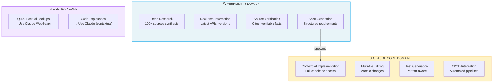
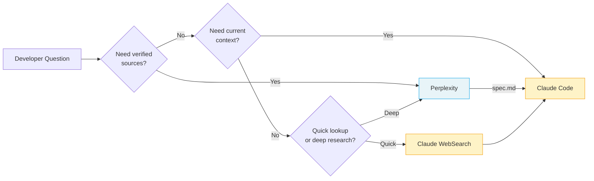
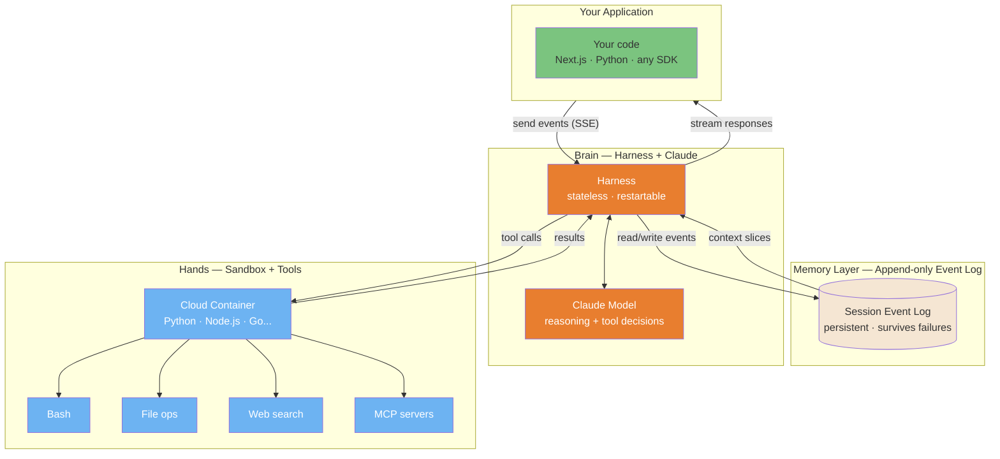
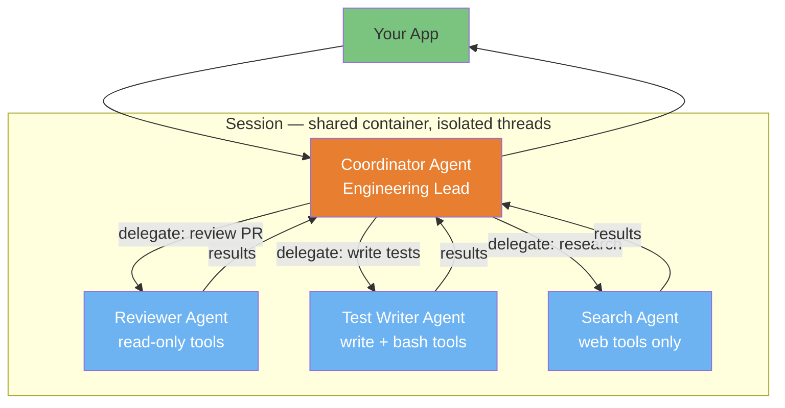

# Экосистема искусственного интеллекта: максимизация Claude Code с помощью дополнительных инструментов

> **Время чтения**: ~25 минут
>
> **Purpose**: это руководство поможет вам понять, когда использовать Claude Code по сравнению с дополнительными инструментами искусственного интеллекта и как объединить их в цепочку для достижения оптимальных рабочих процессов.

---

## Прежде чем выбирать продукт, выберите слой

Модель не является средой выполнения, а платформа, панель мониторинга или диспетчер парка автоматически не являются средой выполнения. В среде выполнения имеется итеративный цикл модели и инструмента. Использование репозитория делает одну базу кода разборчивой и проверяемой. Оркестратор координирует несколько сеансов среды выполнения. Это различие не позволяет списку функций стать ложным сравнением.

Прочтите [Agent Harness Map](./agent-harness-landscape.md) для строгого сравнения времени выполнения и ее более широкого каталога с исходными кодами. Прочтите [Agent Harness Engineering](../core/agent-harness.md) для четырехуровневой модели, [Agent Tools: Beyond Claude Code](./agentic-tools.md) для инфраструктур и плоскостей управления, а также [glossary](../core/glossary.md) для терминологии. Последующие операции относятся к [Agent Evaluation](../roles/agent-evaluation.md), [Session Observability](../ops/observability.md)и [Security Hardening](../security/security-hardening.md).

---

## Оглавление

- [Введение](#introduction)
- [1. Недоумение AI (исследования и снабжение)](#1-perplexity-ai-research--sourcing)
- [2. Google Gemini (Визуальное понимание)](#2-google-gemini-visual-understanding)
- [2.1 Mistral Large 4 (мультимодальный кандидат API)](#21-mistral-large-4-multimodal-api-candidate)
- [3. Кими (PPTX и создание длинных документов)](#3-kimi-pptx--long-document-generation)
- [4. НоутбукLM (синтез и аудио)](#4-notebooklm-synthesis--audio)
- [5. Инструменты преобразования голоса в текст (Wispr Flow, Superwhisper)](#5-voice-to-text-tools-wispr-flow-superwhisper)
- [6. IDE, ADE и гибридные среды кодирования](#6-ide-ade-and-hybrid-coding-environments)
- [6.1 Google Антигравитация (первый агент IDE)](#61-google-antigravity-agent-first-ide)
- [7. Прототипы пользовательского интерфейса (v0, Bolt, Lovable)](#7-ui-prototypers-v0-bolt-lovable)
- [7.1 Генеративный пользовательский интерфейс: форматы интерактивного вывода, управляемые агентом](#71-generative-ui-agent-driven-interactive-output-formats)
- [8. Оркестрация рабочего процесса](#8-workflow-orchestration)
- [9. Стоимость и стратегия подписки](#9-cost--subscription-strategy)
- [10. Claude Cowork (Предварительный обзор исследования)](#10-claude-cowork-research-preview)
- [11. Агенты кодирования искусственного интеллекта Matrix](#11-ai-coding-agents-matrix)
- [11.1 Goose: альтернатива с открытым исходным кодом (блок)](#111-goose-open-source-alternative-block)
- [11.2 Мнение практикующего врача](#112-practitioner-insights)
- [11.3 Когда собирать, а когда использовать](#113-when-to-build-vs-use)
- [11.4 Платформы распространения навыков](#114-skills-distribution-platforms)
- [12. Инструменты упаковки контекста](#12-context-packing-tools)
- [14. Claude Управляемые агенты (облачная платформа)](#14-claude-managed-agents-cloud-hosted-platform)
- [15. Предварительный обзор Project Glasswing и Claude Mythos (Защитная безопасность)](#15-project-glasswing--claude-mythos-preview-defensive-security)
- [16. Шаг за токеном: как работают программы LLM (интерактивное руководство)](#16-step-by-token-how-llms-work-interactive-guide)
- [Приложение: Готовые к использованию подсказки](#appendix-ready-to-use-prompts)
- [Указание Claude Code на другой бэкэнд](#pointing-claude-code-at-another-backend)

---

## <a name="introduction"></a>Введение

### <a name="philosophy-augmentation-not-replacement"></a>Философия: увеличение, а не замена.

Claude Code превосходен в:
- **Контекстное рассуждение** для всей кодовой базы
- **Многофайловая реализация** с интеграцией тестирования
- **Постоянная память** через файлы CLAUDE.md
- Автоматизация **CLI** для трубопроводов CI/CD
- **Агентное выполнение задач** с минимальным контролем

Что Claude Code делает не очень хорошо (по замыслу):
- **Поиск в Интернете в режиме реального времени с проверкой источника** (веб-поиск существует, но ограничен)
- **Генерация изображения** (без встроенных возможностей)
- **PowerPoint/slide поколение** (без выхода PPTX)
- **Аудиосинтез** (без TTS)
- **Прототипирование на основе браузера** (без визуального предварительного просмотра)

Цель состоит не в том, чтобы найти «лучшие» инструменты, а в том, чтобы связать **правильный инструмент для каждого шага**.

> Тот же шаблон persona/agent, который объединяет дополнительные инструменты, применяется здесь на уровень выше, к назначенным должностям руководителей бизнеса (финансовый директор, директор по маркетингу, совет директоров), а не к инструментам разработки. См. [AI Исполнительные агенты](./ai-executive-agents.md) для этой ситуации.

### Матрица дополнительности

| Задача | Claude Code | Лучшая альтернатива | Зачем |
|------|-------------|-------------------|-----|
| **Реализация кода** | ✅ Лучший | - | Контекстное рассуждение + редактирование файлов |
| **Глубокое исследование источников** | ⚠️ Ограничено | Недоумение Про | 100+ проверенных источников |
| **Изображение → Код** | ⚠️ Ограничено | Gemini 2.5+ | Превосходное визуальное понимание |
| **Поколение слайдов** | ❌ Нет | Kimi.com | Собственный экспорт PPTX |
| **Обзор аудио** | ❌ Нет | НоутбукLM | Синтез в стиле подкаста |
| **Прототипирование браузера** | ❌ Нет | v0.dev, Болт | Предварительный просмотр в реальном времени |
| **IDE автозаполнение** | ❌ Нет | Второй пилот, Курсор | Встроенные предложения |

---

## <a name="1-perplexity-ai-research--sourcing"></a>1. Недоумение ИИ (исследования и поиск источников)

### Диаграмма дополнительности

На следующей диаграмме показано, как Perplexity и Claude Code дополняют друг друга в рабочем процессе разработки:



**Key Insight**: Недоумение отвечает на вопрос: «Что нам следует построить?» → Claude Code отвечает: «Как нам это здесь построить?»

### Поток решений



### Когда использовать Perplexity вместо Claude

| Сценарий | Используйте недоумение | Используйте Claude |
|----------|---------------|------------|
| «Какая последняя версия API для X?» | ✅ | ⚠️Отсечка знаний |
| «Сравнить 5 библиотек для аутентификации» | ✅ Источники | ⚠️Могут галлюцинировать |
| «Объясните это сообщение об ошибке» | ⚠️ Дженерик | ✅ Контекстный |
| «Реализовать аутентификацию в моей кодовой базе» | ❌ Нет файлов | ✅ Полный доступ |

### Возможности Perplexity Pro для разработчиков

**Режим глубоких исследований**
- Синтезирует более 100 источников в структурированный вывод
- Занимает 3-5 минут, но дает исчерпывающие характеристики
- Экспортировать как уценку → Подать в Claude Code

**Выбор модели**
- Claude Sonnet 5.5: Лучше всего подходит для технической прозы и документации.
- GPT-4o: подходит для фрагментов кода.
- Sonar Pro: быстрый поиск фактов

Возможности **Labs**
- Пространства: постоянные контексты проекта.
- Блоки кода: экспорт с выделенным синтаксисом
- Диаграммы: автоматически создаются на основе данных.

### <a name="integration-workflow"></a>Рабочий процесс интеграции

#### Схема 1: Исследование → спецификация → код

```
┌─────────────────────────────────────────────────────────┐
│ 1. PERPLEXITY (Deep Research)                           │
│    "Research best practices for JWT refresh tokens      │
│     in Next.js 15. Include security considerations,     │
│     common pitfalls, and library recommendations."      │
│                                                         │
│    → Output: 2000-word spec with sources               │
└───────────────────────────┬─────────────────────────────┘
                            ↓ Export as spec.md
┌─────────────────────────────────────────────────────────┐
│ 2. CLAUDE CODE                                          │
│    > claude                                             │
│    "Implement JWT refresh tokens following spec.md.     │
│     Use the jose library as recommended."               │
│                                                         │
│    → Output: Working implementation with tests         │
└─────────────────────────────────────────────────────────┘
```

#### Схема 2. Рабочий процесс с параллельной панелью

Использование tmux или разделения терминала:

```bash
# Left pane: Perplexity (browser or CLI)
perplexity "Best practices for rate limiting in Express"

# Right pane: Claude Code (implementing)
claude "Add rate limiting to API. Check spec.md for approach."
```

### <a name="comparison-claude-websearch-vs-perplexity"></a>Сравнение: Claude WebSearch против Perplexity

| Особенность | Claude Веб-поиск | Недоумение Про |
|---------|-----------------|----------------|
| Количество источников | ~5-10 | 100+ (Глубокие исследования) |
| Проверка источника | Базовый | Полные цитаты |
| Данные в реальном времени | Да | Да |
| Формат экспорта | Текст в контексте | Markdown, блоки кода |
| Лучшее для | Быстрый поиск | Комплексное исследование |
| Стоимость | Включено | $20/month Про |

**Рекомендация**: используйте веб-поиск Claude для быстрой проверки фактов. Используйте Perplexity Deep Research перед любой значимой реализацией, требующей понимания экосистемы.

---

## <a name="2-google-gemini-visual-understanding"></a>2. Google Gemini (визуальное понимание)

### Варианты использования для разработчиков

Визуальные суперспособности **Gemini**:
- Макет пользовательского интерфейса → Код HTML/CSS/React (верность 90%+)
- Интерпретация диаграмм (блок-схемы → Mermaid/code)
- Отладка снимков экрана («почему это выглядит сломанным?»)
- Извлечение токенов дизайна (цвета, интервалы из изображений)

### Gemini 2.5 Pro для разработки

Лучший в своем классе по:
- **Комплексное преобразование пользовательского интерфейса**: Загрузите скриншот Figma → Получите компоненты Tailwind
- **Понимание схем**: Архитектурные схемы → План реализации
- **Анализ ошибок**: загрузить снимок экрана с ошибкой → получить инструкции по отладке

Выбор модели:
- **Gemini 2.5 Pro**: сложное визуальное мышление, длинный контекст.
- **Gemini 2.5 Flash**: быстрые визуальные задачи, меньшая стоимость

### Рабочий процесс интеграции

#### Шаблон: Визуальный → код

```
┌─────────────────────────────────────────────────────────┐
│ 1. GEMINI 2.5 PRO                                       │
│    Upload: screenshot.png of Figma design               │
│    Prompt: "Convert this to a React component using     │
│            Tailwind CSS. Use semantic HTML and          │
│            include responsive breakpoints."             │
│                                                         │
│    → Output: JSX + Tailwind code                       │
└───────────────────────────┬─────────────────────────────┘
                            ↓ Copy to clipboard
┌─────────────────────────────────────────────────────────┐
│ 2. CLAUDE CODE                                          │
│    > claude                                             │
│    "Refine this component for our Next.js project.      │
│     Add proper TypeScript types, our Button component,  │
│     and connect to the auth context."                   │
│                                                         │
│    → Output: Production-ready component                │
└─────────────────────────────────────────────────────────┘
```

#### Шаблон: Диаграмма → План реализации

```
┌─────────────────────────────────────────────────────────┐
│ 1. GEMINI                                               │
│    Upload: architecture-diagram.png                     │
│    Prompt: "Analyze this architecture diagram.          │
│            Output a Mermaid diagram with the same       │
│            structure, and list the components."         │
│                                                         │
│    → Output: Mermaid code + component list             │
└───────────────────────────┬─────────────────────────────┘
                            ↓ Paste mermaid to CLAUDE.md
┌─────────────────────────────────────────────────────────┐
│ 2. CLAUDE CODE                                          │
│    "Implement the UserService component from the        │
│     architecture in CLAUDE.md. Start with the           │
│     interface, then the implementation."                │
│                                                         │
│    → Output: Implemented service                       │
└─────────────────────────────────────────────────────────┘
```

### Альтернативы генерации изображений

Для создания диаграмм, макетов или визуальных ресурсов:

| Инструмент | Лучшее для | Формат | Качество |
|------|----------|--------|---------|
| Идеограмма 3.0 | Макеты пользовательского интерфейса, иконки | PNG, СВГ | Высокий |
| Рекрафт v3 | Векторы, логотипы | СВГ, PNG | Очень высокий |
| Середина пути | Художественные визуальные эффекты | PNG | Художественный |
| ДАЛЛ-И 3 | Быстрые концепции | PNG | Хороший |

**Рабочий процесс для сгенерированных изображений**:
1. Создайте изображение с помощью выбранного инструмента
2. Загрузите в Gemini для → конвертации кода.
3. Уточнить с помощью Claude Code

---

## <a name="21-mistral-large-4-multimodal-api-candidate"></a>2.1 Mistral Large 4 (мультимодальный кандидат на API)

**Проверено 06.10.2026.** [Mistral Large 4](https://mistral.ai/news/mistral-large-4/) — это модель рассуждения общего назначения, принимающая текст и изображения и создающая текст, выпущенная в общедоступной предварительной версии через Mistral Studio и API. Mistral заявляет, что провела обучение и проводит этот предварительный просмотр на своей европейской инфраструктуре; это заявление о запуске не устанавливает условия резидентности данных каждого маршрута API. Веса будут объявлены позднее в октябре.

Если команда сравнивает поставщиков, добавьте Large 4 к управляемому пилотному проекту API для задач репозитория, обоснования документов или визуального анализа. Измерьте принятые результаты с помощью выбранного ремня безопасности. Эта модель отличается от среды выполнения агента кодирования Vibe, и эта запись не обеспечивает встроенную совместимость с Claude Code. В документации по модели [Mistral](https://docs.mistral.ai/models/mistral-large-4-0) перечислены вызовы функций и структурированные выходные данные, но сами по себе эти функции не доказывают полную интеграцию агента кодирования.

Начните с оценки исходного кода [](../../docs/resource-evaluations/mistral-large-4.md) для получения независимых результатов, уточненного соглашения о подсчете параметров 49B/52B и неразрешенных контекстных фигур 1M/512K. Используйте снимок рынка [](../ops/llm-market-snapshot.md#2-api-prices) для сравнения рекламных и первоначальных тарифов, стратегию подписки [](../ops/subscription-strategy.md#exercise-choose-a-provider-portfolio-for-300-engineers) для API и закупок рабочей силы, а также [локальный вывод](./local-vs-cloud-inference.md#what-actually-fits-named-models) для границы памяти веса.

---

## <a name="3-kimi-pptx--long-document-generation"></a>3. Кими (PPTX и создание длинных документов)

### Что такое Кими?

[Kimi](https://kimi.ai) — помощник Moonshot AI, отличающийся:
- **Нативное поколение PPTX** (настоящие слайды, без уценки)
- **128K+ контекст токена** (все кодовые базы)
- **Макеты с учетом кода** (подсветка синтаксиса на слайдах)
- **Многоязычный** (отлично Chinese/English)

### Варианты использования для разработчиков

**Генерация презентации**:
- PR-сводка → колода заинтересованных сторон
- Архитектурная документация → визуальное представление
- Техническая спецификация → слайды по адаптации команды
- Пошаговое руководство → обучающие материалы

### Рабочий процесс интеграции

#### Шаблон: Код → презентация

```
┌─────────────────────────────────────────────────────────┐
│ 1. CLAUDE CODE                                          │
│    "Generate a summary of all changes in the last       │
│     5 commits. Format as markdown with sections:        │
│     Overview, Key Changes, Breaking Changes, Migration."│
│                                                         │
│    → Output: changes-summary.md                        │
└───────────────────────────┬─────────────────────────────┘
                            ↓ Upload to Kimi
┌─────────────────────────────────────────────────────────┐
│ 2. KIMI                                                 │
│    Prompt: "Create a 10-slide presentation from this    │
│            summary for non-technical stakeholders.      │
│            Use business-friendly language.              │
│            Include one slide per major feature."        │
│                                                         │
│    → Output: stakeholder-update.pptx                   │
└─────────────────────────────────────────────────────────┘
```

#### Шаблон: Архитектура → обучение

```
┌─────────────────────────────────────────────────────────┐
│ 1. CLAUDE CODE (using /explain or equivalent)           │
│    "Explain the authentication flow in this project.    │
│     Include sequence diagrams (mermaid) and key files." │
│                                                         │
│    → Output: auth-explanation.md with diagrams         │
└───────────────────────────┬─────────────────────────────┘
                            ↓ Upload to Kimi
┌─────────────────────────────────────────────────────────┐
│ 2. KIMI                                                 │
│    "Create an onboarding presentation for new devs.     │
│     20 slides covering the auth system. Include         │
│     code snippets and diagrams where relevant."         │
│                                                         │
│    → Output: auth-onboarding.pptx                      │
└─────────────────────────────────────────────────────────┘
```

### Сравнение: инструменты презентации

| Инструмент | Сильные стороны | Слабые стороны | Лучшее для |
|------|-----------|------------|----------|
| **Кими** | Собственный PPTX, с учетом кода | Меньше дизайнерской полировки | Технические колоды |
| **Gamma.app** | Красивые шаблоны | Меньшая поддержка кода | Бизнес-колоды |
| **Томе** | AI-родной, визуальный | Дорогой | Маркетинг |
| **Beautiful.ai** | Умные шаблоны | Руководство | Design-focused |
| **Marp** | Уценка → слайды | Ручная укладка | Колоды разработчиков |

**Рекомендация**: используйте Kimi для получения технического контента с кодом. Используйте «Гамму» для колод business/investor.

---

## <a name="4-notebooklm-synthesis--audio"></a>4. NotebookLM (синтез и аудио)

### Варианты использования для разработчиков

**Сводка документации**:
- Загрузите более 50 файлов → получите единое понимание
- Задавайте вопросы о вашей кодовой базе
- Создайте аудиообзор для обучения в дороге

**Обзор аудио**:
- Создает 10-15-минутный «подкаст» из загруженного контента.
- Два хоста AI обсуждают вашу документацию
- Идеально подходит для внедрения или проверки больших систем.

### Рабочий процесс интеграции

#### Шаблон: Codebase → внедрение аудио

```
┌─────────────────────────────────────────────────────────┐
│ 1. EXPORT (via Claude Code or manual)                   │
│    "Export all markdown files from docs/ and the        │
│     main README to a single combined-docs.md file."     │
│                                                         │
│    → Output: combined-docs.md (50K tokens)             │
└───────────────────────────┬─────────────────────────────┘
                            ↓ Upload to NotebookLM
┌─────────────────────────────────────────────────────────┐
│ 2. NOTEBOOKLM                                           │
│    - Add combined-docs.md as source                     │
│    - Click "Generate Audio Overview"                    │
│    - Wait 3-5 minutes for generation                    │
│                                                         │
│    → Output: 12-minute audio explaining your system    │
└───────────────────────────┬─────────────────────────────┘
                            ↓ Listen during commute
┌─────────────────────────────────────────────────────────┐
│ 3. BACK TO CLAUDE CODE                                  │
│    "Based on my notes from the audio overview:          │
│     [paste notes]                                       │
│     Help me understand the auth flow in more detail."   │
│                                                         │
│    → Output: Contextual deep-dive                      │
└─────────────────────────────────────────────────────────┘
```

#### Схема: синтез из нескольких источников

```
┌─────────────────────────────────────────────────────────┐
│ NOTEBOOKLM                                              │
│ Upload multiple sources:                                │
│ - Your codebase docs (combined-docs.md)                 │
│ - Framework documentation (Next.js docs PDF)           │
│ - Related articles (URLs or PDFs)                      │
│                                                         │
│ Ask: "How does our auth implementation compare to       │
│       Next.js best practices?"                         │
│                                                         │
│    → Output: Comparative analysis with citations       │
└─────────────────────────────────────────────────────────┘
```

### Экспорт в CLAUDE.md

После синтеза NotebookLM экспортируйте ключевые данные в свой проект:

```markdown
## Architecture Insights (from NotebookLM synthesis)

### Key Patterns
- Service layer uses repository pattern
- Auth flow follows OAuth2 with PKCE
- State management via React Query

### Potential Issues Identified
- Token refresh logic not documented
- Missing error boundaries in critical paths

### Recommendations
- Add token refresh documentation
- Implement error boundary audit
```

---

## <a name="41-notebooklm-mcp-integration"></a>4.1 Интеграция NotebookLM MCP

**Доступно с**: Claude Code v2.1+ с поддержкой MCP

**Что он делает**: отправляйте запросы к записным книжкам NotebookLM непосредственно из Claude Code, сохраняя контекст разговора по нескольким вопросам.

### Установка

```bash
# Install NotebookLM MCP server
claude mcp add notebooklm npx notebooklm-mcp@latest

# Configure profile (optional, add to ~/.zshrc or ~/.bashrc)
export NOTEBOOKLM_PROFILE=standard  # minimal (5 tools) | standard (10 tools) | full (16 tools)

# Verify installation
claude mcp list
# Should show: notebooklm: npx notebooklm-mcp@latest - ✓ Connected
```

**Сравнение профилей**:

| Профиль | Инструменты | Вариант использования |
|---------|-------|----------|
| `minimal` | 5 | Базовые запросы, среды с ограничением токенов |
| `standard` | 10 | **Recommended** — запросы + управление библиотекой |
| `full` | 16 | Расширенный (управление браузером, очистка, повторная аутентификация) |

**Подробное описание инструмента**:

| Инструмент | минимальный | стандартный | полный | Описание |
|------|---------|----------|------|-------------|
| `ask_question` | ✅ | ✅ | ✅ | Запрос блокнотов с контекстом беседы |
| `add_notebook` | ✅ | ✅ | ✅ | Добавить блокнот в библиотеку |
| `list_notebooks` | ✅ | ✅ | ✅ | Список всех блокнотов в библиотеке |
| `get_notebook` | ✅ | ✅ | ✅ | Получить информацию о блокноте по идентификатору |
| `setup_auth` | ✅ | ✅ | ✅ | Первоначальная аутентификация Google |
| `select_notebook` | ❌ | ✅ | ✅ | Установить активный блокнот |
| `update_notebook` | ❌ | ✅ | ✅ | Обновить метаданные блокнота |
| `search_notebooks` | ❌ | ✅ | ✅ | Поиск в библиотеке по ключевым словам |
| `list_sessions` | ❌ | ✅ | ✅ | Список активных сеансов разговора |
| `get_health` | ❌ | ✅ | ✅ | Проверьте статус аутентификации и конфигурацию |
| `remove_notebook` | ❌ | ❌ | ✅ | Удалить блокнот из библиотеки |
| `re_auth` | ❌ | ❌ | ✅ | Сменить аккаунт Google |
| `cleanup_data` | ❌ | ❌ | ✅ | Очистить данные браузера и сеансы |
| `get_browser_state` | ❌ | ❌ | ✅ | Ручная проверка состояния браузера |
| `execute_browser_action` | ❌ | ❌ | ✅ | Ручное управление браузером |
| `wait_for_element` | ❌ | ❌ | ✅ | Ожидание элемента браузера вручную |

### Аутентификация

**Важно**: NotebookLM MCP использует изолированный профиль Chrome, отдельный от основного сеанса браузера.

```bash
# In Claude Code, first-time setup:
"Log me in to NotebookLM"

# Browser opens automatically for Google authentication
# Select your Google account (pro tip: use authuser=1 for secondary accounts)
# Session persists in: ~/Library/Application Support/notebooklm-mcp/
```

**Настройка нескольких учетных записей**:

Если у вас несколько учетных записей Google и вы хотите использовать конкретную:

1. **Предварительная настройка в браузере**: Открыть `https://notebooklm.google.com/?authuser=1` (изменить номер для разных учетных записей)
2. Войдите с желаемой учетной записью
3. **Then** запустите аутентификацию в Claude Code

MCP хранит учетные данные в изолированном профиле Chrome, поэтому файлы cookie вашего основного браузера не влияют на него.

**Проверка аутентификации**:

```bash
"Check NotebookLM health status"

# Expected output after successful auth:
# {
#   "authenticated": true,
#   "account": "your-email@gmail.com",
#   "notebooks": <count>
# }
```

### Создание библиотеки блокнотов

В отличие от веб-интерфейса, MCP работает с **поделиться ссылками**, а не выполняет автоматическую синхронизацию всех записных книжек.

**Добавить блокнот**:

```bash
# 1. In NotebookLM web UI:
#    - Open notebook
#    - Click "Share" → "Anyone with the link"
#    - Copy share URL

# 2. In Claude Code:
"Add notebook: https://notebooklm.google.com/notebook/abc123...
Name: LLM Engineer Handbook
Description: Comprehensive guide on LLM engineering practices
Topics: LLM, fine-tuning, RAG, deployment"

# Minimal metadata required - the MCP will analyze content automatically
```

**Укажите свою библиотеку**:

```bash
"List my NotebookLM notebooks"

# Shows all added notebooks with topics, use cases, last used
```

**Поиск библиотеки**:

```bash
"Search NotebookLM library for: React patterns"

# Returns relevant notebooks based on name, description, topics
```

### Запрос блокнотов

**Прямой запрос** (указать блокнот):

```bash
"In LLM Engineer Handbook, how do I implement RAG with embeddings?"

# Claude will:
# 1. Select the specified notebook
# 2. Query NotebookLM with your question
# 3. Return answer with precise citations
# 4. Maintain session_id for follow-up questions
```

**Контекстный разговор**:

```bash
# First question
"In Building Large-Scale Web Apps notebook, what are the caching strategies?"

# Follow-up (uses same session_id)
"How would that apply to a Next.js application?"

# Another follow-up
"What about Redis vs in-memory cache trade-offs?"

# Session context is maintained across all queries
```

**Выбрать активный блокнот**:

```bash
"Select LLM Engineer Handbook as active notebook"

# Now you can ask without specifying notebook each time
"What are the fine-tuning techniques?"
"How does DPO compare to RLHF?"
```

### Расширенные рабочие процессы

**Исследование на нескольких ноутбуках**:

```bash
# Compare insights across notebooks
"What does LLM Engineer Handbook say about embeddings?"
"Now check Playwright Automation guide for testing strategies"
"How can I combine these approaches?"
```

**Обновить метаданные записной книжки**:

```bash
# As you use notebooks, refine their metadata
"Update LLM Engineer Handbook:
 - Add topic: prompt engineering
 - Add use case: When designing LLM architectures"

# This helps Claude auto-select the right notebook for future queries
```

**Управление сеансом**:

```bash
"List active NotebookLM sessions"

# Shows all conversation sessions with message counts, age
# Useful to resume previous research threads
```

### Сравнение: MCP и веб-интерфейс

| Особенность | MCP Интеграция | Веб-интерфейс |
|---------|----------------|--------|
| Доступ с Claude Code | ✅ Директ | ❌ Ручной копипаст |
| Контекст разговора | ✅ Постоянный session_id | ⚠️ Только веб-чат |
| Запросы к нескольким ноутбукам | ✅ Беспрепятственное переключение | ⚠️ Ручная навигация |
| Генерация звука | ❌ Используйте веб-интерфейс | ✅ Родной |
| Поделиться блокнотами | ✅ Через библиотеку | ✅ Родной |
| Скорость запроса | ✅ Мгновенный | ⚠️ Навигация в браузере |

**Рекомендации**: используйте **MCP для запросов** во время разработки, **веб-интерфейс для создания аудио** во время адаптации.

### <a name="troubleshooting"></a>Поиск неисправностей

| Проблема | Решение |
|-------|----------|
| `notebooklm: not connected` | Запустите `source ~/.zshrc` (или перезапустите терминал), затем перезапустите Claude Code. |
| Пустой список записных книжек после аутентификации | Вы прошли аутентификацию, но еще не добавили блокноты. Используйте рабочий процесс «Поделиться ссылками». |
| Неправильный аккаунт Google | Очистить аутентификацию: удалить `~/Library/Application Support/notebooklm-mcp/chrome_profile/`, повторно аутентифицироваться |
| «Инструмент не найден» | Убедитесь, что переменная `NOTEBOOKLM_PROFILE` установлена ​​правильно. |
| Ошибки ограничения скорости | Подождите 24 часа или повторите аутентификацию с использованием другой учетной записи Google. |

**Проверьте конфигурацию MCP**:

```bash
# View your .claude.json MCP config
cat ~/.claude.json | jq '.mcpServers.notebooklm'

# Should show:
# {
#   "type": "stdio",
#   "command": "npx",
#   "args": ["notebooklm-mcp@latest"],
#   "env": {}
# }
```

### Пример: рабочий процесс адаптации

```bash
# Day 1: Setup
"Log me in to NotebookLM"
"Add notebook: <share-link-1> - Codebase Architecture"
"Add notebook: <share-link-2> - API Documentation"

# Day 2: Research
"In Codebase Architecture, what's the auth flow?"
"How does that integrate with the API docs?"
"Select API Documentation notebook"
"What are the rate limiting strategies?"

# Week 2: Advanced
"Search library for: database patterns"
"In Database Patterns notebook, explain connection pooling"
"How would I implement this in our codebase?"
```

---

## 4.2 Расширенные функции (полный профиль)

**Когда использовать профиль `full`**:
- Необходимо часто переключать учетные записи Google (`re_auth`)
- Хотите очистить данные MCP без удаления файла вручную (`cleanup_data`)
- Необходимо удалить блокноты из библиотеки (`remove_notebook`)
- Расширенная отладка, требующая ручного управления браузером

**Включить полный профиль**:

```bash
# Add to ~/.zshrc or ~/.bashrc
export NOTEBOOKLM_PROFILE=full

# Restart Claude Code
```

### Удалить блокнот из библиотеки

```bash
"Remove notebook: LLM Engineer Handbook"

# Or by ID:
"Remove notebook with ID: llm-engineer-handbook"
```

**Случай использования**: очистка библиотеки, удаление устаревших блокнотов, исправление повторяющихся записей.

### Повторная аутентификация (переключение аккаунта)

**Сценарий**: вы хотите переключиться с личной учетной записи Google на рабочую учетную запись.

```bash
"Re-authenticate NotebookLM with different account"

# Browser opens, select different Google account
# New credentials saved, old session cleared
```

**Разница против `setup_auth`**:
- `setup_auth`: первая аутентификация.
- `re_auth`: переключение учетных записей (очистка существующего сеанса)

**Важно**: после повторной аутентификации ваша библиотека записных книжек будет иметь вид **preserved** (хранится локально), но вам необходимо будет подтвердить доступ к записным книжкам (они должны быть доступны для новой учетной записи).

### Данные очистки

**Scenario**: начать заново, очистить все данные MCP (аутентификация, библиотека, профиль браузера).

```bash
"Clean up NotebookLM MCP data"

# Options:
# - preserve_library: Keep notebook metadata (default: false)
# - confirm: Safety confirmation (default: false)
```

**Что будет удалено**:
- Профиль браузера (`~/Library/Application Support/notebooklm-mcp/chrome_profile/`)
- Файлы cookie аутентификации
- Активные сессии
- Библиотека ноутбука (кроме `preserve_library=true`)

**Когда использовать**:
- Проблемы аутентификации, не решенные повторной аутентификацией
- Конфликты браузера или повреждение
- Начинаем заново после тестирования
- Перед удалением MCP

**Example**:

```bash
"Clean NotebookLM data but keep my library"
# → cleanup_data(preserve_library=true, confirm=true)

"Completely reset NotebookLM MCP"
# → cleanup_data(preserve_library=false, confirm=true)
```

### Ручное управление браузером

**Расширенные инструменты отладки** (только полный профиль):

**1. Получить состояние браузера**:

```bash
"Show NotebookLM browser state"

# Returns: current_url, cookies, local_storage, session_storage
```

**2. Выполнить действие браузера**:

```bash
"Navigate NotebookLM browser to specific notebook URL"
"Click element in NotebookLM browser"
"Type text in NotebookLM browser"
```

**3. Дождитесь элемента**:

```bash
"Wait for element to load in NotebookLM browser"
```

**Случай использования**: отладка проблем с аутентификацией, проверка состояния браузера во время сбоев, навигация по записной книжке вручную.

---

## 4.3 Параметры браузера (все профили)

Управляйте поведением браузера для запросов и аутентификации.

### Доступные варианты

```javascript
{
  // Visibility
  "headless": true,        // Run without visible window (default: true)
  "show": false,          // Show browser window (default: false)

  // Performance
  "timeout_ms": 30000,    // Operation timeout (default: 30000)

  // Viewport
  "viewport": {
    "width": 1920,        // Default: 1920
    "height": 1080        // Default: 1080
  },

  // Stealth mode (human-like behavior)
  "stealth": {
    "enabled": true,           // Master switch (default: true)
    "human_typing": true,      // Simulate typing speed (default: true)
    "random_delays": true,     // Random pauses (default: true)
    "mouse_movements": true,   // Realistic mouse moves (default: true)
    "typing_wpm_min": 160,     // Min typing speed (default: 160)
    "typing_wpm_max": 240,     // Max typing speed (default: 240)
    "delay_min_ms": 100,       // Min delay between actions (default: 100)
    "delay_max_ms": 400        // Max delay between actions (default: 400)
  }
}
```

### Примеры использования

**Отладка аутентификации визуально**:

```bash
"Log me in to NotebookLM with visible browser"

# Claude calls: setup_auth(show_browser=true)
```

**Специальный тайм-аут для медленных соединений**:

```bash
"Ask NotebookLM (with 60s timeout): What are the main concepts?"

# Claude calls: ask_question(timeout_ms=60000, ...)
```

**Отключить скрытность для более быстрых запросов** (если ограничения скорости не важны):

```bash
# Advanced: requires direct tool call (not natural language)
ask_question(
  question="...",
  browser_options={
    "stealth": {"enabled": false},
    "timeout_ms": 10000
  }
)
```

**Когда настраивать**:
- **Показать браузер**: устранение проблем с аутентификацией, проверка выбора учетной записи
- **Увеличить время ожидания**: медленная сеть, большие блокноты, сложные запросы
- **Отключить скрытность**: локальное тестирование, отладка, приоритет скорости.
- **Пользовательская область просмотра**: Тестирование адаптивного пользовательского интерфейса ноутбука (редко)

---

## 4.4 Управление сеансом

NotebookLM MCP поддерживает контекст диалога при запросах через `session_id`.

### Как проходят сеансы

```bash
# First query → Creates session
"In LLM Engineer Handbook, what is RAG?"
# → Returns session_id: "abc123"

# Follow-up → Uses same session
"How does it compare to fine-tuning?"
# → Uses session_id: "abc123" automatically

# Another notebook → New session
"In Playwright Guide, how do I test?"
# → New session_id: "xyz789"
```

**Свойства сеанса**:
- **Automatic**: Claude управляет session_id для дополнительных вопросов.
- **Scoped**: один сеанс на записную книжку на разговор.
- **Timeout**: 15 минут бездействия (настраивается)
- **Максимальное количество сеансов**: 10 одновременных (настраивается)

### Список активных сеансов

```bash
"List my active NotebookLM sessions"

# Returns:
# - session_id
# - notebook_name
# - age_seconds
# - message_count
# - last_activity (timestamp)
```

**Случай использования**: Возобновление предыдущих потоков исследований, анализ истории запросов, устранение проблем с контекстом.

### Ручное управление сеансом

**Возобновить конкретный сеанс**:

```bash
"Continue NotebookLM session abc123 with question: What about embeddings?"

# Claude calls: ask_question(session_id="abc123", question="...")
```

**Принудительно создать новый сеанс** (игнорировать контекст):

```bash
"Ask NotebookLM in fresh session: What is RAG?"

# Claude omits session_id to create new session
```

**Очистка сеанса**:

Сессии автоматически истекают через 15 минут. Ручная очистка через `cleanup_data`.

---

## 4.5 Лучшие практики управления библиотекой

### Организация блокнотов

**Соглашение об именах**:

```bash
# Good: Descriptive, searchable
"LLM Engineer Handbook"
"Playwright Testing Guide"
"Next.js Architecture Patterns"

# Bad: Vague, unhelpful
"Notebook 1"
"My Docs"
"Tech Stuff"
```

**Темы стратегии**:

```bash
# Specific, hierarchical
topics: ["RAG", "embeddings", "vector databases", "LLM fine-tuning"]

# Too broad
topics: ["AI", "programming"]
```

**Случаи использования** (помогает Claude автоматически выбирать):

```bash
# Action-oriented
use_cases: [
  "When implementing RAG systems",
  "For fine-tuning LLM models",
  "To understand embeddings architecture"
]
```

### Рабочий процесс уточнения метаданных

После использования блокнота уточните его метаданные:

```bash
# Initial add (minimal)
"Add notebook: <url>
Name: TypeScript Guide
Description: TypeScript best practices
Topics: TypeScript, types"

# After usage (refine)
"Update TypeScript Guide:
 - Add topic: generics
 - Add topic: utility types
 - Add use case: When designing type-safe APIs
 - Add tag: advanced"
```

### Поиск и открытие

**Поиск по ключевым словам**:

```bash
"Search library for: React hooks"
"Search library for: testing"
"Search library for: architecture patterns"
```

**Умный выбор** (Claude решает):

```bash
"Which notebook should I consult about database design?"
# Claude searches library, proposes best match

"I need help with TypeScript generics"
# Claude auto-selects TypeScript Guide if metadata matches
```

### Жизненный цикл ноутбука

```bash
# 1. Add
"Add notebook: <url> - Name: X, Description: Y, Topics: Z"

# 2. Use
"In X notebook, ask: ..."

# 3. Refine
"Update X: Add topic: ..., Add use case: ..."

# 4. Archive (full profile)
"Remove notebook: X"  # If outdated or duplicate
```

### Стоимость

**Free**: NotebookLM (включая интеграцию с MCP) бесплатен при наличии учетной записи Google.

**Limits**:
- Уровень бесплатного пользования: 100 блокнотов, 50 источников в каждом блокноте, 500 тыс. слов, 50 ежедневных запросов.
- Ограничения Google AI Premium/Ultra: в 5 раз выше

---

## <a name="5-voice-to-text-tools-wispr-flow-superwhisper"></a>5. Инструменты преобразования голоса в текст (wisprflow, Superwhisper)

**Философия**: «Кодирование Vibe», диктуйте намерения и позволяйте ИИ реализовывать их

Голосовой ввод обеспечивает скорость набора текста примерно в 4 раза (~150 слов в минуту против ~40 слов в минуту) с более богатым контекстом.
Вы говорите больше, когда вам не нужно это печатать.

### <a name="tool-comparison"></a>Сравнение инструментов

| Инструмент | Обработка | Задержка | Конфиденциальность | Цена | Платформа |
|------|------------|---------|---------|-------|----------|
| **Wispr Flow** | Облако | ~500 мс | Сертифицирован SOC 2 | $12/mo | Мак, Вин, iOS |
| **Супершепот** | Местный | 1-2s | 100% оффлайн | ~$50 единоразово | только для Mac |
| **MacWhisper** | Местный | Переменная | 100% оффлайн | 49 долларов США единоразово | только для Mac |

### Когда светится голос + Claude Code

| Сценарий | Почему голос побеждает |
|----------|---------------|
| Длинные дампы контекста | Вы естественным образом включаете ограничения, крайние случаи, бизнес-контекст. |
| Мозговой штурм | Меньше самофильтрации, больше сырых идей |
| Мультиагентное управление | Диктуйте 3-4 сеанса Claude одновременно. |
| Доступность | RSI, ограничения подвижности, напряжение глаз |

### Рабочий процесс кодирования Vibe

1. Откройте Claude Code или курсор.
2. Активировать голос (горячая клавиша Wispr или системная диктовка)
3. Диктуйте естественно: «Мне нужен компонент, который показывает статистику пользователей,
   у него должна быть нумерация страниц, потому что у нас тысячи пользователей,
   и сортировку по имени или дате регистрации, используйте нашу существующую настройку Tailwind"
4. Пусть Claude обработает подробный ввод.
5. Повторите вслух: «Добавьте состояние загрузки и обработку ошибок».

### Trade-offs

| Преимущество | Ограничение |
|-----------|------------|
| ~4 раза быстрее ввод | ~ в 3 раза более подробный вывод |
| Более богатый контекст | Конфиденциальность в облаке (Wispr) |
| Состояние потока сохранено | ~800 МБ ОЗУ |
| Естественное выражение | Технические термины требуют обучения |

### Рекомендация

| Профиль | Инструмент |
|---------|------|
| Productivity-first | Wispr Flow Pro ($12/mo) |
| Privacy-required | Супершепот (Mac) |
| Budget-conscious | МакВиспер (49 долларов единоразово) |
| Пользователь Windows | Подождите улучшения стабильности Wispr |

**Совет для профессионалов**: Для сложных подсказок рассмотрите возможность «уточнения» для сжатия
подробный голосовой ввод в структурированные подсказки перед отправкой на Claude.
См. шаблон навыков `/voice-refine` в `examples/skills/`.

---

## <a name="51-text-to-speech-tools-agent-vibes"></a>5.1 Инструменты преобразования текста в речь (Agent Vibes)

**Философия**: Звуковое повествование освобождает глаза для многозадачности.

Преобразование текста в речь добавляет аудиозапись к ответам Claude Code, позволяя:
- **Проверка кода в режиме многозадачности** (слушайте, просматривая различия визуально)
- **Длительные сеансы отладки** (звуковые уведомления держат вас в курсе)
- **Доступность** (нарушение зрения, напряжение глаз, RSI)
- **Фоновый мониторинг** (оповещения для errors/completion)

### Инструмент: Agent Vibes (сервер сообщества MCP)

**Status**: дополнительная интеграция (не официальная функция Claude Code)
**Cost**: 100% бесплатно (оффлайн TTS)
**Maintenance**: Движение сообщества (Пол Прейбиш)

| Особенность | Ценить |
|---------|-------|
| **Provider** | Piper TTS (автономный нейронный режим) + macOS Say (родной) |
| **Голоса** | 15+ (12 английских, 4 французских, включая 124 говорящих на нескольких языках) |
| **Качество** | ⭐️⭐️⭐️⭐️ (Пайпер средний), ⭐️⭐️⭐️⭐️⭐️ (Пайпер высокий) |
| **Latency** | ~280 мс (Piper Medium), ~50 мс (macOS Say) |
| **Дисковое пространство** | ~1,3 ГБ (Пайпер + голоса + аудиоэффекты) |
| **Установка** | ~18 минут (5 этапов, интерактивно) |

### Когда TTS сияет

| Сценарий | Выгода |
|----------|---------|
| Обзоры кода | Слушайте анализ Claude во время просмотра кода. |
| Долго выполняющиеся задачи | Звуковое уведомление о завершении tests/builds |
| Сеансы отладки | Предупреждения об ошибках без постоянной проверки экрана |
| Режим обучения | Двуязычное повествование (основной + целевой язык) |
| Парное программирование | Кодирует один человек, оба слышат отзывы Claude. |

### Trade-offs

| Преимущество | Ограничение |
|-----------|------------|
| 100% оффлайн | Нет голосов облачного качества (по сравнению с ElevenLabs) |
| Нулевая стоимость | Задержка ~280 мс (по сравнению с мгновенным запуском macOS Say) |
| Мультиязычность (50+) | ~1 ГБ дискового пространства для голосовых моделей |
| 124 голосовых вариации | Для установки требуется Homebrew, Bash 5.x. |

### <a name="quick-start"></a>Быстрый старт

**Установка**: Рабочий процесс установки [TTS](../workflows/tts-setup.md) (18 мин)

**Основное использование**:
```bash
# In Claude Code
/agent-vibes:whoami          # Check current voice & provider
/agent-vibes:list            # List all 15 voices
/agent-vibes:switch fr_FR-tom-medium  # French male voice

# Test
> "Say hello in French"  # Audio narration plays
```

**Временно отключить звук**:
```bash
/agent-vibes:mute    # Silent work
# ... focus time ...
/agent-vibes:unmute  # Re-enable
```

### Рекомендация

| Профиль | Настройка |
|---------|-------|
| **Проверщик кода** | ✅ Установить с помощью `fr_FR-tom-medium`, `verbosity: low` |
| **Фокус-работник** | ⚠️ Установить, но отключить звук по умолчанию, включить звук для уведомлений. |
| **Battery-conscious** | Использовать провайдера macOS Say (мгновенно, более низкое качество) |
| **Общественное рабочее пространство** | ❌ Пропустить TTS (отвлечение звука на других) |

### Полная документация

- **[Agent Vibes: Руководство по интеграции](../../examples/integrations/agent-vibes/README.md)** — Обзор, команды, варианты использования
- **[Руководство по установке](../../examples/integrations/agent-vibes/installation.md)** — 18-минутная процедура установки
- **[Каталог голосов](../../examples/integrations/agent-vibes/voice-catalog.md)** - 15 голосов с аудиосэмплами
- **[Устранение неполадок](../../examples/integrations/agent-vibes/troubleshooting.md)** — распространенные проблемы и решения

**Resources**:
- GitHub: https://github.com/paulpreibisch/AgentVibes
- Образцы голоса: https://rhasspy.github.io/piper-samples/

---

## <a name="6-ide-ade-and-hybrid-coding-environments"></a>6. IDE, ADE и гибридные среды кодирования.

> **Техническое сравнение**: Для объективного сравнения Claude Code с более чем 22 альтернативами по 11 критериям (поддержка MCP, навыки, команды, субагенты, режим планирования) см. Матрицу агентов кодирования [AI](https://coding-agents-matrix.dev/) (обновлено в январе 2026 г.).

Этикетки на продуктах больше не являются надежными границами. Агентская среда разработки, или ADE, может сочетать в себе IDE, автономный CLI, настольный клиент, точки входа в чат и выполнение в облаке. Курсор, Киро, Claude Code, Devin Desktop и Warp Agent охватывают более одной из этих поверхностей.

Прежде чем выбрать товар, сравните три независимых вопроса:

1. **Интерфейс**: CLI, TUI, IDE, рабочий стол, Интернет или чат.
2. **Execution**: локальный, удаленный или гибридный.
3. **Владение циклом**: этот продукт планирует, действует с помощью инструментов, наблюдает за результатами и решает следующий шаг, или он только размещает или координирует другую среду выполнения?

[Agent Harness Landscape](./agent-harness-landscape.md#interface-execution-and-loop-ownership-are-separate) применяет эту таксономию во всем исходном каталоге. Более глубокий профиль [Warp Agent CLI](./agentic-tools.md#19-warp-agent-cli) показывает, почему продукт, обычно описываемый как ADE, также может участвовать в сравнении терминальных агентов.

### Выбирайте интерфейс по рабочему процессу

| Нуждаться | Интерфейс, который нужно протестировать в первую очередь | Примеры, а не рейтинги |
|---|---|---|
| Встроенное завершение и редактирование рядом с кодом | IDE | Курсор, Клайн, Девин Рабочий стол |
| Тяжелая работа с оболочкой и воспроизводимые команды | CLI | Claude Code, Codex CLI, Агент варпа |
| Интерактивные отладчики или полноэкранные терминальные программы | CLI с поддержкой TUI | Warp Agent, открытый код, раздавить |
| Асинхронная работа и удаленный мониторинг | Интернет | Жюль, Девин, поверхности облачных агентов |
| Выделенное собственное рабочее пространство | Рабочий стол | Рабочий стол Claude Code, Рабочий стол Devin, Киро |
| Начните работу с командного общения или проблемы | Чат | Продукты с точками входа в Slack, Discord или трекере. |

Соответствие интерфейсов — это лишь краткий список. Контроль разрешений, изоляция репозитория, место выполнения, восстановление, доступ к модели и стоимость принятых задач по-прежнему требуют репрезентативного испытания.

Для настольных продуктов, которые координируют существующие интерфейсы командной строки агентов, используйте сравнение рабочих пространств [](./third-party-tools.md#desktop-agent-workspace-comparison). Он сравнивает Conductor, Emdash, Superset, Escouade, Nimbalyst и Vibe Kanban по рабочему процессу и ограничениям внедрения; сам по себе их интерфейс не делает их новыми инструментами среды выполнения.

### Гибридный рабочий процесс

**Утренняя сессия (стратегическая)**:
```bash
claude "Review the auth module and suggest improvements"
# Claude analyzes, suggests multi-file refactoring plan
```

**Во время кодирования (тактического)**:
```
# In Cursor/VS Code with Copilot
# Quick autocomplete, inline suggestions
# Small function implementations
```

**Перед фиксацией (проверкой)**:
```bash
claude "Review my changes and suggest tests"
# Claude reviews diff, generates comprehensive tests
```

### Реальный путь миграции: Курсор → Виндсерфинг → Claude Code.

> **Источник**: [Инженерный блог Zadig&Voltaire](https://tech.zadig-et-voltaire.com/blog/migration-nuxt/), Бенджамин Калеф, февраль 2026 г.

Это датированная история внедрения, поэтому оригинальное название продукта сохранено. Впоследствии Windsurf был переименован в [Devin Desktop](https://devin.ai/desktop); изменение названия не меняет того, что команда сообщила на 2025 год.

Команда из шести человек из Zadig&Voltaire задокументировала последовательное внедрение своих инструментов во время шестимесячной реконструкции электронной коммерции (июль 2025 г. – январь 2026 г.):

| Фаза | Инструмент | Наблюдение |
|-------|------|-------------|
| июль 2025 г. | Курсор | Совместная работа, встроенные предложения |
| август 2025 г. | Виндсерфинг | Похожая парадигма, немного другой UX |
| август 2025 г. | **Claude Code** | Контекстное понимание всей кодовой базы, поворотный момент |
| ноябрь 2025 г. | Claude Opus 4.5 | Скачок в понимании модели, надежная генерация кода |

Команда сообщила о повороте Claude Code был движим **контекст уровня кодовой базы** а не редактирование на уровне файла. Затем они интегрировали индивидуальные навыки (`zv-commit`, `zv-code-review`, `zv-jira`, `zv-jira-qa`) и общественные навыки от [skills.sh](https://skills.sh/) стандартизировать свои рабочие процессы.

**Caveat**: Заявленный прирост производительности (-33% LOC, -63% LCP) в первую очередь связан с самой миграцией Nuxt 3, а не с инструментами искусственного интеллекта. Путь миграции инструмента — это передаваемая информация.

### Интеграция с курсором

`.cursor/rules` курсора может отражать ваш CLAUDE.md:

```markdown
# .cursor/rules
# Mirror from CLAUDE.md for consistency

## Conventions
- Use TypeScript strict mode
- Prefer named exports
- Test files: *.test.ts

## Patterns
- Services use dependency injection
- Components use render props for flexibility
```

### <a name="multi-ide-configuration-sync"></a>Синхронизация конфигурации Multi-IDE

Когда ваша команда использует несколько инструментов ИИ-кодирования (Claude Code + Cursor + Copilot), поддержание единообразных соглашений во всех инструментах становится проблемой.

#### <a name="the-problem"></a>Проблема

| Инструмент | Конфигурационный файл | Формат |
|------|-------------|--------|
| Claude Code | `CLAUDE.md` | Маркдаун + @imports |
| Курсор | `.cursorrules` | Обычная уценка |
| Codex/ChatGPT | `AGENTS.md` | AGENTS.md стандарт |
| Второй пилот | `.github/copilot-instructions.md` | GitHub-specific |

**Без синхронизации**: каждый файл перемещается независимо, что приводит к несогласованному поведению ИИ в разных инструментах.

#### Решение 1. Собственный @import (рекомендуется для Claude Code)

Claude Code изначально поддерживает импорт `@path/to/file.md`:

```markdown
# CLAUDE.md
@docs/conventions/coding-standards.md
@docs/conventions/architecture.md
```

**Pros**: встроенный, без этапа сборки, поддерживается Anthropic.
**Cons**: Cursor/.cursorrules не поддерживает @import

#### Решение 2. Генерация на основе сценариев (команды с несколькими IDE)

Для команд, которым нужны одинаковые соглашения **во всех IDE**:

```
docs/ai-instructions/           # Source of truth
├── core.md                     # Shared conventions
├── claude-specific.md          # Claude Code additions
├── cursor-specific.md          # Cursor additions
└── codex-specific.md           # AGENTS.md additions

        ↓ sync script (bash/node)

CLAUDE.md     = core + claude-specific
.cursorrules  = core + cursor-specific
AGENTS.md     = core + codex-specific
```

**Пример сценария синхронизации** (bash):

```bash
#!/bin/bash
CORE="docs/ai-instructions/core.md"

cat "$CORE" > CLAUDE.md
echo -e "\n---\n" >> CLAUDE.md
cat "docs/ai-instructions/claude-specific.md" >> CLAUDE.md

cat "$CORE" > .cursorrules
echo -e "\n---\n" >> .cursorrules
cat "docs/ai-instructions/cursor-specific.md" >> .cursorrules
```

**Когда использовать этот подход**:
- Команда со смешанными предпочтениями IDE (Claude Code + курсор + код VS)
- Необходимо обеспечить соблюдение одинаковых соглашений во всех инструментах.
- CI/CD проверка инструкций AI

#### <a name="️-agentsmd-support-status"></a>⚠️ Статус поддержки AGENTS.md

**Claude Code НЕ поддерживает AGENTS.md** изначально (выпуск[GitHub № 6235](https://github.com/anthropics/claude-code/issues/6235), 171 комментарий, по состоянию на февраль 2026 г. все еще открыт).

**Обходное решение**: символическая ссылка `ln -s AGENTS.md .claude/CLAUDE.md`

Стандарт AGENTS.md поддерживается несколькими инструментами кодирования. Поскольку поддерживаются изменения в зависимости от продукта и версии, перед объединением файлов инструкций проверьте текущую совместимость в матрице агентов кодирования [AI](https://coding-agents-matrix.dev).

### Экспорт из IDE в Claude

Когда вам нужен более глубокий анализ Claude:

1. Выберите код в IDE
2. Копировать с контекстом (путь к файлу, номера строк)
3. Вставьте Claude со словами: «Проанализируйте это и предложите архитектурные улучшения».

---

## <a name="61-google-antigravity-agent-first-ide"></a>6.1 Google Антигравитация (сначала агент IDE)

> **Источник**: [Google Codelabs](https://codelabs.developers.google.com/getting-started-google-antigravity), [Google Cloud Blog](https://cloud.google.com/blog/topics/developers-practitioners/choosing-antigravity-or-gemini-cli), отзывы сообщества (февраль 2026 г.)

Google Antigradity — это первый **agent IDE** (форк VS Code), выпущенный в конце 2025 года. В отличие от традиционных инструментов IDE, добавляющих ИИ в редактор, Antigradity делает автономные агенты основным интерфейсом. Разработчики контролируют работу через пользовательский интерфейс в стиле управления полетом, а не пишут код напрямую.

### Claude Code против Антигравитации: две философии

| Измерение | Claude Code | Гугл Антигравитация |
|-----------|-------------|-------------------|
| **Парадигма** | Сначала терминал, родной CLI | Агент-первый, IDE-родной |
| **Контроль разработчика** | Явное одобрение каждого редактирования | Более высокая автономия агента |
| **Контекстная модель** | Уровень кодовой базы через CLAUDE.md | Мультиповерхность (редактор + браузер + терминал) |
| **Multi-agent** | Команды агентов (v2.1+) | Встроенная многоагентная оркестровка |
| **CI/CD** | Родной (безголовый, конвейеры) | Еще не созрел |
| **Профиль риска** | Предсказуемый, консервативный | Более высокая автономия = более высокий риск превышения |
| **Формат навыков** | `.claude/skills/` (фронтовая часть YAML) | Другая экосистема на основе каталогов |
| **Модели** | Claude (Anthropic) | Мультимодель (Gemini, Claude, Liquid AI) |

### Мост: антигравитация-клод-прокси

Пакет [npm](https://www.npmjs.com/package/antigravity-claude-proxy) сообщества предоставляет Anthropic-совместимый API, поддерживаемый службой Cloud Code компании Antigradity. Это позволяет разработчикам использовать модели Claude через интерфейс Антигравити или объединить оба инструмента в единый рабочий процесс.

### Когда стоит задуматься об антигравитации

| Сценарий | Рекомендация |
|----------|---------------|
| Быстрое прототипирование («виброкодирование») | Антигравитация (более высокая автономность, визуальная обратная связь) |
| Производственный код с CI/CD | Claude Code (предсказуемый, безголовый, встроенный в конвейер) |
| Многомодельные эксперименты | Антигравитация (~150 моделей через OpenRouter) |
| Стандартизация команды | Claude Code (CLAUDE.md, навыки, экосистема хуков) |
| Разработчики, не относящиеся к CLI | Антигравитация (родной IDE, меньше трения на концах) |

### Компромиссы, которые следует знать

**Сильные стороны антигравитации**: более широкий визуальный контекст (агенты «видят» браузер + редактор), параллельная оркестровка агентов, более низкий барьер для разработчиков, не использующих CLI.

**Слабые стороны антигравитации**: более высокие когнитивные издержки (мониторинг нескольких агентов), менее предсказуемое поведение, CI/CD незрелый, риск деструктивных операций, когда агенты действуют автономно.

**Итог**: Claude Code оптимизируется для обеспечения предсказуемости **и интеграции с существующими рабочими процессами разработчиков**. Антигравитация оптимизируется для **максимальной автономии агента с экспериментальными компромиссами**. Они служат разным философиям. Выбирайте исходя из своей толерантности к риску и предпочтений рабочего процесса.

---

## <a name="7-ui-prototypers-v0-bolt-lovable"></a>7. Прототиперы пользовательского интерфейса (v0,bolt, привлекательный)

### Когда использовать прототипы

| Сценарий | Использовать прототип | Используйте Claude Code |
|----------|---------------|-----------------|
| «Создать целевую страницу» | ✅ v0 (визуальный) | ⚠️ Нет предварительного просмотра |
| «Добавить форму в существующее приложение» | ⚠️ Нужен контекст | ✅ Имеет контекст |
| «Быстрая итерация пользовательского интерфейса» | ✅ Предварительный просмотр в реальном времени | ⚠️ Медленнее |
| «Система оформления матчей» | ⚠️ Дженерик | ✅ Считывает ваши токены |

### Сравнение инструментов

| Инструмент | Сильные стороны | Куча | Лучшее для |
|------|-----------|-------|----------|
| **v0.dev** | Shadcn/Tailwind | Реагировать | Прототипы компонентов |
| **Bolt.new** | Полный каркас приложения | Различный | Быстрые MVP |
| **Lovable** | Design-to-code | Реагировать | Передача дизайнера |
| **WebSim** | Экспериментальный интерфейс | Интернет | Творческое исследование |

### Рабочий процесс интеграции

#### Выкройка: Прототип → производство

```
┌─────────────────────────────────────────────────────────┐
│ 1. V0.DEV                                               │
│    Prompt: "A user profile card with avatar,            │
│            stats, and action buttons"                   │
│                                                         │
│    → Output: React + Shadcn component preview          │
│    → Export: Copy code                                 │
└───────────────────────────┬─────────────────────────────┘
                            ↓ Paste to clipboard
┌─────────────────────────────────────────────────────────┐
│ 2. CLAUDE CODE                                          │
│    "Adapt this v0 component for our Next.js app:        │
│     - Use our existing Button, Avatar components        │
│     - Add TypeScript types matching User interface      │
│     - Connect to getUserProfile API endpoint            │
│     - Add loading and error states"                     │
│                                                         │
│    → Output: Production-ready integrated component     │
└─────────────────────────────────────────────────────────┘
```

---

## <a name="71-generative-ui-agent-driven-interactive-output-formats"></a>7.1 Генеративный пользовательский интерфейс: форматы интерактивного вывода, управляемые агентом

### Почему существует эта категория

Разработчики прототипов пользовательского интерфейса (раздел 7) генерируют статическое приложение, которое вы вставляете в базу кода. В 2025–2026 годах появится другая проблема: агенту, которому необходимо отобразить реальную форму, ворота одобрения или кнопку *внутри одного поворота чата*, а не как отдельный артефакт. Обычный текст не может собирать структурированные входные данные. Статический снимок экрана не может отправить действие. Сам ответ должен быть интерактивным и исходить от вызова модели, часто небольшого или точно настроенного, а не от человека, пишущего JSX.

За решение этой проблемы конкурируют четыре подхода с совершенно разными предположениями о том, кто выдает выходные данные и что должна выдавать модель.

| Подход | Продавец | Что производит модель | Рендеринг | Портативность |
|----------|--------|--------------------------|-----------|-------------|
| **A2UI** | Google | Структурированное описание пользовательского интерфейса | Клиенты экосистемы Google | Концепция, популяризированная Google, а не независимый стандарт |
| **MCP Приложения** (сентябрь 1865 г.) | Anthropic + OpenAI + MCP-UI (в соавторстве) | Полезная нагрузка HTML/iframe через ответ инструмента MCP | Claude Рабочий стол, VS Code, ChatGPT, Goose | Расширение открытого протокола, поддержка нескольких поставщиков с первого дня |
| **Vercel AI SDK генеративный UI** | Версель | Компоненты JSX/React, потоковая передача на стороне сервера (`streamUI`, `useObject`) | Только реагировать | Привязан к Vercel AI SDK и React. |
| **MDMA** | MobileReality (с открытым исходным кодом) | Уценка со встроенным YAML, проверенная по схеме Zod | `@mobile-reality/mdma-renderer-react` (только React на момент написания этой статьи) | Пакеты Spec/parser/validator/runtime не имеют импорта, специфичного для узла, и запускаются в любой среде выполнения JS; сам рендерер этого не делает |

Они решают смежные, но отдельные проблемы. Приложения MCP — это ответ инструмента с пользовательским интерфейсом. Шаблон Vercel AI SDK предполагает, что сервер выбирает и передает компоненты React напрямую, поэтому клиент никогда не анализирует промежуточный формат. MDMA меняет это: модель создает проверенный YAML, а средство рендеринга на стороне клиента интерпретирует его, что жертвует некоторой гибкостью рендеринга в пользу формата, который легче создать правильно для небольшой модели или модели с ограниченными ресурсами. Третья смежная категория — это сами приложения MCP, которые уже рассматриваются отдельно в этом руководстве (раздел «Расширения `guide/core/architecture.md`, MCP»), поскольку это проблема уровня протокола, а не формата рендеринга.

### Практический пример: МДМА

[MDMA](https://github.com/MobileReality/mdma) — это проект с открытым исходным кодом, построенный на одной основной идее: создание синтаксически допустимого, совместимого со схемой блока YAML — это более низкая планка для небольшого LLM (их целью являются такие модели, как Gemini Flash, и они доработали свою собственную модель 26B), чем создание правильного JSX или рукописного HTML. Техническая основа этой идеи выдерживает проверку. Маркетинговые заявления, наложенные на это, в большинстве случаев не соответствуют действительности.

**Что происходит**:
- Настоящий детерминированный конвейер validator/fixer: один проход, без дополнительного вызова LLM, извлечение на основе регулярных выражений, устойчивое к нарушенной уценке, 19 правил проверки, упорядоченные фиксаторы (вывод типа поля, исправление опечатки ключа YAML, восстановление привязки).
- Стандартный анализ через remark/unified с корректной обработкой состояния потоковой передачи (плагин отличает блок, который все еще генерируется, от блока, который на самом деле искажен).
- Честные, измеренные оценки с использованием Promptfoo с пользовательскими утверждениями, явно сформулированными в их собственных документах как «наблюдения, а не выводы». Заголовок: 41% успеха при использовании простого приглашения по сравнению с 90,5% при использовании DSL плюс валидатор на их точно настроенной модели (`evals/own-model/README.md`).
- «Запускается где угодно» справедливо для основных пакетов (спецификация, парсер, валидатор, среда выполнения): нулевой импорт, специфичный для узла (`fs`, `path`, `crypto`), проверенный прямым grep для этих четырех пакетов.
- CI с GitHub Actions, закрепленным SHA фиксации (редкая, хорошая практика), управлением версиями каждого пакета на основе наборов изменений и реальным набором тестов (`turbo run test` для всех пакетов, подтверждено в `package.json`).

**Что преувеличено или вводит в заблуждение**:
- Неявное утверждение о гарантированном корректном пользовательском интерфейсе не соответствует строгому смыслу: измерено 90,5%, а не 100%. В самом репозитории есть неразрешенное противоречие: `evals/own-model/results.json` (`evals/own-model/results.json`) показывает прохождение 95/95, 100%, выполненное 30 июня 2026 г., в то время как README указывает 90,5% для того же оценочного трека. Ничто в репо не согласовывает эти два числа.
- «Работает где угодно» не распространяется на рендеринг. Поставляется ровно один рендерер, `@mobile-reality/mdma-renderer-react`, 100% React. Компонент диаграммы по умолчанию не является диаграммой: `ChartRenderer.tsx` анализирует CSV и отображает HTML `<table>` с комментарием к коду, допускающим такую ​​же информацию («Рендеринг данных диаграммы как простая таблица HTML», `packages/renderer-react/src/components/ChartRenderer.tsx`).
- Вебхуки ни к чему не привязаны. `WebhookRenderer.tsx` отправляет событие пользовательского интерфейса `INTEGRATION_CALLED`, которое хост-приложение должно обработать само (`packages/renderer-react/src/components/WebhookRenderer.tsx`). Внутри MDMA вызов HTTP не происходит. К чести проекта, соответствующий механизм выполнения веб-перехватчика указан как еще не созданный в их собственных документах дорожной карты, в отличие от пробела в проверке формы ниже.
- «Модели на устройстве/маленькие модели» описывают размер модели *generator* (размещенной на Modal, распространяемой через Hugging Face), а не ничего о визуализированном выводе. CSS средства рендеринга поставляется с нулевыми запросами `@media` (что подтверждается поиском каждого файла `.css` в пакете рендеринга React), поэтому здесь также нет истории адаптивного дизайна.
- Заявление демо-сайта о «доступности по дизайну» не подкреплено кодом. Основы есть (родные метки, собственные кнопки, один `role="alert"` на компоненте выноски), но нигде в средстве визуализации нет `aria-invalid` или `aria-live`, а ячейка таблицы маскировки PII представляет собой кликабельный `<span>` без `role="button"` и без `tabIndex`, что означает, что пользователи клавиатуры не могут показать или скрыть ее (`packages/renderer-react/src/components/TableRenderer.tsx`, линии 4-15).

**Функциональная ошибка, обнаруженная двумя независимыми аудитами**: проверка формы никогда не применяется. `FormRenderer.tsx` оборачивает поля в простой `<div className="mdma-form">`, а не в элемент `<form>`, а элементом управления отправки является `<button type="button">` с обработчиком `onClick`, который напрямую отправляет действие (`packages/renderer-react/src/components/FormRenderer.tsx`, строки 119–125 и 247–258). Встроенная проверка ограничений HTML5 срабатывает только при реальном событии отправки формы, которое здесь никогда не срабатывает. Хуже того, объект `validation` уровня поля (`pattern`, `min`, `max`), определенный в схеме (`packages/spec/src/schemas/components/form.ts`, строка 18) и документированный с помощью рабочих примеров в `docs/reference/component-catalog.md` (включая пример шаблона, соответствующий домену электронной почты компании), нигде не читается в средстве визуализации. Поле с пометкой `required: true` может быть отправлено пустым без отображения ошибок. В отличие от пробела в веб-перехватчике, который честно указан как будущая работа, этот задокументирован как работающий, с конкретным примером, взятым из собственного репозитория `examples/approval-workflow/document.md`, и он молча не работает.

**Примечание по безопасности**: как целостность цепочки журнала аудита, так и хэш редактирования PII не являются криптографическими. `event-log-integrity.ts` использует FNV-1a, и комментарий к коду прямо говорит об этом («Простая хеш-функция для целостности цепочки журналов (некриптографическая)», `packages/runtime/src/core/event-log-integrity.ts`, строка 10). Хэш редактирования PII в `hash.ts` представляет собой скользящий хеш в стиле djb2, который также помечен как некриптографический в собственном комментарии (`packages/runtime/src/redaction/hash.ts`). Ни один из них не сопротивляется преднамеренному вмешательству. Ключевые слова пакета `@mobile-reality/mdma-runtime` npm включают «audit-log» и «pii» (`packages/runtime/package.json`), что предполагает вариант использования с соблюдением требований, который на самом деле не подтверждается выбором хэша.

**Структурное ограничение**: формат строго линейный, девять типов компонентов расположены вертикально (форма, кнопка, таблица, список задач, выноска, ворота утверждения, веб-перехватчик, диаграмма, мышление), без концепции макета или сетки. Это разумный выбор для разговорного чата (валидатор даже обеспечивает его соблюдение с помощью правил `single-interactive-component` и `flow-ordering`), но настоящая стена для тех, кто хочет макет в стиле информационной панели.

Полная оценка с разбивкой по баллам: `docs/resource-evaluations/mdma-evaluation.md`.

### Куда на самом деле движется эта категория

Это молодая категория, все четыре вышеперечисленных подхода были реализованы или получили распространение в период 2025–2026 годов, и ни один из них не стал стандартом де-факто. Технические дебаты (Markdown/YAML против потокового JSX против структурированной полезной нагрузки инструмента) также не решены: собственные оценки MDMA не сравниваются с режимом JSON или структурированным выводом вызова функций, ограниченным грамматикой, что, возможно, является наиболее подходящей альтернативой «модель пишет YAML вручную». Их число 41% → 90,5% свидетельствует о том, что DSL плюс валидатор превосходит простое приглашение; он не устанавливает, что Markdown превосходит каталог схем JSON при тех же условиях.

Другой открытый вопрос — дистрибуция, а не архитектура. Соавторами MCP Apps являются Anthropic и OpenAI, а также четыре клиента-поставщика. За шаблоном Vercel AI SDK стоит платформа Vercel и база пользователей Next.js. A2UI имеет экосистему Google. MDMA — это проект с открытым исходным кодом, осуществляемый одной командой и пока не распространяемый поставщиками, нацеленный на интеграцию с AG-UI (открытый протокол CopilotKit), что отличается от A2UI. Какой бы формат ни получил широкое распространение, скорее всего, будет зависеть не только от того, кто предоставит для него клиент по умолчанию, но и от того, какой из них технически чище.

---

## <a name="8-workflow-orchestration"></a>8. Оркестровка рабочего процесса

### Полный трубопровод

Для максимальной эффективности цепляйте инструменты в таком порядке:

```
┌─────────────────────────────────────────────────────────────────────┐
│                        PLANNING PHASE                                │
├─────────────────────────────────────────────────────────────────────┤
│                                                                      │
│  [PERPLEXITY]              [GEMINI]              [NOTEBOOKLM]       │
│  Deep Research             Diagram Analysis       Doc Synthesis      │
│  "Best practices for..."   Upload architecture   Upload all docs     │
│       ↓                         ↓                      ↓             │
│  spec.md                   mermaid + plan        audio overview      │
│                                                                      │
└────────────────────────────────┬────────────────────────────────────┘
                                 ↓
┌─────────────────────────────────────────────────────────────────────┐
│                      IMPLEMENTATION PHASE                            │
├─────────────────────────────────────────────────────────────────────┤
│                                                                      │
│  [CLAUDE CODE]                          [IDE + COPILOT]             │
│  Multi-file implementation              Inline autocomplete          │
│  "Implement per spec.md..."             Quick edits while typing    │
│       ↓                                       ↓                      │
│  Working code + tests                   Polished code               │
│                                                                      │
└────────────────────────────────┬────────────────────────────────────┘
                                 ↓
┌─────────────────────────────────────────────────────────────────────┐
│                       DELIVERY PHASE                                 │
├─────────────────────────────────────────────────────────────────────┤
│                                                                      │
│  [CLAUDE CODE]                          [KIMI]                       │
│  PR description                         Stakeholder deck             │
│  /release-notes                         "Create slides from..."     │
│       ↓                                       ↓                      │
│  GitHub PR                              presentation.pptx           │
│                                                                      │
└─────────────────────────────────────────────────────────────────────┘
```

### Шаблоны сеансов

#### Особенность, требующая больших исследований

```bash
# 1. Research (Perplexity - 10 min)
# "Best practices for WebSocket implementation in Next.js 15"
# → Export to websocket-spec.md

# 2. Implementation (Claude Code - 40 min)
claude
> "Implement WebSocket following websocket-spec.md.
   Add to src/lib/websocket/. Include reconnection logic."

# 3. Stakeholder update (Kimi - 5 min)
# Upload: changes + demo screenshots
# → Generate 5-slide update deck
```

#### Визуально-тяжелая функция

```bash
# 1. UI Prototype (v0 - 10 min)
# Generate dashboard layout

# 2. Visual refinement (Gemini - 5 min)
# Upload Figma polish → Get final code

# 3. Integration (Claude Code - 30 min)
claude
> "Integrate this dashboard component.
   Connect to our data fetching hooks.
   Add proper TypeScript types."
```

#### Внедрение новой кодовой базы

```bash
# 1. Audio overview (NotebookLM - 15 min)
# Upload all docs → Generate audio → Listen

# 2. Deep questions (Claude Code - 20 min)
claude
> "I just listened to an overview of this codebase.
   Help me understand the payment flow in detail."

# 3. First contribution (Claude Code - 30 min)
claude
> "Add a new endpoint to the payments API.
   Follow the patterns I see in existing endpoints."
```

---

### <a name="81-multi-agent-orchestration-systems"></a>8.1 Многоагентные системы оркестровки

При масштабировании за пределы отдельных сеансов Claude Code внешние системы оркестрации координируют работу нескольких одновременно работающих агентов.

#### Обзор

| Система | Цель | Бэкэнд | Зрелость | Мониторинг |
|--------|---------|---------|----------|------------|
| **Газовый городок** | Менеджер мультиагентного рабочего пространства | Экземпляры Claude Code | Экспериментальный | агент-чат (SSE + SQLite) |
| **мультиклауд** | Автономный генератор агентов | Claude Code агенты | Активный разработчик (383⭐) | агент-чат (логи JSON) |
| **agent-chat** | Пользовательский интерфейс мониторинга в реальном времени | N/A (читает логи) | Ранний (v0.2.0) | Панель управления |

#### Газовый городок (Стив Йегг)

**Что это такое**: Оркестратор, управляющий десятками экземпляров Claude Code с ролями, вдохновленными Безумным Максом:
- **Mayor**: Центральный координатор, генерирует работу, делегирует задачи.
- **Polecats**: эфемерные рабочие задания, выполняющие задачи кодирования.
- **Witness**: контролирует рабочих, помогает в случае застревания.
- **Refinery**: управляет очередью слияния, разрешает конфликты.

**Ключевые моменты**:
- ✅ Разблокирует многоагентную оркестровку для Claude Code.
- ⚠️ Чрезвычайно дорого (создателю требовался второй аккаунт Anthropic для ограничения расходов)
- ❌ Экспериментальный, не серийный
- 🔗 [GitHub репо](https://github.com/steveyegge/gastown)

**Когда использовать**: сложные высокоуровневые задачи, требующие параллельной работы агента (не детализированные задачи).

#### мультиклод (длоренк)

**Что это такое**: Самостоятельная система, создающая автономные агенты Claude Code:
- Каждый агент: отдельное окно tmux + рабочее дерево git + ветка.
- Автоматически создает PR, CI = храповик (автоматическое объединение проходящих PR)
- Типы агентов: работник, супервайзер, очередь слияния, PR-пастырь, рецензент.

**Ключевые моменты**:
- ✅ Самостоятельный хостинг с первого дня (multiclaude строится сам)
- ✅ Расширяется с помощью определений агента Markdown.
- ✅ Пакеты Public Go: pkg/tmux, pkg/claude
- 🔗 [GitHub репо](https://github.com/dlorenc/multiclaude)

**Когда использовать**: команды, которым нужен полный контроль над оркестровкой агентов, средами on-prem/airgap

#### агент-чат (Джастин Абрамс)

**Что это такое**: Пользовательский интерфейс мониторинга в реальном времени (похожий на Slack) для связи агентов:
- Читает файлы сообщений `beads.db` (SQLite) Gas Town и JSON multiclaude.
- SSE для текущих обновлений, каналов рабочей области, индикаторов непрочитанных сообщений
- Нулевые настройки по умолчанию, темная тема

**Ключевые моменты**:
- ✅ Единое представление для нескольких систем оркестрации
- ⚠️ Очень новый (48 часов назад, v0.2.0)
- ⚠️ Не совместим с автономным Claude Code (требуется газ Town/multiclaude)
- 🔗 [GitHub репо](https://github.com/justinabrahms/agent-chat)

**Архитектурный шаблон (переносимый в Claude Code)**:
```
1. Hook logs Task agent spawns → SQLite
2. Parent/child relationships tracked
3. SSE endpoint streams updates
4. Dashboard UI consumes stream
```

См.: `guide/ops/observability.md` для встроенного мониторинга сеансов Claude Code.

#### <a name="entire-cli-provenance-and-merge-governance"></a>Весь CLI: происхождение и управление слиянием

**Что это такое**: захват сеанса, связанный с фиксацией, плюс межагентное возобновление, а не параллельная координация. С 26 октября 2026 года он также является клиентом размещенной на сервере Entire Git Forge, где находится управление слиянием (Trails and Gates).

**Запуск**: февраль 2026 г., Томас Домке (бывший генеральный директор GitHub), стартовый капитал 60 миллионов долларов. Forge запущен 26 октября 2026 года.

**Разница в архитектуре:**

| Аспект | Газовый городок / мультиклауд | Весь CLI |
|--------|------------------------|-----------|
| **Парадигма** | Координация (мультиплексирование tmux) | Провенанс + управление (контрольно-пропускные пункты, слияние ворот) |
| **Нерест агента** | Руководство (tmux/worktrees) | Нет: вы управляете своими агентами, их записывает целиком. |
| **Распараллеливание** | Да (5+ агентов) | Не оркестратор; несколько агентов могут сохранять контрольные точки одновременно |
| **Сохранение контекста** | Руководство (общие файлы) | Автоматически (контрольные точки в Git) |
| **Аудиторский след** | Никто | Контрольные точки, связанные с коммитами |
| **Резюме** | Нет | `entire session resume <branch>`, между агентами |

**Ключевые моменты**:
- ✅ Подсказки, расшифровка и затронутые файлы сохраняются при каждом коммите.
- ✅ Сеансы могут быть возобновлены другим агентом или товарищем по команде.
- ✅ Объединить Врата с одобрения человека (размещенная кузница, Тропы)
- ⚠️ Не создает и не координирует агентов.
- ⚠️ Pre-1.0 CLI (0.10.x в октябре 2026 г.)
- ⚠️ Для Entire не обнаружено сертификатов SOC 2, ISO 27001, HIPAA или FedRAMP (27 октября 2026 г.)
- 🔗 [GitHub репо](https://github.com/entireio/cli) / [docs.entire.com](https://docs.entire.com)

**Поток передачи обслуживания агента (как на самом деле передается контекст между агентами):**

```
Claude Code                    Git repository                Codex (or a teammate)
-----------                    --------------                ---------------------

works on branch feat/x
git commit ------------------> commit + Entire-Checkpoint trailer
                               checkpoint ref (prompts,
                               transcript, files touched)
git push --------------------> pushed with the code
                                       |
                                       v
                               git fetch / clone
                                                             entire session resume feat/x
                                                             (restores the branch's sessions
                                                              in the agent you choose)

Result: the next agent starts from the recorded sessions, not from the diff alone.
```

**Когда использовать весь CLI:**

```bash
# Use Case 1: Provenance for review or audit
entire enable
[... Claude makes changes, you commit ...]
entire checkpoint explain <id>      # prompts, transcript and files behind the commit

# Use Case 2: Hand a branch to another agent or teammate
entire session resume feat/x        # restores the branch's sessions in your agent

# Use Case 3: Debugging a past decision
entire why src/auth/jwt.ts          # commit, checkpoint, prompt and session behind a file
entire search "token refresh"       # find earlier sessions by intent
```

**Матрица дополнительности:**

| Вариант использования | Лучший инструмент |
|----------|-----------|
| **Параллельные функции** (5+ агентов) | Газовый городок |
| **Визуальный мониторинг** | agent-chat |
| **macOS параллельно с GUI** | Дирижер |
| **Провенанс + управление слиянием** | **Весь CLI** |
| **Один агент + отслеживание затрат** | Родной Claude Code + ccusage |

**Практический рабочий процесс (гибридный подход):**

```bash
# 1. Use Gas Town for parallel feature work
gastown spawn --agents=5 --tasks="auth, tests, docs, refactor, deploy"

# 2. Enable Entire in the same repository so every agent commit carries its checkpoint
entire enable
[... agents commit as usual ...]
entire checkpoint list              # review what each agent did before merging
```

**Status:** CLI 0.10.x, MIT, macOS, Linux и Windows (октябрь 2026 г.)

> **Полная документация**: [AI Руководство по отслеживанию](../ops/ai-traceability.md#51-entire-cli), [Сторонние инструменты](./third-party-tools.md#entire-cli)

#### Предупреждения о безопасности и стоимости

**Перед использованием внешних оркестраторов**:

| Риск | смягчение последствий |
|------|------------|
| **Взрыв стоимости** | Установите лимиты расходов Anthropic, используйте Haiku для работников |
| **Потеряна работа** | «Кодирование Vibe» учитывает потерю работы за пропускную способность — имейте план отката |
| **Экспериментальный статус** | Не для критических путей производства, сначала протестируйте на этапе подготовки. |
| **Утечка контекста** | Журналы могут содержать конфиденциальные данные: просмотрите их перед включением пользовательского интерфейса мониторинга. |

#### Интеграция с нативным Claude Code

Если вы не используете Gas Town/multiclaude, вы все равно можете:

1. **Записывать сеансы с несколькими экземплярами** через перехватчики (см. `examples/hooks/session-logger.sh`)
2. **Отслеживание операций `--delegate`** с пользовательской регистрацией перехватчиков. Появляется агент задач.
3. **Создайте облегченную панель управления**, используя шаблон SSE из чата агента.

**Концептуальная архитектура**:
```bash
# Hook: .claude/hooks/multi-agent-logger.sh
# Triggered on PostToolUse when tool="Task"
# Logs: timestamp, parent_session_id, child_agent_id, task_description

# Dashboard: Simple Go HTTP server streaming logs via SSE
# UI: React/HTML consuming SSE stream
```

#### Когда НЕ использовать оркестраторы

**Используйте один сеанс Claude Code, когда**:
- Задача состоит из <3 шагов или затрагивает <5 файлов
- Вам нужен полный control/oversight каждого изменения.
- Бюджетные ограничения предотвращают затраты на использование нескольких агентов
- Кодовая база достаточно проста для последовательной работы.

**Используйте оркестраторы, когда**:
- Задача естественным образом распараллеливается (несколько независимых функций)
- У вас есть бюджет на параллельных агентов (умножьте затраты на N агентов)
- Толерантность к экспериментированию высокая (работа может быть lost/redone)
- У команды есть мощность от SRE до monitor/intervene.

### <a name="82-domain-specific-agent-frameworks"></a>8.2 Структуры агентов, специфичных для предметной области

Помимо универсальных помощников по кодированию, специализированные платформы предназначены для конкретных случаев использования со встроенными шаблонами контекста, оценки и развертывания.

#### НАО (агенты аналитики)

**URL**: [github.com/getnao/nao](https://github.com/getnao/nao/) | **Stack**: TypeScript 58,9%, Python 38,5%

**Что это такое**: Платформа с открытым исходным кодом для создания и развертывания аналитических агентов. Двухэтапная архитектура: создание контекста агента через CLI (базы данных, документы, метаданные) → развертывание пользовательского интерфейса чата для запросов данных на естественном языке.

**Основные особенности**:
- Независимость от базы данных (PostgreSQL, BigQuery, Snowflake, Databricks)
- Встроенная система оценки с модульным тестированием
- Нативная визуализация данных в интерфейсе чата
- Самостоятельное развертывание с помощью Docker
- Стек: Fastify, Drizzle ORM, tRPC, React, shadcn UI.

**Соответствие Claude Code**: Хотя nao развертывает агенты как автономные службы (а не плагины Claude Code), его шаблоны можно переносить:
- **Архитектура построителя контекста**: Структурирование сложного контекста агента (аналогично лучшим практикам `.claude/agents/`)
- **Система оценки**: Измерение качества агента с помощью показателей, модульных тестов и циклов обратной связи (пробел в текущих рабочих процессах Claude Code)
- **Интеграция баз данных**: шаблоны для внедрения контекста базы данных в подсказки агента.

**Когда использовать**: группы обработки данных создают интерфейсы диалоговой аналитики для бизнес-пользователей. Для пользователей Claude Code nao служит эталонной архитектурой для оценки агентов и шаблонов контекста базы данных.

**Status**: Активный проект с открытым исходным кодом, готовый к использованию, хорошо документированный.

---

## <a name="9-cost--subscription-strategy"></a>9. Стоимость и стратегия подписки

### Сравнение ежемесячных затрат

| Инструмент | Уровень бесплатного пользования | Профессиональная стоимость | Лучшее для |
|------|-----------|----------|----------|
| Claude Code | Pay-per-use | ~$20-50/month типично | Основной инструмент разработки |
| Растерянность | 5 Про searches/day | $20/month | Научно-тяжелая работа |
| Gemini | Хороший бесплатный уровень | $19.99/month | Визуальная работа |
| НоутбукLM | Бесплатно | Бесплатно | Документация |
| Кими | Щедрый бесплатно | Бесплатно | Презентации |
| v0.dev | Ограниченный | $20/month | Прототипирование пользовательского интерфейса |
| Курсор | Бесплатный уровень | $20/month | Интеграция IDE |

### Рекомендуемые подписки по профилям

**Минимальный стек ($40-70/month)**:
- Claude Code (оплата по факту использования) — 20–50 долларов США.
- Перплексити Про — 20 долларов США.
- Все остальное: бесплатные уровни.

**Сбалансированный стек ($80-110/month)**:
- Claude Code - $30-50
- Перплексити Про — 20 долларов США.
- Gemini Продвинутый — 20 долларов США.
- Курсор Про — 20 долларов США.
- Бесплатно: NotebookLM, Кими

**Стек питания ($120-150/month)**:
- Claude Code (интенсивное использование) — 50–80 долларов США.
- Перплексити Про — 20 долларов США.
- Gemini Продвинутый — 20 долларов США.
- Курсор Про — 20 долларов США.
- версия 0 Про — 20 долларов США.
- Бесплатно: NotebookLM, Кими

### <a name="cost-optimization-tips"></a>Советы по оптимизации затрат

1. **Использовать Claude Code's Haiku модель** для простых задач(`/model haiku`)
2. **Групповые исследовательские сеансы** в Perplexity, чтобы максимизировать глубокое исследование
3. **Используйте бесплатные уровни** для Gemini Flash, NotebookLM, Kimi
4. **Регулярно проверяйте использование контекста** (`/status`), чтобы избежать потерь
5. **Используйте Opus умеренно** - только для архитектурных решений

---

## <a name="10-claude-cowork-research-preview"></a>10. Claude Cowork (превью исследования)

> **Research Preview** (январь 2026 г.): документация ограничена, возможны ошибки, доступ только локальный. Использование в производстве пока не рекомендуется.

Cowork расширяет агентские возможности Claude для нетехнических пользователей через приложение Claude Desktop. Вместо команд терминала он обращается к локальным папкам для управления файлами.

**Официальный источник**: [claude.com/blog/cowork-research-preview](https://claude.com/blog/cowork-research-preview)

### Быстрое сравнение

| Аспект | Claude Code | Коворкинг | Проекты |
|--------|-------------|--------|----------|
| **Target** | Разработчики | Работники умственного труда | Каждый |
| **Интерфейс** | Terminal/CLI | Настольное приложение | Чат |
| **Доступ** | Оболочка + код | Папка-песочница | Документы |
| **Выполнить код** | Да | **No** | Нет |
| **Выходы** | Код, скрипты | Excel, PPT, документы | Разговоры |
| **Зрелость** | Производство | **Предварительный просмотр** | Производство |
| **Соединители** | Серверы MCP | **Только локально** | Интеграции |
| **Платформа** | Все | только macOS | Все |
| **Подписка** | Usage-based | Про или Макс | Все уровни |

### <a name="when-to-use-what"></a>Когда что использовать

```
Need code execution?        → Claude Code
File/doc manipulation?      → Cowork (if local files)
Cloud files/collaboration?  → Wait (no connectors yet)
Ideation/planning?          → Projects
```

### Ключевые варианты использования

| Вариант использования | Вход | Выход |
|----------|-------|--------|
| **Файловая организация** | Грязная папка загрузок | Структурированные папки от type/date |
| **Отслеживание расходов** | Скриншоты квитанций | Excel с формулами + итоги |
| **Синтез отчета** | Разрозненные заметки + PDF-файлы | Документ в формате Word/PDF |
| **Подготовка к встрече** | Документы компании + LinkedIn | Информационный документ |

### Соображения безопасности

> **Официальной документации по безопасности пока не существует.**

**Рекомендации**:
1. Создайте специальную папку `~/Cowork-Workspace/` и никогда не предоставляйте доступ к Documents/Desktop.
2. Просмотрите планы задач перед выполнением (особенно файл deletions/moves).
3. Избегайте файлов с текстом, похожим на инструкции, из неизвестных источников.
4. В рабочей области нет учетных данных, ключей API или конфиденциальных данных.
5. Резервное копирование перед разрушительными операциями

**Матрица рисков**:
| Риск | Уровень | смягчение последствий |
|------|-------|------------|
| Быстрое внедрение через файлы | ВЫСОКИЙ | Выделенная папка, нет ненадежного контента |
| Злоупотребление действиями браузера | ВЫСОКИЙ | Просмотрите каждое веб-действие |
| Доступ к локальному файлу | СЕРЕДИНА | Минимальный объем разрешений |

### Рабочие процессы разработчиков ↔ не-разработчиков

**Pattern**: Спецификации разработчиков в Claude Code → Обзор в личку в Cowork

```
┌─────────────────────────────────────────────────────────────┐
│ DEVELOPER (Claude Code)                                      │
│ > "Generate a technical spec. Output to ~/Shared/specs/"    │
└──────────────────────────────┬──────────────────────────────┘
                               ↓
┌─────────────────────────────────────────────────────────────┐
│ PROJECT MANAGER (Cowork)                                     │
│ > "Create stakeholder summary from ~/Shared/specs/.         │
│    Output as Word doc with timeline and risks."             │
└─────────────────────────────────────────────────────────────┘
```

Общий контекст через файл `~/Shared/CLAUDE.md`.

### Доступность

| Аспект | Статус |
|--------|--------|
| Подписка | Про ($20/mo) или Макс ($100-200/mo) |
| Платформа | Только macOS (планируется Windows, Linux не анонсирован) |
| Стабильность | Предварительный просмотр исследования |

> **Deep Dive**: полные методы обеспечения безопасности, устранение неполадок и подробные примеры использования см. в [guide/cowork.md](../cowork.md).

---

## <a name="appendix-ready-to-use-prompts"></a>Приложение: Готовые к использованию подсказки

### Недоумение: исследование технических характеристик

```
Research [TECHNOLOGY/PATTERN] implementation best practices in [FRAMEWORK].

Requirements:
- Production-ready patterns only (no experimental)
- Include security considerations
- Compare top 3 library options with pros/cons
- Include code examples where helpful
- Cite all sources

Output format: Markdown spec I can feed to a coding assistant.
```

### Gemini: пользовательский интерфейс для кода

```
Convert this UI screenshot to a [FRAMEWORK] component using [STYLING].

Requirements:
- Use semantic HTML
- Include responsive breakpoints (mobile/tablet/desktop)
- Extract color values as CSS variables
- Add accessibility attributes (aria labels, roles)
- Include hover/focus states visible in the design

Output: Complete component code ready to paste.
```

### Кими: Код для презентации

```
Create a [N]-slide presentation from this technical content.

Audience: [TECHNICAL/NON-TECHNICAL]
Purpose: [STAKEHOLDER UPDATE/TRAINING/PITCH]

Requirements:
- One key message per slide
- Include code snippets where relevant (syntax highlighted)
- Add speaker notes for each slide
- Business-friendly language for non-tech audiences
- Include a summary/next steps slide

Output: Downloadable PPTX file.
```

### NotebookLM: понимание кодовой базы

После загрузки документации:

```
Based on all sources, explain:
1. The overall architecture pattern used
2. How data flows through the system
3. Key integration points with external services
4. Potential areas of technical debt or complexity
5. How authentication/authorization works

Format as a structured summary I can add to my CLAUDE.md file.
```

### Claude Code: Интегрированный внешний выход

```
I have [DESCRIBE SOURCE] from [TOOL].

Context: [PASTE CONTENT]

Integrate this into our project:
- Location: [TARGET DIRECTORY/FILE]
- Adapt to our patterns (check CLAUDE.md)
- Add TypeScript types matching our interfaces
- Connect to existing [STATE/API/HOOKS]
- Add tests following our testing patterns

Validate against existing code before implementing.
```

---

## Краткая справочная карта

### Матрица решений по инструменту

| Мне нужно... | Использовать |
|--------------|-----|
| Реализация функции | Claude Code |
| Исследования перед внедрением | Глубокое исследование недоумения |
| Преобразование дизайна в код | Gemini → Claude |
| Создать презентацию | Claude → Кими |
| Понять новую кодовую базу | НоутбукLM → Claude |
| Прототип быстрого пользовательского интерфейса | v0/Bolt → Claude |
| Быстрое встроенное редактирование | IDE + Второй пилот |

### Связывание шаблонов

```
Research → Code:     Perplexity → Claude Code
Visual → Code:       Gemini → Claude Code
Prototype → Prod:    v0/Bolt → Claude Code
Code → Slides:       Claude Code → Kimi
Docs → Understanding: NotebookLM → Claude Code
```

---

## <a name="11-ai-coding-agents-matrix"></a>11. Матрица агентов кодирования ИИ

**URL**: [coding-agents-matrix.dev](https://coding-agents-matrix.dev) | **GitHub**: [PackmindHub/coding-agents-matrix](https://github.com/PackmindHub/coding-agents-matrix) | **Лицензия**: Apache-2.0

**Maintainers**: [Packmind](https://packmind.com) (Седрик Тейтон, Артур Магне)

### Что это такое?

Ан **интерактивная матрица сравнения** из 23 агентов кодирования ИИ по 11 техническим критериям:

| Категория | Критерии |
|----------|----------|
| **Идентификация** | Статус открытого исходного кода, звезды GitHub, дата первого выпуска |
| **Упаковка** | CLI, выделенный IDE, расширение IDE, поддержка BYO LLM, MCP |
| **Особенности** | Пользовательские правила, AGENTS.md, Навыки, Команды, Субагенты, Режим планирования |

**Агенты сравнили**: Aider, Claude Code, Cursor, GitHub Copilot, Continue, Goose, Windsurf и еще 16.

### Почему это полезно

**Инструмент обнаружения**: Когда вы выбираете, какой агент кодирования использовать, Матрица помогает вам фильтровать по конкретным техническим требованиям:

- «Покажите мне агенты CLI с открытым исходным кодом и поддержкой MCP»
- «Какие агенты поддерживают стандарт AGENTS.md?»
- «Сравните функции Claude Code и Cursor»

**Объективные данные**: Никакой маркетинговой болтовни, просто функция presence/absence (Yes/No/Partial). Обновления по инициативе сообщества через шаблоны задач GitHub.

### Взаимодополняемость с этим руководством

| Матрица (Дискавери) | Это руководство (мастерство) |
|-------------------|---------------------|
| «Какие агенты существуют?» | «Как эффективно использовать Claude Code?» |
| Сравнение функций (11 критериев) | Рабочие процессы, архитектура, методологии TDD/SDD |
| 23 агента × мелко | 1 агент × глубина (19 тыс. строк) |
| Технические характеристики | Практические шаблоны (120), викторина (264 вопроса) |

**Вариант использования**: Используйте Матрицу, чтобы **обнаружить и сравнить** → Выбрать Claude Code → Используйте это руководство, чтобы **освоить это**.

### Интерактивные функции

- **Сортируемые столбцы**: щелкните любой критерий для сортировки ascending/descending.
- **Multi-filter**: объедините фильтры с помощью логики AND (например, «Открытый исходный код + поддержка MCP + режим планирования»).
- **Search**: поиск агентов по имени, типу или описанию.
- **Community-driven**: Предложить новый agents/criteria с помощью GitHub проблемы

### <a name="limitations"></a>Ограничения

- **Снимок, не в реальном времени**: Агенты развиваются, критерии меняются. Проверьте актуальность данных (последнее обновление: 19 января 2026 г.).
- Только **Presence/absence**: не объясняет работу функций *how* или различия в качестве.
  - Пример: «Claude Code имеет режим планирования» (Да) и «Как режим планирования работает на практике» (не рассматривается)
- **Нет рабочих процессов**: Не научит вас эффективному использованию агентов (это то, что делается в этом руководстве).
- **Нет показателей производительности.**: не оценивается скорость, точность или стоимость.

### <a name="related-resources"></a>Связанные ресурсы

- [Packmind](https://packmind.com): разработка контекста и управление агентами кодирования ИИ.
- [Packmind OSS](https://github.com/PackmindHub/packmind): платформа для управления версиями контекста кодирования ИИ.
- [Context-Evaluator](https://github.com/PackmindHub/context-evaluator): сканер с открытым исходным кодом для CLAUDE.md / AGENTS.md / copilot-instructions.md: 17 оценщиков (13 детекторов ошибок + 4 генератора предложений), поддерживает Claude Code, Cursor, Copilot, OpenCode, Codex. CLI + локальный веб-интерфейс. Апач-2.0. Отдельно размещенное веб-приложение, задокументированное в исходном коде, было недоступно во время проверки 2 сентября 2026 г.
- Шаблоны [Claude Code](https://github.com/davila7/claude-code-templates): более 200 шаблонов для Claude Code (17k⭐)
- [Awesome Claude Code](https://github.com/hesreallyhim/awesome-claude-code): тщательно подобранная библиотека инструментов.

**Позиционирование**: Matrix дополняет это руководство, помогая **выбрать** подходящего агента. После того, как вы выберете Claude Code, это руководство научит вас, как его **master**.

> **См. также**: [Agent Tools: Beyond Claude Code](./agentic-tools.md) для получения полных описаний Hermes Agent, Codex CLI, Aider, Devin, SWE-agent, CrewAI, LangGraph и AutoGen, а также структуры принятия решений по вариантам использования.

---

## <a name="111-goose-open-source-alternative-block"></a>11.1 Goose: альтернатива с открытым исходным кодом (блок)

Для разработчиков, достигающих пределов подписки Claude Code или нуждающихся в гибкости модели, [Goose](https://github.com/block/goose) является заметной альтернативой с открытым исходным кодом, которую стоит понять.

### Что такое Гусь?

Ан **агент кодирования ИИ на машине** разработанный Block (ранее Square) и выпущенный под лицензией Apache 2.0. В отличие от Claude Code, Goose работает полностью локально и **model-agnostic**: он может использовать Claude, Gemini, Грок или любой другой LLM provider.

| Метрика | Стоимость (март 2026 г.) |
|--------|------------------|
| **GitHub Звезды** | 33,000+ |
| **Авторы** | 400+ |
| **Релизы** | 175+ с января 2025 г. |
| **Лицензия** | Apache 2.0 (разрешительный) |
| **Основной язык** | Ржавчина (64%) + TypeScript (26%) |

### <a name="claude-code-vs-goose-key-differences"></a>Claude Code против Гуся: ключевые различия

| Аспект | Claude Code | Гусь |
|--------|-------------|-------|
| **LLM Гибкость** | только Claude | Любой LLM (GPT, Gemini, Claude, Groq, местные модели) |
| **Развертывание** | Облако (серверы Anthropic) | Только локально (на вашем компьютере) |
| **Стоимость модели** | Подписка (20–$200/mo) | Бесплатно + ваши расходы на LLM API |
| **Ограничения ставок** | Кепки Anthropic weekly/5-hour | Ограничения вашего провайдера LLM |
| **Видимость токена** | Непрозрачный (без отслеживания по запросу) | Полная прозрачность |
| **MCP Поддержка** | Родной (растущая экосистема) | Доступны тысячи серверов MCP |
| **Сложность настройки** | Просто (установка npm) | Умеренный (инструментарий Rust, ключи API) |

### Когда стоит рассмотреть гуся

**Хорошо подходит**:
- Вы часто превышаете недельные лимиты Claude Code.
- Вам нужна гибкость модели (например, GPT для некоторых задач, Claude для других).
- Вам требуется полная прозрачность и контроль затрат
- Вы работаете с большими многоязычными базами кода, требующими агрессивного рефакторинга.
- Вам нужна возможность работы в автономном режиме (с локальными моделями, такими как Ollama)

**Плохо подходит**:
- Вам нужна простота, а не гибкость
- Вы предпочитаете фиксированную ежемесячную плату переменному выставлению счетов API.
- Вы цените особые способности Claude к рассуждению и не можете их заменить.
- Вы не хотите управлять учетными данными LLM API.

### Рецепты: эквивалент навыков + команды Гуся.

У Goose есть примитив рабочего процесса под названием **Recipes**: управляемые версиями, совместно используемые, параметризованные многоэтапные рабочие процессы. В отличие от навыков Claude Code (которые определяют возможности агента) или косых команд (которые запускают одноразовые действия), рецепты определяют полную последовательность выполнения: что делать, в каком порядке, с какой моделью на каждом этапе. Их можно публиковать в виде глубоких ссылок, импортировать товарищи по команде и возвращать в систему контроля версий. Ближайшая аналогия с Claude Code: навык, который объединяет несколько команд в определенной последовательности с переносом состояния между шагами.

### Оркестровка субагентов

С середины 2025 года Goose поддерживает создание специализированных субагентов в рамках рабочего процесса. Родительский агент может делегировать подзадачи субагентам с разными ролями (Планировщик, Архитектор, Frontend Dev, Backend Dev), каждый из которых потенциально может запускать отдельный LLM, оптимизированный для своей задачи. Это отличается от инструмента «Агент» Claude Code (который создает субагент той же модели). Goose позволяет создавать разнородные команды агентов, где выбор модели осуществляется для каждой роли, а не для каждого сеанса. См. §9 для описания собственных многоагентных шаблонов Claude Code.

### Переносимость навыков

И Claude Code, и Goose поддерживают открытый стандарт [Agent Skills](https://agentskills.io) (agentskills.io). Навыки, которые вы создаете с помощью SKILL.md, можно переносить на более чем 26 платформ, включая Cursor, VS Code, GitHub, OpenAI, Codex и Gemini CLI. Поля, специфичные для Claude Code (`context`, `agent`), игнорируются другими платформами, но не нарушают совместимость.

### Trade-offs

| Гусиное преимущество | Гусиное ограничение |
|-----------------|------------------|
| Нет ограничений на подписку | LLM API Затраты могут непредсказуемо вырасти |
| Выбор модели | Требуются самоуправляемые ключи API. |
| Полная прозрачность токена | Нет встроенной межсессионной памяти. |
| Открытый исходный код (внесите свой вклад) | Меньшая база пользователей, меньше учебных пособий |
| Офлайн с местными моделями | Локальные модели уступают сложным задачам |

### Требования к оборудованию

Сам Goose легкий (двоичный файл Rust). Требования зависят от вашего выбора LLM:

| Тип LLM | Требования |
|----------|-------------|
| **Облачные API** (Claude, GPT, Gemini) | Минимальный (только доступ к сети) |
| **Локальные модели** (Оллама и т. д.) | 16–32 ГБ ОЗУ, графический процессор рекомендуется для более крупных моделей |

### Быстрый старт

```bash
# macOS
brew install goose

# Or via cargo
cargo install goose-cli

# Configure LLM provider
goose configure
```

Подробную настройку см. в [Goose Quickstart](https://block.github.io/goose/docs/quickstart/).

### Позиционирование

Goose — это альтернатива Claude Code, а не замена, и он имеет другие компромиссы. Правильный выбор зависит от ваших приоритетов:

| Приоритет | Выбирать |
|----------|--------|
| Простота, рассуждения Claude | Claude Code |
| Контроль затрат, гибкость модели | Гусь |
| Фиксированный ежемесячный бюджет | Подписка Claude Code |
| Оплата по факту использования, без ограничений | Гусь + API |

Для большинства разработчиков, уже вложивших средства в рабочие процессы Claude Code, стоимость перехода значительна. Goose наиболее ценен для команд, нуждающихся в разнообразии моделей, или для разработчиков, часто выходящих за пределы Claude Code.

---

## <a name="112-practitioner-insights"></a>11.2 Мнения практиков

Внешние ресурсы от опытных практиков, которые подтверждают и расширяют шаблоны, описанные в этом руководстве.

### <a name="dave-van-veen-stanford-phd-hoppr"></a>Дэйв Ван Вин (доктор философии Стэнфорда, HOPPR)

**URL**: [davevanveen.com/blog/agentic_coding/](https://davevanveen.com/blog/agentic_coding/)

**Учетные данные автора**:
- Доктор философии в области машинного обучения, Стэнфордский университет (2021–2024 гг.)
- Главный научный сотрудник в области искусственного интеллекта в HOPPR (конвейеры медицинского искусственного интеллекта в масштабе туберкулеза)
- Соавтор: «Агентные системы в радиологии» (ArXiv 2025).

**Сводка содержания**: Рабочий процесс агентного кодирования производственного уровня с 6 ограждениями:
- **TDD** (Разработка через тестирование)
- **Во-первых, простота** / **YAGNI**
- **Использовать перед перезаписью**
- **Worktree безопасность** (изоляция git)
- **Manual фиксирует только** (граница человеческого авторства)

**Соответствие этому руководству**: Все шаблоны описаны в нашей документации (часто более подробно):

| Узор Ван Вина | Ссылка на это руководство |
|------------------|---------------------|
| TDD ограждение | `guide/core/methodologies.md` (TDD, Циклы проверки) |
| Рабочие деревья Git | `examples/commands/git-worktree.md` (+ ветвление БД) |
| Этап планирования | Режим планирования (раздел 3.3) |
| Ручные фиксации | Лучшие практики Git (раздел 9.9) |

**Value**: Независимая проверка от практикующего доктора философии из Стэнфорда о том, что шаблоны, представленные в этом руководстве, готовы к использованию. Полезно для читателей, ищущих несколько авторитетных источников.

**Note**: Фраза «Английский — новый язык программирования» (иногда приписываемая этой статье) принадлежит Андрею Карпати и Бинду Редди, а не Ван Вину.

### <a name="matteo-collina-nodejs-tsc-chair"></a>Маттео Коллина (председатель node.js TSC)

**URL**: [adventures.nodeland.dev/archive/the-human-in-the-loop/](https://adventures.nodeland.dev/archive/the-human-in-the-loop/)

**Учетные данные автора**:
- Председатель технического руководящего комитета Node.js
- Мейнтейнер: Fastify, Pino, Undici (17B downloads/year)
- Соучредитель и технический директор Platformatic
- Доктор философии в области платформ приложений Интернета вещей (2014 г.)

**Context**: ответ на статью Майка Арнальди «Смерть разработки программного обеспечения» (январь 2026 г.)

**Краткое содержание**: Тезис о смене узких мест. ИИ меняет *, что* мы делаем, а не *, нужен ли нам*:
- ИИ внедряет, люди проверяют, и суждение становится ограничивающим фактором
- «Я проверяю каждое изменение. Каждую модификацию поведения. Каждую выпущенную строчку».
- Культурное предупреждение: фраза «это написал ИИ» никогда не должна становиться оправданием для отказа от понимания
- Аналогия с промышленной революцией: новый масштаб → новые виды отказов → новые методы обеспечения безопасности.

**Основные данные** (из более широкого исследования):
- Время проверки +91% в 2025 г. (CodeRabbit)
- 96% разработчиков не доверяют коду ИИ (Sonar 2026)
- Соотношение «Создание:обзор» = 1:12 (7 минут против 85 минут).

**Ключевая цитата**:
> «Человек в цикле — это не ограничение. В этом вся суть».

**Согласование с этим руководством**:

| Коллина Пойнт | Ссылка на это руководство |
|---------------|---------------------|
| Проверка как узкое место | Доверительная калибровка (раздел 2.5) |
| Просматривайте каждое изменение | Золотые правила (Правило №1) |
| Критическое суждение старшего | Спектр проверки (строка 1077) |
| Культурная ответственность | Ловушка для кодирования вибраций (`learning-with-ai.md:81`) |

**Value**: мнение из первых рук крупного разработчика ПО с открытым исходным кодом. Подтверждает, что культура проверки кода (уже необходимая в открытом исходном коде) напрямую переносится на разработку с помощью ИИ. Мощный авторитет для убеждения скептически настроенных команд.

**Контекст дебатов**: Статья Коллины является прямым ответом Арнальди (генеральному директору Effect/Effectful), который утверждал, что «разработка программного обеспечения мертва». Обмен Коллина-Арнальди стал определяющим моментом в дискуссии в январе 2026 года об искусственном интеллекте и роли разработчиков.

### <a name="peter-steinberger-pspdfkit-founder-moltbot-creator"></a>Питер Стейнбергер (основатель PSPDFKit, создатель Moltbot)

**URL**: [Доставка со скоростью вывода](https://steipete.me/posts/2025/shipping-at-inference-speed)

**Учетные данные автора**:
- Основал PSPDFKit (обработка документов SDK, более 60 сотрудников, клиенты: Dropbox, DocuSign, SAP)
- Создатель Moltbot (ранее Clawdbot), личного помощника с искусственным интеллектом с открытым исходным кодом.
- Документированная эволюция рабочего процесса в сообщении блога за декабрь 2025 г.

**Сводка содержимого** (только шаблоны, не зависящие от модели):
- **Потоковый мониторинг**: переход от построчного чтения кода к наблюдению за потоком генерации ИИ, вмешиваясь только в ключевые компоненты.
- **Многопроектное жонглирование**: 3-8 параллельных проектов с линейными фиксациями и передачей знаний между проектами через ссылки на файлы
- **Свежий контекст для каждой задачи**: проверяет новый шаблон контекста (раздел 2.2) на основе производственного опыта.
- **Итеративное исследование**: сборка → тестирование → доработка, а не исчерпывающее предварительное планирование.

**Согласование с этим руководством**:

| Узор Штайнбергера | Ссылка на это руководство |
|---------------------|---------------------|
| Свежий контекст для каждой задачи | Раздел 2.2 Свежий шаблон контекста (строка 1525) |
| Многопроектные рабочие процессы | Раздел 9.13 Рабочие процессы с несколькими экземплярами (строка 9583) |
| Итеративное исследование | Рабочие процессы: итеративное уточнение |

**Value**: Взгляд опытного производителя инструментов на шаблоны рабочих процессов с использованием искусственного интеллекта в масштабе производства. Проверяет новый контекст и многоэкземплярные подходы, уже описанные в этом руководстве.

**Примечание**: Штайнбергер является создателем Moltbot (см. FAQ по [ClawdBot](#claude-code-vs-clawdbot-whats-the-difference)). Его наблюдения основаны на рабочем процессе, отличном от Claude; перед принятием шаблоны должны быть проверены в контексте Claude Code.

### <a name="addy-osmani-google-chrome-team"></a>Адди Османи (команда Google Chrome)

**URL**: [Проблема 80% при агентном кодировании](https://addyo.substack.com/p/the-80-problem-in-agentic-coding)

**Учетные данные автора**:
- Руководитель разработки в команде Google Chrome
- Автор бестселлеров, более 600 тысяч читателей новостной рассылки
- Опубликовано 28 января 2026 г.

**Краткое содержание**: Синтез «проблемы 80%»: когда ИИ генерирует более 80% кода, разработчики сталкиваются с тремя новыми видами ошибок (чрезмерное проектирование, распространение предположений, подхалимское соглашение) и рискуют «долгом понимания», отличным от технического долга. Объединяет DORA, Stack Overflow и отраслевые исследования парадокса производительности (+98% PR, +91% времени проверки, но без общего снижения рабочей нагрузки).

**Основные данные** (цитаты из внешнего исследования):
- 44% разработчиков пишут <10% кода вручную (опрос Ронахера)
- 48% только систематически проверяют код ИИ перед фиксацией (SonarSource)
- 66% разочарованы «почти правильными» решениями ИИ (Stack Overflow, 2025)
- 99% сообщают, что еженедельно экономится более 10 часов, но при этом рабочая нагрузка не снижается (Atlassian, 2025)

**Согласование с этим руководством**:

| Концепция Османи | Ссылка на это руководство |
|----------------|---------------------|
| Долг понимания | Ловушка кодирования вибраций (learning-with-ai.md:81) |
| Обзор как узкое место | Доверительная калибровка (ultimate-guide.md:1061) |
| Роль оркестратора | Режим планирования + рабочие процессы инструмента задач |
| +91% времени просмотра | Уже цитировалось (строка 1977 выше) |

**Value**: Хорошо сформулированный синтез, представляющий концепцию «проблемы 80%». Полезный вторичный источник для подкрепления концепций, уже задокументированных в этом руководстве, первичными источниками.

**Note**: Статья объединяет существующие исследования. Первичные данные см. в отчете DORA за 2025 год, Stack Overflow за 2025 год и в выводах Маттео Коллина, описанных выше.

### <a name="alan-engineering-charles-gorintin-maxime-le-bras"></a>Алан Инжиниринг (Шарль Горинтен, Максим Ле Бра)

**URL**: [Принцесса Эйфелевой башни (и Ральф Виггам)](https://www.linkedin.com/pulse/le-principe-de-la-tour-eiffel-et-ralph-wiggum-maxime-le-bras-psmxe/)

**Учетные данные автора**:
- Чарльз Горинтин: соучредитель и технический директор Alan (более 15 тысяч компаний, более 300 тысяч участников, привлечено 500 миллионов евро), специалист по обработке данных ex-Facebook/Instagram/Twitter, член правления Mistral AI
- Максим Ле Бра: руководитель отдела кадров в компании Alan, пионере в сфере подбора персонала с помощью искусственного интеллекта во Франции.
- Опубликовано: 2 февраля 2026 г. (Информационный бюллетень «Intelligence Humaine», 3897 подписчиков)

**Краткое содержание**: Концепция изменения парадигмы проектирования с использованием искусственного интеллекта посредством двух основных концепций:
1. **Принцип Эйфелевой башни**: инструменты искусственного интеллекта фундаментально преобразуют то, что возможно с точки зрения архитектуры (например, лифты позволили придать форму Эйфелевой башни), а не просто ускоряют выполнение старых задач.
2. **Модель программирования Ральфа Виггама**: Агентские циклы, в которых инженеры становятся architects/editors, а не единственными создателями (отсылка к персонажу Симпсонов, «помогающему» собирать мебель)
3. **Парадокс проверки**: Когда ИИ добивается успеха в 99% случаев, человеческая бдительность становится ненадежной для обнаружения 1% ошибок. Решение: автоматизированные ограничения по сравнению с ручным просмотром
4. **Точность как валюта**: Четкая спецификация (WHAT/WHERE/HOW) становится новой сверхсилой инженера, заменяя скорость внедрения.
5. **Масштабирование амбиций**: Реализуйте ранее невыполнимые амбиции благодаря новым инструментам, а не просто более быстрому выполнению старых задач.

**Ключевая цитата**:
> «L'intelligence - это факультет фабриканта искусственных предметов, в частности, утварей и ярмарка утварей». (Анри Бергсон, «Творческая эволюция», 1907 г.)

**Согласование с этим руководством**:

| Алан Концепт | Ссылка на это руководство |
|--------------|---------------------|
| Парадокс проверки | Правило производственной безопасности 7 (production-safety.md:639) |
| Требования к точности | Подсказка WHAT/WHERE/HOW/VERIFY (ultimate-guide.md:1512) |
| Петли Ральфа Виггама | Рабочие процессы итеративного уточнения (workflows/iterative-refinement.md:107) |
| Инженер → смена архитектора | Ментальная модель: шаблон оркестратора (ultimate-guide.md:1189) |
| Принцип Эйфелевой башни | Трансформация против ускорения (неявно при смене парадигмы) |

**Value**: проверка в масштабе производства от крупной французской технологической компании, работающей в строго регулируемой отрасли (медицинское страхование, GDPR, соответствие медицинским данным). Первое четкое формулирование «парадокса верификации» как отдельной концепции. Демонстрирует, что концепции смены парадигмы применимы не только к стартапам Кремниевой долины, но и к авторитетным европейским компаниям.

**Context**: Статья включает интервью со Станисласом Полу (соучредителем Dust, ex-OpenAI), в котором упоминается достижение Mirakl (75% сотрудников стали разработчиками агентов, используя платформу Dust). Подтверждает, что трансформация «инженер → оркестратор» происходит во всей отрасли, а не только среди первых пользователей.

**Примечание к языку**: Оригинал статьи на французском языке; концепции и цитаты, переведенные для этого руководства.

### Задиг и Вольтер инженерия (Бенджамин Калеф)

**URL**: [tech.zadig-et-voltaire.com/blog/migration-nuxt/](https://tech.zadig-et-voltaire.com/blog/migration-nuxt/)

**Учетные данные автора**:
- Технический менеджер проекта Zadig&Voltaire (электронная коммерция элитной моды)
- Руководил командой из 6 человек при полной миграции интерфейса (июль 2025 г. – январь 2026 г.).
- Опубликовано: 2 февраля 2026 г.

**Сводка содержания**: первые данные о продуктивности внешней команды (не Anthropic) с временной кривой внедрения. Во время миграции Vue Storefront → Nuxt 3 команда отслеживала скорость мерж-реквестов с помощью ИИ в течение 6 месяцев:

| Месяц | MRs/week | AI-assisted |
|-------|----------|-------------|
| июль 2025 г. | ~7 | 30% |
| ноябрь 2025 г. | ~15 | 70% |
| январь 2026 г. | ~27 | 90%+ |

Ускорение **4x** в течение 6 месяцев, при этом помощь ИИ выросла с 30% до 90%+.

**Согласование с этим руководством**:

| З&В Инсайт | Ссылка на это руководство |
|-------------|---------------------|
| Путь миграции инструмента | Инструменты на основе IDE (раздел 6 выше) |
| Изменение мышления оркестратора | Ментальная модель (ultimate-guide.md:2360) |
| Индивидуальные навыки в производстве | Навыки (раздел 5.5 в ultimate-guide.md) |
| Кривая внедрения в масштабах всей команды | Подходы к внедрению (adoption-approaches.md) |

**Value**: дополняет внутренние показатели Anthropic (+67% PRs/engineer/day) данными **внешней команды**, демонстрирующими прогрессивную траекторию внедрения. Временной аспект (30% → 90% за 6 месяцев) уникален. В большинстве тематических исследований описываются снимки before/after, а не путь.

**Caveat**: указанные показатели производительности (-63% LCP, -33% LOC) относятся к миграции Nuxt 3, а не Claude Code. Траектория производительности — это передаваемое понимание. Статья опубликована командой самостоятельно (без проверки третьей стороной).

### <a name="outcome-engineering-o16g-manifesto-cory-ondrejka"></a>Разработка результатов: Манифест o16g (Кори Ондрейка)

**URL**: [o16g.com](https://o16g.com/)

**Учетные данные автора**:
- Технический директор Onebrief (военная командная платформа искусственного интеллекта)
- Соавтор Second Life (технический директор Linden Lab)
- Бывший вице-президент Google по опыту (более 1500 инженеров, советник Сундара Пичаи)
- Бывший вице-президент по мобильной разработке в Meta
- Опубликовано: 13 февраля 2026 г.

**Краткое содержание**: Философский манифест, предлагающий 16 принципов перехода от «разработки программного обеспечения» к «инжинирингу результатов»: приоритезация измеримых результатов над выводом кода. Организовано в двух частях:
1. **Цели** (1-8): Человеческие намерения направляют агентов, проверенная реальность важнее показателей, управление на основе бюджета заменяет невыполненные работы, создание вместо утомления, картирование контекста перед отправкой, агрессивное построение для проверки гипотез, анализ неудач как артефактов обучения
2. **Building** (9-16): оркестровка агентов, конституционное кодирование, графы знаний, системы приоритетов, документация, постоянное улучшение, шлюзы риска, аудит результатов.

**Культурное позиционирование**: Название «o16g» соответствует образцу нумеронимов (i18n, k8s, a11y), разработанному для принятия сообществом. Honeycomb процитировала это в своем 10-летнем манифесте. Talent500 выбрал этот термин в день публикации. Опубликовано на сайте Hacker News. Позиционирует себя как преемник разработки программного обеспечения агентной эпохи, сравнимый по амбициям с Agile Manifesto (2001) для своей эпохи.

**Согласование с этим руководством**:

| o16g Концепция | Ссылка на это руководство |
|--------------|---------------------|
| Инженер → архитектор результатов | Ментальная модель: шаблон оркестратора (ultimate-guide.md:2360) |
| Ворота риска, блокирующие доставку | Правила производственной безопасности (production-safety.md) |
| Принципы оркестровки агентов | Команды агентов (workflows/agent-teams.md) |
| Контекст карты перед отправкой | CLAUDE.md + Режим планирования (разделы 3.1, 2.3) |
| Проверенная реальность, а не показатели | Доверительная калибровка (ultimate-guide.md:1039) |

**Value**: не является ресурсом, специфичным для Claude Code: нет команд, конфигураций или шаблонов действий. Ценность имеет культурный характер: заслуживающий доверия лидер отрасли формулирует философский сдвиг, лежащий в основе всех моделей в этом руководстве. Если термин «инжиниринг результатов» станет популярным (как и «кодирование вибрации»), то этот манифест станет основным источником.

**Status**: Emerging (публикация первого дня). В списке наблюдения за отслеживанием усыновления сообществом.

---

## <a name="113-when-to-build-vs-use"></a>11.3 Когда создавать, а когда использовать

Для большинства разработчиков Claude Code CLI обеспечивает правильный баланс мощности и простоты. Но понимание того, когда лучше использовать готовые агенты, а не создавать собственные, поможет вам выбрать инструмент, соответствующий вашим потребностям.

### Готовые агенты

**Claude Code, Cursor, Windsurf, Goose**: готовые к использованию CLI или инструменты с графическим интерфейсом, оптимизированные для рабочих процессов кодирования. Установите и сразу начните работать.

**Используйте, когда**:
- Вам нужен помощник по программированию прямо сейчас
- Стандартные рабочие процессы (внедрение, отладка, рефакторинг)
- Хотите управляемые обновления и поддержку сообщества
- Предпочитайте фиксированные затраты (подписки), а не цены на основе использования.

### Фреймворки для создания агентов

**Google ADK, LangChain, Vercel AI SDK**: наборы инструментов на основе кода для создания пользовательских агентов с нуля.

**Основные особенности**:
- Поддержка **Multi-LLM**: используйте Claude, GPT, Gemini или локальные модели (часто через унифицированные API).
- Совместимость с **MCP**: используйте те же серверы MCP, что и Claude Code (доступно более 3000)
- **Пользовательские рабочие процессы**: проектирование поведения агента для задач, специфичных для предметной области.
- **Embedable**: Интегрируйте агенты в свои приложения.

**Используйте, когда**:
- Создание продукта на основе ИИ-агентов (а не просто их использование)
- Нужны запасные стратегии с несколькими LLM (например, Claude для кода, GPT для других задач).
- Требуйте настраиваемых потоков выполнения, помимо помощи в кодировании.
- Хотите получить полный контроль над подсказками, памятью и оркестровкой

| Рамки | Фокус | Поддержка Claude | Зрелость |
|-----------|-------|----------------|----------|
| **[Google ADK](https://google.github.io/adk-docs/)** | Многоязычность (TypeScript, Python, Go, Java) | ✅ Родной | Производство (17,6K⭐, Renault/Box) |
| **[LangChain](https://python.langchain.com/)** | Экосистема Python/JS, крупнейшее сообщество | ✅ Через `@anthropic-ai/sdk` | Зрелые (100 тыс.+⭐) |
| **[Версель AI SDK](https://sdk.vercel.ai/)** | Edge/streaming, сначала реагируйте | ✅ Родной провайдер | Активный (15K+⭐) |

### Прямой API

**Anthropic API, OpenAI API**: необработанный доступ LLM без поддержки агента.

**Используйте, когда**:
- Создание простых чат-ботов или одноцелевых ботов
- Максимальная гибкость, минимум зависимостей
- Вы сами управляете вызовами инструментов, памятью и оркестровкой.

### <a name="decision-tree"></a>Дерево решений

```
Need coding assistant? → Claude Code
Building agent product? → ADK/LangChain
Simple chatbot only? → Direct API
Multi-LLM required? → Framework (ADK/LangChain)
Custom workflow logic? → Framework
Standard dev tasks? → Pre-built agent
```

### MCP: Общий стандарт

Все платформы (Claude Code, ADK, LangChain) поддерживают **Model Context Protocol** (MCP). Это означает:
- Серверы MCP, которые вы создаете, работают с помощью инструментов
- Более 3000 серверов MCP доступны по всей экосистеме
- Инструменты, подсказки и ресурсы переносимы.

**Пример**: `mcp-server-github` работает с Claude Code, агентами, созданными ADK, и агентами LangChain одинаково.

**Resources**:
- [MCP Спецификация](https://modelcontextprotocol.io)
- [MCP Экосистема серверов](https://github.com/modelcontextprotocol/servers)
- [Охват MCP в этом руководстве](../ultimate-guide.md#mcp-servers) (раздел 6)
- [Agent Tools: Beyond Claude Code](./agentic-tools.md#section-5-decision-framework): полная система принятия решений с пошаговым руководством по использованию инструментов

---

## <a name="114-skills-distribution-platforms"></a>11.4 Платформы распространения навыков

Для обнаружения и распространения навыков агентов за пределами локального создания:

### skills.sh (лаборатории Версель)

**URL**: [skills.sh](https://skills.sh/) | **GitHub**: [vercel-labs/agent-skills](https://github.com/vercel-labs/agent-skills) | **Запуск**: 21 января 2026 г.

**Что это такое**: Централизованный каталог для поиска и установки навыков агентов. Его таблица лидеров и количество установок постоянно меняются и не определяют качество, совместимость или обслуживание.

**Installation**:
```bash
npx skills add vercel-labs/agent-skills
npx skills add supabase/agent-skills
npx skills add anthropics/skills
npx skills add anthropics/claude-plugins-official
```

**Поддерживаемые агенты**: в текущем каталоге перечислены Claude Code, Cursor, Codex, GitHub Copilot, Windsurf, Gemini, Cline и другие клиенты.

**Status**: проект сообщества Vercel Labs, запущенный в январе 2026 года.

**Format**: формат каталога навыков оператора с фронтальной частью `SKILL.md` и YAML. Поля, специфичные для Claude Code, не гарантируют, что они будут вести себя одинаково в другом клиенте.

Используйте каталог для обнаружения шаблонов, даже если вы ничего не устанавливаете. Установка не является контрактом на обслуживание: проверьте выбранный источник, сценарии, права доступа к инструменту и версию, затем используйте, разветвите, специализируйте или отклоните его на основе локальной оценки. См. [Владение и повторное использование управления](../ultimate-guide.md#ownership-and-reuse-governance).

### шаблоны клауд-кода (GitHub)

**URL**: [github.com/davila7/claude-code-templates](https://github.com/davila7/claude-code-templates) | **Stars**: 29,9 тыс. (27 июля 2026 г., было 17 тыс.+)

**Что это такое**: Распределение полных рабочих процессов на основе GitHub (агенты + команды + перехватчики + навыки). Ориентирован на полные шаблоны проектов, а не на отдельные навыки.

**Установка**: клонирование и копирование шаблонов вручную.

**Status**: признанный ресурс сообщества, более широкий охват, чем skills.sh (включает полные конфигурации `.claude/`).

### SkillsMP (индекс сообщества)

**URL**: [skillsmp.com](https://skillsmp.com/)

**Что это такое**: управляемый сообществом индекс, включающий более 7000 навыков с рейтингами, оценёнными искусственным интеллектом (уровни S/A/B/C)

**Focus**: обнаружение и каталогизация, более широкая экосистема, чем просто Claude Code.

### <a name="when-to-use"></a>Когда использовать

| Вариант использования | Платформа |
|----------|----------|
| Откройте для себя популярные навыки работы с фреймворками | skills.sh (таблица лидеров) |
| Официальные навыки установки одной командой | skills.sh (Vercel React, Supabase) |
| Полные шаблоны рабочих процессов | claude-code-templates |
| Team-specific/internal навыки | Репозитории GitHub (настраиваемые) |
| Специальные корпоративные навыки | Локальный `.claude/skills/` |

### Интеграция с этим руководством

См. [Раздел 5.5: Рынок навыков](#skills-marketplace-skillssh) для:
- Подробные инструкции по установке
- Лучшие навыки по категориям (интерфейс, база данных, аутентификация, тестирование)
- Сведения о совместимости форматов
- Компромиссы и рекомендации

---

## <a name="12-context-packing-tools"></a>12. Инструменты упаковки контекста

При работе с LLM на больших базах кода **контекстная упаковка** относится к методам эффективного извлечения и подачи соответствующего контекста кода в модель.

### Почему контекст имеет значение

Claude Code автоматически читает файлы по мере необходимости, но существуют внешние инструменты для:
- **Предварительная подготовка к сеансу**: сброс соответствующего кода перед началом
- **Рабочие процессы с использованием перекрестных инструментов**: передача контекста моделям за пределами Claude Code
- **Офлайн-анализ**: подготовка контекста для последующего использования

### Доступные инструменты

| Инструмент | Цель | Как это работает |
|------|---------|--------------|
| **gitingest** | Репо → текстовый дамп | Извлекает соответствующие файлы в один текстовый файл для использования LLM. |
| **repo2txt** | Репо → форматированный контекст | Похож на gitingest, с опциями форматирования. |
| **Контекст7 MCP** | Поиск документов | Извлекает документацию библиотеки по требованию (см. раздел [MCP](#8-mcp-servers)) |

### Когда использовать (а когда нет)

| Сценарий | Лучший подход |
|----------|---------------|
| Работаю в Claude Code | Позвольте Claude читать файлы естественным образом (предварительный дамп не требуется) |
| Передача контекста в ChatGPT/Gemini | gitingest/repo2txt полезно |
| Подготовка спецификации для рассмотрения командой | Экспортируйте соответствующие файлы, чтобы поделиться ими |
| Очень большое монорепозиторий (>1M LOC) | Может помочь при выборочном извлечении |

> **Note**: Собственный доступ к файлам Claude Code обычно достаточен. Эти инструменты наиболее полезны для рабочих процессов с несколькими инструментами или при работе с моделями, у которых нет доступа к файловой системе.

### Источник

- Адди Османи: [Мой рабочий процесс кодирования ИИ в 2026 году](https://addyosmani.com/blog/ai-coding-workflow/), обсуждение упаковки контекста как части более широкого рабочего процесса разработки ИИ

### <a name="architecture-diagrams-as-context-advanced-pattern"></a>Диаграммы архитектуры как контекст (расширенный шаблон)

Исследования подтверждают, что для больших баз кода ООП LLM борется с полиморфизмом и рассуждениями о зависимостях при обработке файлов частями ([ACM 2024](https://dl.acm.org/doi/10.1145/3639474.3640052): «LLM все еще не может избежать Instanceof»).

**Проблема**: при фрагментировании файлов теряются структурные связи (иерархии классов, реализации интерфейса, межмодульные зависимости).

**Solution**: Включите диаграммы архитектуры в контекст проекта, чтобы обеспечить явные взаимосвязи.

#### Подходы

| Подход | Обслуживание | Стоимость токена | Лучшее для |
|----------|-------------|------------|----------|
| **Архи MCP** | Ноль (автогенерация) | On-demand | Репозитории GitHub с иерархией классов |
| **Инлайн Mermaid** | Руководство | 200-500 жетонов | Пользовательские архитектурные виды |
| **PlantUML ref** | Руководство | Минимальный | Интеграция Enterprise/IDE |

#### Инструменты MCP для визуализации архитектуры

**Archy MCP** (phxdev1, апрель 2025 г.):
- Автоматически генерирует Mermaid из репозиториев GitHub или текстовых описаний.
- Поддерживает: блок-схемы, диаграммы классов, диаграммы последовательности.
- URL: [pulsemcp.com/servers/phxdev1-archy](https://www.pulsemcp.com/servers/phxdev1-archy)

**Mermaid MCP** (hustcc, 61,4 тыс. пользователей):
- Пользовательские темы, цвета фона
- Рендеринг в реальном времени

**Blueprint MCP** (ArcadeAI):
- Текстовые описания → технические схемы
- Асинхронное управление заданиями

#### Встроенный пример (CLAUDE.md)

```markdown
## Architecture Overview

\`\`\`mermaid
classDiagram
    class UserService {
        +authenticate()
        +getProfile()
    }
    class AuthProvider {
        <<interface>>
        +validate()
    }
    UserService --> AuthProvider
\`\`\`
```

#### Когда использовать

- Кодовые базы ООП >20 модулей со сложным наследованием
- Java/Spring проекты с глубоким полиморфизмом
- Когда обзора символов Серены недостаточно

#### Рекомендуемый рабочий процесс

1. **Сначала попробуйте Серену**: `get_symbols_overview` + `find_symbol` (нулевое обслуживание)
2. **Если недостаточно**: используйте **Archy MCP** для автоматического создания диаграмм классов.
3. **В крайнем случае**: Встроенный вручную Mermaid для пользовательских представлений

#### Ключевое понимание

> «Структура контекста имеет большее значение, чем размер контекста». Явные отношения улучшают рассуждения LLM об ООП-архитектуре.

**Источник**: [LinkedВ обсуждении (январь 2026 г.)](https://www.linkedin.com/posts/tigraff_uml-claude-wibecoding-activity-7420595633826258944-gGO5)

**Note**: Шаблон указан в проекте Java/Spring. Не проверено в масштабе. Альтернатива Serena + grepai позволяет достичь аналогичных результатов при нулевом обслуживании.

---

## <a name="13-autonomous-research-loops-autoresearch-pattern"></a>13. Автономные циклы исследования (шаблон автоисследования)

**Источник**: [karpathy/autoresearch](https://github.com/karpathy/autoresearch), 92,2 тыс. звезд по состоянию на 27 июля 2026 г. (57 тыс. звезд за первые 3 недели, март 2026 г.)

Шаблон автоматического исследования позволяет агенту ИИ выполнять итерации по улучшению в одночасье без участия человека в каждом цикле. Первоначально разработанный для исследований в области машинного обучения, тот же шаблон применим к качеству кода, рефакторингу и любой задаче с объективной, измеримой метрикой.

### Основной цикл

```
measure → propose change → apply → re-measure → keep if better / git reset if not → repeat
```

Четыре ингредиента заставляют его работать:

1. **Одна целевая метрика**: число, которое вы хотите переместить (вниз или выше). Никакой двусмысленности, никаких суждений. Пример: `grep -r "as any" src/ | wc -l`
2. **A фиксированный бюджет**: одно атомарное изменение на итерацию (или бюджет времени для машинного обучения). Обеспечивает сопоставимость итераций.
3. **Git как откат**: плохие изменения исчезают с помощью `git checkout -- .`. Никаких повреждений не накапливается.
4. **`program.md`**: файл Markdown, определяющий действия агента can/cannot. По структуре он идентичен CLAUDE.md или файлу навыков.

### Что делает karpathy/autoresearch

Исходный репозиторий проводит автономные исследования машинного обучения на одном графическом процессоре:

| Компонент | Роль |
|-----------|------|
| `train.py` | Единственный файл, который редактирует агент (модель, оптимизатор, архитектура). |
| `prepare.py` | Фиксированная проводка: данные, токенизатор, оценка. Только для чтения. |
| `program.md` | Контракт на поведение агента: бюджет, ограничения, что следует изучить |
| Метрика | `val_bpb` (биты проверки на байт), меньше = лучше |
| Бюджет | 5-минутные настенные часы на эксперимент |
| По улучшению | `git commit` |
| О регрессе | `git reset --hard HEAD` |

Результат: ~100 экспериментов за 8 часов сна на H100. Два объединенных коммита в самом репо — `Co-Authored-By: Claude Opus 4.6`. Агент провел автоматическое исследование по автоисследованию.

### Адаптация к качеству кода

Тот же цикл работает и для механических улучшений кода. Замените метрику ML на счетчик grep:

| Исследования машинного обучения | Качество кода |
|-------------|-------------|
| Изменить `train.py` | Изменить файлы `src/` |
| Измерьте `val_bpb` | Измерьте `grep pattern src/ | wc -l` |
| 5-минутный бюджет графического процессора | Одно атомарное изменение на итерацию |
| Оставить, если `val_bpb` улучшится | Сохранить, если количество уменьшится |
| `git reset`, если нет | `git checkout -- .`, если нет |
| `program.md` = навык агента | `program.md` = навык агента |

**Примеры циклов для кодовых баз TypeScript:**

| Петля | Метрика | Цель |
|------|--------|--------|
| `loop-remove-as-any` | `grep " as any" src/` | 0 |
| `loop-export-fn` | `grep "export function " src/` | 0 |
| `loop-interface-type` | `grep "export interface " src/` | 0 |
| `loop-eslint-disable` | `grep "eslint-disable" src/` | 0 |

### Паттерн `program.md`

`program.md` — самый важный файл: он кодирует то, что разрешено делать агенту. Никогда не создавайте его автоматически. Напишите это самостоятельно для каждого цикла, чтобы учесть ограничения вашей кодовой базы.

```markdown
# Program: loop-remove-as-any

## Objective
Reduce `as any` casts in src/ to 0. One change per iteration.

## Measurement
bash scripts/autoresearch/loop-remove-as-any/measure.sh
Lower = better. Target: 0.

## What you CAN do
- Replace `x as any` with a proper type or `unknown`
- Add a type assertion with justification comment

## What you CANNOT do
- Modify test files
- Change public API signatures
- Touch files outside src/

## Stop when
Metric = 0, or no more mechanical replacements exist.
```

Структурно он идентичен файлу поведенческих правил CLAUDE.md, применяемому к одной автономной задаче.

### Подмости с Claude Code

Используйте команду `/autoresearch` (доступна в [examples/commands/](../../examples/commands/autoresearch.md)) для сканирования вашей кодовой базы, обнаружения возможностей улучшения и создания механических файлов:

```
/autoresearch                              # Scan + propose loops
/autoresearch --scaffold loop-remove-as-any  # Generate measure.sh, direction.txt, files.txt
/autoresearch --run loop-remove-as-any       # Start the autonomous loop
/autoresearch --status                       # Check all loops
```

### <a name="when-to-use-this-pattern"></a>Когда использовать этот шаблон

Хорошо работает для:
- **Механический рефакторинг** с четким правилом (переименование шаблона, удаление антишаблона, соблюдение соглашения)
- **Улучшение покрытия** (цель: выше, показатель: `jest --coverage | grep Statements`)
- **Уменьшение зависимостей** (файлы, импортирующие устаревший модуль)
- **Любая метрика, подсчитываемая grep**, которая движется в одном направлении

Не работает для:
- Задачи, требующие суждения или бизнес-контекста для каждого изменения
- Метрики без четкого направления (мнения о стиле, архитектурные компромиссы)
- Изменения, когда «худшее иногда приемлемо» по другим причинам

### Свойства безопасности

Шаблон безопасен благодаря гарантии отката git. Агент никогда не накапливает плохие изменения. Любая регрессия немедленно исчезает. Единственный риск заключается в том, что ваши ограничения `program.md` слишком слабы. Напишите жесткие ограничения, а затем при необходимости расширьте их.

### <a name="case-study-when-the-loop-repairs-the-baseline"></a>Практический пример: когда цикл восстанавливает базовую линию

2 ноября 2026 года четыре исследователя MIT CSAIL опубликовали [Искры программирования веса и пространства](https://rikiyat.github.io/blog/weight-space-programming/), сообщение в блоге без рецензируемой статьи. В нем модель, которую авторы журналов определяют как OpenAI's `gpt-6-astra`, пробежаться по Codex CLI с отключенными встроенными инструментами считывает и редактирует веса нейронной сети. Эксперимент Qwen во всем, кроме названия, представляет собой цикл автоматического исследования: модель редактирует веса Qwen3.5-0.8B из ядра Python, оценивает кандидатов по практическим задачам с бюджетом в 10, 25 или 50 проходов вперед и сохраняет то, что набрало больше очков. Градиенты и тренировки запрещены. Авторы публикуют каждое приглашение, ответ, запуск кода и оценку в [их хранилище журналов](https://github.com/RikiyaT/lm_understand-logs).

Основные цифры взяты из 50-проходного прогона: MATH-500 с 7,9% до 48,1% и IFEval с 21,0 до 62,3 после вычитания одного направления из 64 выходных столбцов MLP в слоях 15 и 19 (131 072 веса, 0,016% модели). Сторонний повтор опубликованного чекпоинта, задокументированного на его карте модели [](https://huggingface.co/RikiyaT/Qwen3.5-0.8B-weight-space-programming), дал 51,0% по тому же протоколу.

Журналы показывают, что измеряет это число:

| Наблюдение | Источник |
|---|---|
| 93% ответов MATH-500 неотредактированной модели достигли предела в 32 768 токенов, 33,1% после 50-проходного редактирования. | [Эксперимент 8 README](https://github.com/RikiyaT/lm_understand-logs/blob/main/exp8_math/README.md) |
| В подсказке задачи указывается ошибка: «Если модель часто дает сбой, потому что она повторяется и никогда не завершается, необходимо найти и исправить то, что движет этим повторением». | [Первая подсказка 50-проходного цикла](https://github.com/RikiyaT/lm_understand-logs/blob/main/exp8_math/runs/p50c/turns/t001/prompt.txt) |
| Один прогон для каждого бюджета, каждый с разным редактированием: прогноз первого ранга по 30 матрицам, одна голова с нулевым вниманием, затем столбцы MLP. | Эксперимент 8 README |
| Более поздняя версия приглашения без примера сбоя не вносила никаких изменений при 10 проходах и соответствовала опубликованному результату при 25; запуски из других версий приглашения исключены из публикации | [Выдержка из результатов](https://github.com/RikiyaT/lm_understand-logs/blob/main/exp8_math/eval/RESULTS_excerpt.md) |
| На Gemma 3 270M, которая не зацикливается, в результате редактирования MATH-500 был перемещен с 6,8 максимум до 7,7. | Отрывок результатов |

Авторы сами подводят черту: «Однако исправить циклы — это не то же самое, что улучшить модель в математике». Вычитание направления из весов принадлежит к тому же семейству, что и направленная абляция [Arditi и др.](https://arxiv.org/abs/2406.11717), примененная к отказу в 2024 году. Комментарий [Hacker News с самым высоким рейтингом](https://news.ycombinator.com/item?id=50347685), прочитанный 3 ноября 2026 года, называет редактирование «в основном вектором управления, очень устоявшейся техникой», аналогией, поскольку вектор управления добавляется к активациям в вывод, в то время как это редактирование меняет веса. Оценка выполняется при температуре 0,6 со штрафом за присутствие 1,5. Карта модели [Qwen3.5-0.8B](https://huggingface.co/Qwen/Qwen3.5-0.8B) предупреждает, что эта модель «более склонна к зацикливанию мышления», и указывает температуру 1,0 для собственной таблицы тестов. Его IFEval в режиме мышления, равный 44,0, получен из другого оборудования и не может быть напрямую сопоставлен с измеренным здесь значением 21,0, но ни один опубликованный прогон не сравнивает редактирование с базовой моделью в настройках карты.

Те же ловушки применимы к любому циклу, который вы запускаете с помощью `/autoresearch`:

1. **Прочитайте распределение сбоев базового плана перед дельтой.** Большой выигрыш по сравнению с базовым планом, который в большинстве случаев истекает по времени, приводит к сбою или усечению, измеряет исправление этого сбоя. Запишите долю попыток, закончившихся без полезного результата, до и после.
2. **Сравнить с самым дешевым известным исправлением.** Здесь настройки декодирования или бюджет токена. В цикле кода — флаг конфигурации, автоисправление lint или возврат. Цикл должен преодолеть это, а не сломанное состояние.
3. **Назовите подсказки в `program.md`.** Указание агенту режима сбоя является законным, но сообщите об этом с результатом. Здесь приглашение без подсказки не привело к редактированию за 10 проходов.
4. **Сохранять каждый прогон.** Один прогон на каждый бюджет и исключенные версии подсказок превращаются в анекдот. Собственный цикл `git reset` отбрасывает отклоненных кандидатов, поэтому регистрируйте каждую попытку и ее измерение перед сбросом, а не только выигрышную фиксацию.
5. **Добавьте элемент управления там, где исправление не должно помочь.** Дальнейшее действие Gemma является полезным элементом управления, поскольку оно проверяет заявление о возможности на модели, которая не зацикливается, и оно дает отрицательный результат.
6. **A Повторный запуск артефакта не является воспроизведением претензии.** Сторонний запуск подтверждает оценку отредактированной контрольной точки. Он протестировал базовую модель только на 25 проблемах и не проверил альтернативных решений.

Лучше всего контролируемый результат поста находится в другом месте: указание того, на каком из трех языков был обучен небольшой преобразователь уровня символов, и определение местоположения его копирующих головок только из средних блоков и без его запуска. Этот результат охватывает три модели с двумя попытками в каждой. Полная оценка: [Весово-пространственное программирование](../../docs/resource-evaluations/weight-space-programming.md).

---

## <a name="pointing-claude-code-at-another-backend"></a>Наведение Claude Code на другой сервер

Два разных дела часто поданы под одним и тем же заголовком и несут в себе
противоположные профили риска. Прежде чем принять решение, разделите их.

**Случай 1: коммерческий шлюз по контракту.** `ANTHROPIC_BASE_URL` — это
поддерживаемый корпоративный механизм и маршрутизация Claude Code через шлюз, например
поскольку LiteLLM, Portkey или OpenRouter — это устоявшаяся производственная модель с
бюджеты, списки разрешенных моделей и распределение затрат. Back Market сообщил о запуске
примерно 245 разработчиков таким образом за два с половиной месяца. Это задокументировано
в [API Шлюз для Claude Code в Scale](../ops/api-gateway.md) и
[Стратегия подписки](../ops/subscription-strategy.md), включая
список разрешенных поставщиков и связанные с ним предупреждения об ответственности. Компромиссы
Ниже приведены сведения об ухудшении функций, которые по-прежнему применяются при маршрутизации на модель, отличную от Claude.

**Случай 2: прокси-сервер с обратной разработкой.** Повторная реализация частного
API для получения подписки, на использование которой у вас нет лицензии, является
другое дело, и предупреждение ниже для него не изменилось.

### Обходные пути сообщества

> ⚠️ **Отказ от ответственности**: В этом подразделе описаны методы обратного проектирования.
> которые существуют в сообществе **только для полноты**. Эти методы:
> - **Не проверялось** автором руководства
> - **Не рекомендуется** для производственного использования.
> - **Не поддерживается** Anthropic
> - С учетом ограничений **ToS** от различных поставщиков
>
> **Наша рекомендация**: используйте шлюз по контракту (Случай 1), используйте Claude
> Кодируйте модели Claude по назначению или используйте инструменты, предназначенные для
> поддержка нескольких провайдеров (Aider, Continue.dev).

### Что существует

Claude Code читает `ANTHROPIC_BASE_URL` из переменных среды, следуя
Anthropic SDK соглашения. Это предполагаемый механизм для предприятия
шлюзы. Технически он также может указывать на любой Anthropic-совместимый прокси,
включая реверс-инжиниринг, о котором и пойдет речь в этом подразделе.

### Известные переменные среды

| Переменная | Цель | Статус |
|----------|---------|--------|
| `ANTHROPIC_BASE_URL` | Переопределение конечной точки API | Недокументировано для CC |
| `ANTHROPIC_MODEL` | Название модели по умолчанию | Semi-documented |
| `ANTHROPIC_AUTH_TOKEN` | Аутентификация API | Официальный |

### Почему мы не рекомендуем использовать реверс-инжиниринг прокси

Пункты 1 и 5 применимы к любой модели, отличной от Claude, в том числе через шлюз.
по контракту. Пункты 2, 3 и 4 относятся только к несанкционированным прокси.

1. **Ухудшение функций**: веб-поиск, MCP, расширенные режимы мышления
   оптимизирован для Claude и ухудшается с другими моделями
2. **ToS-риски**: прокси-серверы для обратного проектирования (например, для GitHub Copilot)
   явно нарушать условия поставщика
3. **Нет поддержки**: Anthropic не может помочь в отладке настроек, отличных от Claude.
4. **Обременение по обслуживанию**: прокси-серверы ломаются, когда поставщики меняют API
5. **Вводящие в заблуждение выходные данные**: ответы, отличные от Claude, могут не соответствовать ожидаемому поведению.

### Лучшие альтернативы

Если вам нужны локальные модели или гибкость работы с несколькими поставщиками:

| Нуждаться | Рекомендуемый инструмент |
|------|------------------|
| Локальные модели (Оллама, vLLM) | [Aider](https://aider.chat) |
| Мультипровайдер IDE | [Continue.dev](https://continue.dev) |
| Claude + локальная гибкость | Aider (поддерживает оба) |

### Дальнейшее чтение (внешнее)

Для тех, кто понимает риски и все равно хочет исследовать:
- Обсуждения сообщества r/LocalLLaMA
- Документация LiteLLM по настройке прокси
- GitHub поиск: "прокси-код клода"

*Мы намеренно не предоставляем пошаговые инструкции.*

---

---

## <a name="14-claude-managed-agents-cloud-hosted-platform"></a>14. Управляемые агенты Claude (облачная платформа)

> **Запуск**: 8 апреля 2026 г. (публичная бета-версия, включена по умолчанию для всех учетных записей Anthropic API).

Управляемые агенты Claude — это облачная агентская платформа Anthropic. Если Claude Code — это инструмент, *, который вы* используете для написания программного обеспечения, то управляемые агенты — это инфраструктура *, которую вы отправляете* своим пользователям: автономный агент, работающий в облаке от вашего имени.

Ключевая ментальная модель: **Claude Code — это связка, построенная на основе той же инфраструктуры**. Управляемые агенты — это базовая платформа, которая теперь доступна непосредственно любому разработчику.

---

### Трехстороннее решение

Anthropic предлагает три различных способа сборки с помощью Claude. Выбор неправильного слоя стоит недель.

| | Сообщения API | Claude Управляемые агенты | Claude Code |
|---|---|---|---|
| **Что это такое** | Прямые подсказки модели | Управляемый облачный агент | CLI/IDE помощник по кодированию |
| **Кто управляет** | Вы строите цикл | Anthropic обрабатывает инфра | Вы (разработчик) |
| **Подходит для** | Пользовательские циклы агентов, детальный контроль | Длительные автономные задачи в вашем продукте | Написание программного обеспечения в интерактивном режиме |
| **Инфраструктура** | Ваши серверы | Облако Anthropic | Ваша машина |
| **Сохранение сеанса** | Вы управляете государством | Встроенный, выдерживает отключения | Per-session |
| **Multi-agent** | Ручная координация | Встроенные потоки (предварительный просмотр исследования) | Субагенты через инструмент задач |
| **Доступ** | Ключ API | Ключ API (та же ценовая модель) | Подписка Max/Pro или API |
| **Типичное использование** | Чат-боты, конвейеры, детальные приложения | Особенности продукта, фоновые работники | Рабочий процесс разработчика |

**Практическое правило**: если ваши пользователи запускают агент (а не вы), обратитесь к управляемым агентам. Если вы являетесь пользователем агента, выберите Claude Code.

---

### Архитектура: Мозг, руки, память.

Платформа разделяет три компонента, которые старые архитектуры агентов объединяли в один хрупкий контейнер.



**Почему это важно на практике**:

- **Старая архитектура**: один контейнер = мозг+руки+память. Сбой контейнера = потеря сеанса.
- **Новая архитектура**: каждый уровень независим. При перезапуске системы журнал сеанса не теряется. Сбои контейнера не теряют логическую цепочку. Измеренное воздействие: p50 TTFT снизился примерно на 60%, p95 упал >90%.
- **Security**: учетные данные никогда не достигают сгенерированного кода. Токены Git используются во время инициализации песочницы, а затем отбрасываются. Токены OAuth остаются в хранилищах за пределами «песочницы», доступ к которым осуществляется через выделенные прокси.

---

### Основные понятия (API)

Четыре объекта в порядке создания:

| Концепция | Что это такое | Создается один раз или для каждой задачи |
|---------|-----------|--------------------------|
| **Агент** | Модель + системная подсказка + инструменты + серверы MCP | Один раз, повторно используется в разных сеансах |
| **Окружающая среда** | Шаблон контейнера (пакеты, сетевые правила) | Один раз, повторно используется в разных сеансах |
| **Сессия** | Запуск экземпляра агента для одной задачи | За задачу |
| **События** | Сообщения между вашим приложением и агентом (SSE) | Непрерывно во время сеанса |

**Бета-заголовок требуется для каждого запроса.**: `anthropic-beta: managed-agents-2026-04-01`

---

### Многоагентная координация (предварительная версия исследования)

Один агент (координатор) делегирует полномочия специализированным субагентам, работающим в параллельных потоках. Каждый поток имеет свой собственный изолированный контекст. Инструменты и история разговоров не передаются.



**Текущие ограничения** (предварительный обзор исследования): только один уровень делегирования, субагенты не могут создавать дополнительных агентов. Все агенты используют одну и ту же файловую систему контейнера, но работают в отдельных потоках сеанса.

---

### Реальные варианты использования

| Вариант использования | Почему управляемые агенты подходят |
|----------|------------------------|
| **Бот для проверки кода в вашем продукте** | Длительная работа, инициируемая пользователями, требует доступа к файлам и bash |
| **Фоновый конвейер данных** | Работает часами, выдерживает обрывы соединения, присмотр за детьми не требуется |
| Помощник по адаптации на базе **AI** | Постоянное состояние между сеансами, веб-поиск + создание файлов |
| **Рабочий процесс создания документа** | Мультиагент: исследователь + писатель + форматировщик параллельно |
| **Автоматизированный агент контроля качества** | Пишите тесты, запускайте их, исправляйте сбои: автономный цикл с самооценкой (превью исследования) |

**Проверка предприятия** (из объявления о запуске): Notion развертывает агенты параллельного выполнения задач, Rakuten поставляет специализированных агентов менее чем за неделю каждый, Asana управляет совместными коллегами по команде ИИ, Sentry объединяет агент отладки с написанием исправлений.

---

### Шаблон интеграции Next.js

Самый распространенный шаблон: маршрут Next.js API, который создает сеанс, отправляет задачу и передает прогресс агента обратно во внешний интерфейс через события, отправленные сервером.

**Install**:

```bash
npm install @anthropic-ai/sdk
```

Маршрут **API** (`app/api/agent/route.ts`):

```typescript
import Anthropic from "@anthropic-ai/sdk";

const client = new Anthropic({ apiKey: process.env.ANTHROPIC_API_KEY });

// Agent and environment are created once (e.g., at app startup or in a setup script)
// Store these IDs in environment variables: AGENT_ID, ENVIRONMENT_ID

export async function POST(req: Request) {
  const { task } = await req.json();

  // 1. Create a session for this task
  const session = await client.beta.sessions.create({
    agent: process.env.AGENT_ID!,
    environment_id: process.env.ENVIRONMENT_ID!,
    title: task,
  });

  // 2. Return a streaming response (SSE) to the browser
  const encoder = new TextEncoder();
  const stream = new ReadableStream({
    async start(controller) {
      // Open the agent event stream
      const agentStream = await client.beta.sessions.events.stream(session.id);

      // Send the user task
      await client.beta.sessions.events.send(session.id, {
        events: [{ type: "user.message", content: [{ type: "text", text: task }] }],
      });

      // Forward agent events to the browser
      for await (const event of agentStream) {
        if (event.type === "agent.message") {
          for (const block of event.content) {
            controller.enqueue(
              encoder.encode(`data: ${JSON.stringify({ text: block.text })}\n\n`)
            );
          }
        } else if (event.type === "agent.tool_use") {
          controller.enqueue(
            encoder.encode(`data: ${JSON.stringify({ tool: event.name })}\n\n`)
          );
        } else if (event.type === "session.status_idle") {
          controller.enqueue(encoder.encode(`data: ${JSON.stringify({ done: true })}\n\n`));
          break;
        }
      }
      controller.close();
    },
  });

  return new Response(stream, {
    headers: {
      "Content-Type": "text/event-stream",
      "Cache-Control": "no-cache",
      Connection: "keep-alive",
    },
  });
}
```

**Передний крючок** (`hooks/useAgent.ts`):

```typescript
import { useState } from "react";

export function useAgent() {
  const [output, setOutput] = useState<string[]>([]);
  const [tools, setTools] = useState<string[]>([]);
  const [running, setRunning] = useState(false);

  async function run(task: string) {
    setRunning(true);
    setOutput([]);
    setTools([]);

    const res = await fetch("/api/agent", {
      method: "POST",
      headers: { "Content-Type": "application/json" },
      body: JSON.stringify({ task }),
    });

    const reader = res.body!.getReader();
    const decoder = new TextDecoder();

    while (true) {
      const { done, value } = await reader.read();
      if (done) break;

      for (const line of decoder.decode(value).split("\n")) {
        if (!line.startsWith("data: ")) continue;
        const data = JSON.parse(line.slice(6));
        if (data.text) setOutput((prev) => [...prev, data.text]);
        if (data.tool) setTools((prev) => [...prev, data.tool]);
        if (data.done) setRunning(false);
      }
    }
  }

  return { run, output, tools, running };
}
```

**Переменные среды** (`.env.local`):

```
ANTHROPIC_API_KEY=your-api-key
AGENT_ID=agt_...         # from client.beta.agents.create()
ENVIRONMENT_ID=env_...   # from client.beta.environments.create()
```

> **Примечание по созданию agent/environment**: создайте их один раз (в сценарии установки или при первом развертывании) и сохраните идентификаторы. Их можно использовать повторно во всех сеансах, нет необходимости воссоздавать их при каждом запросе.

---

### Когда обращаться к управляемым агентам (контрольный список решений)

Используйте управляемых агентов, если применимы **два или более** из следующих условий:

- [ ] Задача выполняется дольше, чем один запрос HTTP (минуты, а не секунды).
- [ ] Ваши *users* запускают агента (а не вы, разработчик)
- [ ] Вам нужен агент, чтобы пережить обрывы соединения или перезапуск сервера.
- [ ] Агенту необходимо выполнить код, файлы read/write или выполнить поиск в Интернете в контейнере.
- [ ] Вам нужна наблюдаемость без ее создания (консоль отслеживает каждый вызов инструмента)
- [ ] Вы создаете функцию продукта, а не рабочий процесс разработки.

Оставайтесь на **Messages API**, когда вам нужен полный контроль над циклом агента, пользовательской логикой повторов или нестандартной маршрутизацией инструментов.

Оставайтесь на **Claude Code**, когда вы являетесь пользователем: пишете программное обеспечение, просматриваете запросы на поставку, выполняете анализ на своем собственном компьютере.

---

### Функции предварительного просмотра исследований

Три особенности за отдельным запросом доступа, функциональные, но еще не стабильные контракты API.

#### Результаты (цикл самооценки)

Агент оценивает свои выходные данные по заданным вами критериям, а затем выполняет итерацию, пока не будет соответствовать им. Никакого ручного цикла повтора на вашей стороне.

```typescript
const agent = await client.beta.agents.create({
  name: "Report Writer",
  model: "claude-sonnet-5-5",
  system: "You write concise executive summaries.",
  tools: [{ type: "agent_toolset_20260401" }],
  outcomes: [
    { description: "Summary is under 300 words" },
    { description: "Key metrics are cited with sources" },
    { description: "No jargon — readable by a non-technical executive" },
  ],
});
```

Измеренное влияние на внутренние тесты: улучшение успешности выполнения задач при создании структурированных файлов до 10 пунктов, с наибольшим приростом при решении самых сложных проблем.

#### Память (межсессионное сохранение)

Агент запоминает факты во время сеансов. Хранится в векторном индексе, управляемом Anthropic. Никакая внешняя база данных не требуется.

Полезно для: отслеживания предпочтений пользователей, контекста проекта, который формируется с течением времени, личных помощников, которые обучаются.

#### Мультиагент (координация)

Документировано выше. Один координатор, N специалистов в параллельных потоках, один уровень делегирования.

**Запросить доступ**: [claude.com/form/claude-managed-agents](https://claude.com/form/claude-managed-agents)

---

### Модель затрат и оптимизация

**Billing**: стандартная цена токена Anthropic API. Никакой платы за сеанс, никаких дополнительных затрат на вычисления, кроме токенов. Оперативное кэширование и сжатие применяются автоматически. Вы платите за уменьшенное количество токенов.

**Выбор модели является основным рычагом затрат**:

| Модель | Вход | Выход | Когда использовать |
|-------|-------|--------|-------------|
| Haiku 5.5 | $0.10/MTok (0,50 доллара за 100 тысяч) | $0.50/MTok (2,50 доллара за 100 тысяч) | Ограниченная классификация, маршрутизация, извлечение |
| Sonnet 5.5 | $2/MTok | $10/MTok | Плановая разработка, при условии оценки задачи |
| Opus 5.5 | $4/MTok | $20/MTok | По умолчанию на прямой службе; сложные рассуждения |
| Басня 5.1 | $10/MTok | $50/MTok | Явная эскалация, когда разрешен доступ к учетной записи |

Стандартные тарифы API подтверждены 24 сентября 2026 г. Быстрый режим Opus 5.5 стоит 8/40 долларов США за MTok. Эти тарифы не определяют типичный счет за сеанс: измеряются входные и выходные данные, токены кэша и повторные попытки отдельно. [Официальные цены](https://platform.claude.com/docs/en/about-claude/pricing).

**Схемы контроля затрат**:

1. **Многоуровневая маршрутизация**: используйте Haiku для классификации задачи, затем направьте ее к Sonnet или Opus на основе оценки сложности.
2. **Просматривайте системное приглашение**: каждый токен в системном приглашении кэшируется после первого вызова, но раздутое приглашение по-прежнему накапливается во многих сеансах.
3. **Установить критерии результата** (предварительный просмотр исследования): агент выполняет самокоррекцию вместо того, чтобы вы запускали несколько полных сеансов, чтобы получить правильный результат.
4. **Ограничение скорости для пользователя**: API обеспечивает создание 60 сеансов в минуту во всей организации. Прежде чем приступить к этому, создайте очередь для каждого пользователя.

---

### `ant` CLI

Anthropic поставляется с выделенным CLI для управления агентами, средами и сеансами с терминала, что полезно для настройки сценариев и отладки.

**Установить** (macOS):

```bash
brew install anthropics/tap/ant
xattr -d com.apple.quarantine "$(brew --prefix)/bin/ant"  # unquarantine on macOS
```

**Установить** (Linux/WSL):

```bash
VERSION=1.0.0
OS=$(uname -s | tr '[:upper:]' '[:lower:]')
ARCH=$(uname -m | sed -e 's/x86_64/amd64/' -e 's/aarch64/arm64/')
curl -fsSL "https://github.com/anthropics/anthropic-cli/releases/download/v${VERSION}/ant_${VERSION}_${OS}_${ARCH}.tar.gz" \
  | sudo tar -xz -C /usr/local/bin ant
```

**Общие команды**:

```bash
# Create an agent (interactive YAML)
ant beta:agents create \
  --name "My Agent" \
  --model claude-sonnet-5-5 \
  --system "You are a helpful assistant." \
  --tool '{type: agent_toolset_20260401}'

# List agents
ant beta:agents list

# Start a session interactively
ant beta:sessions create --agent $AGENT_ID --environment $ENVIRONMENT_ID

# Stream a session live
ant beta:sessions stream --session-id $SESSION_ID

# Inspect session threads (multi-agent)
ant beta:sessions:threads list --session-id $SESSION_ID
```

CLI автоматически устанавливает все необходимые бета-заголовки. Полезно для однократной настройки агента, отладки зависшего сеанса или подготовки среды сценариев в CI.

---

### Матрица поддержки SDK

Управляемые агенты API доступны в 8 SDK вне бета-версии. Все автоматически устанавливают бета-заголовок `managed-agents-2026-04-01`.

| Язык | Упаковка | Установка |
|----------|---------|---------|
| TypeScript / Node.js | `@anthropic-ai/sdk` | `npm install @anthropic-ai/sdk` |
| Питон | `anthropic` | `pip install anthropic` |
| Идти | `anthropic-sdk-go` | `go get github.com/anthropics/anthropic-sdk-go` |
| Ява | `anthropic-java` | Градл: `com.anthropic:anthropic-java:2.20.0` |
| C# | `Anthropic` | `dotnet add package Anthropic` |
| Руби | `anthropic` | `bundle add anthropic` |
| PHP | `anthropic-ai/sdk` | `composer require anthropic-ai/sdk` |
| CLI | `ant` | `brew install anthropics/tap/ant` |

---

### Инженерное образование: почему изменилась архитектура

Из инженерного блога [Anthropic](https://www.anthropic.com/engineering/managed-agents): полезный контекст для понимания проектных решений.

**Проблема «домашние животные против крупного рогатого скота»**: исходная одноконтейнерная архитектура создала то, что команды по инфраструктуре называют «домашним животным» (человек, обслуживаемый вручную, которого вы не можете позволить себе потерять). Один сбой означал потерю всей сессии. Новая модель разделения рассматривает каждый компонент как «скот»: без состояния, взаимозаменяемый и заменяемый.

**Распад предположения**: исходная система была построена с учетом ограничений модели: обходные пути для «контекстной тревожности» в Sonnet 4.5, явная логика восстановления для поведения Claude Opus 4.5 больше не отображается. В каждом поколении моделей эти обходные пути становились мертвым грузом. Редизайн интерфейса решает эту проблему: реализации меняются под стабильными интерфейсами, поэтому улучшения модели фиксируются без архитектурной хирургии.

**Стабильность интерфейса**: каждый компонент взаимодействует посредством минимальных контрактов: `execute(name, input) → string` для контейнеров, `wake(sessionId)`/`getSession(id)` для восстановления жгута. Это отражает виртуализацию ОС: `read()` остается стабильным на всех поколениях оборудования. Вывод для разработчиков: код вашего приложения взаимодействует со стабильными API-интерфейсами сеансов и событий, независимо от того, что Anthropic делает внутри.

---

### <a name="resources"></a>Ресурсы

- [Официальная документация](https://platform.claude.com/docs/en/managed-agents/overview)
- [Краткий старт](https://platform.claude.com/docs/en/managed-agents/quickstart)
- [API Артикул](https://platform.claude.com/docs/en/api/beta/sessions)
- [Инженерный блог: Отделение мозга от рук](https://www.anthropic.com/engineering/managed-agents)
- [Документация по многоагентной координации](https://platform.claude.com/docs/en/managed-agents/multiagent-orchestration)
- [Запросить доступ к предварительному просмотру исследования](https://claude.com/form/claude-managed-agents) (мультиагентный режим, самооценка, память)
- [`ant` CLI выпуски](https://github.com/anthropics/anthropic-cli/releases)

---

---

## <a name="15-project-glasswing--claude-mythos-preview-defensive-security"></a>15. Предварительный просмотр Project Glasswing и Claude Mythos (защитная безопасность)

> **Объявлено**: 7 апреля 2026 г. **Access**: предварительный просмотр исследования только по приглашению, а не общедоступная конечная точка API.

Project Glasswing — это инициатива Anthropic по обнаружению защитных уязвимостей с помощью искусственного интеллекта в критической программной инфраструктуре. Это не функция Claude Code, и у нее нет общедоступного API. Он появляется в этом руководстве, потому что сигнализирует о том, куда движутся передовые возможности Claude, и потому что он важен для разработчиков, которые поддерживают крупные проекты с открытым исходным кодом или зависят от них.

---

### Что это такое

Glasswing внедряет **Claude Mythos Preview**, новую модель передового класса, созданную специально для автоматического обнаружения уязвимостей. Mythos недоступен через стандартный Anthropic API. Доступ требует одобрения Anthropic и доступен только партнерским организациям в области безопасности и критической инфраструктуры.

Партнеры на момент запуска: AWS, Apple, Broadcom, Cisco, CrowdStrike, Google, JPMorgan Chase, Linux Foundation, Microsoft, NVIDIA и Palo Alto Networks, а также более 40 организаций, поддерживающих критически важное программное обеспечение.

### Что нашел Мифос

Из материалов выпуска Anthropic, подтвержденных TechCrunch, PBS NewsHour и Forbes:

- Тысячи уязвимостей высокой степени важности, включая ошибки десятилетней давности в OpenBSD, FFmpeg и ядре Linux.
- Уязвимости во всех основных операционных системах и веб-браузерах.

### Что это значит для разработчиков

**Направление модели**: Возможности класса Mythos (глубокий статический анализ, отслеживание многофайловых зависимостей, моделирование путей эксплойтов) в конечном итоге перейдут в серийные модели Claude. Когда это произойдет, рабочие процессы Claude Code, ориентированные на безопасность, приобретут значительную глубину.

**Последствия открытого исходного кода**: Если вы поддерживаете пакеты, от которых зависит критическая инфраструктура, партнеры Glasswing могут обратиться к вам с скоординированными результатами раскрытия информации через OpenSSF, Alpha-Omega или Apache Software Foundation (все финансируется Glasswing).

**Сигнал о поэтапном развертывании**: Anthropic планирует протестировать средства защиты Mythos в будущем выпуске Claude Opus перед тем, как он станет общедоступным. Это закономерность, которую следует ожидать для других функций модели с высокими возможностями: закрытый предварительный просмотр исследований, затем Opus, затем более широкий доступ.

### Доступ и финансирование

- Только по приглашению, через менеджеров по работе с клиентами Anthropic.
- Партнерским организациям доступно до 100 миллионов долларов США в виде кредитов Mythos.
- Финансирование выделено для Alpha-Omega, OpenSSF и Apache Software Foundation.

---

### Связанный: Сообщения API на Amazon Bedrock (предварительный просмотр исследования)

Анонсировано 7 апреля 2026 года в примечаниях к выпуску Anthropic API вместе с Glasswing: стандартные сообщения API теперь доступны в качестве предварительной исследовательской версии на **Amazon Bedrock**в регионе `us-east-1`. Он использует ту же схему запросов, что и собственный Anthropic API, работающий в инфраструктуре, управляемой AWS.

Практические замечания для корпоративных пользователей Claude Code:

- Тот же формат запроса, что и у прямого Anthropic API: миграция — это однострочное изменение конечной точки для существующих интеграций.
- Доступ через менеджера по работе с клиентами Anthropic (пока не для самообслуживания)
- Естественно сочетается с доверенным хранилищем сертификатов CA ОС Claude Code v2.1.101 (`CLAUDE_CODE_CERT_STORE=bundled` для возврата), что позволяет использовать корпоративные настройки прокси-сервера TLS без дополнительной настройки.

### Ресурсы

- [Anthropic отдел новостей](https://www.anthropic.com/news): Анонс проекта Glasswing
- [TechCrunch: предварительный просмотр модели Claude Mythos AI, безопасность](https://techcrunch.com/2026/04/07/anthropic-mythos-ai-model-preview-security/)

---

## <a name="16-step-by-token-how-llms-work-interactive-guide"></a>16. Шаг за шагом: как работают программы LLM (интерактивное руководство)

[stepbytoken.com](https://www.stepbytoken.com/en), автор Дмитрий Меро

21 глава, 189 минут чтения, бесплатно, на 8 языках. Интерактивное руководство, объясняющее, как на самом деле работают большие языковые модели, от прогнозирования токенов до многоагентных систем, без необходимости использования уравнений или предварительных знаний в области машинного обучения.

Все, что вы делаете с Claude Code, будь то написание подсказок, управление контекстными окнами или построение конвейеров агентов, обретет больше смысла, если вы поймете основную механику. Step by Token эффективно и четко обеспечивает эту механическую интуицию.

### Структура

Руководство состоит из четырех частей:

**Часть I: Анатомия модели** (главы 1–5) описывает, как работает предсказание слов в ядре, токенизация и кодирование байтовых пар, встраивания в качестве геометрического семантического пространства (классическая территория «Король минус Мужчина плюс Женщина = Королева»), механизм внимания и полная архитектура Трансформатора, включая многоголовое внимание и остаточные связи.

**Часть II: Обучение и выравнивание** (главы 6–8) объясняет функции потерь и градиентный спуск без формул, параметры выборки, такие как температура и top-p, а также то, как необработанная модель становится помощником с помощью контролируемой точной настройки, RLHF и конституционного искусственного интеллекта.

**Часть III: Модель в производстве** (главы 9–13) охватывает контекстные окна, генерацию с расширенным поиском, агенты LLM с циклом ReAct, методы быстрого проектирования (нулевой, малошаговый, цепочка мыслей, самосогласованность) и причины возникновения галлюцинаций.

**Часть IV: Расширенные темы** (главы 14–21) посвящены тонкой настройке с помощью LoRA и QLoRA, мультимодальности с помощью встраивания патчей и CLIP, метрикам оценки (MMLU, HumanEval), расширенному рассуждению с токенами мышления (o1, o3, DeepSeek-R1), механике кэша KV, законам масштабирования (Kaplan, Chinchilla), механистическому интерпретируемость и диффузионные модели.

### Главы, наиболее важные для пользователей Claude Code

| Глава | Тема | Почему это важно |
|---------|-------|----------------|
| **Ch. 9** | Контекстные окна | Почему память Claude идеальна, но ограничена, и что вы теряете по краям |
| **Ch. 11** | LLM Агенты | Использование инструментов, петля ReAct, MCP как открытый стандарт («USB-C для периферийных устройств AI») |
| **Ch. 12** | Оперативное проектирование | Нулевой выстрел против нескольких выстрелов против цепочки мыслей, когда согласованность стоит затрат |
| **Ch. 13** | Галлюцинации | Почему они происходят и практические способы снижения риска |
| **Ch. 17** | Расширенное рассуждение | Что на самом деле делают токены мышления, когда расширенные бюджеты помогают, а не тратят деньги впустую |
| **Ch. 18** | КВ-кэш | Почему время появления первого токена отличается от скорости генерации, почему входные токены стоят меньше, чем выходные токены |

### Подход

Каждая глава включает как минимум одну интерактивную визуализацию, созданную с помощью D3.js или React Three Fiber, предназначенную для манипулирования, а не для просмотра. Глава «Внимание» позволяет вам наблюдать за соответствием запроса-ключа-значения в реальном времени по всему предложению. Глава контекстного окна показывает, что на самом деле происходит на краях контекста. Педагогика последовательно отдает приоритет интуиции над запоминанием: заявленная философия сайта — «Понимай, а не запоминай».

Глава об агентах (гл. 11) подробно описывает MCP стандарт как независимый от поставщика протокол для подключения инструментов к моделям, что делает его непосредственно актуальным для всех, кто занимается созданием с помощью Claude Code's MCP integrations.

### Об авторе

Дмитрий Меро — разработчик iOS, который создал Step by Token, потому что хотел глубже понять, с чем на самом деле работает, и обнаружил, что построение объяснений требует такого рода взаимодействия, которое создает настоящее понимание. Руководство бесплатное, активно поддерживается и доступно на 8 языках (английском, французском, испанском, итальянском, португальском, немецком, китайском, японском). Полный словарь из 196 терминов поставляется вместе с главами.

**Сайт**: [stepbytoken.com](https://www.stepbytoken.com/en) | **Контакт автора**: [dimitri.merault@gmail.com](mailto:dimitri.merault@gmail.com) | **LLMs.txt**: [stepbytoken.com/llms.txt](https://www.stepbytoken.com/llms.txt)

---

*Вернуться к [Полное руководство](#11-ai-ecosystem-complementary-tools) | [Основной README](../README.md)*
