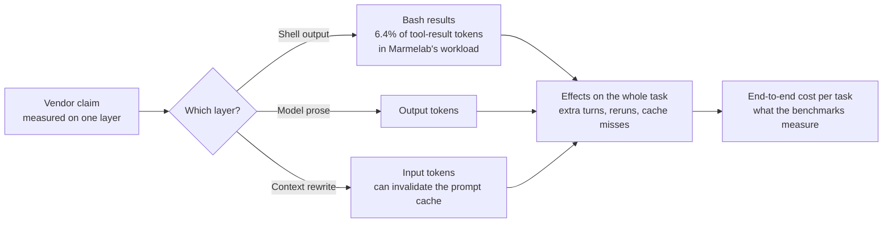

# Контекстная инженерия: инструменты и экосистема

> **Confidence**: Уровень 1/2. Основные концепции, основанные на опубликованных исследованиях и производственных данных. Подробности о сторонних инструментах основаны на общедоступной документации, количество звезд GitHub API подтверждено 7 июля 2026 г.
>
> **Связанное**: [Контекстное проектирование (руководство по настройке)](../core/context-engineering.md) | [Сторонние инструменты](./third-party-tools.md) | [MCP Экосистема серверов](./mcp-servers-ecosystem.md) | [a карта ландшафта инструментов контекстной инженерии](https://www.florian.bruniaux.com/blog/articles/context-engineering-tools-map/) (четыре слоя, не ранжирование)

На этой странице представлена ​​экосистема инструментов, которые помогут вам управлять тем, что попадает в контекстное окно, а что нет. Он дополняет [руководство по контекстному проектированию, ориентированному на конфигурацию](../core/context-engineering.md), который охватывает CLAUDE.md структура и определение пути. Здесь основное внимание уделяется более широкому набору инструментов: сжатию выходных данных, оперативному сжатию, шлюзам искусственного интеллекта, оптимизации RAG, наблюдаемости и инфраструктуре вывода.

---

## Оглавление

1. [Ментальная модель](#1-the-mental-model)
2. [Основные концепции](#2-core-concepts) (MVC, гниение контекста, семантическая подготовка, призрачные токены)
3. [Сжатие вывода: CLI и вывод инструментов](#3-output-compression-cli--tool-output) ([независимые тесты](#independent-benchmarks), RTK, Headroom, pxpipe,tilth, shunt, Token Savior, контекстный режим, stacklit, режим кода Cloudflare MCP)
4. [Prompt Compression](#4-prompt-compression) (LLMLingua, Выборочный контекст, AutoCompressors/Gisting, RECOMP, AttnComp, TOON)
5. [AI Шлюзы](#5-ai-gateways)
6. [RAG ​​Оптимизация](#6-rag-optimization)
7. [Системы памяти](#7-memory-systems)
8. [KV Инфраструктура кэша](#8-kv-cache-infrastructure)
9. [LLMOps и наблюдаемость](#9-llmops--observability)
10. [Выбор инструмента по варианту использования](#10-tool-selection-by-use-case)
11. [Исследовательский ландшафт](#11-research-landscape)

---

## <a name="1-the-mental-model"></a>1. Ментальная модель

Рамка, которая заставляет все остальное щелкать: **, контекстное окно — это RAM, а не диск**.

Оперативная память быстрая, дорогая и ограниченная. Вы не загружаете все, что у вас есть, в оперативную память перед запуском программы. Вы загружаете именно то, что нужно программе, именно тогда, когда она в этом нуждается. То же самое относится и к контексту LLM: каждый токен, который вы туда помещаете, заменяет что-то другое, стоит денег и конкурирует за внимание модели.

Это переосмысливает инженерную задачу. Это не «как мне дать модели больше информации?» но «каков минимальный набор информации, необходимый модели для успеха?» Каждая техника на этой странице является ответом на второй вопрос.

Аналогия с системной архитектурой сохраняется и дальше. Процессор без хорошего управления памятью глохнет. LLM без хорошего управления контекстом галлюцинирует, теряет связность и смещается к общим выводам. Оптимизация контекста — это инвестиция в надежность, а не просто сокращение затрат.

---

## <a name="2-core-concepts"></a>2. Основные концепции

### Минимальный жизнеспособный контекст (MVC)

MVC — это принцип предоставления именно той информации, которая необходима для выполнения задачи, не более того. Он имеет два режима отказа, которые выглядят противоположными, но происходят по одной и той же причине:

- **Under-context**: модели не хватает необходимой информации, она галлюцинирует или выдает общий результат.
- **Over-context**: модель перегружена нерелевантной информацией, внимание рассеивается, приверженность ухудшается.

Исследование ухудшения соответствия (см. руководство по проектированию контекста [, раздел 2](../core/context-engineering.md#2-the-context-budget)) дает количественную оценку сбоям в контексте: CLAUDE.md более 400 строк обычно снижает соответствие примерно до 60%. Причиной является диффузия внимания: слишком много потенциально релевантных сигналов конкурируют за ограниченный бюджет внимания модели.

MVC — это не минимализм сам по себе. Речь идет о точности. Системная подсказка из 300 жетонов, которая точно описывает то, что нужно модели, превосходит подсказку из 3000 жетонов, которая скрывает важную инструкцию на пятой странице.

### Контекстная гниль

Снижение контекста описывает ухудшение поведения модели по мере увеличения длины контекста во время сеанса. Наиболее изученной формой является феномен «потерянного посередине»: модели постоянно недооценивают информацию, помещенную в середину длинного контекста, уделяя внимание в первую очередь началу и концу.

Эмпирические последствия на практике:

- Инструкции в верхней части файла CLAUDE.md выполняются более последовательно, чем инструкции в нижней части.
- В длительных агентных сеансах прежние ограничения теряют свою значимость, поскольку новый контент подталкивает их к середине.
- Результаты инструмента в начале сеанса часто фактически «забываются» после нескольких раундов взаимодействия.

Смягчение: `/compact` при 70% использовании контекста (а не 90%), структурированные перехватчики для заметок и перезапуск сеанса для принципиально новых контекстов задач. Команда `/compact` суммирует историю разговоров, удаляя устаревший контент из окна активного внимания, сохраняя при этом непрерывность.

### Гипотеза семантического прайминга

Наблюдение из исследования сжатия, имеющее практическое значение: когда вы сверхсжимаете контекст (удаляя большинство токенов), модель не запоминает удаленную информацию дословно. Вместо этого сжатый контекст действует как *семантический штрих*: он активирует соответствующие скрытые знания, которые уже присутствовали в весах модели в результате обучения.

Это важно, поскольку означает, что сильно сжатый контекст может работать лучше, чем предполагает его плотность информации. Модель не восстанавливает факты из контекста; он направлен на соответствующие знания, которые у него уже есть. Для хорошо обученных доменов подсказка из 10 токенов может активировать более важные знания, чем дословный отрывок из 100 токенов.

Практический вывод: в стесненных контекстах отдавайте предпочтение ключевым словам и структурным подсказкам, а не прозе. «Использовать OpenAPI 3.1, строгий режим, без значений NULL» обеспечивает более точное поведение, чем два абзаца, объясняющие одно и то же.

### Разрушение контекста и стоимость токена: два давления

Управление контекстом осуществляется под действием двух одновременных факторов давления, которые тянутся в противоположных направлениях:

| Давление | Причина | Эффект | смягчение последствий |
|----------|-------|--------|------------|
| **Поворот контекста** | Слишком много контента | Рассредоточение внимания, потеря посередине | Чернослив, компактный, объем |
| **Стоимость токена** | Каждый токен выставлен счет | Перерасход бюджета, увеличение задержки | Сжатие, фильтрация, кэширование |

Стоимость адресов сжатия. Обрезка адресов гниет. Хорошая контекстная инженерия делает и то, и другое.

### Качество контекста после сжатия («Призрачные токены»)

Большая часть инструментов на этой странице отвечает на вопрос: «Сколько токенов мы сэкономили?» Более новый, более узкий ракурс задает другой вопрос: после `/compact` или любого другого прохода суммирования с потерями, какая часть того, что остается, все еще является несущей, по сравнению с собственным весом, который случайно пережил уплотнение? Для последнего используется термин «призрачные токены»: контент, который требует затрат бюджета, но больше не выполняет полезную работу, в отличие от шумовых целей MVC до того, как сжатие когда-либо запустится.

`alexgreensh/token-optimizer` — инструмент, который больше всего ассоциируется с этим фреймворком (1748 звезд по состоянию на 27 июля 2026 г. по сравнению с 1565 в июне и 947 в мае 2026 г., что является самой быстрорастущей записью в этой категории в процентном отношении). Вместо того, чтобы сообщать об одном проценте сокращения, он нацелен на то, что выдерживает этап уплотнения и соответствует ли это сохранившееся содержимое решаемой задаче.

Это действительно отличный вопрос от показателей необработанного сокращения, представленных в другом месте на этой странице (сокращение токенов Headroom для каждого сценария, RTK до 90% на выходе оболочки). Необработанное сокращение показывает, сколько было сокращено. Качество после уплотнения определяет, является ли то, что было сохранено, правильным и актуальным. Инструмент может получить хорошие оценки по первому показателю и плохие по второму, если он удаляет неправильный контент. Относитесь к этому как к новому измерению, а не как к зрелой категории инструментов. Следите за этой точкой зрения, а не принимайте ее как решенную проблему.

---

## <a name="3-output-compression-cli--tool-output"></a>3. Сжатие вывода: CLI и вывод инструмента.

Выводы инструментов, результаты команд оболочки, журналы испытаний и ответы на запросы к базе данных имеют общую структурную проблему: они на 70–95% содержат шаблонный код. При прохождении набора тестов регистрируются сотни строк успеха для одной неудачи, которая вас волнует. `git log` выгружает метаданные для каждого коммита, когда вам нужны три поля. Этот шум попадает в контекстное окно дословно, если не будет перехвачен.

### <a name="independent-benchmarks"></a>Независимые тесты

Восемь общедоступных тестов измеряли инструменты экономии токенов при выполнении целых задач агента или воспроизводили реальные сеансы, а не на одном уровне. Прочтите 30 сентября 2026 г., они согласны в одном: инструмент, который сокращает вывод оболочки, текст модели или один тип контента, редко сокращает счет на ту же сумму, а некоторые инструменты делают задачи более дорогими. Ни один инструмент не выигрывает во всех тестах, и каждый результат относится к одной подвеске, одной модели и одной настройке усилия. Тестировались модели `claude-sonnet-4-6`, `claude-sonnet-5`, GPT-5.6 Sol и безымянная версия Claude Sonnet, а в воспроизведении Codepointer применялись цены Opus 4.8; ни одна из восьми протестированных моделей Claude Sonnet 5.5, Claude Opus 5.5 или GPT-6, перечисленных в снимке рынка [LLM](../ops/llm-market-snapshot.md), поэтому рассматривайте результаты как устаревшее свидетельство о механизме, а не как текущий рейтинг.

Два из восьми не являются независимыми от каждого инструмента, который они измеряют: Dasein Labs управляет своим стендом и создает Parsec, а сопровождающий THOL является автором Tokenade. Их ряды Parsec и Tokenade являются собственным эталоном каждого производителя, а не сторонним измерением; остальные строки в этих двух тестах измеряют инструменты, которые их издатель не производит.

> **Disclosure**: автор этого руководства внес свой вклад в RTK на раннем этапе и остается его сторонником, не внося активного вклада в его код сегодня. В этом разделе не рекомендуются инструменты: в нем сообщается, что утверждает каждый проект и что измеряли третьи стороны, с указанием источников, а также приводятся измеренные результаты RTK, включая неблагоприятные. Страница сохранения токенов [](https://cc.bruniaux.com/token-savings/) расширяет ее каталогом из 45 проектов, выбранных по фиксированному правилу (публичные, не заархивированные, предназначенные для агентов кодирования и не менее 100 звезд GitHub, или измеренные одним из этих тестов или уже охваченные руководством), каждый со своим утверждением, единицей измерения, используемой в заявлении, и любыми сторонними измерениями.

| Контрольный показатель | Метод | Интерес издателя |
|---|---|---|
| [Bench для сжатия кода Dasein](https://github.com/daseinlabs/code-compression-bench), 4 июля 2026 г. | 100 проверенных задач SWE-bench, безголовый Claude Code, `claude-sonnet-4-6`, официальный грейдер Docker, один запуск на руку, стоимость с учетом кэша | Спонсором и оператором является Dasein Labs, что делает Parsec одним из подразделений. Рука Парсека также вводит краткий поворот-0 и решение об остановке, помимо сжатия. |
| [Stet, «Шесть способов сэкономить»](https://www.stet.sh/blog/gpt-56-token-saving-modes), 20 июля 2026 г. | 10 объединенных изменений из одного производственного репозитория, Codex CLI с GPT-5.6 Sol, 7 рукавов, 2 повторения, 140 прогонов | Неназванный автор создает Stet.sh, используемый инструмент оценки; ни один сравниваемый инструмент не принадлежит им |
| [Marmelab, «Сокращение расходов на агента кодирования»](https://marmelab.com/blog/2026/08/27/which-agent-based-plugin-should-you-use-in-2026.html), 27 августа 2026 г. | Задачи Atomic CRM Builder, от 1 до 4 задач на каждый инструмент, от 3 до 4 запусков на конфигурацию; версии ремня безопасности, модели и инструмента не указаны | Marmelab увеличивает рабочую нагрузку; ни один сравниваемый инструмент не принадлежит им |
| [JetBrains, RTK](https://blog.jetbrains.com/ai/2026/07/rtk-claude-code-token-savings/), июль 2026 г. | 86 задач SkillsBench, 425 оплачиваемых испытаний, Claude Code 2.1.201, rtk 0.43.0, `claude-sonnet-5`, низкие и высокие усилия, тест Уилкоксона для медианы для каждой задачи | Ничего не указано |
| [JetBrains, Caveman](https://blog.jetbrains.com/ai/2026/07/speak-to-ai-agents-like-cavemen-tosave-tokens/), июль 2026 г. | 86 задач SkillsBench, 82 чистые пары, `claude-sonnet-5` с небольшими усилиями, Принудительная активация Caveman | Ничего не указано |
| [Token-Harness Leaderboard](https://pi-infected.github.io/token-harness-optimizer-leaderboard/) (THOL), кампания Claude Code 2.1.206, результаты зафиксированы 18 июля 2026 г. | Безголовый Claude Code с `claude-sonnet-4-6`, 17 задач, 10 запусков на задачу и инструмент; в заголовке указаны 7 задач, в которых для управления без инструментов использовалось не менее 200 000 токенов (70 запусков на инструмент), сквозные доллары США с интервалами начальной загрузки 95%. На странице используется противоположное соглашение о знаках; цифры конвертируются здесь | Поддерживается автором Tokenade, который возглавляет таблицу; на странице так написано |
| [Tura, плагины для сохранения токенов](https://github.com/Tura-AI/benchmark/tree/main/blog_data/token-saving-plugin-eza), 19 июля 2026 г. | Одна задача (переписать инструмент Rust `eza` на Python, 52 утверждения), Codex CLI 0.144.1 с GPT-5.6 Sol при высоком уровне рассуждений, 2 запуска на руку, стоимость смоделирована на основе количества токенов по прейскурантным ценам. | Опубликовано сопровождающим Tura, конкурирующим агентом кодирования; автор говорит, что это не независимая рецензия |
| [Codepointer, «Сокращение стоимости токена LLM»](https://codepointer.dev/p/cutting-llm-token-costs-with-rtk), 18 июня 2026 г. | Контрфактическое воспроизведение 500 сессий из собственной истории Claude Code автора (614 миллионов токенов, 926,31 доллара США по прейскурантным ценам); нет живых запусков, успех задачи не измеряется | Никакой связи с сравниваемыми проектами не указано |

**Results.** Отрицательный результат означает, что дешевле, чем тот же агент без инструмента.

| Инструмент | Контрольный показатель | Что было измерено | Результат |
|---|---|---|---|
| РТК | Dasein | Общая стоимость | +13%, решено 54 задачи против 57 без него |
| РТК | JetBrains | Средняя стоимость задачи: низкая, затем высокая трудоемкость | +7,6% (р=0,004), затем +0,1% (р=0,99); качество без изменений. Сопровождающие RTK оспаривают принцип «один запуск на задачу» (см. раздел RTK). |
| РТК | Стет | Стоимость рабочей нагрузки, запуск 1, затем запуск 2 | +13%, затем -9% |
| РТК | ТОЛ | Сквозная стоимость, 7 длинных задач | +7,1% (интервал 95% от -7,2% до +26,0%) |
| РТК | Тура | Смоделированная стоимость, одна задача, 2 прогона | +7,2%, на 44% больше агентских раундов; автор говорит, что данные не идентифицируют эффект плагина |
| РТК | Кодовый указатель | Доля повторных расходов | -0,5%, при этом сокращая от 33% до 99% производительности оболочки, которую он распознает. |
| Пещерный человек | JetBrains | Выходные токены, принудительная активация | -8,5%. README теперь сообщает о 50% медианном сокращении выходных токенов по сравнению с «Ответить кратко». контроль (только умение); в описании GitHub по-прежнему написано «сокращает 65% токенов» |
| Пещерный человек | Dasein | Общая стоимость | -19% |
| Пещерный человек | Стет | Стоимость рабочей нагрузки, запуск 1, затем запуск 2 | +9%, затем -12% |
| Пещерный человек | ТОЛ | Сквозная стоимость, 7 длинных задач | -13,6% (интервал от -30,2% до +3,6%) |
| Пещерный человек | Тура | Смоделированная стоимость, одна задача, 2 прогона | -3.9% |
| Пещерный человек | Кодовый указатель | Доля повторных расходов | -0.4% |
| Высота над головой | Dasein | Общая стоимость | +44% |
| Высота над головой | Мармелаб | Стоимость за операцию, режим кэша, затем режим токена | -4% (авторы называют шумом), затем +32% |
| Высота над головой | ТОЛ | Сквозная стоимость, 7 длинных задач | +52,8% (интервал от +10,2% до +120,2%) |
| Высота над головой | Кодовый указатель | Доля повторных расходов | -2,8%, со средним сокращением выходных данных grep и diff на 54%, которых он касается. |
| хвостик | Стет | Стоимость рабочей нагрузки, запуск 1, затем запуск 2 | +20%, затем -2%; тестов 1 победа, 4 поражения, 15 ничьих |
| хвостик | ТОЛ | Сквозная стоимость, 7 длинных задач | -3,5% (интервал от -18,1% до +12,4%) |
| хвостик | Тура | Смоделированная стоимость, одна задача, 2 прогона | -8,9%; разница между двумя пробегами составила 51,7% от их среднего значения. |
| Контекстный режим | Стет | Стоимость рабочей нагрузки, запуск 1, затем запуск 2 | +72%, затем +33% |
| Графифицировать | Мармелаб | Стоимость большой трансформации | +1% |
| Graphify, график проверки кода | ТОЛ | Сквозная стоимость, 7 длинных задач | -3,3% и -8,5%, но THOL сообщает, что агент никогда не вызывал ни один из инструментов, поэтому разрыв не является эффектом инструмента. |
| КодГраф | ТОЛ | Сквозная стоимость, 7 длинных задач | -7,6% (интервал от -21,6% до +8,7%) |
| lean-ctx | ТОЛ | Сквозная стоимость, 7 длинных задач | +10,3% (интервал от -12,6% до +46,4%) |
| Эджи | ТОЛ | Сквозная стоимость, 7 длинных задач | -14,7% (интервал от -37,1% до +11,1%); THOL отмечает отсутствие учета токенов для этого инструмента |
| claude-token-efficient | ТОЛ | Сквозная стоимость, 7 длинных задач | -11,6% (интервал от -24,2% до +1,4%) |
| Навигация по коду LSP | Мармелаб | Стоимость большой трансформации | -13% |
| Парсек | Dasein (спонсорская рука) | Общая стоимость | -39%, решено 62 задачи |
| Ферма | Dasein | Общая стоимость | -22%, решено 55 задач; бежать 21 сентября 2026 г. на более поздней подвеске, не в паре с другими руками |
| Воз | Dasein | Общая стоимость | -13%, решено 55 задач, настенные часы +23% |
| Токенада | THOL (авторский инструмент) | Сквозная стоимость, 7 длинных задач | -38,9% (интервал от -53,2% до -22,3%); агент вызывал инструмент в 5 из 70 запусков |
| Переход на GPT-5.6 Terra xhigh | Стет | Стоимость рабочей нагрузки, запуск 1, затем запуск 2 | -49%, затем -49%: смена модели, единственное повторное падение в этом исследовании. |

**Препринты исследований (с 2025 г. по сентябрь 2026 г.).** Эти препринты arXiv, еще не прошедшие рецензирование, проверяют сокращение количества токенов в сравнении с заявленной или предполагаемой стоимостью, успехом или временем. Их тезисы были зачитаны 30 сентября 2026 г.; на странице [, посвященной экономии токенов,](https://cc.bruniaux.com/token-savings/#research) перечислено 15, отделяя исследования от статей, авторы которых оценивают собственный метод.

| Препринт | Настройка | Нахождение |
|---|---|---|
| [Сокращение токенов не является снижением стоимости](https://arxiv.org/abs/2607.12161) (Weinberger, Hozez; v1 13 июля 2026 г., v5 12 августа 2026 г.) | Три подхода к сокращению количества токенов по сравнению с немодифицированным Claude Code, стоимость, оплачиваемая поставщиком, подмножество Go SWE-bench | Крупнейшее сокращение установки сжатия привело к увеличению количества токенов вывода инструментов на 38,4% и увеличению выставленных счетов на 6,8%; между задачами сокращение токенов и снижение затрат коррелируют слабо (Pearson r = 0,15) |
| [Эмпирическое определение стоимости шлюзов сжатия контекста в агентах многооборотного кодирования](https://arxiv.org/abs/2609.22114) (Чен, Ши; v1 19 августа 2026 г.) | Париток, производственный шлюз между Claude Code или Codex и Claude Sonnet или GPT-5. | Фильтрация инструментальной схемы удаляет от 21 до 57 тысяч токенов за ход; сжатие контента экономит около 2% за ход; авторы предупреждают, что тесты однократного сжатия не следует использовать в качестве аргумента в пользу стоимости многоэтапного сжатия. Статья представляет собой личный шлюз авторов. |
| [Во что обходится агенту сжатие контекста?](https://arxiv.org/abs/2608.16370) (Лю; v1, 17 августа 2026 г.) | Три модели, две задачи, горизонт на 24 оборота | При использовании GPT-5.5 степень завершения выросла с 80% до 85% (p = 1,0), а количество вызовов извлечения возросло с 21,0 до 63,9 (p = 0,002): агент вновь получает состояние, в котором сжатие было снижено. |
| [CAVEWOMAN](https://arxiv.org/abs/2606.24083) (Адейеми, Росси, Дернонкур; v1 23 июня 2026 г.) | Восемь моделей, пять наборов данных, отдельные поколения, а не цикл агентов | Реализованная стоимость снижения выходного сжатия составила от 1,4 до 2,4 раза за модель на большинстве моделей API; Сжатие входных данных увеличило чистую стоимость примерно в 1,15 раза по сравнению со средним значением пяти тестов. |
| [Не ломайте кэш](https://arxiv.org/abs/2601.06007) (Люмер, Низар, Джангити и др.; v2 31 января 2026 г.) | Три стратегии кэширования, три провайдера, более 500 сеансов агентов | Оперативное кэширование снизило стоимость API на 41–80 %: сохранение целостности кэша важнее, чем сжатие того, что в него входит. |
| [Агентное кодирование в дикой природе](https://arxiv.org/abs/2608.00101) (Лю, Цю, Гойри и др.; v1 30 июля 2026 г.) | Июнь 2026 г. Отслеживание GitHub Copilot: 3,2 млн пользователей, 13 млн сеансов, 761 млн звонков. | Коэффициент попадания в кэш составляет в среднем 90 % в течение хода и падает до 55 % за пределами хода. |
| [Может ли ваш ИИ-агент быть дешевле?](https://arxiv.org/abs/2608.25399) (Smekal; v1 26-08-2026) | 2700 пробежек с Кими К3 на трех уровнях нагрузки. | Замена полной спецификации задачи пустой пользовательской историей увеличила расходы на токены на 29,7%. |
| [За пределами экономии токенов: систематическое исследование сжатия контекста в агентах LLM](https://arxiv.org/abs/2609.32961) (Сатиш, Синха, Кавада, Ядвадкар; v1 26 сентября 2026 г.) | Около 35 000 пробегов, три модели с открытым весом, проверены SWE-bench и Terminal-Bench 1.0. | В Terminal-Bench с Qwen политики, использующие примерно треть меньшего количества токенов, могут занять на 20–80 % больше времени, и одна и та же политика ведет себя по-разному в разных моделях. |

**Почему экономия на слоях не становится экономией на счетах.** В базовых запусках Marmelab результаты `Read` составляли 90,6% токенов результатов инструментов, а `Bash` — 6,4%. Компания JetBrains обнаружила, что RTK-вызовы Bash могут перезаписывать несут чуть менее 20% символов результатов инструмента, и что результаты инструмента являются лишь частью того, что выставляет счет за сеанс, поскольку один и тот же контекст перечитывается на каждом ходу. За время запуска с минимальными усилиями `rtk gain` сообщил о сохранении 96,2 миллиона токенов, в то время как измеренный счет увеличился.




**Как использовать эти результаты.**

- **Сравнивайте знаменатели перед числами.** «До 90% меньше токенов в выводе оболочки» и «+7,6% стоимости задачи» описывают разные количества; оба могут быть правдой.
- **Скидка на одиночные прогоны.** Dasein запускает каждую руку один раз при выполнении 100 задач, а знаки Стета переключаются между двумя повторениями для Caveman, Ponytail и RTK.
- **Учитывайте интерес издателя.** Два теста, которые оценивают инструмент на первое место, проводятся производителем этого инструмента (Dasein для Parsec, разработчиком THOL для Tokenade), а тест Tura исходит от сопровождающего конкурирующего агента.
- **Измерьте свои собственные задачи.** Выполните свою рабочую нагрузку с помощью инструмента и без него, в паре, и сравните стоимость принятой задачи, как описано в разделе [AI об экономике устройства](../ops/ai-unit-economics.md#2-building-a-cost-per-accepted-task). Карта рычагов FinOps [AI](../ops/ai-finops.md#3-lever-map) помещает сжатие среди других рычагов затрат.

### <a name="rtk-rust-token-killer"></a>RTK (Убийца жетонов ржавчины)

RTK — это прокси-сервер CLI, который перехватывает выходные данные команд до того, как они достигнут контекста Claude, применяя специальные фильтры, которые обрабатывают сигнал и отсекают шум. Он интегрируется через перехватчик Claude Code, поэтому стандартные команды прозрачно переписываются.

| Атрибут | Подробности |
|-----------|---------|
| **Источник** | [github.com/rtk-ai/rtk](https://github.com/rtk-ai/rtk) |
| **Установить** | `brew install rtk`, сценарий установки из README или `cargo install --git https://github.com/rtk-ai/rtk` (другой крейт «rtk» существует на crates.io) |
| **Звезды** | 82 094 (GitHub API, 30 сентября 2026 г.), по сравнению с 69 042 на 07 июля 2026 г., 24 397 в апреле 2026 г. и 446 в феврале 2026 г. |
| **Интеграция** | Перехват Claude Code через `rtk init --global` |

Скачок с апреля по июль, примерно в 2,8 раза, представляет собой крутую кривую для прокси-сервера CLI. Это вполне правдоподобно, учитывая растущую степень интеграции инструмента в настройки других агентов по умолчанию (см. ниже), но считайте эту цифру непроверенной по сравнению с полным графиком звездной истории, а не подтвержденным ростом, и перепроверяйте ее, прежде чем цитировать ее в контексте высоких ставок.

Собственные цифры RTK для каждой команды, в которых учитываются только выходные данные оболочки:

| Команда | Снижение |
|---------|-----------|
| `rtk git log` | 92% |
| `rtk git status` | 76% |
| `rtk vitest run` | 99%+ |
| `rtk cargo test` | 89% в среднем |
| `rtk pnpm outdated` | 70–85% |

Философия дизайна: подавлять успешные результаты, поверхностные сбои. Набор тестов, который прошел 300 тестов и не прошел 2, должен отображать 2 строки, а не 302. Это соответствует тому, как разработчик читает выходные данные. Контекст должен соответствовать этой когнитивной модели.

RTK поддерживает пользовательские фильтры через TOML DSL (`.rtk/filters.toml`) для шаблонов вывода, специфичных для проекта, без написания Rust. Полный справочник функций см. в разделе [Сторонние инструменты: RTK](./third-party-tools.md#rtk-rust-token-killer).

**Реальное влияние на затраты**: README от RTK сам устанавливает ограничение: он сокращает до 90% выходных данных bash, читаемых агентом, что «не то же самое, что сокращение вашего счета на 90%», а встроенные в Claude Code инструменты Read, Grep и Glob обходят его хук. Контрфактическое воспроизведение 500 собственных сеансов Claude Code Codepointer (926,31 доллара США по прейскурантным ценам) показало, что RTK экономит 0,5% расходов, одновременно сокращая от 33% до 99% распознаваемых выходных данных оболочки. Автор агента maki сообщает, что bash составляет около 12% от общего использования его токена, а чтение файла составляет около 65%. Экономия на каждой команде реальна; они применимы к одному фрагменту контекста.

**Ответ сопровождающих RTK**: в [«RTK on SkillsBench: Что измеряет эталонный тест»](https://www.rtk-ai.app/blog/rtk-on-skillsbench/) (RTK AI Labs, 07 августа 2026 г.) сопровождающие утверждают, что заголовок JetBrains основан на одном запуске для каждой задачи и что дополнительные обороты (+13,8%) обусловлены поведением агента, а не сжатием. При повторном запуске с RTK v0.45.0 они сообщают о затратах -4,8% на 13 задач разработки (перестановка p = 0,305), результатах на уровне задач от -32% до +14%, вариациях от запуска к запуску для одной и той же задачи примерно 22% и потолке сжатия примерно от 3% до 4% от стоимости, поскольку RTK переписал около трети вызовов Bash, охватывающих около 20% символы вывода инструмента. Это собственный анализ поставщика. См. также [issue #3157](https://github.com/rtk-ai/rtk/issues/3157). В описании репозитория GitHub указано «60-90% общих команд разработки», а в заголовке README говорится «до 90% вывода bash, который читает ваш агент».

**Сторонние измерения**: JetBrains измерила среднюю стоимость задачи в целом по всем задачам +7,6 % при RTK при небольших усилиях (p=0,004) и +0,1 % при высоких усилиях при неизменном качестве; Dasein показал +13% общей стоимости; Стет показал +13%, затем -9% за два прогона; THOL показал +7,1% на длинных сессиях с интервалом, пересекающим ноль. См. [независимые тесты](#independent-benchmarks), где описаны методы и предостережения. Автор этого руководства на раннем этапе внес свой вклад в RTK и остается его сторонником, но сегодня не участвует активно в его коде.

### Высота над головой

Запас сжимает то, что входит в контекст из выходных данных инструмента, структурированных данных и истории разговоров. Его формирователь выходных данных также уменьшает то, что возвращается от модели, что делает его одним из немногих инструментов, которые работают с обеих сторон вызова LLM.

| Атрибут | Подробности |
|-----------|---------|
| **Источник** | [GitHub: headroomlabs-ai/headroom](https://github.com/headroomlabs-ai/headroom) |
| **Docs** | [headroom-docs.vercel.app](https://headroom-docs.vercel.app/docs) |
| **Звезды** | 74 156 (GitHub API, 30 сентября 2026 г.), по сравнению с 62 778 27 июля 2026 г. и 57 223 07 июля 2026 г. |
| **Автор** | Теджас Чопра (старший инженер Netflix) |
| **Лицензия** | Апач 2.0 |
| **Установить** | `pip install "headroom-ai[all]"` или `npm install headroom-ai` |
| **Версия** | v0.39.1 (последний выпуск, 26 сентября 2026 г.) |

> Исправление **URL**: более ранние версии этого руководства связаны с `headroom.ai` (несвязанный домен), а более поздние `github.com/chopratejas/headroom` (личная вилка автора). С тех пор проект перешел в организацию `headroomlabs-ai`; старый личный пул теперь перенаправляет, стандартный организационный перевод GitHub.

**Заявленное влияние на затраты**: сопровождающий указывает совокупную экономию в размере «~ 700 тысяч долларов США за 200 миллиардов обработанных токенов». Об этом сообщается самостоятельно, сторонний аудит не обнаружен. Считайте это маркетинговым сигналом, а не проверенной цифрой, в отличие от приведенных ниже контрольных цифр для каждой рабочей нагрузки, которые публикуют методологию.

**Пять режимов развертывания**:

1. Библиотека Python: `compress(messages)` непосредственно в коде приложения.
2. TypeScript/npm: `withHeadroom()` / `compress()`
3. Прокси HTTP: `headroom proxy --port 8787`, затем установите `ANTHROPIC_BASE_URL=http://localhost:8787`
4. Сервер MCP: `headroom mcp install` (открывает `headroom_compress`, `headroom_retrieve`, `headroom_stats`)
5. Обертка агента: `headroom wrap claude|codex|cursor|aider|copilot`

**Compress-Cache-Retvieve (CCR)**: вместо отправки подробного вывода инструмента в модель Headroom заменяет его заполнителем `{{HEADROOM_TAG_N}}`, сохраняет оригинал в локальном хранилище SQLite (векторный индекс HNSW + полнотекстовый индекс FTS5) и регистрирует дескриптор извлечения. Модель вызывает `headroom_retrieve(tag)`, когда ей нужны исходные данные. Несколько агентов (Claude + Codex) могут использовать одно и то же хранилище SQLite для передачи обслуживания контекста между агентами.

**Output shaper** (`HEADROOM_OUTPUT_SHAPER=1`): добавляет краткую инструкцию в конце системной подсказки (префикс кэша сохраняется) и уменьшает усилия модели при поворотах, следующих за успешными результатами инструмента. Экономия указывается как «оценочная» с использованием 10% контрольной группы с 95% доверительным интервалом.

**Область тестирования**: В описании репозитория, прочитанном 30 сентября 2026 г., говорится: «На 20 % меньше токенов для агентов кодирования, на 60–95 % меньше токенов для JSON, те же ответы». Текущее сокращение токенов README (отладка инцидентов SRE 57 %, исследование кодовой базы 42 %, сортировка проблем GitHub 30 %, поиск кода 21 %, чтение 30 сентября 2026 г.) измеряется по четырем автономным сценариям, созданным на основе выходных форматов сервера MCP, а не по расходам за весь сеанс; более ранние версии содержали от 73% до 92% того же контента. Результаты сторонних разработчиков по всем задачам: общая стоимость Dasein составила +44%, THOL +52,8% при длительных сеансах, Marmelab -4%, затем +32%, а повтор Codepointer -2,8% расходов (см. [независимые тесты](#independent-benchmarks)). Тесты точности (GSM8K от 0,870 до 0,870, TruthfulQA 0,530 против 0,560) представляют собой N = 100 выборок, независимо не воспроизведенных. Команда воспроизведения: `python -m headroom.evals suite --tier 1`.

**Известные проблемы (июнь 2026 г., проверьте текущий статус решения в системе отслеживания проблем)**:

- **Issue #714**: Срок действия оригиналов CCR истекает через 5 минут (LRU TTL). Длительно выполняемые задания агента, которые делают паузу между шагами, могут привести к сбоям извлечения по истечении срока действия кэша. Для этого случая не зарегистрировано никакого постоянного резервного варианта.
- **Issue #1158**: `headroom wrap claude` автоматически ограничивает контекст на уровне 200 КБ для подписчиков Claude Max (бета-заголовок `context-1m-2025-08-07` удален). Пользователи Claude Max должны использовать `headroom mcp install` вместо `wrap`.
- **Issue #1227** (безопасность, не решена по состоянию на июнь 2026 г.): конечные точки CCR не имеют защиты по шлейфу и используют разрешительный CORS. Локальная веб-страница может читать кэшированные выходные данные инструмента без аутентификации. Избегайте CCR, если хост работает вместе с ненадежным локальным веб-контентом.
- **Issue #1209**: В некоторых конфигурациях CCR сохраняет заполнитель `{{HEADROOM_TAG_N}}` как исходный, поэтому `headroom_retrieve` возвращает заполнитель, а не фактические данные. Подана ПР № 1208.
- **Issue #1233**: `CodeAwareCompressor` генерирует неверный синтаксис Python примерно в 28% реальных файлов, содержащих современный синтаксис (match/case, оператор моржа, вложенный асинхронный код). В этих случаях тихий переход к несжатому выводу.

**Когда выбирать запас вместо RTK**: RTK обрабатывает неструктурированный текст CLI и удаляет контент, который вам определенно не нужен. Запас — правильный выбор для структурированных данных (полезные данные JSON, результаты базы данных, ответы API), где вы не можете заранее предсказать, какие части потребуются модели, и где требуется извлечение без потерь. Эти два инструмента дополняют друг друга; RTK работает на выходном уровне оболочки, а запас — на уровне структурированных данных.

**Производственное примечание**: Сжатие ядра работает. У CCR есть проблемы с надежностью из-за ошибок № 714 и № 1209 выше. Для пользователей Claude Max предпочтительнее режим MCP, а не `headroom wrap`.

### pxpipe

pxpipe — первый производственный инструмент, созданный на сжатии контекста optical/visual специально для Claude Code и Anthropic API: вместо сжатия текста он перезаписывает большие блоки контекста в изображения перед тем, как запрос покинет машину. См. [Контекстная инженерия: оптическое и визуальное сжатие контекста](../core/context-engineering.md#optical-and-visual-context-compression), чтобы узнать о линии исследований (DeepSeek-OCR, AgentOCR, Glyph, VIST).

| Атрибут | Подробности |
|-----------|---------|
| **Источник** | [github.com/teamchong/pxpipe](https://github.com/teamchong/pxpipe) |
| **Лицензия** | Массачусетский технологический институт, TypeScript |
| **Звезды** | 4277 (GitHub API, 07.07.2026), по сравнению с 586 на момент запуска в мае 2026 года, примерно в 7 раз менее чем за два месяца. |
| **Установить** | `npx pxpipe-proxy` |

**Механизм**: локальный прокси-сервер перехватывает вызовы `/v1/messages` и, превышая вычисленный порог экономической эффективности, перезаписывает большие блоки `tool_result`, уже свернутые старые повороты и статический блок system-prompt/tool-doc в изображения PNG (столбцы шириной 1928 пикселей, примерно 92 000 символов на страницу, примерно 4761 токен видения на страницу). Он никогда не затрагивает выходные данные модели, недавние повороты или скудную прозу, где текст остается дешевле за символ. Безубыточность соотношения текста и изображения составляет около 19 символов на токен; Наблюдаемый разработчиком трафик Claude Code в среднем составляет 1,91 символа на токен, поэтому большую часть большого контента стоит визуализировать. Точный байтовый контент (пароли, хеши, идентификаторы) явно исключается из рендеринга и помечается в README как документированный риск потери памяти, а не как решенная проблема.

```bash
npx pxpipe-proxy
ANTHROPIC_BASE_URL=http://127.0.0.1:47821 claude
```

**Бенчмарки**: сквозное сокращение счетов на 59–70 %, измеряемое для каждого запроса с помощью параллельного контрфактического вызова `count_tokens`, зарегистрированного в `~/.pxpipe/events.jsonl` и перепроверенного с фактическим выставленным счетом за использование, воспроизводимая методология, а не маркетинговая оценка. Пилотный проект SWE-bench Lite: 10/10 проходит в обе руки при размере запроса -65% (маленький n, раскрытый как таковой в README). Дословное воспроизведение 12-значных шестнадцатеричных строк: 13/15 правильно в Fable 5, 0/15 в Sol, нумерует состояния README явно, а не скрывает.

**Список разрешений модели**: по умолчанию — `claude-fable-5` и `gpt-5.6`. Opus 4.7/4.8 и GPT-5.5 включены из-за более высоких показателей ошибочного чтения визуализированных изображений.

**Когда выбирать pxpipe вместо Headroom**: тот же уровень шлюза API, другая модальность. Запас сжимает текст в текст (обратимый, на основе поиска); pxpipe растрирует текст в изображения (с потерями для точных строк, а не на основе поиска). Они скорее дополняют, чем конкурируют: pxpipe предназначен для Claude Code/Anthropic-API с ограниченной поддержкой GPT, а не является многоагентным универсальным инструментом, таким как Headroom.

### вспашка

Tilth — это сервер MCP для навигации по коду, ориентированный на самый крупный источник использования токенов в сеансах Claude Code: чтение файлов. Вместо того, чтобы возвращать полное содержимое файла, он обеспечивает структурную навигацию через Tree-Sitter, поэтому модель считывает формы и взаимосвязи вместо необработанного текста.

| Атрибут | Подробности |
|-----------|---------|
| **Источник** | [github.com/jahala/tilth](https://github.com/jahala/tilth) |
| **Установить** | `cargo install tilth`, затем `tilth install claude-code` |
| **Архитектура** | Сервер MCP, устанавливается в Claude Code |
| **Парсер** | сидящий на дереве (многоязычный) |

Основные инструменты, которые он предоставляет:

- **Чтение файла с автоконтуром**: для больших файлов вместо полного текста возвращает структурный скелет с названиями разделов и диапазонами строк. Модель запрашивает определенные диапазоны по запросу.
- **Поиск символов**: определения, использование и разрешенные вызываемые объекты в одном вызове, заменяющем цикл grep-then-read.
- **`--callers`**: все места вызова символа структурно, а не через текстовый поиск.
- **`--deps`**: импорт и зависимости файла, полезны перед рефакторингом для понимания радиуса взрыва.
- **`grok <symbol>`**: все об одном символе в одном вызове: подпись, вызывающие, вызываемые, родственные функции, связанные тесты.
- **Структурные различия**: сводка изменений на уровне функции, а не на уровне строки.
- **Session dedup**: символы, уже показанные в сеансе, помечаются как `[shown earlier]`, а не повторно расширяются.

**Benchmarks**: компания Tilth отказалась от предыдущего эталона стоимости (версия 0.5.0, модели начала 2026 года). В документе README от 30 сентября 2026 г. говорится, что эталонный тест «больше не описывает инструмент» и что «вспашка не требует затрат»; жгут хранится под биркой `benchmark-archive`. В более ранних версиях этого руководства указывалась цена за правильный ответ в этом тесте -40%; не используйте его повторно. Никаких сторонних измерений обнаружено не было.

Почему чтение файлов является важной целью: при измеренной рабочей нагрузке Marmelab результаты `Read` составили 90,6% токенов результатов инструмента, а `Bash` — 6,4%, а автор отчетов агента maki читает около 65% общего использования своих токенов по сравнению с примерно 12% для bash. Меньшее чтение не гарантирует меньшую стоимость по причинам, указанным в независимых тестах [](#independent-benchmarks).

**Install:**

```bash
cargo install tilth
tilth install claude-code   # registers the MCP server in Claude Code
```

После глобальной установки не требуется настройка для каждого проекта.

**Сравнение с Lean-ctx**: И Tilth, и Lean-ctx используют Tree-Sitter для сжатия чтения файлов. Lean-ctx работает как перенаправление на уровне перехвата (перехватывает собственные вызовы Read на уровне MCP), аtilth предоставляет явные инструменты навигации, которые модель вызывает напрямую. Lean-ctx более прозрачен и не требует изменений в том, как модель запрашивает файлы. Tith дает модели больше контроля над тем, что она извлекает, но требует использования инструментов Tith, а не стандартных операций чтения. Командам, которые хотят, чтобы модель активно перемещалась по структуре кода, а не пассивно сжимала данные, лучше подходят явные инструменты Tilth.

### <a name="shunt-delegation-not-compression"></a>шунт (делегирование, а не сжатие)

Шунт нацелен на тот же пул, что и Tilth и Lean-ctx, чтение файлов, но с другим механизмом. Он не сжимает то, что читает Claude. Он полностью отделяет файл от Claude: перехватчик блокирует чтение, а сценарий отправляет файлы и вопрос более дешевой модели, которая отвечает кратким описанием. Claude видит только эту сводку.

| Атрибут | Подробности |
|-----------|---------|
| **Источник** | [github.com/spotify/portal-ai-plugins](https://github.com/spotify/portal-ai-plugins) (`plugins/shunt`, Apache-2.0) |
| **Статья** | [Portal от Spotify сократил использование моего токена Claude Code на 90%](https://engineering.atspotify.com/2026/9/portal-by-spotify-cut-my-claude-code-token-usage-by-90) |
| **Требуется** | Экземпляр Spotify Portal (коммерческое управление Backstage, бесплатная пробная версия, затем продажная цена) с помощником AiKA |
| **Рабочая модель** | Gemini 2.5 Flash по умолчанию, настраивается для каждого «режима» портала |
| **Оценка** | [spotify-portal-shunt.md](../../docs/resource-evaluations/spotify-portal-shunt.md) (3/5) |

**Как это работает**: перехватчик `PreToolUse` на `Read` блокирует полное чтение файлов длиной более 350 строк и называет навык `/bulk-reader` в его отказе. Второй хук делает то же самое для `cat`, `head`, `tail`, `less` и `more` в Bash. Скрипт `bulk-read` отправляет файлы в рабочую модель через портал CLI. Сценарий `code-write` генерирует шаблон из спецификации и одного справочного файла и записывает его прямо на диск, поэтому Claude никогда не читает сгенерированный код.

**Чтение 90%**: это среднее значение трех сценариев чтения (82%, 94%, 94%) в частном монорепозитории, учитываемое как токены, входящие только в контекст Claude. Жетоны рабочей модели, дополнительный ход, вызванный каждым блоком, и точность ответа не учитываются. Стоимость перемещается в другой счет, а не исчезает. Автор также сообщает об ограничениях: сводки рабочих содержат ненадежные номера строк, поэтому редактирование по-прежнему требует целевого чтения, а Gemini Flash пропустил ошибку потокобезопасности, которую Claude обнаружил после получения этого раздела. Примените контрольный список в [Как прочитать заявление поставщика о снижении затрат](../ops/ai-unit-economics.md#6-how-to-read-a-vendors-cost-reduction-claim), прежде чем называть цифру.

**Измеренные дефекты** (тестирование в реальном времени, Claude Code 2.1.284, без экземпляра Portal):

- Блок «Чтение» работает с текстовыми файлами, но PDF-файлы также блокируются: количество строк берется в двоичном формате, поэтому PDF-файл с 4471 байтом новой строки отправляется по пути делегирования.
- Хук Bash игнорирует пути, начинающиеся с `~`: `head -100 ~/project/file.ts` проходит, в то время как та же команда с абсолютным путем блокируется. Перехватчик проверяет буквальную строку, и кавычка `~` не расширяется.
- Дальние чтения всегда проходят, в том числе и по `offset: 0`, а само сообщение об отказе предлагает перечитать по `offset` и `limit`. Крюк рулит Claude; он не обеспечивает соблюдение бюджета.
- `code-write --target` записывает через Bash, вне каких-либо правил перехвата или разрешений, относящихся к `Edit` и `Write`.

**Что из этого взять**: выкройку, а не продукт. Первой авторской версией был блок правил маршрутизации в `CLAUDE.md`, который Claude мог игнорировать. Хук заставляет маршрутизацию применяться при каждом вызове. Вы можете воспроизвести то же самое принудительное применение без портала и без отправки кода второму поставщику, перенаправив его на субагент, работающий на Haiku:

```markdown
<!-- .claude/agents/bulk-reader.md -->
---
name: bulk-reader
description: Answers a precise question about large files. Use when a full read was refused for size.
tools: Read, Grep, Glob
model: haiku
---
Read the files named in the task and answer only the question asked, in short bullets.
Lead each bullet with the exact symbol name and line number. Do not propose edits.
```

```bash
#!/usr/bin/env bash
# PreToolUse hook (matcher: Read): send full reads of large text files to a Haiku subagent
MIN_LINES="${BULK_READ_MIN_LINES:-350}"
input=$(cat)
# The subagent itself must be able to read the files it was sent
[ "$(jq -r '.agent_type // empty' <<<"$input")" = "bulk-reader" ] && exit 0
# Ranged reads (offset or limit set, including 0) are targeted: let them through
[ "$(jq -r '.tool_input | has("offset") or has("limit")' <<<"$input")" = "true" ] && exit 0
path=$(jq -r '.tool_input.file_path // empty' <<<"$input")
[ -f "$path" ] || exit 0
# Text files only: PDFs, images and notebooks go to Read as usual
case "$(file -b --mime-type "$path")" in
  text/*|application/json|application/xml|application/javascript) ;;
  *) exit 0 ;;
esac
lines=$(wc -l < "$path" | tr -d ' ')
[ "$lines" -le "$MIN_LINES" ] && exit 0
jq -n --arg r "File is $lines lines (threshold: $MIN_LINES). Ask the bulk-reader subagent a precise question about it, or re-read only the section you need with offset and limit." \
  '{hookSpecificOutput: {hookEventName: "PreToolUse", permissionDecision: "deny", permissionDecisionReason: $r}}'
```

Зарегистрируйте его под `hooks.PreToolUse` с `"matcher": "Read"` в `.claude/settings.json`. Перехватчик использует текущий формат `hookSpecificOutput`, автоматически завершает работу, когда ему нечего решать, и считывает `agent_type`, чтобы субагент не блокировался правилом, которое он обслуживает. Чтение файлов уже разрешено Claude Code в абсолютные пути, поэтому описанная выше проблема `~` не применима к перехватчику чтения. Компромисс остается таким же, как и у шунта: файл заменяется сводкой, что подходит для вопроса «что делает этот модуль» и неправильно для «исправления строки 212». Измерьте до и после с помощью `/cost` по одним и тем же вопросам и проверьте ответы, а не только количество жетонов.

**Сравнение с Tilth и Lean-ctx**: они отсекают токены чтения локально, без добавления модели, и сохраняют доступность точного контента. Шунт и вариант субагента заменяют чтение ответом из другой модели: большая экономия на исследовательских вопросах, с потерями по конструкции и бесполезна для редактирования.

### Жетон Спасителя

Token Savior — это сервер MCP «три в одном»: навигация по структурному коду по символам (замена полного чтения файлов), сжатие вывода Bash для 34 распространенных инструментов CLI и постоянная межсессионная память через SQLite с FTS5.

| Атрибут | Подробности |
|-----------|---------|
| **Источник** | [GitHub: Mibayy/token-savior](https://github.com/Mibayy/token-savior) |
| **Установить** | `pip install "token-savior-recall[mcp]"`, затем `ts init --agent claude --yes` |
| **Звезды** | ~ 1000 (июнь 2026 г.) |
| **Язык** | Питон 3.11+ |
| **Последний коммит** | Апрель 2026 г. (добавлена ​​поддержка C99/C11 и GLSL) |

**Основные инструменты навигации** (через профиль `optimized`, более 15 инструментов):

- `find_symbol(name)` — нахождение функций и классов в индексированной базе кода.
- `get_function_source(name)` — получить реализацию без загрузки полного файла
- `get_full_context(identifier)` — расширенный контекст вокруг символа
- `get_change_impact(identifier)` — цепочка зависимостей для анализа радиуса взрыва перед рефакторингом
- `build_commit_summary` — последние изменения git без чтения каждого файла
- `memory_index` / `memory_search` — сохранение и извлечение результатов сеанса во время прогонов.
- `ts_discover()` — сканирование прошлых транскриптов на предмет упущенных возможностей оптимизации.

**Bash Compaction**: 34 компактора вывода для git, pytest, jest, kubectl и подобных инструментов, активируемых через хуки `TS_BASH_COMPACT=1` и PostToolUse. Выходные данные размером более 4 КБ возвращаются к полному захвату. Эта функция является добровольной и обеспечивает значительную долю сообщаемой прибыли; пропуск этого пункта существенно снижает экономию.

**6 Профили инструментов** (контролирует, сколько инструментов видит модель, полезно, когда бюджет манифеста ограничен): `full`, `core`, `nav`, `lean`, `ultra`, `tiny`. Профиль `tiny` предоставляет 6 инструментов; еще примерно с 60 можно связаться через `ts_search` по запросу.

**Поддержка языков**: Python, TypeScript/JavaScript, Go, Rust, C#, C/C99/C11, GLSL, а также форматы конфигурации (JSON, YAML, TOML, INI, ENV, HCL/Terraform, Dockerfile, Markdown).

Результаты **tsbench** (Claude Opus 4.7, 96 задач, синтетическая 2000-строчная кодовая база, `--seed 42`, авторский бенчмарк):

| Метрика | Без токена Спасителя | С Токеном Спасителя |
|--------|---------------------|-------------------|
| Завершение задачи | 78.3% | 97.9% |
| Активный tokens/task | ~16,800 | ~3,929 (-77%) |
| Стена time/task | ~111s | ~26.6s (-76%) |

В README, записанном от 30 сентября 2026 г., теперь говорится, что эти цифры соответствуют только «сообщенным и непроверенным»: репозиторий tsbench не является общедоступным, а повторное измерение, опубликованное 9 августа 2026 г., было отозвано на следующий день, поскольку только 1 из 143 сеансов назывался инструментом Token Savior (отложенная загрузка инструмента MCP скрыла их). Повторное измерение числится как открытая работа. Независимая репродукция третьей стороной не публиковалась. Поведение на больших базах кода (более 100 тыс. строк) не оценивалось в контролируемых условиях.

```bash
# Recommended install
pip install "token-savior-recall[mcp]"
ts init --agent claude --yes   # merges hooks into ~/.claude/settings.json

# Or without global install
WORKSPACE_ROOTS=/your/project uvx token-savior
```

**Сравнение с Tilth**: Tilth (Rust, 14 языков; его контрольная стоимость удалена) фокусируется на навигации по структурному коду и структурах файлов. Token Savior добавляет сжатие вывода Bash и постоянную межсессионную память, чего нет у Tilth. Выберите Tith для слоя навигации кода Rust без индекса, который нужно поддерживать. Выберите Token Savior, если вам также необходимо сжатие Bash и сохранение памяти между сеансами.

### context-mode

context-mode — это сервер MCP, который работает на границе между инструментами и контекстом, перехватывая выходные данные вызовов инструментов до того, как они достигнут окна диалога, и применяя сжатие или выборочное извлечение. Он также реализует уровень отслеживания сеанса с использованием SQLite с полнотекстовым поиском FTS5, что позволяет семантически извлекать содержимое более раннего сеанса после того, как `/compact` отбрасывает необработанную историю.

| Атрибут | Подробности |
|-----------|---------|
| **Источник** | [GitHub: mksglu/context-mode](https://github.com/mksglu/context-mode) |
| **Звезды** | 18 654 (GitHub API, 07.07.2026) по сравнению с 14 149 в мае 2026 г. (+32% примерно за 2 месяца) |
| **Лицензия** | ELv2 (планируется коммерческое SaaS) |
| **Платформы** | Плагин Claude Code, Gemini CLI, Copilot, Cursor, Kiro, Zed и еще 11 (всего 17 по сравнению с 12 в мае 2026 г.) |
| **Претензии** | «315 КБ становится 5,4 КБ. Сокращение на 98%»: байты необработанных выходных данных инструмента не попадают в контекстное окно в сценариях поставщика (около 60% без перехватчиков, для каждой таблицы собственной платформы). Не жетоны и не купюра |
| **Лицензия** | Elastic License 2.0 (исходный код доступен) |
| **Сторонние измерения** | Stet: стоимость рабочей нагрузки +72%, затем +33% за два прогона (см. [независимые тесты](#independent-benchmarks)) |

Темпы роста воспринимаются как консолидация уже зрелого инструмента, а не появление новых участников: другие проекты теперь называют контекстный режим зависимостью или ссылкой, что является признаком формирования экосистемы вокруг него, а не просто принятия его конечными пользователями.

**Как работает песочница вывода MCP**: Вместо маршрутизации необработанных результатов вызова инструмента непосредственно в диалог, контекстный режим перехватывает результат, применяет сжатие и вводит сводку с дескриптором извлечения. Полный вывод доступен по запросу, если модель этого требует, по духу это похоже на архитектуру без потерь Headroom, но работает конкретно на границах инструмента MCP.

**Память сеанса после `/compact`**: контекстный режим использует SQLite + FTS5 для индексации истории сеансов. Когда `/compact` запускается и удаляет необработанную историю разговоров, индекс SQLite сохраняется. Последующие поисковые запросы используют ранжирование BM25 для выявления соответствующего более раннего контекста без перезагрузки полной расшифровки.

**Шаблон «Думайте в коде»**: контекстный режим v1.0.64 документировал шаблон, в котором вместо чтения файлов для ответа на исследовательский вопрос модель пишет и выполняет сценарий, который запрашивает или считает, а затем считывает только результат. Этот метод подробно описан в руководстве по контекстному проектированию [](../core/context-engineering.md).

**Когда выбирать контекстный режим**: Если вы запускаете Claude Code вместе с другими платформами (Cursor, Gemini CLI) и хотите иметь единый уровень управления контекстом, который работает на всех из них. Также полезно, когда выходные данные инструмента MCP большие и структурированные, и вам необходимо извлечение сеанса после сжатия, помимо того, что обеспечивает только `/compact`.

**Сравнение с RTK и Headroom**: RTK работает на уровне команд оболочки (выходные данные CLI), запас по структурированному уровню ответа data/API. context-mode работает конкретно на границе инструмента MCP и добавляет сохранение сеанса. Эти инструменты дополняют друг друга.

### освещенный стеком

stacklit генерирует машиночитаемый индекс структуры пакета репозитория, экспортированных символов и зависимостей. Агент считывает этот индекс за один вызов (около 250 токенов) вместо того, чтобы тратить более 50 000 токенов на изучение файлов, чтобы понять структуру кодовой базы.

| Атрибут | Подробности |
|-----------|---------|
| **Источник** | [GitHub: glincker/stacklit](https://github.com/glincker/stacklit) |
| **Установить** | `npm install -g stacklit` |
| **Интеграция** | Автоматически настраивает Claude Code, Cursor и Aider через `stacklit setup`. |
| **Заявленное снижение** | 50 000+ токенов исследования сжаты до ~250 токенов |

**Как это работает**: `stacklit generate-json` сканирует репозиторий и записывает `stacklit.json`, структурированную карту пакетов, экспортирует с сигнатурами типов, графиком зависимостей, тепловой картой активности git и подсказками платформы. `stacklit setup` автоматически вставляет компактную карту кодовой базы в файлы конфигурации агента. `stacklit diff` определяет, когда индекс устарел после добавления или удаления файла.

```bash
# One-time setup per repository
stacklit generate-json    # create the index
stacklit setup            # inject into Claude Code / Cursor / Aider config

# Maintenance
stacklit diff             # check if index is stale
stacklit generate-json    # re-index after structure changes
```

**Совместимость с Worktree**: генерирует индексы для каждого репозитория без централизованного состояния. В отличие от grepai (для которого требуется локальный индекс внедрения) или Serena (который подключается к языковому серверу), stacklit создает статический файл JSON, который работает в рабочих деревьях git и временных средах CI без дополнительной настройки.

**Сравнение с RTK и контекстным режимом**: RTK перехватывает вывод CLI во время сеанса. контекстный режим перехватывает выходные данные инструмента MCP в режиме реального времени. stacklit исключает затраты токенов на этапе исследования до начала сеанса, делая структуру репо известной из первого сообщения. Эти три инструмента предназначены для разных моментов жизненного цикла сеанса и дополняют друг друга.

### Режим кода Cloudflare MCP

Другая категория стоимости схемы инструментов: сервер MCP с сотнями или тысячами конечных точек загружает схему для каждого инструмента, и эти накладные расходы на схему могут затмить реальную задачу. Режим кода Cloudflare MCP (`cloudflare/mcp`) решает эту проблему на уровне поверхности API, а не на уровне вывода.

Вместо предоставления одного инструмента MCP для каждой конечной точки он предоставляет ровно два метаинструмента, `search()` и `execute()`, подкрепленные типизированным SDK. Модель записывает и запускает JavaScript в изолированном экземпляре V8 (динамический рабочий загрузчик), который вызывает типизированный SDK, вместо того, чтобы заранее получать определение схемы для каждой возможной конечной точки. Для полной поверхности API Cloudflare (2500+ конечных точек) это снижает стоимость загрузки схемы примерно с 1,17 млн ​​токенов примерно до 1000, что на 99,9% меньше по этому конкретному измерению.

Это реализованная производственная функция крупного поставщика инфраструктуры, а не побочный проект или исследовательский прототип. Он обобщает закономерность, достойную названия: когда поверхность инструмента велика и по большей части не используется в течение сеанса, интерфейс выполнения кода открывается через API вместо одного MCP Инструмент для каждой конечной точки перемещает стоимость токена с «заранее загружается для каждого сеанса» на «оплачивается только за фактически вызванные конечные точки». Видеть [MCP Экосистема серверов](./mcp-servers-ecosystem.md) как это взаимодействует с Claude Code's MCP руководство по количеству инструментов ([Прогрессивное раскрытие информации](../core/context-engineering.md#progressive-disclosure) в руководстве по разработке основного контекста рекомендуется использовать менее 80 инструментов на активных серверах; выполнение кода MCP сервер полностью обходит этот потолок, предоставляя 2 инструмента независимо от API размер поверхности).

### Подход с нулевой установкой: эффективность использования токенов Claude

[claude-token-efficient](https://github.com/drona23/claude-token-efficient) (6072 звезды, GitHub API, 30 сентября 2026 г.) — это один файл `CLAUDE.md`, который инструктирует Claude генерировать краткие ответы. Никаких двоичных файлов, никакого сервера MCP, никаких перехватчиков.

Показатель 63% README представляет собой количество слов в четырех подсказках, каждое из которых выполняется один раз, которые сам README называет «индикатором направления»; его новый тест с текущим файлом дает примерно на 4%, 12% и 7% меньше выходных токенов на Haiku, Sonnet и Opus. THOL зафиксировал -11,6% сквозных затрат на длительных сеансах с интервалом, пересекающим ноль. Этот подход работает в реальной, но узкой области применения: если подробный вывод модели является вашим основным фактором затрат, то попробовать инструкцию по стилю в `CLAUDE.md` ничего не стоит. Он не может сжимать выходные данные оболочки, операции чтения файлов или ответы инструментов. Для этого требуются такие инструменты, как RTK, Lean-ctx, Headroom или Tith. Число звезд, близкое к 6 тысячам, отражает реальный спрос на опции без настройки, а не на проверенную производительность при различных рабочих нагрузках.

Используйте его как отправную точку. Когда вы достигаете потолка, приведенные выше инструменты решают то, чего не может сделать файл `CLAUDE.md`.

---

## <a name="4-prompt-compression"></a>4. Быстрое сжатие

Сжатие подсказки работает на уровне ввода модели: уменьшается количество токенов самой подсказки перед ее отправкой в ​​LLM. Это отличается от сжатия вывода (которое перехватывает ответы инструмента) и сокращения контекста (которое управляет историей сеансов).

### LLMLingua / LLMLingua-2

LLMLingua (Microsoft Research) — наиболее изученная среда сжатия подсказок. Он использует небольшую языковую модель для оценки «важности» каждого токена в командной строке, а затем удаляет наименее важные токены до достижения целевого коэффициента сжатия.

| Атрибут | Подробности |
|-----------|---------|
| **Источник** | [github.com/microsoft/LLMLingua](https://github.com/microsoft/LLMLingua) |
| **Максимальное сжатие** | 20x |
| **Потеря производительности** | ~1,5% в тестах GSM8K и BBH |
| **Подход (v1)** | Подсчет токенов на основе недоумения с помощью небольшого LM |
| **Подход (v2)** | Дистилляция данных из GPT-4, классификация токенов |

LLMLingua-2 совершенствует оригинал, рассматривая сжатие как проблему классификации (сохранить или удалить), а не как проблему ранжирования. Классификатор обучается путем дистилляции аннотаций GPT-4, что делает его более быстрым и более обобщаемым для разных областей.

Гипотеза семантического прайминга (см. раздел 2) объясняет, почему 20-кратное сжатие может сохранить 98,5% производительности задачи: модель не вызывает буквальное воспроизведение сжатого текста. Он использует сжатые токены в качестве семантических якорей своих собственных предварительно обученных знаний. Часто встречающиеся токены (служебные слова, связки) часто опускаются; ключевые слова домена и структурные маркеры сохраняются.

**Когда использовать**: длинные системные подсказки, повторяющиеся контексты RAG, примеры с небольшим количеством фрагментов, где примеры многословны. Не подходит для кода (синтаксис является несущим) или числовых данных (важна каждая цифра).

### Выборочный контекст

Выборочный контекст (Li et al., 2023) появился раньше LLMLingua и оценивает лексические единицы (лексемы, фразы или предложения) на основе самоинформации Шеннона, а не на основе чистого недоумения. Его обычно называют прямым предшественником LLMLingua, и с тех пор LLMLingua заменил его на практике. Цифры, сообщаемые compression/quality, различаются в зависимости от источника; относитесь к любому конкретному соотношению, которое вы обнаружите, как к цитированию из вторичного источника, а не как к подтвержденному результату теста.

### Автокомпрессоры и токены gist (сжатие с мягкими подсказками)

Отдельное семейство, которое сжимает контекст в изученные векторы вместо более короткого текста. **AutoCompressors** (Chevalier et al., EMNLP 2023) точно настраивает базовую модель для суммирования длинных сегментов в многократно используемые «сводные векторы». **Gisting** (Mu, Li & Goodman, Stanford, NeurIPS 2023) обучает модель сжимать подсказку в несколько кэшируемых «суть токенов» путем изменения масок внимания во время стандартной тонкой настройки, сообщая о 26-кратном сжатии с минимальной потерей качества в наборе данных Alpaca+.

По состоянию на середину 2026 года ни один из методов не используется в производственных инструментах: оба требуют тонкой настройки самой целевой модели, что нарушает переносимость «работы на любом LLM», которая сделала LLMLingua приемлемым. Они существуют как категория для отслеживания, но еще не для установки.

### RECOMP (сжатие, специфичное для RAG)

RECOMP (Xu et al., arXiv 2310.04408) сжимает полученные документы до того, как они войдут в подсказку, а не сжимает собранную подсказку целиком (дополнительно к подходу контекстного поиска Anthropic, описанному в §6 ниже). Два обучаемых компрессора: экстрактивный, который выбирает полезные предложения, и абстрактный, который генерирует краткое изложение нескольких документов. Сообщается об успехах в Естественных вопросах, TriviaQA и HotpotQA для замороженных LM. Это все еще метод исследования, а не стандартный инструмент, но основополагающий принцип (сжатие во время извлечения, а не во время быстрой сборки) послужил основой для последующих работ по RAG-сжатию.

### AttnComp (научно-исследовательское направление)

AttnComp (по состоянию на март 2026 года продукт еще не поступил в продажу) предлагает заменить оценку недоумения шаблонами перекрестного внимания в качестве показателя сжатия. Аргумент: недоумение измеряет, насколько «удивительным» токену становятся его предшественники. Это полезно для языкового моделирования, но лишь слабо коррелирует с релевантностью задачи. Шаблоны перекрестного внимания напрямую показывают, какие токены учитывает модель для данного результата, что делает его более принципиальным показателем важности.

Опубликованные результаты показывают, что AttnComp превосходит LLMLingua при эквивалентной степени сжатия. Следите за выпуском OSS.

### TOON (нотация объекта, ориентированная на токены)

TOON работает на другом уровне, чем LLMLingua или AttnComp: это формат сериализации данных, а не алгоритм сжатия, применяемый постфактум. Вместо того, чтобы оценивать и удалять токены из существующего приглашения, он перекодирует структурированные данные (массивы объектов, табличные записи) в более плотную текстовую запись, прежде чем эти данные когда-либо достигнут модели, столбцы с ключами объявляются один раз, а не повторяются для каждой строки, так же, как CSV избегает повторения имен полей.

`xaviviro/python-toon` предоставляет Python encoder/decoder, а производственные примеры (Scalevise, среди прочего, цитируемые в прессе) сообщают о сокращении количества токенов более чем на 50 % плюс улучшении задержки на 15 % для структурированных табличных полезных данных.

Выигрыш полностью зависит от формата: почти нулевой для глубоко вложенных, неоднородных JSON (нет повторяющейся плоской структуры, которую можно было бы использовать), максимальный для плоских табличных массивов (ответы списка API, результаты запросов к базе данных, данные в форме CSV). Прежде чем использовать TOON, проверьте, являются ли ваши фактические полезные данные табличными; если это глубоко вложенные объекты, лучше подойдет семантическая оценка LLMLingua.

---

## <a name="5-ai-gateways"></a>5. Шлюзы ИИ

Шлюзы искусственного интеллекта располагаются между настроенными приложениями и их поставщиками LLM. Они могут обрабатывать маршрутизацию, ограничение скорости, управление затратами и активное преобразование контекста для запросов, отправленных через них. Трафик, который обходит настроенную конечную точку, остается за пределами их телеметрии и контроля политик.

### <a name="edgee"></a>Эджи

Edgee — это шлюз искусственного интеллекта на базе Rust для агентов кодирования (Claude Code, Codex и других). Он предлагает два рычага затрат: сжатие токенов, поставляемое как **Compressor V2** (анонсировано 2 июля 2026 г.), и маршрутизацию модели. Сжатие — это рычаг, для которого Edgee опубликовал измерения; Маршрутизация пока не имеет опубликованных тестов (см. [Routing](#routing) ниже). Раздел проверен на общедоступных страницах Edgee 30 сентября 2026 г.

#### Компрессор V2: три слоя, измеряемые отдельно

| Слой | Что он сжимает | Измеряемый эффект (собственный тест Edgee) |
|-------|--------------------|-------------------------------------------|
| **Краткость** | Вывод модели (стрипы озвучивают планирование: «Сначала я прочитаю файл, затем...») | Медианное снижение затрат на задачу на 27,5%, 6 задач SWE-bench Lite, 6/6 в пользу Edgee (p = 0,031) |
| **Уменьшение поверхности инструмента (TSR)** | Каталог MCP `tools[]`, свернутый в один виртуальный инструмент `search` | На 33,0% меньше токенов, 8 трудоемких задач MCP, 8/8 (p = 0,008); стоимость ~10%, 5/8, незначительно |
| **Обработка результатов инструмента** | История разговоров/результаты инструмента | Медианное снижение затрат на 10,4%, 6 задач SWE-bench Lite, 4/6, незначительное |

**Источники**: [Edgee Blog, Методология Compressor V2](https://www.edgee.ai/blog/posts/introducing-compressor-v2-three-compression-layers-measured-end-to-end-for-a-50-cost-reduction) (Халед Маамра, 2 июля 2026 г.) | [Edgee docs, Сжатие токенов](https://www.edgee.ai/docs/features/token-compression) | [github.com/edgee-ai/edgee](https://github.com/edgee-ai/edgee)

С 16 сентября 2026 г. TSR включен по умолчанию для новых ключей Claude Code и Codex ([edgee#244](https://github.com/edgee-ai/edgee/pull/244)). Каждый уровень по-прежнему можно переключать с помощью клавиши API.

**Производство по сравнению с эталоном: Edgee теперь разделяет эти два понятия.** В текущих документах приводятся две цифры и предостерегается от их смешивания: **15-20%** сокращение стоимости токенов «для активных клиентов Edgee, в течение 30 дней, только за счет сжатия, без маршрутизации» («Планируйте это») и **50%** для SWE-bench Lite со всеми тремя слоями, описанный как «потолок в контролируемых условиях». В документах добавлено: «никогда не указывайте 50%, не называя SWE-bench Lite». В более ранних версиях документации Edgee были указаны средние показатели производительности по слоям (краткость ~ 6,5%, обрезка ~ 19 %, TSR ~ 25 % «в разработке»); эти цифры больше не появляются, и на текущих страницах публикуется только совокупный диапазон.

**Критическое прочтение цифры 50%**: в методическом сообщении говорится, что «три стратегии V2 были оценены независимо от рабочих нагрузок, соответствующих их проектным целям», поэтому в его таблицах не содержится ни одного запуска со всеми тремя включенными уровнями. Документы и страница продукта [](https://www.edgee.ai/token-compression) теперь поддерживают 50% с помощью одного сеанса SWE-bench Lite: «18 420 → 9 210 токенов со всеми тремя включенными», разделенных на доли на уровне 10%, 10% и 30%. Применяются два ограничения. Этот сеанс имеет номер n=1 и не отображается в методическом сообщении. И эти три акции составляют ровно 10,0%, 10,0% и 30,0% от базового уровня (1842 + 1842 + 5526 токенов), что больше похоже на иллюстрацию, чем на измеренное разложение. Суммирование отдельно измеренных эффектов каждого слоя также не даст общего результата: меньшее повествование оставляет меньше истории, которую нужно обрезать.

Статистический дизайн экспериментов на каждом уровне тщательно продуман: парное сравнение для каждой задачи, выбор критерия знака вместо парного t-критерия, поскольку различия в стоимости имеют большой хвост, начальная загрузка с повторной выборкой 10 000 и одноразовый номер, вводимый в каждую репликацию для предотвращения загрязнения кэша подсказок между запусками. Размеры выборки по-прежнему имеют значение: при n=6 наилучшее достижимое p-значение двустороннего знакового теста составляет 0,031, поэтому идеальным результатом 6 из 6 был результат *only*, который мог преодолеть обычный порог 0,05; одно переключение задачи снижает его до 5/6, p = 0,22, незначительно. Экономический эффект TSR (5/8) и обрезка (4/6) не достигли значимости.

**Разрешение задач все еще не измерено.** Ни один из опубликованных материалов Edgee не сообщает о фактическом показателе SWE-bench, скорости разрешения (доля проблем, патчи для которых все еще проходят тесты), с включенным или выключенным сжатием. Документы отвечают одной строкой: «Нулевой измеримый дрейф в образцах, проверенных SWE-Bench», без указания размера выборки, списка экземпляров, базовой нормы или доверительного интервала. Репозиторий [`compression-lab`](https://github.com/edgee-ai/compression-lab) измеряет потребление и стоимость токенов, а не разрешение. Более дешевый агент, который решает меньше заявок, не является чистым выигрышем, поэтому рассматривайте «семантические потери при выполнении задач кода» как требование для тестирования на вашей собственной рабочей нагрузке.

**Отношения с РТК**: В методологическом сообщении Edgee RTK назван непосредственным источником вдохновения для слоя обрезки результатов инструмента. Структурно RTK может охватывать только один этот уровень: он работает как локальный хук оболочки и не имеет доступа к MCP каталог инструментов или собственные выходные данные модели. Для Claude Code пользователь уже использует RTK, уровень краткости Edgee — это действительно новая возможность, а обрезка частично совпадает с тем, что RTK уже делает локально. TSR пересекается с Claude Codeродной MCP Поиск инструментов (§ [MCP Поиск инструмента](../core/architecture.md#mcp-tool-search-lazy-loading)); Принудительное включение лаунчера Edgee ClaudeПоиск инструментов, когда TSR включен ([край#150](https://github.com/edgee-ai/edgee/pull/150)), и ни один опубликованный эксперимент не выявил преимущества TSR по сравнению с собственным поиском инструментов. Единственное прямое сравнение — это отчет Edgee до версии V2 за март 2026 года ([отчет о бое](https://github.com/edgee-ai/compression-lab/blob/main/reports/battle-report-2026-03-12T07-09-26-635Z.md)): Снижение затрат на 19,5 % для Edgee по сравнению с 19,0 % для RTK с тем же набором команд с RTK. API продолжительность меньше (676 с против 712 с). Он не публикует подсчет повторений или тест значимости, поэтому показывает два инструмента в одном и том же диапазоне, а не победителя.

#### результаты лаборатории сжатия (опубликовано 30 сентября 2026 г.)

Эджи [`compression-lab`](https://github.com/edgee-ai/compression-lab) README теперь публикует результаты послойного компрессора V2 на SWE-bench Lite в виде уменьшений по сравнению с ванильным вариантом. Claude Code (агрегат/среднее/медиана на задачу) с парным тестом знаков на стоимость более 300 сравнений на слой:

| Слой | Стоимость | Токены | Выходные токены | Знаковый тест (стоимость) |
|-------|------|--------|---------------|------------------|
| Краткость | 30.6% / 30.0% / 33.3% | 23.9% / 23.4% / 25.4% | 61.3% / 63.4% / 77.2% | 277/300, p ≈ 1.6×10⁻⁵⁶ |
| Обрезка результатов инструмента | 6.3% / 5.6% / 6.0% | 6.9% / 6.0% / 6.0% | 2.0% / 2.5% / 4.3% | 202/300, p ≈ 1.9×10⁻⁹ |
| ТСР | 16.7% / 14.4% / 14.0% | 18.8% / 15.9% / 15.8% | 17.2% / 16.0% / 17.0% | 260/300, p ≈ 1.1×10⁻⁴⁰ |

Тот же README сообщает о выносливости на плане подписки: выполнено 26,5 инструкций вместо 21, общая стоимость сессии $12,26 против $10,25 (+19,6%), а стоимость инструкции на 5,1% ниже ($0,463 против $0,488).

Что README заявляет о своем выборе: SWE-bench не предназначен для MCP, поэтому он был «искусственно дополнен[ed]» запросами MCP, чтобы было что измерить; при испытаниях используется случайно выбранное подмножество, поскольку полные испытания на стенде SWE обходятся дорого; и три слоя измерялись по одному, а не вместе, на том основании, что они нацелены на разные части подсказки. Информация об использовании токенов поступает из журналов сеансов Claude Code, а стоимость рассчитывается локально из таблицы цен Anthropic, а не из счетов-фактур; шлюз не вносит никаких чисел. В таблице README указаны стоимость и токены, а не показатели разрешения SWE-bench.

#### <a name="routing"></a>Маршрутизация

Стратегии маршрутизации Edgee [](https://www.edgee.ai/docs/features/routing-strategies) существуют в двух формах: ручные правила (сопоставляют запрошенную модель с моделью обслуживания с дополнительными бюджетами для каждой модели или этапами бюджета) и **умная маршрутизация в бета-версии**, которая классифицирует каждую задачу как низкую, среднюю, высокую или максимальную сложность и отправляет ее в модель, выбранную для этого уровня. В документах Edgee не публикуются данные об экономии при маршрутизации. На странице продукта упоминается «комбинированное сокращение до 70%» для стратегий сжатия плюс бюджетные стратегии без какой-либо методологии.

Единственный найденный номер маршрутизации — это интервью с клиентом, размещенное в блоге Edgee ([Qonto, 22 сентября 2026 г.](https://www.edgee.ai/blog/posts/edgee-has-become-our-governance-layer-for-ai-usage-an-interview-with-qontos-kevin-prettre)): только сжатие обеспечивает «среднее» снижение затрат на «17%», а сжатие плюс перемаршрутизация — «37,7%» по последним измерениям Qonto после политики от 1 сентября, которая переместила трафик выполнения задач на «более дешевую пограничную модель того же класса». Общий ресурс маршрутизации не изолирован. Qonto заявляет, что у нее «пока нет официальной оценочной платформы»; доказательствами качества являются отзывы команды, скорость доставки и двухнедельное слепое испытание, в ходе которого десять инженеров были молча перенаправлены на модель с открытым весом, и «никто из них не заметил разницы».

#### Замечания по развертыванию

- **Задержка**: «Накладные расходы шлюза P50 <12 мс» на странице продукта — это время сжатия на границе. собственный Эджи [тест шлюза](https://www.edgee.ai/blog/posts/i-benchmarked-six-ai-gateways-including-ours) (10 августа 2026 г.) измеренное время доставки первого токена составило +24 мс на `gpt-5.4` и +101 мс вкл. `claude-sonnet-4-6`, по коротким подсказкам в течение двух дней; собственное примечание к области применения исключает длинные контексты и вызовы инструментов.
- **Путь к данным**: размещенный шлюз обрабатывает запросы, контекст кода и результаты инструмента при передаче. Локальная опция [](https://www.edgee.ai/blog/posts/edgee-on-premise-gateway) (16 июля 2026 г.) сохраняет «подсказки и ключи провайдера» внутри вашей инфраструктуры с автономным режимом для изолированных сетей.
- **Независимые доказательства**: по состоянию на 30 сентября 2026 г. мы не обнаружили независимого воспроизведения тестов Edgee. Единственное стороннее измерение — THOL, которое сообщает, что Edgee дешевле на 14,7% при длительных сеансах с интервалом, пересекающим ноль, и отмечает, что трафик Edgee не виден для учета его токенов. Сторонние рецензии, такие как анализ [SFEIR](https://www.sfeir.com/articles/edgee-compression-contexte-agents-codage/) (на французском языке), перечитывают опубликованные данные Edgee, а не перепроверяют их.

### Портключ

Portkey — это управляемый шлюз AI, ориентированный на унифицированную маршрутизацию между несколькими поставщиками LLM.

| Атрибут | Подробности |
|-----------|---------|
| **Источник** | [portkey.ai](https://portkey.ai) |
| **Поддержка модели** | Более 250 LLM через единый API |
| **Особенности** | Маршрутизация, резервные варианты, балансировка нагрузки, кэширование, ограждения |
| **Наблюдаемость** | Встроенная система отслеживания и отслеживания затрат. |

Уровень семантического кэширования Portkey особенно важен для оптимизации контекста: идентичные или почти идентичные запросы кэшируются и возвращаются без вызова LLM. В приложениях с повторяющимися шаблонами запросов (службы поддержки, боты проверки кода, внутренний поиск) частота попаданий в кэш может снизить общее количество вызовов LLM на 30–60%.

**Gateway и сжатие вывода**: эти категории дополняют друг друга. RTK/Headroom сжимает то, что попадает в контекст из выходных данных инструмента. Шлюзы сжимают или маршрутизируют собранное приглашение до того, как оно попадет в модель. Оба сокращают общий расход токенов, но перехватываются на разных этапах конвейера.

### ЛайтLLM

[LiteLLM](https://github.com/BerriAI/litellm) — это прокси-сервер Python под лицензией MIT с кэшированием на базе Redis, виртуальными ключами и настраиваемыми ограничениями бюджета для каждой команды или для каждого пользователя. В отличие от Edgee или Portkey, он не имеет собственного активного уровня сжатия: его рычагами затрат являются кэширование и маршрутизация, а не сжатие отправляемого содержимого на уровне токена. Его можно использовать в сочетании с RTK или Lean-ctx, которые обеспечивают сжатие, если целью также является централизованное соблюдение бюджета для маршрутизируемого командного трафика. См. [api-gateway.md](../ops/api-gateway.md) для определения границы исполнения бюджета.

### Семантическое кэширование как библиотека: GPTCache

Семантическое кэширование Portkey (выше) и кэширование подсказок Anthropic (§8) требуют точного или почти точного совпадения префиксов. [GPTCache](https://github.com/zilliztech/GPTCache) (Zilliz, Apache 2.0) предназначен для другого случая: он кэширует полный *response*, ключевой для внедрения запроса, и обслуживает его для любого нового запроса, превышающего порог косинусного подобия, полностью пропуская вызов LLM, а не уменьшая количество отправляемых ему данных. Это библиотека для интеграции в ваш собственный код (а не встроенный шлюз) с подключаемыми векторными серверными модулями (Milvus, FAISS) и серверными модулями хранения (Redis, MongoDB); поиск по внедрению добавляет примерно 3–8 мс. Цифры результативности от 30 до 70% циркулируют в материалах поставщиков и блогах, но не проверены независимыми экспертами. Относитесь к ним как к порядку величины, а не к измеренному числу, пока вы не сравните свой собственный трафик.

---

## <a name="6-rag-optimization"></a>6. Оптимизация RAG

У расширенной генерации с поиском есть хорошо документированный режим сбоя: на этапе извлечения возвращаются фрагменты, которые семантически релевантны изолированно, но не имеют контекста, который мог бы быть полезен. Фрагмент, в котором упоминается «Выручка в третьем квартале выросла на 3%», не имеет смысла без названия компании и года, которые могли быть в одном и том же документе, но в другом фрагменте.

### Anthropic контекстный поиск

Метод контекстного поиска Anthropic обеспечивает изоляцию фрагментов путем предварительной контекстуализации каждого фрагмента перед индексированием. К каждому фрагменту добавляется короткая преамбула, сгенерированная LLM, помещающая его в документ, из которого он взят.

```
Before: "Revenue grew 3% in Q3."

After: "From Acme Corp Q3 2024 earnings report: Revenue grew 3% in Q3."
```

Преамбула генерируется один раз для каждого фрагмента во время индексации, а не во время извлечения. Благодаря быстрому кэшированию стоимость создания преамбул для большого корпуса документов снижается примерно на 90 % (документ кэшируется; различаются только инструкции для каждого фрагмента).

Опубликованные результаты оценки Anthropic:

| Метод | Снижение частоты отказов |
|--------|----------------------|
| Только контекстные встраивания | 35% |
| Контекстный BM25 (ключевое слово + семантика) | 49% |
| Контекстные встраивания + BM25 + реранжирование | 67% |

Сочетание семантического поиска (встраивания), поиска по ключевым словам (BM25) и этапа изменения ранжирования, который переупорядочивает результаты по релевантности фактическому запросу, дает наилучшие результаты. Поставщики реранжирования включают Cohere и Voyage AI.

Стоимость в масштабе: создание контекстных преамбул для 1 миллиона токенов документов стоит примерно 1,02 доллара США после оперативного кэширования. Для большинства производственных корпораций это единовременная стоимость индексации.

### JIT/агентный поиск

Традиционный RAG загружает результаты поиска в начале запроса. Извлечение JIT (точно в срок) откладывает это: агент начинает с минимального контекста и извлекает информацию по требованию, когда задача показывает, что ему действительно нужно.

Это важно для рабочих процессов агентов с непредсказуемыми требованиями к информации. Агенту отладки кода может потребоваться один набор документов для ошибки Python и совершенно другой набор для ошибки базы данных, возникшей двумя шагами позже. Загрузка обоих предварительных контекстов отходов; ни одна загрузка не вызывает галлюцинаций. JIT-поиск заправляет иголку.

В терминах Claude Code: это то, что агент делает естественным образом, когда он использует инструменты (`list_directory`, `read_file`, `grep`), а не получает предварительно собранный контекст. Шаблон «поиск при необходимости» — это принцип проектирования, а не просто возможность Claude.

### <a name="query-side-indexing-semantic-chunking-and-synthetic-questions"></a>Индексирование на стороне запроса: семантическое разделение и синтетические вопросы

Два метода индексирования последовательно улучшают качество поиска по сравнению с тем, чего можно достичь только с помощью лучшего встраивания.

**Семантическое разбиение на фрагменты** разбивает документы по логическим единицам (абзац, раздел, блок аргументов), а не по фиксированному количеству токенов. Граница из 500 токенов, нарисованная в середине предложения, создает два фрагмента, которые по отдельности неоднозначны и плохо извлекаются при любом запросе. Разделение по границам абзаца или раздела сохраняет смысловую единицу, даже если размеры фрагментов становятся нерегулярными.

**Генерация синтетических вопросов** берет каждый фрагмент и задает LLM: на какие вопросы этот фрагмент будет отвечать? Эти сгенерированные вопросы индексируются вместе с необработанным текстом фрагмента (или вместо него). Во время запроса вопросы пользователя гораздо надежнее соответствуют индексированным вопросам, чем прозе, поскольку словарный запас и формулировки лучше совпадают. Этот метод формализован в направлении работы doc2query (Nogueira & Lin, 2019) и в HyDE (Hypothetical Document Embeddings, Gao et al., 2022). В производственных системах специалисты-практики наблюдали улучшение извлечения в диапазоне 10% в своих наборах оценок, хотя прирост значительно варьируется в зависимости от набора данных и модели внедрения.

Эти два метода хорошо сочетаются с описанным выше подходом контекстного поиска Anthropic: сначала контекстуализируйте каждый фрагмент, затем генерируйте синтетические вопросы из контекстуализированной версии. Вопросы наследуют контекст окружающего документа и создают более богатые записи индекса.

*Источник: Гийом Лафорж (консультант разработчиков, Google Cloud), [IFTTD, эп. 361 «Pourquoi le RAG n’est pas mort»](https://www.ifttd.io/episodes/rag); doc2query: Ногейра и Лин (2019); ХайДЭ: Гао и др. (2022).*

### Оценка триады RAG

RAG Triad — это система оценки качества результатов RAG по трем измерениям:

| Измерение | Вопрос | Что он ловит |
|-----------|----------|----------------|
| **Контекстная релевантность** | Соответствует ли полученный контекст вопросу? | Ошибки поиска |
| **Соответствие ответа** | Соответствует ли ответ вопросу? | Дрейф поколений |
| **Заземленность** | Поддерживается ли ответ полученным контекстом? | Галлюцинация |

Все три могут выйти из строя независимо друг от друга. Система может получить совершенно релевантный контекст и при этом галлюцинировать (неспособность заземления). Он может генерировать релевантный ответ, не подкрепленный тем, что было получено. Одновременная оценка всех трех позволяет определить, какая часть конвейера RAG является слабым звеном.

Arize Phoenix реализует RAG Triad в качестве системы оценки производства (см. раздел 9).

---

## <a name="7-memory-systems"></a>7. Системы памяти

Агенты, работающие в течение длительного времени, сталкиваются с вариантом проблемы гниения контекста: история сеансов растет до тех пор, пока не выйдет за пределы контекстного окна или до тех пор, пока ранний контекст не будет эффективно игнорироваться. Системы памяти решают эту проблему, перемещая информацию из контекстного окна в постоянное хранилище и извлекая ее по требованию.

### Краткосрочная перспектива: уплотнение и структурированное ведение заметок

В частности, для Claude Code память сеансового уровня обрабатывается двумя механизмами:

**`/compact`** обобщает историю разговора, заменяя необработанный диалог плотным резюме. Модель сохраняет непрерывность, но количество токенов существенно сбрасывается. Используйте при использовании контекста 70%, а не 90%.

**Структурированное ведение заметок с помощью перехватчиков.** — это агентная версия: перехватчик PostToolUse записывает ключевые решения, обнаруженные факты и состояние задачи в файл заметок. Агент загружает этот файл в начале следующего сеанса. Это полностью исключает разрушение контекста для многосессионной работы: файл заметок находится в начале контекста (максимальное внимание) и содержит только проверенную информацию.

**Auto Memory (v2.1.59+)** и **Auto Dream** предоставляют собственные альтернативы CC: Claude записывает свой собственный `MEMORY.md` между сеансами, а фоновый субагент объединяет его после ≥5 сеансов и ≥24 часов. См. [Системы памяти: автоматическая память](../core/memory-systems.md#22-auto-memory-v2159).

### Долгосрочная перспектива: системы внешней памяти

Для многосессионных и многоагентных рабочих процессов системы постоянной памяти хранят информацию вне контекстного окна и извлекают ее выборочно. Экосистема CC имеет трехуровневую модель:

**Индивидуальный (без команды)**: claude-mem (111 тысяч звезд, автоматический захват на основе хуков), агентная память (30 тысяч звезд, слияние BM25 + вектор + граф, самооценка 95,2% R@5, возможность внедрения контекста), ICM (двоичная архитектура Rust, двойной распад + граф, `brew install icm`). Звезды проверены 03.11.2026. Оценки отзыва не показывают, что используется введенная память; см. [шестиступенчатый конвейер](../core/memory-systems.md#from-captured-to-effective-the-six-stage-pipeline).

**Обмен командами**: CLAUDE.md + `.mcp.json` + навыки, переданные в репо (Троица, ноль ниже). Mem0 Cloud MCP для объединенной командной памяти. Zep/Graphiti для временных графов знаний. О том, как сделать этот общий контекст доступным для всей команды, а не для одного сеанса, см. в разделе «Проектирование контекста [для команды, а не только для сеанса](https://www.florian.bruniaux.com/blog/articles/context-engineering-team-system/)».

**Различие RAG и Memory**: RAG — это доступ модели к знаниям внешнего мира (документы, база кода, Интернет). Память — это доступ к знаниям, специфичным для пользователя и сеанса (предпочтения, прошлые решения, непрерывность). Обе системы являются поисковыми системами, обслуживающими различные части информационной архитектуры. Хорошо спроектированный агент использует оба.

> **Каноническая ссылка**: [Руководство по системам памяти](../core/memory-systems.md): Сравнительная таблица из 20 инструментов, шаблоны архитектуры, матрица рисков, блок-схема принятия решений и тесты.

---

## <a name="8-kv-cache-infrastructure"></a>8. Инфраструктура кэша KV

Этот раздел состоит из двух частей. В первом рассматривается механизм оперативного кэширования Anthropic применительно к Claude Code, в том числе то, как Claude Code структурирует запросы для максимизации вероятности попадания. Второй охватывает автономную инфраструктуру вывода для команд, развертывающих свои собственные LLM.

### Что такое KV-кэш?

На этапе предварительного заполнения (обработка входных данных) преобразователь вычисляет пары ключ-значение для каждого токена в контексте. Эти пары хранятся в видеопамяти графического процессора, а не в виде необработанного текста или хешей токенов. Для префикса на 100 000 токенов на Opus данные KV занимают примерно 500–1 ГБ видеопамяти.

Для последующих запросов с общим префиксом (например, одного и того же системного приглашения) эти сохраненные значения KV можно использовать повторно, а не пересчитывать. Это повторное использование кэша KV. Авторегрессионная природа преобразователей накладывает одно строгое ограничение: кэшироваться могут только префиксы. Если токен N изменяется, записи KV для токенов N+1 и далее должны быть пересчитаны. Модификация в любом месте префикса делает недействительными все последующие.

Без повторного использования кэша KV каждый запрос обрабатывает весь контекст с нуля. При эффективном кэшировании только уникальная часть каждого запроса (сообщение пользователя, результаты нового инструмента) требует новых вычислений. Быстрое кэширование Anthropic снижает как задержку, так и стоимость: кэшированные токены на Opus выставляются по цене примерно $0.50/M по сравнению с $5/M для некэшированных входных токенов. Для попаданий в кэш требуется, чтобы общий префикс был достаточно длинным (обычно более 1024 токенов) и достаточно новым (срок действия кэша истекает примерно через 5 минут без доступа).

### Сжатие KV-кэша: рубеж исследований

Отличием от приглашения *caching* (повторное использование неизмененного префикса) является кэш KV *compression*: сжатие самих кэшированных тензоров, поскольку кэш KV может занимать до 70% памяти вывода в длинных контекстах. В текущих исследованиях доминируют три семейства методов: выборочное вытеснение токенов (сохранение наиболее релевантных, отбрасывание остальных), квантование (более низкая числовая точность) и низкоранговое сжатие. Недавние работы, такие как ChunkKV, сжимают по семантическим фрагментам, а не по токенам, чтобы сохранить лингвистическую связность, а TurboQuant (ICLR 2026) применяет случайное ортогональное вращение перед квантованием, чтобы выровнять дисперсию. Это активная область исследований systems/MLOps с 2026 года, но стандартизированные инструменты, которые вы устанавливаете, еще не установлены. Это важно в первую очередь для команд, выполняющих самостоятельный вывод (ниже), а не для пользователей Claude Code API, чье кэширование полностью управляется Anthropic.

### Как Claude Code использует кэширование подсказок

Claude Code структурирует каждый запрос, чтобы максимизировать скорость попадания в кеш. Порядок запроса имеет значение из-за ограничения префикса: элементы, которые изменяются чаще всего, должны появляться последними.

**Структура запроса (от наиболее стабильного к наименее стабильному)**:

1. **Системная подсказка**: идентична для всех пользователей Claude Code одной и той же версии. Общий кеш: все пользователи одной и той же версии получают выгоду от одних и тех же кэшированных записей KV, когда Anthropic обслуживает системные запросы из общей памяти графического процессора.
2. **Определения инструментов**: статические для каждого сеанса. Блокируется в начале сеанса. Добавление или удаление инструментов в середине сеанса делает недействительным весь кэш разговоров, поэтому Claude Code блокирует список инструментов в начале сеанса.
3. **Project config / CLAUDE.md**: Вводится как содержимое сообщения (через блоки `<system-reminder>` в сообщениях), а не в системную подсказку.
4. **История разговора**: Скользящая точка останова, только новые ходы требуют новых вычислений.

**Почему CLAUDE.md нет в системном приглашении**: Если бы содержимое CLAUDE.md было добавлено в системное приглашение, префикс каждого пользователя был бы уникальным (разные проекты, разные конфигурации), и преимущество общего кэширования системного приглашения с ~30 000 токенов исчезло бы. Сохраняя системное приглашение одинаковым для всех пользователей и вводя CLAUDE.md в качестве содержимого сообщения, Anthropic может амортизировать затраты на вычисление системного приглашения для каждого параллельного сеанса Claude Code. CLAUDE.md по-прежнему кэшируется, как только появляется в истории разговоров, но само системное приглашение остается общедоступным.

**Продуктивные показатели результативности**: В реальных сеансах Claude Code оперативное кэширование достигает примерно 96 % результативности. Простая причина заключается в том, что системное приглашение, определения инструментов, содержимое CLAUDE.md и предыдущие ходы разговора — все это попадает в кеш; только новый поворот пользователя и реакция модели представляют собой свежие вычисления.

### Антишаблоны кэширования

**Timestamps в системной подсказке**: любое часто меняющееся значение в префиксе системной подсказки нарушает кэширование, делая префикс каждого пользователя уникальным. Пользователь Hacker News сообщил, что удалось восстановить более 20 процентных пунктов частоты попадания в кеш, переместив поле временной метки из префикса системного приглашения в сообщение. Исправление: переместите динамические значения (текущая дата, ветка git, время изменения файла) в содержимое сообщения, а не в системное приглашение.

**Добавление или удаление инструментов в середине сеанса**: Поскольку определения инструментов находятся между системным приглашением и историей разговора в префиксе запроса, любое изменение в списке инструментов делает недействительным кэш всего разговора. Claude Code позволяет избежать этого, блокируя определения инструментов при запуске сеанса.

### Режим планирования: шаблон проектирования, устойчивый к кэшу

Режим планирования ограничивает доступ для записи на этапах планирования. Наивной реализацией было бы удаление инструментов записи из списка инструментов в режиме планирования. Проблема: удаление инструментов из списка меняет префикс, делая недействительным весь кэш сеанса.

Фактическая реализация Claude Code: вместо удаления инструментов добавляются два новых инструмента (`EnterPlanMode` и `ExitPlanMode`). Полный список инструментов остается постоянным при переключении режимов. Поведение режима передается через инструкции в сообщениях, а не через изменения в определениях инструментов. Префикс кэша остается неизменным независимо от того, включен или выключен режим планирования.

Это конкретный пример более широкого принципа проектирования: предпочесть переключение режима на уровне инструкций структурным изменениям в префиксе запроса.

### Сжатие по сравнению с `/clear` для непрерывности кэша

Сжатие (`/compact`) сохраняет кеш. Запрос на уплотнение повторно использует один и тот же системный запрос и префикс определений инструментов, поэтому кэшированные записи KV, полученные ранее в сеансе, остаются действительными после запуска уплотнения. Только часть истории разговоров заменяется сводкой.

`/clear`, за которым следует более 5 минут бездействия, может привести к полному холодному запуску. Срок жизни кэшированных записей истекает во время простоя, поэтому следующий запрос не находит кэшированных записей KV для системного приглашения или определений инструментов. Это одна из причин, по которой Claude Code по умолчанию использует сжатие, а не полный сброс для длительных сеансов: сжатие сохраняет непрерывность, не вызывая истечения срока действия кэша.

### Инфраструктура автономного кэша KV

Следующие инструменты применимы к командам, которые развертывают собственные LLM, а не используют Anthropicудалось API.

### vLLM (PagedAttention)

vLLM — это доминирующая система вывода с открытым исходным кодом для самостоятельных LLM. Его ключевым нововведением является PagedAttention: кэш-память KV выделяется страницами фиксированного размера (аналогично страницам виртуальной памяти ОС), а не смежными блоками.

Традиционное распределение кэша KV тратит 60–80% памяти графического процессора из-за фрагментации (распределение пространства в худшем случае для каждой последовательности). PagedAttention сокращает эти потери до менее 4 %, распределяя страницы по запросам и распределяя их по требованию.

| Атрибут | Подробности |
|-----------|---------|
| **Источник** | [github.com/vllm-project/vllm](https://github.com/vllm-project/vllm) |
| **Ключевая инновация** | PagedAttention (несмежный кэш KV) |
| **Потеря памяти** | Снижено с 60–80% до <4%. |

### SGLang (Радиксаттентенион)

SGLang представляет RadixAttention: записи кэша KV организованы в виде дерева счисления (структура дерева), основанного на последовательности токенов. Когда два запроса используют общий префикс, записи KV их общего префикса автоматически используются повторно.

Это особенно эффективно для:

- Несколько запросов используют одно и то же системное приглашение (дерево сохраняет его один раз)
- Конвейеры RAG, в которых полученный документ является постоянным во многих запросах.
- Многоагентные системы, в которых базовый контекст общий для всех субагентов.

| Атрибут | Подробности |
|-----------|---------|
| **Источник** | [github.com/sgl-project/sglang](https://github.com/sgl-project/sglang) |
| **Ключевая инновация** | RadixAttention (автоматическое повторное использование кэша на основе trie) |
| **Подходит для** | Рабочие нагрузки с общими префиксами, многоагентные системы |

### Семантическое кэширование

Семантическое кэширование работает над уровнем модели: вместо кэширования активаций KV оно кэширует полные ответы LLM, основанные на семантическом сходстве запроса. Новый запрос, семантически близкий к кэшированному запросу, возвращает кэшированный ответ без вызова LLM.

Redis с расширениями векторного поиска является наиболее распространенной реализацией. В рабочих нагрузках с высокой повторяемостью (боты часто задаваемых вопросов, внутренний поиск, конвейеры проверки кода со схожими шаблонами) достижима вероятность попадания в семантический кэш 30–60 %, при этом в некоторых производственных развертываниях сообщается о снижении затрат на 73 %.

Риск: кэшированные ответы устаревают. Для семантического кэширования требуются политики TTL, согласованные с частотой изменения базовых знаний.

---

## <a name="9-llmops--observability"></a>9. LLMOps и наблюдаемость

Вы не можете оптимизировать то, что не измеряете. Категория инструментов LLMOps обеспечивает инструментальный уровень: отслеживание, отслеживание затрат, оценку качества и обнаружение дрейфа для систем на базе LLM.

### Инспекторы локальных сессий: claude-devtools и tokview

Прежде чем обратиться к размещенной платформе, два инструмента нулевого облака напрямую считывают собственные журналы локальных сеансов Claude Code (`~/.claude/projects/**/*.jsonl`) и преобразуют их в пошаговую атрибуцию, для исторических данных не требуется никаких изменений прокси или кода.

| Инструмент | Механизм | Отличительная черта |
|------|-----------|------------------------|
| **claude-devtools** ([github.com/matt1398/claude-devtools](https://github.com/matt1398/claude-devtools), MIT, `brew install --cask claude-devtools`) | Настольное приложение Electron, которое анализирует расшифровки локальных сеансов | Атрибуция токенов за ход по 7 категориям: CLAUDE.md (global/project/directory), активации навыков, @упомянутые файлы, вызов инструмента I/O, расширенное мышление, накладные расходы team/subagent, пользовательский текст. Более детальная, чем трехсегментная полоса исходной команды `/context`. |
| **tokview** ([github.com/headroomlabs-ai/tokview](https://github.com/headroomlabs-ai/tokview), MIT, `uv tool install token-viewer`) | Локальный прокси плюс панель управления terminal/browser; `tokview import claude` заполняет существующую историю JSONL без необходимости прокси-сервера для прошлых сеансов. | Атрибуция вплоть до отдельного вызова инструмента, в реальном времени по мере работы агента, а также отслеживание ориентировочной стоимости использования подписки (не API). |

Оба работают полностью на локальных файлах: без телеметрии, без входа в систему, без учетной записи. tokview поставляется от headroomlabs-ai, той же команды, что и Headroom (§3): рассматривайте предложения по горячим точкам как введение к собственным инструментам сжатия Headroom, а не как рекомендацию, не зависящую от поставщика; то же самое предостережение это руководство уже применяет к цифрам, сообщаемым Headroom.

Для базы кода, достаточно маленькой для проверки вручную, ту же разбивку по 7 категориям можно аппроксимировать с помощью 20-строчного сценария, который суммирует `usage.input_tokens` для каждого блока `tool_use` в файле JSONL сеанса. Никакой установки, никакой зависимости, и он учит тому, что на самом деле означают категории, прежде чем перейти к упакованной информационной панели.

### Лангфузе

Ведущий вариант с открытым исходным кодом. Langfuse отслеживает вызовы LLM в сложных многоэтапных рабочих процессах агентов, фиксируя input/output на каждом этапе, задержку, стоимость вызова и полное дерево выполнения.

| Атрибут | Подробности |
|-----------|---------|
| **Источник** | [github.com/langfuse/langfuse](https://github.com/langfuse/langfuse) |
| **Лицензия** | Открытый исходный код (MIT) |
| **Развертывание** | Самостоятельное размещение или облако |
| **Подходит для** | Требования к самостоятельному хостингу, анализ затрат, отладка трассировки |

Ключевые функции для оптимизации контекста: разбивка стоимости токенов для каждого сеанса, сравнение трассировок (какой вариант приглашения дешевле?) и пользовательские метрики оценки, которые можно запускать на сохраненных трассировках без повторного запуска агента.

### ЛэнгСмит

LangSmith совместим с Anthropic (экосистема LangChain) и является стандартным выбором, если вы строите платформу на основе LangChain или LangGraph. Он превосходно справляется с отладкой цепочек операций, где понимание графа выполнения так же важно, как и отдельные вызовы LLM.

| Атрибут | Подробности |
|-----------|---------|
| **Источник** | [smith.langchain.com](https://smith.langchain.com) |
| **Подходит для** | Рабочие нагрузки LangChain/LangGraph, отладка цепочки, тестирование A/B |
| **Особенности** | Управление наборами данных, автоматическая оценка, регрессионное тестирование |

### Аризе Феникс

Phoenix специализируется на оценке качества RAG, изначально реализуя RAG Triad. Он отслеживает операции поиска наряду с генерацией, поэтому вы можете соотнести качество поиска с качеством окончательного ответа.

| Атрибут | Подробности |
|-----------|---------|
| **Источник** | [github.com/Arize-ai/phoenix](https://github.com/Arize-ai/phoenix) |
| **Лицензия** | Open-source |
| **Специальность** | Оценка RAG, метрики LLM в качестве судьи, встраивание дрейфа |

Особенно полезно для: определения того, когда извлечение является узким местом (ошибки контекстной релевантности) или генерации (ошибки обоснованности). Это различие определяет, исправите ли вы средство извлечения или подсказку.

### Максим А.И.

Maxim AI фокусируется на непрерывной оценке: проведении автоматических оценок для каждой производственной трассы, а не только для наборов автономных тестов. Он поддерживает рабочие процессы LLM в качестве судьи (с использованием LLM для оценки результатов другого LLM) и A/B тестирование вариантов подсказок на основе производственного трафика.

| Атрибут | Подробности |
|-----------|---------|
| **Источник** | [getmaxim.ai](https://www.getmaxim.ai) |
| **Подходит для** | Непрерывная оценка, тестирование A/B в производстве, обнаружение регрессии |

### ТруЛенс

TruLens реализует структуру оценки RAG Triad в виде библиотеки с открытым исходным кодом. Его можно встроить непосредственно в код вашего приложения, выполняя оценки внутри приложения, а не на отдельной платформе наблюдения.

| Атрибут | Подробности |
|-----------|---------|
| **Источник** | [github.com/truera/trulens](https://github.com/truera/trulens) |
| **Лицензия** | Open-source |
| **Подходит для** | Встроенная оценка RAG, интеграция библиотек, оценка RAG Triad |

### Выбор инструмента наблюдения

| Нуждаться | Рекомендуется |
|------|------------|
| Самостоятельное размещение всего, анализ затрат | Лангфузе |
| Экосистема LangChain, отладка цепочки | ЛэнгСмит |
| Оценка качества RAG, в частности | Аризе Феникс |
| Непрерывная оценка продукции, тестирование A/B | Максим А.И. |
| Встроить RAG Triad в код приложения | ТруЛенс |

Эти инструменты не являются взаимоисключающими. Langfuse для трассировки и Phoenix для оценки RAG — распространенная комбинация.

---

## <a name="10-tool-selection-by-use-case"></a>10. Выбор инструмента по варианту использования

### Вы пользователь Claude Code (индивидуальный разработчик)

| Проблема | Инструмент |
|---------|------|
| Команда выводит контекст флудинга | РТК |
| Чтение файлов потребляет большую часть контекстного бюджета | Tilth, Lean-ctx или Token Savior |
| Исследовательские вопросы по большим файлам, где достаточно краткого изложения. | Перехватчик чтения, который перенаправляет на субагент Haiku (шаблон [shunt](#shunt-delegation-not-compression)) |
| Мониторинг расходов токенов | ccusage (см. [Сторонние инструменты](./third-party-tools.md)) |
| Контекст становится слишком длинным в сеансе | `/compact` при использовании 70% |
| Забывание решений прошлых сессий | Система памяти ICM |
| Claude игнорирует правила из длинного CLAUDE.md | Определение пути (см. руководство по контекстному проектированию [](../core/context-engineering.md)) |

### Вы создаете приложение AI

| Проблема | Инструмент |
|---------|------|
| Вывод инструмента JSON слишком подробный | Высота над головой |
| Запросы слишком длинные, необходимо сжатие | LLMLingua |
| Маршрутизация между несколькими провайдерами LLM | Портключ |
| Сжатие + маршрутизация модели для агентов кодирования | Эджи |
| Фрагменты RAG теряют контекст | Anthropic Контекстный поиск |
| Отслеживание выполнения агента | Лангфьюс или ЛэнгСмит |
| Измерение качества RAG | Аризе Феникс |
| Непрерывная оценка | Максим А.И. |

### Вы развертываете самостоятельный LLM.

| Проблема | Инструмент |
|---------|------|
| Эффективность памяти графического процессора | vLLM (PagedAttention) |
| Кэширование общего префикса (мультиагентное, RAG) | SGLang (Радиксаттентенион) |
| Семантическое кэширование повторяющихся запросов | Redis с векторным поиском |

---

## <a name="11-research-landscape"></a>11. Исследовательский ландшафт

Активные направления исследований, которые еще не реализованы в качестве производственных инструментов (март 2026 г.), а также новая партия статей с апреля по июль 2026 г., предлагающих конкретные архитектуры смягчения последствий вместо дальнейшего документирования исходной проблемы гниения контекста: ACON, рекурсивные языковые модели, Context Kubernetes, AMA-Bench, ContextBudget и гниение контекста классификатора. Полное резюме с уровнями достоверности: [Контекстная инженерия: новые направления исследований](../core/context-engineering.md#new-research-directions-april-to-july-2026).

### SlimInfer (динамическое сокращение токенов)

SlimInfer идентифицирует избыточные представления токенов на промежуточных уровнях преобразователя и отсекает их во время вывода. Опубликованные результаты: ускорение Time-to-First-Token в 2,53 раза для LLaMA 3.1 без измеримого ухудшения качества. Механизм: представления промежуточного уровня для многих токенов сходятся к почти идентичным значениям; удаление этих избыточных представлений экономит вычисления без потери информации.

### TopV (визуальная обрезка токенов)

Для мультимодальных моделей (моделей языка видения) токены изображений доминируют в использовании контекста. Изображение размером 1024x1024 может генерировать тысячи визуальных токенов, большинство из которых кодируют неинформативные участки (фон, поля). TopV формулирует выбор патча как задачу оптимизации (алгоритм Синкхорна), сохраняя только визуальные области, относящиеся к задаче рассуждения. Опубликованные результаты показывают значительное снижение TTFT при выводе VLM при сохранении производительности задач.

### Эффект уменьшения жетона на галлюцинации

Открытие, которое затрагивает несколько направлений исследований: сокращение количества токенов в генеративных моделях не только снижает затраты, но и заметно снижает галлюцинации и «чрезмерное обдумывание» простых запросов. Механизм не до конца понятен, но корреляция одинакова во всех исследованиях. Более короткие и точные контексты дают более обоснованные и менее подробные результаты. Это усиливает аргументы в пользу MVC как принципа надежности, а не только принципа стоимости.

---

> **Cross-references**
>
> - [Контекстное проектирование (руководство по настройке)](../core/context-engineering.md): иерархия CLAUDE.md, определение пути, управление бюджетом
> - [Сторонние инструменты](./third-party-tools.md): полный справочник RTK, ccusage, ICM и другие инструменты, специфичные для CC.
> - Экосистема серверов [MCP](./mcp-servers-ecosystem.md): MCP как динамическое внедрение контекста
> - [Observability](../ops/observability.md): мониторинг Claude Code в производстве
> - [Полное руководство: Системы памяти](.#memory-hierarchy): Полная архитектура памяти для Claude Code
