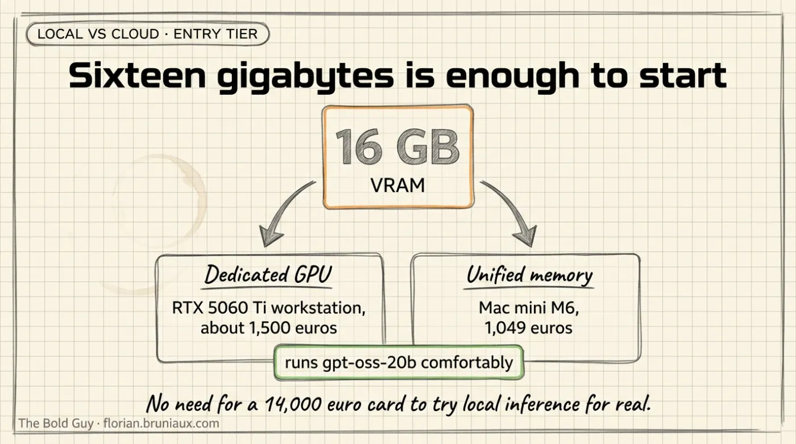
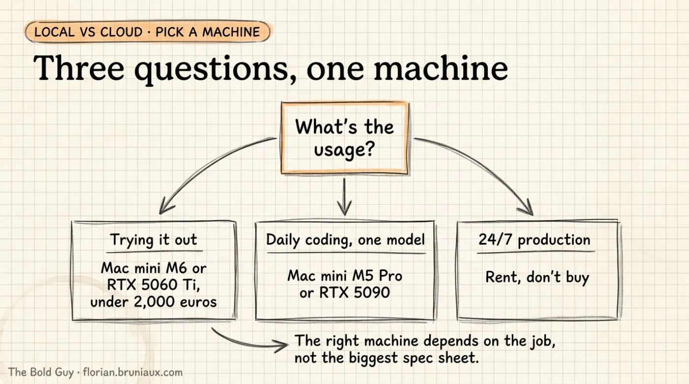
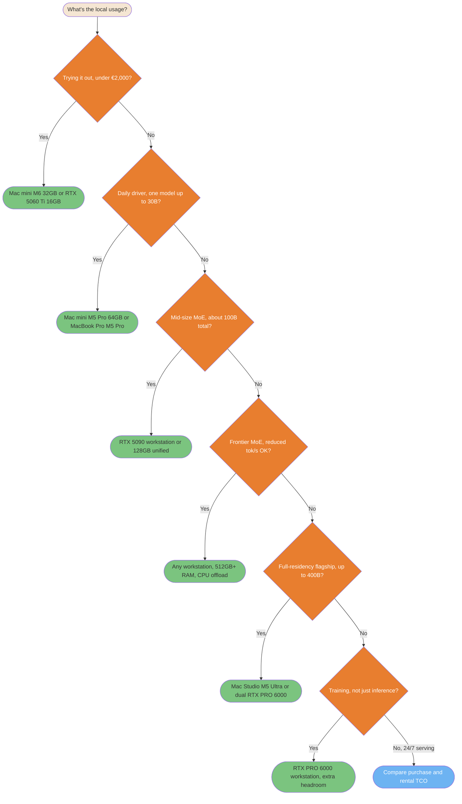
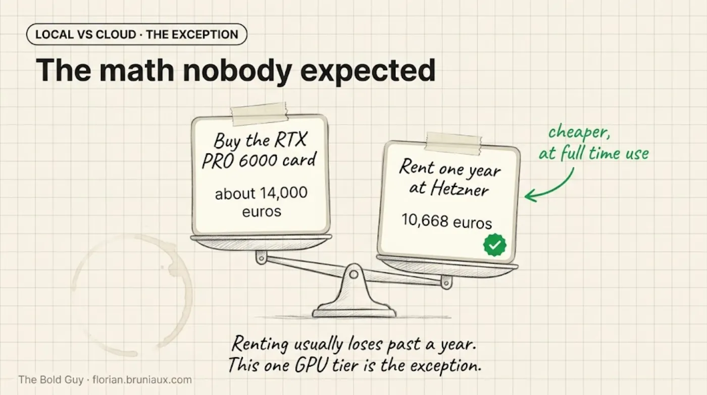
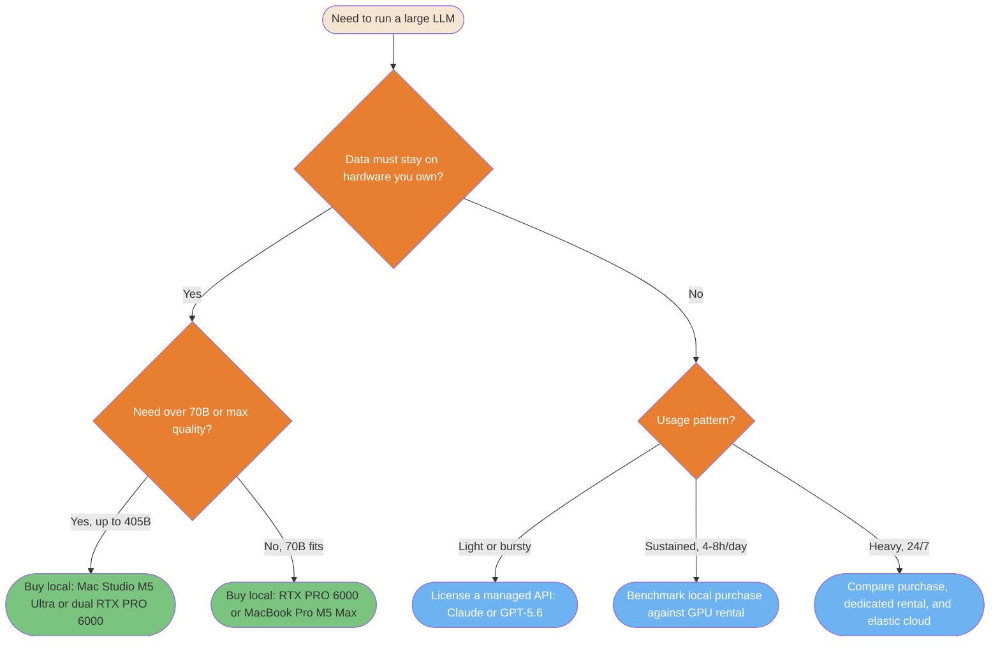
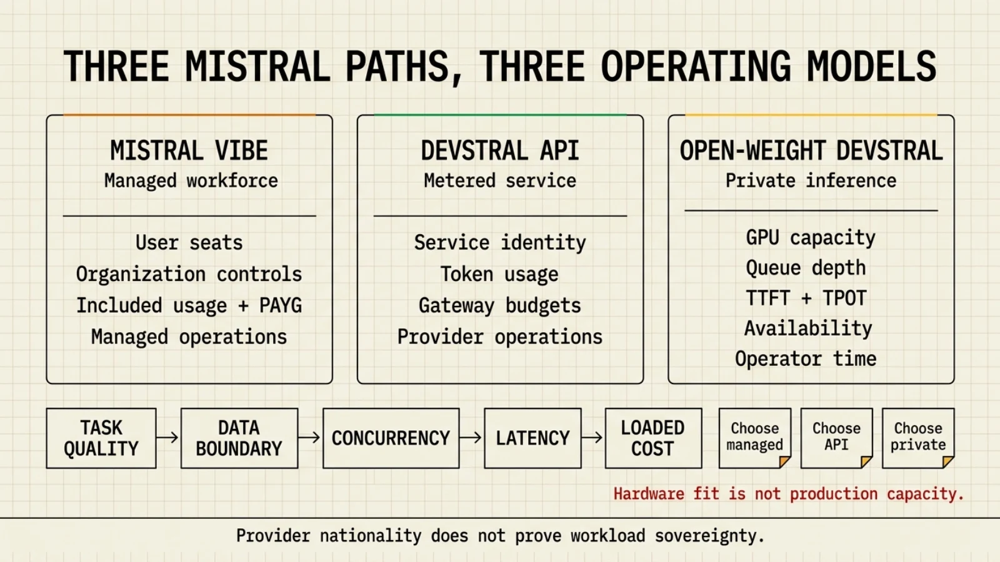
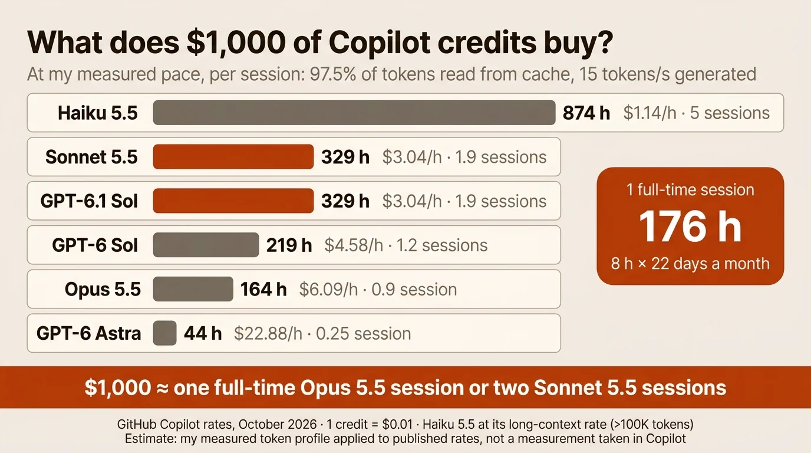

# Локальное или облачное решение: аппаратное обеспечение LLM и экономика выводов

> **Время чтения**: ≈35 минут
>
> **Purpose**: Ответьте на один вопрос цифрами, а не звуками: для запуска большой модели открытого веса (параметры от 70 до 400 млрд), когда покупка локального оборудования превосходит аренду облачного графического процессора или оплату за токен, и что на самом деле подходит для какой машины.

---

## Оглавление

- [Дата моментального снимка данных](#data-snapshot-date)
- [Определение размеров локального оборудования с помощью llmfit](#sizing-local-hardware-with-llmfit)
- [Протокол тестирования перед покупкой](#benchmark-protocol-before-you-buy)
- [Четырнадцать сопоставимых конфигураций оборудования](#fourteen-comparable-hardware-configurations)
- [Пропускная способность памяти, предварительное заполнение и ECC](#memory-bandwidth-prefill-and-ecc)
- [Что на самом деле подходит: именованные модели](#what-actually-fits-named-models)
- [Какой локальный компьютер для какого использования](#which-local-machine-for-which-usage)
- [Настройка обслуживающего двигателя: vLLM в производстве](#serving-engine-tuning-vllm-in-production)
- [Настройка агента кодирования: Apple Silicon с MLX](#coding-agent-setup-apple-silicon-with-mlx)
- [Цены на аренду облачного графического процессора](#cloud-gpu-rental-pricing)
- [Прогноз затрат на один год](#one-year-cost-projections)
- [Потребляемая мощность: ватты, ватт-часы, джоули на токен](#power-consumption-watts-watt-hours-joules-per-token)
- [Энергоэффективность по архитектуре модели](#energy-efficiency-by-model-architecture)
- Пропускная способность [Cloud API: Claude против GPT-5.6](#cloud-api-throughput-claude-vs-gpt-56)
- [Почему облачный и локальный Tokens/Sec несопоставимы](#why-cloud-and-local-tokenssec-are-not-comparable)
- [Схема решения](#decision-diagram)
- [Схема принятия решений](#decision-framework)
- [Определение размеров самостоятельного вывода для команды](#sizing-self-hosted-inference-for-a-team)
- [Одна машина для небольшой команды](#one-machine-for-a-small-team)
- [Рабочий пример: сколько я вешу в октябре 2026 года](#worked-example-what-i-am-weighing-in-october-2026)
- [Смена провайдера на уровне CLI](#switching-providers-at-the-cli-level)

---

## <a name="data-snapshot-date"></a>Дата снимка данных

Каждая цена, характеристики и показатели пропускной способности на этой странице являются снимками из **август 2026 г.**, за исключением случаев, когда в строке или абзаце указано, что они были перепроверены **1 октября 2026 г.** (строки Mac Studio, Strix Halo и Gorgon Halo, таблица пропускной способности и раздел для небольших групп) или на **21 октября 2026 г.** (цены на DGX Spark и GB10, вариант GB10 на 64 ГБ, списки Strix Halo и Gorgon Halo, ноутбуки RTX Spark и длинные подсказки об измерениях в разделе пропускной способности) или на **22 октября 2026 г.** (проработанный пример в конце страницы) или на **24 октября 2026 г.** (цифры Qwen3.6-35B-A3B для нескольких сеансов в разделах MLX, «Малая команда» и «Примеры работы», а также примечание о вызове инструмента в разделе «Кэширование префикса») или на **3 ноября 2026 г.** (Цены на Mac Studio M5 Ultra 256 ГБ и 512 ГБ на Apple France, цены на GB10 и Mac Studio в рабочем примере, а также на строки GLM-5.3-Flash и DeepSeek-V4.1-Flash-1017) или на **4 ноября 2026 г.** (Спотовые цены Nebius при аренде облачного графического процессора, примечание о пропускной способности за сеанс, случай Revolut и параграф о параллелизме для каждого профиля в разделе определения размера команды). Цены на память резко выросли в 2026 году: TrendForce сообщила, что контрактные цены на обычные DRAM выросли на 93-98% по сравнению с предыдущим кварталом в первом квартале 2026 года и прогнозируют еще 58-63% во втором квартале ([TrendForce, 1 июня 2026 г.](https://www.trendforce.com/presscenter/news/20260601-13070.html), не перечитывал для этой ревизии), так что 128 ГБ-класса машины могут стоить заметно дороже, чем при запуске. Цены на графические процессоры за несколько недель меняются на двузначные цифры, поставщики облачных услуг пересматривают цены без предварительного уведомления, а семейства моделей заменяются. Относитесь к таблицам как к методу воспроизведения, а не как к постоянному прайс-листу. Запросы и команды CLI, использованные для создания этой страницы, включены, поэтому вы можете запустить их повторно.

Для просмотра в реальном времени вместо этого фиксированного снимка два трекера обновляются постоянно, а не по фиксированному расписанию: [llm-stats.com](https://llm-stats.com/llm-updates) (тестовые оценки, голоса на арене и цены API, полученные непосредственно от поставщиков) и [benchlm.ai](https://benchlm.ai/) (более 401 модели в 46 категориях таблицы лидеров, включая tokens/sec и время до первого токена, явно исключая алгоритмически сгенерированные контрольные данные). Ни один из них не заменяет математические расчеты аппаратного обеспечения на этой странице, для которых все еще требуется `llmfit` для вашей собственной целевой модели.

---

## <a name="sizing-local-hardware-with-llmfit"></a>Определение параметров локального оборудования с помощью llmfit

Прежде чем что-либо покупать, проверьте, какой объем памяти действительно может работать. [`llmfit`](https://github.com/AlexsJones/llmfit) (MIT, `brew install llmfit`) обнаруживает ваше оборудование и оценивает свою базу данных моделей на соответствие, скорость и качество.

```bash
llmfit system                                    # detect current hardware
llmfit --memory 96G --ram 128G fit --json         # simulate a different memory budget
llmfit --memory 96G --ram 128G info "meta-llama/Llama-3.3-70B-Instruct"
```

Два ограничения, которые следует знать, прежде чем доверять его выводам:

**`--memory` переопределяет VRAM графического процессора, `--ram` переопределяет системную RAM. Они не являются взаимозаменяемыми.** На дискретном графическом процессоре Nvidia веса моделей обычно находятся в VRAM. Разгрузка ЦП может оставить часть модели или экспертов MoE в системной оперативной памяти, но каждая передача или эксперт, вычисляемый ЦП, увеличивает затраты на производительность. Результат зависит от пропускной способности PCIe, пропускной способности памяти хоста, архитектуры модели и стратегии разгрузки; универсального потолка 5 tokens/sec не существует. В чипах унифицированной памяти Apple Silicon и AMD Ryzen AI эти два числа должны быть равны, поскольку имеется только один пул физической памяти.

**Инструмент не может переключить серверную часть вывода.** Он определяет серверную часть машины, на которой он работает (Metal, CUDA, ROCm), и продолжает использовать модель скорости этой серверной части, даже если вы переопределяете размер памяти для моделирования различного оборудования. Запустите его на компьютере Nvidia для номеров Nvidia или на компьютере Apple Silicon для номеров Apple. Моделирование RTX PRO 6000 на MacBook дает правильный ответ по объему памяти (что подходит) и неправильный ответ по пропускной способности (tokens/sec), поскольку инструмент по-прежнему рассчитывает скорость на основе модели металлической линии крыши Mac, а не на основе CUDA.

---

## <a name="benchmark-protocol-before-you-buy"></a>Протокол тестирования перед покупкой

Проверка мощности отвечает только на вопрос, можно ли загрузить гири. Он не показывает, остается ли модель пригодной для использования с реальным приглашением, несколькими пользователями или серверной частью вывода, которую вы планируете запустить. Прежде чем сравнивать машины, проверьте точную модель, квантование, длину контекста и цель параллелизма.

| Измерение | Что это мешает |
|---|---|
| Вес резидентности плюс время выполнения и запас KV-кэша | Модель, которая успешно загружается, но при длинном приглашении ей не хватает памяти. |
| Пропускная способность предварительного заполнения и время получения первого токена | Скрытие медленной обработки подсказок за быстрым номером декодирования |
| Пропускная способность декодирования | Расценивание входных и сгенерированных токенов как одного и того же показателя. |
| Однопользовательские запуски и запуски с целевым параллелизмом | Игнорирование одного кэша KV для каждой активной последовательности, пакетной обработки и организации очереди. |
| Мощность стены во время одного пробега | Преобразование потолка TDP в вымышленное измерение джоулей на токен |
| Покупка, электроэнергия, обслуживание и дозированное использование | Сравнение покупки оборудования с почасовой арендой, как если бы оба имели одинаковую мощность и эксплуатационные расходы. |

Переговоры, проиндексированные во время обзора этой страницы, показывают, почему каждая область важна. В эксперименте Devoxx на процессоре Ryzen AI Max+ 395 с моделью Q4 Qwen 122B динамики отделяют предварительное заполнение от декодирования, определяют пропускную способность памяти как узкое место декодирования и показывают, что разгрузка графического процессора меняет производительность на стоимость передачи (пропускная способность памяти[в 21:58](https://youtube.com/watch?v=DXEsG3Vo6F4&t=1318s), разгрузка [GPU в 28:46](https://youtube.com/watch?v=DXEsG3Vo6F4&t=1726s), [аппаратный запуск в 37:05](https://youtube.com/watch?v=DXEsG3Vo6F4&t=2225s)). Демо-версия RamaLama сообщает примерно о 1300 входных tokens/sec и 60-70 выходных tokens/sec на одном ноутбуке, двух числах, которые невозможно объединить в один результат «tokens/sec» ([17:24](https://youtube.com/watch?v=CYxwXobrL28&t=1044s)).

В одной презентации Framework Desktop сообщается о 80–130 Вт во время использования, 25–60 Вт tokens/sec в среднем с пиками около 80–90, а стоимость машины выросла примерно с 2400 до 3000 евро ([power в 15:57](https://youtube.com/watch?v=RTQdC6IgBzc&t=957s), [cost в 16:20](https://youtube.com/watch?v=RTQdC6IgBzc&t=980s), [пропускная способность в 17:25](https://youtube.com/watch?v=RTQdC6IgBzc&t=1045s)). Это полевые наблюдения, о которых сообщают докладчики, а не контролируемые кросс-аппаратные тесты. Используйте их, чтобы определить, что следует измерять в зависимости от вашей рабочей нагрузки, а не для ранжирования машин в таблице ниже.

---

## <a name="fourteen-comparable-hardware-configurations"></a>Четырнадцать сопоставимых конфигураций оборудования

Голые графические процессоры нельзя сравнивать с ноутбуками или бытовой техникой. В таблице ниже перечислены только полные системы: ЦП, память, графический процессор и хранилище вместе, отсортированные по возрастанию цены по состоянию на август 2026 года. Переоценка DGX Spark в октябре 2026 года переместит строки 5 и 10 дальше по шкале цен, чем предполагает их положение. Для рабочих станций, построенных на голом графическом процессоре Nvidia (без фиксированного процессора от производителя), в столбце «ЦП» показан один реалистичный пример, а не спецификация. Первые три строки — это начальный уровень, который специально просил читатель: машины с графическим процессором (выделенным или унифицированным) объемом около 16–32 ГБ, достаточно дешевые, чтобы попробовать локальный логический вывод, не тратя на сборку более 4000 евро.



| # | Конфигурация | Процессор | Системная память | графический процессор | Хранилище | Цена (август 2026 г.) |
|---|---|---|---|---|---|---|
| 1 | Мак мини, Apple M6 | Apple M6, 12 ядер (2 супер + 4 производительности + 6 эффективности) | 16-32 ГБ унифицировано | Встроенный графический процессор, 12 ядер, пропускная способность 170 GB/s | Твердотельный накопитель 256 ГБ-2 ТБ | 1049 евро (базовая версия 16 GB/256 ГБ) / ≈1500 евро ориентировочно при макс. 32 ГБ (+400 долларов США BTO) |
| 2 | Рабочая станция, 1x RTX 5060 Ti 16 ГБ | *Пример*: AMD Ryzen 5 7600, 6 ядер | 32–64 ГБ DDR5 (только хост) | RTX 5060 Ti, 4608 ядер CUDA, 16 ГБ выделенной GDDR7, 448 GB/s | NVMe 1–2 ТБ | ≈1300–1600 евро (только графический процессор: рекомендуемая розничная цена 429 долларов США, ≈590–730 евро на улице, август 2026 г.) |
| 3 | Мак мини, Apple M5 Pro | Apple M5 Pro, 15 или 18 ядер | 24–64 ГБ унифицировано | Встроенный графический процессор, 16 или 20 ядер, пропускная способность 307 GB/s | Твердотельный накопитель емкостью 512 ГБ-8 ТБ | 1999 евро (базовая версия: 24 GB/512 ГБ) / ≈3000 евро ориентировочно при макс. 64 ГБ (+1000 долларов США BTO) |
| 4 | AMD Ryzen AI Halo (тот же чип в Framework Desktop, GMKtec EVO-X2, HP Z2 Mini G1a) | Ryzen AI Max+ 395, Zen 5, 16 потоков cores/32 | 128 ГБ унифицированный LPDDR5x | Интегрированная Radeon 8060S, 40 CU RDNA 3.5, без выделенной видеопамяти | SSD-накопитель емкостью 2 ТБ | ≈3999 долларов США (≈3700–4000 евро) за платформу AMD (прейскурантная цена на май 2026 г.). Framework Desktop, 128 ГБ: выпущен по цене 1999 долларов США, 3449 долларов США (сделай сам) 16 октября 2026 года, нет в наличии, без учета хранилища и ОС. GMKtec EVO-X2 128 ГБ: 3499,99 долларов США (1 ТБ) или 3649,99 долларов США (2 ТБ) в магазине в США на ту же дату (проверено 21 октября 2026 г.) |
| 5 | NVIDIA DGX Искра | Grace, 20 ядер Arm (10x Cortex-X925 + 10x Cortex-A725) | 128 ГБ унифицированный LPDDR5x | GB10 Blackwell, 6144 ядра CUDA (48 SM), без выделенной видеопамяти | NVMe 4 ТБ (входит в комплект) | Цена на сумму 6950 долларов США на торговой площадке NVIDIA в США со 2 по 6 октября 2026 г. отсутствует в наличии. Цена запущена в октябре 2025 года по цене 3999 долларов США, а 23 февраля 2026 года повышена до 4699 долларов США. Германия: 6989 евро с доставкой в ​​течение нескольких месяцев, 7349,99 евро на складе. Стоимость OEM-варианта на 64 ГБ начинается с 4999 долларов США с 23 октября 2026 г. (перепроверено 21 октября 2026 г.) |
| 6 | Макбук Про, Apple M5 Про | Apple M5 Pro, 15 или 18 ядер | 48 ГБ унифицировано | Встроенный графический процессор, 20 ядер | SSD-накопитель емкостью 2 ТБ | ≈€4,500-5,000 |
| 7 | Рабочая станция, 1x RTX 5090 | *Пример*: AMD Ryzen 9 9950X, 16 ядер | 64–128 ГБ DDR5 (только хост) | RTX 5090, 21 760 ядер CUDA, 32 ГБ выделенной памяти GDDR7 | NVMe 2–4 ТБ | ≈€5,000-6,000 |
| 8 | Макбук Про, Эппл М5 Макс | Apple M5 Max, 18 ядер | 128 ГБ единый | Встроенный графический процессор, 40 ядер | SSD-накопитель емкостью 2 ТБ | ≈€5,500-6,500 |
| 9 | AMD Ryzen AI Max PRO 400 («Ореол Горгоны») | Ryzen AI Max+ PRO 495, Zen 5, 16 потоков cores/32, до 5,2 ГГц | До 192 ГБ унифицированного LPDDR5X-8533, до 160 ГБ, адресуемого графическим процессором | Интегрированная Radeon 8065S, 40 CU RDNA 3.5 | 2–4 ТБ (оценка) | Объявлено AMD; по состоянию на 27 сентября 2026 г. компания Petronella не будет поставляться, согласно которой цена HP ZBook Ultra G3a составит 5 999 долларов США (128 ГБ) и 7 449 долларов США (192 ГБ). Объявления на 16 октября 2026 г.: Framework Desktop 400 (192 ГБ) — 6799 долларов США, доставка по предварительному заказу своими руками в ноябре, Acemagic F9A — 6499 долларов США, GMKtec EVO-X5 Pro — 6799 долларов США, Minisforum MS-S1 MAX-P495 — 7399 долларов США. Независимых тестов производственного оборудования не найдено (перепроверено 21 октября 2026 г.) |
| 10 | Пара рабочих станций, 2x NVIDIA DGX Spark | 2 процессора Grace, по 20 ядер Arm каждый (10 Cortex-X925 + 10 Cortex-A725) | 256 ГБ унифицированного LPDDR5x (2x128 ГБ) | 2x GB10 Blackwell, 12 288 ядер CUDA вместе (96 SM), без выделенной видеопамяти, без NVLink | 2x NVMe по 4 ТБ (в комплекте) | ≈13 900 долларов США, что вдвое превышает указанную выше цену в октябре 2026 года (6 950 долларов США) (≈ 9 398 долларов США по цене 4 699 долларов США за февраль-сентябрь). Цена пакета не проверена |
| 11 | Рабочая станция, двойной RTX 5090 | *Пример*: AMD Threadripper 7960X, 24 ядра | 128–256 ГБ DDR5 (только хост) | 2x RTX 5090, 43 520 ядер CUDA вместе, 64 ГБ GDDR7 вместе, без NVLink | NVMe 4 ТБ | ≈€8,000-12,000 |
| 12 | Mac Studio, Apple M5 Ультра | Apple M5 Ultra, 30 или 36 ядер | 96-512 ГБ унифицированная, 1.2 TB/s | Встроенный графический процессор, 64 или 80 ядер. | SSD-накопитель емкостью 1–16 ТБ | От 5499 долларов США (96 ГБ); 256 ГБ от 9499 долларов США (30-ядерный процессор, 1 ТБ). Базовая цена во Франции — 6599 евро (перепроверено 1 октября 2026 г.). Цены на Apple France для образовательных учреждений на 3 ноября 2026 г., 36-ядерный ЦП и 80-ядерный графический процессор с твердотельным накопителем емкостью 4 ТБ: 12 851 евро (256 ГБ) и 24 236 евро (512 ГБ), доставка от 13 до 15 недель. |
| 13 | Рабочая станция RTX PRO 6000 Blackwell | *Пример*: AMD Threadripper PRO 7975WX, 32 ядра | 128–256 ГБ DDR5 ECC (только хост) | RTX PRO 6000, 24 064 ядра CUDA, 96 ГБ выделенной GDDR7 ECC | NVMe 4 ТБ | ≈16 000-18 000 евро (одна карта стоит 14 000 евро) |
| 14 | Рабочая станция, двойной RTX PRO 6000 Blackwell | *Пример*: AMD Threadripper PRO 7995WX, 96 ядер | 256 ГБ+ DDR5 ECC (только хост) | 2x RTX PRO 6000, 48 128 ядер CUDA вместе, 192 ГБ GDDR7 вместе, без NVLink | NVMe 4–8 ТБ | ≈€30,000-32,000+ |

Источники: количество ядер Nvidia RTX 5090 и RTX PRO 6000 Blackwell и видеопамять подтверждены через [Центральный компьютер](https://www.centralcomputer.com/pny-nvidia-rtx-pro-6000-graphics-card-96gb-gddr6-24-064-cuda-cores-pci-express-5-0-x16-600w-vcnrtxpro6000b-pb.html) и [Шнайдер Диджитал](https://shop.schneider-digital.com/en/graphics-cards/nvidia/rtx-pro-blackwell-series/nvidia-rtx-pro-6000-blackwell-workstation-edition-96gb-pcie-5.0-x16) (стоимость карты ≈14 000 евро). Характеристики RTX 5060 Ti 16 ГБ и рекомендуемая розничная цена от [ВидеоКардз](https://videocardz.com/newz/nvidia-announces-geforce-rtx-5060-ti-at-429-16gb-and-379-8gb-299-rtx-5060-launches-next-month), диапазон уличных цен от [Трекер BestValueGPU за август 2026 г.](https://bestvaluegpu.com/history/new-and-used-rtx-5060-ti-16gb-price-history-and-specs/). Характеристики GB10 от [Пути обучения рукам](https://learn.arm.com/learning-paths/laptops-and-desktops/dgx_spark_llamacpp/1_gb10_introduction/) и [NVIDIA DGX Искра](https://www.nvidia.com/en-us/products/workstations/dgx-spark/). Количество процессоров Radeon 8060S от [TechPowerUp](https://www.techpowerup.com/342635/amd-readies-ryzen-ai-max-388-8c-16t-and-full-40-cu-radeon-8060s-gpu). Яблоко М5 Pro/Max характеристики чипа (количество ядер, пропускная способность памяти, подтверждено) 24/48/64 уровни ГБ) от [Собственная страница технических характеристик Apple](https://support.apple.com/en-mide/126318). Цены на Mac Studio M5 Max и M5 Ultra, максимальный объем памяти и пропускная способность взяты из [Анонс Apple в августе 2026 г.](https://www.apple.com/newsroom/2026/08/apple-introduces-new-mac-studio-with-m5-max-and-m5-ultra/) и [Выпуск доступности от 22 сентября](https://www.apple.com/newsroom/2026/09/the-new-mac-mini-and-mac-studio-are-available-today/); Цены на конфигурацию на 256 ГБ и базовая цена во Франции в размере 6599 евро взяты из конфигуратора магазина Apple, как указано в исследовании этой версии, а не перечитываются построчно. Mac Studio с M5 Max (от 2499 долларов США, до 128 ГБ, 614 GB/s) в этой таблице не занимает ни строчки; см. таблицу пропускной способности ниже. Характеристики Gorgon Halo от [AMD Ryzen AI Max+ PRO 495 стр.](https://www.amd.com/en/products/processors/laptop/ryzen-pro/ai-max-pro-400-series/amd-ryzen-ai-max-plus-pro-495.html); доступность и цены HP от [Petronella Technology Group, 27 сентября 2026 г.](https://petronellatech.com/blog/dgx-spark-vs-strix-halo-vs-gorgon-halo-local-llm-benchmarks/). Цены на запуск Framework Desktop взяты из обзора [BotMonster's Strix Halo](https://botmonster.com/hardware/amd-strix-halo-mini-pcs-ryzen-ai-max-395-homelab/). Mac mini M6 и M5 Pro были анонсированы 25 августа 2026 г. (поставка состоится 22 сентября 2026 г.): характеристики чипов и уровни памяти — от [9to5Покрытие Mac для запуска](https://9to5mac.com/2026/08/25/apple-announces-new-mac-mini-heres-everything-new/), базовая цена во Франции — от [MacGeneration](https://www.macg.co/mac/2026/08/de-700-eu-1-050-eu-en-moins-de-deux-ans-le-tarif-du-mac-mini-nen-finit-plus-de-bouger-310595), цена обновления памяти BTO в долларах США (основа для «оценочных» цифр в евро, приведенных выше, поскольку французская цена Apple для каждой конфигурации в евро не была независимо доступна) из разбивки конфигурации [Daring Fireball](https://daringfireball.net/2026/08/configurations_and_pricing_for_new_mac_minis_and_mac_studios). История цен на DGX Spark, перепроверенная 21 октября 2026 г.: февральское изменение связано с «Объявлением об изменении цены 2/23/2026» NVIDIA, в результате которого рекомендуемая розничная цена Founders Edition была увеличена с 3999 до 4699 долларов «из-за мировых ограничений в поставках памяти», цитируется на форуме разработчиков [NVIDIA](https://forums.developer.nvidia.com/t/september-2026-availability-of-gb10s/382068?page=2). О листинге на торговой площадке стоимостью 6950 долларов США для той же конфигурации 128 GB/4 TB сообщили пользователи форума 2–5 октября ([страница 9](https://forums.developer.nvidia.com/t/september-2026-availability-of-gb10s/382068?page=9)) и [AI Compute Scout’s Marketplace Audit](https://aicomputescout.com/articles/nvidia-dgx-spark-who-is-it-for/) (4699 долларов США 11 сентября, цена отсутствует 29 сентября, 6950 долларов США нет в наличии на 4 и 6 октября); Никакого заявления NVIDIA о причине обнаружено не было. Немецкие предложения от [billiger.de, октябрь 2026](https://www.billiger.de/products/5414860266-nvidia-dgx-spark-gb10-founders-edition-blackwell-tensor-core-128-gb-ram-4-tb-ssd-dgx-os-ubuntu-linux). Вариант на 64 ГБ, «доступный исключительно через участвующих OEM-партнеров», указан на странице [NVIDIA DGX Spark](https://www.nvidia.com/en-us/products/workstations/dgx-spark/) с теми же 273 GB/s и ConnectX-7; его стартовая цена в 4999 долларов взята из [Tom's Hardware](https://www.tomshardware.com/pc-components/gpus/nvidia-introduces-64gb-dgx-spark-to-throw-local-ai-fans-a-lifeline-amid-the-rampocalypse-new-gb10-config-starts-at-usd4999-for-those-who-can-work-with-less) и даты 23 октября от AI Compute Scout. Списки Framework, GMKtec и Ryzen AI Max+ PRO 495 взяты из руководства по покупке [S5 Labs, обновленного 16 октября 2026 г.](https://s5labs.io/resources/local-llm-machines/), датированного снимка витрины магазина в США до уплаты налогов.

---

## <a name="memory-bandwidth-prefill-and-ecc"></a>Пропускная способность памяти, предварительное заполнение и ECC

Объем памяти определяет, какая модель загружается. Пропускная способность памяти устанавливает потолок скорости декодирования, поскольку плотная модель считывает примерно весь свой весовой файл для каждого сгенерированного токена. Предварительное заполнение, чтение подсказки, больше зависит от вычислений. Агент кодирования каждый раз отправляет длинные подсказки, поэтому оба числа имеют значение.

| Машина | Единая память | Пропускная способность памяти | ЕСС | Источник и статус |
|---|---|---|---|---|
| Мак мини М6 | 16–32 ГБ | 170 GB/s | Не рекламируется | Apple, август 2026 г. |
| Мак мини/Макбук Про М5 Про | 24–64 ГБ | 307 GB/s | Не рекламируется | Технические характеристики Apple |
| AMD Ryzen AI Max+ 395 (Strix Halo) | До 128 ГБ | 256 GB/s теоретически, 234-235 GB/s измерено на одном ноутбуке | Нет: LPDDR5X на этих скоростях не настроен с ECC согласно обзору Strix Halo. | спецификация AMD; Измерение Петронеллы, 27 сентября 2026 г. |
| NVIDIA DGX Spark (GB10) | 128 ГБ или 64 ГБ в системах только OEM с 23 октября 2026 г. | 273 GB/s рассчитан для обоих, 258,8 GB/s измерено на 128 ГБ | Нет (в записи TechPowerUp GB10 ECC указан как неподдерживаемый; страница не перечитывалась, она вернула 403) | спецификация NVIDIA; Измерение петронеллы |
| Ноутбуки NVIDIA RTX Spark (N1X) | До 128 ГБ; на Windows фиксированное разделение GPU/CPU, 62,5 ГБ для использования графического процессора на устройстве емкостью 128 ГБ, установленном на 64/64 | ≈300 GB/s, рассчитано на основе 256-битного LPDDR5X-9400. | Не рекламируется | Конфигурация памяти из StorageReview, 16 октября 2026 г. |
| AMD Ryzen AI Max+ PRO 495 (Ореол Горгоны) | До 192 ГБ | ≈273 GB/s, вычислено на основе 256-битного LPDDR5X-8533. | Не рекламируется | Страница спецификаций AMD; еще не отправляю |
| Mac Studio M5 Макс | До 128 ГБ | 614 GB/s | Не рекламируется | Отдел новостей Apple, август 2026 г. |
| Mac Studio M5 Ультра | До 512 ГБ (можно заказать в Apple France 3 ноября 2026 г., доставка через 13–15 недель) | 1.2 TB/s | Не рекламируется | Отдел новостей Apple, август 2026 г.; Образовательный магазин Apple France, 3 ноября 2026 г. |
| RTX PRO 6000 Блэквелл | 96 ГБ выделенной памяти GDDR7 | Спецификация карты, а не унифицированная память | Да, ECC GDDR7 | NVIDIA |

**Bandwidth прогнозирует потолок декодирования для моделей с высокой плотностью.** Тест плотного Qwen3.8-27B на одной машине на DGX Spark (ASUS GX10) показал вес FP8 (29 ГБ) на уровне 7,8 tok/s против примерно 23 tok/s на Q4_K_M (19,6 ГБ): чем больше файл, тем больше информации. байт на токен, поэтому он декодируется медленнее, несмотря на новые форматы тензорного ядра. В том же репозитории сообщается о 8–16 tok/s для этой плотной модели через llama.cpp и 24 tok/s для повседневного чата через vLLM с NVFP4 и кэшированием префиксов, измеренных 5–8 сентября 2026 г. Источник: [HAOyezi/qwen38-27b-dgx-spark-benchmarks](https://github.com/HAOyezi/qwen38-27b-dgx-spark-benchmarks), один автор, одна машина.

**Prefill — это то, где GB10 опережает Strix Halo.** Используя те же файлы сборки и модели llama.cpp, Petronella измерила обработку подсказок Qwen3.6-35B-A3B на уровне 2323 против 1313 tok/s с пустым контекстом, 2165 против 1028 при 8K и 1907 против 638 при 32K, DGX Spark против ноутбука Strix Halo (HP ZBook Ultra G1a). Декодирование, измеренное через Ollama 0.34.0, оказалось ближе: 74,5 против 54,4 tok/s на модели MoE и 12,6 против 11,4 tok/s на плотной Qwen3.6-27B. Источник: [Petronella Technology Group, 27 сентября 2026 г.](https://petronellatech.com/blog/dgx-spark-vs-strix-halo-vs-gorgon-halo-local-llm-benchmarks/). Стоимость медленного предварительного заполнения является конкретной для агентов кодирования: на GMKtec EVO-X2 (Ryzen AI Max+ 395, Windows, llama.cpp Vulkan) холодный запрос OpenCode, содержащий около 13 264 токенов подсказки и 41 определение инструмента, занимал около 154,5 секунды, в то время как кэшированные последующие повороты обрабатывали новые части подсказки выше 200 tok/s и устойчивое поколение осталось на уровне 16,45 tok/s в контексте 128K. Источник: [erstmalreden/qwen3.8-27b-ryzen-ai-max-395-benchmarks](https://github.com/erstmalreden/qwen3.8-27b-ryzen-ai-max-395-benchmarks), испытано 15 августа 2026 г., одна машина.

Глубина контекста **снижает пропускную способность даже на GB10.** Собственный запуск DGX Spark от llama.cpp (`llama-bench`, сборка `11fb327bf (7941)`, 5 февраля 2026 г.) показывает, что gpt-oss-120b MXFP4 упал с 2443,91 до 1567,08 tok/s на Приглашение на 2048 токенов и декодирование tok/s с 58,72 до 42,76 по мере роста предыдущего контекста с 0 до 32768 токенов. Агент кодирования, который несколько раз превращается в сеанс, работает в глубине этой таблицы, а не на цифре пустого контекста, указанной в большинстве спецификаций. Источник: [`benches/dgx-spark/dgx-spark.md`](https://github.com/ggml-org/llama.cpp/blob/master/benches/dgx-spark/dgx-spark.md), февраль 2026 г., хранится здесь в качестве базовой линии за пределами окна снимка этой страницы.

**M5 Ultra с длиной приглашения агента кодирования.** Один автор запускал gpt-oss-120b (`mlx-community/gpt-oss-120b-mxfp4-bf16`, ≈65 ГБ) через `mlx_lm.server` на Mac Studio M5 Ultra 256 ГБ и M3 Ultra 96 ​​ГБ, три измеренных запуска в каждом случае с уникальным одноразовым номером для каждого приглашения, поэтому кэширование префикса не могло скрыть предварительное заполнение. При запросе на ≈24 400 токенов M5 Ultra достиг ≈3955 предварительного заполнения tok/s, времени до первого токена 6,17 с и декодирования 76 tok/s по сравнению с ≈1101 tok/s, 22,17 с и 55 tok/s на M3 Ultra. На двух серверах не использовались одинаковые флаги (запрос кеширования и параллелизм декодирования только на M5 Ultra), версия MLX не указана, а мощность не измерялась. Источник: [Elite Test Engineering, 29 сентября 2026 г.](https://elitetestengineering.substack.com/p/gpt-oss-120b-on-two-generations-of). Не было обнаружено сопоставимого длительного запуска на DGX Spark или Strix Halo с той же моделью и временем работы, поэтому этот результат не ставит M5 Ultra в сравнение с ними.

Ноутбуки **RTX Spark: 128 ГБ в коробке, около половины для графического процессора на Windows.** Ноутбуки NVIDIA N1X поступили в продажу 16 октября 2026 года, при этом стартовая цена составит 2599 долларов США (S5 Labs). Обзор HP OmniBook Ultra 16, проведенный StorageReview, показал, что Windows использует фиксированный разделенный набор в приложении NVIDIA: устройство емкостью 128 ГБ предоставляет 62,5 ГБ графическому процессору в 64/64.. HP оценила протестированные конфигурации в 3199,99 долларов США (32 ГБ, 1 ТБ), 4999,99 долларов США (64 ГБ, 2 ТБ) и 6229,99 долларов США. (128 ГБ, 2 ТБ, HP.com 14 октября). В тесте агента кодирования Codex CLI через Ollama в контексте 64K Qwen3.6-35B-A3B сгенерировал 89,5 tok/s со средним временем стены 72,0 с и тремя успехами из трех, а gpt-oss:20b сгенерировал 58,0 tok/s.. В обзоре не указано квантование или версия Ollama, сообщает об отсутствии отдельной предварительной заливки для этих запусков и не измеряет энергопотребление. Источник: [StorageReview, 16 октября 2026 г.](https://www.storagereview.com/review/hp-omnibook-ultra-16-review-rtx-spark-n1x).

**ECC — это пробел, который не закрывает ни одна из коробок с унифицированной памятью.** Ни одна из вышеперечисленных систем Mac, GB10 или Strix Halo не продается с унифицированной памятью ECC. Бесшумное переключение битов имеет мало значения для сеанса чата одного разработчика и больше для общего сервиса, выходные данные которого используются для проверки кода, сборки или конвейеров данных. ECC означает профессиональные карты (класс RTX PRO 6000) или серверные платформы.

**CUDA — это отдельное решение.** Если работа включает в себя тонкую настройку, использование только инструментов CUDA или позднее развертывание той же модели на серверах NVIDIA, DGX Spark или рабочая станция NVIDIA сохраняют единый программный стек. Только для справки: MLX на Apple Silicon и llama.cpp Vulkan или ROCm на AMD работоспособны, с учетом предостережений времени выполнения в разделе [MLX](#coding-agent-setup-apple-silicon-with-mlx).

---

## <a name="what-actually-fits-named-models"></a>Что на самом деле подходит: Именованные модели

Сортировка базы данных `llmfit` по количеству необработанных параметров приводит к неясным или ориентированным на ролевую игру тонким настройкам, которые помещаются в памяти, а не к флагманским моделям, которые на самом деле хотят запускать большинство людей. Запрос `llmfit info` к собственному официальному репозиторию каждой лаборатории (а не к стороннему квантовому зеркалу) дает более чистую отправную точку, но очистка HuggingFace `llmfit` имеет свои собственные пробелы в качестве данных (см. строку Kimi K3 ниже, где это отклонение примерно в 2 раза). Каждый подсчет параметров и подсчет экспертов MoE в этой таблице был перепроверен во второй раз с карточкой модели каждой лаборатории, репозиторием GitHub или официальным объявлением, а не только с `llmfit`.

В этой таблице используется текущее поколение по состоянию на август 2026 года, а не модели mid-2024/2025 (Llama 3.x, Qwen2.5, Mixtral, оригинальный DeepSeek-V3), датированные более ранней версией этой страницы.

**Дополнение от 6 октября: Mistral Large 4 еще не является проверенным рядом.** В документации по модели [](https://docs.mistral.ai/models/mistral-large-4-0) указан MoE с параметром 1,05T и 52B активных параметров. На странице выпуска Mistral [Hugging Face](https://huggingface.co/mistralai/Mistral-Large-4.0-1T05-A52B) поясняется цифра 49B запуска: 49B активных на каждый токен, 52B, включая встраивания и выходные слои. Также не требуется памяти для хранения всех экспертов. При параметрах 1,05T простой четырехбитный расчет веса дает **525 GB** до метаданных квантования, распределения времени выполнения и кэша KV. Эта арифметика не является размером выпущенной контрольной точки или аппаратным результатом. Веса будут объявлены позднее в октябре; лицензия, применимое квантование, совместимость обслуживания и измеренная производительность остаются непроверенными. Не допускайте использования Large 4 в рекомендациях по установке оборудования до тех пор, пока их не проверят. См. оценку исходного кода [](../../docs/resource-evaluations/mistral-large-4.md#specifications-and-availability).

В таблице «МО» означает смесь экспертов. Уровни MoE такой модели содержат несколько блоков прямой связи, называемых экспертами, и маршрутизатор отправляет каждый токен нескольким из них (top-k) ([Mixtral](https://arxiv.org/html/2401.04088), [Switch Transformers](https://ar5iv.labs.arxiv.org/html/2101.03961)). Вычисляют только выбранные эксперты, поэтому вычисления для каждого токена отслеживают «активное» количество параметров (скорость декодирования также зависит от пропускной способности памяти), но каждый эксперт должен оставаться в памяти, поэтому память отслеживает «общее» количество параметров.

[](../images/model-axes/moe-memory-compute-en-gemini.webp)

Пример *Mixtral: определите размер машины по общим параметрам, ожидайте, что вычисления на токен будут следовать за активными. Откройте изображение в полном размере. [Происхождение изображения](../images/model-axes/README.md).*

| Бюджет аппаратной памяти | Модель, которая подходит | Архитектура | Расчетная резидентность веса с указанной точностью или квантованием |
|---|---|---|---|
| 16 ГБ видеопамяти (RTX 5060 Ti) или унифицированная 16–32 ГБ (Mac mini M6) | **`openai/gpt-oss-20b`** (август 2025 г., Apache 2.0) подходит с запасом по высоте; `Qwen/Qwen3.8-27B` достигает этого уровня только при более тяжелом количестве (Q3_K_M), незначительном при использовании памяти 99%. | МО, всего 21 млрд, активных 3,6 млрд (эксперты 4/32) | 11,0 ГБ для gpt-oss-20b, 15,84 ГБ для Qwen3.8-27B на Q3_K_M |
| 32 ГБ видеопамяти (1x RTX 5090) или 32–48 ГБ унифицированной памяти (MacBook Pro M5 Pro) | **`Qwen/Qwen3.8-27B`** (август 2026 г., Apache 2.0) подходит для большого запаса высоты; **`Qwen/Qwen3.6-35B-A3B`** (апрель 2026 г., Apache 2.0, MoE) также подходит для 4–6-битного режима и быстрее декодирует на оборудовании с единой памятью, поскольку на каждый токен активируется только ≈3B параметров. | Плотность ≈27 миллиардов, или всего MoE 35 миллиардов / 3 миллиарда активных (256 экспертов, 8 маршрутизированных + 1 общий на токен) | 14,2 ГБ для Qwen3.8-27B; ≈20-26 ГБ для Qwen3.6-35B-A3B на 4-6-битной версии |
| 48 ГБ унифицировано (MacBook Pro M5 Pro) | Qwen3.8-27B легко помещается; **`meta-llama/Llama-4-Scout-17B-16E`** (всего 109B, МО) не совсем подходит | МО, 17Б активно / 16 экспертов | Требуется 55,6 ГБ, превышает 48 ГБ |
| 64 ГБ видеопамяти (двойной RTX 5090) | **`meta-llama/Llama-4-Scout-17B-16E`** | МО, всего 109B, 17B активно | 55,6 ГБ для весов; он загружается, но оставшиеся 8,4 ГБ ограничены, если включены среда выполнения и кэш KV. |
| 96–128 ГБ (RTX PRO 6000, MacBook Pro M5 Max, DGX Spark, Ryzen AI Halo) | Llama-4-Scout подходит для большой высоты; на момент этого снимка ни один подтвержденный флагман текущего поколения не находится в диапазоне от 56 до 200 ГБ. | | |
| 192–256 ГБ (двойной RTX PRO 6000, Mac Studio M5 Ultra) | **`deepseek-ai/DeepSeek-V4-Flash-0731`** (MIT, выпуск GA, 30–31 июля 2026 г.) соответствует опубликованным сторонним оценкам веса для обеих конфигураций; `meta-llama/Llama-4-Maverick-17B-128E` (всего ≈400B, MoE, лицензия сообщества) подходит только для конфигурации на 256 ГБ. | MoE, всего 304Б / 13Б активных на карту официальной модели сборки NVIDIA; более ранняя предварительная сборка имела общий размер 284Б при тех же 13Б активных, и ни DeepSeek, ни NVIDIA не объясняют, почему общее количество общедоступной версии выросло. | Официальных данных о VRAM не существует. Сторонние квантованные оценки для кластера выпуска GA около 100-170 ГБ (Unsloth: ≈103 ГБ при 3-битном режиме, ≈162 ГБ при 8-битном режиме «без потерь»; Spheron: ≈166 ГБ при INT4; `llmfit`: 155,8 ГБ). Верхний предел оставляет около 22 ГБ до выполнения и кэша KV в системе объемом 192 ГБ. Llama-4-Maverick-17B-128E требуется 205,7 ГБ, поэтому по этой оценке он умещается в 256 ГБ и не помещается в 192 ГБ. |
| 256 ГБ (Mac Studio M5 Ultra 256 ГБ, двойной DGX Spark) | **`LibertAIDAI/GLM-5.3-Flash-NVFP4`**, стороннее квантование NVFP4 Zhipu/Z.ai's `GLM-5.3-Flash` (Лицензия MIT, контекст на 1 048 576 токенов, первая мультимодальная модель в линейке GLM-5: текст, изображение и видео). Z.ai официально объявил об этом 26 августа 2026 года после анонимного запуска его под названием «Ox Alpha» на OpenRouter и OpenCode с 20 августа. | MoE, всего 320 байт / 18 байт активных на 45 уровнях, в отличие от флагманского SKU `GLM-5.3` с параметром 743B, представленного ниже. | ≈181 ГиБ по сравнению с 598,5 ГиБ в BF16. Только весовой NVFP4 на маршрутизированных тензорах FFN (≈97% параметров, остальные остаются BF16); авторы контрольной точки сообщают о точности косинуса туда и обратно ≈0,99665 на каждого эксперта по сравнению с источником BF16. 181 ГиБ составляет около 194 ГБ, поэтому контрольная точка не подходит для системы на 192 ГБ, такой как Dual RTX PRO 6000, как указывалось в более ранней версии этой страницы; 256 ГБ оставляет максимум около 62 ГБ для среды выполнения и кэша KV. В паре 2x DGX Spark карта модели сообщает, что 8 запросов с контекстом 128 КБ завершаются сбоем, а 2 запроса с контекстом 64 КБ выполняются (проверено 3 ноября 2026 г.). Контрольная точка была проверена собственными авторами только на паре 2x DGX Spark (SGLang, tensor-parallel 2); их README утверждает, что vLLM не работает в этой комбинации |
| Любая конфигурация на этой странице | **`zai-org/GLM-5.2`** (всего ≈753B, МО, Массачусетский технологический институт). `GLM-5.3` (всего 743B, МО, объявлено 14 августа 2026 г., а не 17 августа, как указано в более ранней версии этой страницы) — это та же базовая модель с обновлением кодирования после обучения; Вес корабля был поставлен примерно через две недели после объявления. Это отдельный SKU от `GLM-5.3-Flash`, описанного выше, меньшая по размеру отдельная модель, которая после квантования действительно подходит к аппаратному обеспечению этой страницы. | МО, ≈40 млрд активных / 256 экспертов | 385,9 ГБ, превосходит все здесь |
| Любая конфигурация на этой странице | **`deepseek-ai/DeepSeek-V4-Pro-0813`** (всего 1,6 т, МО, Массачусетский технологический институт, Джорджия, 13 августа 2026 г.) | МО, **49B активный** (официально подтверждено) | 845,4 ГБ, не подходит |
| Любая конфигурация на этой странице | **`Qwen/Qwen3.8-2.4T-A95B`** (всего 2,4 т, MoE, база открытого веса размещенного Qwen3.8-Max) | МО, ≈95B активных / 512 экспертов | 1253 ГБ, не подходит |
| Любая конфигурация на этой странице | **`MoonshotAI/Kimi-K3`** (**2.8T total**, подтверждено через собственный репозиторий GitHub Moonshot, август 2026 г.) | МО, 16 из 896 активных экспертов (≈50B активных экспертов, расчет) | ≈1430 ГБ по оценкам (экстраполировано на основе соотношения VRAM на параметр DeepSeek-V4-Pro; собственная запись `llmfit` для этого репозитория сообщает о неправильном общем объеме 5527 ГБ и не использовалась) |

Источники официально подтвержденных цифр: [gpt-oss-20b model card](https://huggingface.co/openai/gpt-oss-20b), [Qwen3.8-27B](https://huggingface.co/Qwen/Qwen3.8-27B), [Qwen3.6-35B-A3B](https://huggingface.co/Qwen/Qwen3.6-35B-A3B), [Qwen3.8-2.4T-A95B](https://huggingface.co/Qwen/Qwen3.8-2.4T-A95B), [Объявление Llama 4](https://ai.meta.com/blog/llama-4-multimodal-intelligence/), [Карта модели Llama-4-Scout](https://huggingface.co/meta-llama/Llama-4-Scout-17B-16E), [Карта модели DeepSeek-V4-Flash-0731](https://huggingface.co/deepseek-ai/DeepSeek-V4-Flash-0731) и Карта модели сборки [NVIDIA](https://build.nvidia.com/deepseek-ai/deepseek-v4-flash-0731/modelcard) для фигур 304B/13B (оценки сторонней памяти VRAM из руководства [Unsloth по развертыванию](https://unsloth.ai/docs/models/deepseek-v4) и [Spheron's Рекомендации по графическому процессору](https://www.spheron.network/tools/gpu-recommender/deepseek-ai/DeepSeek-V4-Flash-0731/)), модель [DeepSeek-V4-Pro карта](https://huggingface.co/deepseek-ai/DeepSeek-V4-Pro), [GLM-5.2 анонс](https://datanorth.ai/news/zhipu-ai-releases-glm-5-2), [Kimi K3 GitHub репозиторий](https://github.com/MoonshotAI/Kimi-K3), [GLM-5.3-Карта модели Flash](https://huggingface.co/zai-org/GLM-5.3-Flash), [Искусственный анализ GLM-5.3-Flash](https://artificialanalysis.ai/models/glm-5-3-flash), [GLM-5.3-Flash-NVFP4 контрольная точка](https://huggingface.co/LibertAIDAI/GLM-5.3-Flash-NVFP4), Два репозитория для развертывания DGX Spark от [Tutanka01](https://github.com/Tutanka01/glm5.3-flash-2x-dgx-spark-nvfp4), два репозитория для тестов DGX Spark от [kingjones30](https://github.com/kingjones30/GLM-5.3-Flash-2x-DGX-Spark).

Собственные сопровождающие **GLM-5.3-Flash-NVFP4 не публикуют никаких показателей пропускной способности для контрольной точки**, заявляя в своем репозитории, что они «предпочли бы ничего не публиковать, чем публиковать число, которое мы не измеряли». Три сторонние компании запустили контрольную точку на оборудовании одного и того же класса, паре 2x DGX Spark, с разницей в два дня (26–27 августа 2026 г.) и сообщили о трех разных результатах. `Tutanka01/glm5.3-flash-2x-dgx-spark-nvfp4`, репозиторий с одним автором, созданный 26 августа с одной звездой, использует SGLang и измеряет ≈18 tokens/sec от начала до конца, без документированного метода тестирования. `kingjones30/GLM-5.3-Flash-2x-DGX-Spark`, опубликованный в ветке форума разработчиков NVIDIA 27 августа, использует модифицированный vLLM (заполнение нулями NoPE-MLA, ядра Marlin MoE) плюс собственное спекулятивное декодирование MTP-5 контрольной точки и сообщает медианное значение для трех прогонов: 24,74 tok/s для кода, 30,30 tok/s для структурированного вывода и 19,58. tok/s для прозы; без спекулятивного декодирования та же настройка падает до 14,6 tok/s, что автор объясняет тем, что декодирование ограничено пропускной способностью памяти MoE. В отдельной ветке форума NVIDIA, озаглавленной «43,4 tok/s PEAK», сообщается об этом единственном числе без какого-либо метода тестирования. Разрыв между 18, диапазоном 24,7-30,3 и 43,4 tok/s на одних и тех же двух машинах наиболее правдоподобно объясняется выбором двигателя (SGLang вместо пропатченного вручную vLLM) и наличием или отсутствием спекулятивного MTP-5. декодирование - гипотеза, которую поддерживают два документированных потока, но ни один из них не подтверждает полностью. Относитесь ко всем трем цифрам как к результатам, полученным сообществом, а не к независимым контрольным показателям, и повторно запустите приведенный выше раздел «Протокол сравнительного анализа», прежде чем определять размер покупки на основе любого из них.

**В приведенном выше столбце резидентности предполагается, что каждый эксперт должен находиться в VRAM или единой памяти. Он охватывает вес, а не полный бюджет времени выполнения.** `llmfit` сообщает как показатель «полной модели», так и гораздо меньший «активный» показатель (например, DeepSeek-V4-Pro-0813 показывает 845,4 ГБ полного объема против 63,6 ГБ активного). Активная цифра описывает стоимость вычислений одного прямого прохода; полная модель — это то, что нужно для простого развертывания «все в памяти». Распределение во время выполнения, длина контекста, точность KV-кэша, размер пакета и параллельные последовательности потребляют дополнительную память. Для моделей MoE существует ярлык, но он смещает ограничение, а не удаляет его: полный набор экспертов должен оставаться где-то быстро (системная оперативная память, а не VRAM), и только эксперты, выбранные для текущего токена, передаются в потоковом режиме на графический процессор или вычисляются на процессоре.

Два реальных проекта реализуют именно это. `llama.cpp`'s `--n-cpu-moe`/`--cpu-moe` флаги сохраняют экспертные тензоры MoE в оперативной памяти ЦП, одновременно передавая активные на графический процессор через PCIe для каждого токена, что подтверждено собственным проектом. GitHub документы и обсуждения проблем. [FreeToken](https://github.com/FlashML-org/FreeToken) (Апач 2.0, [бумага arXiv](https://arxiv.org/abs/2608.16157), авторы, в том числе Сун Хан и Ион Стойка), идут еще дальше, предлагая адаптивную к полосе пропускания `hybrid` режим: он профилирует соотношение пропускной способности PCIe-хоста (`ft bench bw`) и разделяет промахи экспертного кэша между «выборкой через PCIe» и «вычислением на месте на ЦП», при этом LRU-кеш экспертов на графическом процессоре повторно использует те из них, которые были активны на предыдущем токене. Собственный FreeToken README заявлено, что декодирование происходит в 3–4 раза быстрее, а предварительное заполнение — в 6–30 раз быстрее, чем у Ollama на моделях MoE; эта цифра получена от авторов статьи, а не от независимого ориентира. FreeToken официально поддерживает DeepSeek-V4-Flash, GLM-5.2, GLM-4.7, Qwen3.6/3.5 МО и gpt-oss, среди прочих, и его `ft launch claude` команда подключает локально обслуживаемую модель непосредственно в Claude Code через FreeToken Anthropic-compatible API. Сообщенные сообществом (не проверенные независимо) цифры пропускной способности, переданные в Slack: графический процессор для ноутбука с объемом памяти 8 ГБ и оперативной памятью 64 ГБ с моделью 35B MoE на уровне 39,3. tokens/sec, RTX 5090 с 192 ГБ оперативной памяти и DeepSeek-V4-Flash (284 ГБ) на 22 tokens/secи рабочая станция с памятью 96 ГБ Графический процессор с 512 ГБ ОЗУ под управлением GLM-5.2 (753B) с частотой 14,9 tokens/sec.

На практике это означает, что вердикты «не подходит» для GLM-5.2 и DeepSeek-V4-Pro в таблице выше справедливы только для простой загрузки полной видеопамяти. При достаточном объеме системной оперативной памяти (класс 512 ГБ, а не 96–256 ГБ видеопамяти, которые используются на этой странице в других местах) и механизме с возможностью разгрузки ЦП оба становятся пригодными для использования с реальной, хотя и уменьшенной, пропускной способностью на оборудовании, уже описанном в четырнадцати конфигурациях этой страницы.

Разрыв в границах все еще увеличился, а не сузился по сравнению с предыдущим поколением, описанным здесь: DeepSeek-V3 требовалось 350,6 ГБ в 4-битном режиме, его преемнику DeepSeek-V4-Pro, выпущенному в августе 2026 года, требовалось 845,4 ГБ в пересчете на полную видеопамять, и ни MoE с параметром 2,4 Т от Qwen, ни Kimi-K3 с параметром 2,8 Т от Moonshot не подходили ни для чего в этой линейке оборудования, даже с процессором. разгрузка, включая рабочую станцию с двумя процессорами RTX PRO 6000 стоимостью более 30 000 евро. Достижение этого класса модели на приемлемой скорости требует либо достаточно агрессивного квантования, чтобы `llmfit` больше не считал ее пригодной для использования, либо бюджета и межсоединения (класс NVLink, а не сборки нескольких графических процессоров только для PCIe на этой странице), которые выходят далеко за рамки этой страницы.

---

## <a name="which-local-machine-for-which-usage"></a>Какая локальная машина для какого использования

Две таблицы выше отвечают на вопрос «что и где подходит». В этом разделе содержится ответ на другой, более распространенный вопрос: учитывая то, что вы на самом деле хотите сделать, какую из четырнадцати конфигураций лучше купить. Те же базовые данные, организованные по вариантам использования, а не по цене.



| Использование | Рекомендуемая конфигурация(и) | Класс модели, на который нацелен этот объект | Зачем |
|---|---|---|---|
| Дешевая попытка локального вывода, сторонний проект, бюджет менее 2000 евро. | Рабочая станция Mac mini M6 (32 ГБ) или RTX 5060 Ti 16 ГБ | `gpt-oss-20b`, `Qwen3.8-27B` в более тяжелом количестве | Самая дешевая точка входа, использующая настоящую модель текущего поколения, а не игрушечную доработку. |
| Ежедневный помощник по кодированию, одна модель до ≈30B, окно реального контекста | Mac mini M5 Pro (64 ГБ) или MacBook Pro M5 Pro (48 ГБ) | `Qwen3.8-27B` удобный; `Llama-4-Scout` слишком тугой | 48–64 ГБ дают одну комнату для модели плюс достаточно контекста, чтобы быть полезным, а не просто пройти тест. |
| MoE среднего размера (всего ≈100 байт, активный ≈17 байт) с хорошей пропускной способностью | Двойная рабочая станция RTX 5090 (агрегат 64 ГБ, с серверной частью, поддерживающей тензорное разделение) или унифицированная конфигурация 96–128 ГБ (DGX Spark, Ryzen AI Halo, MacBook Pro M5 Max) | `Llama-4-Scout-17B-16E` | 55,6 ГБ массы не поместятся в одну 32 ГБ RTX 5090; 64 ГБ оставляют ограниченное время работы и контекстный запас, а 96–128 ГБ безопаснее. |
| Frontier MoE (GLM-5.2, DeepSeek-V4-Pro), уменьшенная, но приемлемая пропускная способность | Любая рабочая станция на этой странице с добавленной системной оперативной памятью объемом более 512 ГБ, работающая под управлением `llama.cpp --n-cpu-moe` или [FreeToken](https://github.com/FlashML-org/FreeToken). | `GLM-5.2`, `DeepSeek-V4-Pro-0813` | Полный набор экспертов остается в оперативной памяти системы; только активные эксперты по каждому токену передаются на графический процессор, поэтому VRAM перестает быть жестким ограничением |
| Самая большая модель, поддерживаемая на этой странице, с полной резидентностью памяти ускорителя, без каких-либо трюков с разгрузкой. | Mac Studio M5 Ultra (256 ГБ) или двойной RTX PRO 6000 Blackwell (192 ГБ вместе) | `DeepSeek-V4-Flash-0731` соответствует имеющимся сторонним оценкам веса для обоих; `Llama-4-Maverick-17B-128E` подходит только на конфиг 256 ГБ | ≈100–170 ГБ (сторонние квантовые оценки, официальных цифр нет) для DeepSeek-V4-Flash-0731; верхняя оценка оставляет ограниченный запас времени выполнения — 192 ГБ. Llama-4-Maverick нужно 205,7 ГБ и не помещается 192 ГБ |
| Локальная точная настройка или обучение, а не только вывод | Рабочая станция RTX PRO 6000 Blackwell (одинарная или двойная) | Зависит от целевой модели | Для обучения требуется запас VRAM, помимо резидентности веса для состояний и градиентов оптимизатора, стоимость, которую не моделируют цифры, представленные только на этой странице. |
| Устойчивое тяжелое производство или обслуживание продукции 24/7 | Сравните покупку, специальную аренду и эластичную аренду | Точная модель производства и уровень обслуживания | Результат определяется использованием, мощностью, обслуживанием, доступностью и требуемым классом графического процессора; почасовая цена сама по себе не |
| Требуется CUDA (тонкая настройка, инструменты только для CUDA, позднее развертывание на серверах NVIDIA) | DGX Spark или рабочая станция NVIDIA | Зависит от целевой модели | Один стек программного обеспечения от настольного компьютера до сервера; GB10 также показал скорость предварительного заполнения в 1,8–3,8 раза, чем ноутбук Strix Halo в контексте 0–32 КБ. С октября 2026 года Spark на 128 ГБ стоит 6950 долларов; OEM-вариант на 64 ГБ (от 4999 долларов США) сохраняет CUDA и 273 GB/s, но вдвое уменьшает объем памяти, которая определяет, какая модель загружается |
| Несколько человек используют одну машину | См. [Одна машина для небольшой команды](#one-machine-for-a-small-team) | ≈27-35B, квантованный | Последовательное использование работает; параллельные агенты конкурируют за одну и ту же полосу пропускания, а серверы в стиле llama.cpp могут терять совокупную пропускную способность при одновременном выполнении. |



<details>
<summary>ASCII версия</summary>

```
What's the local usage?
└─ Trying it out, under €2,000?
   ├─ Yes → Mac mini M6 32GB or RTX 5060 Ti 16GB
   └─ No  → Daily driver, one model up to 30B?
            ├─ Yes → Mac mini M5 Pro 64GB or MacBook Pro M5 Pro
            └─ No  → Mid-size MoE, about 100B total?
                     ├─ Yes → RTX 5090 workstation or 128GB unified
                     └─ No  → Frontier MoE, reduced tok/s OK?
                              ├─ Yes → Any workstation, 512GB+ RAM, CPU offload
                              └─ No  → Full-residency flagship, up to 400B?
                                       ├─ Yes → Mac Studio M5 Ultra or dual RTX PRO 6000
                                       └─ No  → Training, not just inference?
                                                ├─ Yes             → RTX PRO 6000 workstation, extra VRAM headroom
                                                └─ No, 24/7 serving → Compare purchase and rental TCO
```

</details>

---

## <a name="serving-engine-tuning-vllm-in-production"></a>Обслуживание тюнинга двигателя: vLLM в производстве

В таблицах выше указано, какое оборудование купить. Они ничего не говорят о том, действительно ли пропускная способность этого оборудования достигает пользователей: это решает обслуживающий механизм и его конфигурация. [vLLM](https://docs.vllm.ai/) — это обслуживающий механизм с открытым исходным кодом по умолчанию, лежащий в основе большинства самостоятельных развертываний, совместимых с OpenAI, включая строку MoE с разгрузкой ЦП выше. Это рычаги конфигурации с задокументированным эффектом и то, что на самом деле говорят о каждом из них официальные документы, согласно руководству по оптимизации [vLLM](https://docs.vllm.ai/en/stable/configuration/optimization/) (снимок от августа 2026 г.; vLLM выпускает новые выпуски примерно каждые две недели, поэтому перепроверьте точные значения по умолчанию, прежде чем полагаться на них).

### Уровни оптимизации компиляции

Установите с помощью `-O` в `vllm serve` или `compilation_config` в Python API.

| Уровень | Что он делает |
|---|---|
| `-O0` | Никаких оптимизаций. Самый быстрый запуск, самая низкая производительность во время работы. |
| `-O1` | Простая компиляция, быстрые слияния, графики `PIECEWISE` CUDA. |
| `-O2` | По умолчанию. Дополнительные диапазоны компиляции, больше слияний, графики `FULL_AND_PIECEWISE` CUDA. |
| `-O3` | Задокументировано как «на данный момент равно `-O2`», зарезервировано для будущих экспериментальных оптимизаций. |

`-O2`, являющийся документально подтвержденным значением по умолчанию, соответствует рамке «золотого пятна производства», которая используется в описаниях обслуживания. Что не выдерживает критики: рассматривать `-O3` как отдельный, более агрессивный уровень производства. На этом снимке в собственной документации vLLM указано, что `-O3` на практике идентичен `-O2`.

### Кэширование префиксов

Автоматическое кэширование префиксов хеширует каждый блок KV-кэша по содержимому его токена, а также предшествующих ему токенов, поэтому второй запрос, использующий префикс приглашения (фиксированное системное приглашение, повторяющийся шаблон из нескольких фрагментов), повторно использует уже вычисленные блоки вместо их повторного вычисления. В V1 он включен по умолчанию; `--prefix-caching-hash-algo` (по умолчанию `sha256`) является настраиваемым. В проектной документации vLLM это называется «почти бесплатным обедом», но не публикуется никаких токенов времени до первого запуска или показателей стоимости, официальных или иных. Считайте любой конкретный процент, связанный с этой функцией (среди прочего часто повторяющееся «снижение затрат на 30–50%)», как анекдотический, пока он не будет измерен на вашей собственной рабочей нагрузке с общим префиксом.

**На гибридных моделях проверяйте кэширование префиксов вместе со спекулятивным декодированием и вызовами инструментов.** Рецепт NVIDIA DGX Spark для `nvidia/Qwen3.6-35B-A3B-NVFP4` запускал vLLM 0.24.0 со спекулятивным декодированием MTP, кэшированием префиксов и кэшем FP8 KV. При наличии в запросе 46 инструментов модель записала свой вызов инструмента в виде некорректного XML в `content`, вернула `finish_reason: stop` и не вернула `tool_calls`; Прошло 20-45 инструментов. Репортер сначала обвинил квантование NVFP4, а затем приписал сбой MTP в сочетании с кэшированием префиксов в гибридной архитектуре Gated-DeltaNet Qwen3.6. Независимый тестер зафиксировал 1 сбой из 111 вызовов на vLLM 0.24.0 с обеими функциями, 120 из 120 с одним только кэшированием префиксов и 120 из 120 на vLLM 0.26.0 с обеими функциями; Затем репортер получил 120 вызовов и 0 из них были искажены на 0.26.0 с MTP по трем спекулятивным токенам. 5 сентября 2026 г. проблема все еще оставалась открытой, при этом отмечалась отдельная ошибка памяти FlashInfer на GB10 с указанием MTP. Источник: [NVIDIA/dgx-spark-playbooks#89](https://github.com/NVIDIA/dgx-spark-playbooks/issues/89), перечитайте 24 октября 2026 г. Сбой был периодическим, поэтому при коротком дымовом тесте его можно пропустить: многократно воспроизведите длинный список инструментов, прежде чем доверять конфигурации обслуживания агента.

### Частичное заполнение

Включено по умолчанию в V1. Он разбивает предварительное заполнение длинного приглашения на фрагменты и чередует их с этапами декодирования в реальном времени из других запросов вместо того, чтобы позволить одному большому предварительному заполнению блокировать пакет. Ручка настройки — `max_num_batched_tokens`: меньшие значения (около 2048) благоприятствуют задержке декодирования, поскольку меньшее количество фрагментов предварительного заполнения замедляет генерацию токена за токеном для других запросов, тогда как большие значения благоприятствуют времени до первого токена. Собственные рекомендации vLLM — `max_num_batched_tokens > 8192` для меньших моделей на больших графических процессорах.

### Вытеснение кэша KV

Когда пространство KV-кэша заканчивается для текущего пакета, vLLM вытесняет (вытесняет) запрос и пересчитывает его позже, вместо того, чтобы аварийно завершить работу из-за ошибки нехватки памяти. В V1 режимом вытеснения по умолчанию является `RECOMPUTE`, а не режим переключения на ЦП и восстановление, поскольку в текущей архитектуре повторные вычисления имеют меньшие накладные расходы. Рычаги, которые уменьшают частоту срабатывания вытеснения: `gpu_memory_utilization` вверх, `max_num_seqs` вниз, `tensor_parallel_size` и `pipeline_parallel_size` вверх (оба сегментируют модель и освобождают память каждого графического процессора для кэша KV). Вытеснение — это запасной вариант корректности в случае нехватки памяти; именно эти четыре настройки на самом деле удерживают вас от попадания в цель.

### Стратегии параллелизма

Четыре независимые оси, [combinable](https://docs.vllm.ai/en/latest/serving/parallelism_scaling/):

| Режим | Сплиты | Типичное использование |
|---|---|---|
| ТП (тензорная параллель) | Весовые матрицы для графических процессоров | Модель слишком велика для видеопамяти одного графического процессора. |
| ПП (параллельный трубопровод) | Слои между графическими процессорами или узлами | Многоузловое масштабирование, обычно TP внутри узла и PP между узлами. |
| DP (параллельные данные) | Полная модель реплицирована по GPU/group | Масштабирование необработанного параллелизма, когда модель уже подходит для одного GPU/group |
| ЭП (экспертный параллельный) | Эксперт МЭ оценивает графические процессоры | Модели смешанного состава экспертов; в каждом GPU/rank находится группа экспертов |

Документированная производственная схема для больших моделей MoE: односторонняя тензорная параллель, 8-сторонняя параллельная обработка данных, 8-сторонняя экспертно-параллельная обработка слоев MoE, при этом веса внимания реплицируются на всех 8 графических процессорах, а экспертные веса распределяются между ними. Общее соглашение: размер TP равен количеству графических процессоров на узел, размер PP равен количеству узлов.

### CPU и NUMA: настоящее узкое место, но не флаг vLLM для CUDA

Токенизация, рендеринг шаблонов чата, планирование запросов и мультимодальная предварительная обработка выполняются на ЦП до того, как что-либо достигнет графического процессора. При длинных последовательностях и больших пакетах только токенизация увеличивает задержку примерно до 80 % в конфигурациях, конкурирующих с ЦП ([arXiv:2603.22774](https://arxiv.org/html/2603.22774v1)). Эта часть верна: вывод предназначен не только для графического процессора. Что не так, как обычно утверждается: документированная функция vLLM привязки ЦП и закрепления NUMA ограничена плагином [`vllm-ascend`](https://docs.vllm.ai/projects/ascend/en/latest/user_guide/feature_guide/cpu_binding.html) (Huawei NPU, только серверы ARM): в его собственных документах прямо говорится: «На x86_64 никаких действий не требуется». Для стандартного многосокетного сервера CUDA, такого как конфигурации с двумя RTX-PRO-6000 или двумя RTX-5090 на этой странице, нет документированного аргумента механизма vLLM NUMA, к которому можно было бы обратиться. Доступным рычагом является закрепление процесса vLLM на уровне ОС `numactl`, выполняемое вне vLLM, а не настройка vLLM.

### Мультимодальный (VLM) сервис

Три флага сокращают повторную предварительную обработку изображений или видео для моделей языка видения:

- `mm_encoder_tp_mode="data"` разделяет пакетный мультимодальный ввод по рангам TP (параллельное кодирование данных), при этом каждый ранг по-прежнему содержит полные веса кодера.
- `mm_processor_cache_gb` устанавливает размер кэша в ГиБ, что позволяет избежать повторной обработки уже просмотренных мультимодальных входных данных; по умолчанию — 4 ГиБ, `0` отключает его.
- `mm_processor_cache_type="shm"` перемещает полезные данные кэша в общую память, доступную всем рабочим процессам, сохраняя только ключи кэша в основном процессе.

### Что настроить в первую очередь

Официального рейтинга приоритетов, опубликованного vLLM, не существует. Ниже приведен порядок расположения каждой функции на пути запроса (планирование prefill/decode перед предотвращением OOM перед масштабированием), а не сравнительный рейтинг:

1. Кэширование префиксов и фрагментированное предварительное заполнение (в версии V1 включено по умолчанию; убедитесь, что они не отключены)
2. `gpu_memory_utilization` и `max_num_batched_tokens`
3. `max_num_seqs` и запас вытеснения KV-кэша
4. Стратегия параллелизма (TP/PP/DP/EP), когда настройка одного графического процессора исчерпана
5. Флаги мультимодального кэша при обслуживании VLM

---

## <a name="coding-agent-setup-apple-silicon-with-mlx"></a>Настройка агента кодирования: Apple Silicon с MLX

vLLM не нацелен на Apple Silicon; на Mac эквивалентное решение (модель, время выполнения, бюджет памяти) принимается через [MLX](https://github.com/ml-explore/mlx), собственную структуру массивов Apple и построенную на ней экосистему. В этом разделе описывается, что и как запускать в конкретном случае локального агента кодирования на Mac с единой памятью (конфигурации с объемом памяти 96–128 ГБ на этой странице: MacBook Pro M5 Max, Mac Studio, Mac mini M5 Pro).

### Выбор модели: один МО для ежедневного использования, одна плотная модель в резерве.

| Модель | Архитектура | Лицензия | Контекст | Опубликованные тесты |
|---|---|---|---|---|
| [`Qwen/Qwen3.6-35B-A3B`](https://huggingface.co/Qwen/Qwen3.6-35B-A3B) | MoE, всего 35 млрд / ≈3 млрд активных (256 экспертов, 8 перенаправленных + 1 общий на токен) | Апач 2.0 | 262 144 встроенных, с возможностью расширения до ≈1,01M | Проверено SWE-Bench 73.4, LiveCodeBench v6 80.4, MMLU-Pro 85.2, GPQA 86.0 (модель карты) |
| [`Qwen/Qwen3.8-27B`](https://huggingface.co/Qwen/Qwen3.8-27B) | Плотный, ≈27B | Апач 2.0 | 262 144 коренные | Та же архитектура, что и у `Qwen3.6-27B`, выпущенного в апреле 2026 г., все преимущества после обучения: Terminal-Bench 2.1 73,0 (против 63,4), SWE-Bench Pro 61,7 (против 53,5), LiveCodeBench v6 90,3 (против 83,9) |

Обе фигуры взяты непосредственно из карты HuggingFace каждой модели, проверенной в этом сеансе. `Qwen3.8-27B` уже является эталонной плотной моделью на этой странице (см. таблицу аппаратного обеспечения выше); он заменяет более старую плотную версию `Qwen3.6-27B`, которая циркулирует в некоторых рецензиях за август 2026 года (включая широко распространенный отчет о локальном выводе для Mac, рассмотренный при написании этого раздела), в качестве «качественной» пары для `Qwen3.6-35B-A3B`. Поскольку `Qwen3.8-27B` явно лучше в каждом тесте, где существует сравнение, и уже является моделью, которую эта страница использует где-то еще, используйте ее вместо `Qwen3.6-27B` в качестве плотного запасного варианта: тот же вес, нет причин запускать более старую модель.

Разделение MoE по скорости и плотности по глубине соответствует обсуждению разгрузки ЦП [MoE на этой странице](#what-actually-fits-named-models) в меньшем масштабе: `Qwen3.6-35B-A3B` активирует ≈3B параметров на токен, поэтому он декодирует ближе к скорости модели 3B, сохраняя при этом обученную емкость модели 35B за счет ≈20–26 ГБ резидентных весов. (4-6-бит) вместо ≈2 ГБ у модели 3B. На Mac с унифицированной памятью 96–128 ГБ обе модели подходят одновременно, оставляя место для большого кэша KV, что означает, что вы можете оставить модель MoE загруженной для повседневных операций агента и заменить ее плотной моделью для более сложного одиночного запроса, а не выбирать одну навсегда.

### Сравнение времени выполнения: что проверено, что сообщает поставщик, а что нет

Четыре среды выполнения предоставляют OpenAI-совместимый локальный API на Apple Silicon. На практике они не являются взаимозаменяемыми, и размер разрыва между ними является самым большим рычагом в этом разделе, превышающим выбор модели для заданного целевого показателя качества.

| Время выполнения | Что это такое | Проверено в этом сеансе |
|---|---|---|
| [MLX](https://github.com/ml-explore/mlx) / [`mlx-lm`](https://github.com/ml-explore/mlx-lm) | собственная структура массивов Apple; `mlx-lm` обеспечивает загрузку модели, квантование и OpenAI-совместимый сервер через `mlx_lm.server`. | Текущая версия — v0.31.3 (проверяется непосредственно на странице выпусков GitHub); в базе кода существует спекулятивное декодирование (запись в журнале изменений версии 0.31.2 ссылается на его исправление), что подтверждает, что эта функция реальна и актуальна, хотя конкретные проценты ускорения и принятия черновиков, которые циркулируют для нее, взяты из сторонних блогов, а не из официального теста MLX, и не были независимо воспроизведены здесь |
| [`llama.cpp`](https://github.com/ggml-org/llama.cpp) (Металлический бэкэнд) | `llama-server` построен на базе `-DGGML_METAL=ON`; тот же OpenAI-совместимый сервер, который используется в CUDA в другом месте на этой странице. | Спекулятивное декодирование MTP на Metal документировано как **чистый убыток**: [GitHub выпуск №23752](https://github.com/ggml-org/llama.cpp/issues/23752), открытый и неразрешенный на момент написания, измерено Qwen3.5-9B-Q4_K_M падение с 25,3 tok/s неспекулятивный базовый уровень до 19,3-22,4 tok/s (от -11% до -24%) для всех протестированных настроек длины черновика MTP, при этом собственный вывод проблемы заключается в том, что накладные расходы на оценку черновика превышают спекулятивную выгоду от Metal. **Предостережение**: аппаратное обеспечение этой проблемы — MacBook Pro M1 Max 2021 года, а не M5 Max; механизм (накладные расходы на Metal) является архитектурным и правдоподобно обобщает, но его величина не была независимо подтверждена на Apple Silicon текущего поколения. |
| [LM Студия](https://lmstudio.ai/) (`mlx-engine`) | Собственный бэкэнд LM Studio на базе MLX для Mac | В собственном блоге [LM Studio](https://lmstudio.ai/blog/mlx-engine-agentic-workloads) о `mlx-engine` v1.8.5, официальном собственном источнике, сообщается о M3 Max/36 ГБ: на 82% меньше дополнительной оперативной памяти при параллельных рабочих нагрузках с длинными запросами (с 6,47 ГБ до 1,18 ГБ), пропускная способность параллельного чата увеличена в 2,2 раза (с 15,24 до 33,97 выходных данных) tok/s), а время запроса на повторное изображение увеличено с 23,79 до 6,88 с (количество некэшированных токенов приглашения сократилось с ≈3730 до 145) благодаря восстановлению KV-кэша на диске. Они публикуются поставщиками, а не воспроизводятся независимо, но источником является собственный инженерный блог LM Studio, а не сторонний агрегатор. |
| [Оллама](https://ollama.com/) | Среда выполнения общего назначения, переключенная на серверную часть MLX на Mac. | Реально (задокументировано в собственных примечаниях к выпуску Ollama), но конкретные цифры «в 1,6–2 раза быстрее, от 1100 до 1851 tok/s prefill», прикрепленные к этому переключателю в циркулирующих рецензиях, относятся к стороннему обзорному блогу, а не к собственным тестам Ollama; здесь не воспроизводится независимо |

Чистый практический вывод, соответствующий тому, на что указывают все четыре строки: предпочтите собственный сервер MLX (`mlx_lm.server`, `mlx-engine` LM Studio или выделенный сервер MLX, такой как [oMLX](https://omlx.ai/) или [vMLX](https://vmlx.net/)) вместо бэкэнда Metal `llama.cpp` для цикла агента кодирования Mac, особенно из-за подтверждена регрессия MTP в Metal и подтверждена обработка кэша префиксов в движках на базе MLX. Не включайте спекулятивное декодирование `llama.cpp` на Metal без предварительного тестирования вашей собственной модели и оборудования; проблема № 23752 показывает, что это может усугубить ситуацию.

### Предостережение относительно «эталонных» сайтов Apple Silicon

При исследовании этого раздела была обнаружена группа информационных сайтов, появившихся до 2026 года и специализирующихся на показателях пропускной способности Apple-Silicon LLM (доменные имена здесь не упоминаются, поскольку ни на одно из них нельзя полагаться): некоторые прямо маркируют свои собственные заголовки tok/s как «оценки, экстраполированные на основе данных семейства чипов», а не измеренные прогоны, представляя их в таблице, на первый взгляд неотличимой от измеренных результатов. Один источник, упомянутый в первом этапе исследования для этого раздела, представленный как «собственный масштабируемый документ Apple», сообщающий об улучшении TTFT в 5,8 раз (с 245 до 42 мс) за счет кэширования префиксов, не существует, как описано: лежащая в основе статья arXiv (2601.19139) представляет собой независимый документ (не от Apple), в реферате которого приводятся совершенно другие цифры (прирост пропускной способности 21-87%, 24,7x). ускорение видеокэша и снижение мультимодальной задержки с 21,7 с до менее 1 с, никаких чисел 245ms/42ms TTFT вообще). Считайте любую конкретную фигуру M5-Max tok/s, которую вы найдете вне карточки модели лаборатории, официальных примечаний к выпуску среды выполнения или воспроизводимого репозитория тестов сообщества (например, опубликованных страниц запуска `omlx.ai`, которые публикуются поставщиком, но, по крайней мере, связаны с конкретной моделью, квантованием и длиной контекста для каждого числа), как непроверенную, пока вы не измерите ее самостоятельно с помощью [Benchmark Protocol](#benchmark-protocol-before-you-buy) выше.

### Бюджет памяти и длина контекста

Единая память распределяется между ЦП, ГП и НПУ; macOS ограничивает то, какую часть данных графический процессор может адресовать одновременно через `iogpu.wired_limit_mb`. Руководства сообщества Apple-Silicon LLM (не опубликованные Apple) сходятся во мнении, что примерно 60-70% общей оперативной памяти можно безопасно использовать для весов моделей плюс кэш KV до того, как начнется нехватка памяти и начнется подкачка; на машине объемом 128 ГБ это практический потолок около 90 ГБ для модели + KV, оставляя место для macOS, Docker, IDE и браузера. `Qwen3.6-35B-A3B` с разрядностью 4–6 бит (вес ≈ 20–26 ГБ) оставляет под потолком достаточно места для большого KV-кэша; плотная 70Б модель на Q4/Q5 (≈40-50 ГБ веса) уходит гораздо меньше. Это соответствует общей схеме, уже описанной выше: длина контекста [существенно снижает пропускную способность](#benchmark-protocol-before-you-buy) по мере роста кэша KV, поэтому рассматривайте токены 32–64 тыс. как практический рабочий контекст для непрерывного цикла агента на Mac с памятью 128 ГБ с другими запущенными приложениями и резервируйте более длинные контексты для периодического анализа большой кодовой базы, а не для постоянного использования агента.

### <a name="several-sessions-on-one-mac-the-throughput-is-shared"></a>Несколько сеансов на одном Mac: пропускная способность распределяется

Один сеанс `Qwen3.6-35B-A3B` на M5 Max выполняется быстро. Один запуск oMLX (v0.5.3, M5 Max с 64 ГБ, 4-бит, 31 июля 2026 г.) декодирует со скоростью 131,0 tok/s с 1 КБ контекста, 122,4 с 4 КБ, 118,4 с 8 КБ, 113,3 с 16 КБ и 104,3 с 32 КБ, с пиковой памятью 22,9 ГБ (страница запуска[oMLX](https://omlx.ai/benchmarks/nul8lotd)). Это ответ на вопрос одного пользователя. Рабочая нагрузка агента кодирования с пятью или более параллельными сеансами требует другого вопроса: как одна и та же машина распределяет свою пропускную способность.

Единственное обнаруженное сравнение параллелизма на одном и том же компьютере — это открытая проблема oMLX на MacBook Pro M5 Max 128 ГБ под управлением `mlx-community/Qwen3.6-35B-A3B-8bit`, с общим префиксом токена ≈8K, 256 выходными токенами и температурой 0:

| Параллельные потоки | oMLX 0.6.4, агрегат | `mlx-lm` основной (фиксация `77c33b14`), агрегатный |
|---|---|---|
| 1 | ≈88 tok/s | ≈81 tok/s |
| 3 | 88.5 tok/s | 136.0 tok/s |
| 5 | 98.2 tok/s | 173.6 tok/s |

С помощью `mlx-lm` каждый из пяти потоков декодируется примерно по 40. tok/s. Источник: [jundot/omlx#3348](https://github.com/jundot/omlx/issues/3348), открыт 1 сентября 2026 г., перечитан 24 октября 2026 г.

**Плоская кривая oMLX получается из префиксного кеша, а не из пакетной обработки.** Сопровождающий объясняет, что для гибридов Gated-DeltaNet, таких как Qwen3.5 и Qwen3.6, префиксный кеш хранит и сопоставляет только полные блоки, поскольку рекуррентное состояние фиксируется на границах блоков: 2048 токенов на M5 Max, 4096 на 64 ГБ+ до NAX хозяева. Тестовый префикс завершал блок примерно из 1,9 тыс. токенов, поэтому каждый запрос перечитывал этот хвост и останавливал пакет декодирования. На M3 Ultra заполнение одного и того же префикса сразу за границей переместило потоки 3 и 5 с 68 и 76 tok/s на 129 и 174. На M5 Max репортера с другой гибридной моделью заполнение сократило время теплого префикса до первого токена с 0,91–0,93 с до 0,33 с, а пять одновременных запросов с 6,8 с до 2,5 с. настенные часы. Запрос на включение, связанный с проблемой (# 3388), предлагает раскрыть эффективный размер блока через API; Частичное кэширование отслеживается отдельно и все еще было открыто. Сеансы Claude Code имеют общие длинные системные подсказки и схемы инструментов, что является именно этим шаблоном, поэтому измеряйте с помощью собственного префикса, а не с помощью отдельных коротких подсказок.

**Негибридные модели выполняют пакетную обработку по-разному на одном и том же сервере.** `gpt-oss-120b` на oMLX v0.4.1 и M5 Max 128 ГБ увеличился с 71,6 tok/s для одного запроса до 132,5, 231,9 и 470,1 tok/s в совокупности при 2, 4 и 8 запросах (5 июня 2026 г., квантование и пакетный контекст не указаны). Односессионное декодирование при этом запуске упало с 71,6 tok/s при 1 КБ до 19,8 при 128 КБ (страница запуска[oMLX](https://omlx.ai/benchmarks/performance/5bpi935l)). Сервер, архитектура модели и форма запроса увеличивают одновременную пропускную способность так же, как и чип.

Два других M5 Max 128 ГБ для той же модели показывают такие же результаты. Смешанные отчеты о 4-битных картах EigenLabs: ≈132 tok/s для одного потока с `mlx-lm` и ≈254 tok/s в сумме с шестью с помощью планировщика MLX-Swift, без указания версий движка или размера подсказки ([EigenLabs card](https://huggingface.co/EigenLabs/Qwen3.6-35B-A3B-MLX-mixed-4bit)). Таблица форка `vllm-mlx` дает 65,6 серийного номера tok/s и 131,5 при четырех для 4-битного MoE, измеренного 4 сентября 2026 года на Mac Studio, точный чип которого на странице неоднозначен ([TimotejLabsky/vllm-mlx](https://github.com/TimotejLabsky/vllm-mlx)).

**Квантование меняет надежность вызова инструментов, а не только скорость.** Два варианта использования агентов сообщества расходятся во мнениях. На M4 Max 128 ГБ с пятью поддельными инструментами `mlx-community/Qwen3.6-35B-A3B-4bit-DWQ` выполнил 210 из 210 раундов без ошибок за три прохода, в то время как плоский 4-битный элемент управления дал один пустой ответ за 70 раундов ([BrownBear127/qwen-mlx-bench](https://github.com/BrownBear127/qwen-mlx-bench), 18 апреля 2026 г.). Второе рабочее пространство сообщает, что простая 4-битная сборка «вызвала примерно 200 вызовов цикла инструмента в обоих полных проходах с ограничением в 36 ГБ» и что `mlx-community/Qwen3.6-35B-A3B-OptiQ-4bit` «не выдал ни одного»; его более старый результат DWQ был получен через загрязненную системную подсказку и помечен как замененный ([navikt/mlx-workspace](https://github.com/navikt/mlx-workspace/blob/main/MODELS.md)). Кванты Unsloth «UD» (Dynamic 2.0), часто рекомендуемые для этой модели, выбирают тип квантования для каждого слоя; не было обнаружено сравнения вызовов инструментов между UD и сборками MLX, указанными выше. Выберите контрольную точку, воспроизводя собственный цикл агента, а не за счет недоумения или скорости декодирования.

Практическое значение для 5–10 агентов на одном M5 Max: ожидайте примерно 35–40 tok/s за сеанс при пяти сеансах с `Qwen3.6-35B-A3B` (измерено на 8-битной контрольной точке с `mlx-lm`), а не на показатель за один сеанс, и проверьте его на реальной длине контекста. Никаких измерений 10 одновременных сеансов в контексте 64–128 КБ на M5 Max обнаружено не было.

### Запускаем его как постоянный локальный API.

```bash
# Install (Python 3.12, isolated venv recommended)
pip install mlx-lm

# Serve an OpenAI-compatible endpoint at http://127.0.0.1:8080/v1
mlx_lm.server \
  --model mlx-community/Qwen3.6-35B-A3B-4bit \
  --port 8080
```

Чтобы он работал в качестве фоновой службы, которая выдерживает перезагрузку и перезапускается при сбое, пользовательский агент `launchd` является эквивалентом macOS модуля systemd:

```xml
<!-- ~/Library/LaunchAgents/local.mlx-llm.plist -->
<?xml version="1.0" encoding="UTF-8"?>
<!DOCTYPE plist PUBLIC "-//Apple//DTD PLIST 1.0//EN" "http://www.apple.com/DTDs/PropertyList-1.0.dtd">
<plist version="1.0">
<dict>
  <key>Label</key><string>local.mlx-llm</string>
  <key>ProgramArguments</key>
  <array>
    <string>/usr/local/bin/mlx_lm.server</string>
    <string>--model</string><string>mlx-community/Qwen3.6-35B-A3B-4bit</string>
    <string>--port</string><string>8080</string>
  </array>
  <key>RunAtLoad</key><true/>
  <key>KeepAlive</key>
  <dict><key>SuccessfulExit</key><false/></dict>
</dict>
</plist>
```

```bash
launchctl load ~/Library/LaunchAgents/local.mlx-llm.plist
launchctl start local.mlx-llm
```

`RunAtLoad` запускает сервер при входе в систему; `KeepAlive` с `SuccessfulExit: false` перезапускает его в случае сбоя процесса. Замените `ProgramArguments` на `llama-server` или `mlx-openai-server launch`, чтобы запустить другую среду выполнения с тем же шаблоном управления. Укажите базовый URL-адрес OpenAI-совместимого агента кодирования на `http://127.0.0.1:8080/v1`.

---

## <a name="cloud-gpu-rental-pricing"></a>Стоимость аренды облачного графического процессора

Ежечасно, по требованию, на каждый графический процессор. Данные в долларах США сохранены в опубликованном виде; Евро указывается только в том случае, если поставщик напрямую указывает евро.

| Поставщик | графический процессор | Price/hour |
|---|---|---|
| OVHcloud | H100 80 ГБ | €2.80 ($2.99) |
| OVHcloud | А100 80 ГБ | $3.07 |
| OVHcloud | L40S 48 ГБ | $1.80 |
| RunPod (Безопасное облако) | L40S 48 ГБ | $0.99 |
| RunPod (облако сообщества) | L40S 48 ГБ | $0.79 |
| Лямбда | H100 80 ГБ SXM | $3,99-4,29 в зависимости от размера узла |
| Лямбда | A6000 48 ГБ (графический процессор для рабочей станции предыдущего поколения) | $1.09 |
| Облако GMI | H100 80 ГБ | $2.00 |
| Облако GMI | H200 | $2.60 |
| Hetzner (`GEX131`, выделенное «голое железо», а не эластичное почасовое облако) | RTX PRO 6000 Blackwell Max-Q 96 ГБ | 1,4247 евро (889/month без НДС, без НДС) |
| Децентрализованный (торговая площадка класса Vast.ai) | H100 80 ГБ | $2.50-3.89 |
| АВС | H100 80 ГБ (прямой тариф AWS не найден; рыночный диапазон согласно [AltStreet](https://altstreet.investments/tools/gpu/gpu-price-comparison)) | 8,00-12,29 долларов США, средняя оценка 10 долларов США. |
| АВС | H200, `p5en.48xlarge`, по требованию (узел с 8 графическими процессорами, на каждый графический процессор) | $7.91 |
| АВС | H200, `p5en.48xlarge`, спот (на графический процессор) | $3.37 |

AWS не продает экземпляр H200 с одним графическим процессором: самый маленький узел P5en уже состоит из 8 графических процессоров по общей цене 63.30/hour. Для варианта использования «один графический процессор в качестве удаленной рабочей станции» OVHcloud, Lambda, GMI Cloud или RunPod соответствуют форме потребностей лучше, чем AWS. GMI Cloud, в частности, уступает OVHcloud на H100 (\$2.00/h против \$2.99/h OVH). GEX131 от Hetzner — это выделенный сервер, а не экземпляр эластичного облака с посекундной оплатой: он взимает фиксированную ежемесячную ставку независимо от того, сколько часов вы фактически используете в этом месяце, поэтому он не отображается в таблице с пропорцией по часам ниже. Источники: [OVHcloud прайс-лист](https://us.ovhcloud.com/public-cloud/prices/), [Cloud Mercato H100-380](https://pcr.cloud-mercato.com/providers/ovh/flavors/H100-380), [Цены Lambda](https://lambda.ai/pricing), [RunPod L40S](https://www.runpod.io/gpu-models/l40s), [Vantage EC2 P5en](https://instances.vantage.sh/aws/ec2/p5en.48xlarge), [GMI Цены на облако](https://www.gmicloud.ai/en/pricing), [Пресс-релиз Hetzner GEX131](https://www.hetzner.com/pressroom/new-gex131/).

**Спотовые цены вы можете запросить самостоятельно.** Nebius публикует свои приоритетные (спотовые) цены на графические процессоры через неаутентифицированные API, `GET https://api.nebius.cloud/billing/v1alpha1/spot-price`, с историей до 30 дней через конечную точку `list-series` ([Nebius docs](https://docs.nebius.com/signup-billing/spot-prices)). Снимок, сделанный 4 ноября 2026 г. в 13:43 UTC, за час графического процессора:

| графический процессор | Код региона | Пятно price/hour |
|---|---|---|
| B200 | `us-central1` / `me-west1` | $6.00 / $7.10 |
| B300 | `us-north1` / `uk-south1` / `eu-west2` | $6.00 / $6.79 / $8.60 |
| H200 | `us-central1` / `eu-north1` / `eu-west1` | $1.79 / $2.00 / $4.00 |
| H100 | `eu-north1` | $1.50 |
| РТХ ПРО 6000 | `uk-south2` / `eu-south1` / `us-central1` | $0.79 / $1.38 / $1.49 |

Спотовые мощности могут быть востребованы в любое время, цены меняются в течение часа, и на тот момент ни в одном регионе ЕС не было указана спотовая цена на B200. Сопоставьте каждый код региона со страной в собственном списке регионов Nebius, прежде чем рассматривать строку как размещенную в ЕС; на этой странице нет. При цене 6 долларов за час графического процессора узел B200 с 8 графическими процессорами стоит около 35 000 долларов за 730 часов по сравнению с примерно 83 000 долларов за блоки емкости AWS `p6-b200.48xlarge` в Париже по цене 113.666/hour по состоянию на 28 октября 2026 года для того же сравнения. Эти два блока не эквивалентны: один является вытесняемым блоком и находится за пределами ЕС, другой — зарезервированным блоком во Франции.

---

## <a name="one-year-cost-projections"></a>Прогноз затрат на один год

`annual cost = price/hour × hours/day × 365`. Три шаблона использования одного и того же класса графического процессора (H100/H200) у разных поставщиков.

Это модель расходов на аренду, а не полный расчет совокупной стоимости владения. Сюда не входят постоянное хранилище, передача данных, скидки на зарезервированное использование, местное электроснабжение и охлаждение, время обслуживания, финансирование, стоимость при перепродаже, время простоя и затраты на поддержание резервных мощностей. Это также не делает арендуемый H100 эквивалентным по производительности более дешевому местному компьютеру Mac или Ryzen.

| Провайдер/графический процессор | 4h/day | 8h/day | 24/7 |
|---|---|---|---|
| ОВХ H100 80 ГБ | ≈€4,088 | ≈€8,176 | ≈€24,528 |
| GMI Cloud H100 80 ГБ | ≈$2,920 (≈€2,716) | ≈$5,840 (≈€5,431) | ≈$17,520 (≈€16,294) |
| ГМИ Облако H200 | ≈$3,796 (≈€3,530) | ≈$7,592 (≈€7,061) | ≈$22,776 (≈€21,182) |
| Децентрализованный H100 (≈$3/h) | ≈$4,380 | ≈$8,760 | ≈$26,280 |
| Лямбда H100 80 ГБ | ≈$6,263 (≈€5,825) | ≈$12,527 (≈€11,650) | ≈$37,580 (≈€34,955) |
| Спот AWS H200 | ≈$4,925 (≈€4,580) | ≈$9,850 (≈€9,161) | ≈$29,547 (≈€27,479) |
| AWS H200 по требованию | ≈$11,552 (≈€10,743) | ≈$23,104 (≈€21,487) | ≈$69,309 (≈€64,457) |
| AWS H100 (оценка ≈$10/h) | ≈$14,600 (≈€13,578) | ≈$29,200 (≈€27,156) | ≈$87,600 (≈€81,468) |

GEX131 от Hetzner (RTX PRO 6000 Blackwell, 96 ГБ) не подходит для этого почасового формата, поскольку за него взимается фиксированная плата в размере 889/month независимо от количества часов использования, но при 12 месяцах аренды подряд (10 евро, 668/year) его стоит сравнивать напрямую с покупкой: см. ниже.

Перекрестная ссылка на таблицу аппаратного обеспечения выше:

**При небольшом использовании (4h/day) стоимость аренды H100 OVH в течение одного года (≈4088 евро) приближается к покупной цене Ryzen AI Halo или DGX Spark (≈3700–4700 евро).** Это кроссовер с денежными затратами, а не сравнение производительности. Системы H100, Ryzen и DGX различаются объемом памяти, пропускной способностью, программной поддержкой и доступностью. Покупка становится более дешевым выбором только в том случае, если локальная машина может выполнять ту же рабочую нагрузку на требуемом уровне обслуживания после включения питания и операций.

Выделенная аренда **Hetzner на 96 ГБ на один год стоит меньше, чем покупка одной карты рабочей станции, но аппаратные варианты не эквивалентны.** Полный год аренды GEX131 стоит 10 668 евро. Hetzner указывает RTX PRO 6000 Blackwell Max-Q мощностью до 300 Вт, в то время как для сравнения при покупке за ≈14 000 евро используется версия Workstation Edition с мощностью 600 Вт. Оба имеют 96 ГБ памяти, но диапазон мощности может повлиять на устойчивую пропускную способность. Расходы только на карту превысили 10 668 евро примерно через 15,7 месяцев; по сравнению с полной рабочей станцией стоимостью 16 000–18 000 евро номинальное время пересечения составляет примерно 18–20 месяцев без учета местного электричества, технического обслуживания и стоимости при перепродаже. Поддерживаемый вывод более узок, чем «аренда всегда лучше покупки»: GEX131 — это хороший вариант на один год, когда достаточно 96 ГБ ускорительной памяти, но сравните точную рабочую нагрузку, прежде чем рассматривать ее как эквивалент по производительности карте рабочей станции.



*Только сравнение расходов. В прокате используется вариант Max-Q мощностью 300 Вт; в покупной цене указана версия Workstation Edition мощностью 600 Вт. Графика не определяет эквивалентную пропускную способность.*

**GMI Cloud — это самый дешевый эластичный (посекундный, не выделенный) вариант H100/H200, найденный на этой странице, уступающий даже OVHcloud.** На 24/7 цена H100, указанная GMI, составляет ≈16 евро, 294/year, по сравнению с ≈24 евро, 528/year, указанной на H100 OVH. цена. Имя ускорителя совпадает, но ЦП хоста, хранилище, сеть, доступность и условия обслуживания могут отличаться.

Прейскурантные цены **AWS по требованию на этом снимке не являются конкурентоспособными для рабочей нагрузки вывода в форме рабочей станции с одним графическим процессором.** Даже в 4h/day расчетные расходы на AWS H100 (≈13 евро, 578/year) приближаются к цене покупки одной рабочей станции RTX PRO 6000. В 24/7 оценка достигает ≈81 евро. Скидки 468/year. Enterprise, существующие обязательства AWS, региональная доступность, управляемые услуги и локальность сети могут изменить это решение; таблица лишь подтверждает вывод о сравниваемых здесь публичных ценах и форме рабочей нагрузки.

---

## <a name="power-consumption-watts-watt-hours-joules-per-token"></a>Потребляемая мощность: ватты, ватт-часы, джоули на токен.

OVHcloud, AWS, Lambda, GMI Cloud и Hetzner не раскрывают показатели ватт на токен, кВтч на 1000 токенов или показатели энергопотребления на каждый запрос для экземпляров графического процессора, проверенных на этой странице. Anthropic и OpenAI также не раскрывают энергию на токен или энергию на запрос для Claude Opus 5, Sonnet 5 или GPT-5.6 Sol/Terra/Luna.. В таблицах ниже указаны официальные потолки мощности, измерения поставщиков, независимые измерения и небольшое количество доступных измерений энергии для каждого токена.

**Официальные характеристики TDP и мощности платы** (потолок, на который рассчитано охлаждение и подача питания, а не то, что на самом деле потребляет рабочая нагрузка):

| Аппаратное обеспечение | Мощность | Источник |
|---|---|---|
| РТХ 5090 | TDP 575 Вт, рекомендуемый блок питания 950 Вт | [TechPowerUp](https://www.techpowerup.com/gpu-specs/geforce-rtx-5090.c4216) |
| RTX PRO 6000 Blackwell Server Edition | 400-600 W | [NVIDIA](https://www.nvidia.com/en-us/data-center/rtx-pro-6000-blackwell-server-edition/) |
| RTX PRO 6000 Blackwell Рабочая станция Edition | 600 W | [NVIDIA](https://www.nvidia.com/en-us/products/workstations/professional-desktop-gpus/rtx-pro-6000-family/) |
| RTX PRO 6000 Блэквелл Макс-Q | 300 W | [NVIDIA](https://www.nvidia.com/en-us/products/workstations/professional-desktop-gpus/rtx-pro-6000-family/) |
| AMD Ryzen AI Max+ 395 (Ryzen AI Halo SoC) | Номинальная мощность 55 Вт, настраиваемая 45–120 Вт | [TechPowerUp](https://www.techpowerup.com/cpu-specs/ryzen-ai-max-395.c3994) |
| MacBook Pro 14 дюймов M5 Pro/M5 Макс. | Адаптер USB-C мощностью 96 Вт, аккумулятор емкостью 72,4 Втч | [Технические характеристики Apple](https://support.apple.com/en-mide/126318) |
| NVIDIA DGX Искра | Адаптер USB-PD мощностью 240 Вт (только потолочный) | [NVIDIA](https://www.nvidia.com/en-us/products/workstations/dgx-spark/) |

**Измерения всей системы** (данные Apple опубликованы поставщиком; результат DGX Spark представляет собой независимый обзор):

| Аппаратное обеспечение | Измеренная мощность | Примечания |
|---|---|---|
| Mac Studio, M3 Ultra (32-ядерный ЦП, 80-ядерный графический процессор, 512 ГБ, твердотельный накопитель на 16 ТБ) | 9 Вт в режиме ожидания, 270 Вт макс. | [Собственный документ поддержки Apple](https://support.apple.com/en-us/102027), измерение на стене |
| Mac Studio, M1 Ultra (20-ядерный процессор, 48-ядерный графический процессор, 64 ГБ, твердотельный накопитель 1 ТБ) | 13 Вт в режиме ожидания, 215 Вт макс. | Тот же документ Apple для масштабирования между поколениями |
| NVIDIA DGX Искра | 40–45 Вт в режиме ожидания, **60–90 Вт во время типичного вывода LLM**, менее 200 Вт при комбинированной нагрузке ЦП и графического процессора | Обзор [ServeTheHome](https://www.servethehome.com/nvidia-dgx-spark-review-the-gb10-machine-is-so-freaking-cool/4/), единственная независимо измеренная фигура, специфичная для LLM, на этой странице. |

В источниках, проверенных для RTX 5090, семейства RTX PRO 6000 Blackwell или платформы Ryzen AI Halo, не существует независимо измеренных показателей мощности, специфичных для LLM. Любой, кто сегодня называет число ватт на токен для этих конкретных графических процессоров, экстраполирует TDP, а не сообщает об измерениях, и эта страница не будет создавать ложно-точные цифры, чтобы заполнить этот пробел.

**Найдено одно непосредственно измеренное значение количества джоулей на токен**, на основе продольного анализа [ML.Energy](https://ml.energy/blog/measurement/energy/llm-inference-energy-a-longitudinal-analysis/): Llama 3.1 8B на H100, размер партии 64, снизилось с 0,20 J/token (версия 2.0, сентябрь 2024 г.) до 0,12 J/token (версия 3.0, декабрь 2025 г.), снижение на 41 % только за счет улучшений программного обеспечения и ядра при том же оборудовании. Модели 70B и 405B Llama 3.1 продемонстрировали сопоставимое снижение производительности (до 15% и 39% соответственно) между одними и теми же двумя поколениями программного обеспечения, хотя публичная оценка ML.Energy не дает абсолютного значения J/token для этих больших размеров. Что касается измерения 8B, новый стек производил примерно в 1,67 раза больше токенов на джоуль на том же оборудовании. Этот программный эффект достаточно велик, чтобы сделать недействительными сравнения, построенные только на основе TDP графического процессора.

**[Neuralwatt](https://portal.neuralwatt.com/pricing)** — единственный найденный поставщик логических выводов, который публикует реальный показатель энергопотребления по каждому запросу в ватт-часах для вариантов GLM-5.2, а также цену за токен. Точное число перемещается: проверка во время исследования этой страницы показала ≈1,96 Втч для стандартного варианта и ≈1,17 Втч для «быстрого» варианта, в то время как более ранний автоматический поиск в тот же день выдал ≈2,29 Втч и ≈1,73 Втч для тех же двух вариантов. Neuralwatt ведет страницу с ценами на электроэнергию в реальном времени, поэтому рассматривайте точную цифру как движущийся снимок, а не как фиксированную константу, и конвертируйте ее в джоули на токен, только если вы знаете фактическое количество токенов ваших собственных запросов (Втч × 3600 ÷ токены).

**Чтобы измерить собственное оборудование, а не гадать**, [TokenPowerBench](https://github.com/chenxuniu/TokenPowerBench) (инструмент для сравнительного анализа в стиле MIT с открытым исходным кодом, [arXiv paper](https://arxiv.org/html/2512.03024v1)) измеряет мощность графического процессора и системы с помощью программной телеметрии и вычисляет с учетом фазы количество джоулей на токен, джоулей на отклик и произведение энергии-задержки. метрики без необходимости использования внешнего измерительного оборудования. Формула, лежащая в основе всех чисел на этой странице, проста: энергия на один токен (джоули) равна мощности системы (ватты), разделенной на пропускную способность (токены в секунду). Любой может вычислить это для своей собственной установки с помощью настенного измерителя или `nvidia-smi`/`powermetrics` и секундомера; никто не должен доверять числу ватт на токен, включая те, которые позже будут добавлены на эту страницу, не зная, взято ли оно из спецификации, измерения стены или предположения.

---

## <a name="energy-efficiency-by-model-architecture"></a>Энергоэффективность по архитектуре модели

В разделе «Оборудование» выше содержится ответ «сколько ватт потребляет графический процессор». Отдельный вопрос заключается в том, «имеет ли значение сама модель»: действительно ли архитектура «Смесь экспертов», меньшее количество активных параметров или формат с более низкой точностью сокращают энергию на каждый токен, и говорят ли об этом какие-либо лаборатории, стоящие за моделями, названными на этой странице. Проверяется непосредственно по официальной карте или репозиторию каждой модели, а также по двум исследовательским тестам, которые измеряют это независимо (ML.Energy, EnergyLLM-Bench).

**Meta — единственная лаборатория на этой странице, которая вообще раскрывает показатели энергии тренировки и выбросов углекислого газа.** Официальная карта модели Llama 4 [](https://github.com/meta-llama/llama-models/blob/main/models/llama4/MODEL_CARD.md) сообщает для каждой модели: Llama 4 Scout использовала 5,0 миллионов графических часов H100 при мощности 700 Вт на графический процессор для 1354 тонн выбросов CO2экв на основе местоположения (0 тонн на основе рынка, что означает Собственные закупки электроэнергии компанией Meta были сопоставлены с чистыми источниками); Llama 4 Maverick использовал 2,38 миллиона графических часов для выброса 645 тонн CO2-экв. Это тренировочные цифры, а не измерения вывода. Проверено напрямую и подтверждено отсутствие для всех остальных моделей на этой странице: карты Qwen3.8-27B, Qwen3.8-2.4T-A95B, GLM-5.2, Kimi K3 и DeepSeek-V4-Pro, собственные модели, дают заявления об архитектуре, точности и (для DeepSeek) относительной эффективности, но не содержат абсолютных джоулей, графических часов, кВтч или показателей CO2. Ни Anthropic, ни OpenAI не публикуют ничего подобного для Claude Opus 5/Sonnet 5 или GPT-5.6 Sol/Terra/Luna. Один сторонний сайт, [Know Your Compute](https://www.knowyourcompute.com/models/llama-4-maverick/), оценивает ≈0,60 Втч на запрос для Llama 4 Scout и ≈1,8 Втч. для Maverick, но прямо заявляет, что они получены на основе характеристик оборудования и тестов API, а не метаданных, и их следует рассматривать как оценку, а не раскрытие информации.

Коэффициент активных параметров **MoE уменьшает арифметику на токен, но он не позволяет надежно предсказать измеренную энергию, и один реальный тест показывает, что это может пойти неправильным путем. Собственная модель карты** DeepSeek утверждает, что DeepSeek-V4-Pro (всего 1,6 Тбайт, активная емкость 49 Б) требует только 27% FLOP для вывода одного токена и 10% кэша KV своего предшественник DeepSeek-V3.2 в контексте 1 миллиона токенов, архитектурное заявление против собственной предыдущей модели DeepSeek, а не сравнение плотных моделей и не показатель в джоулях. Таблица лидеров [ML.Energy v3.0](https://ml.energy/blog/measurement/energy/diagnosing-inference-energy-consumption-with-the-mlenergy-leaderboard-v30/) (46 моделей, 7 задач, графические процессоры H100 и B200) дает наиболее близкие реальные измерения между моделями: Qwen 3 30B-A3B (MoE) использует в 3,56 раза меньше энергии на один токен, чем плотный Qwen 3 32B на том же оборудовании, но Qwen 3 235B-A22B, несмотря на активация аналогичных 22B параметров для каждого токена потребляет *больше* энергии, чем плотная модель 32B, поскольку ее общие параметры в 235B требуют большего количества графических процессоров для хранения в памяти, а этот аппаратный объем превышает вычислительные ресурсы, сэкономленные за счет разреженности. Общее количество параметров по-прежнему имеет значение, а не только количество активных. Вторая точка данных делает ту же точку более резкой: [EnergyLLM-Bench](https://openreview.net/pdf/03dfc5242cdec04c87b1c5d436fb275adfeafba9.pdf) измерил Mixtral-8x7B (MoE, 2 из 8 активных экспертов) на уровне 271,44 J/token по сравнению с 4,59 J/token. для плотного Mistral-7B и 0,80 J/token для GPT-2, результат обусловлен реализацией и конфигурацией оборудования, а не контролируемым сравнением с учетом возможностей, но четкой демонстрацией того, что «меньшее количество активных параметров» не является гарантией более низкой измеренной энергии.

**Энергетическая выгода от квантования реальна, но зависит от размера партии, а не фиксированного процента.** Тест Llama 3 405B показал примерно на 30 % снижение энергии на один токен при переключении с FP16 на FP8 при большой пакетной рабочей нагрузке (от 45 кДж до 32 кДж для той же партии). Но контролируемое ML.Energy сравнение FP8 и BF16 для Qwen 3 235B-A22B на H100 обнаружило обратное при небольших размерах партий: в партиях 8–16 FP8 использовал до 56% *больше энергии*, чем BF16 (FP8 выиграл 0 из 7 сравнений), поскольку затраты на преобразование и квантование перевешивают формат. преимущество в пропускной способности до тех пор, пока рабочая нагрузка не станет достаточно большой, чтобы насытить тензорные ядра. В партии 65-256 FP8 выиграл 11 из 12 сравнений со средним снижением энергопотребления на 11%. Таким образом, чат-бот с низким уровнем параллелизма и пакетное задание с высокой пропускной способностью на одной и той же модели и графическом процессоре могут увидеть противоположные результаты от одного и того же точного переключателя. Не было обнаружено никаких измерений с использованием одного и того же оборудования и той же модели, изолирующих энергетический эффект INT4 или AWQ (в отличие от объема памяти); отдельное исследование низкобитовой точности сообщает о нормализованных цифрах примерно 0,55x для NVFP4 и 0,34x для NVINT4 относительно его собственного базового уровня, но привязывает результат к конкретным ядрам и оборудованию, а не к константе, не зависящей от модели.

**Не существует заслуживающего доверия рейтинга по джоулям на токен с одинаковым аппаратным обеспечением для GLM-5.2, DeepSeek-V4-Pro, Qwen3.8, Kimi K3 и GPT-5.6 вместе взятых.** ML.Energy — это наиболее близкая модель к межсемейному тесту в списке моделей на этой странице, но опубликованные результаты версии 3.0 не охватывают все из них. идентичное аппаратное и программное обеспечение, а форма задачи сама по себе затрудняет выбор модели: одна и та же таблица лидеров показывает задачу решения проблемы, в среднем 6988 токенов вывода и 4625 Дж на ответ, по сравнению с задачей текстового диалога, в среднем 717 токенов и 184 Дж, разница в 25 раз полностью обусловлена ​​длиной выходных данных, а не эффективностью модели. Любое сравнение энергопотребления между моделями, которое не фиксирует аппаратное обеспечение, точность, размер партии и форму задачи, не является измерением модели.

---

## <a name="cloud-api-throughput-claude-vs-gpt-56"></a>Пропускная способность облака API: Claude против GPT-5.6

Семейство GPT-5.6 OpenAI (выпущено 9 июля 2026 г.) поставляется в трех уровнях надежности, названных в честь небесных тел: **Sol** (флагман), **Terra** (сбалансированный средний уровень), **Luna** (быстрый, дешевый). Все три доступны в ChatGPT, Codex и API и обычно доступны на Amazon Bedrock. Приведенные ниже измерения Claude относятся к **Opus 5** и **Sonnet 5**. Это исторические результаты для конкретной модели, а не измерения Opus 5.5 или Fable 5.1. Текущие псевдонимы, значения по умолчанию и цены см. в разделе «Выбор модели [](../ultimate-guide.md#25-model-selection--thinking-guide)».

| Модель | Типичная пропускная способность | Max-effort/benchmark пропускная способность | Время первого токена | Цена (токенов $/M, in/out) |
|---|---|---|---|---|
| ГПТ-5.6 Соль | ≈70 tok/s (OpenRouter P50) | 74.3 tok/s (искусственный анализ) | ≈138,6 с в режиме максимального рассуждения | $5 / $30 |
| ГПТ-5.6 Терра | ≈58 tok/s (OpenRouter P50) | n/a | ≈2.48s | 2/12 долларов США (скидка 20 % с момента запуска, начиная с 30 июля 2026 г.) |
| ГПТ-5.6 Луна | ≈112 tok/s (OpenRouter P50) | 140.7 tok/s (искусственный анализ) | ≈150,7 с в режиме максимального рассуждения | 0,20/1,20 доллара США (скидка на 80 % с момента запуска, начиная с 30 июля 2026 г.) |
| Claude Sonnet 5 | ≈75,9 tok/s (Искусственный анализ, максимальное усилие) | n/a | не опубликовано | $2 / $10 |
| Claude Opus 5 | **≈26 tok/s среднее** (производственная телеметрия LLM-Benchmarks, мин. 5,3, макс. 60,9) | n/a | ≈2.87s | 5/25 долларов США (предварительный просмотр исследования в быстром режиме: 10/50 долларов США) |

Среднее значение Claude Opus 5, равное ≈26 tok/s, получено на основе производственной телеметрии по реальным вызовам, без единой предустановки тестов, что существенно меньше, чем цифры ≈55-80 tok/s, указанные для Opus 5 при более легких предустановках на других трекерах. Anthropic оптимизирует Opus 5 для глубины рассуждений, а не для скорости потоковой передачи.

На специализированном оборудовании (системы Cerebras, а не стандартный облачный графический процессор) Sol достигает примерно **750 tok/s**, что примерно в 10 раз превышает типичную облачную скорость API. Это подтверждает, что потолок пропускной способности определяется инфраструктурой развертывания и многопользовательским планированием, а не только архитектурой модели.

Источники: [OpenRouter Sol](https://openrouter.ai/openai/gpt-5.6-sol), [OpenRouter Terra](https://openrouter.ai/openai/gpt-5.6-terra), [OpenRouter Luna](https://openrouter.ai/openai/gpt-5.6-luna), [ArtificialAnaанализ Sol](https://artificialanalysis.ai/models/gpt-5-6-sol), [ArtificialAnaанализ Luna](https://artificialanalysis.ai/models/gpt-5-6-luna), [Искусственный анализ Sonnet 5](https://artificialanalysis.ai/models/claude-sonnet-5), [LLM-Бенчмарки Anthropic](https://llm-benchmarks.com/providers/anthropic), [OpenAI Обновление цены и качества](https://openai.com/index/advancing-the-price-performance-frontier-with-gpt-5-6/), [Церебра](https://www.cerebras.ai/blog/getting-the-most-out-of-gpt-5-6-sol-terra-and-luna).

---

## <a name="why-cloud-and-local-tokenssec-are-not-comparable"></a>Почему облачный и локальный tokens/sec несопоставимы

Сравнение облака API's tokens/sec к локальному графическому процессору tokens/sec сравнивает скорость автомобиля на перегруженном шоссе со скоростью того же автомобиля на пустой дороге. Три конкретных механизма вызывают этот разрыв:

**Время до первого токена в облаке может включать в себя рассуждения, которые не передаются клиенту.** Значения TTFT Сола и Луны за 138–150 секунд при предустановках максимального рассуждения включают внутренние вычисления перед видимым выводом. Локальный вывод не гарантирует TTFT в миллисекундном масштабе: предварительное заполнение подсказки увеличивается с длиной входных данных, локальная модель рассуждения все еще может генерировать токены рассуждения, а веса, возможно, придется загружать или перемещать между памятью хоста и ускорителя. Записывайте время предварительного заполнения и видимое декодирование отдельно на обоих путях.

**Облачная инфраструктура оптимизирует совокупную пропускную способность одновременно работающих пользователей, в то время как однопользовательская локальная рабочая станция может зарезервировать ускоритель для одного запроса.** Динамическая пакетная обработка, общие очереди и платные уровни приоритета компенсируют индивидуальную задержку для общего использования системы. Автономная служба с несколькими пользователями вновь создает ту же проблему планирования: каждая активная последовательность использует кэш KV, непрерывная пакетная обработка изменяет задержку и пропускную способность, а запросы могут стоять в очереди. [LLM-D, обслуживающий talk](https://youtube.com/watch?v=ZcpD1M0Wa8Q&t=899s), демонстрирует компромисс между статической и непрерывной пакетной обработкой, а затем определяет размер очереди и использование KV-кэша как входные данные для балансировки нагрузки ([47:14](https://youtube.com/watch?v=ZcpD1M0Wa8Q&t=2834s)).

**Облачные пограничные модели и локальные модели не раскрываются и не настраиваются на одной и той же основе.** Поставщики API не публикуют достаточно подробностей, чтобы утверждать количество развернутых параметров, политику квантования, пакетной обработки или топологию ускорителя для каждого запроса. Локальное развертывание предоставляет эти возможности и обычно использует 4-8-битные квантованные веса. Приведенные выше полевые наблюдения показывают полученный разброс: одна демонстрационная версия ноутбука сообщила примерно о 1300 входных tokens/sec, но только 60-70 выходных tokens/sec, в то время как в разговоре о Framework Desktop сообщалось в среднем о 25-60 выходных tokens/sec. Скорость потокового вывода облака API и локальный тест становятся сопоставимыми только после согласования определений модели, задачи, контекста, параллелизма, предварительного заполнения, декодирования и задержки.

Число **A на сеанс ничего не значит без его модельной архитектуры, класса оборудования и параллельной обработки.** Опубликованные сторонние результаты, приведенные на этой странице (ни один из них не воспроизводится здесь), показывают, что декодирование на сеанс происходит где-то от 15-18 tok/s (плотный Qwen3.8-27B на одном GB10, совместно используемом восемью сеансами) до 41 tok/s (MoE). Qwen3.6-35B-A3B, один и тот же блок, восемь сеансов), около 107 tok/s (MoE Qwen3-Coder-30B-A3B на одном RTX PRO 6000 при десяти коротких запросах) и 200 tok/s (настроенное Revolut развертывание GLM-5.3 на B200, см. [, размер команды раздел](#sizing-self-hosted-inference-for-a-team)). Плотная модель пересчитывает все свои веса для каждого токена, поэтому больше всего страдает от медленной общей памяти; модель смешанных экспертов считывает только своих активных экспертов. Цитирование «локальный графический процессор выполняет 15-20 tok/s» или «графический процессор соответствует облаку» без этих трех квалификаторов неверно в ту или иную сторону. Для агентов кодирования более точным сравнением обычно является время появления первого токена в длинном контексте, а не скорость декодирования.

**Исправление из более ранней версии этого раздела.**: ранее сообщалось `llmfit system` на MacBook Pro M5 Max отображается «171 GB/s измерил пропускную способность оперативной памяти». Это было неправильно по обоим пунктам. Запуск одной и той же команды три раза подряд на одной и той же машине возвращает ровно 614,0. GB/s каждый раз нулевое отклонение, а это не то, как выглядят измерения в реальном времени. `llmfit doctor`Собственная аппаратная диагностика подтверждает это: обнаруженные системные характеристики вообще не содержат поля пропускной способности. Независимая рецензия на инструмент ([МодельФит `llmfit` обзор](https://modelfit.io/blog/llmfit-find-best-llm-for-your-hardware/)) прямо говорит то же самое: `llmfit` поддерживает статическую таблицу пропускной способности с указанием имени чипа и серверной части, откалиброванную на основе общедоступных спецификаций и материалов сообщества, а не проверки вашей машины во время выполнения. Опубликованный Apple теоретический пик для M5 Max составляет 600-614. GB/s ([Отдел новостей Apple, август 2026 г.](https://www.apple.com/newsroom/2026/08/apple-introduces-new-mac-studio-with-m5-max-and-m5-ultra/)).

Написанный вручную многопоточный тест процессора в стиле STREAM на той же машине дал реальный, варьирующийся результат: медиана 164,7 GB/s при 8 потоках, низкая дисперсия при повторных запусках. Относитесь к этому как к полу, а не как к потолку. Тесты сообщества STREAM на M4 Max с более низкими характеристиками (546 GB/s теоретически, ниже 600-614 у M5 Max) достигают 321-402 GB/s с оптимизированной реализацией с поддержкой BLAS и P-ядром; быстрый рукописный цикл ЦП на более быстром чипе, который не достигает требуемого уровня, что является артефактом эталонного качества, а не свидетельством того, что аппаратное обеспечение ограничено.

Более полезной проверкой оказалось сопоставление собственных измеренных значений tokens/sec с номерами сообщества для той же модели на сопоставимом оборудовании, а не вообще погоня за абстрактным показателем пропускной способности. На том же M5 Max `Qwen3.6-35B-A3B-4bit` измерил среднюю пропускную способность декодирования tok/s 71,5 для всех размеров контекста, где сравнение парных плотных моделей прошло четко. По данным сообщества, для почти идентичного Qwen 3.5 35B-A3B 4bit M4 Max (теоретический 546 GB/s) составляет 55-70 tok/s, а M3 Ultra (теоретический 800 GB/s) - 80-110 tok/s; 71,5 tok/s на чипе 600-614 GB/s находится точно между этими двумя, где и должен быть разрыв в полосе пропускания. Реальная устойчивая пропускная способность на вашей реальной машине по-прежнему является числом, которое предсказывает ваш фактический tokens/sec.. Для ее достоверного измерения требуется либо правильно оптимизированный микротест, либо, что более практично, сравнение вашего собственного tok/s с эталонной моделью сообщества, а не поиск в спецификации инструмента CLI.

---

## <a name="decision-diagram"></a>Схема решения



<details>
<summary>ASCII версия</summary>

```
Need to run a large LLM
└─ Data must stay on hardware you own?
   ├─ Yes → Need over 70B or max quality?
   │        ├─ Yes, up to 405B → BUY: Mac Studio M5 Ultra or dual RTX PRO 6000
   │        └─ No, 70B fits    → BUY: RTX PRO 6000 or MacBook Pro M5 Max
   └─ No  → Usage pattern?
            ├─ Light or bursty     → LICENSE: managed API (Claude or GPT-5.6)
            ├─ Sustained, 4-8h/day → BENCHMARK: local purchase against GPU rental
            └─ Heavy, 24/7         → COMPARE: purchase, dedicated rental, elastic cloud
```

</details>

## <a name="decision-framework"></a>Структура принятия решений

**Легкое или периодическое использование без необходимости владения аппаратным обеспечением.**: начните с управляемого API (Claude, GPT-5.6) или специализированного поставщика логических выводов. Это позволяет избежать простоя оборудования и обслуживания. Прежде чем сравнивать только цены токенов, проверьте качество модели, обработку данных и ограничения скорости.

**Постоянное использование, 4–8 часов в день**: сравните конкретную модель локально и на арендованном графическом процессоре. Если для рабочей нагрузки требуется ускоритель класса H100, таблица почасовой аренды дает подходящую отправную точку. Если квантованная модель 20–30B уже соответствует целевому показателю качества на Mac mini или рабочей станции, более дешевая локальная система и H100 не являются сопоставимыми покупками. Публичные цены AWS по требованию по-прежнему плохо подходят для рабочей нагрузки с одним графическим процессором, смоделированной на этой странице, но существующие обязательства предприятия могут изменить эффективную цену.

Использование **Heavy или 24/7**: сравните совокупную стоимость владения при полной покупке с выделенной и гибкой арендой. При высокой загрузке эластичные почасовые расходы по прейскуранту могут превысить цену покупки оборудования в течение года, но стоимость питания, охлаждения, обслуживания, доступности и перепродажи меняет результат. GEX131 от Hetzner является противоположным примером на этом снимке: один год использования сервера Max-Q емкостью 96 ГБ стоит меньше, чем стоимость одной карты рабочей станции, а также предоставляет хост-систему. Его более низкий диапазон энергопотребления означает, что рабочая нагрузка по-прежнему нуждается в прямом тестировании производительности.

**Нужны действительно огромные модели (до ≈300-400B) локально.**: Mac Studio M5 Ultra 256 ГБ и двойная рабочая станция RTX PRO 6000 Blackwell 192 ГБ могут выдержать вес DeepSeek-V4-Flash-0731 в пределах доступных сторонних оценок 100-170 ГБ. Верхняя оценка оставляет ограниченное время выполнения и запас KV-кэша на уровне 192 ГБ, поэтому необходимо протестировать контекст и параллелизм. Оценка Llama 4 Maverick в 205,7 ГБ подходит только для Mac Studio с 256 ГБ. GLM-5.2, DeepSeek-V4-Pro и выпуски MoE с несколькими триллионами параметров требуют разгрузки ЦП или оборудования, выходящего за рамки описанных здесь конфигураций с полным резидентством.

**Данные должны оставаться на оборудовании, принадлежащем вашей организации.**: управляемые API и арендованное облачное оборудование не соответствуют этому требованию. Купите местное оборудование, размер которого соответствует реальной модели. Если требование касается региона, доступа оператора, шифрования или договорного контроля, а не владения оборудованием, развертывание выделенного облака или суверенного облака все равно может соответствовать требованиям после проверки безопасности и соответствия требованиям.

Отчет практикующего специалиста по двум проектам RAG по устаревшим системам дает соседний пример такого компромисса. Сюзанна Питерс рассказала, что оба проекта начались с облачных API, а затем протестировали Llama с автономным размещением, поскольку клиенты не отправляли личную информацию в общедоступное облако. Самостоятельный путь работал, но был медленнее, менее совершенным и приводил к увеличению затрат на дорогостоящее оборудование. Это свидетельство того, что суверенитет может оправдать самостоятельную деятельность, несмотря на более слабую операционную экономику. Это не тест агента кодирования или расчет безубыточности. Источник: [Сюзанна Питерс, «ТРЯПКА в дикой природе», 09:38](https://www.youtube.com/watch?v=_Hbn-WhMiHA&t=578s), опубликовано 8 апреля 2026 г.

---

## <a name="sizing-self-hosted-inference-for-a-team"></a>Определение размера самостоятельного вывода для команды

Все оборудование, превышающее размеры, рассчитано на одну рабочую нагрузку на одной машине. Когда компания оценивает самостоятельный хостинг для обслуживания множества разработчиков, одновременно использующих агенты кодирования, возникает другой вопрос: сколько одновременных сеансов может фактически поддерживать данная конфигурация графического процессора, и превосходит ли математика подписку на рабочее место при такой численности персонала? Контекст этого сравнения в отношении подписки см. в разделе «Стратегия подписки [» в Team Scale](../ops/subscription-strategy.md).

**Конкурентность, а не скорость одного потока, — вот что нужно для совместного развертывания.** Один интерактивный пользователь редко перегружает графический процессор; Экономика совместного вывода связана с обслуживанием множества запросов в одном пакете. В приведенных ниже строках GeneralCompute использовались модели vLLM 0.8.x, FP8 Llama 3.1, кэширование префиксов, входы с 1024 токенами, выходы с 256 токенами и H100 по требованию по цене $2.99/hour.. Строка 671B получена из отдельного 4-битного анализа 8xH100. Это разные нагрузки, а не одна сопоставимая таблица лидеров. Источники: [GeneralCompute методология](https://www.generalcompute.com/blog/generalcompute-vs-vllm-throughput-latency-and-cost-benchmarks) и [Developers Digest анализ безубыточности](https://www.developersdigest.tech/blog/self-hosting-open-weights-models-break-even-math), проверено 30 августа 2026 г.

| Модель | Аппаратное обеспечение | Параллелизм | Совокупная пропускная способность | Пропускная способность по запросу | P99 ТТФТ |
|---|---|---|---|---|---|
| Лама 8Б | 1x H100 | 64 | n/a | 48 tok/s | 890 мс |
| Лама 8Б | 1x H100 | 256 | ≈11,200 tok/s | n/a | n/a |
| Лама 70Б | 4x H100 | 64 | n/a | 22 tok/s | 2400 мс |
| Лама 70Б | 4x H100 | 256 | ≈3,400 tok/s | n/a | n/a |
| 671B MoE (класс DeepSeek), 4-битный | 8x H100 | ~100 | ≈620 tok/s | ≈33 tok/s (однопоточный) | не сообщается |

Источники: [GeneralCompute vLLM тесты](https://www.generalcompute.com/blog/generalcompute-vs-vllm-throughput-latency-and-cost-benchmarks) для строк Llama, [Developers Digest анализ безубыточности](https://www.developersdigest.tech/blog/self-hosting-open-weights-models-break-even-math) для строк 671B MoE. GeneralCompute продает управляемую услугу, используемую для сравнения, и явно раскрывает этот конфликт. Это сторонние тесты для конкретного оборудования и настроек квантования, а не гарантия того, что будет воспроизведено при любом конкретном развертывании.

Прочтите столбец пропускной способности для каждого запроса рядом с TTFT, а не вместо него. Агент кодирования испытывает как ожидание первого токена, так и время, необходимое для создания каждого токена в последовательности зависимых вызовов. Ни одно из этих чисел не говорит о том, достаточна ли открытая модель 8B или 70B для решения целевых задач кодирования. Развертывание должно соответствовать требованиям к успешному выполнению задачи и целевым показателям задержки, прежде чем его совокупная пропускная способность сможет поддерживать экономическое обоснование.

**Mistral имеет разные рабочие формы.** Vibe — это продукт для управляемой рабочей силы, Devstral можно использовать через API Mistral, а модели с открытым весом можно развертывать в частном порядке. Руководство по запуску Devstral 2 от Mistral рекомендует использовать как минимум четыре графических процессора класса H100 для более крупной модели, тогда как Devstral Small 2 нацелен на один графический процессор и может работать на некоторых потребительских системах или конфигурациях только с процессором. Это отправная точка для соответствия модели, а не результат параллелизма для организации-разработчика. Меньшее развертывание все равно должно пройти тот же контроль качества задач кодирования, а развертывание с четырьмя H100 по-прежнему требует измеренных затрат на пакетную обработку, задержку, доступность и загруженные операции. Источники: [Mistral, Devstral 2 и Vibe CLI](https://mistral.ai/news/devstral-2-vibe-cli/) и [Mistral Vibe 2.0](https://mistral.ai/news/mistral-vibe-2-0/), проверено 31 августа 2026 г. Сравните три пути приобретения Mistral в упражнении [300 для инженеров-поставщиков](../ops/subscription-strategy.md#exercise-choose-a-provider-portfolio-for-300-engineers).

В цене запуска на январь 2026 года Devstral 2 составлял 0,40 доллара США за миллион входных токенов и 2,00 доллара США за миллион выходных токенов, а Devstral Small 2 — 0,10 доллара США и 0,30 доллара США. Запишите их как датированный снимок запуска, а не текущую цитату. Прежде чем рассчитывать безубыточность, еще раз проверьте идентификатор активной модели, лицензию, ставку API, региональный путь обработки и контракт на частное развертывание. Французский провайдер и хостинг по умолчанию в ЕС не гарантируют, что все дополнительные функции или субпроцессоры остаются внутри Франции или ЕС; упражнение по подписке [](../ops/subscription-strategy.md#exercise-choose-a-provider-portfolio-for-300-engineers) содержит этот контрольный тест.

**Large 4 меняет компаратор API, а не измеренный базовый уровень самостоятельного хостинга.** 06 октября 2026 г. Mistral указывает ставки продажи в размере 0,68 доллара на входе, 0,07 доллара на кэшированном входе и 2,09 доллара на выходе за миллион токенов с первоначальными ставками 1,36 доллара США / 0,14 доллара США / 4,18 доллара США. Используйте оба случая при расчете чувствительности; Дата окончания продажи не найдена. Рабочая нагрузка [reference](../ops/llm-market-snapshot.md#5-cost-of-one-reference-workload) стоит 4,68 доллара США по ценам продажи или 9,35 доллара США по первоначальным ценам с учетом гипотетических предположений о кэше. Ни руководство Devstral для четырех H100, ни приведенный ниже пример 671B с восемью H100 не определяют потребности в оборудовании, параллелизм или точку безубыточности для Large 4. Источник: [Ценообразование Mistral](https://docs.mistral.ai/inference/pricing).



**Математические расчеты безубыточности, выполненные для одного случая пограничного масштаба.** Анализ Developers Digest моделирует модель MoE с 671B параметрами (класс DeepSeek), арендованную как узел 8xH100 по общей фиксированной стоимости около 16 долларов США, 000/month и обнаруживает:

| Использование | Выход tokens/month | Стоимость за 1 млн выходных токенов |
|---|---|---|
| 100% | ≈1.6B | ≈$10 |
| 50% | ≈800M | ≈$20 |
| 20% | ≈320M | ≈$50 |
| 5% | ≈80M | ≈$200 |

В сравнении источника в июне 2026 года использовалась DeepSeek V4 Pro по цене 0,87 доллара США за 1 миллион выходных токенов. По этой цене ≈10 долларов США за самостоятельное размещение более чем в 11 раз превышали цену размещенного API. Этот компаратор переехал. DeepSeek теперь указывает выход V4 Pro по цене 1,98 доллара США в непиковые периоды и 3,96 доллара США в пиковые периоды за 1 миллион токенов. Фиксация оценки собственного хоста источника приводит к тому, что текущий разрыв составляет примерно 5,1 раза в непиковое время или в 2,5 раза в пиковое время:

| Размещенный компаратор | Цена размещенного вывода / 1 миллион токенов | ≈10 долларов США за несколько хостингов |
|---|---:|---:|
| DeepSeek V4 Pro, снимок июня 2026 г. | $0.87 | >11x |
| DeepSeek V4 Pro, текущий внепиковый период | $1.98 | ≈5.1x |
| DeepSeek V4 Pro, текущий пик | $3.96 | ≈2.5x |

Источники: [Developers Digest, июньский анализ безубыточности](https://www.developersdigest.tech/blog/self-hosting-open-weights-models-break-even-math) и [DeepSeek Models and Pricing](https://api-docs.deepseek.com/quick_start/pricing/), проверено 30 августа 2026 г. DeepSeek заявляет, что цены могут меняться, поэтому в экономическом обосновании должна быть записана дата сравнения, а не переносить одно кратное вперед на неопределенный срок.

Источник Developers Digest сообщает, что такое развертывание прекращается только тогда, когда устойчивый объем заполняет партию, заменяемый API имеет премиальную цену, а не дешевый хост с открытым весом, а эксплуатационные расходы амортизируются по всему объему. Его итоговое правило: большую часть времени в работе находится от 50 до 100 одновременных запросов. Сохраняйте этот порог в рамках этого 4-битного сценария 8xH100 класса 671B.

**Ops — это не дополнительные накладные расходы, это строка в том же сравнении.** Тот же анализ добавляет от 5000 до 15 долларов США, 000/month загруженного времени инженеров для запуска развертывания (планирование мощности, обновления, реагирование на инциденты) помимо аренды или покупки графического процессора. Расчет безубыточности, который ограничивается часами работы графического процессора, занижает реальную стоимость на эту сумму.

**Опубликованное исследование обслуживания показывает, почему один порог параллелизма не является переносимым.** В документе vLLM сообщается, что пропускная способность в 2–4 раза выше, чем оцененные базовые показатели, при той же задержке, и говорится, что улучшение растет с увеличением длины последовательностей, больших моделей и более сложного декодирования. Для его оценки использовались синтетические процессы поступления, полученные из ShareGPT и Alpaca, а не производственный трафик агента кодирования. DistServe измеряет *goodput*, частоту запросов, которая остается в пределах TTFT и целевых значений времени на вывод токена, и сообщает о в 7,4 раза большем количестве запросов или в 12,6 раз более жестких SLO, чем оценивается на современном уровне техники. Splitwise сообщает о конструкции кластера с фазовым разделением, пропускная способность которого в 1,4 раза выше, а затраты на 20 % ниже, чем в базовом варианте. В этих результатах используются разные модели, оборудование, рабочие нагрузки и базовые показатели, поэтому ни один из них не предсказывает точную экономию для примеров H100 в этом руководстве. Вместе они показывают, что длина запроса, длина вывода, целевая задержка и топология обслуживания могут существенно изменить производительность и стоимость. Источники: [Kwon et al., PagedAttention и vLLM](https://arxiv.org/pdf/2309.06180), PDF, стр. 1–2 и раздел 6, стр. 9–12; [Zhong и др., DistServe](https://www.usenix.org/system/files/osdi24-zhong-yinmin.pdf), протокол OSDI 2024, стр. 193–194 и раздел 6, стр. 201–205; и [Patel et al., Splitwise](https://arxiv.org/pdf/2311.18677), PDF, стр. 1–2 и оценка, стр. 8–12.

Рабочие нагрузки **Agent делают выбор планировщика еще одной переменной размера.** Agentix, опубликованный на NSDI 2026, планирует зависимые вызовы LLM как программы, а не как независимые запросы. При использовании ShareGPT, BFCL, LATS и смешанной рабочей нагрузки пропускная способность программы в 4–15 раз превышала vLLM при той же задержке токена на уровне программы. Для оценки использовались результаты Пуассона, синтезированные из эталонных программ, один однородный узел с восемью графическими процессорами A100-SXM4-80GB и vLLM 0.6.1. В нем не сообщалось о качестве задач кодирования или сравнении затрат. Результат показывает, что тест vLLM на уровне запроса может искажать производительность агента; он не предоставляет множитель производства или количество графических процессоров для 300 инженеров. Источник: [Luo и др., Agentix](https://www.usenix.org/system/files/nsdi26-luo.pdf), протоколы NSDI 2026, стр. 2451–2454, разделы 6.1–6.4 и рисунки 11–18.

**Товарная сеть является реальным контрпримером предположению, что для повышения эффективности обслуживания требуется фабрика премиум-класса.** EcoServe, опубликованный на OSDI 2026, оценивал Llama-30B, CodeLlama2-34B и Qwen2-72B в кластерах L20, A800 и H100. Его основной кластер L20 использовал Ethernet 10 Гбит/с, а его результат с 32 графическими процессорами показал улучшение производительности от 1,96 до 2,51 раза в четырех сравнениях с vLLM, Sarathi, DistServe и MoonCake. Подробная оценка сообщает о различной рентабельности в зависимости от модели, SLO и кластера; он также отмечает, что оцененный прототип DistServe не обслуживался и что некоторые базовые случаи не могли соответствовать целевому SLO. Результат является свидетельством того, что архитектура может изменить переход к стандартной инфраструктуре, а не к передаваемому мультипликатору. Источник: [Du и др., Эффективное обслуживание LLM на товарных кластерах графических процессоров](https://www.usenix.org/system/files/osdi26-du.pdf), протоколы OSDI 2026, стр. 1787–1790 и Раздел 4, стр. 1794–1799.

ThunderServe предоставляет второй противоположный пример оборудования и сети. Его оценка MLSys 2025 обслуживала LLaMA-30B на 32 гетерогенных облачных графических процессорах и показала увеличение пропускной способности в 2,1 раза (в среднем в 1,7 раза) по сравнению с базовыми показателями при том же бюджете. В отдельном тесте 4xA40 плюс 4xRTX 3090 Ti недезагрегированный базовый уровень обеспечил 1610 tokens/s, ThunderServe предоставил 3292 tokens/s со скоростью более 40 Гбит/с, а его размещение на 5 Гбит/с по-прежнему обеспечивало 2196 tokens/s.. 4-битный результат сжимает передачи KV-кэша, а не веса модели. Цены были взяты из устаревшего снимка Vast.ai, прибытия воспроизводили кодирование Azure и трассировки разговоров с помощью процесса Пуассона, а в документе не проверялось качество задач кодирования, избыточность или труд операторов. Это перемещает аппаратный кроссовер под тестируемую рабочую нагрузку, но не обеспечивает экономический паритет с передовой хостинговой моделью. Источник: [Jiang et al., ThunderServe](https://proceedings.mlsys.org/paper_files/paper/2025/file/c2a0e26dd9ee7d57e92bb1c24b39659a-Paper-Conference.pdf), PDF, стр. 8–10 и 16–17, рисунки 7–12 и 16 и таблицы 5–8.

**Экономия энергии не приводит напрямую к равной экономии затрат.** Оценка HPCA 2025, проведенная DynamoLLM, показала снижение энергопотребления на 57%, 42% и 15% по сравнению с базовым показателем SinglePool при синтетических низких, средних и высоких нагрузках. В ходе недельного моделирования, основанного на производственных обсуждениях и трассировках кода, среднее количество серверов упало с 40 до 24,6, что позволило сэкономить на аренде графического процессора 1362,70 доллара США в час, в то время как связанная с этим экономия электроэнергии составила всего 4,40 доллара США в час. Исследование моделирует обслуживающую инфраструктуру и исключает труд операторов. Он поддерживает эластичность с учетом нагрузки и показывает, что аренда простаивающего графического процессора может доминировать над потреблением электроэнергии, но его моделирование трассировки H100 не является расценкой на самостоятельное размещение для одной команды разработчиков. Источник: [Stojkovic и др., DynamoLLM](https://iacoma.cs.uiuc.edu/iacoma-papers/hpca25_2.pdf), PDF, стр. 10–11, рисунки 13–17.

**Длительные производственные данные позволяют отслеживать спрос перед покупкой оборудования.** OpenTela — это документ OSDI 2026 по операционным системам, посвященный гетерогенной исследовательской службе, объединяющей несколько учреждений, а не исследованию стоимости агента кодирования. Тем не менее, ее развертывание обеспечивает более надежное свидетельство рабочей нагрузки, чем синтетический тест: более 22 месяцев, 13 миллионов запросов, 15 миллиардов токенов, 142 модели и более 1000 исследователей с анонимной трассировкой, охватывающей период с июля 2024 года по октябрь 2025 года. Помимо механизмов вывода системе требовались аутентификация, отслеживание использования, маршрутизация, обнаружение сервисов, мониторинг работоспособности, балансировка нагрузки и управление жизненным циклом узлов. Эти функции относятся к модели затрат на самостоятельное размещение, даже если существующие мощности HPC делают приобретение графического процессора дешевым. Источник: [Yao et al., OpenTela](https://www.usenix.org/system/files/osdi26-yao.pdf), протокол OSDI 2026, стр. 1821–1822 и раздел 6, стр. 1829–1833.

**Спрос на агента кодирования также варьируется в рамках одной и той же задачи.** Препринт 2026 года, анализирующий траектории восьми передовых моделей на SWE-bench Verified, обнаружил до 30-кратных изменений в использовании токенов при повторных запусках одной задачи, при этом входные токены влияют на общую стоимость, а более высокое использование токенов не означает более высокую точность. Во втором препринте было проведено 2700 испытаний пяти задач с одной моделью и обнаружено, что сокращение полной спецификации до простой пользовательской истории увеличило общие затраты токенов на 29,7%, в то время как идентичные конфигурации сохранили средний разброс между запусками в 1,34 раза. Оба исследования представляют собой эталонные исследования, а не производственную телеметрию, а дизайн второго исследования, состоящий из одной модели и пяти задач, является существенным ограничением. Вместе они исключают возможность определения размера парка на основе количества мест, одного приглашения или жетонов средней производительности. Источники: [Bai и др., Как ИИ-агенты тратят ваши деньги?](https://arxiv.org/pdf/2604.22750), PDF, стр. 1–6 и 10–12; и [Smékal, Может ли ваш ИИ-агент быть дешевле?](https://arxiv.org/pdf/2608.25399), PDF, стр. 3–6 и 9–10.

**Наблюдаемые трассировки агента кодирования показывают, какие части этого дистрибутива важны для обслуживания.** TraceLab охватывает 4265 сеансов Claude Code и Codex от 43 разработчиков за восемь месяцев. Медианный шаг считывает 126 180 префиксных токенов для Claude или 115 584 для Codex, создавая при этом 252 или 184 выходных токена соответственно. Коэффициент попадания в кеш префикса с учетом токенов составляет 95,7%, однако промахи в кеше вызывают в 3,8 раза больше токенов предварительного заполнения, чем потребовалось бы только для действительно новых входных данных. Отдельная трассировка GitHub Copilot охватывает одну неделю в июне 2026 года, 13,5 миллиона сеансов и 3,2 миллиона пользователей из США. Он сообщает о 50-кратном диапазоне потребления токенов за ход для пяти пользовательских архетипов, неглубоком параллелизме LLM среди перекрывающихся ходов (медиана 1,15, P90 1,4) и сбоях инструментов в 9% ходов, что может увеличить объем вычислений до 4 раз за счет циклов повтора. TraceLab восстанавливает стоимость на основе прейскурантных цен API и не измеряет принятие задачи; документ Copilot анонимизирует модели и не раскрывает ни инфраструктуру графического процессора, ни стоимость обслуживания. Эти трассировки поддерживают кэш на уровне сеанса, предварительное заполнение, моделирование сбоев и процентильное моделирование, но не обеспечивают подсчета количества графических процессоров или оценки безубыточности размещенного или локального размещения. Источники: [Zhu et al., TraceLab](https://arxiv.org/pdf/2606.30560), PDF, стр. 1–6 и 11–13, таблицы 1, 5, 8 и 11; и [Liu et al., Агентское кодирование в дикой природе](https://arxiv.org/pdf/2608.00101), PDF, стр. 1–6 и 15–16, Таблицы. 1, 3 и 7 и рисунок 7.

Практический эксперимент показывает, почему пилот должен воспроизводить точную схему сообщения агента. При настройке локального агента кодирования с использованием llama.cpp докладчики обнаружили, что заголовок с меткой времени менялся в каждом сообщении, что делало недействительным кэш KV. Они оценили итоговое падение производительности примерно в 95%. В том же докладе отмечается, что каждый одновременный пользователь добавляет отдельный кэш KV, но не предоставляет данных о количестве пользователей, пропускной способности, TTFT, аппаратных результатах или артефактах теста. Рассматривайте процент как оценку инцидента, специфичную для этой интеграции, а не как константу llama.cpp или vLLM. Прежде чем определять размер развертывания, протестируйте стабильные префиксы, реальную длину контекста, одновременные сеансы, вытеснение кэша, TTFT, время на выходной токен и глубину очереди. Источник: [Maestri и Soldano, «Локальный запуск вашего агента кодирования», 31:58](https://www.youtube.com/watch?v=DXEsG3Vo6F4&t=1918s) и [41:58](https://www.youtube.com/watch?v=DXEsG3Vo6F4&t=2518s), Devoxx, опубликовано 1 апреля 2026 г.

**A опубликовала случай самостоятельного размещения: Revolut.** На выставке AI Engineer в Нью-Йорке 13 октября 2026 года руководитель отдела ИИ Revolut описал перемещение агентов кодирования из Claude Code и Codex по умолчанию в самостоятельную модель с открытым весом. Цифры, приведенные ниже, взяты из автоматических подписей прямой трансляции, а не из слайдов, и были прочитаны 4 ноября 2026 г. (прямая трансляция[AI Engineer NYC, выступление с 5:36:58](https://www.youtube.com/watch?v=akEqiXFo3GM&t=20218s)):

| Что говорит разговор | Временная метка |
|---|---|
| Раньше: инженеры тратили «[тысячу] в месяц, 10 000 в месяц с не такой уж большой рентабельностью инвестиций», поэтому Claude Code был запущен со строгими ограничениями бюджета и мало повлиял на время выполнения заказа. | [5:39:34](https://www.youtube.com/watch?v=akEqiXFo3GM&t=20374s) |
| После самостоятельного размещения GLM (5.1 с апреля 2026 г.): время кодирования сокращается на 60 % и время выполнения заказа на 70 % при выборке из 2000 инженеров. Смена модели и снятие лимитов токенов произошли одновременно, поэтому разговор не разделяет их. | [5:38:01](https://www.youtube.com/watch?v=akEqiXFo3GM&t=20281s), [5:40:06](https://www.youtube.com/watch?v=akEqiXFo3GM&t=20406s) |
| Модели Frontier остаются доступными «в виде исключения». | [5:40:36](https://www.youtube.com/watch?v=akEqiXFo3GM&t=20436s) |
| «Итак, для обслуживания 2000 инженеров нам примерно нужно 56 B200», для GLM 5.3, в стенограмме организатора с отметкой времени ([AI Engineer, страница обсуждения, 5:41:18](https://ai.engineer/nyc/2026/talks/revolut)). Автоматические субтитры прямой трансляции гласят: «200». | [5:41:08](https://www.youtube.com/watch?v=akEqiXFo3GM&t=20468s) |
| Целевое время появления первого маркера — менее 3 с, жалобы — более 5 с; 200 tok/s интерактивности в течение дня, 800 tok/s в нерабочее время. | [5:41:08](https://www.youtube.com/watch?v=akEqiXFo3GM&t=20468s) — [5:42:11](https://www.youtube.com/watch?v=akEqiXFo3GM&t=20531s) |
| «Смешанная стоимость токена 30 центов за миллион», счет на одну десятую от предыдущего | [5:42:11](https://www.youtube.com/watch?v=akEqiXFo3GM&t=20531s) |
| Те же 56 графических процессоров, от примерно 3 до более 7 запросов в секунду, время получения первого токена от более 10 с до примерно 1,6 с, только за счет настройки. Спикер резюмирует это как «улучшение производительности на 88% при увеличении спроса на 76%». Резюме организатора, а не стенограмма, дает от 14,26 до 1,68 с; «от 3 до более 7» запросов в секунду превышает 76 %, о которых сообщает заголовок слайда, и страница не согласовывает эти два показателя. | [5:42:43](https://www.youtube.com/watch?v=akEqiXFo3GM&t=20563s) |
| Настройки: ограничение контекста 256 КБ («длинный контекст — это мошенничество»), веса NVFP4, тензорная параллель 8 вместо 4 для комнаты KV-кэша, частота попадания в кеш выше 90%, спекулятивное декодирование. | [5:43:43](https://www.youtube.com/watch?v=akEqiXFo3GM&t=20623s) — [5:44:46](https://www.youtube.com/watch?v=akEqiXFo3GM&t=20686s) |
| Регулируемый банк ЕС: весы размещены за пределами Китая, «песочница» с участием человека, чтобы регулятор не считал агентов автономными, OpenTelemetry для инцидентов | [5:46:20](https://www.youtube.com/watch?v=akEqiXFo3GM&t=20780s) — [5:47:55](https://www.youtube.com/watch?v=akEqiXFo3GM&t=20875s) |

Что переносится в меньшую организацию: история «песочницы» для регулятора, ограничение контекста, частота попаданий в кэш как отслеживаемый показатель и пограничные модели, оставленные в качестве исключения. Что не передается, так это масштаб. При указанной выше цене блока мощности AWS в Париже 56 B200 стоят около 580 000 долларов в месяц, то есть примерно 290 долларов на инженера из более чем 2000 человек. Revolut владеет или арендует свои мощности на условиях, которые в разговоре не раскрываются.

**Конкурентность для каждого разработчика как рабочая гипотеза.** Места не являются параллельными запросами, но разработчики-агенты запускают несколько сеансов одновременно. Моя собственная рабочая гипотеза, а не измерение какой-либо организации: два-три параллельных сеанса для обычного разработчика после нескольких месяцев использования агента, пять-шесть для опытного пользователя и пятнадцать-тридцать для такого интенсивного пользователя, как я (26 одновременных агентов на 95-м процентиле и 67 на пике недели, измеренном в рабочем примере [](#worked-example-what-i-am-weighing-in-october-2026)). Для 100 разработчиков с 10–15 % опытных пользователей и до двух активных пользователей это дает от 230 до 400 открытых сеансов в пиковую нагрузку. Не все из них генерируются в один и тот же момент: трассировка GitHub Copilot выше сообщает о медиане параллелизма LLM 1,15 среди перекрывающихся поворотов. Сопоставьте пилотный проект с обоими числами.

**Что это означает для организации со штатом 300 инженеров:** не переводите 300 рабочих мест в 300 одновременных запросов и не рассматривайте от 50 до 100 одновременных запросов как универсальную точку безубыточности. Запустите репрезентативный пилотный проект и сохраните трассировку прибытия, процентили сеансов и поворотов, вариант спецификации, усилия на обдумывание, длину подсказок и выходных данных, поведение при попадании в кэш и вытеснении, частоту сбоев инструментов и повторных попыток, одновременные вызовы на задачу, TTFT и целевые показатели времени на вывод токенов, скорость принятия задач, стоимость за принятую задачу и использование графического процессора. Включите в одну модель обнаружение сервисов, маршрутизацию, мониторинг, аварийное переключение, обновления и время оператора. Сравните размещенные и локальные варианты с одинаковыми показателями успешности задачи и задержки. Приведенный выше случай 8xH100 остается свидетельством того, что скачок трафика разработчиков может привести к тому, что дорогостоящие мощности будут простаивать, в то время как системы и операционные документы показывают, что форма рабочей нагрузки и архитектура обслуживания могут привести к переходу.

---

## <a name="one-machine-for-a-small-team"></a>Одна машина для небольшой команды

В приведенном выше разделе указаны размеры кластеров графических процессоров. Многие команды сначала задаются более мелким вопросом: может ли один компьютер обслуживать четырех или пяти человек? Результаты измерений показывают, что это зависит от того, перекрываются ли запросы и какое серверное программное обеспечение их группирует.

| Настройка | Параллелизм | Результат | Источник |
|---|---|---|---|
| Ноутбук Strix Halo (HP ZBook Ultra G1a), llama.cpp | 1 → 4 запроса | 47.1 tok/s **in total** для четырех одновременных запросов, которые авторы описывают как меньше, чем один пользователь получил в одиночку (модель не названа рядом с этой цифрой; для масштаба gpt-oss-20b работал на скорости 76.1 tok/s для одного пользователя на Vulkan RADV) | [Петронелла, 27 сентября 2026 г.](https://petronellatech.com/blog/dgx-spark-vs-strix-halo-vs-gorgon-halo-local-llm-benchmarks/) |
| DGX Spark, SGLang, Qwen3.8-27B NVFP4 | 16 потоков | 227,6 tok/s в совокупности (≈14 tok/s за поток), результат сообщества | Цитируется в репозитории тестов [HAOyezi](https://github.com/HAOyezi/qwen38-27b-dgx-spark-benchmarks) от MiaAI-Lab. |
| DGX Spark, vLLM FP8 + DSpark, Qwen3.8-27B | 8 потоков | 208.7 Суммарный результат tok/s, результат сообщества | Тот же репо со ссылкой на 0xBakeer |
| DGX Spark, vLLM ≈0,26 с MTP (2 токена), `unsloth/Qwen3.6-35B-A3B-NVFP4` | 1 → 8 потоков | 95.1 tok/s для одного потока; 317,0 tok/s в сумме 8 (41,1 за поток), 500 жетонов завершения, размер подсказки не указан, результат сообщества | [MiaAI-Lab](https://github.com/MiaAI-Lab/Unsloth-Qwen3.6-35b-NVFP4-DGX-Spark), перечитать 24 октября 2026 г. |
| DGX Spark, vLLM 0.27.2 с DSpark (K=8), Qwen3.6-35B-A3B NVFP4 | 1 → 8 потоков | Задача Agent/tool: 103,1 tok/s для одного потока, 232,7 в 4, совокупно 309,8 в 8; размер подсказки не указан, файлы результатов датированы 15 августа 2026 г. | [рецепт соджуфкса](https://github.com/sojufx/Qwen3.6-35B-NVFP4-DGX-Spark-Recipe) |
| DGX Spark, vLLM с MTP, Qwen3.6-35B-A3B NVFP4 (сборка Vision) | 1 → 8 потоков, ≈20 тыс. токенов каждый | 52 tok/s на один поток; 231 tok/s агрегат на 8 (33 на запрос), время до первого токена ≈25 с на 8 против ≈5 с на 1 | [фришеКарта с датами](https://huggingface.co/frischeDaten/Qwen3.6-VL-35B-A3B-NVFP4-DGX-Spark-VisionSafe) |
| MacBook Pro M5 Max 128 ГБ, `Qwen3.6-35B-A3B-8bit`, общий префикс ≈8K | 5 потоков | 173,6 tok/s в совокупности с `mlx-lm` (≈40 на поток); 98.2 с oMLX 0.6.4 в той же строке, см. [несколько сеансов на одном Mac](#several-sessions-on-one-mac-the-throughput-is-shared) | [jundot/omlx#3348](https://github.com/jundot/omlx/issues/3348) |
| Mac Studio M5 Max/M5 Ультра | Несколько пользователей | Для этой версии не обнаружено независимых многопользовательских измерений. | Apple публикует данные о пропускной способности и кластеризации RDMA, а не о пропускной способности каждого пользователя. |

Три практических последствия:

- **Последовательное совместное использование — самый простой случай.** Если члены команды работают по очереди, одна машина с квантованной моделью 27–35B может обслуживать несколько человек; каждый запрос по-прежнему получает однопользовательскую скорость.
- **Параллельные агенты — это сложный случай.** Пять агентов с собственными длинными контекстами совместно используют одну шину памяти и один бюджет KV-кэша. Используйте сервер, который выполняет пакетную обработку (vLLM, SGLang или сервер MLX с пакетной обработкой) и измеряйте совокупную пропускную способность и пропускную способность каждого пользователя при реальном параллелизме, прежде чем обещать время ответа.
- **Одна машина — это одна точка отказа.** Запланируйте резервный вариант (второй компьютер или размещенный API), если от этого зависит команда, и сохраните результаты протокола [benchmark](#benchmark-protocol-before-you-buy), чтобы можно было повторить сравнение.

**Покупка, аренда и аренда в ежемесячном выражении.** Apple Upgrade арендует Mac Studio по цене 48.99/month (M5 Max) или 110.10/month (M5 Ultra) на 36 месяцев без учета налогов ([Apple, 22 сентября 2026 г.](https://www.apple.com/newsroom/2026/09/the-new-mac-mini-and-mac-studio-are-available-today/)). Аренда одного H100 при почасовой ставке [выше](#cloud-gpu-rental-pricing) стоит примерно 120–180 долларов в месяц при двухчасовой работе в день и 1460–2200 долларов в месяц при 24/7.. Это не эквивалентные машины: H100 обслуживает более крупные модели и большее количество одновременных запросов, а локальная коробка добавляет настройки, обслуживание и мощность, которые не входят в стоимость аренды. Сравнивайте их только после того, как одна и та же модель пройдет одну и ту же задачу и задержку на обоих.

---

## <a name="worked-example-what-i-am-weighing-in-october-2026"></a>Рабочий пример: сколько я вешу в октябре 2026 года.

Этот раздел — мой собственный случай, как автора данного руководства, написанный, пока я принимаю решение. Он применяет метод этой страницы к одной реальной рабочей нагрузке, а не к общей. Рассматривайте заключение как одну точку данных, а не как рекомендацию для вашей установки.

**Что я измерял, а что нет.** Моя рабочая нагрузка, скорость моего облака за вызов и переоценка Copilot, приведенная ниже, взяты из моих собственных журналов. Каждое значение локальной пропускной способности в этом разделе, как для одного сеанса, так и для нескольких сеансов, получено кем-то другим: опубликованными тестами, карточками моделей, рецептами сообщества и отчетами пользователей, каждый из которых связан с тем, где он появляется. Я не запускал GB10, Mac Studio M5 Ultra или RTX PRO 6000 с несколькими агентами, и ни одно из этих чисел не было воспроизведено на моей стороне. Единственный показатель локального декодирования на этой странице, который я измерил сам, — это запуск одного сеанса на моем MacBook M5 Max (71,5 tok/s, в [, почему облачный и локальный tokens/sec несопоставимы](#why-cloud-and-local-tokenssec-are-not-comparable)).

**Рабочая нагрузка.** Мои локальные журналы Claude Code и Codex за семь дней до 21 октября 2026 г. в сумме содержат около 511 миллионов некэшированных входных и выходных токенов, а также 18,3 миллиардов операций чтения из кэша (коэффициент попадания в кэш 97,5%). Считая сеанс активным, когда в нем регистрировалось событие за предыдущие пять минут, я одновременно запускал 26 агентов на 95-м процентиле и 67 на пике. При тех же измерениях с середины августа 2026 года, за исключением одного разветвления рабочего процесса, агенты которого жили около двух секунд, самые высокие пики составили 42 основных сеанса (5 сентября) и 89 агентов (27 сентября), так что эта неделя является типичной, а не максимальной. В среднем за активные минуты сеанс реализации требует около 108 tok/s некэшированных запросов и 15 tok/s выходных данных. Эти цифры взяты из моих собственных журналов и не публикуются; метод (дедуплицированный `usage` для каждого сообщения Claude, совокупные дельты `token_count` для Codex) воспроизводится на вашем компьютере.

**Ограничение.** Для взаимодействия с клиентом требуется от 5 до 10 параллельных сеансов, причем все должно храниться локально, в системе Unix, при бюджете около 1000 евро в месяц, который был запланирован для использования API. У меня уже есть MacBook Pro M5 Max на 128 ГБ, поэтому вопрос в том, что купить вместе с ним.

**Что мне дает сегодня облако.** Разделив выходные токены каждого вызова на время между запросом и окончанием ответа (вызовы с 200 или более выходными токенами, за семь дней до 22 октября 2026 г.), получим следующие медианы: Claude Haiku 5,5 171 tok/s, Sonnet 5,5 83, Opus 5.5 76, GPT-6 Sol 55, GPT-6.1 Sol 37, GPT-6 Astra 30. Они включают в себя организацию очереди, предварительное заполнение и время до первого токена, поэтому чистое декодирование происходит быстрее; Codex считает жетоны рассуждений выходными.

**Почему суверенный API не вписывается в бюджет.** Парижские генеративные API Scaleway перечисляют Qwen3.6-35B-A3B по цене 0,25 евро на входе / 1,50 евро на выходе и gpt-oss-120b по цене 0,15 евро / 0,60 евро за миллион токенов, без учета НДС, без цены кэшированного ввода для этих двух моделей. (Цены[Scaleway](https://www.scaleway.com/fr/tarifs/model-as-a-service/), проверено 22 октября 2026 г.). Агент кодирования повторно отправляет свой контекст на каждом этапе: в моих журналах количество операций чтения из кэша в 39,4 раза превышает количество некэшированных входных данных, поэтому один сеанс отправляет около 4400 входных токенов в секунду. При 8 часах в день, 22 дня в месяц, 5 сеансов будут стоить около 3530 евро (Qwen3.6-35B-A3B) или 2100 евро (gpt-oss-120b) в месяц, а 10 сеансов — около 7060 евро или 4200 евро. Цена только некэшированной части, как и предполагалось, занижает счет примерно в 20 раз.

[](../images/local-vs-cloud-worked-example-purchase.webp)

| Опция (цены во Франции без НДС) | Покупка | Ежемесячно в течение 3 лет | Простая окупаемость, только если исчезнет 1 €,000/month из расходов API. | ОС |
|---|---|---|---|---|
| GB10 128 ГБ: Dell Pro Max с GB10, 2 ТБ | 5595,52 евро ([Dell France](https://www.dell.com/fr-fr/shop/desktop-computers/spd/dellpromaxwithgb10fcm1253), 3 ноября; 5608,52 евро 22 октября) | ≈€164 | ≈6 месяцев | NVIDIA DGX OS 7 (Linux), без опции Windows |
| Mac Studio M5 Ultra 256 ГБ, 1 ТБ | 10 357,50 евро ([LDLC.pro](https://www.ldlc.pro/fiche/PB00760889.html), «+15 дней») | ≈€297 | ≈10 месяцев | macOS |
| Mac Studio M5 Ultra 256 ГБ, 4 ТБ, цена Apple для образовательных учреждений | 10 709 евро (12 851 евро вкл. НДС, образовательный магазин apple.com/fr) | ≈€306 | ≈11 месяцев | macOS |
| Mac Studio M5 Ultra 512 ГБ, 4 ТБ, цена Apple для образовательных учреждений | 20 197 евро (24 236 евро вкл. НДС, образовательный магазин apple.com/fr) | ≈€570 | ≈20 месяцев | macOS |
| Рабочая станция RTX PRO 6000 Max-Q, 128 ГБ ECC | от 21 990 евро, окончательная цена по котировке ([Happy Mining](https://happymining.fr/products/station-ia-threadripper-rtx-pro-6000)) | ≈€631 | ≈22 месяца | Убунту ЛТС |

Листинги Dell, LDLC и Happy Mining впервые были опубликованы 22 октября 2026 года. Dell и LDLC были перечитаны 3 ноября 2026 года: Dell перешла на 5 595,52 евро, LDLC не изменилась. Два ряда Apple поступили из французского образовательного магазина Apple 3 ноября 2026 года, что означает от 13 до 15 недель до поставки для обеих конфигураций (36-ядерный ЦП, 80-ядерный графический процессор); их цифры без учета НДС предполагают, что отображаемая цена включает 20% НДС. Цена на образование требует соответствия требованиям, а стандартная цена Apple не была прочитана. В ежемесячном столбце добавляется электроэнергия по цене 0.1624/kWh без НДС ([Selectra, EDF Tarif Bleu Pro, обновлено 8 октября 2026 г.](https://entreprises.selectra.info/energie/fournisseurs/edf)) за 176 часов активности и 544 часа простоя в месяц, с предполагаемым потреблением 200 Вт/30 Вт (GB10), 250 Вт/20 Вт (Mac Studio) и 450 Вт/ 80 Вт (рабочая станция). Эти расчеты представляют собой бюджетные предположения, а не измерения; при таком использовании электричество обходится в 8-20 евро в месяц на машину. Стоимость перепродажи, финансирование или обслуживание не включены, а в столбце окупаемости предполагается, что покупка действительно устраняет ежемесячные расходы на API на 1000 евро. Это разделение, а не установленная безубыточность: 1000 евро — это запланированный бюджет, а не измеренный счет, и освобождение квоты внутри подписки, которая остается в силе, не экономит деньги. Пока пилотные меры, на которые тратятся средства, фактически не исчезнут, покупка не имеет доказанного срока окупаемости.

[](../images/local-vs-cloud-worked-example-models.webp)

*Как читать этикетки: «опубликовано» означает сторонний тест, который публикует свой метод, а не мои измерения; «сообщенный» означает отчет пользователя, который никто не воспроизвел; «оценка» означает расчет на основе моей рабочей нагрузки. Только две облачные полосы исходят от моих собственных вызовов.*

**Как было показано, что каждая машина работает с несколькими агентами.** Доказательства немногочисленны и в основном сообщаются самими людьми:

- **GB10, vLLM, 8 одновременных синтетических запросов:** 313,4 tok/s агрегат для Qwen3-30B-A3B NVFP4, 289,0 для qwen3-coder-next INT4, 116-153 для gpt-oss-120b MXFP4. Ollama на том же блоке сохраняет скорость, близкую к однопотоковой, поскольку не выполняет пакетную обработку: на qwen3-coder-next 60,4 tok/s для 8 запросов против 59,2 для одного, где vLLM достигает 289,0; на Qwen3-30B-A3B - 87,5 против 85,2 ([sergioamsilva/dgx-spark-field-notes](https://github.com/sergioamsilva/dgx-spark-field-notes/blob/main/benchmarks/RESULTS.md)).
- **GB10, Qwen3.8-27B NVFP4, опубликованные рецепты:** 122,8 tok/s агрегируют при 8 потоках с vLLM и спекулятивным декодированием DSpark ([Zkosztyua/Qwen3.8-27B-DGX-Spark](https://github.com/kosztyua/Qwen3.8-27B-DGX-Spark), измерения 15–16 августа 2026 г.), 148 при 8 потоках с SGLang и DFlash2 ([hasso5703/dgx-spark-qwen38](https://github.com/hasso5703/dgx-spark-qwen38)) и от 84,3 до 105,8 при 10 запросах с обычным vLLM, без и с MTP ([Kubesimplify, 17 августа 2026 г.](https://blog.kubesimplify.com/qwen3-8-27b-on-dgx-spark)). Это от 15 до 18 tok/s за восемь сеансов и от 8 до 11 за десять, что близко к тем 15 tok/s, которые мне нужны.
- **GB10, Qwen3.8 Flash-Next, один пользовательский отчет, на который я больше не полагаюсь:** 265,7 tok/s по 6 потокам, 44,6 на поток (список лидеров[в выпуске evanwtf/local-llm 722](https://github.com/evanwtf/local-llm/issues/722), цифры сообщаются самостоятельно). Контрольная точка NVFP4 составляет 126 ГиБ, включая n-граммовую таблицу 47,7 ГиБ, поэтому она не подходит для 128 ГБ одного Spark при поставке: один Spark запускает ее только с этой таблицей, считанной из NVMe, а SGLang затем ограничивает ее 8 одновременными запросами с помощью MTP (поваренная книга[SGLang](https://docs.sglang.io/cookbook/autoregressive/Qwen/Qwen3.8-Flash-Next), прочтено 22 октября 2026 г.). Единственный воспроизводимый рецепт, который я нашел на двух Sparks, дает 97,9 tok/s в совокупности при шести потоках, примерно по 16 на поток ([tonyd2wild](https://github.com/tonyd2wild/Qwen3.8-Flash-Next-NVFP4-DGX-Spark)). В том же списке потенциальных клиентов содержится единственный измеренный мультиагентный запуск на двух связанных Sparks: два агента Codex с 36-38 tok/s вместе взятыми.
- **RTX PRO 6000 Max-Q, один пользовательский отчет:** Claude Code с одним оркестратором и до трех субагентов на Qwen3.8 Flash-Next NVFP4, 326 tok/s в совокупности при 4 выполняемых запросах (результаты сообщества[](https://github.com/jpezzulli/sglang-rtxpro6000/blob/pennyroyal-main-sm120-final/COMMUNITY-RESULTS.md), образцы журнала планировщика, не воспроизводятся).
- **GB10, Qwen3.6-35B-A3B NVFP4, один рецепт сообщества (добавлен 24 октября 2026 г.):** 95.1 tok/s для одного потока и 317.0 tok/s в совокупности на 8 потоков, 41,1 на поток, с vLLM ≈0,26 и MTP на два жетоны; размер подсказки не указан ([MiaAI-Lab](https://github.com/MiaAI-Lab/Unsloth-Qwen3.6-35b-NVFP4-DGX-Spark)). Два других рецепта дают 309,8 tok/s при 8 потоках в задаче agent/tool с DSpark ([sojufx](https://github.com/sojufx/Qwen3.6-35B-NVFP4-DGX-Spark-Recipe)) и 231 tok/s, 33 на запрос, с запросами ≈20 000 токенов и примерно за 25 секунд до первого токена. ([frischeDaten](https://huggingface.co/frischeDaten/Qwen3.6-VL-35B-A3B-NVFP4-DGX-Spark-VisionSafe)); запуск с длинным запросом наиболее близок к агенту кодирования. Даже это более чем в два раза превышает показатель Qwen3.8-27B за сеанс при восьми сеансах для модели с активными параметрами 3B, чья оценка поставщика находится на SWE-bench Verified, а не Pro, поэтому эти две оценки не сравниваются.
- **MacBook M5 Max (обновлено 24 октября 2026 г.):** с `Qwen3.6-35B-A3B-8bit` и общим префиксом ≈8 КБ, `mlx-lm` достиг 173,6. tok/s в совокупности при пяти потоках, около 40 на поток, тогда как oMLX 0.6.4 остался на уровне 98,2 из-за блочного кэша префиксов. на гибридных моделях ([подробнее](#several-sessions-on-one-mac-the-throughput-is-shared)). Один сеанс декодирует по адресу 131 tok/s при 1 КБ контекста и 104 при 32 КБ на oMLX.
- **Mac Studio M5 Ultra:** только для одного сеанса (76 tok/s для gpt-oss-120b, в разделе пропускной способности [](#memory-bandwidth-prefill-and-ecc); 32-75 tok/s в сообщениях M5 Max, о которых сообщают сами пользователи, из того же списка потенциальных клиентов). Мультиагентные измерения не найдены.

**Какая модель с открытым весом по состоянию на 22 октября 2026 г.** Единственное сравнение одинаковых жгутов, которому я доверяю, - это запуск Vals Terminal-Bench 4.0, где каждая модель получает один и тот же минимальный агент bash (Mini-SWE-агент, три прохода): Claude Opus 5.5 65,15%, Sonnet 5,5 64,14%, GPT-6.1 Sol 55,05%, GPT-6 Sol 44,44%, затем лучшие модели с открытым весом, GLM-5.3 на 38,89% (753B, слишком большой для любой машины здесь), GLM-5.3-Flash 37,37% и DeepSeek-V4.1-Flash-1017 31,82% ([Vals, 19 октября 2026](https://www.vals.ai/benchmarks/terminal-bench-4); GLM-5.3 с зеркала [AIEvals](https://aievals.app/benchmarks/terminal-bench-4)). Лучшая открытая модель, вмещающая два GB10, на этой плате уступает Opus 5.5 примерно на 28 баллов. Модели, которые с комфортом подходят для одного GB10, в нем нет, поэтому существуют только оценки их производителей:

| Модель | Размер | Лицензия | Подходит | Оценка агентного кодирования |
|---|---|---|---|---|
| [Qwen3.8-27B](https://huggingface.co/Qwen/Qwen3.8-27B) | Плотная 27 ГБ, ≈22 ГБ NVFP4 | Апач 2.0 | Один GB10, MacBook | SWE-bench Pro 61.7, производитель, обвязка Claude Code |
| [Laguna S 2.1](https://huggingface.co/poolside/Laguna-S-2.1-NVFP4) (у бассейна) | 117,6 ГБ MoE, 8,5 ГБ активных, ≈71 ГБ NVFP4 | OpenMDW-1.1, разрешительный | Один GB10, MacBook | SWE-bench Pro 59.4, поставщик, Обвязка для бассейна |
| [GLM-5.3-Flash](https://huggingface.co/zai-org/GLM-5.3-Flash) | 320Б МЧС, 18Б активен, КПП FP8 | Массачусетский технологический институт | Два GB10 примерно по 4 бита | Терминал-Бенч 4.0 37.37, Вальс |
| [DeepSeek-V4.1-Flash-1017](https://huggingface.co/deepseek-ai/DeepSeek-V4.1-Flash) | 763B MoE на карточке модели (в более ранней версии указано 552B; проверено 3 ноября 2026 г.), 8B/16B активны | Массачусетский технологический институт | Два GB10 со скоростью 2,9 бит/мин (движок сообщества TensorFold): 414 ГБ файлов, таблицы Engram остаются на диске, а головной узел содержит около 108 ГиБ ([рецепт README](https://github.com/Elevatormusic/DeepSeek-V4.1-Flash-1017-EXL3-TensorFold-2x-DGX-Spark)) | Терминал-Бенч 4.0 31.82, Вальс |
| Qwen3.8 Flash-Next | 125B MoE + 51B n-граммовая таблица, 6B активный | qwen-community-1.0, а не Apache | Только один GB10 со столом на NVMe | не на доске Вальса |
| [Qwen3.6-35B-A3B](https://huggingface.co/Qwen/Qwen3.6-35B-A3B) (добавлен 24 октября) | 35Б MoE, 3Б активно, ≈20–26 ГБ при 4–6 битах | Апач 2.0 | Один GB10, MacBook | SWE-bench проверен 73.4, поставщик |
| [KAT-Coder-V2.5-Dev](https://huggingface.co/Kwaipilot/KAT-Coder-V2.5-Dev) (Kwaipilot, добавлено 24 октября) | 35Б МО, 3Б активный | Апач 2.0 | Один GB10, MacBook (тот же размерный класс, что и Qwen3.6-35B-A3B) | SWE-bench Verified 69.40, с маркировкой «Внутреннее воспроизведение». |
| [Laguna XS 2.1](https://huggingface.co/poolside/Laguna-XS-2.1) (у бассейна, добавлено 24 октября) | 33Б МО, 3Б активен | OpenMDW-1.1 | Один GB10, MacBook | SWE-bench проверен 70.9, поставщик |
| [Nemotron 3.5 Super VL 120B-A12B](https://huggingface.co/nvidia/NVIDIA-Nemotron-3.5-Super-VL-120B-A12B-NVFP4) (NVIDIA, 15 октября 2026 г.) | 120Б МО, 12Б активный | OpenMDW-1.1 | Один ГБ10 в NVFP4 на каждую карту NVIDIA | Проверено SWE-bench 71.07, Pro 51.30 (NVFP4), поставщик |
| [Ling-3.0-flash](https://huggingface.co/inclusionAI/Ling-3.0-flash) (включение AI, добавлено 24 октября) | МО, 5.1B активен; на карточке написано всего 124Б в тексте и 127Б в метаданных | Массачусетский технологический институт | Не проверено; ≈62 ГБ при 4 битах по простой арифметике, без учета среды выполнения и KV-кеша | SWE-bench Pro 56.6, производитель |

В оценках поставщиков сочетаются SWE-bench Verified и SWE-bench Pro, а также разные комплектующие, поэтому ряды не сравниваются друг с другом; только столбец Vals имеет одинаковую обвязку. Пять строк, добавленных 24 октября, взяты из модельной инвентаризации, проведенной в тот день, при этом каждая карточка перечитывалась; ни у одного из них пока нет независимой агентской оценки. Лицензии были считаны на каждой карте модели 22 октября 2026 г., за исключением Flash-Next, которая взята из вторичной записи [](https://www.systemdesign.academy/explained/qwen-3-8) и должна быть проверена перед использованием клиента. Два GB10 с DeepSeek-V4.1-Flash достигают примерно 57 tok/s в тексте и 92 в коде для одного потока и около 140 tok/s в общей сложности в четырех потоках по рецепту сообщества, который квантует до 2,9 бита без опубликованных измерений качества ([Elevatormusic, 17–18 октября, 2026](https://github.com/Elevatormusic/DeepSeek-V4.1-Flash-1017-EXL3-TensorFold-2x-DGX-Spark)).

**Куда я приземляюсь.** Один GB10 128 ГБ на Linux выполняет выполнение клиентских сеансов через vLLM без возврата к облаку API; MacBook продолжает планировать и анализировать. Это самый дешевый вариант, имеющий какие-либо доказательства нескольких сеансов, и он поставляется без трехмесячного ожидания. Сначала я планировал использовать Qwen3.8 Flash-Next и сообщил о 45 tok/s на поток; приведенные выше проверки удалили обе, поэтому пилот теперь сравнивает Qwen3.8-27B и Laguna S 2.1, две модели, которые работают на одном GB10 без исправлений по разрешительной лицензии, и добавляет GLM-5.3-Flash через API. Согласно опубликованным рецептам, за восемь сеансов Qwen3.8-27B составляет от 15 до 18 tok/s за сеанс, что соответствует моим требованиям; Я не воспроизводил эту цифру, поэтому параллелизм нужно измерять, а не предполагать. Перед покупкой я прогоню протокол [benchmark](#benchmark-protocol-before-you-buy) на MacBook с реальными задачами клиента. Три результата могут изменить решение: модели с открытым весом не справляются с этими задачами, предварительное заполнение в длинных контекстах оказывается узким местом или GLM-5.3-Flash явно превосходит модели с одним GB10, что оправдывает второй GB10.

### <a name="what-1000-a-month-of-copilot-credits-buys"></a>Что можно купить за 1000 долларов в месяц кредитов Copilot

Тот же клиент также предоставляет каждому человеку по 1000 долларов США в месяц в виде кредитов GitHub Copilot, поэтому облачная сторона заслуживает такого же взвешенного отношения. Copilot Business стоит 19 долларов США за пользователя в месяц и включает 1900 AI Credits GitHub; Enterprise стоит 39 долларов и включает в себя 3900. Включенные кредиты попадают в один пул для всей организации, выставляющей счет, один кредит составляет 0,01 доллара США, а счет за каждую модель выставляется за миллион токенов ([GitHub, модели и цены](https://docs.github.com/en/copilot/reference/copilot-billing/models-and-pricing); [места и циклы выставления счетов](https://docs.github.com/en/copilot/concepts/billing-and-usage/organizations-and-enterprises/seats-and-billing-cycles), обе проверены 22 октября 2026 г.). GitHub публикует свои собственные тарифы для каждой модели и не обещает, что будет отслеживать Anthropic; в проверенные даты его тарифы на Claude соответствовали прейскурантным ценам Anthropic: Opus 5.5 — входные данные стоимостью 4 доллара, входные данные в кэше — 0,20 долларов США, запись в кэш — 5 долларов США и выходные данные — 20 долларов США; Sonnet 5.5 стоит 2 доллара США/0,10 доллара США/2,50 доллара США/10 долларов США. GPT-6.1 Sol соответствует Sonnet, а GPT-6 Astra стоит 10 долларов на входе и 50 долларов на выходе. Если в одном запросе содержится более 272 000 входных токенов, модели GPT удваивают стоимость входных данных и кэширования и вдвое увеличивают выходные данные; Haiku 5.5 стоит в пять раз дороже выше 100К.

**Что происходит на пределе.** Использование сверх объединенного лимита оплачивается по тем же тарифам, а платное использование включено по умолчанию. Когда бюджет пользователя заканчивается, GitHub останавливает потребляющие кредиты функции Copilot этого пользователя, даже если в пуле организации все еще есть кредиты, и «не происходит автоматического перехода к более дешевым моделям». Завершение кода и следующие предложения по редактированию не оплачиваются в кредитах ([GitHub, выставление счетов на основе использования для организаций и предприятий](https://docs.github.com/en/copilot/concepts/billing-and-usage/organizations-and-enterprises/billing), проверено 22 октября 2026 г.). Цены указаны в долларах США; GitHub's [общие условия](https://github.com/customer-terms/general-terms) (раздел 8.3) оставляет налоги клиенту, а в документах Copilot не говорится, как НДС применяется к бизнесу в ЕС. Таким образом, пользовательский бюджет в 1000 долларов — это жесткая остановка, а не цель.

[](../images/local-vs-cloud-copilot-hours.webp)

**Per model.** Применяя мой измеренный профиль сеанса (97,5% входных данных, прочитанных из кэша, генерируются 15 tok/s) к этим показателям, при этом один сеанс с полной занятостью учитывается как 176 часов (8 часов, 22 дня):

| Модель | Стоимость за активный час | Часы за 1000$ | Очные сессии |
|---|---|---|---|
| Haiku 5.5, контекст более 100К | $1.14 | 874 h | 5 |
| Sonnet 5.5 | $3.04 | 329 h | 1.9 |
| ГПТ-6.1 Соль | $3.04 | 329 h | 1.9 |
| ГПТ-6 Соль | $4.58 | 219 h | 1.2 |
| Opus 5.5 | $6.09 | 164 h | 0.9 |
| ГПТ-6 Астра | $22.88 | 44 h | 0.25 |

В необработанных токенах за 1000 долларов можно купить 250 миллионов входных токенов Opus 5.5 или 50 миллионов выходных токенов, что вдвое больше, чем у Sonnet 5.5 или GPT Sol. В моем миксе он охватывает около 2,6 миллиардов токенов Opus, из которых только 64 миллиона являются некэшированными входными и 9 миллионов — выходными. Цена Haiku 5.5 соответствует уровню длинного контекста, поскольку сеансы агента передают 100 000 токенов контекста; ниже — в пять раз дешевле. В строках GPT используется уровень по умолчанию: за последние 30 дней 6,5% вызовов Codex пересекали 272 тыс. входных токенов и стоили дороже.

[](../images/local-vs-cloud-copilot-days.webp)

**О реальных проектах.** Переоценка 30-дневных моих журналов Claude Code и Codex (с 22 сентября по 22 октября 2026 г., дедуплицированные вызовы, сжатые архивы Codex включены) по тарифам Copilot с применением уровней длинного контекста дает 12 036 долларов США за одно взаимодействие с продуктом и 9034 доллара за другого. На Codex приходится 80% и 54% от этой суммы. В день это составляет среднее значение 388 долларов и медианное значение в будние дни 312 долларов для первого, при этом худший день составляет 1314 долларов, среднее значение 291 доллар и медианное значение 245 долларов для второго. 1000 долларов хватает примерно на 3 рабочих дня в первый и 4 во второй. Перенос всего на Sonnet 5.5 и GPT-6.1 Sol увеличивает время до 8–12 дней и 7–8 дней. При моем нынешнем темпе на 22-дневный месяц потребуется от 5400 до 8200 долларов на человека, или от 1900 до 3000 долларов за более дешевую пару. Первая версия этого раздела, опубликованная в тот же день, читала только несжатые журналы Codex и стоила 6306 и 4886 долларов.

Старые модели, которые Copilot больше не выставляет на продажу, продаются по прейскурантным ценам Anthropic. Журналы Codex сообщают об отсутствии записей в кэш: если GitHub учитывает некэшированные входные данные GPT как записи в кэш (2,50 доллара вместо 2,00 долларов за миллион), доля Codex возрастает почти на четверть от стоимости некэшированных входных данных. Самое большое неизвестное — это подвеска: агент второго пилота — это не Claude Code или Codex. GitHub заявляет, что он использует быстрое кэширование для моделей Anthropic, что срок действия кэша истекает через 24 часа бездействия для моделей OpenAI и один час для большинства других, и что переключение моделей, рассуждений или инструментов в середине сеанса снова отправляет весь контекст в качестве свежих входных данных; он не публикует рейтинг попаданий ([GitHub, оптимизировать использование ИИ](https://docs.github.com/en/copilot/tutorials/optimize-ai-usage); [хостинг модели](https://docs.github.com/en/copilot/reference/ai-models/model-hosting)). Без кэширования счет резко возрастает.

Кредиты [](../images/local-vs-cloud-copilot-vs-max.webp)

**Против подписки Claude Max.** Anthropic не публикует квоту токенов для Max, а только относительные множители 5x и 20x и еженедельные лимиты. SemiAnaдет оценил полный месяц каждого плана по прейскурантным тарифам Opus 5.5 при агентском сочетании 96,6% кэшированных входных данных: около 5725 долларов США за Max 5x (100 долларов США) и 11 726 долларов США за Max 20x (200 долларов США) (сводка[explainx.ai оценки SemiAnalysis](https://www.explainx.ai/blog/semianalysis-claude-vs-chatgpt-subscription-api-value-limit-testing-2026), октябрь 2026 г.); полная методология доступна только для подписчиков). Это в 5,7 и 11,7 раз превышает бюджет Copilot в 1000 долларов за одну десятую и пятую его цены. Эта цифра представляет собой сравнительный показатель, а не экономию, и Anthropic может изменить пределы без предварительного уведомления.

---

## <a name="switching-providers-at-the-cli-level"></a>Смена провайдера на уровне CLI

Все вышесказанное касается того, на каком оборудовании или API выполнять вывод. Отдельная, дополнительная проблема заключается в том, как указать Claude Code на любой выбранный вами бэкэнд, не переписывая каждый раз конфигурацию. [cc-copilot-bridge](https://ccbridge.bruniaux.com/) — это уровень маршрутизации для Claude Code CLI, который переключается между тремя серверными модулями с помощью трехсимвольной команды: `ccd` для прямого Anthropic (с оплатой за токен), `ccc` для подписки GitHub Copilot и `cco` для полностью автономного локального доступа. вывод через Олламу. Это не меняет никаких математических расчетов по аппаратному обеспечению или затратам на этой странице, оно меняет, с каким сервером Claude Code общается, как только вы решите. Текущая версия — v1.5.3, версия 2 находится в стадии разработки. Стоит отметить: маршрут Copilot основан на реконструированном API, что, как отмечается в собственной документации проекта, может нарушать Условия обслуживания GitHub Copilot.

### Где живет остальная часть этого вопроса?

Выбор бэкэнда, отличного от Claude, занимает четыре страницы, каждая из которых отвечает на отдельный вопрос. Начните с того, который соответствует вашему.

| Ваш вопрос | Страница |
|---|---|
| Какое оборудование и сколько стоит обслуживание токена? | Эта страница |
| Как мне ограничить и атрибутировать расходы разработчиков? | [API Шлюз для Claude Code в масштабе](../ops/api-gateway.md) |
| Места, идентификационные данные службы или и то, и другое? | [Стратегия подписки](../ops/subscription-strategy.md) |
| Законно ли вообще указывать Claude Code в другом месте? | [Указание Claude Code на другой бэкэнд](./ai-ecosystem.md#pointing-claude-code-at-another-backend) |

Два ограничения пересекают все четыре, и ни одно из них не связано с аппаратным обеспечением или ценой. Агрегатор дает вам один коммерческий контракт, но не один периметр ответственности: маршрутизация к десяти провайдерам по-прежнему означает проверку десяти политик данных. А в опубликованном отчете о масштабной миграции экономия объясняется заменой модели и бюджетом на каждого разработчика, а не самим шлюзом. Ни один из пунктов не меняет математику аппаратного обеспечения на этой странице; оба меняют то, что на самом деле доказывает экономия.
