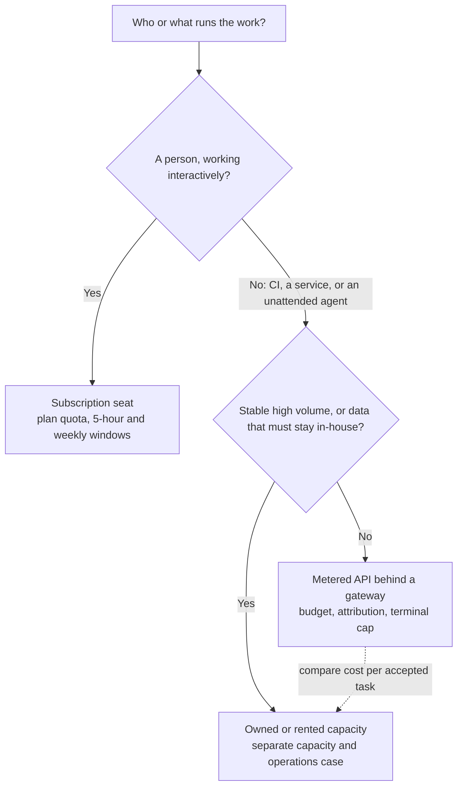
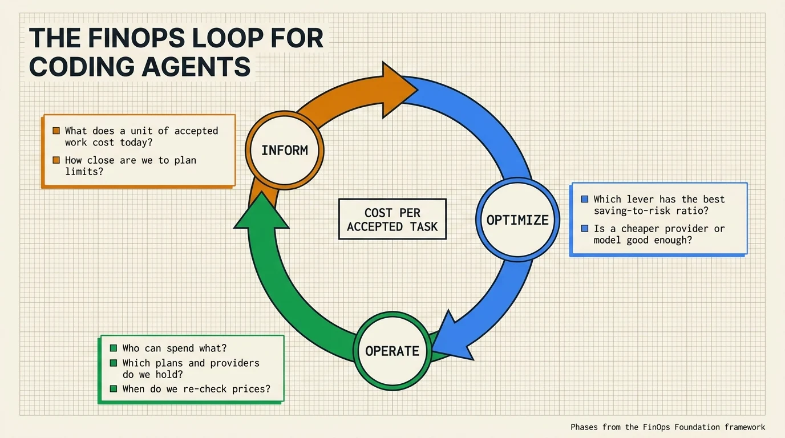

# Справочник AI FinOps для агентов кодирования

> **Время чтения**: ≈12 минут
>
> **Audience**: разработчики платят за использование собственных агентов, технические руководители, владеющие бюджетом команды, а также владельцы платформ или закупщиков, которые выбирают планы и поставщиков.
>
> **Purpose**: используйте эту ссылку, чтобы определить показатель затрат, сравнить рычаги воздействия на рабочую нагрузку и установить средства контроля расходов. Для получения рабочей оценки откройте [визуальное сравнение и калькулятор стоимости](https://cc.bruniaux.com/finops/). Датированные цены собраны в рыночном снимке [LLM](./llm-market-snapshot.md).

---

## ТЛ;ДР

| Вопрос | Начните здесь |
|---|---|
| Цены на LLM растут или падают? | Снимок рынка [LLM, §1](./llm-market-snapshot.md#1-the-trend-quotas-shrink-while-token-prices-fall) |
| Сколько стоит один день работы агента у каждого провайдера? | Снимок рынка [LLM, §5](./llm-market-snapshot.md#5-cost-of-one-reference-workload) |
| Как мне измерить, сколько на самом деле стоит работа моего агента? | [AI юнит-экономика, §2](./ai-unit-economics.md#2-building-a-cost-per-accepted-task) |
| Какие рычаги снижают затраты и что нарушает каждый из них? | [§3 ниже](#3-lever-map) |
| Место, API или оба для команды? | [Стратегия подписки](./subscription-strategy.md) |
| Как ограничить расходы на команду или ключ? | [API шлюз](./api-gateway.md) |
| Когда местное или арендованное оборудование превосходит API? | [Локальный или облачный вывод](../ecosystem/local-vs-cloud-inference.md) |
| Как мне отслеживать свои сеансы? | [Наблюдаемость, отслеживание затрат](./observability.md#cost-tracking) |

---

## 1. Три режима затрат, которые движутся независимо друг от друга

Работа агента оплачивается тремя разными механизмами. У каждого свой отряд, и каждый может меняться без движения других.

| Режим | Что вы покупаете | Единица, которую вы можете сравнить | Что это меняет |
|---|---|---|---|
| **Квота подписки** | Место с включенным использованием (Claude Pro, Max, Team; ChatGPT Plus, Pro; Cursor; Copilot) | Доля резерва, которую поставщик не публикует в токенах | Множители плана, 5-часовые и еженедельные окна, взвешивание модели, правила превышения, по которым клиенты могут использовать место |
| **Измеренные токены API** | Доступ к модели с оплатой по факту использования | Цена за миллион входных, кэшированных входных и выходных токенов | Прейскурантная цена, множители кэша, пакетные скидки и скидки в непиковые часы, региональные надбавки, быстрые режимы, изменения токенизатора |
| **Собственные или арендованные мощности** | Машинное или графическое время работы моделей с открытым весом | Стоимость часа работы графического процессора, деленная на полезную работу, выполненную при вашем использовании. | Цены на оборудование, ставки аренды, соответствие модели, загрузка, обслуживающий персонал |

OpenAI в сентябре 2026 года показывает, почему это различие важно. На своем DevDay 29 сентября компания OpenAI объявила, что 30 октября объем использования, включенный в ChatGPT Pro стоимостью 200 долларов США, снизится с 20 до 10 раз по сравнению с лимитом Plus 30 октября по той же цене. 30 сентября в прайс-листе API была указана цена GPT-6.1 Sol по цене 2 доллара за миллион входных токенов и 10 долларов за миллион выходных токенов, что составляет одну пятую от ставки GPT-6 Astra. Подписчик Pro за 200 долларов теряет половину включенного использования, а клиент API получает более дешевую модель. В снимке рынка  перечислены датированные изменения и их источники.

Отсюда следуют два последствия:

- **Знайте, какой режим несет вашу рабочую нагрузку.** Заголовок о «росте цен» ничего не говорит о вашем счете, пока вы не узнаете, к какому режиму он относится.
- **Не конвертируйте квоту в токены.** Поставщики описывают квоты как кратные другому плану («5x Pro», «20x Plus») и взвешивают их по модели, усилиям и размеру контекста. Любая полученная вами цифра в токенах является оценкой, а не контрактом. Вместо этого измерьте собственное потребление (см. [§2](#2-the-finops-loop-applied-to-agents)).

Какой режим должен нести рабочую нагрузку, зависит от того, кто или что им управляет. Приведенная ниже маршрутизация представляет собой сжатую таблицу решений стратегии подписки :

---

## 2. Цикл FinOps, применяемый к агентам

Структура [FinOps Foundation](https://www.finops.org/framework/phases/) организует работу по затратам в три этапа: **Inform** (изучение данных о затратах, использовании и эффективности), **Optimize** (определение способов повышения эффективности и ценности) и **Operate** (внедрение изменений).

| Фаза | Вопрос по работе агента | Что делать | Где |
|---|---|---|---|
| **Информировать** | Сколько стоит сегодня единица принятой работы? | Записывайте токены за попытку, частоту попаданий в кэш, повторные попытки и время проверки. Разделяйте по принятым задачам, а не по запросам. | [AI юнит-экономика, §2](./ai-unit-economics.md#2-building-a-cost-per-accepted-task), [Observability](./observability.md#cost-tracking), `/usage` в Claude Code |
| **Информировать** | Насколько мы близки к планированию ограничений? | Регистрируйте, как часто ограничивают работу прерываний и какая модель была активна, когда они это делали. | [Планы и ограничения подписки](../ultimate-guide.md#subscription-plans--limits) |
| **Оптимизировать** | Какой рычаг имеет лучшее соотношение сбережений и риска для этой рабочей нагрузки? | Выберите из карты рычагов , протестируйте на образце, сравните стоимость принятой задачи до и после. | [AI юнит-экономика, §3](./ai-unit-economics.md#3-the-real-cost-reduction-levers) |
| **Оптимизировать** | Достаточно ли хорош более дешевый поставщик или модель? | Сравните свои собственные задачи с помощью одного и того же инструмента. Оценки поставщиков оценивают модель, ремни безопасности и настройку усилия. | Снимок рынка [LLM, §4](./llm-market-snapshot.md#4-capability-read-the-benchmark-conditions-first) |
| **Работа** | Кто и что может потратить? | Бюджеты для каждой команды, виртуальные ключи, списки разрешенных моделей, политика прогрессивных расходов для интерактивных пользователей, жесткие ограничения для необслуживаемых агентов. | [API шлюз](./api-gateway.md), [AI юнит-экономика, §5](./ai-unit-economics.md#5-budget-and-governance-per-team) |
| **Работа** | Какие планы и провайдеры у нас есть? | Отделите рабочие места от производственного трафика API, запустите пилотный проект перед фиксацией. | [Стратегия подписки, §7](./subscription-strategy.md#7-decision-and-pilot-gate) |
| **Работа** | Когда мы перепроверим цены? | Повторная проверка у первичного источника перед каждым решением о закупках и не реже каждого квартала. | Снимок рынка [LLM, §8](./llm-market-snapshot.md#8-refresh-rule) |

---

## 3. Карта рычага

Во второй колонке указан режим, на который действует рычаг. В последнем столбце указано, что рычаг оставляет нерешенным или может ухудшить ситуацию, поэтому каждому из них требуется измерение затрат до и после принятой задачи.

| Рычаг | Режим | Задокументировано в | Что это не решает |
|---|---|---|---|
| Маршрут по сложности задачи | API, подписка | [AI Экономика устройства](./ai-unit-economics.md#route-by-complexity) | Задача, для которой действительно нужна самая сильная модель, остается дорогостоящей, а неправильный маршрут требует повторной попытки. |
| Оперативное кэширование | API | [Рычаги оптимизации затрат](../ultimate-guide.md#cost-optimization-levers-native-vs-api-level) | Любое изменение кэшированного префикса делает его недействительным; прокси, которые переписывают контекст, могут его сломать |
| Пакетная обработка | API | [Пакеты сообщений API](../core/architecture.md#message-batches-api) | Запросы обрабатываются асинхронно в течение 24 часов, поэтому пакет не вписывается в интерактивный цикл. |
| Цены вне пика | API, некоторые планы кодирования | Снимок рынка [LLM, §2](./llm-market-snapshot.md#2-api-prices) | Среди проверенных провайдеров его публикуют только DeepSeek (API) и Z.AI (план кодирования), причем графики меняются. |
| Сжатие выходных данных инструмента | API, подписка | [Инструменты контекстного проектирования, §3](../ecosystem/context-engineering-tools.md#3-output-compression-cli--tool-output), [независимые тесты](../ecosystem/context-engineering-tools.md#independent-benchmarks) | Фильтр с потерями может отбросить строку, необходимую агенту, что может вызвать повторный запуск; сторонние тесты показали, что сквозной эффект намного ниже заявлений поставщиков, а иногда и более высокая стоимость |
| Чтение делегирования более дешевой модели | API, подписка | [шунт](../ecosystem/context-engineering-tools.md#shunt-delegation-not-compression) | За токены рабочей модели по-прежнему взимается плата, и она может извлекать неправильные файлы. |
| Изоляция субагентов и ограничения итераций | API, подписка | [AI юнит-экономика, §3](./ai-unit-economics.md#isolate-heavy-work-in-sub-agents) | Субагенты с плохим охватом повторяют работу параллельно |
| Мобильность провайдера (шлюз, возможность принести свой ключ) | API | [API шлюз](./api-gateway.md), [OpenCode](../ecosystem/agentic-tools.md#15-opencode-anomaly-formerly-sst) | Модели не взаимозаменяемы: схемы инструментов, кэширование и рассуждения ведут себя по-разному. |
| Планирование портфолио | Подписка | [Стратегия подписки](./subscription-strategy.md) | Квоты остаются отзывными и не гарантируются в токенах. |
| Локальный или арендованный вывод | Емкость | [Локальный или облачный вывод](../ecosystem/local-vs-cloud-inference.md) | Доступны только модели открытого веса, соответствующие аппаратному обеспечению, а простаивающее оборудование по-прежнему стоит денег. |

Чтобы оценить утверждение поставщика о том, что инструмент «сокращает затраты на X%», примените контрольный список в [AI Unit Economics, §6](./ai-unit-economics.md#6-how-to-read-a-vendors-cost-reduction-claim): проводится ли сравнение по одним и тем же задачам, сколько задач оно охватывает, сообщает ли оно медианное или среднее значение, и является ли сокращение токенов также сокращением долларов.

---

## 4. Что не рассматривается в этом разделе

- **A прогноз.** В разделе документированы датированные факты и метод. Он не предсказывает, куда пойдут цены.
- **Договорные цены.** Объемные скидки, подтвержденные расходы и зарезервированная мощность обычно являются частными контрактами, и в снимке они не указаны.
- **Бизнес-ценность.** Стоимость принятой задачи является знаменателем. Доходы, предотвращенные дефекты и влияние на клиентов остаются отдельными задачами для каждой команды.

---

## См. также

- [LLM снимок рынка](./llm-market-snapshot.md): датированные цены, квоты и тенденции
- [AI Экономика единиц](./ai-unit-economics.md): система измерения
- [Стратегия подписки](./subscription-strategy.md): места, API и портфели поставщиков для команд
- Шлюз [API](./api-gateway.md): бюджеты, виртуальные ключи и списки разрешений
- [AI Визуальный обзор FinOps](https://cc.bruniaux.com/finops/): те же режимы и рычаги, что и на интерактивной странице с калькулятором стоимости
- [Инструменты для экономии токенов, измерено](https://cc.bruniaux.com/token-savings/): заявления поставщиков по шести общедоступным тестам
- [Инструменты разработки контекста](../ecosystem/context-engineering-tools.md): инструменты сжатия и делегирования с их измеренными эффектами
- [Локальный или облачный вывод](../ecosystem/local-vs-cloud-inference.md): оборудование, аренда и API безубыточность
