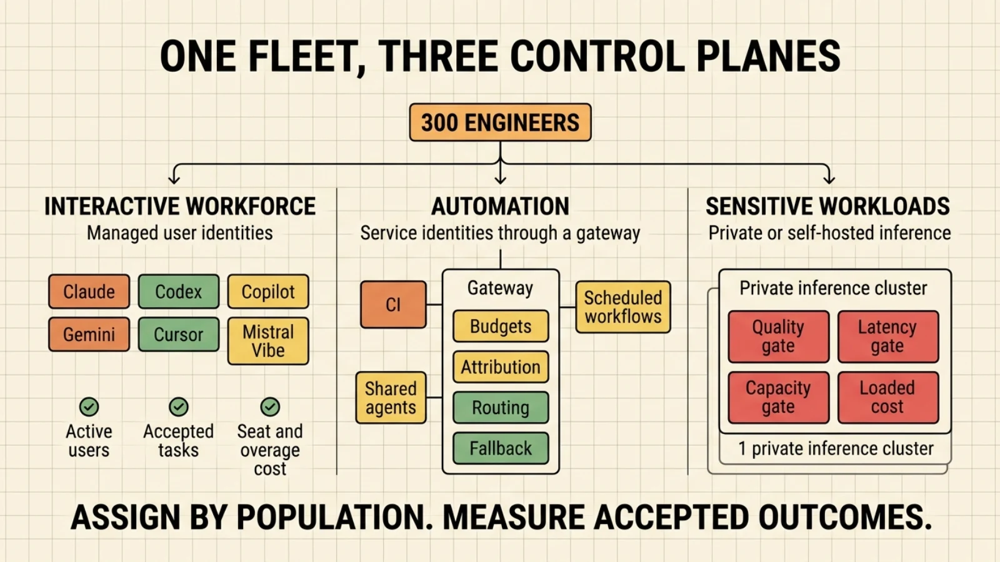

# Стратегия подписки в масштабе команды

> **Audience**: Руководители разработчиков, команды платформ, группы безопасности и владельцы закупок решают, как организация должна покупать инструменты ИИ-кодирования и управлять ими.
>
> **Scope**: Anthropic Team и Enterprise представляют собой детально проработанный пример. Упражнение по принятию решений также охватывает Codex, GitHub Copilot, Gemini Code Assist, Cursor, Mistral Vibe, управляемый трафик API и автономный вывод. На этой странице план продукта или национальность поставщика не рассматриваются как доказательство соответствия нормативным требованиям. Информацию о реализации шлюза см. в разделе [API Шлюз для Claude Code на сайте Scale](./api-gateway.md). Для измерения затрат на уровне задачи см. [AI Unit Economics](./ai-unit-economics.md).

---

## <a name="tldr"></a>ТЛ;ДР

| Ситуация | Начните здесь | Зачем |
|---|---|---|
| Сервис поддерживает критически важную функцию под DORA при любом размере команды. | Классифицируйте функцию и запустите управляющий вентиль [](#7-decision-and-pilot-gate), прежде чем сравнивать количество мест. | DORA не требует наличия плана Anthropic, но достаточно одного обязательного элемента управления только для предприятия, чтобы исключить команду из оцениваемого рабочего процесса. |
| От 2 до 150 предполагаемых пользователей. Командные средства управления соответствуют оценке рисков. | Команда со смешанными стандартными и премиальными местами | Рабочее место включает использование в соответствии с ограничениями плана, единым входом, централизованным администрированием, коммерческими условиями и по умолчанию не требует обучения входным и выходным данным. |
| Более 150 предполагаемых пользователей или документированная необходимость в элементе управления только для предприятия. | Предприятие | Плата за место в размере 20 долларов США дает организации доступ и контроль; затем каждый токен выставляется по тарифу API. |
| Общие задания CI, службы, рабочие нагрузки агента SDK или автоматические агенты | Claude Платформа API с проверенной политикой расходов и лимитом терминалов | Человеческое место — неверная идентичность и бюджетная граница для производственной услуги |
| Регулируемая организация, использующая как рабочую силу, так и автоматизацию производства. | Команда или предприятие для людей, платформа API для услуг | Управление идентификацией и контроль трафика API — это отдельные решения. |
| Несколько помощников по программированию или поставщиков на рассмотрении | Выполните упражнение «Портфолио инженера [300»](#exercise-choose-a-provider-portfolio-for-300-engineers) | Claude, Codex, Copilot, Gemini, Cursor и Mistral используют разные границы места, кредита, избытка и контроля. |
| Самостоятельный вывод на рассмотрении | Отдельное экономическое обоснование мощности и операций | Цены на места не включают в себя оборудование, надежность, безопасность и кадровое обеспечение, необходимые для достоверного сравнения. |

Team и Enterprise используют одни и те же семейства моделей. Enterprise добавляет централизованный контроль над моделями, уровнями усилий, ролями и бюджетами, доступными для каждой группы населения. Выбирайте его, когда именованному владельцу элемента управления требуется одна из этих функций, когда предполагаемые пользователи превышают документированный объем Team или когда требуется дозированное использование без ограничений плана на рабочее место. В противном случае команда является более сильным значением по умолчанию. Маркировка Enterprise сама по себе не доказывает ни качество модели, ни соответствие нормативным требованиям.



---

## <a name="1-the-20-enterprise-seat-does-not-include-usage"></a>1. Место Enterprise стоимостью 20 долларов США не включает использование

Две цены в 20 долларов покупают разные вещи:

- **Team Standard** стоит 20 долларов США за место в месяц при ежегодной оплате или 25 долларов США при ежемесячной оплате. Место включает использование Claude в соответствии с ограничениями плана проката. Team Premium стоит 100 долларов США за место в месяц при ежегодной оплате или 125 долларов США при ежемесячной оплате и включает в себя в пять раз больше использования, чем Standard.
- **Usage Enterprise** стоит 20 долларов США за рабочее место в месяц с ежегодной оплатой за доступ. Он не включает в себя никаких жетонов. Использование Claude, Claude Code и Cowork оплачивается отдельно по стандартным тарифам API. Anthropic не документирует ограничения на использование на одно рабочее место в этом плане, и администраторы могут устанавливать ограничения на расходы организации и пользователя.

Источники: [Anthropic, цены на план](https://claude.com/pricing) и [. Что такое план Enterprise?](https://support.claude.com/en/articles/9797531-what-is-the-enterprise-plan), проверено 31 августа 2026 г.

Anthropic публикует минимум 20 мест для Enterprise с самообслуживанием и 50 мест для Enterprise с поддержкой продаж. Небольшая регулируемая команда, которой нужен контроль только для предприятия, не может сделать вывод о меньшем пути покупки на основе общедоступной документации. Он должен составлять бюджет в соответствии с опубликованным минимумом. Если отдел продаж предлагает другую схему, в файле закупок следует записать ее, прежде чем использовать меньшее количество мест в бизнес-кейсе.

Таким образом, сравнение по умолчанию:

```text
Team monthly cost       = seat price + optional usage credits beyond plan limits
Enterprise monthly cost = $20 access fee + metered token usage
```

По прейскурантной цене счет Enterprise активного разработчика включает в себя плату за доступ в размере 20 долларов США и неограниченное дозированное потребление. Контракт на индивидуальную продажу может изменить коммерческий результат, но публичный заголовок в 20 долларов не устанавливает оптовую скидку.

---

## <a name="2-team-covers-the-baseline-enterprise-adds-specific-controls"></a>2. Команда прикрывает базовую линию; Enterprise добавляет специальные элементы управления

Заявление «нам нужно, чтобы Enterprise соответствовал требованиям» слишком расплывчато, чтобы одобрить покупку. И Team, и Enterprise действуют в соответствии с Коммерческими условиями Anthropic. Anthropic заявляет, что по умолчанию не обучает генеративные модели на входных и выходных данных Team, Enterprise или API. Team также включает единый вход, централизованное выставление счетов, администрирование коннекторов и стандартный 30-дневный период хранения данных Claude Code.

Enterprise добавляет элементы управления, которые могут закрыть определенные пробелы в аудите, идентификации, хранении или сети:

| Контроль | Команда | Предприятие, основанное на использовании | Актуальность решения |
|---|---|---|---|
| Коммерческие условия и отсутствие обучения модели по умолчанию | Да | Да | Базовая защита, а не отличительная черта предприятия |
| Сертификаты поставщиков и сертификаты качества | Артефакты на уровне поставщика, в зависимости от области отчета | Артефакты на уровне поставщика, в зависимости от области отчета | SOC 2 типа I и II, ISO 27001:2022 и ISO/IEC 42001:2023 являются входными данными для закупок, а не дифференциаторами плана; проверьте область действия продукта и период аудита каждого артефакта в Центре управления безопасностью. |
| SSO и центральное администрирование | Да | Да | Команда может удовлетворить базовые требования к управляемому доступу |
| Обеспечение | Приглашение, удаление вручную или JIT | SCIM доступен | SCIM имеет значение, когда при отключении необходимо удалить доступ и рабочие места у поставщика удостоверений без второго ручного действия. |
| Роли | Основной владелец, владелец, администратор и пользователь | Пользовательские роли и группы в дополнение к стандартным ролям | Требуется, когда обязанности, доступ к функциям или политики населения должны быть разделены более четко, чем позволяет команда. |
| Доступ к модели | Доступ ко всем доступным моделям; нет документированной политики организации по модели | Списки разрешений для организации и настраиваемых ролевых моделей, а также ограничения усилий для каждой модели для настраиваемых ролей. | Модельные семейства являются общими; Предприятие обеспечивает соблюдение утвержденной модели и политики усилий для всех покрываемых продуктов. |
| Аудиторские доказательства | Нет экспорта журнала аудита | Журналы аудита и соответствия API | Требуется, когда расследования, надзор или контрольное тестирование требуют доказательств на уровне организации. |
| Удержание Claude Code | Стандартное хранение 30 дней | Стандартное 30-дневное хранение плюс соответствующий критериям ZDR | ZDR — это отличие Enterprise для Claude Code, но он отключает функции, требующие сохраненных подсказок или ответов. |
| Политика хранения продуктов | Нет индивидуального графика организации | Пользовательский срок хранения, минимум 30 дней. | Актуально, когда график документации организации должен соблюдаться централизованно. |
| Сеть и контроль доступа | Нет документированного списка разрешенных IP-адресов или ограничений для клиентов. | Контроль доступа на уровне сети и белый список IP-адресов | Актуально только в том случае, если целевые поверхности и пути движения покрыты. |
| Контроль расходов | Плановые лимиты; дополнительные лимиты использования кредитов на уровне организации и индивидуальном уровне | Организационные, групповые и индивидуальные лимиты расходов при дозированном использовании. | Специальная документация Anthropic Enterprise подтверждает групповую политику; Опубликованные команды контроля за использованием кредитов ограничиваются на уровне организации и отдельных лиц. |
| Дополнительные данные | Нет документированной опции Team для конфигурации CMEK, вывода только для США или конфигурации с поддержкой HIPAA. | Эти варианты доступны соответствующим корпоративным организациям в зависимости от объема продукта и контракта. | Именованное требование должно соответствовать точному варианту; доступность не является доказательством того, что она включена или достаточна. |

Источники: [Anthropic цены](https://claude.com/pricing), [Team plan](https://support.claude.com/en/articles/9266767-what-is-the-team-plan), [роли и разрешения](https://support.claude.com/en/articles/9267276-roles-and-permissions), [Anthropic сертификаты](https://support.claude.com/en/articles/10015870-what-certifications-has-anthropic-obtained), [Anthropic Центр управления безопасностью](https://trust.anthropic.com/), [Кредиты на использование в рамках группы и рабочего места](https://support.claude.com/en/articles/12005970-manage-usage-credits-for-team-and-seat-based-enterprise-plans), [Корпоративные группы и лимиты расходов](https://support.claude.com/en/articles/13799932-manage-groups-and-group-spend-limits-on-enterprise-plans), [Доступ к корпоративной модели](https://support.claude.com/en/articles/15694740-manage-model-access-for-your-organization), [Подготовка JIT и SCIM](https://support.claude.com/en/articles/13133195-set-up-jit-or-scim-provisioning), [Claude Code Данные использование](https://code.claude.com/docs/en/data-usage)и [Claude Code с нулевым сохранением данных](https://code.claude.com/docs/en/zero-data-retention), проверено 31 августа 2026 г.

На странице справки команды Anthropic и сравнении цен используются перекрывающиеся метки для ролевого доступа и контроля расходов. В приведенной выше таблице используется специальная контрольная документация, позволяющая отличать фиксированные роли и лимиты использования организации или пользователей от корпоративных пользовательских ролей, групп и политик расходов на уровне группы. Подтвердите точный контроль в продукте вместо того, чтобы рассматривать общую метку как функцию четности.

### <a name="provider-certifications-are-supplier-evidence-not-a-plan-control"></a>Сертификаты поставщиков являются доказательством поставщика, а не средством контроля плана.

Anthropic распространяет SOC 2 Type I и II, ISO 27001:2022 и ISO/IEC 42001:2023 на свои коммерческие продукты, а не представляет их как функции, предназначенные только для предприятий. Группа закупок должна запросить текущие сертификаты, отчеты, промежуточные письма, заявления об объеме работ, исключения и любые другие доступные ограниченные материалы доверия через Центр управления безопасностью. Затем он должен сопоставить каждый артефакт с продуктами, путями обработки, субподрядчиками и рассматриваемым периодом.

Для банка эти артефакты являются вкладом в обеспечение гарантий поставщиков, а не заменой их. В руководстве ЕЦБ по облачному аутсорсингу от июля 2025 года говорится, что поднадзорные организации не должны с течением времени полагаться исключительно на аудиторские отчеты третьих сторон или сертификаты поставщиков. Учреждение по-прежнему нуждается в собственной оценке рисков, правах на аудит по контракту, мониторинге и независимой проверке. Источник: [ECB Руководство по аутсорсингу облачных сервисов](https://www.bankingsupervision.europa.eu/ecb/pub/pdf/ssm.supervisory_guides202507.en.pdf), разделы 2.5.1–2.5.3, проверено 31 августа 2026 г.

Каждый элемент управления имеет свою границу покрытия. Соответствие API не фиксирует Claude Code в Интернете, рабочие нагрузки платформы Claude API, Amazon Bedrock или Google Vertex AI. Источник: [Соответствие API, покрытие](https://support.claude.com/en/articles/13015708-access-the-compliance-api), проверено 31 августа 2026 г.

ZDR не включен в стандартный план Enterprise. Anthropic включает его отдельно для квалифицированных организаций. Он применяется к выводу Claude Code, а не к Chat или Cowork, и отключает Claude Code в веб- и облачных сеансах с рабочего стола. Источник: [Claude Code ZDRscope](https://code.claude.com/docs/en/zero-data-retention), проверено 31 августа 2026 г.

Клиенты терминалов по умолчанию хранят расшифровки сеансов в виде открытого текста на компьютерах разработчиков в течение 30 дней, если только организация не изменит `cleanupPeriodDays` и не применит этот параметр. Расшифровки, начатые или недавно продолженные в Desktop или Cowork, освобождаются от этого локального значения по умолчанию. Перед написанием управляющего оператора проверьте точную поверхность, поставщика, тип сеанса и режим хранения. Источник: использование данных [Claude Code](https://code.claude.com/docs/en/data-usage), проверено 31 августа 2026 г.

### <a name="compliance-api-evidence-has-its-own-risk-boundary"></a>Доказательства соответствия API имеют собственную границу риска.

Соответствие API создает конфиденциальную плоскость доказательств. В зависимости от области действия ключ доступа к соблюдению требований может предоставлять доступ к активности организации, чатам, файлам, проектам, а также расшифровкам сеансов Claude Code или Cowork. Он также может удалять чаты, файлы и проекты по требованию. Источник: [Соответствие API](https://platform.claude.com/docs/en/manage-claude/compliance-api), проверено 31 августа 2026 г.

Anthropic документирует шестилетний срок хранения ленты активности, шесть лет по умолчанию для стенограмм локальных сеансов, если не установлен ограниченный период хранения в организации, и шесть лет для удаленных стенограмм Cowork. Эти записи на стороне сервера отделены от локальных файлов стенограмм за 30 дней, описанных выше. Ограничьте соответствие ключам и экспорту API, проверьте доступ к ним и определите срок хранения индексов SIEM и архивов соответствия. Источник: [API и сохранение данных](https://platform.claude.com/docs/en/manage-claude/api-and-data-retention), проверено 31 августа 2026 г.

Команда и предприятие имеют общие принципы обеспечения соответствия, но предоставляют разные доказательства контроля. Утверждайте Enterprise только в том случае, если один из его дополнительных средств управления закрывает документированное требование.

---

## <a name="3-a-bank-buys-against-a-control-gap-not-a-plan-label"></a>3. Банк покупает по контрольному разрыву, а не по плану.

Банку следует классифицировать вариант использования, прежде чем сравнивать подписки. Разработчик, использующий Claude Code в общедоступном образце кода, не создает такого же риска, как агент, читающий данные клиента, производственные журналы, логику платежей или секреты аутентификации.

Для финансовых организаций ЕС с 17 января 2025 года DORA требует наличия реестра договорных соглашений со сторонними поставщиками ИКТ. Учреждение должно классифицировать поддерживаемую функцию и оценить соглашение перед выбором плана. Для банков, находящихся под надзором ЕЦБ, в руководстве по облачному аутсорсингу, выпущенном в июле 2025 года, излагаются ожидания надзорного органа и передовая практика, соответствующие DORA, с использованием пропорционального подхода, основанного на риске. Источники: подготовка [EBA для регистров DORA](https://www.eba.europa.eu/activities/direct-supervision-and-oversight/digital-operational-resilience-act/preparation-dora-application) и [ECB. Руководство по аутсорсингу облачных сервисов](https://www.bankingsupervision.europa.eu/ecb/pub/pdf/ssm.supervisory_guides202507.en.pdf), проверено 31 августа 2026 г.

Если услуга поддерживает критически важную функцию, проверка выходит за рамки характеристик продукта и включает места обработки данных, права доступа и аудита, субподряд, обработку инцидентов, непрерывность и выход.

Файл закупок должен ответить на следующие вопросы, прежде чем в нем будет указано название «Команда» или «Предприятие»:

1. **Граница данных**: Какие репозитории, классы данных, соединители, секреты, журналы и производственные среды разрешены или запрещены?
2. **Жизненный цикл удостоверения**: Достаточно ли единого входа и JIT или деинициализация и членство в группах должны осуществляться через SCIM?
3. **Evidence**: Какие события, запросы, ответы, файлы и административные изменения должны быть доступны службам безопасности, аудиту, юридическим службам или регулирующим органам? Как долго?
4. **Retention**: Требуется ли для данного варианта использования стандартное 30-дневное хранение Claude Code, индивидуальный график выпуска продукта или ZDR? Что еще необходимо удалить с машин разработчиков?
5. **Риск третьей стороны**: Охватывают ли контракт и приложения субобработчиков, места обработки, уведомление об инцидентах, права доступа и аудита, непрерывность обслуживания и выход?
6. **Контроль изменений**: Какие версии моделей, версии Claude Code, разъемы, серверы MCP и размещенные поверхности одобрены? Как проверяются и откатываются обновления?
7. **Финансовый контроль**: Какие пороговые значения видимости, предупреждений, утверждений, понижения модели и терминальных ограничений применяются к каждому пользователю, команде, службе и организации? Какие этапы применимы к интерактивным людям и какие рабочие нагрузки должны прекратиться детерминированно?

Утвердите Enterprise, если названное требование соответствует функции, доступной только для Enterprise, и тестирование продукта докажет, что эта функция соответствует предполагаемому рабочему процессу. Сертификационный значок, общая ссылка на соответствие требованиям или сравнительная таблица продаж не являются таким доказательством.

### <a name="what-enterprise-still-does-not-solve"></a>Что Enterprise до сих пор не решает

Покупка Enterprise не передает Anthropic нормативную ответственность. DORA возлагает на финансовую организацию ответственность по своим обязательствам, требует регистрации договорных соглашений в области ИКТ, а также требует дополнительной оценки и договорных положений, если услуга ИКТ поддерживает критически важную или важную функцию.

План сам по себе не предусматривает:

- Соблюдение DORA или требуемой организацией классификации рисков, комплексная проверка, регистрация, мониторинг и контроль доказательств;
- Резиденция данных в ЕС: опубликованные собственные элементы управления платформой Anthropic в настоящее время предлагают логические выводы `global` или `us` и географию рабочего пространства только для США, а не для ЕС;
- проверенный план выхода и миграции, включая доступный возврат данных и адекватный переходный период;
- договорные возможности, цели восстановления, тесты на непрерывность, помощь при инцидентах или точные уровни обслуживания, подходящие для классифицированной функции;
- автоматическое утверждение каждой модели, разъема, сервера MCP, размещенной поверхности, субпроцессора или будущего изменения продукта.

Статьи 28–30 DORA конкретизируют эти отдельные обязательства: учреждение продолжает нести ответственность, должно оценивать концентрацию и взаимозаменяемость, а также заключать контракты на места обработки, доступ и возврат данных, уровни обслуживания, поддержку при инцидентах, права на аудит, непрерывность и выход, где это применимо. Корпоративные функции могут предоставить часть доказательств. Они не могут заменить банковскую оценку, контракт или проверенный операционный контроль. Источники: [DORA, статьи 28–30](https://eur-lex.europa.eu/legal-content/EN/TXT/?uri=CELEX:32022R2554) и местонахождение данных [Anthropic](https://platform.claude.com/docs/en/manage-claude/data-residency), проверено 31 августа 2026 г.

---

## <a name="4-the-13-per-active-day-figure-is-a-benchmark-with-missing-denominators"></a>4. Показатель в 13 долларов США за активный день — это ориентир с отсутствующими знаменателями.

Anthropic сообщает, что в среднем около 13 долларов США на разработчика за активный день и от 150 до 250 долларов США на разработчика в месяц при развертывании на предприятии, при этом затраты ниже 30 долларов США за активный день для 90% пользователей. Anthropic рекомендует пилотный проект, поскольку выбор модели, размер кодовой базы, параллельные сеансы и автоматизация меняют результат. Источник: [Anthropic, Эффективное управление расходами](https://code.claude.com/docs/en/costs), проверено 31 августа 2026 г.

Этот тест не раскрывает период наблюдения, набор моделей, долю неактивных разработчиков, набор задач, уровень принятия или распределение выше 90-го процентиля. Дневной знаменатель включает активные дни, а месячный показатель может включать неактивные дни или пользователей. Эти два значения не могут определить, сколько должен стоить рабочий процесс конкретного разработчика, команды или агента. Они также не могут поддержать утверждение о том, что разработчик с низкими затратами не занимается агентной инженерией.

Текущие настройки модели по умолчанию заставляют отсутствующий материал смешиваться с моделью. Для Claude Code по умолчанию используется Opus 5.5 в версиях Pro, Max, Team и Enterprise при прямом обслуживании; Foundry сохраняет Sonnet 4.5. Настройки организации могут переопределять настройки по умолчанию. Среднее значение за прошлые периоды или по смешанной модели не является прогнозом для интенсивного развертывания Opus. Источник: конфигурация модели [Claude Code](https://code.claude.com/docs/en/model-config), проверено 24 сентября 2026 г.

Независимые данные подтверждают измерение распределения, а не доверие к среднему значению. Бай и др. повторное выполнение агентского кодирования на одних и тех же задачах SWE-bench Verified и наблюдаемое до 30-кратного изменения общего количества токенов; более широкое использование токенов не означало более высокую точность. Их контрольный показатель для восьми моделей не является данными производственных счетов, но он показывает, почему средний показатель по одному пробегу или одному автопарку не может установить безопасный бюджет. Источник: [Bai и др., Как ИИ-агенты тратят ваши деньги? Анализ и прогнозирование потребления токенов в задачах агентного кодирования](https://arxiv.org/pdf/2604.22750), PDF, стр. 1–4.

Отчет практикующего специалиста на Back Market дает знаменатель, близкий к объему в 300 инженеров. Николя Мартиньоль сообщил об от 210 до 220 активных пользователей среди 280 человек, причем активным пользователем считается тот, кто потратил не менее 1 доллара в этом месяце. Он сообщил, что в январе средний показатель за три месяца составил 191 доллар на одного активного разработчика и около 3000 долларов на пользователя с самыми высокими расходами. В докладе не приводятся медианные данные, процентили, количество принятых задач или экспорт счетов, а в более позднем обзоре приводятся итоговые данные за январь, которые противоречат более ранним данным. Относитесь к цифрам как к операционному отчету, а не как к проверяемому прогнозу. Источники: область активных пользователей [в 49:05](https://www.youtube.com/watch?v=kSrEZ57thMg&t=2945s), [January Tail в 50:04](https://www.youtube.com/watch?v=kSrEZ57thMg&t=3004s)и среднее значение [за три месяца в 50:48](https://www.youtube.com/watch?v=kSrEZ57thMg&t=3048s), опубликовано 3 апреля 2026 г.

В той же учетной записи описана политика поэтапных закупок: начните с выставления счетов API, чтобы отслеживать использование и избегать простаивающих подписок, затем рассмотрите максимальный план с фиксированной ценой для ежедневных пользователей. Заявленная эквивалентность между максимальным планом за 200 долларов и использованием API от 1100 до 1200 долларов была представлена ​​в качестве оценки и не проводилась без каких-либо расчетов. Измерьте пересечение на основе собственных счетов организации и принятых результатов. Личный аккаунт Max также остается за пределами границ управления командой и предприятием, управляемых работодателем, описанных в [Boundaries](#8-boundaries). Источники: [, первоначальное решение API в 06:37](https://www.youtube.com/watch?v=kSrEZ57thMg&t=397s) и ежедневная рекомендация пользователя [в 44:00](https://www.youtube.com/watch?v=kSrEZ57thMg&t=2640s), опубликовано 3 апреля 2026 г.

Для пилота сообщите как минимум:

- предполагаемые места, активированные места, активные пользователи и активные дни;
- класс задачи, версия модели, уровень усилий, размер контекста, поведение кэша и количество параллельных агентов;
- стоимость за сеанс и за принятое задание с медианным и верхним процентилями;
- принятие первого прохода, повторные попытки, время проверки человеком, регрессии и скорость отката;
- отдельные итоги для интерактивной работы и автоматической автоматизации.

Без этих знаменателей среднемесячное значение представляет собой сводку счетов, а не инженерное решение.

---

## <a name="5-optimize-cost-per-accepted-task-not-cost-per-token"></a>5. Оптимизируйте стоимость за принятую задачу, а не за токен.

Более дешевые токены могут привести к более высокой стоимости рабочего процесса. Если Haiku или Sonnet требует повторных запросов, выдает неправильный патч или передает работу на проверку человеком, его более низкая частота токенов может не компенсировать повторные попытки и доработку. Один успешный запуск Opus может обойтись дешевле, чем три неудачных запуска на меньшей модели.

Используйте каноническую единицу из [AI Unit Economics](./ai-unit-economics.md#2-building-a-cost-per-accepted-task):

```text
cost per accepted task =
  (model spend + retry spend + human review cost + rework cost)
  / accepted tasks
```

Если испытание не дает принятого задания, соотношение не определено. Сообщайте о нулевых принятых задачах, общем количестве попыток и общих расходах вместо того, чтобы скрывать неудачную пробную версию за числом долларов за задачу.

По текущим общедоступным тарифам API Opus 5.5 стоит 4 доллара за миллион входных токенов и 20 долларов за миллион выходных токенов, Sonnet 5.5 стоит 2 и 10 долларов, а Haiku 5.5 стоит 0,10 и 0,50 долларов за приглашения до 100 000 токенов. Двукратная разница в скорости между Opus и Sonnet имеет смысл только в том случае, если обе модели преодолевают одинаковые ворота качества. Источник: цены на модели [Claude](https://platform.claude.com/docs/en/about-claude/pricing), проверено 27 октября 2026 г.

Databricks называет совокупность моделей с лучшей ценой при требуемом уровне качества *Граница эффективности*. Используйте этот термин как дисциплину оценки, а не как публичный рейтинг. Кандидат принадлежит к границам организации только для тех классов задач, пары модель-оборудование, порога приемки и границы стоимости проверки, которые были фактически протестированы. Databricks сообщает о снижении средней стоимости задачи более чем на 30% при использовании своего внутреннего интеллектуального маршрутизатора, при этом качество примерно соответствует самой дорогой модели, но не публикует образец задачи, парный протокол или доверительный интервал. Источник: [Databricks, «Управление затратами на кодирование ИИ в масштабе»](https://www.databricks.com/blog/managing-ai-coding-costs-scale), 2026-08-07.

Установите правила маршрутизации на основе измеренных результатов задачи:

- Запускайте неоднозначные, межсистемные, чувствительные к безопасности или требующие доработки задачи на самой надежной одобренной модели.
- Используйте более дешевую модель для механических или четко определенных работ только после того, как повторные испытания покажут, что она сохраняет процент приемки и не увеличивает затраты на проверку или повторную попытку.
- Сравнивайте модели для одних и тех же задач, используя более одного запуска для каждой задачи. Записывайте весь рабочий процесс посредством тестов и принятия человеком, а не первый созданный патч.
- Маршрут по проверенному классу задач. Не предполагайте, что семейство моделей или автоматический классификатор сложности знают порог качества организации.
- Предпочитайте решение об использовании модели на уровне задачи до начала работы, когда задача может оставаться в одном стабильном пути кэша. Если маршрутизация происходит для каждого запроса, измерьте создание кэша, чтение кэша, холодный запуск и изменения поведения в середине задачи.
- Повышение цен и делегирование как отдельные попытки. Дешевый контроллер, использующий дорогую модель, все равно может быть дешевле, но дублированный контекст и проверка входят в общую сумму принятых задач.

Неудачное сравнение более дешевых моделей является достоверным свидетельством для тестируемых задач. Это не является доказательством того, что для каждой задачи требуется Opus. Решение о парке требует одинакового сравнения репрезентативной работы, при этом в результат будут включены неудачи и доработки.

Команда уже включает доступ ко всем доступным моделям. Enterprise добавляет централизованное применение. Администраторы могут отключать модели на уровне всей организации, а для настраиваемых ролей ограничивать доступ к моделям и ограничивать максимальный уровень усилий для каждой модели в Chat, Cowork и поддерживаемых поверхностях Claude Code.

В опубликованном сравнении планов Anthropic указано контекстное окно размером 200 тыс. для Team и 500 тыс. для модели Enterprise по умолчанию. Это разница в возможностях плана, а не доступ к другому семейству моделей, и она не устанавливает более высокую скорость принятия задач. Источник: [Anthropic, цены](https://claude.com/pricing), проверено 31 августа 2026 г.

У этого контроля есть пределы. Haiku нельзя отключить. Claude Code CLI версии 2.1.199 или новее отражает ограничения модели и усилий в средстве выбора; более ранние клиенты все еще могут отображать отключенные варианты, но Anthropic сообщает, что запросы с их использованием отклоняются. Эта настройка пока не применяется к Claude в Chrome или Claude Security. Псевдонимы Claude, такие как `opus` и `sonnet`, также могут со временем перейти в более новые версии. Закрепите полные идентификаторы модели для контролируемых развертываний, запустите пакет регрессии перед изменением закрепления, загрузите новую версию и сохраните путь отката. Источники: [План команды](https://support.claude.com/en/articles/9266767-what-is-the-team-plan), [Доступ к корпоративной модели](https://support.claude.com/en/articles/15694740-manage-model-access-for-your-organization)и [Claude Code, конфигурация модели](https://code.claude.com/docs/en/model-config), проверено 31 августа 2026 г.

---

## <a name="6-workforce-plans-and-production-api-traffic-solve-different-problems"></a>6. Кадровые планы и производственный трафик API решают различные проблемы.

Используйте рабочие места Team или Enterprise для определенных людей. Используйте идентификаторы Claude Platform API для заданий CI, общих агентов, запланированных рабочих нагрузок и сервисов, которым требуется собственный бюджет, ограничение скорости и жизненный цикл.

Шлюз, такой как LiteLLM или Portkey, может выдавать виртуальные ключи, прикреплять метаданные команды или службы, ограничивать модели и отклонять маршрутизируемые запросы API после превышения настроенного бюджета. Ограничение терминала само по себе не обеспечивает предупреждение о расходах, одобрение или безопасное для качества понижение модели; для них требуется уровень политики и проверенное поведение клиента. Шлюз не может видеть или ограничивать трафик, аутентифицированный по подписке, отправляемый непосредственно в Anthropic. Enterprise уже предоставляет средства контроля расходов пользователей и организаций для дозированного использования рабочей силы. Добавьте шлюз, если организации нужен один уровень политики для трафика платформы API, нескольких поставщиков или удостоверений служб. См. шлюз [API для Claude Code на сайте Scale](./api-gateway.md#31-progressive-spend-policy-for-interactive-users).

Аккаунты практикующих специалистов поддерживают атрибуцию шлюза, а не измерение производительности. Shopify сообщает о распределении затрат предприятия API по командам и людям через свой внутренний прокси. Отчеты Ramp отслеживают затраты по командам и продуктам на аналогичном внутреннем уровне. Back Market утверждает, что телеметрия BigQuery выявила вызовы Anthropic API от таких клиентов, как Cursor, помимо существующей стоимости лицензии. Ни один из трех аккаунтов не публикует базовые данные о расходах, стоимости внедрения или стоимости принятой задачи. Источники: [Shopify в 22:22](https://www.youtube.com/watch?v=u-3IILWQPRM&t=1342s), опубликовано 2 июля 2025 г.; [Ramp в 24:53](https://www.youtube.com/watch?v=NMs8C2_3M0w&t=1493s), опубликовано 9 марта 2026 г.; и [Back Market в 45:09](https://www.youtube.com/watch?v=kSrEZ57thMg&t=2709s), опубликовано 3 апреля 2026 г.

Контракт шлюза не утверждает каждого маршрутизируемого поставщика. Back Market сообщила, что ее организация разрешила только небольшую часть проходящих внутреннюю проверку из примерно 70 провайдеров, доступных тогда через OpenRouter, и что маршрутизация к десяти провайдерам означает проверку десяти политик данных. Автоматически созданная стенограмма искажает размер этого короткого списка, поэтому точное количество не установлено, а выступающий явно не представил свое заявление в качестве юридической консультации. Сохраните список разрешенных поставщиков и просмотрите контракт каждого поставщика, путь обработки и элементы управления, прежде чем включать его. См. [Model Allowlists](./api-gateway.md#4-model-allowlists) для получения информации об названных поставщиках и границах ответственности. Источник: [Николя Мартиньоль, 38:17](https://www.youtube.com/watch?v=DRtd8S_3E-w&t=2297s), опубликовано 22 июля 2026 г.

Перемещение трафика к агрегатору может увеличить счет, но механизм заключается в замене модели, а не в улучшении ставки на ту же модель. Back Market сообщил о росте с 87 000 долларов в месяц на Anthropic API в июне 2026 года до 23 000 долларов на OpenRouter в августе для того же населения. Спикер объясняет падение двумя изменениями, внесенными в одном и том же окне, а не одним: разработчики перестали использовать исключительно модели Anthropic, при этом модель с открытым весом поглощала 53% токенов за 35% расходов, и одновременно был введен бюджет для каждого разработчика. Поскольку оба этих продукта расположены вместе, счет не позволяет зачислять ни один из них отдельно, и он не сообщает об измерении качества продукции или затраченного времени. Относитесь к этому как к шагу по замещению плюс бюджет, а не как к экономии ставок. Источник: [, двухмесячный обзор OpenRouter](https://www.youtube.com/watch?v=pbrP--c4alk), опубликованный 14 сентября 2026 г.

Регулируемое развертывание может разделить удостоверения сотрудников и служб:

```text
Developers  -> Team or Enterprise organization -> Anthropic workforce controls
CI/services -> Internal gateway                -> Claude Platform API
```

Не используйте учетные данные места разработчика в качестве производственного удостоверения автоматической службы.

---

## <a name="7-decision-and-pilot-gate"></a>7. Решение и пилотные ворота

Применяйте шлюзы в следующем порядке: критичность функций и данных, необходимые элементы управления и условия контракта, охват поверхности продукта, затем количество пользователей и стоимость. Критическая или важная классификация DORA не требует автоматического обязательного использования Enterprise. Он действительно удаляет численность персонала в качестве безопасного ярлыка: если оцениваемый рабочий процесс требует SCIM, свидетельства соответствия API, настраиваемого хранения, сетевых ограничений или другого элемента управления, предназначенного только для предприятия, это требование определяет план даже для небольшой команды.

Выберите **Team**, когда выполняются все три условия: предполагаемое количество пользователей остается в пределах 150, единый вход группы и модель администрирования соответствуют требованиям идентификации, а оценка рисков не требует только корпоративных доказательств, хранения, сети или контроля ролей.

Выбирайте **Enterprise**, когда это требуется подсчетом пользователей или подписанным требованием управления, а также после того, как пилот проверит соответствующую функцию на каждой намеченной поверхности. Примите тот факт, что место в размере 20 долларов США — это плата за доступ и прогнозирование использования токенов отдельно.

Добавьте платформу **Claude за шлюзом**, когда для автоматизации производства требуются идентификаторы услуг, бюджеты терминалов, маршрутизация между поставщиками или централизованная атрибуция API. Для интерактивного трафика API проверьте прогрессивные предупреждения, разрешения и понижение передачи перед ограничением терминала. Это может сосуществовать с любым планом рабочей силы.

Эти варианты являются ветвью решения Anthropic. Они не устанавливают, что один поставщик должен обслуживать каждого разработчика или рабочую нагрузку.

### <a name="exercise-choose-a-provider-portfolio-for-300-engineers"></a>Упражнение: выберите портфель поставщиков для 300 инженеров.

В ходе упражнения ставится вопрос о том, какой путь закупок и развертывания должен обслуживать каждую группу населения, а не о том, какой поставщик получит один универсальный рейтинг. Заморозьте все цены, допуски, элементы управления, версии модели и предположения по контракту на дату проведения проверки. Перед закупкой повторно запустите коммерческий снимок, поскольку несколько поставщиков изменили свою единицу выставления счетов или право на участие в плане в течение 2026 года.

#### Шаг 1: запишите отправную точку публичной рекламы

В таблице ниже представлена ​​исходная карта, проверенная 31 августа 2026 г. Это не котировка, и она не нормализует различные единицы выставления счетов в единую цену искусственного места.

| Путь кандидата | Общественная отправная точка | Границу, которую пилот должен проверить |
|---|---|---|
| Claude Команда или предприятие на основе использования с Claude Code | В разделы [1](#1-the-20-enterprise-seat-does-not-include-usage) и [2](#2-team-covers-the-baseline-enterprise-adds-specific-controls) включен документ «Командное использование» и «корпоративный доступ», а также дозированные токены. | Предполагаемый объем пользователей, хвост активных пользователей, модель и политика усилий, охватываемые поверхности и стоимость принятой задачи |
| ChatGPT Business или Enterprise с Codex | Бизнес публично перечисляет места Standard стоимостью 20/25 долларов США и места Premium стоимостью 100/125 долларов США, включая Codex, и ориентированы на организации со штатом от 2 до 200 сотрудников; Предприятие имеет индивидуальную цену | Организации со штатом 300 инженеров требуется ценовое предложение Enterprise или другой документированный путь. Новые рабочие места PAYG только для Codex перестали быть доступны для новых рабочих пространств Business 24 июня 2026 г., хотя существующие рабочие места, соответствующие критериям, могут сохранить их. |
| GitHub Copilot Бизнес или предприятие | Бизнес перечисляет 19 долларов США за предоставленного пользователя с 1900 ежемесячными кредитами AI; Enterprise перечисляет 39 долларов из 3900. Пул кредитов у организации, выставляющей счет, и дополнительное использование составляет 0,01 доллара США за кредит. | Расход кредитов в зависимости от модели, бюджеты пользователей и центров затрат, трафик агентов, предварительные условия корпоративного плана и скорость принятия использованных кредитов |
| Gemini Code Assist Standard или Enterprise | Google публикует почасовые ставки за лицензию в рамках ежемесячных и 12-месячных обязательств. Enterprise добавляет настройку кода и более активное использование агентов. | Фактические обязательства по оплате, назначение лицензий, ценность интеграции с Google Cloud, настройка репозитория, ежедневные ограничения для агентов и переносимость за пределы Google Cloud. |
| Курсорные команды или предприятие | В Teams указаны активные места Standard за 40 долларов и Premium за 120 долларов; Предприятие индивидуальное. Использование сторонней модели оплачивается по публичной цене API плюс ставка Cursor в размере 0,25 доллара США за миллион токенов. | Использование по каждому пользователю или в пуле, расходы по требованию, автоматическая маршрутизация, разметка сторонней модели, SCIM и расширенные элементы управления, стоимость фонового агента и выход из состояния рабочего процесса, специфичного для курсора. |
| Mistral Vibe Team или Enterprise | Команда оценивает 24,99 доллара США за пользователя; Предприятие индивидуальное. Организационный план охватывает использование Vibe, Studio и API, при этом использование включено в стоимость до необязательного PAYG. | Vibe CLI, IDE, Интернет и покрытие удаленных агентов; ограничения организации и рабочего пространства; SAML, аудит, зрелость Admin API, поддержка и условия частного развертывания |
| Управляемый мультипровайдер API | Токены провайдера плюс стоимость шлюза, телеметрии и оператора. | Идентификаторы служб, список разрешенных поставщиков, резервное поведение, отклонение бюджета, политика регистрации полезной нагрузки и трафик, проходящий в обход шлюза. |
| Самостоятельный вывод открытого веса | Нет эквивалента стоимости места | Качество задач, параллелизм, TTFT, скорость вывода, глубина очереди, доступность, стоимость загруженной инфраструктуры и время оператора при одних и тех же шлюзах приема и задержки. |

Источники: [OpenAI ценообразование для бизнеса](https://openai.com/business/pricing/) и [Codex право на гибкое ценообразование](https://help.openai.com/en/articles/11487671-flexible-pricing-for-the-enterprise-and-team-plan); [GitHub Copilot выбор плана](https://docs.github.com/en/copilot/tutorials/roll-out-at-scale/assign-licenses/choose-enterprise-plan) и [AI-выставление счетов по кредиту](https://docs.github.com/en/copilot/concepts/billing/usage-based-billing-for-organizations-and-enterprises); [Gemini Код Справочная информация по ценам](https://cloud.google.com/products/gemini/pricing); [Ценообразование команды курсоров](https://prod.cursor.com/docs/account/teams/pricing); [Цены Mistral](https://mistral.ai/pricing/), [подписки](https://docs.mistral.ai/admin/billing-usage/subscriptions)и [Ограничения использования](https://docs.mistral.ai/admin/billing-usage/usage-limits), все проверены 31 августа 2026 г.

Mistral нужны три отдельные строки кандидатов в рабочей таблице, хотя в сводной таблице они группируются: рабочие места Vibe, Devstral или Codestral через API Mistral, а также частное или автономное развертывание с открытым весом. Mistral утверждает, что данные по умолчанию размещаются в ЕС, но некоторые функции могут временно передавать данные за пределы ЕС; Корпоративные клиенты могут отключить некоторые из этих функций на уровне организации. Штаб-квартира во Франции и хостинг по умолчанию в ЕС являются значимыми фактами закупок, а не доказательством того, что все пути обработки остаются во Франции или ЕС. Источники: [Mistral, руководство по расположению данных](https://help.mistral.ai/en/articles/347629-where-do-you-store-my-data-or-my-organization-s-data) и [Enterprise Admin API, предварительная версия](https://docs.mistral.ai/admin/admin-api/overview), проверено 31 августа 2026 г.

**Mistral Large 4, проверено 06.10.2026.** Добавьте эту общедоступную предварительную модель в строку-кандидат API и оцените ее с теми же вентилями принятой задачи и задержки. Цена модели не определяет право на место Vibe или модель Vibe по умолчанию. При запуске будут объявлены веса позднее в октябре; Частное развертывание остается будущим кандидатом до тех пор, пока не станут доступны файлы, лицензия, поддержка обслуживания и измерения рабочей нагрузки. Снимок рынка [](./llm-market-snapshot.md#2-api-prices) фиксирует продажи и первоначальные курсы API; Оценка исходного кода [](../../docs/resource-evaluations/mistral-large-4.md) фиксирует пределы тестов и спецификаций. Источники: запуск [Mistral](https://mistral.ai/news/mistral-large-4/) и [документация модели](https://docs.mistral.ai/models/mistral-large-4-0).

Что касается требования к резидентству, отличайте заявку на европейскую инфраструктуру запуска от контрактного пути обработки. Документация Mistral по региональному выводу [](https://docs.mistral.ai/inference/regional-inference), проверенная 6 октября 2026 г., не дает глобальной конечной точке никаких конкретных обязательств по географии вывода. Региональный вывод является необязательным и оплачивается по стандартной прейскурантной цене в 1,1 раза; его взаимодействие с продажей не установлено. Конечная точка ЕС требует проверки доступности модели для конкретного региона; Большой 4 не запрашивался для этого руководства. В его географическую таблицу входят страны ЕС и ЕАСТ, поэтому подтвердите разрешенные страны. Метаданные учетной записи, выставления счетов и использования остаются вне региональной гарантии. Региональные конечные точки поддерживают вызов функций, но исключают API-интерфейсы агентов, пакетной обработки и файлов с отслеживанием состояния, поэтому пилотный проект должен охватывать фактические функции выбранной конечной точки.

#### Шаг 2. Сегментируйте людей перед распределением мест

Не начинайте с 300 одинаковых лицензий. Заполните эту таблицу, используя экспорт идентификационных данных и счетов. Первые три ряда разделяют предполагаемую рабочую силу без двойного учета людей; Рабочие нагрузки служб остаются отдельными, поскольку им нужны нечеловеческие личности.

| Население | Предполагаемые пользователи | Активированные пользователи | Активные пользователи в месяц | Активных дней на пользователя | Поверхности-кандидаты | Необходимые элементы управления |
|---|---:|---:|---:|---:|---|---|
| Ежедневные интерактивные пользователи агента кодирования |  |  |  |  |  |  |
| Периодические пользователи помощников по кодированию |  |  |  |  |  |  |
| Пользователи с ограниченными правами или пользователи, чувствительные к суверенитету |  |  |  |  |  |  |
| CI, запланированные агенты и общие службы | n/a | n/a | n/a | n/a |  |  |

#### Шаг 3. Запустите один и тот же четырехнедельный пилотный проект для всех кандидатов.

Используйте репрезентативные задачи репозитория и одни и те же шлюзы приемки исполняемых файлов. Повторяйте задачи, поскольку один запуск агента не позволяет оценить распределение. Записывайте модель и версию протокола, класс задачи, уровень маршрутизации, решение о маршрутизации, входные и выходные токены или кредиты поставщика, создание и чтение кэша, холодные запуски, сбои инструментов, повторные попытки, время проверки, принятый результат, задержку и резервный вариант любого поставщика или шлюза. Записывайте каждое предупреждение о расходах, одобрение, понижение и приостановку расходов с их пороговым значением и результатом. Рабочее место, которое также включает функции чата или офиса, может создавать ценность вне программирования, но записывайте эту ценность отдельно, вместо того, чтобы приписывать все рабочее место инженерным задачам.

Для самостоятельных кандидатов воспроизведите измеренную схему прибытия, а не переводите 300 инженеров в 300 одновременных запросов. Регистрируйте использование графического процессора, глубину очереди, TTFT, время на выходной токен, вытеснение кэша, сбои в работе, работу по развертыванию и часы работы оператора. Используйте подробный метод в [Определение размеров самостоятельного вывода для Team](../ecosystem/local-vs-cloud-inference.md#sizing-self-hosted-inference-for-a-team).

#### Шаг 4: рассчитайте сопоставимые единицы решения

```text
workforce monthly cost = committed seats + metered overage + non-seat add-ons
service monthly cost   = provider usage + gateway + telemetry + operator cost
self-host monthly cost = amortized hardware or rental + energy + network
                         + storage + monitoring + availability + operator cost

cost per active developer = workforce monthly cost / monthly active developers
cost per accepted task    = (all model, infrastructure, review, and rework cost)
                            / accepted tasks
```

Также сообщайте о запланированных, назначенных, активированных и активных местах; медианные расходы и расходы верхнего процентиля; неиспользованные включенные кредиты; предупреждения, одобрения, понижения передачи, окончательные отказы; и рабочие процессы с нулевым количеством принятых задач. Не прячьте неудачные испытания за неопределенным соотношением стоимости принятого задания.

#### Шаг 5: выберите портфолио, затем проверьте границы

Действительный результат может назначить разные пути разным группам населения. Например, план управляемой рабочей силы может охватывать интерактивную разработку, шлюз может владеть CI и общими агентами, а частный Mistral или другое развертывание с открытым весом может охватывать узкую рабочую нагрузку, чувствительную к суверенитету. Это гипотеза для проверки, а не рекомендуемое распределение.

Отклонить кандидата, если требуемый контроль или контроль качества задачи не выполняются, даже если его прейскурантная цена ниже. Перед утверждением протестируйте отключение, каждый настроенный этап политики расходов, отклонение терминала, экспорт аудита, расположение данных и подпроцессоры, изменение версии модели, поведение кэша при маршрутизации, возврат к резервному поставщику, обход прямого трафика и поведение при выходе или экспорте данных. Сравнивайте самостоятельное размещение только после того, как локальная модель соответствует тем же целевым показателям принятых задач и задержки, что и управляемые кандидаты.

Перед внедрением ответственный за решение должен утвердить один пакет доказательств, содержащий:

1. пакет гарантий поставщика с указанием объема, периода аудита, исключений и независимой оценки каждого отчета SOC 2, ISO или ограниченного отчета, использованного в решении;
2. матрица контроля «команда против предприятия» с указанием владельца и результатов тестирования для каждого необходимого элемента управления;
3. репрезентативная оценка модели с качеством принятой задачи и общей стоимостью рабочего процесса;
4. ежемесячный прогноз, показывающий медианное и хвостовое использование, а не только среднее значение на одно место;
5. тест на отключение, аудит или тест на покрытие соответствия API, а также тест на удержание;
6. проверка политики расходов для каждого пути дозированного трафика, включая путь отклонения терминала и любые этапы предупреждения, одобрения или понижения передачи;
7. завершенное упражнение с участием нескольких поставщиков с датированными исходными URL-адресами, отклонениями от контракта и выбранной совокупностью для каждого пути;
8. запись DORA и сторонних рисков, если организация считает, что эти обязательства применимы.

Для филиала Anthropic, если команда пройдет этот шлюз, файл закупок не будет содержать продемонстрированного бизнес-кейса предприятия. Если команда не проходит необходимый контроль, а предприятие проходит тот же тест, запишите функцию, предназначенную только для предприятия, ее владельца и свидетельства теста. Для решения по портфелю запишите, почему каждый выбранный путь выигрывает для назначенной ему совокупности и какие измеренные неудачи или пробелы в контроле отклонили альтернативы.

---

## <a name="8-boundaries"></a>8. Границы

Возмещаемая учетная запись Pro или Max не является управляемой работодателем заменой Team или Enterprise. У него отсутствует единая плоскость управления организацией, и его использование может регулироваться Потребительскими условиями, а не Коммерческими условиями. Прежде чем использовать личные учетные записи для работы компании, согласуйте применимый договор. Источник: [Claude Code юридические вопросы и соблюдение требований](https://code.claude.com/docs/en/legal-and-compliance).

Самостоятельный вывод — это отдельное решение по мощности и операциям. Это упражнение включает его в качестве пути-кандидата, но не помещает его рядом с ценой места. Сравните его по измеренному качеству задач, параллельности, пропускной способности, задержке, доступности, безопасности и стоимости загруженных операций. См. [Local и Cloud Inference](../ecosystem/local-vs-cloud-inference.md#sizing-self-hosted-inference-for-a-team).

---

## 9. Краткое изложение решения на одной странице

Используйте эту таблицу после завершения пилотного проекта, а не вместо нее. Ворота принятия решения сочетают в себе основной контроль, проверку стоимости и отбраковку. Он не оценивает качество модели.

| Путь | Используйте его для | Как вы платите | Ворота принятия решения |
|---|---|---|---|
| Команда Claude | Управляемое интерактивное использование Claude Code | Место с включенным лимитом использования и планом | Командные элементы управления и включенное использование проходят пилотный этап; в противном случае протестируйте Enterprise |
| Claude Предприятие | Более крупные или регулируемые развертывания Claude Code | Плата за доступ в размере 20 долларов США за место плюс использование по счетчику в соответствии с договором. | Пробел в контроле над именованной командой устранен, и использование хвоста остается доступным. |
| ChatGPT Business или Enterprise с Codex | Интерактивное использование Codex регулируется через рабочую область ChatGPT. | Уровень места Business или контракт Enterprise | Документируется коммерческий путь 300 человек, охват аудита, поведение в отношении расходов и увольнение. |
| GitHub Copilot Бизнес или предприятие | GitHub-ориентированный IDE, чат и рабочие процессы агентов | Плата за предоставленное пользование, объединенные кредиты ИИ, а затем избыток | Сжигание кредитов для конкретной модели обеспечивает приемлемую стоимость за принятую задачу. |
| Gemini Code Assist Standard или Enterprise | Команды уже управляются через Google Cloud | Ежемесячное или годовое обязательство по количеству лицензионных часов | Настройка кода, ограничения агентов, контроль данных и переносимость оправдывают обязательства. |
| Курсорные команды или предприятие | Команды выбирают рабочий процесс редактора с использованием искусственного интеллекта | Активные сиденья плюс использование модели или избыток | Прибыль от результатов включает в себя разметку модели, фоновые агенты, миграцию и затраты на выход. |
| Mistral Vibe Team или Enterprise | Управляемые рабочие процессы Vibe и пути закупок у европейских поставщиков | Рабочее место для команды с включенным использованием и дополнительным контрактом PAYG или Enterprise. | Vibe успешно выполнил пилотную задачу, и фактические места обработки соответствуют требованиям суверенитета. |
| Управляемый мультипровайдер API | CI, общие агенты, сервисы и модель маршрутизации | Токены провайдера плюс стоимость шлюза, телеметрии и оператора. | Управление маршрутизацией, прогрессивным или терминальным расходом, атрибуция, резервный режим, поведение кэша и обходные элементы управления работают; прямые подписки остаются за пределами шлюза |
| Самостоятельный вывод открытого веса, включая Devstral | Стабильные, объемные или чувствительные к конфиденциальности рабочие нагрузки | Инфраструктура, энергия, мониторинг, доступность и время оператора | Качество и задержка соответствуют целевому; измеренный параллелизм и стоимость загрузки превосходят альтернативу API |

Для 300 инженеров оправданным результатом обычно является распределение портфеля по численности населения, а не один универсальный победитель: управляемый путь рабочей силы для интерактивного использования, управляемые идентификаторы API для автоматизации и самостоятельный вывод только для рабочих нагрузок, которые проходят отдельный случай качества, мощности и операций. Запишите это как взвешенное решение, а не распределение по умолчанию.
