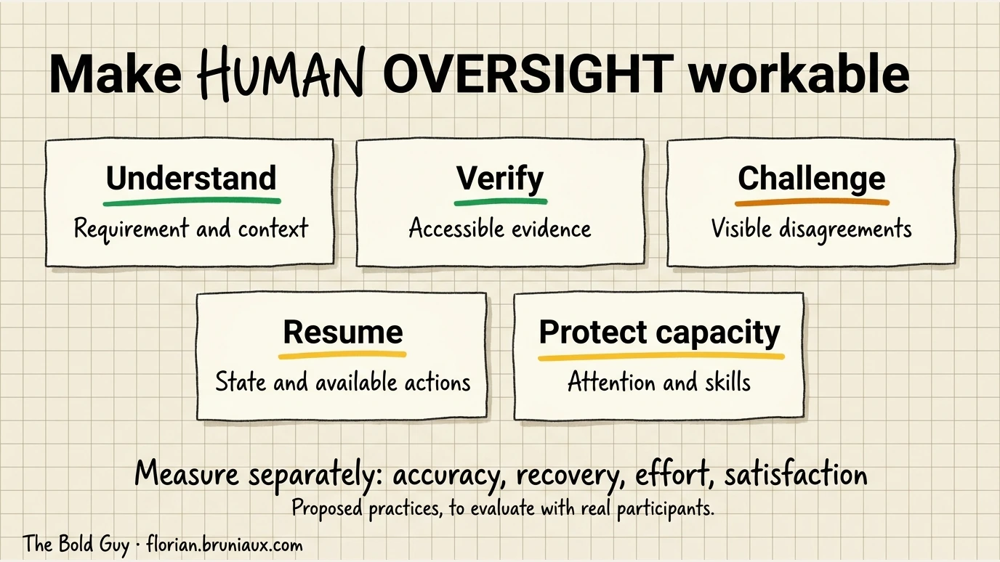

# Учимся программировать с помощью ИИ: руководство для сознательного разработчика

> **Confidence**: Уровень 2, на основе академических исследований (2023–2025 гг.) и отзывов преподавателей.
>
> **Audience**: Младшие разработчики, студенты CS, выпускники учебных курсов, меняющие карьеру.
>
> **Время чтения**: ~15 минут
>
> **Последнее обновление**: август 2026 г.

---

## Оглавление

1. [Быстрая самопроверка (начните здесь)](#quick-self-check-start-here)
2. [Проблема за 60 секунд](#the-problem-in-60-seconds)
3. [Реальность продуктивности искусственного интеллекта](#the-reality-of-ai-productivity)
4. [Три паттерна](#the-three-patterns)
5. [Протокол UVAL](#the-uval-protocol)
6. [Claude Code для обучения](#claude-code-for-learning-not-just-producing)
7. [Разрыв зависимости (Шаблон: Зависимый)](#breaking-dependency)
8. [Использование инструментов ИИ (схема: избегание)](#embracing-ai-tools)
9. [Оптимизация потока (Шаблон: дополненный)](#optimizing-your-flow)
10. [Пример: принципы гибридного обучения](#case-study-hybrid-learning-principles)
11. [На каком этапе кривой внедрения агентов вы находитесь?](#where-are-you-on-the-agent-adoption-curve)
12. [30-дневный план развития](#30-day-progression-plan)
13. [Для технических руководителей и технических менеджеров](#for-tech-leads--engineering-managers)
14. [Стоимость внимания к обзору Shift](#the-attention-cost-of-the-review-shift)
15. [Контрольный список красных флажков](#red-flags-checklist)
16. [Источники и исследования](#sources--research)
17. [См. также](#see-also)

---

## <a name="quick-self-check-start-here"></a>Быстрая самопроверка (начните здесь)

Прежде чем приступить к делу, ответьте честно:

| # | Вопрос | Да | Нет |
|---|----------|-----|-----|
| 1 | Можете ли вы объяснить последний код, который сгенерировал для вас ИИ? | ☐ | ☐ |
| 2 | Вы отлаживали код без ИИ на этой неделе? | ☐ | ☐ |
| 3 | Знаете ли вы, ПОЧЕМУ решение работает (а не только ЧТО оно работает)? | ☐ | ☐ |
| 4 | Сможете ли вы написать ту же функцию без посторонней помощи? | ☐ | ☐ |
| 5 | Знаете ли вы ограничения ИИ в решении задач такого типа? | ☐ | ☐ |

### Ваш результат

| Счет | Где вы находитесь | Перейти к |
|-------|--------------|---------|
| **0-2 да** | Риск зависимости: вы думаете об аутсорсинге | [§6 Нарушение зависимости](#breaking-dependency) |
| **3-4 да** | На правильном пути, есть место для оптимизации | [§8 Оптимизация вашего потока](#optimizing-your-flow) |
| **5 да** | Дополнено: вы правильно используете ИИ | [§9 Практический пример](#case-study-hybrid-learning-principles) |

Будьте честны. Это руководство поможет только в том случае, если вы осознаете, где вы на самом деле находитесь.

---

## <a name="the-problem-in-60-seconds"></a>Проблема за 60 секунд

> ИИ может сделать вас в 3 раза более продуктивными или сделать вас безработными за 3 года.
> Разница? Как вы его используете.

Забудьте пока о статистике. Вот простая метафора:

**AI — ваш GPS.**

- Отлично подходит для быстрого куда-то добраться
- Опасно, если вы потеряете возможность ориентироваться без него.
- Действительно полезно, когда вы понимаете карту И используете GPS.

Разработчик, который только копирует и вставляет результаты ИИ, подобен водителю, который не умеет читать карту. Хорошо, пока не выйдет из строя GPS или пока кто-нибудь не попросит объяснить маршрут.

### Разрыв в навыках

```
Traditional learning: Problem → Struggle → Understanding → Solution
AI-assisted (wrong): Problem → AI → Solution → ??? (no understanding)
AI-assisted (right): Problem → Attempt → AI guidance → Understanding → Solution
```

Борьба не является обязательной. Здесь происходит обучение.

### <a name="the-vibe-coding-trap"></a>Ловушка «кодирования вибрации»

Термин, придуманный [Андреем Карпати](https://x.com/karpathy/status/1886192184808149383) (февраль 2025 г., Слово года 2025 г. по Коллинзу): кодирование путем «полного подчинения вибрациям» без понимания сгенерированного кода.

> **Related**: Для контекстов команды и OSS см. [AI Traceability](../ops/ai-traceability.md), где описаны политики раскрытия информации (LLVM, Ghostty, Fedora) и инструменты атрибуции.

**Symptoms:**
- Принять все, не читая различия
- Ошибки копирования и вставки без понимания основной причины
- Отладка, запрашивая у ИИ случайные изменения, пока он не заработает.

**Предупреждение Карпати:** «Не так уж плохо для одноразовых проектов выходного дня», но опасно для производственного кода, который вам придется поддерживать.

**Предлагаемая практика:** UVAL (§5) предоставляет контрольные точки для проверки понимания перед принятием; его влияние на оценку потребностей в удержании и передаче.

> **Related**: стратегии управления контекстом, которые предотвращают хаос кодирования Vibe, см. в разделе [Anti-Pattern: Context Overload](#anti-pattern-context-overload) в основном руководстве (§9.8).

**В масштабе команды**кодирование вибрации накапливается в том, что некоторые практики называют *долгом понимания* (новый термин, 2025-2026 гг.): растущий разрыв между количеством кода, существующего в системе, и тем, насколько человек действительно понимает. В отличие от технического долга, который проявляется в медленных сборках и запутанных зависимостях, долг понимания порождает ложную уверенность: скорость выглядит нормально, тесты зеленые, а расчет приходит в самый неподходящий момент, обычно во время инцидента или аудита.

---

## <a name="the-reality-of-ai-productivity"></a>Реальность производительности ИИ

Прежде чем оптимизировать свой подход к обучению, поймите, что на самом деле показывают исследования производительности. Здесь больше нюансов, чем предполагает маркетинг.

### Кривая производительности (не прямая линия)

Большинство разработчиков проходят три отдельные фазы:

| Фаза | Хронология | Производительность | Что происходит |
|-------|----------|--------------|------------------|
| **Вау-эффект** | 0-2 недели | ~0% выигрыш | Кривая обучения маскам волнения; время, потраченное на подсказки, компенсирует сэкономленное время |
| **Целевая прибыль** | 2-8 недель | +20-50% | ИИ ускоряет выполнение конкретных задач, которые вы научились эффективно делегировать |
| **Устойчивое Плато** | 3-6 месяцев | +20-30% | Стабильная прибыль, но только для разработчиков, у которых уже есть сильные основы |

**Важный нюанс**: Эти выгоды условны. Исследования показывают, что опытные разработчики (5+ лет) видят более крупные и устойчивые результаты. Младшие разработчики часто видят первоначальные скачки, за которыми следует регресс, потому что скорость без понимания создает технический долг. РКИ 2026 года ([Shen & Tamkin, Anthropic Fellows](https://arxiv.org/abs/2601.20245)) зафиксировало снижение **17% в приобретении навыков**, когда разработчики изучали новую библиотеку с помощью ИИ (n=52, p=0,01), без значительной экономии времени. Только ~20% пользователей ИИ (чистая схема делегирования) закончили работу быстрее, почти ничего не обучившись.

**Проверьте, продолжать ли**: повторяющиеся сбои, сообщения об усталости или трудности с объяснением следующего действия могут оправдать паузу, выполнение более мелкой задачи или дополнительную помощь. Согласуйте и оцените частоту вращения педалей на местном уровне; эти наблюдения не устанавливают заболевание или его причину. См. [. Проверьте, следует ли продолжать](#step-25-check-whether-to-continue).

### Где ИИ помогает (а где вредит)

| Задачи с высокой прибылью | Low/Negative-Gain Задачи |
|-----------------|-------------------------|
| Создание шаблона | Архитектурные решения |
| Тестовые леса | Специализированная логика |
| Рефакторинг известных шаблонов | Глубокая отладка |
| Черновики документации | Тонкая оптимизация |
| Адаптация кодовой базы | Критически важный для безопасности код |
| CRUD-операции | Разработка нового алгоритма |

Модель: **AI превосходно справляется с четко определенными, повторяемыми задачами**. Он борется с неоднозначными проблемами, требующими глубокого контекста или творческого суждения.

### <a name="why-some-teams-get-results-and-others-dont"></a>Почему одни команды добиваются результатов (а другие нет)

**Команды, добившиеся успеха**:
- Установите четкие рекомендации по использованию ИИ (когда использовать, а когда нет)
- Поддерживать стандарты проверки кода (код, сгенерированный ИИ, проверяется так же, как и человеческий код)
- Создавайте общие библиотеки подсказок для общих задач.
- Объедините младших разработчиков со старшими при использовании ИИ

**Команды, которые стагнируют**:
- Никаких стандартов качества кода, генерируемого ИИ.
- Юниоры используют ИИ без надзора
- Измерение скорости без измерения понимания
- Пропуск проверки кода, потому что «это написал ИИ»

Инструмент имеет меньшее значение, чем организационная дисциплина вокруг него.

**Узкое место в проверке исчезло.** Когда создание кода было дорогостоящим, старшие инженеры могли проверять его быстрее, чем младшие могли его написать. Обзор был качественным воротами. ИИ меняет ситуацию: теперь младший может генерировать код быстрее, чем старший может его критически проверить. Фактор, ограничивающий скорость, который исторически сохранял значимость обзора, был удален. То, что раньше было воротами качества, теперь является проблемой пропускной способности. Команды, которые не учитывают это, в конечном итоге штампуют код, сгенерированный ИИ, в больших масштабах.

**Проверка кода, созданного ИИ, становится более ценным навыком, чем его написание с нуля.** Это переосмысливает систематический, строгий анализ результатов работы агента как центральную компетенцию, которую стоит развивать, а не просто скорость набора текста.

*Мехран Сахами, Стэнфорд, «Никогда не поздно», 2025*

> **Для руководителей групп**: Если вы отвечаете за структурирование (адаптацию, политику, измерение роста), перейдите к [§12 Для технических руководителей и технических менеджеров](#for-tech-leads--engineering-managers).

**О страхе, связанном с ремонтопригодностью**: Обеспокоенность по поводу того, что код, сгенерированный ИИ, создает неподдерживаемые кодовые базы, не подтверждается эмпирически: разработчики последующих версий не показывают существенной разницы во времени разработки или качестве кода (Borg et al., 2025, n=151). Реальные риски — это атрофия навыков и чрезмерное делегирование, а не ухудшение качества, присущее следующему разработчику. ([arXiv:2507.00788](https://arxiv.org/abs/2507.00788))

### Последствия для обучения

Это исследование составляет остальную часть данного руководства:

1. **Правило 70/30** (§5) рассчитано на то, где ИИ помогает, а не вредит обучению, а не произвольно.
2. **Три модели**, приведенные ниже, соответствуют этим показателям производительности.
3. **Устранение зависимости** (§6) специально устраняет ловушку младших разработчиков.

---

## <a name="the-three-patterns"></a>Три шаблона

Каждый разработчик, использующий ИИ, попадает в одну из трех моделей:

| Шаблон | Знаки | Риск | Это руководство |
|---------|-------|------|------------|
| **Зависимый** | Копипаст без понимания, не могу отладить код ИИ, тревога без ИИ | безработный | [§7](#breaking-dependency) |
| **Избегающий** | Отказывается от ИИ «принципиально», медленнее аналогов, пренебрежительно относится к инструментам | Оставленный позади | [§8](#embracing-ai-tools) |
| **Дополненный** | Критически использует ИИ, все понимает, знает пределы ИИ | процветающий | [§9](#optimizing-your-flow) |

**Траектория производительности по шаблону** (на основе исследования [§3](#the-reality-of-ai-productivity)):

| Шаблон | 0-2 недели | 2-8 недель | 6+ месяцев |
|---------|-----------|-----------|-----------|
| Зависимый | +50% (иллюзорно) | +20% | -10% (накапливается долг) |
| Избегающий | -30% | -20% | 0% (без кредитного плеча ИИ) |
| Дополненный | +10% | +30-50% | +20-30% (устойчиво) |

### <a name="pattern-1-dependent"></a>Модель 1: Зависимый

**Как вы сюда попали**: Начал с ИИ с первого дня, так и не приобрел фундаментальных навыков, сжатые сроки сделали ярлыки привлекательными.

**Ловушка**: Вы отправляете код, который не можете объяснить. Когда он сломается, вы застрянете. На собеседованиях замираешь.

**Что видят интервьюеры**:
- Не могу использовать базовые алгоритмы на доске
- Борется с вопросом: «Почему вы выбрали этот подход?»
- Просит «поискать что-нибудь» в отношении фундаментальных понятий.

### Схема 2: Избегание

**Как вы сюда попали**: Пуристское мышление, страх перед «обманом», полученное до появления инструментов искусственного интеллекта, недоверие к новым технологиям.

**Ловушка**: Ты медленнее своих сверстников. Вы тратите часы на решение проблем, которые ИИ решает мгновенно. Если вы будете больше бороться, это не поможет вам учиться быстрее. Это просто делает вас медленнее.

**Что видят команды**:
- Изобретать велосипеды без необходимости
- Медленно выполняет рутинные задачи.
- Устойчивость к современным инструментам

### Схема 3: Дополненная

**Как вы сюда попали**: Сначала заложили фундамент ИЛИ сознательно исправили шаблон 1/2 привычки, относитесь к ИИ как к инструменту, а не костылю, проверяйте все.

**Преимущество**: Вы двигаетесь быстро И глубоко понимаете. Вы используете ИИ для рычага воздействия, а не для замены.

**Что видят менеджеры по найму**:
- Быстрая доставка с понятными объяснениями.
- Может работать с ИЛИ без ИИ
- Использует инструменты соответственно задаче

---

## <a name="the-uval-protocol"></a>Протокол УВАЛ

Предлагаемая практика проверки понимания во время работы с помощью ИИ. Он не устанавливает преимущества удержания и не заменяет политику принятия изменений.

### Обзор

| Шаг | Действие | Почему это важно |
|------|--------|----------------|
| **U** | Сначала пойми | Задавайте лучшие вопросы, ловите неправильные ответы |
| **V** | Проверить | Сверьте объяснение и прогноз с доказательствами. |
| **A** | Применять | Применить требование, спрогнозировать результат или диагностировать дефект |
| **L** | Изучить | Запишите информацию и оцените ее последующий отзыв или передачу. |

Причины, по которым это называется протоколом, а не привычкой, см. в [— протоколе UVAL и предлагаемых проверках понимания](https://www.florian.bruniaux.com/blog/articles/uval-protocol-comprehension-debt/).

---

### <a name="u-understand-first-the-15-minute-rule"></a>У: Сначала пойми (правило 15 минут)

**Не просто «подумай 15 минут»**, особый протокол:

#### Шаг 1. Сформулируйте проблему (2 минуты).

Напишите проблему ОДНИМ предложением. Если не можете, значит, вы еще этого не понимаете.

```
❌ "The code doesn't work"
✅ "The login form doesn't show validation errors when email is empty"
```

#### Шаг 2. Методы мозгового штурма (5 минут)

Перечислите три возможных подхода, даже если вы не уверены, что они сработают:

```
1. Add client-side validation with JavaScript
2. Use HTML5 required attribute
3. Add server-side validation and return errors
```

Это заставляет вас думать, прежде чем спрашивать ИИ.

#### <a name="step-25-check-whether-to-continue"></a>Шаг 2.5. Проверьте, стоит ли продолжать

Обратите внимание на усталость, разочарование, повторные неудачные попытки и трудности с объяснением следующего действия. Эти наблюдения могут оправдать паузу, выполнение более мелкой задачи или помощь другого человека; они не диагностируют заболевание и не определяют его причину. Согласуйте частоту, подходящую для задачи, и оцените ее на месте. Очистка контекста агента и восстановление человеческого внимания — это отдельные вмешательства.

#### Шаг 3. Выявление пробелов в знаниях (3 минуты).

Чего конкретно вы НЕ знаете?

```
- I know I need validation, but I don't know how to display inline errors in React
- I've never used Zod before but it keeps coming up
```

#### Шаг 4. ЗАТЕМ спросите ИИ (5 минут).

В пересмотренном вопросе названы недостающие знания:

```
❌ "How do I add validation?"
✅ "I'm building a React login form. I want to:
   1. Validate email format client-side
   2. Show inline error messages below the input
   3. Use Zod for schema validation

   I've tried using the HTML required attribute but need custom error messages.
   What's the idiomatic React approach?"
```

Пересмотренный вопрос делает недостающие знания и ожидаемое поведение явными.

#### Реализация Claude Code

Добавьте в свой `CLAUDE.md`:

```markdown
## Learning Mode
Before generating code for me, ask:
1. What approaches have I already considered?
2. What specifically am I stuck on?
3. What do I expect the solution to look like?

If I skip these, remind me to think first.
```

---

### <a name="v-verify-explain-it-back"></a>В: Подтвердите (объясните в ответ)

**Правило**: Если вы не можете объяснить код коллеге, значит, вы его не выучили.

Объяснение также требует поведенческой проверки. [Необходимо или достаточно?](https://arxiv.org/html/2609.05385v1) обнаружил, что упомянутые три лучших модели не идентифицировали достоверно функции с наивысшими оценками при тестируемых входных вмешательствах в двух задачах синтетического принятия решений. Он не проверяет человеческое обучение и не подтверждает UVAL. В качестве локального упражнения спрогнозируйте граничный случай, измените входные данные и сравните фактический результат с объяснением.

#### Протокол резиновой утки

После того, как ИИ сгенерирует код:

1. Прочитайте каждую строчку вслух
2. Объясните, что делает каждая часть
3. Объясните, ПОЧЕМУ это сделано именно так (а не только что)
4. Определите части, которые вы не понимаете
5. Попросите ИИ объяснить эти конкретные части.

#### Пример

ИИ генерирует:
```typescript
const schema = z.object({
  email: z.string().email(),
  password: z.string().min(8)
}).refine(data => data.password !== data.email, {
  message: "Password cannot be email",
  path: ["password"]
});
```

Ваше объяснение:
- Строка 1: Создает объект схемы Zod.
- Строки 2–3: проверяет формат электронной почты и длину пароля.
- Строки 4–6: Добавляет пользовательскую проверку... **подожди, что делает `refine`?**

→ Теперь спросите ИИ конкретно о `refine`, а не просто копируйте все это.

#### Реализация Claude Code

Создайте собственную косую черту `/explain-back`:

```markdown
# Explain Back

After I accept generated code, help me verify understanding.

## Instructions

1. Show the code I just accepted
2. Ask me to explain what each major section does
3. Correct any misunderstandings
4. If I can't explain it, break it down further

## Example Prompt

"You just accepted this code. Can you explain:
1. What problem does it solve?
2. Why was this approach chosen?
3. What would break if we removed line X?"
```

См. [/learn:quiz command](../../examples/commands/learn/quiz.md) для более полной версии.

---

### A: Применить (прогнозировать, протестировать, адаптировать)

Сохраняйте правильный код без изменений, если никакие требования не требуют редактирования. Переименование переменной, изменение цикла или вставка кода сами по себе не определяют, насколько много человек узнал.

Выберите поведение, которое нужно спрогнозировать перед выполнением проверки. Для итоговой суммы корзины укажите, следует ли отклонять, принудительно или игнорировать недействительную цену; эти варианты представляют собой разные контракты. Преобразование, такое как `Number(value) || 0`, автоматически отображает некоторые недопустимые входные данные в ноль и не является свидетельством правильной проверки.

| Упражнение | Наблюдение для записи |
|---|---|
| Прогнозирование случая пустого ввода или дублирования элементов | Прогноз, фактический результат и объяснение разницы |
| Применить измененное требование | Сохраняющийся инвариант и тест, его наблюдающий |
| Диагностика засеянного дефекта | Воспроизведение, причина и исправление с помощью записанных |
| Возобновите работу над новой сопоставимой задачей | Что передается без повторного воспроизведения того же объяснения |

Это предлагаемые проверки обучения, а не ранжирование обучения по типу редактирования. Для установления удержания необходима более поздняя оценка. Используйте упражнение на понимание [](../../examples/learning-project/review-comprehension-exercise.md), чтобы записывать доказательства без косметических правок.

---

### Л: Учиться (уловить суть)

**Не ежедневный журнал**: их никто не ведет. Вместо этого: автоматический захват.

#### Правило одной вещи

В конце каждого сеанса кодирования запишите ОДНУ вещь, которую вы узнали. Не десять. Один.

```markdown
## 2026-01-17
**Learned**: Zod's `refine()` method for cross-field validation
**Context**: Login form needed password ≠ email check
**Future me**: Use refine() when validation involves multiple fields
```

#### Реализация Claude Code

Создайте перехватчик завершения сеанса:

```bash
# .claude/hooks/bash/learning-capture.sh
# Prompts for one learning at session end
```

См. [examples/hooks/bash/learning-capture.sh](../../examples/hooks/bash/learning-capture.sh) для реализации.

Хук спрашивает: «Какую ОДНУ вещь вы узнали на этом занятии?» и регистрирует это автоматически.

---

## <a name="claude-code-for-learning-not-just-producing"></a>Claude Code для обучения (а не только для производства)

Claude Code имеет специальные функции, способствующие обучению. Вот как их настроить.

### Начните здесь: /powerup

Прежде чем что-либо настраивать, запустите `/powerup`. Это встроенная команда, которая знакомит вас с основными функциями Claude Code с помощью интерактивных анимированных уроков, каждый из которых короткий, практический и предназначен для показа, а не для рассказа. Начните здесь, если вы никогда не проводили структурированное внедрение инструмента.

### <a name="claudemd-configuration-for-learning-mode"></a>Конфигурация CLAUDE.md для режима обучения

Создайте это в своем `CLAUDE.md`:

```markdown
# Learning-First Configuration

## My Learning Goals
- I'm learning: [React hooks, TypeScript, system design, etc.]
- My level: [beginner/intermediate] on these topics
- I learn best when: [examples are shown first, concepts are explained, etc.]

## Response Style
- Always explain WHY, not just WHAT
- After code blocks, ask "What questions do you have about this?"
- Highlight concepts I should understand deeper
- Point out common mistakes beginners make

## Challenges
- Suggest exercises to reinforce concepts after implementing
- Point out edge cases I should consider
- Ask me to predict output before showing it

## When I Ask for Help
1. First ask what I've already tried
2. Guide me toward the answer before giving it
3. Explain the underlying concept, not just the fix
```

Полный шаблон: [examples/claude-md/learning-mode.md](../../examples/claude-md/learning-mode.md).

---

### Слэш-команды для обучения

| Команда | Цель | Когда использовать |
|---------|---------|-------------|
| `/explain` | Объясните существующий код | Встроенный: используйте для любого запутанного кода. |
| `/learn:quiz` | Проверьте свое понимание | После реализации новой концепции |
| `/learn:alternatives` | Показать другие подходы | Если вы хотите понять компромиссы |
| `/learn:teach <concept>` | Пошаговое объяснение | Когда узнаешь что-то новое |

> **Note**: команды используют пространство имен `/learn:`. Поместите файлы в `.claude/commands/learn/`.

#### Создание /learn:викторина

Создайте `.claude/commands/learn/quiz.md`:

```markdown
# Quiz Me

Test my understanding of the code I just wrote or accepted.

## Instructions

1. Look at the last code I worked with
2. Generate 3-5 questions testing:
   - What does this code do?
   - Why was this approach chosen?
   - What would happen if X changed?
   - How would you extend this?
3. Wait for my answers
4. Provide feedback with explanations

$ARGUMENTS (optional: focus area like "error handling" or "performance")
```

Полный шаблон: [examples/commands/learn/quiz.md](../../examples/commands/learn/quiz.md).

---

### <a name="hooks-that-build-habits"></a>Хуки, которые формируют привычки

#### Обучающий захват захвата (окончание сеанса)

Автоматически запрашивает ежедневную запись обучения:

```json
{
  "hooks": {
    "Stop": [{
      "hooks": [{
        "type": "command",
        "command": "$CLAUDE_PROJECT_DIR/.claude/hooks/bash/learning-capture.sh"
      }]
    }]
  }
}
```

---

### Недельный сплит 70/30

Баланс обучения и производства:

| Активность | Время | Использование ИИ | Зачем |
|----------|------|----------|-----|
| **Основное обучение** (новые концепции) | 70% | 30% ИИ | Борьба порождает понимание |
| **Practice/projects** (применение известных навыков) | 30% | 70% ИИ | Примените то, что вы уже знаете |

> **Исследовательская основа**: Это соотношение соответствует [исследованиям продуктивности](#the-reality-of-ai-productivity), показывающим, что ИИ обеспечивает наибольшие результаты при выполнении четко определенных задач (practice/projects), в то время как изучение новых концепций требует когнитивной борьбы, которую ИИ не может сократить.

#### Пример структуры недели

```
Monday:    Learn new React pattern     (minimal AI)
Tuesday:   Learn new React pattern     (minimal AI)
Wednesday: Apply to project            (full AI assistance)
Thursday:  Learn testing approach      (minimal AI)
Friday:    Apply + ship                (full AI assistance)
```

Не используйте интенсивно ИИ при изучении НОВЫХ концепций. Используйте его активно, применяя концепции, которые вы уже поняли.

---

## <a name="breaking-dependency"></a>Нарушение зависимости

**Для разработчиков шаблона 1**: Вы использовали ИИ как опору. Вот как восстановить свой фундамент.

### Неделя 1: Период холодной индейки

**Goal**: Докажите себе, что вы можете программировать без ИИ.

| День | Упражнение | Продолжительность |
|-----|----------|----------|
| 1-2 | Создайте простую функцию БЕЗ ИИ | 2 часа |
| 3-4 | Отладка проблемы, используя только документацию | 1 час |
| 5 | Объясните код, который вы ранее создали с помощью ИИ. | 30 мин. |

**Ожидайте, что это будет медленно и разочаровывающе.** Вот и происходит обучение.

### Неделя 2: управляемое повторное введение

**Цель**: Используйте ИИ в качестве учителя, а не генератора.

| День | Упражнение | Роль ИИ |
|-----|----------|---------|
| 1-2 | Попросите ИИ объяснить концепции, а затем реализуйте их сами. | Репетитор |
| 3-4 | Сначала напишите код, а затем попросите ИИ проверить его. | Рецензент |
| 5 | Сравните свое решение с решениями ИИ, поймите различия | Компаратор |

### Неделя 3–4: Сбалансированное использование

**Цель**: выработать критически важные привычки использования ИИ.

Примените протокол UVAL (§4) к каждому взаимодействию:

1. **Понять**: правило 15 минут, прежде чем спрашивать
2. **Verify**: объясните каждую строку назад.
3. **Apply**: прогнозирование, проверка требований или диагностика; адаптироваться только при необходимости
4. **Learn**: собирайте одну информацию за сеанс.

### <a name="red-flags-youre-slipping"></a>Красные флажки, которые ты проскальзываешь

| Знак | Действие |
|------|--------|
| Копирую не читая | Останавливаться. Сначала прочтите каждую строчку. |
| Не могу объяснить, что делает код | Используйте команду `/explain-back`. |
| Беспокойство, когда ИИ недоступен | Практикуйтесь по 30 минут в день без искусственного интеллекта. |
| Неудачные вопросы на собеседовании | Сосредоточьтесь на основах без ИИ |

---

## <a name="embracing-ai-tools"></a>Использование инструментов искусственного интеллекта

**Для разработчиков шаблона 2**: Вы избегали ИИ. Вот почему это причиняет вам боль и как это изменить.

### Почему избегание — это проблема

Рынок труда изменился:

- Команды ожидают продуктивности с помощью ИИ
- «Чистое» кодирование выполняется медленнее для рутинных задач.
- Отказ от инструментов свидетельствует о негибкости

Вы не жульничаете, используя ИИ. Вы неэффективны, не используя его.

### Неделя 1: Знакомство с низкими ставками

**Goal**: используйте ИИ для задач, которые не кажутся «читерством».

| Задача | Почему это безопасно | Попробуйте это |
|------|---------------|--------|
| Создать шаблон | Никто не учится, печатая импорт | «Создать шаблон компонента React» |
| Объясните незнакомый код | Вы бы все равно это погуглили | `/explain this codebase` |
| Написание документации | Документирование — это не навык | «Задокументируйте эту функцию» |
| Генерация тестовых случаев | Тесты проверят ВАШЕ понимание | «Создать тестовые примеры для этой функции» |

### Неделя 2: Расширенное использование

**Goal**: используйте ИИ для задач, с которыми вам обычно сложно справиться.

| Задача | Старый путь | Путь с помощью искусственного интеллекта |
|------|---------|-----------------|
| Сообщение об ошибке отладки | Переполнение кроличьей норы стека | «Опишите эту ошибку и возможные причины» |
| Изучите новую библиотеку | Читать всю документацию | «Покажи мне ключевые закономерности для X» |
| Рефакторинг кода | Ручной, подвержен ошибкам | «Рефакторинг для удобства чтения, объяснение изменений» |

### Неделя 3–4: Интеграция

**Goal**: ИИ становится частью вашего обычного рабочего процесса.

Применяйте протокол UVAL, чтобы быть уверенным, что вы учитесь, а не просто генерируете.

### Изменение мышления

**Старое мышление**: «Использование ИИ означает, что я не настоящий разработчик».

**Новое мышление**: «ИИ решает рутинные задачи, поэтому я могу сосредоточиться на архитектуре, дизайне и решении сложных проблем».

Лучшие разработчики используют все доступные инструменты. ИИ — это инструмент.

---

## <a name="optimizing-your-flow"></a>Оптимизация вашего потока

**Для разработчиков шаблона 3**: Вы хорошо используете ИИ. Вот как можно повысить уровень.

### Расширенные приложения UVAL

#### Прогнозирующие подсказки

Прежде чем ИИ сгенерирует код, спрогнозируйте подход:

```
My prediction: This will probably use reduce() with an accumulator
Then compare to AI output, learn from differences
```

#### Режим обучения

Используйте ИИ, чтобы проверить свои знания, обучая:

```
I'll explain how React hooks work. Correct my mistakes and fill gaps.

useState stores state that persists between renders...
```

ИИ действует как умная резиновая утка, которая может ловить ошибки.

#### Сравнительный анализ

Попросите несколько подходов, затем выберите:

```
Show me 3 ways to implement this:
1. Using class components
2. Using hooks
3. Using a state management library

Explain trade-offs of each.
```

Это формирует архитектурное мышление.

---

### Расширенная конфигурация Claude Code

#### Динамический режим обучения

```markdown
# Advanced Learning Configuration

## Adaptive Responses
- For topics I mark as "learning": explain thoroughly
- For topics I mark as "known": be concise
- Track my progress within this session

## Challenge Mode (Optional)
When I say "challenge mode on":
- Don't give me complete solutions
- Ask Socratic questions
- Guide me to discover the answer

## Review Mode
After each feature, summarize:
1. New concepts introduced
2. Patterns worth remembering
3. Potential interview questions from this code
```

#### Интеграция интервальных повторений

Отслеживайте концепции для будущего рассмотрения:

```bash
# In learning-capture.sh
# Tag concepts with review dates
echo "2026-01-24,zod-refine,$PROJECT" >> ~/.claude/review-queue.csv
```

Затем периодически проверяйте себя на предмет прошлых знаний.

---

## <a name="case-study-hybrid-learning-principles"></a>Практический пример: принципы гибридного обучения

Что лучше всего подходит для обучения с помощью ИИ? Исследования и успешные реализации указывают на ту же закономерность.

### Из академических исследований (2023-2025 гг.)

Исследования обучения с помощью ИИ показывают оптимальные результаты при:

| Компонент | Цель | Без этого |
|-----------|---------|------------|
| **Человеческий контроль** | Мотивация, критическая обратная связь, ответственность. | Студенты дрейфуют, теряют направление |
| **AI помощь** | Немедленная обратная связь, бесконечное терпение, повторение практики | Более медленная итерация, меньше практики |
| **Прогрессивная автономия** | Уменьшение контроля по мере роста навыков | Никогда не стань независимым |

ИИ преуспевает в **практике и обратной связи**, люди преуспевают в **мотивации и критической оценке**.

### Реализация в реальном мире: метод Аристота

Французская образовательная платформа (школа middle/high) применяет эти принципы в широком масштабе:

**Их модель**:
- Преданный наставник = ответственность + критическая обратная связь
- Упражнения на базе искусственного интеллекта = структурированная практика, контент, проверенный экспертами
- Один и тот же репетитор с течением времени = отношения, понимание прогресса

**Передаваемые принципы для разработчиков**:

| Принцип Аристота | Эквивалент разработчика |
|--------------------|---------------------|
| Преданный репетитор | Mentor/senior + регулярные проверки кода |
| ИИ проверен учителями | AI+верификация через tests/linter/review |
| Прогресс на основе уровней | Проекты возрастающей сложности |
| Долгосрочные отношения | Постоянная обратная связь от одних и тех же людей |

**Их философия**: *"Излишнесть, двусторонность, справедливость"* (Строгость, доброта, справедливость)

Применяется для кодирования:
- **Rigor**: Не принимайте код, который не можете объяснить.
- **Доброта**: ИИ — это инструмент, а не судья. Используйте его без чувства вины
- **Equity**: Каждый может учиться, темпы варьируются. Не сравнивайте себя с другими

→ [methode-aristote.fr](https://www.methode-aristote.fr/)

### Создание собственной системы поддержки

Вероятно, у вас нет специального преподавателя, но вы можете создать структуру:

| Нуждаться | Решение |
|------|----------|
| Подотчетность | Еженедельные проверки с peer/mentor |
| Критическая обратная связь | Обзоры кода, парное программирование |
| Структурированная практика | Целенаправленные упражнения, а не просто работа над проектом |
| Отслеживание прогресса | Учебный журнал, оценка навыков |

Комбинация **человеческой ответственности и практики искусственного интеллекта** превосходит любое из этих решений по отдельности. Это отражает [то, что показывают исследования об успешных командах](#why-some-teams-get-results-and-others-dont): четкие инструкции, стандарты проверки кода и структуры наставничества.

---

## <a name="where-are-you-on-the-agent-adoption-curve"></a>На каком этапе кривой принятия агентов вы находитесь?

> **Audience**: Разработчики, уже использующие Claude Code и желающие оценить свою текущую сложность, а не новички, начинающие с нуля (для этого используйте 30-дневный план ниже).

Прежде чем выбирать путь обучения, найдите себя. Николя Мартиньоль (главный инженер Back Market) в марте 2026 года предложил шестиуровневую шкалу зрелости, которая хорошо соответствует практическому использованию Claude Code. Уровни ниже адаптированы из его структуры, при этом верхняя половина (3-5) представляет собой место, где находится большая часть контента этого руководства.

| Уровень | Профиль | Сигнал |
|-------|---------|--------|
| **0** | Никогда не использовал инструменты разработки ИИ | Максимум использование чат-ботов, ничего не интегрировано в рабочий процесс |
| **1** | Автозаполнение редактора | Cursor, Copilot, Windsurf, но без использования на уровне агента |
| **2** | Внешний LLM, копипаст | ChatGPT или Claude в браузере, вставка кода вручную в редактор |
| **3** | Claude Code основной пользователь | Режим «План выполнения», простые подсказки, просмотр всего вручную |
| **4** | Делегатор сцены | Передача полных этапов разработки (исследования, архитектура, реализация, тесты), написание менее 10% кода вручную |
| **5** | Контекстный инженер | Проектирование CLAUDE.md, субагентов, пользовательских навыков, серверов MCP, создание среды для работы агентов. |
| **6** | Оркестратор | Графы координирующих агентов, петли подкрепления, распределенные агентные системы |

**Быстрые вопросы для самостоятельного размещения:**

- Можете ли вы оставить Claude Code работающим в функциональной ветке более 20 минут без проверки? → Уровень 4+
- Вы пишете CLAUDE.md до начала проекта, а не после? → Уровень 5
- Создавали ли вы собственный агент или хук за последний месяц? → Уровень 5-6
- Ваши основные выходные данные и дизайн системы, а не код? → Уровень 6

Если вы достигли уровня 3 или ниже: приведенный ниже 30-дневный план — правильный путь. Если вы находитесь на уровне 4–6: перейдите к [Context Engineering](../core/context-engineering.md), [Agent Patterns](../../examples/agents/)или [MCP Ecosystem](../ecosystem/mcp-servers-ecosystem.md).

> Источник: Николя Мартиньоль, [«Découvrir les niveaux de maturité de l'adoption des coding Agents»](https://www.touilleur-express.fr/2026/03/17/decouvrir-les-niveaux-de-maturite-de-ladoption-des-coding-agents), Le Touilleur Express, март 2026 г. Адаптировано и расширено.

---

## <a name="30-day-progression-plan"></a>30-дневный план прогресса

Конкретный путь к разработчику дополненной реальности, где бы вы ни находились.

### Неделя 1: Основы

**Focus**: Создайте (или перестройте) основные навыки без сильной зависимости от ИИ.

| День | Активность | Использование ИИ |
|-----|----------|----------|
| 1-2 | Создайте простую функцию БЕЗ ИИ | 0% |
| 3 | Обзор: объясните свой код вслух | 0% |
| 4-5 | Рефакторинг с проверкой ИИ (не генерацией) | 20% |
| 6 | Проблема отладки без ИИ | 0% |
| 7 | Rest/reflection | N/A |

**Критерии успеха**: Может объяснить каждую написанную вами строчку.

### Неделя 2: Понимание

**Focus**: Используйте ИИ, но принуждайте к пониманию.

| День | Активность | Использование ИИ |
|-----|----------|----------|
| 1-2 | Попросите ИИ сгенерировать и объяснить КАЖДУЮ строку | 40% |
| 3 | Пишите код, проверяйте ИИ, исправляйте | 30% |
| 4-5 | ИИ объясняет новую концепцию, вы ее реализуете | 40% |
| 6 | Проверьте себя по концепциям недели | 10% |
| 7 | Rest/reflection | N/A |

**Критерии успеха**: Может уверенно изменять код, сгенерированный ИИ.

### Неделя 3: Критическое использование

**Focus**: бросайте вызов предложениям ИИ, найдите их пределы.

| День | Активность | Использование ИИ |
|-----|----------|----------|
| 1-2 | Попросите несколько подходов, выберите лучший | 60% |
| 3 | Находите ошибки в коде, созданном ИИ | 50% |
| 4-5 | Сложная функция с помощью ИИ | 60% |
| 6 | Объясните всю особенность резиновой утке | 10% |
| 7 | Rest/reflection | N/A |

**Критерии успеха**: Может определить, когда ИИ ошибается.

### <a name="week-4-augmented"></a>Неделя 4: Дополненная

**Focus**: Полная продуктивность при сохранении понимания.

| День | Активность | Использование ИИ |
|-----|----------|----------|
| 1-5 | Реальная работа над проектом с протоколом UVAL | 70% |
| 6 | Обзор: Чему вы научились на этой неделе? | 10% |
| 7 | Планируйте следующие цели обучения | N/A |

**Критерии успеха**: Быстро И все понимаешь.

---

## <a name="for-tech-leads--engineering-managers"></a>Для технических руководителей и инженеров-менеджеров

> **Audience**: инженерные менеджеры, технические руководители, старшие разработчики, отвечающие за наставничество младших.
>
> **Проблема**: Остальная часть этого руководства адресована отдельным разработчикам. В этом разделе рассматриваются люди, ответственные за создание условий, в которых формируются или не формируются хорошие привычки.

UVAL предлагает индивидуальные проверки понимания, эффективность которых требует оценки. Организационная проблема в другом: как создать условия, в которых юниоры *хотят* думать, прежде чем предлагать, где качество не обменивается на скорость и где долг, создаваемый ИИ, не накапливается молча в масштабах команды?

---

### <a name="the-onboarding-imperative"></a>Императив по адаптации

Доступ к ИИ без структурированного обучения дает плохие результаты. Исследование Create Future, проведенное в 2025 году, показало, что младшие разработчики, не прошедшие обучение в области искусственного интеллекта, добились экономии времени только на 14–42 % при выполнении ключевых задач. При кратком структурированном обучении этот показатель подскочил до 35-65%. Инструмент не обучается сам.

**Структурированный адаптация лучше, чем «вот ваша лицензия»:**

| Неделя | Фокус | Избегать |
|------|-------|-------|
| 1 | Обзор кодовой базы без ИИ: базовая оценка | Предоставление доступа Copilot в первый день |
| 2 | Первые функции вручную, только ИИ в качестве рецензента | ИИ как генератор до того, как станут видны основы |
| 3 | Введение протокола UVAL + контролируемые парные сеансы | Использование ИИ в одиночку без регистрации |
| 4+ | Полное использование искусственного интеллекта с еженедельными проверками понимания | Неконтролируемая скорость как показатель успеха |

Первая неделя без ИИ — это не наказание. Это калибровка. Вам нужно увидеть, что они на самом деле знают, прежде чем ИИ замаскирует пробелы. Джуниор, который испытывает трудности на первой неделе, нуждается в другом наставничестве, чем тот, кто работает уверенно, и вы не сможете отличить их, если они оба используют ИИ с первого дня.

---

### Измерение того, что действительно важно

Скорость – запаздывающий показатель. Это ничего не говорит о образовавшемся под ним разрыве в навыках.

**Показатели, показывающие реальный рост:**

| Метрика | Как измерить | Красный Флаг |
|--------|---------------|----------|
| Могу объяснить код в обзоре | Спросите: «Расскажи мне свой подход». | «ИИ предложил это» |
| Отладка независимо | Пришло время разобраться с блокировщиками, о которых вы сообщили сами себе | Всегда нужен ИИ для отладки |
| Прогнозирует результаты | Спросите: «Что это даст?» перед бегом | Не могу ответить без тестирования |
| Предлагает альтернативы | В обсуждениях дизайна | Всегда подчиняется выводу AI |
| Замечает, когда ИИ ошибается | Проверьте качество комментариев | Никогда не улавливает ошибки AI |

**Еженедельный вопрос о росте** (5 минут, любой формат):

> «Какую вещь вы глубоко поняли на этой неделе, а не просто отправили?»

Если они изо всех сил пытаются ответить две недели подряд, это ваш сигнал притормозить.

---

### Оценка объяснения, диагностики и эскалации

Используйте упражнение [на понимание обзора](../../examples/learning-project/review-comprehension-exercise.md), чтобы увидеть, что учащийся может объяснить перед помощью, спрогнозировать после изменения предположения, поставить диагноз на неудачном примере и выйти за рамки его компетенции. Записывайте выступления наставника и агента отдельно от окончательного ответа.

В [IFTTD, серия 362](https://www.ifttd.io/episodes/le-lean-a-l-ere-de-l-ia)Ясин Хмито отличает предоставление агенту навыков от обучения оператора оценивать результат работы. Его пример формализации хорошего модульного теста делает неявные критерии оператора проверяемыми. Учения реализуют это различие; это не является доказательством того, что обучение, основанное на обзорах, равнозначно обучению посредством написания кода. Повторите то же самое с новой задачей, прежде чем требовать перевода, и храните результаты понимания отдельно от подсчета объединенных PR.

### Масштабируемые модели наставничества

Модель компании 1:1 senior/junior не масштабируется за счет команд из 5–10 человек. Эти три подхода делают:

**1. Ротация парного программирования (2-часовые интервалы)**

Два юниора работают вместе с AI. Ограничение: ни один из них не может принять код ИИ, который не может объяснить своему партнеру. Разногласия по поводу *why* передаются старшему. Стоимость: 2h/week за юниора, минимальное время для взрослых.

**2. Архитектура «горячее сиденье» (15 min/week)**

Любой юниор может запросить 15-минутное время для объяснения принятого им архитектурного решения. Старший дает один отзыв. Никакой проверки кода: за выбором стоит только *why*. Масштабируется до N юниоров с временем старшего O(N×15 минут) и заставляет юниоров разрабатывать архитектурные рассуждения, а не просто копировать решения ИИ.

**3. Коллективная собственность CLAUDE.md**

Юниоры предлагают пополнение команды `CLAUDE.md`. Предложения должны основываться на чем-то, что их сожгло или спасло на практике. Пожилые люди рассматривают и принимают или отклоняют с указанием причины. Это заставляет задуматься, распределяет знания по горизонтали и создает общую ответственность за стандарты использования ИИ в команде.

---

### <a name="team-level-steering-metrics"></a>Показатели управления на уровне команды

«Измерение того, что действительно важно» охватывает индивидуальные сигналы роста. В этом разделе рассказывается о том, на что вы смотрите еженедельно и ежемесячно, чтобы управлять всей командой, а не только оценивать отдельных разработчиков.

Два уровня, каждый со своей целью.

**Уровень 1: Состояние доставки (на основе DORA)**

| Метрика | Что это говорит вам |
|--------|------------------|
| Частота развертывания | Отправляем ли мы постоянно или порциями? |
| Время цикла (обязательство к развертыванию) | Где тормозит работа? |
| Скорость устранения ошибок | Какая часть ошибок доходит до производства? |

Это стандартные. Отслеживайте их независимо от использования ИИ. Проблема в том, что их недостаточно.

**Уровень 2: Качество внедрения ИИ**

| Метрика | Как измерить |
|--------|---------------|
| % PR-заявок с помощью искусственного интеллекта, рассмотренных с пониманием | Выборочная проверка: спрашивайте «объясните этот блок» у 1 из 5 младших ПР. |
| Время рассмотрения PR для AI PR по сравнению с PR вручную | Время от «готовности к рассмотрению» до слияния, сегментированное по происхождению PR |
| Процент сдачи «Могу объяснить в обзоре» | Отслеживайте, насколько часто ответ на вопрос «Расскажи мне об этом» удовлетворяет или уклоняет. |

Эти три говорят вам, использует ли команда ИИ, чтобы двигаться быстрее и понимать, или же штампует результаты и долги по отгрузке.

**Скоростная ловушка**

Команды, использующие ИИ, часто достигают порога «высокой производительности» DORA быстрее, чем ожидалось. Частота развертываний увеличивается, время цикла сокращается. Это похоже на успех. Это не так, если показатели уровня 2 ухудшаются одновременно. Скорость не является показателем сохранения навыков, когда ИИ пишет код. Команда может выпускать продукт быстрее в каждом спринте, но с каждым месяцем хуже понимать свою собственную кодовую базу. Смотрите оба уровня вместе, а не каждый по отдельности.

**Еженедельный ритуал понедельника (3 числа, 5 минут)**

1. Частота развертываний на этой неделе по сравнению с прошлой неделей
2. Открытые запросы на запрос старше 24 часов (только подсчет)
3. Ошибки попали в производство на этой неделе

Если какой-либо из трех показателей в течение двух недель подряд демонстрирует неверные тенденции, это повод для расследования, а не повод немедленно менять процесс. Важны закономерности, а не отдельные точки данных.

Полную структуру с информационными панелями и пороговыми значениями оповещений см. в `ops/team-metrics.md`.

---

### Политика ИИ на уровне команды (CLAUDE.md для команд)

Индивидуальная конфигурация `CLAUDE.md` (§6) предназначена для одного разработчика. Политика уровня команды находится в корне `CLAUDE.md` вашего общего репозитория. Сделайте его достаточно коротким, чтобы люди его действительно прочитали:

```markdown
## Team AI Usage Policy

### Required before using AI on a feature
- Write the function signature yourself
- Write at least one test case before asking AI to implement

### Required after AI generates code
- All AI-generated code undergoes the same code review as human code
- Reviewer asks: "Can you explain this section?" for junior PRs, not optional

### Prohibited patterns
- Accepting AI changes without reading the diff
- AI-generated code in security-critical paths without explicit senior sign-off
- Using "AI wrote it" as explanation for any architectural decision in a PR
```

Начните с минимума. Добавляйте правила только тогда, когда шаблон становится проблемой. Политика на шесть страниц, которую никто не читает, хуже, чем политика из трех правил, которые формируют поведение.

---

### Предупреждающие знаки на уровне команды

| Шаблон | Что это значит | Ответ |
|---------|---------------|----------|
| С каждой неделей PR объединялись быстрее, качество падало | Наверное пропускаю обзор | Добавить обязательный контрольный список «объясните это» для младших ПР. |
| Юниоры никогда не задают архитектурных вопросов | Чрезмерное делегирование мышления ИИ | Архитектурное горячее сиденье (см. выше) |
| В ошибках постоянно обвиняют «код, сгенерированный ИИ». | Нет владения кодом | Ознакомьтесь с политикой приемки: кто несет ответственность за то, что они отправляют? |
| Старшие разработчики все чаще высказываются о качестве кода | Долг накапливается молча | Помедленнее, введите «объясните это» перед слиянием. |
| Один и тот же фундаментальный вопрос, который задают в каждом спринте | Не сохраняю, просто повторно подсказываю | Требовать журнал обучения, просмотреть на 1:1с. |
| Скорость юниоров растет, но результативность на собеседованиях падает | Эффект Шена и Тамкина в масштабе команды | Перезагрузка с неделей упражнений без ИИ по известным основам |

---

### Быстрый контрольный список

```
Onboarding
☐ Week 1: no AI, baseline skills visible before tooling provided
☐ Structured AI training included (not just tool access)
☐ UVAL protocol introduced by week 3

Ongoing
☐ Code reviews include "explain this" for junior PRs
☐ Weekly growth question asked (not just velocity reviewed)
☐ Architecture hot seat or equivalent ritual active

Team Policy
☐ CLAUDE.md with AI usage guidelines exists in repo
☐ Prohibited patterns documented and known
☐ Someone owns updating the policy as patterns evolve

Warning Signs
☐ Velocity tracked separately from understanding signals
☐ Debt accumulation monitored (not just feature throughput)
☐ Juniors can explain code they shipped last sprint
```

---

### Нормативно-правовая сфера требует оценки конкретного продукта

Использование ИИ для написания программного обеспечения само по себе не определяет, какая нормативная категория применяется к конечному продукту. Данное учебное руководство не определяет соблюдение требований, применимые даты или штрафы.

На странице [FDA проекта программного обеспечения для устройств с поддержкой искусственного интеллекта (январь 2025 г.)](https://www.fda.gov/regulatory-information/search-fda-guidance-documents/artificial-intelligence-enabled-device-software-functions-lifecycle-management-and-marketing) указано, что это проект руководства, содержащий необязательные рекомендации. Не превращайте этот проект в общее юридическое требование использования UVAL или пояснительного пункта. Регулируемый продукт требует оценки его фактического предполагаемого использования и применимых правил.

---

## <a name="the-attention-cost-of-the-review-shift"></a>Стоимость внимания при смене обзора

> **Audience**: разработчики с любым уровнем опыта, а также технические руководители, занимающиеся планированием ресурсов.
>
> **Вопрос**: Как делегированная генерация меняет работу, необходимую для проверки и возобновления задачи? Измеряйте это отдельно от скорости создания кода.

Обзор отнимает внимание и может привести к необходимости корректировки. Учтите и то, и другое, прежде чем увеличивать объем выпускаемой продукции.

### Что устанавливают источники

[Йохан Мартинссон](https://unlockers.ai/blog/relire-des-pr-faites-par-l-ia) описывает команды, в которых агенты создают PR, а люди анализируют и объединяют решения. Эти полевые наблюдения мотивируют измерить потенциал обзора; они не устанавливают общеотраслевого инверсии времени написания и проверки.

Опрос [Sonar 2026](https://www.sonarsource.com/state-of-code-developer-survey-report.pdf) сообщает о неполном доверии и проверке в виде отдельных ответов: 96% сообщают о неполном доверии, а 48% полностью согласны с тем, что они всегда проверяют код с помощью ИИ перед фиксацией. В последнем пункте указано n=1149. Эти проценты не являются вложенными популяциями. Цифра в 24%, указанная в отчете, касается общей тяжелой работы, а не доли недели, потраченной на проверку результатов ИИ.

Цифровые прикладные цифры из более раннего проекта здесь исключены, поскольку их основная методология не была установлена ​​в этом обзоре. Повторение во вторичных сводках не может подтвердить знаменатель или причинную интерпретацию.

### <a name="historical-review-limits-need-local-calibration"></a>Пределы исторического обзора требуют местной калибровки

Исследование [Cisco](https://static0.smartbear.co/support/media/resources/cc/book/code-review-cisco-case-study.pdf) Джейсона Коэна представляет собой наблюдательное исследование одной команды, включающей примерно 50 разработчиков и 2500 обзоров кода C/C++. Он предшествует текущим рабочим процессам агентов. Его рекомендации относительно размера, темпа и продолжительности проверок мотивируют ограничение нагрузки на проверку, но не устанавливают универсальные когнитивные потолки для изменений, генерируемых ИИ.

Разделите изменение, если его поведение невозможно понять или проверить в контексте. Сгенерированный файл, повторяющееся редактирование и незнакомая смена авторизации требуют разных усилий даже при одинаковом количестве строк. Договаривайтесь о перерывах и наблюдайте за качеством проверки в реальной команде. Рассмотренные здесь источники не устанавливают, что исторические пороги становятся ниже, неизменны или выше с помощью агентов.

### <a name="reviewing-machine-output-is-a-third-mode"></a>Просмотр производительности машины — третий режим.

Проверка результатов агента — это не написание и не проверка коллеги. Он несет в себе режим отказа, описанный десятилетия назад в литературе по человеческому фактору.

- **Парасураман и Райли** ([Human Factors, 1997](https://journals.sagepub.com/doi/10.1518/001872097778543886)) составили карту использования, неправильного использования, неиспользования и злоупотребления автоматизацией и описали самоуспокоенность: надежная автоматизация снижает применяемую к ней бдительность.
- **Goddard и др.** (систематический обзор[2011,](https://pmc.ncbi.nlm.nih.gov/articles/PMC3240751/), поддержка принятия клинических решений) дали количественную оценку. Следование ошибочным автоматическим советам повышало риск принятия неправильного решения примерно на 26% по сравнению с принятием решений без посторонней помощи.
- **Lee, Sarkar и др.** ([CHI 2025](https://www.microsoft.com/en-us/research/publication/the-impact-of-generative-ai-on-critical-thinking-self-reported-reductions-in-cognitive-effort-and-confidence-effects-from-a-survey-of-knowledge-workers/), Microsoft Research и Carnegie Mellon, 319 работников умственного труда, 936 примеров задач из первых рук) обнаружили, что более высокая уверенность в GenAI предсказывает *less* критическое мышление, в то время как более высокая уверенность в собственных способностях предсказывает *подробнее*. Они также обнаружили, что работа критического мышления переходит в три вида деятельности: проверка информации, интеграция ответов и управление задачей.
- **DORA** ([trust в AI](https://dora.dev/insights/trust-in-ai/)) сообщает, что примерно 39% разработчиков за пределами Google доверяют выводам генеративного ИИ «немного» или «совсем не доверяют».

Инструмент, который обычно правильный, труднее проверить, чем тот, который обычно неправильный. Очевидный мусор вызывает пристальное внимание. Правдоподобного вывода нет.

В эссе Кунала [«Сопротивление когнитивной капитуляции»](https://knlb.dev/essays/surrender) (ноябрь 2026 г.) неудача *называется когнитивной капитуляцией*: «некритическое принятие того, что выдают агенты, без фактического размышления, изучения или рассмотрения альтернатив». Его предупреждающий знак — неоднократное нажатие «да, продолжить» в течение сеанса. Его тактика упрощает понимание выходных данных агента: представление запроса на включение с различиями, комментарии агента о том, почему он внес каждое изменение, и столбец для комментариев рецензента; стопки изменений, построенные по принципу «Сделайте изменение легким, а затем сделайте легкое изменение»; пошаговое выполнение реального выполнения в отладчике. Это привычки одного практикующего, а не контролируемые вмешательства.

Объяснение также может ввести в заблуждение. В контролируемом эксперименте с участием 86 программистов Python [Kaufman и др.](https://arxiv.org/abs/2607.08885) (препринт arXiv, июль 2026 г.) обнаружили, что объяснения сгенерированных утверждений на естественном языке не приносят общей пользы, а некачественные объяснения снижают точность, но повышают уверенность. Исследование касается утверждений, а не обоснований агента в сравнении с различиями. Относитесь к этому обоснованию как к требованию проверить, а не как к доказательству.

Практикующие специалисты формулируют обзор по-разному. В сборнике докладов AI DevCon London Дэйв Керр (McKinsey, имя которого указано в описании видео) [говорит](https://www.youtube.com/watch?v=fwL31sNbq8g&t=341): «Речь идет не о контроле качества. Речь идет о взаимодействии с ментальной моделью, чтобы я мог видеть, что кто-то создал и как это работает». Анкит Джайн (Авиатор), представляя систему проверки, которую создает Авиатор, [перемещает поверхность проверки](https://www.youtube.com/watch?v=YgEv7IQzGdM&t=539): «Вы не просматриваете код построчно, а скорее смотрите на доказательства того, что было намерением», а затем на то, соответствует ли поведение критериям приемки. Первый сохраняет в качестве цели человеческое понимание; второй рассматривает намерение и результаты проверки. Ни один отрывок не сообщает об измерении. [Одобряйте только то, что можете объяснить.](../diagrams/10-adoption-and-learning.md#approve-only-what-you-can-explain) получает персональную проверку из этих источников; никто из них этого не предлагает.

### <a name="supervision-needs-capacity-and-a-usable-interface"></a>Для надзора необходимы возможности и удобный интерфейс.

Сообщения о потерянных паузах или удовлетворительной работе по программированию касаются того, как люди проводят свой день. Усталость, удовольствие, автономия и клиническое выгорание — это разные наблюдения. Опрос или шаблон индивидуального одобрения не позволяют диагностировать разработчика и не определяют причину его проблем.

[Митчелл, Гош и Пасси](https://arxiv.org/html/2608.23642v3) утверждают, что конструкция агента может подорвать надзор, на который он опирается. Их статья представляет собой позицию, основанную на предыдущих исследованиях, а не на исследовании, показывающем, что конкретное вмешательство работает в этой команде. Конкретный ответ проекта представляет собой компактное досье, содержащее требования, соответствующие изменения, доказательства, неизвестные, разногласия и доступные действия, с доступом к исходным следам.

Используйте реальный способ приостановить и возобновить работу. По выбранным одноразовым упражнениям соберите первоначальное суждение перед рекомендацией и запишите изменения после рекомендации. Отдельно оценивайте точность решений, возможность возобновления работы, человеческие усилия и удовлетворенность. Более короткое досье, скрывающее противоречия, может увеличить объем работы, необходимой для его проверки.

[](../images/harness-review/human-oversight-en-gemini.webp)

*Практика оценки с участием реальных участников, а не заявленного вмешательства. [Французская версия и исходники](../images/harness-review/README.md).*

### <a name="the-apprenticeship-ladder-ran-through-the-writing-phase"></a>Лестница ученичества проходила через этап написания

Данные по рынку труда необычайно хороши для такого недавнего вопроса.

| Изучать | Метод | Нахождение |
|-------|--------|---------|
| Бриньольфссон, Чандар и Чен, [«Канарейки в угольной шахте»](https://digitaleconomy.stanford.edu/publication/canaries-in-the-coal-mine-six-facts-about-the-recent-employment-effects-of-artificial-intelligence/) (Стэнфордская лаборатория цифровой экономики, ноябрь 2025 г.) | Данные о заработной плате ADP, ~ каждый шестой работник США, 285 000 фирм | Относительное снижение занятости примерно на 16% среди людей в возрасте 22–25 лет в наиболее подверженных воздействию ИИ профессиях. Корректировка происходит за счет сокращения найма, а не увольнения, и за счет численности персонала, а не заработной платы. При фиксированных эффектах сигнал начнет действовать в 2024 году. |
| Вестби, Сассер Модестино и др. ([июнь 2025 г.](https://aliciasassermodestino.com/wp-content/uploads/2025/06/Impact_of_GenAI_on_SWEs_061625.pdf)) | Более 1,5 млн вакансий разработчиков программного обеспечения, 2021–2023 гг., фиксированные эффекты разницы в различиях с месяцем и местоположением | После выпуска ChatGPT в ноябре 2022 года доля младших должностей разработчиков программного обеспечения снизилась на 16,3%, что больше, чем для других компьютерных и математических профессий. |
| Лихтингер и Хоссейни Массум (Гарвард) | LinkedIn и Revelio Labs, около 62 млн сотрудников, 285 000 компаний, 2015–2025 гг. | С первого квартала 2023 года в компаниях, внедряющих ИИ, количество младших сотрудников снижается, тогда как численность старших сотрудников растет |

Эти три описывают рынок. Эти меры по трудоустройству не устанавливают механизм обучения. По лестнице бежали писать, получать рецензии, впитывать рассуждения рецензента и, в конечном итоге, рецензировать других. Отрезание первой ступеньки не приводит автоматически к созданию третьей, и предположение, что это происходит, в настоящее время является предположением.

Источники, рассмотренные здесь, не устанавливают, развивает ли обучение, основанное на повторении, суждение с той же скоростью, что и обучение, основанное на письме. Отсутствие в этом поиске не является доказательством того, что исследования не существует. Практики [§13 Для технических руководителей и технических менеджеров](#for-tech-leads--engineering-managers) созданы для того, чтобы застраховаться от пессимистического сценария с низкими затратами.

### <a name="practices-to-evaluate-locally"></a>Практика оценки на местном уровне

| Упражняться | Ответственная роль | Наблюдение |
|---|---|---|
| Разделите изменения в соответствии с поведением и потребностями проверки. | Автор и рецензент | Можно ли оценить требования и взаимодействующие изменения? |
| Согласуйте паузы и управляемую рабочую нагрузку по проверке | Рецензент и руководитель группы | Усилия, пропущенные дефекты и возможность возобновления без универсальной линии или ограничения по времени. |
| Принимайте новую работу только тогда, когда ее можно проверить. | Владелец мощности | Заявленная доступность, владелец отложенной задачи и явное условие возобновления |
| Отдельные решения по разведке и приемке там, где это полезно | Владелец задачи | Изменяет ли переключение режимов ошибки или усилия по проверке |
| Прогнозирование и диагностика упражнений по новой задаче | Ученик и наставник | Корректность, полученная помощь и передача, отдельно от скорости доставки |
| Обсудите рабочую нагрузку и трудности с остановкой. | Человек и руководитель команды | Зарегистрированный опыт без вывода диагноза или вмешательства на основе уровня одобрения. |

Начните с листа приема [](../../examples/workflows/review-admission.md). Это может оставаться ручной политикой; упражнение не требует планировщика или анкеты по каждому действию.

### Наблюдайте за вниманием наряду с пропускной способностью

[Аккаунт AWS Клара Лигуори в 15:48](https://www.youtube.com/watch?v=pqlWNihgdjI&t=948s) описывает нагрузку, связанную с непрерывной работой агентов и наличием нескольких терминалов. [Николь Форсгрен в 7:24](https://www.youtube.com/watch?v=DfrAaDgFgjc&t=444s) обсуждает поток, обратную связь и когнитивную нагрузку как аспекты опыта разработчика. Эти интервью дополняют рассказы практиков IFTTD; они не устанавливают степень клинического выгорания или причинный эффект одновременной работы агентов.

Записывайте одновременные задачи, перерывы, возобновления контекста, усилия по проверке и трудности с остановкой, о которых вы сами сообщаете. Согласуйте ограничение параллелизма для локальной оценки и сравнения эквивалентной работы до и после изменения. Не преобразуйте эвристику подсчета строк или отдельный отчет в универсальный когнитивный порог.

### <a name="what-is-not-established"></a>Что не установлено

Источники, рассмотренные в этом разделе, не устанавливают причинно-следственного сравнения выгорания между работой разработчиков, требующей большого количества проверок и записи, защитного эффекта трения в кодировании или универсальных ограничений размера и продолжительности проверки для изменений, генерируемых ИИ. Тенденции занятости не определяют траекторию обучения человека.

Учения по надзору [](../../examples/learning-project/review-comprehension-exercise.md) требуют реальных участников. Ответ смоделированного человека не является человеческим свидетельством. Его первое использование может проверить осуществимость; он не может обеспечить устойчивое обучение или снижение когнитивных функций без соответствующего планирования и дальнейших наблюдений.

---

## <a name="red-flags-checklist"></a>Контрольный список красных флажков

Предупреждающие признаки того, что вы становитесь зависимым, и что делать:

| Красный Флаг | Что происходит | Немедленное действие |
|----------|-----------------|------------------|
| Не могу начать без ИИ | Аутсорсинг декомпозиции проблемы | Кодируйте 30 минут ежедневно без ИИ |
| Не понимаю код ИИ | Копирование без обучения | Используйте `/explain-back` для ВСЕГО. |
| Не могу отлаживать ошибки ИИ | Никогда не учился отладке | Умышленное нарушение кода, исправление вручную |
| Сообщается о тревоге или трудностях при работе без посторонней помощи. | Причина не установлена ​​этим сигналом | Обсудите полученный опыт и адаптируйте упражнение или обратитесь за соответствующей поддержкой. |
| Отвергнут на собеседованиях | Основы атрофированы | Практикуйте задачи на доске без искусственного интеллекта |
| Всегда спрашивайте «как», никогда «почему». | Использование на уровне поверхности | Заставьте себя спросить: «Почему такой подход?» |
| Все решения выглядят одинаково | У ИИ есть шаблоны, вам нужно разнообразие | Изучите несколько реализаций вручную |
| Задача кажется простой, но вы не можете ее объяснить | **Разрыв в восприятии**: пользователи ИИ легче оценивают задачи, но набирают на 17 % меньше ([Shen & Tamkin, 2026](https://arxiv.org/abs/2601.20245)) | После каждой задачи объясняйте решение, не глядя на код. |
| Повторяющиеся неудачи или трудности с сохранением внимания. | Заявленные трудности без причинного диагноза | Приостановите, уменьшите объем или запросите помощь; оценить согласованную на местном уровне частоту вращения педалей |

### <a name="weekly-self-audit"></a>Еженедельный самоконтроль

Каждую пятницу спрашивайте:

1. Что я узнал на этой неделе такого, чего не знал раньше?
2. Мог бы я выполнить работу на этой неделе без ИИ?
3. Все ли я понял, что отправил?
4. Я быстрее, чем в прошлом месяце? Я умнее?

Более быстрая доставка и независимое понимание — это отдельные наблюдения. Используйте незнакомую задачу, чтобы исследовать предполагаемый пробел.

---

## <a name="sources--research"></a>Источники и исследования

### Академические исследования

- **GitHub Copilot Исследование воздействия (2024 г.)** ([dl.acm.org](https://dl.acm.org/doi/10.1145/3613904.3642394)): Обнаружено повышение производительности, но выявлены риски атрофии навыков у младших разработчиков.
- **Модели зависимости учащихся при обучении с помощью ИИ** (IACIS 2024): Задокументирована «выученная беспомощность» у учащихся, чрезмерно полагающихся на ИИ.
- **Карьера младшего разработчика с использованием инструментов искусственного интеллекта** (Институт программной инженерии): трехлетнее продольное исследование развития навыков
- **AI Влияние на формирование навыков (Shen & Tamkin, 2026)** ([arXiv:2601.20245](https://arxiv.org/abs/2601.20245)): РКИ Anthropic Fellows (52 разработчика изучают Python Trio with/without GPT-4o): группа ИИ набрала на 17 % меньше баллов в викторине по навыкам (Коэн) d=0,738, p=0,01) без существенного прироста скорости. Выявлены 6 паттернов взаимодействия, 3 из которых сохраняют обучение (концептуальное исследование, гибридное объяснение, поколение и понимание) посредством активного когнитивного взаимодействия.

### Отраслевые отчеты

- **Опрос разработчиков Stack Overflow, 2025 г.**: внедрение инструментов искусственного интеллекта и их предполагаемое влияние на обучение
- **Состояние экосистемы разработчиков на 2025 г.** (JetBrains): модели использования ИИ по уровню опыта
- **GitHub Октябрь 2025 г.**: Скорость внедрения и практика генерации кода

### <a name="productivity-research"></a>Исследование производительности

Источники для [§3 Реальность продуктивности ИИ](#the-reality-of-ai-productivity):

- **GitHub Copilot Исследование производительности (2024 г.)** ([GitHub Blog](https://github.blog/news-insights/research/research-quantifying-github-copilots-impact-in-the-enterprise-with-accenture/)): Измерение производительности предприятия с помощью Accenture
- **McKinsey Developer Productivity Report (2024)** ([mckinsey.com](https://www.mckinsey.com/capabilities/mckinsey-digital/our-insights/unleashing-developer-productivity-with-generative-ai)): комплексный анализ влияния ИИ на рабочие процессы разработки.
- **Stack Overflow 2024: AI Sentiment** ([stackoverflow.co](https://stackoverflow.co/labs/developer-sentiment-ai-ml/)): Отношение разработчиков к инструментам искусственного интеллекта, восприятие производительности
- **Uplevel Engineering Intelligence (2024 г.)**: показатели выгорания и производительности с помощью инструментов ИИ-кодирования
- **METR РКИ для опытных разработчиков (2025 г.)** ([arXiv:2507.09089](https://arxiv.org/abs/2507.09089)): рандомизированное контролируемое исследование (16 опытных разработчиков, 246 проблем, репозитории более 1 млн строк): инструменты искусственного интеллекта замедляли работу разработчиков на знакомых базах кода на 19 %, несмотря на то, что они воспринимали себя на 20 % быстрее (восприятие по 39 баллам). пробел). Исследование выполнения задач, а не измерение долгосрочной атрофии навыков.
- **Borg и др. РКИ «Эхо ИИ» (2025 г.)** ([arXiv:2507.00788](https://arxiv.org/abs/2507.00788)): 2-фазное слепое РКИ (151 участник, 95% профессиональные разработчики): пользователи ИИ на 30,7% быстрее (в среднем), обычные пользователи примерно на 55,9% быстрее. Фаза 2: последующие разработчики, разрабатывающие код, сгенерированный искусственным интеллектом, не показали существенной разницы во времени разработки или качестве кода по сравнению с кодом, созданным человеком. Первое РКИ, явно ориентированное на удобство сопровождения кода с использованием ИИ. Соавтором является Дэйв Фарли («Непрерывная доставка»). Примечание: препринт arXiv (2-я версия, декабрь 2025 г.), еще не опубликованный в рецензируемых материалах.
- **DORA/Google DevOps Research (2024)**: влияние внедрения инструментов искусственного интеллекта на производительность команды

### Обзор нагрузки, познания и восстановления

Источники для [§14 Стоимость внимания обзора Shift](#the-attention-cost-of-the-review-shift):

- **Коэн, исследование Cisco (2006 г.)** ([primary PDF](https://static0.smartbear.co/support/media/resources/cc/book/code-review-cisco-case-study.pdf)): наблюдение, одна группа, до внедрения искусственного интеллекта. Полученные результаты мотивируют калибровку локальной рабочей нагрузки, а не универсальных пороговых значений.
- **Зигмунд и др., «Понимание исходного кода с помощью фМРТ» (ICSE 2014)** ([cs.cmu.edu, PDF](https://www.cs.cmu.edu/~ckaestne/pdf/icse14_fmri.pdf)): понимание программы задействует рабочую память, внимание и речевые области.
- **Floyd, Santander & Weimer (ICSE 2017)** ([DOI](https://doi.org/10.1109/ICSE.2017.24)): проверка кода несет в себе нейронную сигнатуру, отличную от проверки в прозе, модулированную опытом.
- **Peitek и др., Показатели сложности кода в сравнении с измеренной когнитивной нагрузкой (2021 г.)** ([DOI](https://doi.org/10.1109/ICSE43902.2021.00056)): размер текста и размер словарного запаса прогнозируют нейронную и субъективную когнитивную нагрузку во время понимания.
- **Парасураман и Райли, «Люди и автоматизация: использование, неправильное использование, неиспользование, злоупотребление» (Human Factors, 1997)** ([sagepub.com](https://journals.sagepub.com/doi/10.1518/001872097778543886)): основная таксономия предвзятости и самоуспокоенности в области автоматизации.
- **Goddard, Roudsari & Wyatt, систематический обзор предвзятости автоматизации (2011)** ([PMC3240751](https://pmc.ncbi.nlm.nih.gov/articles/PMC3240751/)): ошибочные советы по поддержке принятия решений повышают риск принятия ошибочных решений примерно на 26% по сравнению с решениями, принимаемыми без посторонней помощи. Клиническая область; он не дает информации о размере эффекта при проверке программного обеспечения.
- **Ли, Саркар и др., «Влияние генеративного искусственного интеллекта на критическое мышление» (CHI 2025)** ([microsoft.com](https://www.microsoft.com/en-us/research/publication/the-impact-of-generative-ai-on-critical-thinking-self-reported-reductions-in-cognitive-effort-and-confidence-effects-from-a-survey-of-knowledge-workers/)): Microsoft Research и Carnegie Mellon, 319 информационных работников, 936 примеров из первых рук. Уверенность в GenAI предсказывает меньше критического мышления, уверенность в себе — больше. Критическое мышление переходит к проверке, интеграции и управлению задачами.
- **DORA, Доверьтесь AI** ([dora.dev](https://dora.dev/insights/trust-in-ai/)): ~39% разработчиков за пределами Google доверяют выводам генеративного ИИ «немного» или «совсем нет».
- **«Моделирование выгорания разработчиков с внедрением GenAI»** ([arXiv:2510.07435](https://arxiv.org/html/2510.07435v2)): SEM на основе опросов на модели JD-R. Внедрение приводит к выгоранию из-за увеличения требований к работе, которое смягчается за счет рабочих ресурсов и позитивного восприятия инструмента. Препринт.
- **«Какой ценой? Благополучие разработчиков программного обеспечения в эпоху искусственного интеллекта»** ([arXiv:2605.22349](https://arxiv.org/pdf/2605.22349.pdf)): обзор литературы, в котором отмечается, что лишь немногие исследования явно измеряют выгорание, стресс или баланс между работой и личной жизнью в разработке с помощью ИИ. Полезно в качестве честного заявления о недостатке доказательств.
- **Wendsche & Lohmann-Haislah, метаанализ отряда (Frontiers in Psychology, 2017)** ([frontiersin.org](https://www.frontiersin.org/journals/psychology/articles/10.3389/fpsyg.2016.02072/full)): 86 публикаций, k = 91 образец, N = 38 124. Психологическая отстраненность связана с меньшей утомляемостью, лучшим сном, большей удовлетворенностью жизнью (r ≈ 0,30-0,36). Инвестиции в тяжелую работу отрицательно связаны с отстраненностью.
- **Профили вовлеченности работников умственного труда (Frontiers in Psychology, 2020)** ([PMC7205444](https://pmc.ncbi.nlm.nih.gov/articles/PMC7205444/)): две норвежские выборки. Профиль высокой вовлеченности (низкая отстраненность плюс высокая автономная мотивация) показал меньшие баллы по эмоциональному истощению, чем группа с более высокой отстраненностью. Противовес тому, чтобы воспринимать низкую отстраненность как выгорание само по себе.
- **Sonar 2026 Состояние Кодекса** ([первичный отчет](https://www.sonarsource.com/state-of-code-developer-survey-report.pdf)): доверие и проверка являются отдельными показателями, о которых сообщают сами пользователи. Показатель трудозатрат в 24% не предназначен специально для проверки результатов ИИ.

### <a name="junior-pipeline--labour-market"></a>Младший трубопровод и рынок труда

Источники для [§14 «Лестница ученичества» проходила на этапе написания](#the-apprenticeship-ladder-ran-through-the-writing-phase):

- **Бриньольфссон, Чандар и Чен, «Канарейки в угольной шахте» (Стэнфордская лаборатория цифровой экономики, ноябрь 2025 г.)** ([digitaleconomy.stanford.edu](https://digitaleconomy.stanford.edu/publication/canaries-in-the-coal-mine-six-facts-about-the-recent-employment-effects-of-artificial-intelligence/)): данные ADP по заработной плате охватывают примерно каждого шестого работника в 285 000 фирм США. Относительное снижение занятости примерно на 16% среди людей в возрасте 22–25 лет в наиболее подверженных воздействию ИИ профессиях, вызванное сокращением приема на работу, а не увольнением, с поправкой на численность персонала, а не на заработную плату. При фиксированных эффектах сигнал начнется в 2024 году.
- **Уэстби, Сассер Модестино и др. (июнь 2025 г.)** ([PDF](https://aliciasassermodestino.com/wp-content/uploads/2025/06/Impact_of_GenAI_on_SWEs_061625.pdf)): более 1,5 млн вакансий разработчиков программного обеспечения на 2021–2023 гг., фиксированные эффекты «разница в разнице» с фиксированными эффектами по месяцу и местоположению. Снижение доли младших должностей после ноября 2022 года на 16,3%, что больше, чем для других компьютерных и математических профессий.
- **Лихтингер и Хоссейни Массум (Гарвард)**: данные LinkedIn и Revelio Labs, около 62 миллионов сотрудников в 285 000 фирм, 2015–2025 годы. С первого квартала 2023 года в компаниях, внедряющих ИИ, количество младших сотрудников снижается, тогда как численность старших сотрудников растет.

### Командные и организационные исследования

- **Create Future: Влияние обучения искусственному интеллекту на младших разработчиков (2025 г.)**: Структурированное обучение искусственному интеллекту позволяет экономить время младших сотрудников с 14–42 % (необученных) до 35–65 % (обученных) при выполнении ключевых задач. Источник для [§12 Императив внедрения](#the-onboarding-imperative).
- **Стэнфордское исследование цифровой экономики (2025 г.)**: К июлю 2025 г. занятость разработчиков программного обеспечения в возрасте 22–25 лет снизилась примерно на 20 %. [understandingai.org анализ](https://www.understandingai.org/p/new-evidence-strongly-suggest-ai). Примечание. Этот рисунок зависит от разработчика программного обеспечения и получен в результате вторичного анализа более раннего проекта. В опубликованном в ноябре 2025 года документе сообщается о ~16% людей в возрасте 22–25 лет по всем наиболее подверженным риску профессиям, которые полностью указаны в разделе [Junior Pipeline & Labor Market](#junior-pipeline--labour-market).
- **LeadDev: Руководители технических компаний учитывают влияние ИИ на младших разработчиков (2025 г.)** ([leaddev.com](https://leaddev.com/leadership/tech-ceos-reckon-with-impact-junior-developers)): Организационные взгляды руководителей инженерных специальностей на структурирование роста младших сотрудников в командах, активно использующих ИИ.
- **Stack Overflow: ИИ против поколения Z (2025 г.)** ([stackoverflow.blog](https://stackoverflow.blog/2025/12/26/ai-vs-gen-z/)): карьерный путь для младших разработчиков меняется с учетом данных о внедрении ИИ в зависимости от уровня опыта.

### Точки зрения практиков

- **Anthropic Claude Code Лучшие практики** ([anthropic.com](https://www.anthropic.com/engineering/claude-code-best-practices)): Официальное руководство по эффективному использованию
- **ThoughtWorks Technology Radar**: модель зрелости разработки с использованием искусственного интеллекта
- **Мартин Фаулер о парном программировании ИИ**: Шаблоны эффективного сотрудничества человека и ИИ
- Технология **OCTO: Разработка для агентов IA** ([blog.octo.com](https://blog.octo.com/le-developpement-logiciel-a-l-ere-des-agents-ia)): Организационный взгляд на разработку с использованием искусственного интеллекта: пары как минимальная командная единица (фактор шины), узкие места в переходе от технических требований к функциональным, интеграция младших разработчиков посредством парного программирования и целенаправленной практики. Управленческий фокус, полезный контекст для руководителей групп.
- **Маттео Коллина: Человек в цикле** ([adventures.nodeland.dev](https://adventures.nodeland.dev/archive/the-human-in-the-loop/)): Node.js Председатель TSC о переходе от кодирования к рецензированию. Ответ на «Смерть разработки программного обеспечения» Арнальди. Ключевой тезис: ИИ повышает производительность, но суждение и подотчетность остаются обязанностями человека. Цитата: «Человек в цикле — это не ограничение. В этом вся суть». См. [подробный анализ](../ecosystem/ai-ecosystem.md#matteo-collina-nodejs-tsc-chair).

### Образовательные рамки

- **Méthode Aristote** ([methode-aristote.fr](https://www.methode-aristote.fr/)): гибридная модель обучения человека и искусственного интеллекта.
- **Таксономия Блума в применении к обучению с использованием искусственного интеллекта**: Когнитивные уровни в образовании с использованием искусственного интеллекта
- **Зона ближайшего развития с AI**: теория Выготского в применении к каркасу ИИ

### Ссылки на методологию

См. [methodologies.md](../core/methodologies.md) для:
- TDD с помощью ИИ
- Разработка, основанная на спецификациях
- Разработка на основе оценки результатов ИИ

### Опыт сообщества

Отчеты практиков о реальном использовании обеспечивают эмпирическую проверку теоретических закономерностей. Кроче (2025)[^croce2025] документирует повышение эффективности для изолированных алгоритмических задач (в среднем 90 секунд против 60 минут на головоломки Advent of Code), но подчеркивает компромиссы при совместной работе во время одиночных задач: снижение вовлеченности команды, меньше творческих дискуссий и сокращение обмена разнообразными подходами.

**Caveat**: Эти выводы основаны на N=1 самоотчетах в конкурентных контекстах программирования (Advent of Code), а не на рецензируемых исследованиях или репрезентативных производственных средах. Наблюдаемые затраты на сотрудничество могут быть специфичными для индивидуальных задач, а не для рабочих процессов командной разработки.

[^croce2025]: Steve Croce, ["What I Learned Challenging Claude to a Coding Competition"](https://www.anaconda.com/blog/challenging-claude-code-coding-competition), Anaconda Blog, Jan 16, 2026. Field CTO perspective from 12 days of Advent of Code competition (human vs Claude Code). Reported metrics: Claude 90s/puzzle average, human 60min/puzzle average, no debugging until day 6. Note: Single-participant study on algorithmic puzzles, not production development.

---

## <a name="see-also"></a>См. также

### В этом руководстве

- [AI Роли и карьерные пути](./ai-roles.md): Карта новых ролей ИИ (Инженер по подсказкам → Инженер по монтажу) с матрицей карьеры и ориентирами заработной платы
- [Методологии: TDD с Claude](../core/methodologies.md#tier-5-implementation): сначала напишите тесты, затем реализуйте.
- [Рабочие процессы: Spec-First](../workflows/spec-first.md): понимание требований перед написанием кода
- [Рабочие процессы: Plan-Driven](../workflows/plan-driven.md): используйте режим /plan для сложной работы.
- [Полное руководство: Ментальные модели](#26-mental-model): Как думать о взаимодействиях Claude

### Шаблоны и примеры

- [Режим обучения CLAUDE.md](../../examples/claude-md/learning-mode.md): Шаблон конфигурации
- [/learn:команда викторины](../../examples/commands/learn/quiz.md): команда косой черты для самопроверки
- [/learn:teach Command](../../examples/commands/learn/teach.md): Пошаговое объяснение концепции
- [/learn:альтернативы Command](../../examples/commands/learn/alternatives.md): сравнение различных подходов
- [Learning Capture Hook](../../examples/hooks/bash/learning-capture.sh): Автоматизированное ведение журнала аналитических данных

### <a name="external-resources"></a>Внешние ресурсы

- [Anthropic Краткое руководство по проектированию](https://platform.claude.com/docs/en/build-with-claude/prompt-engineering/overview): Лучшие подсказки = лучшее обучение
- [Программист-прагматик](https://pragprog.com/titles/tpp20/the-pragmatic-programmer-20th-anniversary-edition/): Вечные принципы осознанной практики
- [AI для инженеров](https://leerob.com/ai): основы искусственного интеллекта (ML, преобразователи, токенизация)
- [Step by Token](https://www.stepbytoken.com/en): интерактивное руководство из 21 главы, объясняющее, как LLM работает механически, от токенизации через агентов и кэша KV. Бесплатно, на 8 языках. Хорошо сочетается с разделами этого руководства, посвященными оперативной инженерии и агентам.
- [Как создать агент](https://ampcode.com/blog/how-to-build-an-agent) (Thorsten Ball, Amp) создает минимальный агент кодирования с нуля примерно в 300 строк: цикл чата, определения инструментов, агентный цикл. Наиболее цитируемое описание того же механизма, описанное в [Architecture: The Master Loop](../core/architecture.md#1-the-master-loop), полезно для читателей, которые лучше изучают механизм, сначала создав его игрушечную версию.

---

## Краткая справочная карта

### Краткое описание протокола UVAL

```
U — UNDERSTAND FIRST
    State → Brainstorm → Identify gaps → THEN ask AI

V — VERIFY
    Explain the invariant → Predict behavior → Investigate gaps

A — APPLY
    Predict → Test a requirement → Diagnose → Adapt only when needed

L — LEARN
    One insight per session → Log it → Review later
```

### Правило 70/30

```
Learning new things: 70% struggle, 30% AI
Applying known skills: 30% struggle, 70% AI
```

### Дневные минимумы

```
☐ 15 min: Code something without AI
☐ 5 min: Explain one piece of code out loud
☐ 1 min: Log one thing you learned
```

### Claude Code команды для обучения

```
/explain              — Understand existing code
/learn:quiz           — Test your understanding
/learn:teach <topic>  — Learn something new
/learn:alternatives   — Compare approaches
```

---

*Это руководство является частью полного руководства [Claude Code](../ultimate-guide.md). Если у вас есть вопросы или предложения, смотрите основной репозиторий.*
