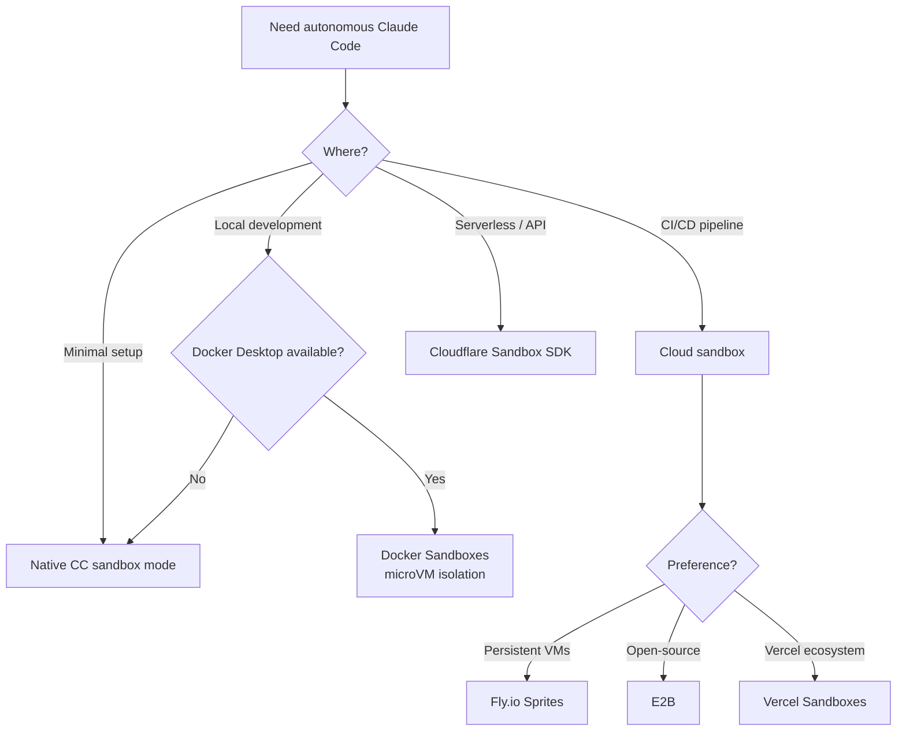

# Изоляция песочницы для агентов кодирования

> **Confidence**: Уровень 2 (официальная документация Docker + проверенная документация поставщика)
> **Время чтения**: ~10 минут
> **Scope**: безопасный запуск Claude Code в изолированных средах
> **Дополнительная литература**: [Почему изоляция, а не разрешения, является реальной границей безопасности.](https://www.florian.bruniaux.com/guides/claude-code-attack-surface/) углубляется в этот именно компромисс.

---

## <a name="tldr"></a>ТЛ;ДР

| Решение | Изоляция | Local/Cloud | Лучшее для |
|----------|-----------|-------------|----------|
| **Docker Песочницы** | микроВМ (гипервизор) | Местный | Максимальная безопасность, необходим Docker-in-Docker |
| **Встроенная песочница CC** | Процесс (Seatbelt/bubblewrap) | Местный | Легкая ежедневная разработка, надежный код |
| **Fly.io Спрайты** | Петарда микроВМ | Облако | Рабочие процессы агента на основе API |
| **E2B** | Петарда микроВМ | Облако | Мультиплатформенные приложения искусственного интеллекта |
| **Песочницы Vercel** | Петарда микроВМ | Облако | Next.js / Экосистема Vercel |
| **Cloudflare Sandbox SDK** | Контейнер | Облако | Бессерверная работа на базе рабочих процессов |
| **agentOS** (Заклепка) | Изолированный V8 + песочница WASM, без гипервизора | В процессе, нет облачного аккаунта | Агенты, встроенные в узел, без зависимости от поставщика |
| **just-bash** (Версель) | Нет (имитированная оболочка, вообще нет виртуальной машины) | В процессе, нет облачного аккаунта | Встроенный инструмент bash, dev/test, демонстрационные терминалы |

Быстрый старт:

```bash
docker sandbox run claude ~/my-project
```

---

## 1. Проблема: безопасная автономия

Система разрешений Claude Code защищает вас от непреднамеренных действий. Но это создает напряжение:

- **`--dangerously-skip-permissions`** удаляет все ограждения: Claude может `rm -rf`, `git push --force` или `DROP TABLE` без запроса. На голом хосте это опасно.
- **Усталость разрешений**: одобрение каждого редактирования файла и команды оболочки замедляет автономные рабочие процессы. Для крупных рефакторингов или конвейеров CI интерактивное утверждение непрактично.
- **Пробел**: Как запустить Claude Code автономно и безопасно?

**Answer**: изолируйте среду выполнения. Позвольте агенту свободно бегать внутри песочницы, где ограничен радиус взрыва. Песочница — это граница безопасности, а не система разрешений.

---

## 2. Подходы к изоляции



---

## <a name="3-docker-sandboxes"></a>3. Песочницы Docker

> **Источник**: [docs.docker.com/ai/sandboxes/](https://docs.docker.com/ai/sandboxes/)
> **Требуется**: Docker Desktop 4.58+ (macOS или Windows)

Docker Песочницы запускают агенты кодирования искусственного интеллекта в изоляции на основе microVM на вашем локальном компьютере. Каждая песочница имеет свой собственный демон Docker и файловую систему. Песочницы НЕ появляются в `docker ps`, поскольку это виртуальные машины, а не контейнеры.

### <a name="quick-start"></a>Быстрый старт

```bash
# Create and run a sandbox with your project
docker sandbox run claude ~/my-project

# Run with autonomous mode (safe inside sandbox)
docker sandbox run claude ~/my-project -- --dangerously-skip-permissions

# Pass a prompt directly
docker sandbox run claude ~/my-project -- "Refactor auth module to use JWT"

# Continue a previous session
docker sandbox run my-sandbox -- --continue
```

### Архитектура

```
┌──────────────────────────────────────────────────────────┐
│                     HOST MACHINE                          │
│                                                          │
│  ┌────────────────────────────────────────────────────┐  │
│  │              DOCKER SANDBOX (microVM)               │  │
│  │                                                    │  │
│  │  ┌──────────────┐  ┌───────────────────────────┐  │  │
│  │  │ Claude Code   │  │ Private Docker daemon     │  │  │
│  │  │ (--dsp mode)  │  │ (isolated from host)      │  │  │
│  │  └──────────────┘  └───────────────────────────┘  │  │
│  │                                                    │  │
│  │  ┌──────────────────────────────────────────────┐  │  │
│  │  │ Workspace: ~/my-project (synced with host)   │  │  │
│  │  │ Same absolute path as host                   │  │  │
│  │  └──────────────────────────────────────────────┘  │  │
│  │                                                    │  │
│  │  Base: Ubuntu, Node.js, Python 3, Go, Git,        │  │
│  │        Docker CLI, GitHub CLI, ripgrep, jq         │  │
│  │  User: non-root 'agent' with sudo                 │  │
│  └────────────────────────────────────────────────────┘  │
│                                                          │
│  Host Docker daemon: NOT accessible from sandbox          │
│  Host filesystem: NOT accessible (except workspace)       │
└──────────────────────────────────────────────────────────┘
```

Ключевые свойства:
- **Workspace sync**: каталог хоста монтируется по тому же абсолютному пути внутри песочницы.
- **Полная изоляция**: агент не может получить доступ к демону хоста Docker, контейнерам хоста или файлам за пределами рабочей области.
- **Private Docker**: каждая песочница имеет собственный демон Docker для контейнеров building/running.
- **Claude работает с `--dangerously-skip-permissions`**: намеренно, поскольку песочница является границей безопасности.

### <a name="network-policies"></a>Сетевые политики

Контролируйте, к чему песочница может получить доступ в сети.

```bash
# View network activity
docker sandbox network log my-sandbox

# Set up denylist mode (block all, allow specific)
docker sandbox network proxy my-sandbox \
  --policy deny \
  --allow-host api.anthropic.com \
  --allow-host "*.npmjs.org" \
  --allow-host "*.pypi.org" \
  --allow-host github.com

# Set up allowlist mode (allow all, block specific)
docker sandbox network proxy my-sandbox \
  --policy allow \
  --block-host "*.malicious-domain.com" \
  --block-cidr "192.168.0.0/16"
```

| Режим | Поведение по умолчанию | Вариант использования |
|------|-----------------|----------|
| **Allowlist** (по умолчанию) | Разрешает большую часть трафика, блокирует определенные направления | Общее развитие |
| **Денилист** | Блокирует весь трафик, разрешает только указанные направления | Среды с высоким уровнем безопасности |

**Заблокированные диапазоны по умолчанию**: частные CIDR (`10.0.0.0/8`, `127.0.0.0/8`, `172.16.0.0/12`, `192.168.0.0/16`, `169.254.0.0/16`) и эквиваленты IPv6.

**Соответствие шаблону**: точное (`example.com`), зависящее от порта (`example.com:443`), подстановочные знаки (`*.example.com` соответствует только субдоменам). Побеждает наиболее конкретный шаблон.

**Предупреждение о безопасности**: Фильтрация доменов не проверяет содержимое трафика. Широкие разрешения (например, `github.com`) разрешают доступ к пользовательскому контенту. Проверка HTTPS не выполняется в режиме обхода.

**Хранилище конфигурации**: для каждой песочницы в `~/.docker/sandboxes/vm/[name]/proxy-config.json`. Политики сохраняются при перезапусках.

### <a name="custom-templates"></a>Пользовательские шаблоны

Для команд, которым необходимы воспроизводимые среды со специальными инструментами:

```dockerfile
FROM docker/sandbox-templates:claude-code

USER root

# Install project-specific dependencies
RUN apt-get update && apt-get install -y \
    postgresql-client \
    redis-tools

# Install global npm packages
RUN npm install -g pnpm turbo

USER agent
```

Сборка и использование:

```bash
# Build the template
docker build -t my-team-sandbox:v1 .

# Create sandbox with custom template
docker sandbox create my-sandbox \
  --template my-team-sandbox:v1 \
  --load-local-template ~/my-project
```

Используйте пользовательские шаблоны в следующих случаях: командная среда, определенные версии инструментов, повторяющиеся настройки, сложные конфигурации. Для простой одноразовой работы используйте настройки по умолчанию и позвольте агенту установить то, что ему нужно.

### Справочник команд

| Команда | Описание |
|---------|-------------|
| `docker sandbox run <agent> <path>` | Создайте и запустите песочницу |
| `docker sandbox create <name>` | Создать, не начиная |
| `docker sandbox ls` | Список всех песочниц |
| `docker sandbox run <name> -- "prompt"` | Передайте подсказку |
| `docker sandbox run <name> -- --continue` | Продолжить предыдущую сессию |
| `docker sandbox run <name> -- --dsp` | Сокращение от --dangerously-skip-permissions |
| `docker sandbox network proxy <name>` | Настройка сетевых политик |
| `docker sandbox network log <name>` | Просмотр сетевой активности |

### Аутентификация

**Вариант 1: ключ API (рекомендуется для безголового устройства)**

Установите `ANTHROPIC_API_KEY` в `~/.bashrc` или `~/.zshrc`. Демон песочницы читает эти файлы, а не текущий сеанс оболочки. Перезапустите демон после изменений. Сохраняется в песочнице.

**Вариант 2: Интерактивный вход (для каждого сеанса)**

Запускается автоматически, если учетные данные не найдены. Используйте `/login` внутри Claude Code для запуска вручную. Аутентификация НЕ сохраняется после уничтожения песочницы.

### Поддерживаемые агенты

| Агент | Поставщик | Статус |
|-------|----------|--------|
| Claude Code | Anthropic | Полная поддержка |
| Codex CLI | OpenAI | Поддерживается |
| Gemini CLI | Google | Поддерживается |
| агент | Docker | Поддерживается |
| Киро | АВС | Поддерживается |

### <a name="limitations"></a>Ограничения

- Только **macOS и Windows** для режима microVM. Linux использует устаревшие песочницы на основе контейнеров (Docker Desktop 4.57+).
- Требуется **Docker Desktop**: недоступно с автономным модулем Docker. Альтернативы сообщества, такие как [dclaude](https://github.com/jedi4ever/dclaude) (Патрик Дебуа), оборачивают Claude Code в стандартные контейнеры Docker для сред Docker только с движком, но используют изоляцию контейнера (не microVM) и монтируют сокет Docker хоста, что является более слабой границей безопасности.
- **MCP Шлюз пока не поддерживается** внутри песочниц.
- **Без сквозной передачи графического процессора**: не подходит для рабочих нагрузок обучения машинному обучению.
- **Синхронизация рабочей области является односторонней**: изменения внутри песочницы распространяются на хост, но одновременные изменения хоста могут конфликтовать.

---

## <a name="4-native-claude-code-sandbox"></a>4. Родная песочница Claude Code

> **Источник**: [code.claude.com/docs/en/sandboxing](https://code.claude.com/docs/en/sandboxing)
> **Требуется**: macOS (встроенный) или Linux/WSL2 (пузырчатая пленка + socat)
> **Особенность**: Claude Code v2.1.0+

Claude Code включает в себя встроенный **встроенная песочница** использование примитивов уровня ОС для изоляции на уровне процесса. Нет Docker required.

### Архитектура

```
┌──────────────────────────────────────────────────────┐
│                    HOST MACHINE                      │
│                                                      │
│  Claude Code (main process)                          │
│       │                                              │
│       ├─ spawn bash command                          │
│       │                                              │
│       ▼                                              │
│  Sandbox wrapper (Seatbelt/bubblewrap)               │
│       │                                              │
│       ├─ Filesystem: read all, write CWD only        │
│       ├─ Network: SOCKS5 proxy, domain filtering     │
│       ├─ Process: isolated environment               │
│       │                                              │
│       ▼                                              │
│  Command executes with restrictions                  │
│       │                                              │
│       └─ Violations blocked at OS level              │
│                                                      │
└──────────────────────────────────────────────────────┘
```

**Ключевые отличия от Docker Sandboxes**:

| Аспект | Родная песочница | Docker Песочницы |
|--------|---------------|------------------|
| **Уровень изоляции** | Процесс (Seatbelt/bubblewrap) | микроВМ (гипервизор) |
| **Ядро** | Доступен хосту | Отдельное ядро ​​для песочницы |
| **Настройка** | 0 зависимостей (macOS), 2 пакета (Linux) | Docker Рабочий стол 4.58+ |
| **Накладные расходы** | Минимальный (~1-3% ЦП) | Умеренный (~5-10% ЦП, +200 МБ ОЗУ) |
| **Docker-in-Docker** | ❌ Не поддерживается | ✅ Частный демон Docker |
| **Случай использования** | Ежедневная разработка, надежный код | Ненадежный код, максимальная изоляция |

### Примитивы ОС

**macOS**: использует ремень безопасности (обязательный контроль доступа TrustedBSD)
- Встроенный, работает «из коробки».
- Фильтрация системных вызовов на уровне ядра

**Linux/WSL2**: использует пузырьковую обертку (пространства имен Linux + seccomp)
- Требуется установка: `sudo apt-get install bubblewrap socat`
- Создает изолированное пространство имен для каждой команды

**WSL1**: ❌ Не поддерживается (для Bubblewrap нужны недоступные функции ядра)

**Windows own**: ❌ Не поддерживается, команды выполняются без изолированной программной среды (используйте WSL2 или установите `failIfUnavailable: true`, чтобы отказаться от запуска).

### Быстрый старт

```bash
# Enable sandboxing (interactive menu)
/sandbox

# Linux/WSL2 only: install prerequisites first
sudo apt-get install bubblewrap socat  # Ubuntu/Debian
sudo dnf install bubblewrap socat      # Fedora
```

**Два режима**:

1. **Режим автоматического разрешения**: команды Bash автоматически одобряются, если они находятся в песочнице (рекомендуется для ежедневной разработки)
2. **Обычный режим разрешений**: все команды требуют одобрения (для обеспечения высокого уровня безопасности).

### Пример конфигурации

```json
{
  "sandbox": {
    "enabled": true,
    "failIfUnavailable": true,
    "autoAllowBashIfSandboxed": true,
    "network": {
      "allowedDomains": [
        "api.anthropic.com",
        "registry.npmjs.org",
        "github.com"
      ]
    },
    "credentials": {
      "files": [
        { "path": "~/.ssh", "mode": "deny" },
        { "path": "~/.aws", "mode": "deny" }
      ]
    }
  }
}
```

Ключа `network.policy` нет; добавьте `"strictAllowlist": true` в `network`, чтобы отклонять каждый хост, не указанный в списке, без запроса. `sandbox.credentials` — это механизм песочницы для сокрытия файлов учетных данных от Bash; см. [Native Sandboxing](./sandbox-native.md#default-behavior), чтобы узнать, почему одного правила чтения `permissions.deny` недостаточно.

### Когда использовать нативный или Docker

**Использовать встроенную песочницу, когда**:
- ✅ Ежедневное развитие с проверенной командой
- ✅ Легкая настройка (без рабочего стола Docker)
- ✅ Минимальный приоритет накладных расходов
- ✅ Коду больше всего доверяют
- ✅ Не нужен Docker-in-Docker

**Используйте песочницы Docker, когда**:
- ✅ Запуск ненадежного кода
- ✅ Максимальная изоляция безопасности (защита от эксплойтов ядра)
- ✅ Нужен частный демон Docker внутри песочницы.
- ✅ Тестирование скриптов, созданных ИИ
- ✅ Производство CI/CD с чувствительными рабочими нагрузками

**Дерево решений**:

```
Daily development?
├─ Trusted code + team → Native Sandbox (lightweight)
└─ Untrusted scripts → Docker Sandboxes (max isolation)

Need Docker inside?
├─ Yes → Docker Sandboxes (only option)
└─ No → Either works, prefer Native for simplicity

Maximum security?
├─ Yes (kernel exploit protection) → Docker Sandboxes
└─ Standard (process isolation OK) → Native Sandbox
```

### Ограничения безопасности

**⚠️ Ограничения встроенной песочницы** (подробности см. в [guide/security/sandbox-native.md](./sandbox-native.md)):

1. **Общее ядро**: уязвимо для эксплойтов ядра (Docker microVM защищает от этого)
2. **Фронт домена**: возможен обход на основе CDN (Cloudflare, Akamai)
3. **Unix-сокеты**: могут предоставлять неожиданные привилегии при неправильной настройке.
4. **Filesystem**: слишком широкие права на запись позволяют повысить привилегии.

**Для ненадежного кода**, песочницы Docker обеспечивают более сильную изоляцию.

### Среда выполнения с открытым исходным кодом

Реализация песочницы доступна в виде пакета npm с открытым исходным кодом:

```bash
# Use sandbox runtime directly
npx @anthropic-ai/sandbox-runtime <command-to-sandbox>

# Example: sandbox an MCP server
npx @anthropic-ai/sandbox-runtime node mcp-server.js
```

**Репозиторий**: [github.com/anthropics/sandbox-runtime](https://github.com/anthropics/sandbox-runtime)

### Глубокое погружение

Полную техническую информацию, примеры конфигурации, устранение неполадок и анализ безопасности:

→ **[Руководство по встроенной песочнице](./sandbox-native.md)**

Охватывает: примитивы ОС, архитектуру сетевого прокси, режимы песочницы, аварийный люк, ограничения безопасности, лучшие практики.

---

## 5. Ландшафт облачных песочниц

### Спрайты Fly.io

> **Источник**: [sprites.dev](https://sprites.dev)

Аппаратно-изолированные среды выполнения, созданные на базе микровиртуальных машин Firecracker от Fly.io.

- **Isolation**: микровиртуальные машины Firecracker с полной аппаратной изоляцией.
- **Persistence**: полностью изменяемая файловая система ext4, автоматический раздел размером 100 ГБ.
- **Checkpoint/restore**: живые контрольные точки за ~300 мс (копирование при записи), восстановление менее 1 секунды.
- **HTTP доступ**: отдельные URL-адреса для каждого спрайта, автоматическая активация по запросам (холодный запуск менее 1 с)
- **Network**: политики выхода уровня 3, public/private переключает
- **Resources**: до 8 процессоров, 16 ГБ ОЗУ на каждый спрайт.
- **API**: CLI (команда `sprite`), REST API, JavaScript и клиентские библиотеки Go.
- **Pricing**: оплата по факту использования ($0.07/CPU-hour, $0.04/GB-hour). Пробные кредиты на сумму 30 долларов США.

### Песочница Cloudflare SDK

> **Источник**: [developers.cloudflare.com/sandbox/](https://developers.cloudflare.com/sandbox/)

Безопасное выполнение кода в изолированных контейнерах, построенных на платформе Workers Cloudflare.

- **Isolation**: контейнеры (не microVM) в бессерверной среде выполнения Cloudflare.
- **Языки**: Python, JavaScript/TypeScript, команды оболочки
- **Persistence**: монтирование корзины R2 по путям локальной файловой системы.
- **API**: TypeScript SDK (`getSandbox()`, `exec()`, `runCode()`, файловые операции, WebSocket)
- **Integration**: Claude генерирует код, песочница выполняет его, результаты возвращаются как text/visualizations
- **Pricing**: Требуется план Worker Paid. На основе цен на платформу Containers.
- **Руководство**: [developers.cloudflare.com/sandbox/tutorials/claude-code/](https://developers.cloudflare.com/sandbox/tutorials/claude-code/)

### Песочницы Версель

> **Источник**: [vercel.com/docs/vercel-sandbox/](https://vercel.com/docs/vercel-sandbox/)

Эфемерные микровиртуальные машины Linux для агентов ИИ и генерации кода, общедоступная с 30 января 2026 г.

- **Isolation**: микровиртуальные машины Firecracker, изолированные от переменных окружения, баз данных и облачных ресурсов.
- **Performance**: инициализация за доли секунды, автоматическое завершение после завершения задачи.
- **Timeouts**: по умолчанию 5 минут, хобби до 45 минут, Pro/Enterprise до 5 часов.
- **SDK**: классы `Sandbox`, `Command`, `Snapshot`. Снимки файловой системы для более быстрого повторного запуска.
- **Auth**: токены Vercel OIDC (рекомендуется) или токены доступа для внешнего CI/CD.
- **Integration**: работает с агентом Claude SDK для выполнения задач автономного агента.

### E2B

> **Источник**: [e2b.dev](https://e2b.dev)

Платформа песочницы с открытым исходным кодом для агентов ИИ и приложений LLM.

- **Isolation**: микровиртуальные машины Firecracker (та же технология, что и в AWS Lambda)
- **Производительность**: холодная загрузка ~150 мс, возобновление режима ожидания менее 25 мс
- **Пользовательские изображения**: до 10 ГБ, загрузка менее чем за 2 секунды (чертежи)
- **Snapshots**: захват и восстановление полного состояния виртуальной машины.
- **Языки**: Python, JavaScript, Ruby, C++, все что угодно на Linux. LLM-агностик.
- **Интеграции**: LangChain, LangGraph, LlamaIndex, Vercel/Next.js, Ollama
- **Развертывание**: размещение в облаке, BYOC (AWS/GCP/Azure), самостоятельное размещение on-premises/VPC
- **Цены**: бесплатный уровень (100 долларов США кредитов, максимум 1 час), Pro от $150/month (максимум 24 часа)

### Собственный режим песочницы Claude Code

> **Источник**: [code.claude.com/docs/en/sandboxing](https://code.claude.com/docs/en/sandboxing)

Встроенная в Claude Code песочница на уровне процесса (уровень 4 в архитектуре [](../core/architecture.md)).

- **Нет внешних зависимостей**: работает «из коробки»
- **Изоляция процесса**: ограничивает команды, которые Claude может выполнять.
- **Configurable**: Через `allowedTools` в настройках
- **Ограничения**: не полная изоляция виртуальной машины, общее ядро ​​и файловая система хоста.

Используйте это, когда: Docker недоступен, достаточно легкой изоляции или вам нужна глубокая защита вместе с песочницей.

### <a name="agentos-rivet-the-in-process-counter-example"></a>AgentOS (Rivet): контрпример в процессе

Каждый вышеперечисленный поставщик выставляет счета через облачную учетную запись. [agentOS](https://agentos-sdk.dev) (`@rivet-dev/agentos`, Apache 2.0, предварительная версия `0.0.1`) не поддерживает: `npm install` получает виртуальную машину, подобную Linux, работающую внутри вашего собственного процесса Node, без загрузки microVM, без контейнера для извлечения, без регистрации провайдера.

Доверенный сайдкар Rust владеет ядром (многоуровневая виртуальная файловая система с наложением и монтированием для S3, Google Drive или каталога хоста; виртуальная таблица процессов с реальными `fork`/`exec`/signals; сокеты, каналы, PTY, DNS). Ни один гостевой системный вызов не достигает хоста напрямую. Недоверенная сторона запускает гостевой JavaScript на собственном V8 с полным JIT, а 42 скомпилированных пакета программного обеспечения, включая реальные исходные `git`, `ripgrep`, `sqlite3` и `duckdb`, запускаются как WASM, построенный на системном корневом каталоге, которым владеет команда. Это существенно более глубокий подход, чем представленная ниже песочница инструмента WebAssembly MCP §7b, которая охватывает один вызов инструмента, а не почти полное пользовательское пространство Linux.

Отличием от простой песочницы являются привязки: определяемая хостом функция со схемой появляется внутри виртуальной машины как обычная команда оболочки, поэтому агент вызывает компанию API так же, как он вызывает `ls`, а учетные данные вообще никогда не попадают в виртуальную машину.

Прежде чем считать это готовым к производству, нужно принять во внимание две вещи. Во-первых, собственные тесты производителя (создание виртуальной машины за 4,8 мс, примерно от 22 до 131 МБ в зависимости от рабочей нагрузки, измеренные на одном i7-12700KF, датированном 30 марта 2026 г.) независимо не воспроизводятся, а формулировка «в 92 раза быстрее, чем облачная микроВМ» сравнивает изолированный запуск V8 с полной загрузкой микроВМ Linux, а это две разные вещи. Во-вторых, «VM» — это маркетинговый выбор: в стеке нет ни KVM, ни Firecracker, ни аппаратной виртуализации. Собственная модель угроз проекта прямо утверждает, что граница безопасности — это вспомогательный и исполнительный процесс, а не гипервизор, надежный для обычного кода ненадежного агента и более слабый, чем аппаратная изоляция от злоумышленника, ищущего побег из V8. Полная оценка: [`docs/resource-evaluations/agentos-in-process-agent-vm.md`](../../docs/resource-evaluations/agentos-in-process-agent-vm.md).

### <a name="just-bash-vercel-simulate-dont-isolate"></a>just-bash (Vercel): моделировать, не изолировать

[just-bash](https://github.com/vercel-labs/just-bash) (`npm install just-bash`, ранее `3.x`) находится на другом конце спектра внутрипроцессных операций по отношению к AgentOS. Никакой виртуальной машины здесь нет вообще, даже безгипервизора. Это лексер, синтаксический анализатор и интерпретатор bash, написанный непосредственно на TypeScript и выполняющийся в виртуальной файловой системе в памяти. Ничто не возникает, ничто не пересекает границы процесса, и вся модель безопасности представляет собой обычное сдерживание JavaScript: `DefenseInDepthBox`, который определяет область исправлений для `Function`, `eval`, `setTimeout` и `process.*` внутри контекста `AsyncLocalStorage`, объекты с нулевым прототипом везде, где скрипт управляет ключом (переменные среды окружения, ассоциативные массивы), и настраиваемые ограничения ресурсов (`maxCallDepth`, `maxSubstitutionDepth`, `maxExecutionTimeMs` и еще дюжина), каждый из которых сопоставлен с именованным вектором атаки в собственном `THREAT_MODEL.md` проекта.

Более 90 встроенных команд, эквивалентных coreutils (`grep`, `sed`, `awk`, `find`, `tar`, `jq`), с Python (CPython через Emscripten), JavaScript (QuickJS) и SQLite (sql.js), доступными в качестве явных опций, каждая из которых задокументирована как дополнительная поверхность безопасности, а не бесплатная функция. Четыре серверные части файловой системы охватывают практический диапазон: только в памяти, копирование при записи в реальный каталог, прямое чтение-запись реального каталога или таблица монтирования, объединяющая несколько. Класс `Sandbox` намеренно отражает `@vercel/sandbox` API, поэтому проект можно начать здесь и позже переключиться на настоящую микровиртуальную машину Vercel Sandbox без переписывания сайтов вызовов.

README говорит об этом без каких-либо ухищрений: «Все выполнение происходит без изоляции виртуальной машины». Это настоящая сделка, а не предостережение, мимо которого можно пройти. По сравнению с границей агента V8-изолировать-плюс-Rust-sidecar, just-bash предлагает меньшую степень сдерживания в обмен на отсутствие движущихся частей, кодовую базу, которую можно проверить в течение дня, и оболочку, которая работает идентично на вкладке браузера. Он подходит для встроенного инструмента bash для агента, которому вы уже в какой-то степени доверяете, для test/dev или для живой демо-версии терминала, а не для защиты от действительно состязательного сценария. Перед любым коммерческим использованием стоит проверить один пробел: в корне репозитория нет файла `LICENSE`, несмотря на заявление README об Apache-2.0. Полная оценка: [`docs/resource-evaluations/just-bash-simulated-shell.md`](../../docs/resource-evaluations/just-bash-simulated-shell.md).

---

## <a name="6-comparison-matrix"></a>6. Матрица сравнения

| Критерий | Docker Песочницы | Родной CC | Спрайты Fly.io | Облачная вспышка SDK | E2B | Песочницы Верселя |
|-----------|-----------------|-----------|----------------|----------------|-----|-----------------|
| **Уровень изоляции** | микроВМ (гипервизор) | Процесс (Seatbelt/bubblewrap) | Петарда микроВМ | Контейнер | Петарда микроВМ | Петарда микроВМ |
| **Изоляция ядра** | ✅ Отдельное ядро | ❌ Общее ядро | ✅ Отдельное ядро | Частичный | ✅ Отдельное ядро | ✅ Отдельное ядро |
| **Запускается локально** | Да | Да | Нет (облако) | Нет (облако) | Нет (облако) | Нет (облако) |
| **Настройка** | Docker Рабочий стол 4.58+ | 0 штук (macOS), 2 упаковки (Linux) | Ключ API | Рабочие заплатили | Ключ API | SDK |
| **Docker-in-Docker** | ✅ Частный демон | ❌ Не поддерживается | Да | Нет | Да | Да |
| **Сетевое управление** | Списки Allow/Deny | Списки Allow/Deny (SOCKS5) | Выходные политики L3 | Не подробно | Не подробно | Не подробно |
| **Платформа** | macOS, Windows (WSL2) | macOS, Linux, WSL2 | Любой (API) | Любой (Рабочие) | Любой (API/SDK) | Любой (SDK) |
| **Накладные расходы** | Умеренный (~5-10% ЦП) | Минимальный (~1-3% ЦП) | Облако | Облако | Облако | Облако |
| **Уровень бесплатного пользования** | Docker Рабочий стол | Бесплатно | кредиты на 30 долларов США | Рабочие заплатили | кредиты на 100 долларов США | Да (ограничено) |
| **Подходит для** | Максимальная безопасность, необходим Docker | Ежедневная разработка, надежный код | Агенты, управляемые API | Бессерверный | Multi-framework | Next.js/Vercel |

---

## <a name="7-safe-autonomy-workflows"></a>7. Безопасные рабочие процессы автономности

### Шаблон: Docker Песочница + --dangerously-skip-permissions

Рекомендуемая модель местного автономного развития:

```bash
# 1. Create a sandbox with your project
docker sandbox create my-feature ~/my-project

# 2. Configure network (optional, recommended for security)
docker sandbox network proxy my-feature \
  --policy deny \
  --allow-host api.anthropic.com \
  --allow-host "*.npmjs.org" \
  --allow-host github.com

# 3. Run Claude autonomously (safe inside sandbox)
docker sandbox run my-feature -- --dangerously-skip-permissions \
  "Refactor the auth module to use JWT. Run all tests before finishing."

# 4. Review changes on host (workspace syncs automatically)
cd ~/my-project && git diff

# 5. If satisfied, commit. If not, discard or re-run.
git add -A && git commit -m "feat: JWT auth (sandbox-generated)"
```

### Шаблон: конвейер CI/CD с песочницей.

Эскиз для GitHub Actions:

```yaml
jobs:
  agent-task:
    runs-on: ubuntu-latest
    steps:
      - uses: actions/checkout@v4

      - name: Run Claude in E2B sandbox
        uses: e2b-dev/e2b-github-action@v1
        with:
          api-key: ${{ secrets.E2B_API_KEY }}
          command: |
            claude --dangerously-skip-permissions \
              -p "Run the full test suite and fix any failures"
```

Для CI/CD облачные песочницы (E2B, Vercel, Sprites) обычно лучше, чем песочницы Docker, поскольку для них не требуется Docker Desktop.

---

## <a name="7b-webassembly-based-mcp-tool-sandboxing-experimental"></a>7б. Песочница инструмента MCP на основе WebAssembly (экспериментальная)

> **Confidence**: уровень 3, первичные источники проверены (репозитории GitHub, блог Microsoft с открытым исходным кодом). По состоянию на июнь 2026 года производственное развертывание не подтверждено.
> **Зрелость**: Экспериментальная. Ни один из перечисленных здесь инструментов не готов к использованию.

Подходы к созданию «песочницы», описанные в разделах 2–7, изолируют, где Claude Code *runs*. Отдельная граница изоляции охватывает то, к чему MCP *tools* может получить доступ в ОС, когда Claude Code вызывает их. Без этого скомпрометированный или неправильно сконфигурированный сервер MCP будет работать с теми же привилегиями ОС, что и ваш процесс Claude Code, включая неограниченную файловую систему read/write и исходящий доступ к сети.

**Ан MCP сервер открыт HTTP нуждается в таком же уровне безопасности, как и любой другой API вы бы работали в производстве.** Аутентификация, авторизация и HTTPS не являются дополнительными опциями для MCP; они являются базовой линией. Местный MCP Сервер, оставленный без аутентификации или поставляемый с незащищенными настройками по умолчанию, остается уязвимой поверхностью для атаки, даже если базовая модель вообще не имеет недостатков. Уязвимость связана с самим сервером, а не с чем-то другим. LLM does.

*Даниэль Гарнье-Муару, Devoxx, 2025 г. (и Макан Сеперифар, 2026 г.)*

WebAssembly предлагает другую модель: скомпилируйте каждый инструмент MCP в компонент `.wasm`, запустите его внутри среды выполнения Wasm и явно объявите права доступа. Инструмент получает именно то, что вы предоставляете, не более того. Модель отказа по умолчанию применяется на уровне выполнения, а не на основе собственного кода инструмента.

**Более детерминированная альтернатива — полностью оставить решение о доступе вне цикла рассуждений агента.** Вместо того, чтобы объявлять возможности внутри самого инструмента, оберните доступ агента за сервер MCP, окруженный отдельным детерминированным уровнем управления доступом, с правами, ограниченными точно через OAuth, и детальной авторизацией на основе отношений (модель OpenFGA). Скомпрометированный или манипулируемый агент не может рассуждать о более широких разрешениях, если он вообще никогда не обладал полномочиями предоставлять себе их.

*Кристоф Бюлер, Devoxx, 2026 г. (и Дипу Сасидхаран, 2025 г.)*

### Доступные инструменты

| Инструмент | Роль | Зрелость |
|------|------|----------|
| [Wassette](https://github.com/microsoft/wassette) (Microsoft) | Среда выполнения, в которой работают серверы MCP как компоненты Wasm, объявленные YAML возможности (пути к файловой системе, сетевые хосты, переменные окружения) | v0.4.0, не готова к производству (самозаявлено) |
| [wasmcp](https://github.com/wasmcp/wasmcp) | Компилирует серверы MCP в компоненты Wasm с изоляцией границ WIT. | Ранняя стадия, отсутствие исполнительных документов |
| [whamm](https://github.com/ejrgilbert/whamm) | DSL на основе DTrace для инструментов и наблюдения Wasm | Не песочница, только наблюдаемость |
| [сплайсер](https://github.com/ejrgilbert/splicer) | Промежуточное программное обеспечение для композиции компонентов Wasm | Интеграция MCP не задокументирована. |

**Wassette** — единственный инструмент, который напрямую решает проблему. Файл политики YAML определяет, к каким путям файловой системы, сетевым хостам и переменным среды может иметь доступ каждый компонент MCP. Базовая среда выполнения — [Wasmtime](https://wasmtime.dev/), которую Microsoft описывает как обеспечивающую «изоляцию на уровне браузера». Такая структура является намеренной: современные браузеры запускают ненадежный сторонний код в Wasm на том же уровне изоляции, что является значимой гарантией, но не то же самое, что сертифицированная граница безопасности предприятия.

Примечание по CVE Wasmtime: среда выполнения имеет подтвержденную историю уязвимостей выхода из песочницы, включая CVE-2026-34971 (ошибочная компиляция Cranelift на aarch64 с включенным wasm_memory64, исправленная в версиях 36.0.7/42.0.2/43.0.1). Если вы одобряете этот подход, отслеживайте рекомендации по безопасности [Bytecode Alliance](https://github.com/bytecodealliance/wasmtime/security/advisories) напрямую.

### Что не охватывает песочница Wasm

Этот уровень изоляции контролирует доступ на уровне ОС для инструментов MCP. Он не обеспечивает:

- Измерение использования токенов или отслеживание затрат (для этого используйте шлюз LiteLLM)
- Журналы аудита или отслеживаемость (используйте OpenTelemetry/Grafana)
- Рабочие процессы утверждения MCP в вашей организации (см. [enterprise-governance.md §3](./enterprise-governance.md#3-mcp-governance-workflow))

Это взаимодополняющие меры контроля, а не альтернативы друг другу.

### Когда смотреть это пространство

Если ваша модель угроз включает скомпрометированные или сторонние серверы MCP с непредсказуемым доступом к файловой системе, изоляция на основе Wasm является правильным архитектурным направлением. Сегодня для большинства команд практическим путем является рабочий процесс утверждения в enterprise-governance.md в сочетании с изоляцией среды на основе Docker. Проведите повторную оценку, когда Wassette опубликует готовый к производству релиз.

---

## <a name="8-anti-patterns"></a>8. Антипаттерны

| Anti-pattern | Почему это опасно | Вместо этого сделайте |
|-------------|-------------------|------------|
| `--dangerously-skip-permissions` без песочницы | Агент имеет неограниченный доступ к файловой системе хоста, сети и Docker. | Используйте песочницу в качестве границы безопасности |
| Предполагая, что контейнеры = виртуальные машины | Контейнеры совместно используют ядро ​​хоста. Выход из контейнера раскрывает хост. | Используйте решения на базе microVM (песочницы Docker, E2B, Sprites) для строгой изоляции. |
| Монтирование всей файловой системы в песочницу | Поражает цель изоляции. Агент может получить доступ к учетным данным, ключам SSH и т. д. | Монтируйте только каталог рабочей области проекта |
| Внесение `*` в белый список в сетевых политиках | Агент может передавать данные в любую конечную точку | Используйте режим списка запретов с явными разрешениями |
| Пропуск проверки `git diff` после запуска в песочнице | Автономный агент мог внести непреднамеренные изменения. | Всегда проверяйте различия перед фиксацией кода, созданного в песочнице. |
| Использование песочницы как предлог для пропуска проверки кода | Изоляция защищает хост, а не качество кода | Песочница + проверка кода дополняют друг друга, а не являются альтернативой. |

---

## <a name="see-also"></a>См. также

- [AI Шаблоны проектирования: Bulkhead](../core/ai-design-patterns.md#bulkhead): изоляция контекста субагента и рабочего дерева считывается как шаблон устойчивости
- [architecture.md](../core/architecture.md): уровень 4 (архитектура субагента) и модель разрешений
- [security-hardening.md](./security-hardening.md): проверка MCP, защита от инъекций, отслеживание CVE.
- [code.claude.com/docs/en/sandboxing](https://code.claude.com/docs/en/sandboxing): официальная документация по песочнице Claude Code
- [docs.docker.com/ai/sandboxes/](https://docs.docker.com/ai/sandboxes/): Документация по песочницам Docker
