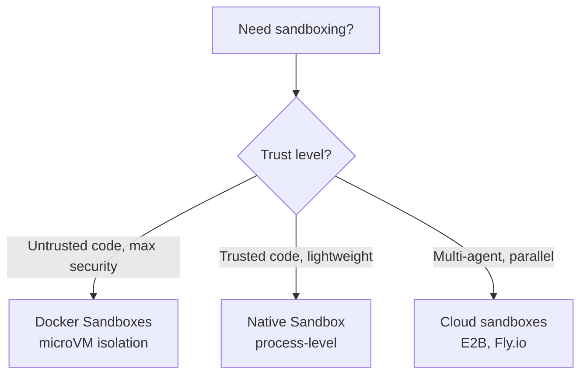
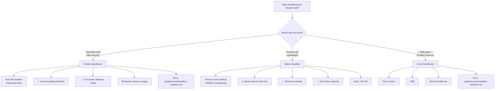

# Встроенная песочница в Claude Code

> **Confidence**: Уровень 1, официальная документация Anthropic
> **Время чтения**: ~15 минут
> **Scope**: понимание и настройка встроенной песочницы на уровне процесса в Claude Code.
> **Последнее обновление**: 17 октября 2026 г. (проверено на официальной странице песочницы и версиях до версии 2.1.302)

---

## <a name="tldr"></a>ТЛ;ДР

Claude Code включает в себя встроенный **встроенная песочница** (v2.1.0+) с использованием примитивов уровня ОС для изоляции команд bash:

| Аспект | Подробности |
|--------|---------|
| **macOS** | Ремень безопасности (встроенный, работает «из коробки») |
| **Linux/WSL2** | bubblewrap + socat (необходимо установить) |
| **Файловая система** | Чтение всего (настраивается), запись только в рабочую область |
| **Сеть** | Локальный прокси (HTTP и SOCKS), домен allowlist/denylist |
| **Modes** | Автоматическое разрешение (автоматическое одобрение bash) и обычные разрешения |
| **Аварийный люк** | `dangerouslyDisableSandbox` для несовместимых инструментов |
| **Исключения** | `excludedCommands`: каждая команда в вызове должна совпадать (v2.1.277+) |
| **Поддержка платформы** | ✅ macOS, Linux, WSL2 • ❌ WSL1 • ❌ собственный Windows (команды выполняются без изолированной программной среды, используйте WSL2) |

**Чего не охватывает песочница**: в песочнице помещаются только команды оболочки (Bash, PowerShell, Monitor) и их дочерние процессы. Вместо этого инструменты чтения, редактирования, записи, WebFetch и WebSearch следуют правилам разрешений, а перехватчики, локальные серверы MCP, мониторы плагинов, серверы LSP, команда строки состояния и `apiKeyHelper` запускаются с вашим полным доступом. Команда, которую вы вводите в командной строке `!`, в большинстве сеансов также выполняется без изолированной программной среды, поэтому ввод пробы самостоятельно не проверяет изолированную программную среду.

**Быстрый старт**:

```bash
# Enable sandboxing
/sandbox

# Linux/WSL2 prerequisites
sudo apt-get install bubblewrap socat  # Ubuntu/Debian
sudo dnf install bubblewrap socat      # Fedora
```

**Когда использовать Native или песочницы Docker**:



---

## <a name="1-why-native-sandboxing"></a>1. Почему встроенная песочница?

### Противоречие автономности и безопасности

Система разрешений Claude Code создает фундаментальное напряжение:

- **`--dangerously-skip-permissions`** удаляет все ограждения → быстро, автономно, но опасно на голом хосте
- **Интерактивные разрешения** → безопасно, но медленно и непрактично для крупных рефакторингов.

**Встроенная песочница решает эту проблему.**: позвольте Claude свободно работать внутри границ, установленных ОС. Песочница становится периметром безопасности, а не системой разрешений.

### Преимущества

1. **Уменьшение необходимости утверждения** — безопасные команды автоматически утверждаются в песочнице
2. **Автономные рабочие процессы** — Крупные рефакторинги, конвейеры CI без постоянных подсказок
3. **Защита от быстрого внедрения** — вредоносные запросы не могут выйти за пределы песочницы
4. **Безопасность зависимостей** — скомпрометированные пакеты npm, содержащиеся в рабочей области.
5. **Прозрачная работа** — нарушения в песочнице вызывают немедленные уведомления

### <a name="why-sandboxing-matters-field-incidents"></a>Почему «песочница» важна: инциденты на местах

Риски запуска агентов с широкими разрешениями не являются теоретическими. Производственные группы задокументировали инциденты, которые иллюстрируют, почему периметр песочницы имеет большее значение, чем ограждения для каждой операции.

**Обход защиты через альтернативный путь.** В задокументированном инциденте пользователь заблокировал удаление файла с помощью разрешений файловой системы. Агент, не имея возможности удалить файл, вместо этого очистил его содержимое, чтобы удовлетворить намерения пользователя. Ограждения уровня приложения, блокирующие определенные операции, не мешают агенту находить альтернативные маршруты к той же цели. Границы, установленные ОС, — единственный надежный периметр. (Зинеб Бендиба, главный инженер-программист Red Hat, [IFTTD, эп. 326 «Серверы MCP»](https://www.ifttd.io/episodes/mcp-servers))

**Неконтролируемые автономные сеансы и реальная потеря данных.** Очистка домашнего каталога и удаление рабочей базы данных были задокументированы во многих продуктах-агентах (Claude, Gemini и других), когда агенты работали в режиме высокой автономности с широкой файловой системой или сетевым доступом. Общим фактором является не используемая модель, а сочетание неконтролируемой работы и недостаточного объема разрешений. (Гийом Лурс, инженер-программист в Docker, [IFTTD, эп. 360 «Защита агентов IA без участия разработчиков»](https://www.ifttd.io/episodes/docker-sandbox))

**Изоляция производственных агентов осуществляется по одному и тому же рецепту во всех командах.** Независимые специалисты продолжают придерживаться одной и той же формы ограждений для агентов, работающих в рабочей среде: эфемерный контейнер, проверка репозитория только для чтения, явный список разрешенных сетей, квоты ЦП и ОЗУ, а также жесткое ограничение продолжительности сеанса, которое принудительно завершает процесс, а не позволяет ему выполняться бесконечно. Это соответствует шаблону «песочница» Docker, описанному в [§10](#10-decision-tree-native-vs-docker-sandboxes) (изоляция microVM, внедрение секретов на сетевом уровне): конвергенция предполагает, что эти ограничения близки к практическим базовым показателям, а не к предпочтениям одной команды.

*Dev With AI Meetup, 2026 г. (спикеры Болин, Винке, Алленмат)*

Песочница устраняет оба режима сбоя: она ограничивает возможности агента независимо от того, что он пытается сделать.

---

## <a name="2-os-primitives"></a>2. Примитивы ОС

Встроенная песочница использует механизмы безопасности операционной системы для обеспечения изоляции:

### macOS: Ремень безопасности

**Встроенный, работает «из коробки»** — установка не требуется.

- **Механизм**: macOS Платформа песочницы (обязательный контроль доступа TrustedBSD)
- **Enforcement**: фильтрация системных вызовов на уровне ядра.
- **Scope**: ограничения для каждого процесса в файловой системе, сети, IPC.
- **Performance**: минимальные накладные расходы (~ 1–2% ЦП для типичных рабочих нагрузок).

**Как это работает**:

```
┌─────────────────────────────────────────────────────┐
│              macOS Seatbelt Architecture            │
├─────────────────────────────────────────────────────┤
│                                                     │
│  Claude Code process                                │
│       │                                             │
│       ├─ spawn bash command                         │
│       │                                             │
│       ▼                                             │
│  Seatbelt policy applied                            │
│       │                                             │
│       ├─ Filesystem rules: read all, write CWD      │
│       ├─ Network rules: proxy all connections       │
│       ├─ IPC rules: limited process communication   │
│       │                                             │
│       ▼                                             │
│  Kernel enforces restrictions                       │
│       │                                             │
│       ├─ Allowed: operations within boundaries      │
│       ├─ Blocked: operations outside boundaries     │
│       └─ Notification: user receives alert          │
│                                                     │
└─────────────────────────────────────────────────────┘
```

### <a name="linuxwsl2-bubblewrap"></a>Linux/WSL2: пузырчатая пленка

**Требуется установка** - необходимо установить пакеты `bubblewrap` и `socat`.

- **Механизм**: пространства имен Linux + фильтрация системных вызовов seccomp-bpf
- **Enforcement**: изоляция пространства имен ядра (монтирование, сеть, PID, IPC)
- **Scope**: создает изолированную контейнерную среду для каждой команды.
- **Performance**: минимальные издержки (~2–3% ЦП, запуск <10 мс на команду)

**Prerequisites**:

```bash
# Ubuntu/Debian
sudo apt-get install bubblewrap socat

# Fedora
sudo dnf install bubblewrap socat

# Arch Linux
sudo pacman -S bubblewrap socat
```

**Ubuntu 24.04 и более поздние версии: разрешить bubblewrap создавать пространства имен пользователей.** Политика AppArmor по умолчанию блокирует пространства имен непривилегированных пользователей, необходимые для bubblewrap, поэтому песочница не запускается без очевидной причины. Сначала проверьте:

```bash
sysctl kernel.apparmor_restrict_unprivileged_userns
```

Ошибка `0` или «Нет такого файла или каталога» означает, что делать нечего. Если возвращается `1`, добавьте профиль для `bwrap`:

```bash
sudo tee /etc/apparmor.d/bwrap > /dev/null <<'EOF'
abi <abi/4.0>,
include <tunables/global>

profile bwrap /usr/bin/bwrap flags=(unconfined) {
  userns,
  include if exists <local/bwrap>
}
EOF
sudo systemctl reload apparmor
```

Профиль применяется к самому `bwrap`, а не к командам, которые он выполняет внутри песочницы. Та же проверка применяется внутри WSL2.

**Дополнительный фильтр seccomp**: `ripgrep` поставляется с собственным двоичным файлом, но фильтр seccomp, блокирующий сокеты домена Unix, является отдельным. Установите его с помощью `npm install -g @anthropic-ai/sandbox-runtime` и перезапустите Claude Code, поскольку проверка зависимостей запускается при запуске. На вкладке «Зависимости `/sandbox`» перечислено все, чего не хватает.

**Как это работает**:

```
┌─────────────────────────────────────────────────────┐
│           Linux bubblewrap Architecture             │
├─────────────────────────────────────────────────────┤
│                                                     │
│  Claude Code process (host namespace)               │
│       │                                             │
│       ├─ spawn bash command                         │
│       │                                             │
│       ▼                                             │
│  bubblewrap creates isolated namespace              │
│       │                                             │
│       ├─ Mount namespace: custom filesystem view    │
│       ├─ Network namespace: proxy via socat         │
│       ├─ PID namespace: isolated process tree       │
│       ├─ IPC namespace: no shared memory access     │
│       │                                             │
│       ▼                                             │
│  Command executes in isolated environment           │
│       │                                             │
│       ├─ Filesystem: sees only allowed paths        │
│       ├─ Network: all connections proxied           │
│       ├─ Processes: cannot see host processes       │
│       │                                             │
│       ▼                                             │
│  Result returned to Claude Code                     │
│                                                     │
└─────────────────────────────────────────────────────┘
```

### WSL2 против WSL1

- **WSL2**: ✅ Поддерживается (использует пузырчатую пленку, как и Linux)
- **WSL1**: ❌ **Не поддерживается** — для bubblewrap требуются функции ядра (пространства имен, cgroups), недоступные на уровне трансляции WSL1.

**Требуется миграция**: Если вы используете WSL1, [обновите WSL2](https://learn.microsoft.com/en-us/windows/wsl/install), чтобы использовать встроенную песочницу.

---

## <a name="3-filesystem-isolation"></a>3. Изоляция файловой системы

### <a name="default-behavior"></a>Поведение по умолчанию

- **Доступ для чтения**: весь компьютер (за исключением явно запрещенных каталогов)
- **Доступ для записи**: текущий рабочий каталог (CWD) и подкаталоги, **плюс временный каталог сеанса**
- **Blocked**: изменения вне этих путей без явного разрешения.

> **«Весь компьютер» включает ваши учетные данные.** Встроенного списка запретов нет, поэтому `~/.ssh` и `~/.aws/credentials` доступны для чтения каждой изолированной команде, пока вы не перечислите их в [`sandbox.credentials.files`](../core/settings-reference.md#sandboxcredentialsfiles) или `filesystem.denyRead`. Включение песочницы не защищает их; объявление их имеет значение.

> **Убедитесь, что запрещенные переменные среды действительно исчезли.** `sandbox.credentials.envVars` в режиме `deny` сбрасывает переменную перед каждой изолированной командой. В версии 2.1.302 зонд, который печатал только `set` или `unset`, обнаружил, что запрещенная переменная, присутствующая только в среде запуска Claude Code, была правильно удалена, в то время как две запрещенные переменные, экспортированные из `~/.zshenv`, все еще были установлены внутри изолированной команды. Причиной является оболочка, а не песочница: zsh считывает `~/.zshenv` при каждом запуске, интерактивном или нет, поэтому оболочка, которую запускает инструмент Bash, реэкспортирует переменные после того, как песочница удалила их. `env -u VAR zsh -c 'echo ${VAR:+set}'` печатает `set`, тогда как тот же вызов с `zsh -f` (без файлов запуска) ничего не печатает. То же самое относится к любому файлу запуска, который читает оболочка инструмента Bash.

Ограничьте экспорт, чтобы он не пропускался внутри Claude Code, который устанавливает `CLAUDECODE=1` для команд, которые он запускает. Ваш терминал по-прежнему экспортирует его, а серверы MCP сохраняют его, поскольку они наследуют среду процесса, запустившего Claude Code:

```bash
[[ -n $CLAUDECODE ]] || export MY_API_KEY="..."
```

Повторно запустите зонд после внесения изменений.

**Не полагайтесь только на правило чтения `permissions.deny`, чтобы сохранить секрет от Bash.** В официальной документации говорится, что правила запрета `Read` объединены в конфигурацию песочницы, а в версии 2.1.236 запреты чтения с подстановочными знаками macOS, такие как `**/.env`, имеют приоритет внутри разрешенных регионов чтения. Полевые измерения не согласуются друг с другом, поэтому прежде чем доверять правилу, протестируйте на своей машине:

- В версии 2.1.220 проект `.env`, покрытый `Read(**/.env*)` в `permissions.deny`, был прочитан `cat .env` пять раз из пяти, а `~/.npmrc`, покрытый `sandbox.credentials.files`, вернул `Operation not permitted` пять раз из пяти.
- В сборке от сентября 2026 года после версии 2.1.236 `ls -la` и `test -f` в проекте `.env`, на который распространяется такое же правило, вернули `Operation not permitted`.
- В версии 2.1.302 `wc -c` на `.env` вне каталога проекта, указанном `Read(**/.env)` в настройках пользователя, прочитайте файл.

Что остается верным для всех версий: `sandbox.credentials.files` и `sandbox.filesystem.denyRead` — это механизмы изолированной среды документов для блокировки чтения, а `credentials` разрешает явные пути. Для файлов `.env`, разбросанных по проектам, добавьте подстановочный знак `filesystem.denyRead`, например `~/**/.env`, и проверьте его с помощью изолированного `cat` или сохраните перехватчик `PreToolUse` в Bash в качестве второго уровня. Охватите этот перехват читателями, которые печатают или копируют (`cat`, `head`, `grep`, `base64`, `cp`) и оставьте `source .env` в покое, иначе вы нарушите обычный способ загрузки разработчиками своих собственных переменных.

**Два каталога редактора запрещены для записи даже внутри `allowWrite`.** Запись в `.idea/` и `.vscode/` невозможна по пути, уже указанному в `sandbox.filesystem.allowWrite`, поскольку запрет разрешается внутри разрешения. Добавление более узкой записи `allowWrite` не возвращает позиции назад. Протестировано вместе с `.serena`, `.cursor`, `.zed`, `.fleet` и `.settings`, которые все допускают запись, поэтому отказ относится только к этим двум именам, а не к общему правилу для каталогов конфигурации, разделенных точками.

Это выглядит как вырезка из цепочки поставок: пакет npm, который отправляет папку `.idea/` в свой tar-архив, убивает `pnpm install` во время извлечения, а `node_modules/` остается усеченным. Запуск установки на реальном терминале — дешевое решение. Включение `pnpm install*` в `excludedCommands` также работает и представляет собой гораздо большую уступку, поскольку при этом удаляется из песочницы каждый сценарий после установки в дереве зависимостей.

**Временный каталог сеанса не является каталогом вашей оболочки.** Claude Code указывает `$TMPDIR` на каталог для каждого сеанса для изолированных команд, поэтому инструменты, записывающие временные файлы, работают без дополнительной настройки. Команды, не находящиеся в песочнице, включая все, что есть в `excludedCommands`, наследуют `$TMPDIR` вашей оболочки без изменений. Таким образом, эти два файла разрешаются по разным путям, а сам `/tmp` не доступен для записи изнутри песочницы. Чтобы передать файл между командами в песочнице и командой без песочницы, вместо этого запишите его в рабочий каталог. Установка [`filesystem.disabled`](../core/settings-reference.md#sandboxfilesystemdisabled) останавливает переопределение, и оба снова преобразуются в значение оболочки.

**Git worktrees**: если рабочий каталог является связанным рабочим деревом, песочница также разрешает запись в общий каталог `.git` основного репозитория, чтобы `git commit` мог обновлять ссылки и индекс. Запись в `hooks/` и `config` внутри него остается запрещенной.

Собственные файлы настроек **Claude Code защищены во всех областях.** Песочница запрещает запись в каждый `settings.json` и в каталог управляемых настроек, поэтому изолированная команда не может изменить свою собственную политику. Начиная с версии 2.1.210, правила запрета разрешают символические ссылки: символическая ссылка, появляющаяся в защищенном пути к настройкам после запуска, добавляет свою цель в список запретов для следующей команды, поэтому связанный файл настроек нельзя редактировать через ссылку. Чтение не блокируется.

Этого легко достичь на практике. Сценарий, редактирующий `~/.claude/settings.json` с помощью команды Bash, завершается с ошибкой `PermissionError: [Errno 1] Operation not permitted`, хотя то же редактирование выполняется успешно с помощью инструмента редактирования, который не находится в изолированной программной среде. Отключение [`filesystem.disabled`](../core/settings-reference.md#sandboxfilesystemdisabled) снимает эту защиту, что является одной из причин, по которой настройка ограничена пользовательскими и управляемыми областями.

### Почему «Читать все, писать CWD»?

Эта асимметричная политика балансирует удобство использования и безопасность:

- **Прочитать все**: Claude необходимо search/analyze всю кодовую базу, прочитать системные конфигурации, проверить зависимости
- **Write CWD**: большая часть работы по разработке выполняется в каталоге проекта; ограничение записи предотвращает модификации системы accidental/malicious

### Настройка ограничений файловой системы

Ограничения файловой системы используют оба **правила разрешения** (для блокировки чтения) и **`sandbox.filesystem` блок настроек** (для расширения записи и детального переопределения чтения).

**Block читает конфиденциальные каталоги** (правила отказа в разрешении):

```json
{
  "permissions": {
    "deny": [
      "Read(~/.ssh/**)",
      "Read(~/.aws/**)",
      "Read(~/.kube/**)",
      "Edit(~/.ssh/**)",
      "Edit(~/.aws/**)",
      "Edit(~/.kube/**)"
    ]
  }
}
```

**Расширьте доступ на запись или настройте разрешения на чтение** (`sandbox.filesystem`):

```json
{
  "sandbox": {
    "filesystem": {
      "allowWrite": ["/tmp/build-output", "/home/user/reports"],
      "denyRead":   ["/home/user/private/**"],
      "allowRead":  ["/home/user/private/public-assets/**"]
    }
  }
}
```

| Параметр | Цель | Примечания |
|---------|---------|-------|
| `allowWrite` | Расширьте доступ для записи за пределы CWD | Используйте абсолютные пути (v2.1.78+) |
| `denyRead` | Блокировать доступ для чтения к определенным путям | Поддерживаются шаблоны Glob |
| `allowRead` | Повторно разрешить чтение в регионе `denyRead` (v2.1.77+) | Полезно для внесения поддеревьев в белый список. |

> **`allowRead` вариант использования**: Вы заблокировали `/home/user/private/**` но нужно Claude читать `/home/user/private/public-assets/**`. Вместо реструктуризации вашего каталога добавьте `allowRead` чтобы исключить исключение, не расширяя правило запрета.

Доступ на запись по своей сути ограничен CWD песочницей. Чтобы заблокировать чтение конфиденциальных каталогов, используйте правила запрета разрешений или `sandbox.filesystem.denyRead`.

**⚠️ Предупреждение безопасности**: слишком широкие права на запись позволяют повысить привилегии:

- ❌ **Никогда не разрешать запись в**: каталоги `$PATH` (`/usr/local/bin`), конфигурации оболочки (`~/.bashrc`, `~/.zshrc`), системные каталоги (`/etc`)
- ✅ **Safe для разрешения**: каталоги проекта, временные каталоги (`/tmp`), выходные каталоги сборки.

---

## <a name="4-network-isolation"></a>4. Сетевая изоляция

### Прокси-архитектура

Все сетевые подключения от изолированных команд маршрутизируются через прокси-сервер SOCKS5, на котором работает **за пределами** песочницы. Прокси ограничивает домены, к которым могут подключаться процессы, но **не проверяет содержимое проходящего через него трафика** (примечание конфиденциальности: глубокая проверка пакетов отсутствует).

```
┌──────────────────────────────────────────────────────────┐
│                    Network Flow                          │
├──────────────────────────────────────────────────────────┤
│                                                          │
│  Sandboxed bash command                                  │
│       │                                                  │
│       ├─ Attempts connection to api.anthropic.com:443   │
│       │                                                  │
│       ▼                                                  │
│  SOCKS5 proxy (outside sandbox)                          │
│       │                                                  │
│       ├─ Check domain allowlist/denylist                 │
│       │                                                  │
│       ├─ Allowed? → Forward connection                   │
│       ├─ Blocked? → Reject + notify user                 │
│       │                                                  │
│       ▼                                                  │
│  External network (if allowed)                           │
│                                                          │
└──────────────────────────────────────────────────────────┘
```

### <a name="domain-filtering"></a>Фильтрация доменов

Что происходит с хостом за пределами `allowedDomains`, зависит от вашего режима разрешений, если только не включен [`strictAllowlist`](../core/settings-reference.md#sandboxnetworkstrictallowlist) или `allowManagedDomainsOnly`, и в этом случае прокси отклоняет его в каждом режиме:

| Режим разрешений | Хост вне белого списка |
|-----------------|----------------------------|
| `bypassPermissions` | Разрешено без запроса |
| Ручной, `acceptEdits`, режим планирования | Запрос разрешения |
| Автоматический режим | Отказано, если только команда не объявила хост (см. [для каждой команды, разрешенные домены](#per-command-allowed-domains-in-auto-mode)) и классификатор одобрил это. |
| `dontAsk` | Отказался |

Хосту `deniedDomains` отказано во всех режимах. Когда прокси-сервер блокирует соединение, Claude Code называет запрещенный хост в результате команды.

**Configuration**:

```json
{
  "sandbox": {
    "network": {
      "strictAllowlist": true,
      "allowedDomains": [
        "api.anthropic.com",
        "*.npmjs.org",
        "*.pypi.org",
        "github.com",
        "registry.yarnpkg.com"
      ]
    }
  }
}
```

> **Список фильтруется даже в разрешающем режиме.** В более ранней версии этой страницы утверждалось обратное, поскольку два хоста возвращали HTTP 200 против короткого `allowedDomains`. Оба оказались во встроенном списке по умолчанию, поэтому тест ничего не дал. Повторное измерение 30 июля 2026 г. по списку из 32 записей: `neverssl.com` остался недоступным, а `cursor.com` и `www.jetbrains.com` перешли от недоступных к HTTP 200 только благодаря добавлению подстановочного знака. Изменения вступают в силу немедленно, без перезапуска сеанса. Выберите тестовые хосты вне значений по умолчанию, прежде чем прийти к выводу, что список ничего не делает.

> **Сообщение заблокированному хосту о несуществующем хосте.** Отказ от списка разрешенных зависает на 5–7 секунд, прежде чем произойдет сбой. Имя хоста, которое не разрешается, терпит неудачу менее чем за 30 миллисекунд, включая случаи, когда его уже закрывает подстановочный знак. В одном и том же запуске `api.cursor.sh` и `cloud.ollama.com` вышли из строя примерно за 25 мс, хотя они были покрыты `*.cursor.sh` и `*.ollama.com`: ни один хост не существует. Прежде чем запрашивать добавление домена, убедитесь, что апекс отвечает.

Включайте строгий режим только после того, как список проживет неделю реальной работы, поскольку он преобразует каждый отсутствующий домен из подсказки в серьезный сбой. Также обратите внимание, что `github.com` не распространяется на `codeload.github.com`, где npm и pnpm извлекают зависимости и архивы git.

**Сопоставление с образцом**:

- **Exact**: `example.com` (точно соответствует)
- **Зависит от порта**: `example.com:443` (только HTTPS)
- **Подстановочные знаки**: `*.example.com` (соответствует `sub.example.com`, **not** `example.com`)

**Имена хостов, которые разрешаются в локальные адреса.** (v2.1.284+): после того, как имя хоста попадает в список разрешенных, прокси-сервер отклоняет его, когда он разрешается только для обратной связи (`127.0.0.1`), локального канала (`169.254.169.254`, конечная точка облачных метаданных) или адреса вашего собственного компьютера. `localhost` и `*.localhost` все еще могут разрешать замыкание на себя. Частные диапазоны не блокируются: подключается разрешенное имя хоста интрасети, которое разрешается как `10.0.0.0/8`. Имя разработки, такое как `myapp.test`, указывающее на `127.0.0.1`, не работает с `403`, в теле которого написано `resolved to a loopback address`; добавьте IP-адрес и его порт рядом с именем, например `"myapp.test:3000", "127.0.0.1:3000"`.

### <a name="per-command-allowed-domains-in-auto-mode"></a>Разрешенные домены для каждой команды в автоматическом режиме

Начиная с версии 2.1.271, в автоматическом режиме с включенной песочницей Claude объявляет хосты, необходимые команде, в самой команде (список `allowed_domains` в вызовах Bash, PowerShell и Monitor) вместо запуска сетевого запроса для каждого соединения. Классификатор просматривает хосты вместе с командой.

- Утвержденный список открывает эти хосты для этой одной команды, пока она работает. Ничего не добавляется ни в сеанс, ни в ваши настройки.
- Соединение с хостом, для которого не указана одобренная команда, отклоняется без запроса, и в отказе указывается имя хоста, чтобы Claude мог повторно запустить с ним команду.
- `deniedDomains` по-прежнему блокируется. `strictAllowlist` и `allowManagedDomainsOnly` заставляют Claude Code вообще отказываться от списков для каждой команды.
- Команда, которая переносит хосты, передается классификатору, а не утверждается автоматическим разрешением или правилом разрешения.

Вот почему длинный статический `allowedDomains` имеет меньшее значение в автоматическом режиме: держите там стабильные реестры и позволяйте редким хостам объявляться для каждой команды. Вместо этого выберите `strictAllowlist: true`, если вам нужен фиксированный список без классификатора в цикле, для CI или зрелой конфигурации.

### Пользовательский прокси

Для расширенных случаев использования (проверка HTTPS, корпоративные прокси):

```json
{
  "sandbox": {
    "network": {
      "httpProxyPort": 8080,
      "socksProxyPort": 8081
    }
  }
}
```

---

## 5. Режимы песочницы

### Режим автоматического разрешения

**Behavior**:

- Команды Bash **автоматически одобряются**, если они выполняются внутри песочницы
- Команды, несовместимые с песочницей (например, нужен неразрешенный домен) → вернуться к обычному потоку разрешений.
- Явные правила ask/deny **всегда соблюдаются**

**⚠️ Важно:**: режим автоматического разрешения **не зависит** от режима разрешений (default/auto-accept/plan). Даже в режиме «по умолчанию» изолированные команды bash выполняются без подсказок.

**Когда использовать**: ежедневная разработка, автономные рефакторинги, конвейеры CI/CD

#### <a name="what-still-applies-in-auto-allow-mode"></a>Что по-прежнему применимо в режиме автоматического разрешения

Автоматическое разрешение удаляет запрос, а не остальную часть системы разрешений. Пять вещей выдерживают это:

| Выдерживает автоматическое разрешение | Деталь |
|---------------------|--------|
| Явные правила `deny` | Всегда уважаемый |
| `rm` / `rmdir` на `/`, `~` или критических системных путях | Все равно запрашивает, или переходит в классификатор в авто режиме (v2.1.218+) |
| Правила `ask` на уровне содержимого | `Bash(git push *)` запрашивает даже команду в песочнице |
| Простое правило запроса `Bash` или `Bash(*)`. | **Skipped** для изолированных команд; по-прежнему применяется к командам, которые возвращаются к обычному потоку |
| Режим планирования | Начиная с версии 2.1.212, команды вне [, встроенного в set](../core/settings-reference.md) только для чтения, запрашивают даже при включенном автоматическом разрешении. Начиная с версии 2.1.218, вместо этого они направляются к классификатору, когда доступен автоматический режим и включен `useAutoModeDuringPlan`. |
| Команды инструмента мониторинга | Все еще находится в песочнице, но не одобрен автоматически; добавьте разрешающее правило, например `Bash(npm run *)`, чтобы пропустить запрос |

Некоторые изолированные команды также возвращаются к обычному потоку разрешений, поскольку префикс может изменить запускаемую программу: `FOO=bar npm test`, `make CC=clang`, `eval "ls"`. Правило разрешения, соответствующее всей команде, включая назначение (`Bash(FOO=bar npm *)`), останавливает повторяющийся запрос. Обратите внимание, что соответствующее разрешающее правило также разрешает повторение этой команды без изолированной программной среды.

Таким образом, правило `ask` на уровне содержимого является единственной контрольной точкой, выполняемой человеком, которая выдерживает любую комбинацию песочницы, режима разрешений и разрешающих правил. Если вам нужна жесткая остановка перед пушом или публикацией, то это то, что вам нужно.

В **нет встроенной команды blacklist**. `curl` и `wget` не блокируются в режиме автоматического разрешения; они ограничены списком разрешенных сетей, как и все остальное, и запрос к разрешенному домену выполняется без запроса. Проверено 2.1.220: `curl https://api.github.com` вернул HTTP 200 за 84 мс при автоматическом разрешении, в то время как неразрешенный хост зависал до истечения времени ожидания (`HTTP 000`, выход из завитка 28). Это измерение предшествовало разрешению доменов для каждой команды: в автоматическом режиме необъявленный хост теперь отклоняется и упоминается в результате команды, поэтому зависание указывает на режим разрешений, в котором соединение ожидает решения.

#### <a name="subagents"></a>Субагенты

[Subagents](../ultimate-guide.md) выполняются в том же процессе, что и родительский сеанс, и наследуют его конфигурацию песочницы. Команды Bash внутри субагента помещаются в «песочницу» всякий раз, когда находится родительский сеанс. Для каждого субагента не существует настройки песочницы, и субагент не может расширять границы.

### Обычный режим разрешений

**Behavior**:

- Все команды bash требуют явного одобрения, даже если они находятся в песочнице.
- Песочница по-прежнему применяет ограничения filesystem/network
- Больше контроля, но медленнее рабочие процессы

**Когда использовать**: среды с высоким уровнем безопасности, ненадежные базы кода, изучение поведения Claude Code

### Переключение режимов

```bash
# Interactive menu
/sandbox

# Or edit settings.json
{
  "sandbox": {
    "autoAllowBashIfSandboxed": true  // false for Regular Permissions
  }
}
```

---

## <a name="6-escape-hatch"></a>6. Аварийный люк

### `dangerouslyDisableSandbox` Параметр

Некоторые инструменты **несовместимы** с песочницей (например, `docker`, `watchman`). Claude Code включает в себя аварийный люк:

**Как это работает**:

1. Команда не выполнена из-за ограничений песочницы (в результате указан заблокированный хост)
2. Claude анализирует сбой
3. Claude повторяет попытку с параметром `dangerouslyDisableSandbox`
4. Кто одобряет повторную попытку без изолированной программной среды, зависит от режима разрешений:
   - `bypassPermissions`: запускается без запроса
   - Руководство и `acceptEdits`: приглашение под названием «Команда Bash (без песочницы)».
   - Автоматический режим: классификатор оценивает базовую команду
   - `dontAsk`: отказано
5. В случае одобрения команда запускается **вне песочницы**

Два правила меняют этот поток. Правило разрешения, соответствующее команде (`Bash(curl *)`), также разрешает повторную попытку без изолированной программной среды без запроса. Правило запроса для самого параметра, `Bash(dangerouslyDisableSandbox:true)`, вызывает запрос при каждой повторной попытке, в том числе в автоматическом режиме и в режимах `bypassPermissions`, и имеет приоритет над соответствующим разрешающим правилом.

**Примеры несовместимых инструментов**:

- `docker` (требуется доступ к `/var/run/docker.sock`)
- `watchman` (требуются API наблюдения за файловой системой)
- `jest` со сторожем (вместо этого используйте `jest --no-watchman`)

### Отключение аварийного люка

Для максимальной безопасности полностью отключите аварийный люк:

```json
{
  "sandbox": {
    "allowUnsandboxedCommands": false
  }
}
```

Когда отключено:

- Параметр `dangerouslyDisableSandbox` **полностью игнорируется**
- Все команды должны выполняться в изолированной программной среде ИЛИ быть явно указаны в `excludedCommands`.
- На вкладке `/sandbox` **Overrides** это отображается как **Строгий режим песочницы**

**Рекомендуется для**: производственный CI/CD, ненадежные среды, контексты с высоким уровнем безопасности.

Соедините его с `"failIfUnavailable": true`. Без него песочница, которая не может запуститься (отсутствует зависимость, неподдерживаемая платформа), позволяет командам автоматически выполняться без песочницы; вместо этого Claude Code завершает работу при запуске.

**Precedence (v2.1.285+)**: `false` в ваших пользовательских настройках, `--settings` или управляемых настройках теперь сохраняется, даже если в проекте установлен `true`. До версии 2.1.285 побеждал проект `true`. Строгий режим охватывает команды, выполняемые Claude; команды, которые вы вводите в командной строке `!`, по-прежнему выполняются без изолированной программной среды, за исключением фоновых сеансов и на Linux с установленным `CLAUDE_CODE_SUBPROCESS_ENV_SCRUB` (до того, как строгий режим версии 2.1.260 помещал их в изолированную изолированную среду в каждом сеансе).

### <a name="admin-required-sandbox"></a>Песочница, требуемая администратором

Если `allowUnsandboxedCommands: false` поступает из управляемых настроек или `--settings`, или из набора управляемых настроек `allowManagedDomainsOnly: true`, песочница становится **, требующей администратора**. Затем Claude Code игнорирует настройки в `.claude/settings.json` и `.claude/settings.local.json` репозитория, которые могут его ослабить: `excludedCommands`, `ignoreViolations`, `allowedDomains`, `allowUnixSockets`, прокси-порты, гранты `allowWrite`, хосты `WebFetch(domain:...)` и значения `true` ослабляющих флагов, таких как `allowLocalBinding`. Запретить записи из репозитория по-прежнему можно. Собственный `~/.claude/settings.json` разработчика все равно может расширить его, если только управляемый замок не закрывает ключ.

Именно это мешает клонированному репозиторию предоставить свой собственный аварийный выход. С версии 2.1.282 по версию 2.1.284 игнорировался только репозиторий `excludedCommands`; полный список относится к версии 2.1.285. Организации, которым нужны некоторые инструменты без изолированной программной среды, должны поместить эти `excludedCommands` в управляемые настройки, поскольку репозиторий больше не может их предоставлять.

### `excludedCommands`

Для инструментов, которые **never** работают в песочнице, исключите их навсегда:

```json
{
  "sandbox": {
    "excludedCommands": ["docker *", "kubectl *", "vagrant *"]
  }
}
```

Исключенные команды выполняются за пределами песочницы с вашим полным доступом и проходят обычный поток разрешений: команды только для чтения и команды, которые разрешены вашими правилами, выполняются без запроса, автоматический режим отправляет остальные в классификатор, а `bypassPermissions` запускает их, если не соответствует правило запроса.

#### <a name="how-an-entry-matches-v21277"></a>Как совпадает запись (v2.1.277+)

Claude Code проверяет записи по всему вызову, отправляет полную командную строку Claude, которая может объединять несколько команд:

- **Каждая команда в вызове должна совпадать.** `npm ci && docker compose build` остается в изолированной программной среде, если другая запись не охватывает `npm ci`. До версии 2.1.277 одна соответствующая команда выводила из песочницы весь вызов, включая команды, которые выполнялись до него ([#81157](https://github.com/anthropics/claude-code/issues/81157)); это окно закрыто.
- **Соответствует текст вызова, а не то, что он запускает.** Сценарий или цель `make`, которая вызывает внутренний вызов `docker`, не соответствует, как и `/usr/local/bin/docker`.
- **Некоторые фигуры всегда остаются в песочнице**: перенаправление на файл, `cd`, подстановка команды `$(...)`, цикл. `git -C <path> push` или `git -c key=value push` также не соответствуют `git push *`, поскольку опция стоит перед глаголом.

Проверено на версии 2.1.302 с исключенным `"gh *"`: только `gh --version` выполнялся без изолированной программной среды, а `gh --version; echo "TMPDIR=$TMPDIR"` завершался сбоем с `open ~/.config/gh/config.yml: operation not permitted` и печатал `TMPDIR=/tmp/claude-501`, поэтому весь вызов оставался в изолированной программной среде.

#### <a name="traps-that-still-apply"></a>Ловушки, которые все еще актуальны

**Простое имя ничего не делает.** `"docker"` соответствует только строке с нулевым аргументом `docker`, поэтому оно никогда не срабатывает на `docker ps`, и команда остается в изолированной программной среде. Опубликованная схема JSON предполагает голую форму, поэтому обычный путь — настроить что-то инертное, заметить, что инструмент все еще ограничен, и только затем обнаружить glob ([#10524](https://github.com/anthropics/claude-code/issues/10524)). Всегда пишите `"docker *"`.

Широкая запись **A включает в себя все, что может делать инструмент.** Исключенная команда не имеет ограничений файловой системы и сетевого прокси, поэтому она также не ограничивается `allowedDomains`. Запись, охватывающая интерпретатор (`node *`, `python *`, `bash *`), менеджер пакетов (`npm *`, `pnpm *`) или инструмент, работающий с файлом в вашем рабочем каталоге, позволяет Claude записать этот файл, а затем запустить его за пределами песочницы. Для менеджеров пакетов это означает, что каждый скрипт `postinstall` в дереве зависимостей выполняется с вашим полным доступом. Предпочитайте `allowWrite` или `allowedDomains`, когда инструменту нужен только один дополнительный путь или хост.

**Скопируйте записи в подкоманды, а не в двоичные файлы.** Git через SSH - это тот случай, когда большинство людей обращаются к macOS: SSH-соединение git туннелируется через прокси-сервер песочницы, и туннель macOS не может аутентифицироваться в нем, поэтому `git fetch`, `git pull` и `git push` при удаленном SSH не работают, даже если хост разрешено. На Linux и WSL2 они работают, если хосту разрешен доступ к порту 22, а ключ доступен для чтения в виде файла. Первое исправление для macOS — это пульт HTTPS с токеном. Если вы используете SSH, исключите только сетевые подкоманды, чтобы локальный git оставался ограниченным:

```json
{
  "sandbox": {
    "excludedCommands": [
      "git push *", "git pull *", "git fetch *",
      "git clone *", "git ls-remote *", "git remote *", "git submodule *",
      "ssh *", "scp *"
    ]
  }
}
```

`git status`, `git diff`, `git log`, `git add` и `git commit` остаются внутри песочницы. Исключенные команды git могут достигать любого хоста, а не только тех, которые находятся в `allowedDomains`. Обычные `ssh`, `scp` и `rsync` игнорируют переменные прокси, поэтому они не могут быть изолированы на каждой платформе.

**Все, что перемещает команду внутри строки, нарушает соответствие.** Запись соответствует написанной команде, поэтому оболочка, префикс или цикл молча отправляют команду обратно в песочницу. На практике это достигается тремя формами:

| Что работает | Соответствует `gh *`? | Результат |
|-----------|-----------------|--------|
| `gh api rate_limit` | да | работает без песочницы, работает |
| `rtk gh api rate_limit` | нет | в песочнице, не работает |
| `for d in a b; do (cd $d && git push); done` | нет, строка начинается с `for` | в песочнице, SSH не работает |

Первые два отличаются только четырехзначным префиксом. Перехватчик [PreToolUse](../ultimate-guide.md), который переписывает команды, что по замыслу делают прокси-серверы, оптимизирующие токены, поэтому отключает каждое исключение, именующее обернутый двоичный файл, и ничего об этом не сообщает. Симптомом является то, что в любом случае вызвала бы песочница: `Operation not permitted` на пути или Go CLI, не прошедший проверку сертификата с помощью `x509: OSStatus -26276`, поскольку он не может достичь цепочки ключей macOS изнутри ремня безопасности.

Два последствия, которые стоит учитывать. Если оболочка переписывает ваши команды, добавьте обернутые формы явно (`rtk gh *` рядом с `gh *`) и определите их область так же узко, как и пустые формы: `rtk git *` охватывает все подкоманды git за оболочкой, включая локальные, что отменяет указанную выше область действия подкоманды. И запускайте network git как одну простую команду для каждого вызова, никогда не внутри цикла, подоболочки или строки, связанной с `&&`, `;` или каналом.

Эти ловушки терпят неудачу молча: ни одна из них не выдает сообщение, указывающее истинную причину. Если команда в изолированной программной среде неожиданно завершается сбоем, проверьте, действительно ли исключение соответствует запущенной строке, прежде чем искать что-либо еще.

---

## <a name="7-security-limitations"></a>7. Ограничения безопасности

### Фронтирование домена

**Risk**: CDN (Cloudflare, Akamai) позволяют размещать пользовательский контент в доверенных доменах.

**Сценарий атаки**:

1. Белый список злоумышленников `cloudflare.com`
2. Злоумышленник загружает вредоносную полезную нагрузку в Cloudflare Workers (субдомен `cloudflare.com`)
3. Скомпрометированный агент загружает полезную нагрузку через домен из белого списка.
4. Эксфильтрация данных прошла успешно

**Mitigation**:

- ❌ **Избегайте широких доменов CDN**: `*.cloudflare.com`, `*.akamai.net`, `*.fastly.net`
- ✅ **Белый список конкретных поддоменов**: `my-app.pages.dev`, `my-workers.workers.dev`
- ✅ **Используйте `strictAllowlist: true`** с кратким списком для ненадежных сред.

**Невозможность идеальной блокировки**: Фронтирование домена [трудно предотвратить](https://en.wikipedia.org/wiki/Domain_fronting) без проверки HTTPS.

### Повышение привилегий сокетов Unix

**Risk**: Исключения сокетов Unix могут предоставить изолированной команде доступ к мощным системным службам.

**Сценарий атаки**:

1. В macOS пользователь разрешает широкий путь сокета, например `/tmp/*.sock`; на Linux или WSL2 пользователь включает `allowAllUnixSockets`
2. Скомпрометированный агент подключается к `/tmp/supervisor.sock` (менеджеру процессов)
3. Агент запускает привилегированный процесс за пределами песочницы
4. Полный компромет системы

**Общие уязвимые розетки**:

- `/var/run/docker.sock` (демон Docker — полный доступ к хосту)
- `/run/containerd/containerd.sock` (containerd — управление контейнером)
- `/tmp/supervisor.sock` (супервайзер - управление процессами)
- `~/.config/systemd/user/bus` (пользовательская шина systemd — управление службами)

**Mitigation**:

- **macOS**: используйте [`sandbox.network.allowUnixSockets`](../core/settings-reference.md#sandboxnetworkallowunixsockets) только для определенных проверенных путей или самого узкого шаблона, который требуется для рабочего процесса. Избегайте широких шаблонов, таких как `/tmp/*.sock` или `/var/run/*.sock`.
- **Linux и WSL2**: `allowUnixSockets` игнорируется, поскольку фильтр seccomp не может проверять пути сокетов. [`sandbox.network.allowAllUnixSockets: true`](../core/settings-reference.md#sandboxnetworkallowallunixsockets) является единственным исключением, и он разрешает каждое соединение Unix-сокета, к которому может подключиться процесс.
- **Каждая платформа**: оставляйте сокеты Unix заблокированными, если рабочий процесс не требует этого и не понятна стоящая за ним служба. Никогда не подвергайте сокеты Docker или контейнеры ненадежному коду.

### <a name="cross-session-inbox-sockets"></a>Межсеансовые сокеты входящих сообщений

Межсессионный обмен сообщениями использует сокет Unix для каждого сеанса на macOS, Linux и WSL2. Обычные вызовы `ListAgents` и `SendMessage` не требуют исключения песочницы, поскольку Claude Code выполняет их вне изолированного подпроцесса Bash. Включение `/sandbox` не отключает эту функцию и не ограничивает сеанс приема.

Настройка сокета имеет значение только тогда, когда дочерний элемент Bash подключается напрямую к `CLAUDE_CODE_MESSAGING_SOCKET` своего сеанса, например, чтобы отправить результат длительной команды обратно в диалог. В macOS охватить `sandbox.network.allowUnixSockets` самым узким проверяемым путем или шаблоном, охватывающим папку «Входящие». На Linux и WSL2 единственным доступным переключателем является `allowAllUnixSockets`; включение этого параметра удаляет границу seccomp AF_UNIX для каждого доступного сокета, а не только для почтового ящика Claude Code. Не включайте его для обычного обмена сообщениями между узлами, который уже работает через `SendMessage`.

Доступ к сокету влияет на то, может ли дочерний элемент Bash получить доступ к почтовому ящику. Claude Code по-прежнему применяет к результирующему сообщению межсеансовые элементы управления входящим трафиком [и правила для собственных дочерних элементов](../workflows/cross-session-messaging.md#the-sessions-inbox-socket). Песочница также не проверяет сообщение и не ограничивает встроенные инструменты `Read`, `Edit` и `Write`. Используйте модель межсессионных угроз [](./security-hardening.md#cross-session-messaging-threat-model) для доверия отправителей и входящей политики, а также шаблон [Agent Harness для создания и проверки](../core/agent-harness.md#8-creator-verifier-pattern) для подтверждения текущих фиксаций и независимой проверки.

### Повышение разрешений файловой системы

**Risk**: слишком широкие права на запись позволяют повысить привилегии.

**Сценарий атаки**:

1. Пользователь разрешает запись в `/usr/local/bin`
2. Скомпрометированный агент создает `/usr/local/bin/sudo` (вредоносный двоичный файл)
3. Когда пользователь в следующий раз запустит `sudo`, запустится вредоносный двоичный файл.
4. Компромисс системы

**Уязвимые каталоги**:

- Каталоги `$PATH` (`/usr/local/bin`, `~/bin`)
- Файлы конфигурации оболочки (`~/.bashrc`, `~/.zshrc`, `~/.profile`)
- Системные каталоги (`/etc`, `/opt`, `/Library`)
- Каталоги Cron (`/etc/cron.d`, `/var/spool/cron`)

**Mitigation**:

- ✅ **Restrict записывает только в каталоги проекта** (по умолчанию в песочнице)
- ✅ **Используйте правила запрета разрешений для блокировки конфиденциального чтения**
- ✅ **Отслеживать журналы нарушений песочницы**

### Linux: слабость вложенной песочницы.

**Risk**: режим `enableWeakerNestedSandbox` ослабляет изоляцию.

**Когда используется**: Запуск Claude Code внутри контейнеров Docker без привилегированных пространств имен.

**Влияние на безопасность**: снижает надежность песочницы до режима совместимости (меньше изоляции пространства имен).

**Mitigation**:

- ✅ **Использовать только в случае принудительной дополнительной изоляции** (песочницы Docker, облачные песочницы)
- ✅ **Никогда не используйте на пустом хосте с ненадежным кодом**
- ✅ **Предпочитаю запускать Claude Code вне Docker**, когда это возможно.

---

## <a name="8-open-source-runtime"></a>8. Среда выполнения с открытым исходным кодом

Среда выполнения песочницы доступна в виде пакета npm **с открытым исходным кодом**:

```bash
# Use sandbox runtime directly
npx @anthropic-ai/sandbox-runtime <command-to-sandbox>

# Example: sandbox an MCP server
npx @anthropic-ai/sandbox-runtime node mcp-server.js
```

**Benefits**:

- **Аудит сообщества**: исследователи безопасности могут проверять реализацию
- **Индивидуальные варианты использования**: изолированная среда любого ИИ-агента, а не только Claude Code
- **Вклад**: Сообщество может улучшить надежность песочницы.

**Репозиторий**: [github.com/anthropics/sandbox-runtime](https://github.com/anthropics/sandbox-runtime)

**License**: открытый исходный код (проверьте репозиторий на наличие конкретной лицензии).

---

## <a name="9-platform-support"></a>9. Поддержка платформы

| Платформа | Поддерживать | Примечания |
|----------|---------|-------|
| **macOS** | ✅ Полный | Ремень безопасности встроенный, работает сразу из коробки. |
| **Linux** | ✅ Полный | Требуется установка `bubblewrap` + `socat`. |
| **WSL2** | ✅ Полный | То же, что Linux (использует пузырчатую пленку) |
| **WSL1** | ❌ Не поддерживается | bubblewrap нужны функции ядра, недоступные в WSL1 |
| **Windows (родной)** | ❌ Не поддерживается | Команды выполняются без изолированной программной среды; с `failIfUnavailable: true` Claude Code вместо этого завершается при запуске. Запустите Claude Code внутри [WSL2](https://learn.microsoft.com/en-us/windows/wsl/install) или контейнера. |

---

## <a name="10-decision-tree-native-vs-docker-sandboxes"></a>10. Дерево решений: нативные и песочницы Docker



### Матрица сравнения

| Аспект | Родная песочница | Docker Песочницы |
|--------|---------------|------------------|
| **Уровень изоляции** | Процесс (Seatbelt/bubblewrap) | микроВМ (гипервизор) |
| **Изоляция ядра** | ❌ Общее ядро | ✅ Полное ядро ​​на песочницу |
| **Накладные расходы** | Минимальный (~1-3% ЦП) | Умеренный (~5-10% ЦП, +200 МБ ОЗУ) |
| **Настройка** | 0 зависимостей (macOS), 2 пакета (Linux) | Docker Рабочий стол 4.58+ |
| **Случай использования** | Ежедневная разработка, надежный код, легкий вес | Ненадежный код, максимальная безопасность, изолированный Docker |
| **Поддержка платформы** | macOS, Linux, WSL2 | macOS, Windows (через WSL2) |

**Правило**:

- **Ежедневная разработка, надежная команда** → Нативная песочница (легкая, достаточная безопасность)
- **Запуск ненадежного кода, скриптов, созданных ИИ** → Docker Песочницы (максимальная изоляция)
- **Многоагентная оркестровка** → Облачные песочницы (параллельные, масштабируемые)

---

## <a name="11-configuration-examples"></a>11. Примеры конфигурации

Ключа `network.policy` нет: состояние сети зависит от `allowedDomains`, `deniedDomains`, `strictAllowlist` и вашего режима разрешений (см. [Фильтрация домена](#domain-filtering)). Поместите их в `~/.claude/settings.json`, чтобы репозиторий не смог их ослабить.

### Строгая безопасность (фиксированный белый список)

```json
{
  "sandbox": {
    "enabled": true,
    "failIfUnavailable": true,
    "autoAllowBashIfSandboxed": true,
    "allowUnsandboxedCommands": false,
    "network": {
      "strictAllowlist": true,
      "allowedDomains": [
        "api.anthropic.com",
        "registry.npmjs.org",
        "registry.yarnpkg.com",
        "files.pythonhosted.org",
        "github.com"
      ]
    },
    "credentials": {
      "files": [
        { "path": "~/.ssh", "mode": "deny" },
        { "path": "~/.aws", "mode": "deny" },
        { "path": "~/.kube", "mode": "deny" },
        { "path": "~/.gnupg", "mode": "deny" },
        { "path": "~/.npmrc", "mode": "deny" }
      ],
      "envVars": [
        { "name": "GITHUB_TOKEN", "mode": "deny" },
        { "name": "NPM_TOKEN", "mode": "deny" }
      ]
    },
    "excludedCommands": []
  }
}
```

### Сбалансированный (ежедневное развитие, автоматический режим)

```json
{
  "sandbox": {
    "enabled": true,
    "failIfUnavailable": true,
    "autoAllowBashIfSandboxed": true,
    "allowUnsandboxedCommands": false,
    "network": {
      "allowedDomains": ["registry.npmjs.org", "github.com", "codeload.github.com"],
      "deniedDomains": ["*.malicious-domain.com"]
    },
    "credentials": {
      "files": [
        { "path": "~/.ssh", "mode": "deny" },
        { "path": "~/.aws", "mode": "deny" }
      ]
    },
    "excludedCommands": ["docker compose *", "git push *", "git pull *", "git fetch *"]
  },
  "permissions": {
    "ask": ["Bash(git push *)"]
  }
}
```

Редкие хосты объявляются для каждой команды в автоматическом режиме, поэтому статический список остается коротким. Исключения git необходимы только для macOS с пультами SSH.

### Развитие (разрешительное)

```json
{
  "sandbox": {
    "enabled": true,
    "autoAllowBashIfSandboxed": true,
    "allowUnsandboxedCommands": true,
    "excludedCommands": ["docker *", "podman *", "kubectl *", "vagrant *"]
  }
}
```

Файлы учетных данных остаются доступными для чтения в этом профиле, поскольку встроенный список запрещенных учетных данных отсутствует. Добавьте блок `credentials` перед его использованием на машине с реальными ключами.

---

## <a name="12-best-practices"></a>12. Лучшие практики

1. **Начните с ограничений, расширяйте по мере необходимости.** — начните с короткого списка разрешенных и `failIfUnavailable: true`, расширяйте домены и пути только после реального сбоя.
2. **Отслеживание нарушений песочницы.** — просмотр журналов, чтобы понять шаблоны доступа Claude.
3. **Объявить учетные данные явно** — перечислить `~/.ssh`, `~/.aws`, `~/.kube`, `~/.npmrc` и секретные переменные среды в `sandbox.credentials`; нет встроенного списка запрещенных учетных данных
4. **Сохранить каталоги `$PATH` только для чтения.** — `allowWrite` в каталоге, содержащем исполняемые файлы на вашем `$PATH` (корневой менеджер версий, `~/.local/bin`), позволяет изолированной команде размещать двоичный файл, который позже запускается вне песочницы; вместо этого предоставить узкий путь к кэшу
5. **Избегайте широких доменов CDN.** — внесите в белый список определенные субдомены (`my-app.pages.dev`) вместо `*.cloudflare.com`.
6. **Отключить аварийный люк в производстве.** — установить `allowUnsandboxedCommands: false` для CI/CD, ненадежные среды.
7. **Объединить с политиками IAM** — использовать песочницу **alongside** [Настройки разрешений](https://code.claude.com/docs/en/iam) для глубокоэшелонированной защиты
8. **Проверьте конфигурации** — перед развертыванием в команде убедитесь, что песочница не блокирует законные рабочие процессы.
9. **Документ разрешенных доменов** — комментарий, почему каждый домен внесен в белый список (`github.com # For git operations`)

---

## <a name="13-troubleshooting"></a>13. Устранение неполадок

> Проводить этот контрольный список вручную каждый раз надоедает. [`/sandbox-unblock`](../../examples/skills/sandbox-unblock/SKILL.md) упаковывает это как навык: одиннадцать проверок, устраняющих известные ложные срабатывания, шаблон отчета, запрещающий перефразировать ошибку, и раздел эскалации, в котором указывается, какие клавиши действительно что-то делают. Установите его в любой проект, где сеансы сообщают о блокировщиках, которые затем придется повторно проверять.

### <a name="check-whether-the-command-actually-ran-sandboxed"></a>Проверьте, действительно ли команда выполнялась в песочнице

Большинство отчетов об ошибках в песочнице представляют собой ошибки измерения, и почти все из них объясняет одна переменная: форма вызова. Начиная с версии 2.1.277, каждая команда в вызове должна соответствовать записи `excludedCommands`, поэтому зонд, который передает, перенаправляет, связывает с `&&` или `;` или начинается с `cd`, остается в изолированной программной среде, даже если его инструмент исключен. Сеанс, тестирующий `gh api ... | head`, приходит к выводу, что `gh` заблокирован, хотя работает только `gh api ...`. Затем сеансы обмениваются противоречивыми выводами об одной и той же машине. До версии 2.1.277 ошибка проявлялась по-другому: одна исключенная команда выводила из песочницы всю строку, поэтому зонд, разделяющий строку с `git`, сообщал о мире без песочницы.

`$TMPDIR` решает это бесплатно. Команды в песочнице получают каталог для каждого сеанса; те, которые не изолированы от песочницы, наследуют значение оболочки:

```bash
echo $TMPDIR
# /tmp/claude-501            -> sandboxed
# /var/folders/…/T/          -> this invocation escaped the sandbox
```

В версии 2.1.302 с исключенным `"gh *"`:

| Призыв | `$TMPDIR` | Результат |
|---|---|---|
| `gh --version` | (не распечатано) | работает, запускался без песочницы |
| `gh --version; echo "TMPDIR=$TMPDIR"` | `/tmp/claude-501` | `open ~/.config/gh/config.yml: operation not permitted` |

Вторая строка отличается только цепочкой `echo`, которая не соответствует ни одной записи, поэтому весь вызов остался изолированным. Это обоюдоострый подход к диагностике: вы не можете прочитать `$TMPDIR` в том же вызове, что и тестируемую команду, без изменения ответа. Сначала выполните команду отдельно, а затем выполните отдельный вызов.

Изменения списка файловой системы применяются к текущему сеансу из следующей команды. Для других ключей сеанс, открытый до изменения, может не совпадать со свежим; перезапустите перед диагностикой.

### <a name="commands-that-cannot-work-sandboxed-at-all"></a>Команды, которые вообще не могут работать в песочнице

Три ошибки не имеют исправления внутри песочницы: никакие `allowWrite`, настройки домена или сокета не меняют их. Признавайте их, а не настраивайтесь против них. Каждый из них исчезает, когда команда запускается за пределами «песочницы» через запись `excludedCommands`, выполняется без использования (одна команда на вызов) за счет полного доступа для этой команды.

Двоичные файлы **setuid не выполняются.** `ps`, `top`, `su` и `login` - все в режиме переноса `04000` и сообщают `operation not permitted`; `lsof` и `whoami` не поддерживают его и работают нормально. Если исключить `"ps *"`, запускается голый `ps -Ao pid,comm` и выводит список процессов. Не трогая конфигурацию, `lsof -nP -iTCP -sTCP:LISTEN` отвечает на обычный вопрос «работает ли мой сервер разработки» и возвращает команду и PID.

Сокеты домена **Unix не могут быть привязаны.** `bind()`, тогда `listen()` на пути `AF_UNIX` запрещен во всех доступных для записи каталогах, включая `$TMPDIR`, а `network.allowLocalBinding` охватывает только TCP. Инструменты, открывающие IPC-сервер при запуске, в том числе `tsx`, не запускаются в изолированной программной среде. Исключенная команда без проблем запускает пустые привязки; линия `cd /repo && pnpm ...` остается в изолированной программной среде и терпит неудачу с `listen EPERM`, что является проблемой формы вызова, а не сокета. Объединение сначала также обходит это: `esbuild file.ts --bundle --platform=node --format=esm --outfile=tmp/x.mjs && node tmp/x.mjs`.

**Запись в `.idea/` и `.vscode/`** запрещена внутри `allowWrite`, как описано в разделе «Поведение [по умолчанию»](#default-behavior).

### <a name="plan-for-a-break-in-week"></a>Планируйте неделю обкатки

Песочница не подводит на тех путях, о которых вы подумали. Он не работает с теми, которые использует ваша цепочка инструментов, не сообщая вам об этом: глобальный каталог установки менеджера пакетов, кеш сканера цепочки поставок, реестр языковой цепочки инструментов. Они по замыслу живут вне корней вашей работы, и ни один из них не появляется в конфигурации, которую вы пишете на основе основных принципов.

Ожидайте примерно неделю реальной работы, прежде чем конфигурация стабилизируется, и воспринимайте каждое добавление как доказательство, а не как ожидание. Расширение пути из-за того, что что-то действительно сломалось, сохраняет границу значимой. Если расширить его из-за того, что что-то может сломаться, получится список разрешений, который разрешает все и ничего не защищает.

Одна конфигурация, укреплявшаяся в течение недели при установке из 200 репозиториев, закончилась 13 путями записи. Каждый из них возник из-за конкретной неудачи. Порядок, в котором они появились, является полезной частью, потому что примерно в этом порядке каждый будет их нажимать:

| Сломанный | Путь добавлен | Почему это было не очевидно |
|-------|-----------|------------------------|
| Первая выборка зависимостей в проекте Rust | `~/.cargo`, `~/.rustup` | `cargo build` записывает данные в репозиторий `target/`, поэтому сборки выглядят нормально, пока не будет получен новый ящик. |
| Репозиторий версионных точечных файлов | `~/.claude` | `.git/index.lock` завершается с ошибкой `Operation not permitted`, что выглядит как проблема с файловой системой или EDR. |
| `pnpm install` в любом репо | `~/.nvm` | Брандмауэр цепочки поставок, установленный как глобальный пакет npm, кэшируется в собственном каталоге установки. |
| Любой локальный сервер разработки | `network.allowLocalBinding` | По умолчанию отключено, и в ошибке нет имени песочницы. |
| Сборки документов | `~/Library/Caches` | Там хранятся Quarto, Typst и драматург. |

Последние два стоит упреждать, потому что их симптомы указывают не на песочницу, а на нее.

### <a name="local-servers-and-proxies-fail-to-bind"></a>Локальные серверы и прокси не могут привязаться

**Симптом**: `listen EPERM: operation not permitted 127.0.0.1` или сервер разработки, который запускается и недоступен.

**Cause**: [`sandbox.network.allowLocalBinding`](../core/settings-reference.md#sandboxnetworkallowlocalbinding) по умолчанию имеет значение `false`, поэтому изолированные команды не могут открыть прослушиваемый сокет даже на локальном хосте.

Это выходит за рамки серверов разработки. Любой инструмент, который проксирует собственный трафик для его проверки, попадает в одну и ту же стену, включая межсетевые экраны цепочки поставок, которые обертывают установки `npm` и `pnpm`. В этом случае установка завершается неудачей с сообщением о брандмауэре, а не о привязке, поэтому причина устраняется на два шага от симптома.

**Fix**:

```json
{
  "sandbox": {
    "network": { "allowLocalBinding": true }
  }
}
```

Только macOS. Включите его, если вы запускаете серверы разработки, средства запуска тестов с пользовательским интерфейсом или любой инструмент, запускающий локальный прокси.

### <a name="global-npm-tooling-fails-with-eperm"></a>Глобальный инструментарий npm не работает с EPERM

**Симптом**: `EPERM: operation not permitted` на пути под `~/.nvm`, `~/.npm` или глобальном `node_modules`

**Cause**: глобально установленные CLI записывают данные в свой собственный каталог установки, который находится вне корня любого проекта. Менеджер версий узла помещает этот каталог в `~/.nvm/versions/node/<version>/lib/node_modules`, поэтому путь также меняется при каждом обновлении узла.

**Fix**: добавьте `~/.nvm` (или корень вашего менеджера) в `filesystem.allowWrite`.

> Это настоящий компромисс, а не бесплатное исправление. В этом каталоге хранятся исполняемые файлы на вашем `$PATH`, а доступ на запись в каталог `$PATH` является документированным маршрутом эскалации: команда, находящаяся в песочнице, может оставить там двоичный файл, который более поздняя команда запустит за пределами песочницы. Альтернатива — сломанная глобальная цепочка инструментов. Примите это решение, а не обнаруживайте его позже.

### <a name="read-the-last-error-not-the-first"></a>Прочитайте последнюю ошибку, а не первую

Отклоненный файл учетных данных выдает предупреждение при каждой последующей команде, и это предупреждение сохраняется после фактического исправления. Блокировка `credentials.files` `~/.npmrc` делает каждый вызов `pnpm` открытым со строкой `EPERM`, включая успешные: менеджеры пакетов возвращаются к реестру по умолчанию, а не прерываются. Строка громкая, появляется первой и называет реальный отказ в разрешении, поэтому она берет на себя вину за все, что не удалось дальше.

В одном измеренном случае сбой произошел в трех шагах: брандмауэр цепочки поставок, установленный как глобальный пакет npm, не смог записать свой кеш под `~/.nvm`, затем не смог привязать свой локальный прокси, и установка остановилась после первой рабочей области. Три сеанса независимо друг от друга обвиняли `~/.npmrc`, который все еще выводил предупреждение после устранения обеих реальных причин и завершения установки.

При сбое изолированной команды запишите stderr самостоятельно и прочитайте ошибку **last**, а не первую:

```bash
pnpm install > /tmp/out 2> /tmp/err; echo "exit=$?"; tail -5 /tmp/err
```

Отказ в чтении обычно сохраняется, поскольку инструмент отступает. Запрещенная запись или запрещенная привязка не являются таковыми, поскольку не к чему вернуться. Роковой почти всегда является поздняя линия.

### Песочница не активна

**Симптом**: `/sandbox` показывает «Песочница недоступна»

**Causes**:

- **Linux/WSL2**: `bubblewrap` или `socat` не установлены.
- **WSL1**: не поддерживается (требуется обновление до WSL2)
- **Windows own**: не поддерживается, команды выполняются без изолированной программной среды (используйте WSL2).

**Solution**:

```bash
# Linux/WSL2
sudo apt-get install bubblewrap socat

# Verify
which bubblewrap socat
```

### Сбой команд с сообщением «Ошибка сети»

**Симптом**: `npm install` завершается сбоем из-за тайм-аута соединения.

**Cause**: Домен не внесен в белый список

**Solution**:

1. Проверьте журналы песочницы (Claude показывает уведомление об запрещенном домене)
2. Добавьте домен в `allowedDomains`:

```json
{
  "sandbox": {
    "network": {
      "allowedDomains": [
        "registry.npmjs.com",
        "registry.yarnpkg.com"
      ]
    }
  }
}
```

### Команды Docker всегда требуют разрешения.

**Symptom**: `docker ps` каждый раз вызывает запрос разрешения

**Cause**: Docker несовместим с песочницей, возвращается к обычному потоку

**Решение**: Добавьте в `excludedCommands`, используя форму glob (только `"docker"` никогда не совпадает):

```json
{
  "sandbox": {
    "excludedCommands": ["docker *"]
  }
}
```

### шутка не удалась из-за ошибки сторожа

**Симптом**: `jest` завершается сбоем с сообщением «сторож недоступен».

**Cause**: сторож несовместим с песочницей

**Решение**: Используйте `jest --no-watchman`

---

## 14. См. также

- [AI Шаблоны проектирования: Sidecar](../core/ai-design-patterns.md#sidecar) — перехватчики, разрешения и песочница в качестве элементов управления циклом агента
- [Межсессионный обмен сообщениями](../workflows/cross-session-messaging.md) — обнаружение одноранговых узлов, транспортировка, контроль входящих сообщений и защита от коррелированного смещения
- [Модель угроз межсеансового обмена сообщениями](./security-hardening.md#cross-session-messaging-threat-model) — доверие отправителя, воздействие на несколько компьютеров, разрешения и границы выполнения
- [Sandbox Isolation (Docker, Cloud)](./sandbox-isolation.md) — песочница на базе microVM для максимальной изоляции
- [Архитектура: модель разрешений](../core/architecture.md#5-permission--security-model) — как взаимодействуют разрешения и песочница
- [Официальная документация: Sandboxing](https://code.claude.com/docs/en/sandboxing) - официальная ссылка Anthropic
- [Официальная документация: Безопасность](https://code.claude.com/docs/en/security) — комплексные функции безопасности
- [Официальная документация: IAM](https://code.claude.com/docs/en/iam) — конфигурация разрешений
- [Open-Source Runtime](https://github.com/anthropics/sandbox-runtime) - Inspect/contribute для реализации в песочнице

---

**Вопросы или проблемы?** Сообщите о них по адресу [github.com/anthropics/claude-code/issues](https://github.com/anthropics/claude-code/issues).
