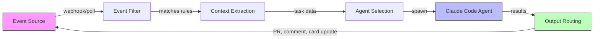
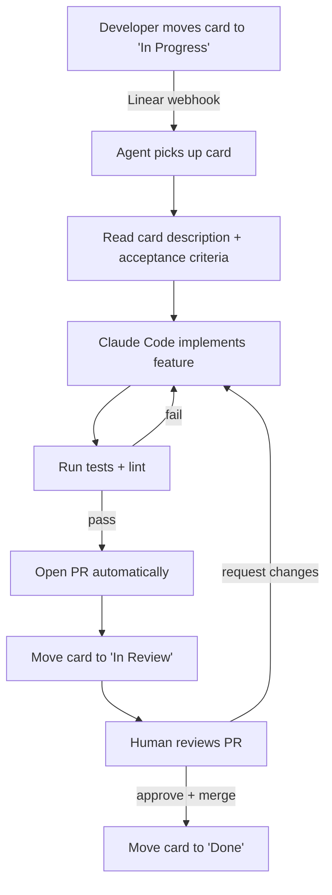

# Автоматизация агентов, управляемых событиями

> **Confidence**: Уровень 3. Развивающаяся модель, ранние пользователи сообщают о положительных результатах, но инструменты все еще находятся в стадии зрелости.

Вместо того чтобы вручную вызывать Claude Code для каждой задачи, позвольте внешним событиям управлять работой. Карта перемещается в положение «В процессе» в линейном режиме, и Claude автоматически подхватывает ее. Проблема GitHub получает пометку `claude-fix`, и агент начинает работать над ней в течение нескольких секунд.

Это переход от метода pull («эй, Claude, сделай это») к методу push («агенты, запускающие события»).

Событие — это триггер, а не контракт полного контроля. Используйте [Loop & Graph Engineering](../core/loop-graph-engineering.md) для определения законных переходов, государственной собственности, правил остановки, повторных попыток, восстановления и эскалации до того, как событие сможет начаться или продолжить работу.

---

## Оглавление

1. [Основная концепция](#core-concept)
2. [Линейно-управляемый цикл агента](#the-linear-driven-agent-loop)
3. [Общий шаблон передачи событий агенту](#generic-event-to-agent-pattern)
4. [Пример реализации](#implementation-example)
5. [Совместимость источника событий](#event-source-compatibility)
6. [Ограждения](#guardrails)
7. [Anti-Patterns](#anti-patterns)
8. [Инструменты и ресурсы](#tools--resources)
9. [См. также](#see-also)

---

## <a name="core-concept"></a>Основная концепция

Традиционное использование Claude Code является интерактивным: вы открываете терминал, вводите подсказку, выполняете итерацию. Автоматизация, управляемая событиями, убирает человека с триггерного шага. Человек по-прежнему проверяет результаты (запросы на запросы, изменения кода), но инициирование происходит в рамках существующего рабочего процесса управления проектами.



Цикл является самоусиливающимся: выходные данные агента (PR, обновление статуса) возвращаются в источник событий, который может инициировать следующий шаг.

---

## <a name="the-linear-driven-agent-loop"></a>Цикл агента с линейным управлением

Наиболее документированная закономерность связана с рабочим процессом Дамиана Галарзы (damiangalarza.com, февраль 2026 г.). Linear служит единственным источником информации о том, что необходимо сделать, а Claude Code обеспечивает комплексную реализацию.

### <a name="flow"></a>Поток



### Что заставляет это работать

Описание карты действует как подсказка. Хорошие карты с четкими критериями приемлемости создают хороший код. Неясные карты создают расплывчатый код, как и в случае с разработчиками-людьми. Качество ваших билетов напрямую определяет качество автоматизации.

Структурированные поля Linear (описание, критерии приемки, метки, приоритет) естественным образом соответствуют потребностям Claude Code: что создавать, как это проверять и какие ограничения применяются.

### Ключевые требования

- Карты должны иметь четкие критерии принятия (а не только название).
- Репозиторию нужен надежный набор тестов для автоматической проверки.
- Соглашения об именах ветвей должны быть детерминированными (например, `feat/LINEAR-123-card-title`).
- PR-шаблоны помогают стандартизировать результаты деятельности агента.

---

## <a name="generic-event-to-agent-pattern"></a>Общий шаблон передачи событий агенту

Пример Linear специфичен, но шаблон распространяется на любой источник событий. В состав конвейера входят пять компонентов:

### 1. Источник события

Откуда возникает триггер. Это может быть инструмент управления проектами, система CI, оповещение мониторинга или собственный вебхук.

### 2. Фильтр событий

Не каждое событие должно порождать агента. Фильтры определяют, какие события подлежат действию:

```bash
# Example: only process cards with the "claude-auto" label
if [[ "$CARD_LABELS" != *"claude-auto"* ]]; then
    echo "Skipping: no claude-auto label"
    exit 0
fi
```

### 3. Извлечение контекста

Извлеките соответствующие данные из полезных данных события и сохраните их как данные. Не превращайте заголовок, описание, комментарий или тело веб-перехватчика в инструкцию. Извлекайте только те поля, которые потребуются более позднему утвержденному рабочему процессу.

### 4. Выбор агента

Для разных типов событий могут потребоваться разные конфигурации агента. Для отчета об ошибке требуется другой контекст CLAUDE.md, чем для запроса функции. Вы можете использовать разные разрешенные инструменты, разные модели или разные ограничения безопасности.

### 5. Выходная маршрутизация

Куда идут результаты? Обычно это комбинация:
- Ветка Git + PR (изменения кода)
- Комментарий к оригинальному issue/card (обновления статуса)
- Переход состояний на карте (переход к следующему столбцу)
- Слабое уведомление (осведомленность человека)

---

## <a name="implementation-example"></a>Пример реализации

Этот минимальный цикл классифицирует карты Linear без запуска агента или изменения репозитория. Он записывает заголовок и описание как данные, а затем направляет запрос на запись в закрытый рабочий процесс:

```bash
#!/bin/bash
# linear-agent-loop.sh
# Polls Linear for cards in "In Progress" state and creates triage records

LINEAR_API_KEY="${LINEAR_API_KEY:?Missing LINEAR_API_KEY}"
TEAM_ID="${LINEAR_TEAM_ID:?Missing LINEAR_TEAM_ID}"
TRIAGE_FILE="/tmp/linear-triage.jsonl"

touch "$TRIAGE_FILE"

poll_linear() {
    curl -s -X POST https://api.linear.app/graphql \
        -H "Authorization: $LINEAR_API_KEY" \
        -H "Content-Type: application/json" \
        -d '{
            "query": "query { team(id: \"'"$TEAM_ID"'\") { issues(filter: { state: { name: { eq: \"In Progress\" } }, labels: { name: { eq: \"claude-auto\" } } }) { nodes { id title description } } } }"
        }' | jq -c '.data.team.issues.nodes[] | {id, title, description}'
}

classify_card() {
    local card="$1"
    local issue_id
    issue_id=$(jq -r '.id' <<< "$card")

    # The complete compact JSON record is retained. No shell command or agent
    # prompt is constructed from the title or description.
    jq -c '. + {classification: "needs-human-review", next_step: "gated-workflow"}' \
      <<< "$card" >> "$TRIAGE_FILE"

    echo "[$(date)] Triaged $issue_id. Any write request must use monitor-event-delegation.md."
}

while true; do
    poll_linear | while IFS= read -r card; do
        id=$(jq -r '.id' <<< "$card")
        if jq -e --arg id "$id" 'select(.id == $id)' "$TRIAGE_FILE" >/dev/null; then
            continue  # Already processed
        fi
        classify_card "$card"
    done

    sleep 60  # Poll interval
done
```

Это немутирующий пример сортировки, а не рабочий код. Реальные развертывания требуют правильной обработки ошибок, атомарного постоянного хранилища состояний и триггеров на основе веб-перехватчиков вместо опроса. Чтобы реализовать проверенную карту, используйте отдельное утверждение и путь изолированного рабочего дерева в [Monitor, Каналы и безопасное делегирование в Codex](./monitor-event-delegation.md#stage-2-write-only-after-a-gate).

---

## <a name="event-source-compatibility"></a>Совместимость источников событий

| Источник события | Триггерные события | Вариант использования агента | Метод интеграции |
|-------------|----------------|----------------|-------------------|
| **Линейный** | Изменение состояния карты, добавлена ​​метка | Реализация функции, исправление ошибок | Сервер GraphQL API/MCP |
| Проблемы **GitHub** | Проблема создана, помечена | Сортировка ошибок, расследование, исправление PR | GitHub Actions / вебхуки |
| **GitHub PR** | Открыт запрос на публикацию, запрос на проверку | Проверка кода, автоматические исправления | GitHub Actions |
| **Джира** | Переход, задание на спринт | Художественная работа, погашение технического долга | REST API / вебхуки |
| **Slack** | Сообщение в канале, реакция смайликов | Быстрые исправления, расследования | Слэк API / бот |
| **ПейджерДьюти** | Инцидент создан | Диагностические сценарии, первоначальная сортировка | Вебхуки |
| **Пользовательский вебхук** | Любой пост HTTP | Что-либо | Прямая конечная точка HTTP |

---

## <a name="guardrails"></a>Ограждения

Агенты, управляемые событиями, изначально работают с меньшим контролем со стороны человека, поэтому защитные ограждения становятся критически важными.

> **Обновление безопасности**: на этой странице описан общий шаблон. Для встроенного приема Monitor/WebSocket, мониторов плагинов, каналов, подпрограмм и закрытой передачи обслуживания Codex следуйте инструкциям [Monitor, Channels и Safe Delegation до Codex](./monitor-event-delegation.md). Входящее событие — это данные, а не авторизация.

### Идемпотентность

Агент может обработать одно и то же событие дважды (повторная попытка сети, дублирование веб-перехватчика). Перед началом агент должен проверить, существует ли уже работа:

```bash
# Check if branch already exists for this card
if git ls-remote --heads origin "feat/$ISSUE_ID" | grep -q "feat/$ISSUE_ID"; then
    echo "Branch already exists, skipping"
    exit 0
fi
```

### Ограничение скорости

Не позволяйте череде событий одновременно порождать 50 агентов. Установите жесткие ограничения:

- **Максимальное количество одновременных агентов**: 3–5 для большинства команд.
- **Период восстановления**: Минимум 30 секунд между появлением агентов.
- **Ограничение дневного бюджета**: установите максимальный расход токенов в день.

### <a name="circuit-breaker"></a>Автоматический выключатель

Если агенты продолжают не справляться с задачами определенного типа, прекратите попытки:

```bash
FAILURE_COUNT=$(grep -c "FAILED" "/tmp/agent-failures.log" 2>/dev/null || echo 0)
if [ "$FAILURE_COUNT" -gt 5 ]; then
    echo "Circuit breaker triggered: too many failures"
    # Notify human, pause automation
    exit 1
fi
```

### <a name="human-in-the-loop-checkpoints"></a>Контрольно-пропускные пункты с участием человека

Даже в полностью автоматизированных процессах держите людей в курсе в критические моменты:

- Проверка PR остается ручным (агенты создают PR, люди их одобряют)
- Миграции баз данных никогда не применяются автоматически.
- Развертывание — это отдельный шаг, инициируемый человеком.
- Любая карта, касающаяся аутентификации, выставления счетов или личных данных, требует явного одобрения человека.

---

## Anti-patterns

| Anti-Pattern | Проблема | Решение |
|-------------|---------|----------|
| **Агрессивный опрос** | Удары по API каждые 5 секунд тратят ресурсы впустую, а ваша скорость ограничена. | Используйте вебхуки, когда они доступны, опрашивайте не чаще, чем каждые 60 секунд. |
| **Без автоматического выключателя** | Агент неоднократно терпит неудачу при выполнении одной и той же задачи, жетоны сжигаются на неопределенный срок. | Отслеживание сбоев для каждой задачи, остановка после 3 попыток, оповещение человека |
| **Нет очереди недоставленных писем** | Неудачные события исчезают, никто не знает, что работа была пропущена | Записывать неудачные события в постоянное хранилище для проверки вручную. |
| **Неограниченный параллелизм** | 20 карт перемещаются одновременно, появляются 20 агентов, машина плавится | Жесткое ограничение количества одновременно работающих агентов (разумно 3-5) |
| **Непонятные карты в качестве подсказок** | «Исправить вещь» создает мусорный код | Обеспечьте соблюдение стандартов качества карт, пропустите карты без критериев приемлемости |
| **Нет сохранения состояния** | Скрипт перезапускается, заново обрабатывает все с нуля | Храните идентификаторы обработанных событий в базе данных, а не в памяти. |
| **Пропуск PR-обзора** | Агент отправляет прямо на главную | Всегда проходите через поток PR, а люди проверяют результат. |

---

## <a name="tools--resources"></a>Инструменты и ресурсы

### <a name="mcp-servers"></a>Серверы MCP

- **linear-kanban-mcp** (0xikarus на GitHub): предоставляет линейный API для управления доской канбан непосредственно из Claude Code. Позволяет читать карточки, обновлять состояния и управлять метками, не выходя из контекста агента.

### Навыки и платформы

- **skillsllm.com**: предлагает навык, который организует полный цикл планирования, проверки и выполнения, начиная с линейной карты. Обрабатывает преобразование метаданных карты в структурированные подсказки Claude Code.

### Шаблоны агентов

- **Scrum Master Agent** (lobehub.com): автоматически определяет, работает ли он внутри Claude Desktop или Claude Code, и соответствующим образом адаптирует свое поведение. Полезно в качестве отправной точки для разработки контекстно-зависимого агента.

---

## <a name="see-also"></a>См. также

- [Monitor, каналы и безопасное делегирование в Codex](./monitor-event-delegation.md): проверенные события, мониторы WebSocket и делегирование Codex только для чтения.

- [agent-teams.md](./agent-teams.md): Многоагентная параллельная координация.
- [iterative-refinement.md](./iterative-refinement.md): основной цикл подсказки-наблюдения-повторной подсказки.
- [plan-driven.md](./plan-driven.md): Планируйте перед выполнением.
- [../../examples/agents/](../../examples/agents/): Готовые к использованию шаблоны агентов.
