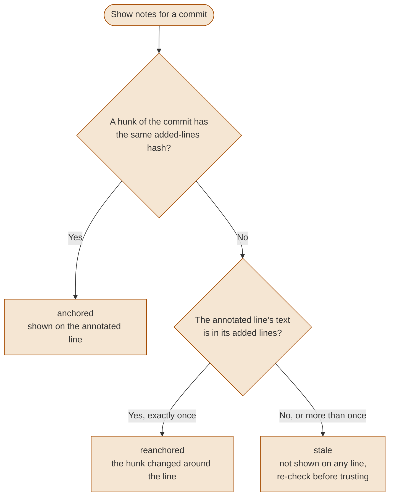
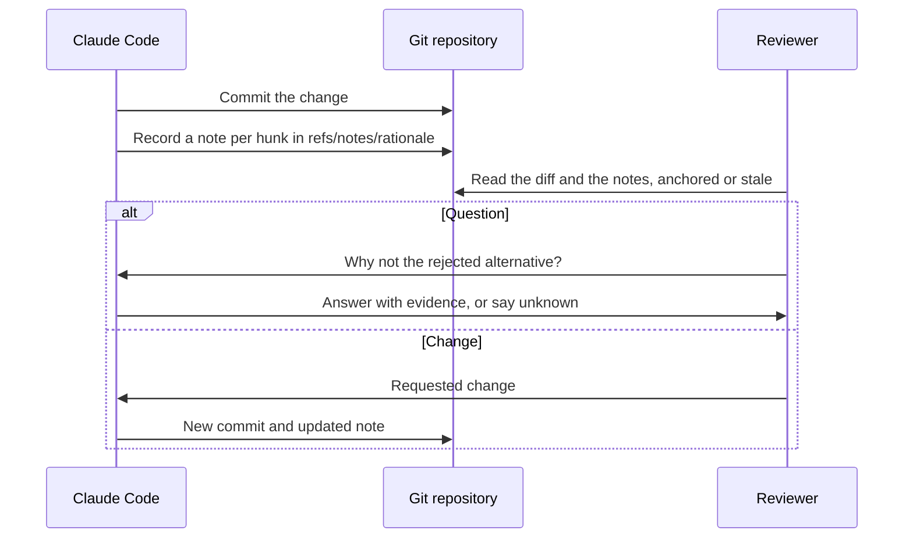

# Изменения агентов, подлежащие проверке: обоснование различий

> **Evidence border**: на этой странице предлагается практика и поставляется шаблон, поведение которого отслеживается собственными тестами. Ни одно исследование, процитированное здесь, не показывает, что обоснование различий повышает точность обзора; один контролируемый эксперимент показал, что объяснения сгенерированного кода не дали общей пользы. Относитесь к обоснованию агента как к требованию, которое рецензент должен проверить, а не как к доказательству.

У рецензента кода, написанного агентом, есть различия, но нет причин. У агента они были, пока он работал: для чего нужны изменения, что он решил не делать, что может сломаться. На этой странице описывается, как хранить эти причины рядом с фрагментом, который они объясняют, в репозитории и как определить, когда они больше не соответствуют коду.

---

## Оглавление

1. [Почему дифференциала недостаточно](#why-the-diff-is-not-enough)
2. [Что записывает в записке агента](#what-an-agent-note-records)
3. [Где живет заметка](#where-the-note-lives)
4. [Привязка и устаревшие примечания](#anchoring-and-stale-notes)
5. [Отзыв в виде вопроса или изменения](#feedback-typed-as-a-question-or-a-change)
6. [Шаблон обоснования агента](#the-agent-rationale-template)
7. [Что не установлено](#what-is-not-established)
8. [См. также](#see-also)

---

## <a name="why-the-diff-is-not-enough"></a>Почему дифференциала недостаточно

Джеффри Литт (Notion) [называет понимание узким местом](https://www.youtube.com/watch?v=WkBPX-oDMnA&t=73): «Агенты пишут для нас тонны кода». Практика Литта — это объяснение, которое агент пишет для каждого изменения, начиная с предыстории и заканчивая тестом, который автор должен пройти, прежде чем просить о проверке. В эссе Кунала [Resisting Cognitive Surrender](https://knlb.dev/essays/surrender) описывается пользовательское представление запроса на включение с различиями, комментарии агента о том, почему он внес каждое изменение, и столбец для рецензента. И то, и другое является индивидуальной практикой, а не измеряемым вмешательством. Они оцениваются в [трех докладах по рассмотрению изменений, написанных агентом](../../docs/resource-evaluations/reviewable-agent-changes-talks.md) и [Сопротивление когнитивному капитуляции](../../docs/resource-evaluations/knlb-cognitive-surrender.md).

Данные о объяснениях неоднозначны и должны определять то, как используется примечание:

- [Kaufman и др.](https://arxiv.org/abs/2607.08885) (препринт arXiv, июль 2026 г., 86 программистов Python, контролируемый эксперимент) обнаружили, что объяснения сгенерированных утверждений на естественном языке «не приносят общей пользы», а некачественные объяснения снижают точность, одновременно повышая уверенность.
- [Gao и др.](https://arxiv.org/abs/2607.24601) (появятся на ISSTA 2026, 34 участника, внутрисубъектное исследование проверок кода, созданных ИИ) обнаружили, что полные объяснения вызывают наибольшее воспринимаемое доверие, но не самое высокое согласие с ИИ, и что уровень объяснения существенно не влияет на время проверки.

Ни в одном из исследований не проверялись доводы агента помимо его собственных различий. То, что они поддерживают, более узкое: в этих исследованиях объяснения вызывали доверие или уверенность, и ни одно из них не показало лучшего выявления неправильных результатов. Примечание полезно, когда оно дает рецензенту возможность проверить: отвергнутую альтернативу, которую нужно взвесить, риск, который нужно проверить, доказательство, которое нужно перепроверить.

[Просмотр результатов работы машины — третий режим.](../roles/learning-with-ai.md#reviewing-machine-output-is-a-third-mode) охватывает предвзятость автоматизации и проверку утверждения, которая идет на этой странице.

---

## <a name="what-an-agent-note-records"></a>Что записывает в агентской записке

В этом руководстве предлагается пять полей на блок. Они основаны на сравнении того, что записывают существующие инструменты ([локальные поверхности обзора](./multi-provider-code-review.md#local-review-surfaces-for-agent-written-changes), [следы происхождения агентов](../../docs/resource-evaluations/agent-provenance-traces.md)), а не на исследовании того, какие поля помогают рецензентам.

| Поле | Что написать | Зачем это нужно рецензенту |
|---|---|---|
| Намерение | Для чего нужны изменения, в одном предложении | Разница показывает, что изменилось, а не почему (критерий[Гупты «почему, а не что»](https://www.youtube.com/watch?v=TJPInBjhE4Q&t=684)) |
| Отклоненная альтернатива | Вариант, который агент рассматривал, но не выбрал, и почему | Первый вопрос рецензента часто звучит так: «Почему не очевидный путь?» |
| Риск | Что это может сломать, для кого | Указывает на ту часть обзора, которую стоит читать медленно. |
| Доказательство | Тест, команда или вывод, поддерживающий изменение. | Что-то, что рецензент может повторить вместо того, чтобы доверять |
| Открытый вопрос | Что агент не смог решить | Превращает молчаливое предположение в вопрос рецензенту |

[](../images/agent-note-fields.webp)

*Предложение руководства, а не поля, подтвержденные исследованием. [Подсказки и запись выбора](../../docs/visual-prompts/reviewable-agent-changes.md).*

`unknown` — правильный ответ для каждого поля, кроме намерения. Агент, который пишет «неизвестно» в качестве доказательства, сообщает рецензенту больше, чем тот, кто придумывает название теста. [docket](../../docs/resource-evaluations/agent-provenance-traces.md#docket-35) помечает фрагменты с небольшим количеством доказательств как «нет доказательств» и упорядочивает фрагменты по шкале риска, включающей эту плотность.

Напишите заметку, пока причины все еще находятся в контексте агента, сразу после фиксации, а не восстанавливаются во время проверки. В glassbox есть примечания к записи агента с помощью `glassbox note add` (никакой хук не заставляет это делать), в diffo есть слои сообщений агента и комментарии через его CLI, а ai-pr-review записывает свое прохождение постфактум из разницы ([evaluation](../../docs/resource-evaluations/agent-review-surfaces.md)).

---

## <a name="where-the-note-lives"></a>Где живет заметка

| Хранилище | Пример | Видно в мерж-реквесте | Через изменение и перебазирование | Через сквош-слияние |
|---|---|---|---|---|
| Git-заметки | `refs/notes/rationale` (этот шаблон), `refs/notes/ai` (git-ai) | Нет, если только инструмент не опубликует это | Да, с комплектом `notes.rewriteRef` (проверено) | Нет для простых заметок (проверено); Демон git-ai переместил свою заметку (проверено) |
| Файл зафиксирован с помощью кода | SARIF под `.pr-notes/` (стеклянный ящик), коляска JSON, если вы его зафиксируете (красавчик) | Как измененный файл | Перемещается вместе с содержимым коммита | Хранится в сжатом содержимом; диапазоны строк могут больше не совпадать |
| Подделать комментарий | Обсуждение мерж-реквеста (их публикует дрейф) | Да | смещение отмечает, что резьба устарела при смене головки | Зависит от кузницы; не проверено |

[](../images/agent-note-storage.webp)

*Зеленые ячейки были протестированы в одном локальном репозитории; серые ячейки были прочитаны из источника. [Подсказки и запись выбора](../../docs/visual-prompts/reviewable-agent-changes.md).*

«Протестировано» относится к запускам [git-ai: атрибуция AI на уровне строк в git Notes](../../docs/resource-evaluations/git-ai-provenance-notes.md) и к собственным тестам шаблона: по одному локальному репозиторию, git 2.56.0. Строки на основе файлов и форжирования возникают в результате чтения исходного кода инструментов, а не в результате их запуска.

Заметки Git сохраняют историю кода в чистоте и не участвуют в различиях за счет дополнительных настроек: `git config notes.rewriteRef refs/notes/rationale` для изменения и перебазирования, а также явного `git push origin refs/notes/rationale`, поскольку при простом нажатии они не отправляются. Сжатие или перебазирование, выполняемое кнопкой слияния Forge, происходит на сервере и не тестировалось; см. [Provenance в примечаниях git](../ops/ai-traceability.md#35-provenance-in-git-notes).

Не помещайте в заметку секреты или данные о клиентах. Заметки отправляются вместе со ссылками на репозиторий, и любой, кто может их получить, может их прочитать.

---

## <a name="anchoring-and-stale-notes"></a>Привязка и устаревшие заметки

Примечание, записанное к строке 42, становится неверным, если кто-то добавляет строку над ней. Привязка по содержанию, а не по положению позволяет избежать этого. Шаблон сочетает в себе два подхода, считываемых в других инструментах: сначала хэш содержимого фрагмента (diffo хеширует фрагменты), затем текст аннотированной строки (стеклянный ящик повторно привязывается фрагментом) только тогда, когда этот текст уникален среди добавленных строк файла, затем ничего.



Результаты покрываются тестами шаблона: строки, добавленные над фрагментом, удерживают примечание на своей строке, редактирование в другом месте фрагмента повторно привязывает его, редактирование аннотированной строки помечает ее как устаревшую, а строка, текст которой появляется дважды, помечается как устаревшая, а не угаданная. Устаревшую заметку все равно стоит прочитать; он записывает то, что намеревался агент сделать до изменения кода.

---

## <a name="feedback-typed-as-a-question-or-a-change"></a>Отзыв в виде вопроса или изменения

Просмотрите обратную связь, которая возвращается агенту и требует тип. Без него агент рассматривает каждый комментарий как инструкцию. Райан Лопополо (OpenAI) [описывает предоставление авторскому агенту](https://www.youtube.com/watch?v=CeOXx-XTYek&t=972) «гибкости, позволяющей откладывать или противодействовать отзывам рецензентов», потому что «без контекста, что это допустимо, агенты кодирования будут склоняться к тому, что они делают, а именно к следованию инструкциям». diffo типизирует каждую ветку рецензента как «Изменение» или «Вопрос» с разными контрактами на ответы для каждой ([evaluation](../../docs/resource-evaluations/agent-review-surfaces.md)).



Вопрос требует от агента объяснений и может закончиться без изменения кода. Запрошенное изменение требует новой фиксации, и агент записывает для нее новую заметку. Шаблон записывает заметки; он не несет обратной связи. Сохраняйте тип в любом канале, который использует обзор: префикс в комментарии forge или инструмент, который печатает темы.

---

## <a name="the-agent-rationale-template"></a>Шаблон агентского обоснования

[`examples/skills/agent-rationale/`](../../examples/skills/agent-rationale/) — это навык Claude Code со сценарием Python из стандартной библиотеки (3.9 или новее):

```bash
# After committing, from the repository root
python3 -I .claude/skills/agent-rationale/scripts/rationale.py add --file src/cart.py --line 42 \
  --intent "Sum prices, not item objects" \
  --rejected "Give Item an __add__ method" \
  --risk "Items without a price attribute now raise AttributeError" \
  --evidence "tests/test_cart.py::test_total_uses_price" \
  --open-question "unknown"

python3 -I .claude/skills/agent-rationale/scripts/rationale.py show
```

Его 15 тестов запускаются в одноразовых репозиториях и охватывают поведение, на которое опирается эта страница: заметка записывается со всеми пятью полями, строка за пределами изменений коммита отклоняется, заметка следует за изменением и перебазированием с помощью `notes.rewriteRef` и теряется при изменении без него, привязка отчетов привязана, повторно привязана или устарела, как показано выше, а также крайние случаи (строка, начинающаяся с `++`, перевод формы внутри строки, дублирующиеся строки, не записанная заметка по сценарию путь, заданный из подкаталога), ведут себя так, как описано в документации.

```bash
python3 -I examples/skills/agent-rationale/scripts/test_rationale.py
```

Тесты были написаны до написания кода, который они покрывают, и они провалились первыми; преднамеренные мутации анализатора и кода привязки привели к провалу ожидаемого теста. Безголовый сеанс Claude Code (`claude -p`, Claude Code 2.1.319) с использованием навыка в одноразовом хранилище 8 ноября 2026 года записал примечание в правой строке и написал `unknown` для отклоненной альтернативы, доказательств и открытого вопроса, которые ничто в этом хранилище не поддержало. В этом запуске использовался шаблон в том виде, в котором он был впервые зафиксирован; текущий скрипт читает свою заметку как закрепленную. Одна сессия с одним коммитом показывает, что навыку можно следовать, а не то, насколько хорошо заметки помогают рецензентам.

---

## <a name="what-is-not-established"></a>Что не установлено

- Что обоснование различий улучшает обнаружение дефектов, время проверки или понимание. На этой странице не найдено ни одного исследования, проверявшего ее на различиях, написанных агентом.
- Что пять полей являются правильными. Это предложение данного руководства.
- Как ведут себя заметки при нажатии кнопки слияния в Forge, при выборе вишни или когда несколько агентов аннотируют один и тот же коммит.
- Что обоснование агента верно. Его пишет тот же агент, код которого находится на рассмотрении.

---

## <a name="see-also"></a>См. также

- [Проверка кода с участием нескольких поставщиков: локальные поверхности проверки](./multi-provider-code-review.md#local-review-surfaces-for-agent-written-changes): diffo, glassbox, hunk, Drift, ai-pr-review, сравнение управляемого обзора
- [Провенанс в git Notes](../ops/ai-traceability.md#35-provenance-in-git-notes): git-ai, AgentNote и Docket, а также то, что выдерживает переписывание
- [Утверждайте только то, что можете объяснить](../diagrams/10-adoption-and-learning.md#approve-only-what-you-can-explain): проверка перед утверждением вывода агента
- [Три места, где объясняется смена агента](../diagrams/06-development-workflows.md#three-places-an-agent-change-gets-explained)
