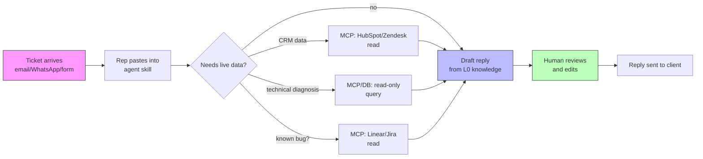

# Служба поддержки и агент CSM: внутренняя сортировка заявок и диагностика учетной записи.

> **Confidence**: Уровень 3 (развивающаяся модель). На ранней стадии внедрения сообщается о положительных результатах, но уровни зрелости, выходящие за пределы L2, практически не документированы.

Коммерческий рынок агентов поддержки ИИ (Decagon, Intercom Fin, Ada) нацелен на одну конкретную задачу: отвечать клиенту напрямую и отклонять заявки до того, как их увидит человек. Это не то, что охватывает этот шаблон.

На этой странице описана другая, дополнительная цель: агент **internal** Claude Code, который находится рядом со службой поддержки или командой CSM, а не перед клиентом. Агент читает заявку, составляет ответ голосом команды и, подключившись к нужным серверам MCP, проверяет CRM и базу данных продуктов, прежде чем ответить, вместо того, чтобы человек выполнял эту рутинную работу вручную. Клиент никогда не разговаривает с ним напрямую; человек всегда отправляет последнее сообщение.

Инструменты отклонения в сторону покупки и этот паттерн не являются конкурентами. Команда может запускать Intercom Fin или Decagon на стороне клиента, одновременно запуская внутреннего агента Claude для своих собственных представителей службы поддержки. Внутренний агент также является более дешевым и быстрым решением, поскольку для него не требуется ни контракт с поставщиком, ни новый инструмент для обучения команды, и он работает на лицензиях Claude Code, которые часто уже есть у команды, граничащей с разработчиками.

---

## Оглавление

1. [Основная концепция](#core-concept)
2. [Модель зрелости](#maturity-model)
3. [Flow](#flow)
4. [MCP Серверы для этого шаблона](#mcp-servers-for-this-pattern)
5. [Развитие навыка L0](#building-the-l0-skill)
6. [Безопасность и ограждения](#security--guardrails)
7. [Метрики для отслеживания](#metrics-to-track)
8. [Anti-Patterns](#anti-patterns)
9. [Инструменты и ресурсы](#tools--resources)
10. [См. также](#see-also)

---

## <a name="core-concept"></a>Основная концепция

Сохраняйте четкие границы с первого дня: это модель помощи агенту, а не автономный чат-бот, работающий с клиентом. Это различие важно по двум причинам.

Во-первых, сфера доверия. Человек просматривает и отправляет каждый ответ. Доступ к данным требует отдельного контроля: учетные данные только для чтения для уровней L1–L3, авторизация запрашивающего пользователя и ограниченные запросы. Просмотр черновика не может предотвратить несанкционированное чтение, дорогостоящий запрос или раскрытие модели до этого рассмотрения.

Во-вторых, инструментарий. Чат-боту, работающему с клиентом, необходим канал (веб-виджет, WhatsApp, почтовый ящик), обработка сеанса и модерация контента, что является территорией агента Claude SDK или API, а не Claude Code CLI. Внутренний инструмент помощи агенту — это навык Claude Code или небольшой сценарий, который представитель службы поддержки запускает на основе заявки. Гораздо меньше строить, гораздо быстрее доставлять.

---

### <a name="brevo-explicit-procedures-before-open-ended-routing"></a>Брево: явные процедуры перед открытой маршрутизацией

В своем отчете GenAI Days от 19 ноября 2026 года Эммануэль Скиара сообщает, что Чарли Идрак описывает замену Брево трудно отлаживаемой агентной системы на процедуры поддержки кодирования дерева решений. LLM вмешиваются в выбранные узлы, и прямой вызов API извлекает данные билета. Известный поиск может быть фиксированной операцией, а не другим модельным решением. MCP сам по себе не делает вызов вероятностным, а фиксированная оркестровка не делает выходные данные LLM детерминированными.

Скиара также описывает отдельный проект, в котором сотрудники службы поддержки создают свои собственные инструменты с помощью агента кодирования в Slack. Держите эту деятельность отдельно от автономных ответов клиентов и внутреннего помощника по составлению документов на этой странице. Этот отчет не является контролируемым сравнением производительности. Прежде чем переносить паттерн или сообщаемые о нем результаты, ознакомьтесь с оценкой источника [](../../docs/resource-evaluations/genai-days-nantes-sciara.md).

## <a name="maturity-model"></a>Модель зрелости

Шесть уровней, каждый из которых можно построить независимо. Большинство команд получают реальную выгоду к L1 или L2 и останавливаются на этом на месяцы, прежде чем двигаться дальше; нет необходимости достигать уровня L5.

### L0: Составление ответа, внешний доступ отсутствует.

Навык принимает необработанный текст заявки (скопированное электронное письмо, сообщение WhatsApp, отправка формы) и создает черновой вариант ответа: диагностические вопросы, если заявка недостаточно определена, или полный ответ, если случай соответствует известному шаблону, задокументированному в навыке. Никаких звонков API, никаких данных в реальном времени, только тон голоса команды и каталог повторяющихся случаев, встроенный в подсказку.

Ценность на этом уровне: более быстрое рисование, последовательный тон и бесплатный пас spelling/grammar. Поставляется через несколько часов, поскольку для этого не требуется никаких новых прав доступа.

### L1: доступ для чтения CRM через MCP

Агент подключается к HubSpot или Zendesk (см. серверы [MCP](#mcp-servers-for-this-pattern) ниже) и может отвечать на такие вопросы, как «какой план у этого клиента», «когда был его последний билет» или «этот контакт уже помечен как риск оттока» без вкладок переключения представителей. Требуется ключ API или грант OAuth, доступный только для чтения, если поставщик поддерживает его.

### <a name="l2-read-only-database-access-for-technical-diagnosis"></a>L2: Доступ к базе данных только для чтения для технической диагностики.

Это уровень, который превращает чертежный инструмент в диагностический. Агент получает учетные данные только для чтения в базе данных продукта (или, лучше, реплику) и может ответить «почему клиент X не может получить доступ к своему сеансу», проверив состояние учетной записи, статус платежа или флаги функций напрямую, вместо того, чтобы переходить к разработке для пятиминутного поиска.

Это также уровень с наибольшим трением одобрения. Ему требуется разрешение от того, кто владеет доступом к данным, и по умолчанию он должен **прочитать реплику**, никогда не является основным соединением, независимо от того, как грант «только для чтения» выглядит на бумаге.

### L3: интеграция системы отслеживания проблем для информирования об известных ошибках.

Подключите агент к Linear или Jira (только для чтения), чтобы он мог распознавать, когда заявка клиента соответствует уже известной, уже проверенной ошибке, и отвечать: «Это известная проблема, исправление запланировано на [дата]» вместо повторной эскалации дубликата. См. [event-driven-agents.md](./event-driven-agents.md) для обратного направления этой интеграции: агент, который превращает сигналы поддержки в заявки отслеживания.

### L4: Контекстуальные знания product/partner

Многие продукты B2B интегрируются со сторонними системами (ERP, платежными системами, поставщиками единого входа), каждая из которых имеет свои особенности. Добавляйте любую документацию, существующую по интеграции (PDF-файлы, документы API, внутренние заметки), в базу знаний, которую агент загружает автоматически, когда в заявке упоминается эта интеграция по имени.

### L5: Брифинг CSM перед звонком

Перед звонком по удержанию или дополнительным продажам агент собирает данные об использовании продукта, историю заявок и заметки CRM в одностраничное краткое описание того, что использует учетная запись, а что нет, недавние сигналы разногласий и углы дополнительных продаж. Это шаг, который превращает 20–30 минут ручной подготовки в нечто готовое еще до того, как CSM откроет свой ноутбук. Ему необходимы уже существующие уровни L1 (CRM) и L2 (DB), а также процессы CSM, достаточно хорошо задокументированные, чтобы знать, что означают «сигнал использования» и «сигнал трения» для вашего продукта.

**Явно выходит за рамки этого шаблона.**: чат-боты, ориентированные на клиента, и инструменты call-coaching/transcription (анализ продаж или звонков CSM для обеспечения качества отслеживания разговоров). Оба являются реальными и ценными инвестициями, но они либо являются продуктами для покупателя (см. введение), либо построены на другой инфраструктуре (конвейеры telephony/recording), чем навык Claude Code.

---

### <a name="connect-documentation-code-and-live-data-without-merging-their-authority"></a>Подключите документацию, код и живые данные, не объединяя их полномочия.

База знаний компании может направить сложный вопрос к документации продукта, соответствующему коду и ограниченному поиску данных. Сохраняйте эти источники отдельными: документация описывает предполагаемое поведение, код показывает реализацию в последней редакции, а запрос отслеживает данные в определенное время. Прежде чем рассматривать поведение хранилища как поведение производства, подтвердите, какая версия кода развернута.

Например, выясните, почему учетная запись не может получить доступ к функции, получив ее документированное правило приемлемости, проверив соответствующий код авторизации в развернутой версии и используя разрешенный поиск состояния этой учетной записи. Укажите версию документа, версию кода и время запроса. Поверхностные разногласия и задержка реплик там, где это уместно, вместо молчаливого выбора одного источника в качестве истины.

Обеспечьте соблюдение разрешений на организацию, учетную запись и поля запрашивающего пользователя в инструменте или службе для каждого поиска и примените разрешения на доступ к хранилищу перед получением кода. Роль базы данных, доступная только для чтения, не устанавливает авторизацию клиента или поля. Предпочитайте параметризованные диагностические операции, ограниченные результаты и тайм-ауты запросов, а записи аудита будут защищены так же, как и базовые данные. Не допускайте попадания секретов и несвязанных личных данных в полученный код и ответы. Человеческий анализ остается проверкой результатов наряду с этими средствами контроля доступа.

Оцените это расширение по репрезентативным вопросам с известными ответами, включая отказ в поиске между учетными записями, устаревшую документацию и разногласия между кодом и данными. Сохраняйте правильность ответов, отслеживаемость источников, воздержание и усилия по технической эскалации, прежде чем требовать лучшего диагноза. [Контекст за пределами репозитория](../core/agent-harness.md#context-beyond-the-repository) описывает компромиссы относительно свежести.

## <a name="flow"></a>Поток



Для этого рабочего процесса требуется этап проверки человеком (H) до того, как ответ достигнет клиента. Для доступа к данным уровня L2 также требуются учетные данные, авторизация и средства управления запросами, описанные выше, независимо от качества черновика.

---

## <a name="mcp-servers-for-this-pattern"></a>Серверы MCP для этого паттерна

Ни один из приведенных ниже серверов не опубликован самими Anthropic, HubSpot или Zendesk. Относитесь к ним как к инструментам сообщества и повторно проверяйте статус обслуживания, прежде чем использовать один из них в производстве. В официальном реестре MCP (`registry.modelcontextprotocol.io`) есть несколько самостоятельно опубликованных записей HubSpot/Zendesk, но наличие в реестре просто означает, что кто-то отправил их, а не то, что поставщик их одобряет; полное обоснование см. в разделе [Поддержка клиентов и CRM](../ecosystem/mcp-servers-ecosystem.md#customer-support--crm). Выбранные здесь серверы были выбраны по количеству звезд GitHub и давности фиксации.

| Система | Сервер | Покрытие | Примечания |
|--------|--------|----------|-------|
| **HubSpot** | [`shinzo-labs/hubspot-mcp`](https://github.com/shinzo-labs/hubspot-mcp) | Контакты, компании, потенциальные клиенты, сделки, продукты, обязательства, пакетные операции, ассоциации (read/write) | Самый широкий объектный охват серверов сообщества, помеченные релизы |
| **HubSpot** | [`baryhuang/mcp-hubspot`](https://github.com/baryhuang/mcp-hubspot) | Контакты, компании (read/write), поиск разговоров, семантический поиск по кэшированным данным | Наибольшее количество звезд; ранее `peakmojo/mcp-hubspot` (старые перенаправления URL) |
| **Zendesk** | [`reminia/zendesk-mcp-server`](https://github.com/reminia/zendesk-mcp-server) | Заявки, комментарии, статьи Справочного центра | Наиболее активно поддерживаемый вариант сообщества Zendesk. |
| **Линейный** | Линейное MCP | Проблемы, проекты, комментарии, циклы | Уже задокументировано в [mcp-servers-ecosystem.md](../ecosystem/mcp-servers-ecosystem.md#linear-mcp); повторно использовать эту настройку для L3 |

Для базы данных продуктов (L2) не существует общего сервера MCP, на который можно было бы указать, поскольку он полностью зависит от вашей схемы и стека. Распространенным подходом является небольшой специальный сервер MCP (или даже тонкая оболочка REST только для чтения), предоставляющий несколько предварительно написанных параметризованных запросов, а не доступ к необработанному SQL, поэтому агент не может создать произвольный запрос к производственным данным.

---

## <a name="building-the-l0-skill"></a>Развитие навыка L0

Минимальная структура навыков, достаточно общая, чтобы адаптироваться к тону любой команды и каталогу случаев:

```markdown
---
name: agent-support
description: Drafts support ticket replies in the team's voice, using known recurring cases
---

# Support Reply Drafting

You draft replies to support tickets. You do not send anything: your output
is always reviewed by a human before it reaches the client.

## Process

1. Read the pasted ticket content (email, WhatsApp message, or form text).
2. Check it against the recurring cases below. If it matches one, draft a
   reply using that resolution.
3. If it doesn't match a known case, ask up to 3 diagnostic questions before
   drafting. Do not guess at a technical explanation you can't verify.
4. Match the tone: [team's tone-of-voice notes, e.g. direct, warm, no jargon]
5. Flag anything touching billing, data deletion, or security for escalation
   instead of drafting a reply.

## Recurring Cases

[Team fills this in from their own ticket history. This is the highest-value
part of the skill, and the one a generic template cannot write for you.]
```

В разделе повторяющихся случаев находится большая часть стоимости, и она должна поступать из экспорта реальных билетов за последние 30–90 дней, сгруппированных по категориям. После добавления доступа к L1/L2 инструкции по навыку распространяются на вызов соответствующих инструментов MCP вместо того, чтобы просить представителя искать информацию вручную.

---

## <a name="security--guardrails"></a>Безопасность и ограждения

- **Только чтение, всегда, для L1–L3.** На этих уровнях нет доступа на запись к CRM, базе данных или системе отслеживания проблем. Если агенту необходимо *обновить* статус заявки или поле CRM, это обдуманное, отдельное решение с собственной проверкой, а не по умолчанию.
- Доступ к **DB через реплику, а не через первичную копию.** См. [L2](#l2-read-only-database-access-for-technical-diagnosis) выше. Реплика ограничивает радиус действия неправильного запроса непроизводственной системой.
- **Наименьшие привилегии для ключей API.** Определите учетные данные HubSpot, Zendesk или Linear до минимального количества типов объектов, которые действительно необходимы навыку; большинство этих платформ поддерживают детальные области действия.
- Обработка **PII.** Содержимое заявки и данные CRM содержат PII. Следуйте правилам обработки данных, описанным в [data-privacy.md](../security/data-privacy.md), и, в частности, не допускайте попадания черновиков ответов или диагностических данных в журналы или стенограммы сеансов, которые сохраняются после заявки.
- **Проверка человеком перед отправкой.** Каждый уровень в этом шаблоне предполагает, что человек читает выходные данные до того, как они достигнут клиента. Сохраняйте элементы управления доступом на границах инструмента и не связывайте черновик агента напрямую с действием автоматической отправки.

---

## <a name="metrics-to-track"></a>Метрики для отслеживания

Этот шаблон не дает «скорости отклонения», поскольку не отклоняется поверхность, обращенная к клиенту. Важными показателями являются производительность и качество внутренней команды, а не объемы, которых следует избегать:

- **Расстояние редактирования черновика до отправки**: насколько представитель меняет черновик перед отправкой. Сокращение расстояния редактирования с течением времени является самым ярким сигналом того, что каталог кейсов по навыку действительно улучшается.
- **Время до первого ответа**: с момента поступления заявки до отправки ответа. См. [team-metrics.md](../ops/team-metrics.md), чтобы узнать, как отслеживать это наряду с другими показателями пропускной способности команды.
- **Скорость эскалации до инженерного отдела**: должна снизиться, как только будет установлен уровень L2 (диагностика БД), поскольку часть эскалации существует только для того, чтобы получить поиск данных, который человек не может выполнить самостоятельно.
- **Время подготовки CSM** (после достижения уровня L5): время от «вызов в календаре» до «CSM имеет то, что им нужно», по сравнению с базовым уровнем, заданным вручную.

---

## Anti-patterns

| Anti-Pattern | Проблема | Решение |
|-------------|---------|----------|
| **Переходим сразу к L2 для демонстрации** | Одобрение доступа к данным занимает несколько недель; команда, которая ждет этого, прежде чем что-либо отправить, тем временем получает нулевую ценность | Сначала отправьте L0, так как он не требует нового доступа и при этом экономит время на разработку. |
| **Автоотправка черновиков** | Обходит необходимую проверку до того, как ответ достигнет клиента | В этом рабочем процессе необходимо выполнять этап проверки человеком каждого ответа. |
| **DB доступ через первичное соединение** | Неправильный запрос или неконтролируемый цикл агента могут ухудшить производительность. | Всегда указывайте на реплику чтения |
| **Общий каталог корпусов, скопированный из шаблона** | Реальные повторяющиеся случаи команды специфичны для их продукта; общий список создает общие, бесполезные черновики | Создайте каталог дел L0 на основе реального экспорта билетов команды за последние 30–90 дней. |
| **Относиться к этому как к проекту чат-бота** | Объединяет внутреннюю помощь агента (навык Claude Code) с отклонением от работы с клиентом (SDK/API и оценка поставщика) | Решите, какой из них вы создаете, прежде чем определять объем работы, см. [Основная концепция](#core-concept). |
| **Нет флага эскалации для деликатных категорий** | Споры по счетам, запросы на удаление данных и отчеты о безопасности с самого начала требуют участия человека, а не ответа, составленного ИИ. | Включите явное правило эскалации в навык L0 для этих категорий. |

---

## <a name="tools--resources"></a>Инструменты и ресурсы

### <a name="mcp-servers"></a>Серверы MCP

- [`shinzo-labs/hubspot-mcp`](https://github.com/shinzo-labs/hubspot-mcp): самый широкий охват объектов HubSpot среди серверов сообщества.
- [`baryhuang/mcp-hubspot`](https://github.com/baryhuang/mcp-hubspot): сервер HubSpot с наибольшим распространением (ранее `peakmojo/mcp-hubspot`)
- [`reminia/zendesk-mcp-server`](https://github.com/reminia/zendesk-mcp-server): заявки, комментарии, статьи Справочного центра
- [Linear MCP](../ecosystem/mcp-servers-ecosystem.md#linear-mcp): уже задокументировано, повторное использование для L3

### Связанное чтение

- [MCP Экосистема серверов](../ecosystem/mcp-servers-ecosystem.md): система оценки, применимая к любому новому серверу перед внедрением
- [MCP против CLI Руководство по принятию решений](../ecosystem/mcp-vs-cli.md): должна ли данная интеграция быть сервером MCP или более простым CLI/script

---

## <a name="see-also"></a>См. также

- [event-driven-agents.md](./event-driven-agents.md): запускать обновления трекера по сигналам поддержки, обратное направление интеграции.
- [mcp-servers-ecosystem.md](../ecosystem/mcp-servers-ecosystem.md): структура оценки и настройка линейного MCP
- [data-privacy.md](../security/data-privacy.md): методы обработки личных данных, упомянутые в [Security & Guardrails](#security--guardrails)
- [team-metrics.md](../ops/team-metrics.md): метрики пропускной способности, указанные в [Metrics to Track](#metrics-to-track)
